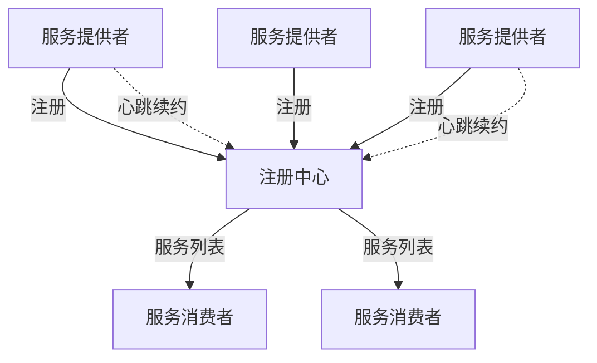
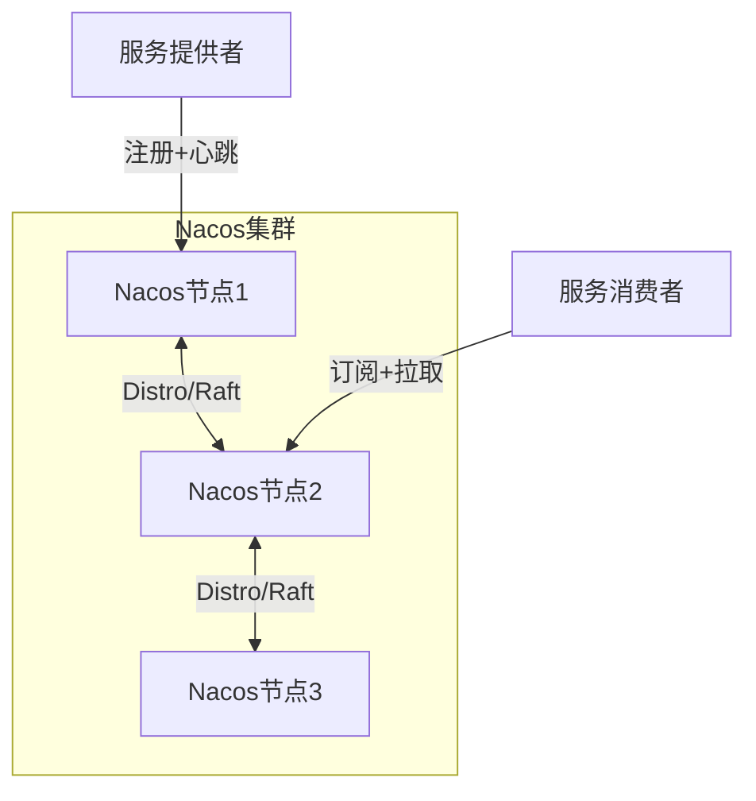
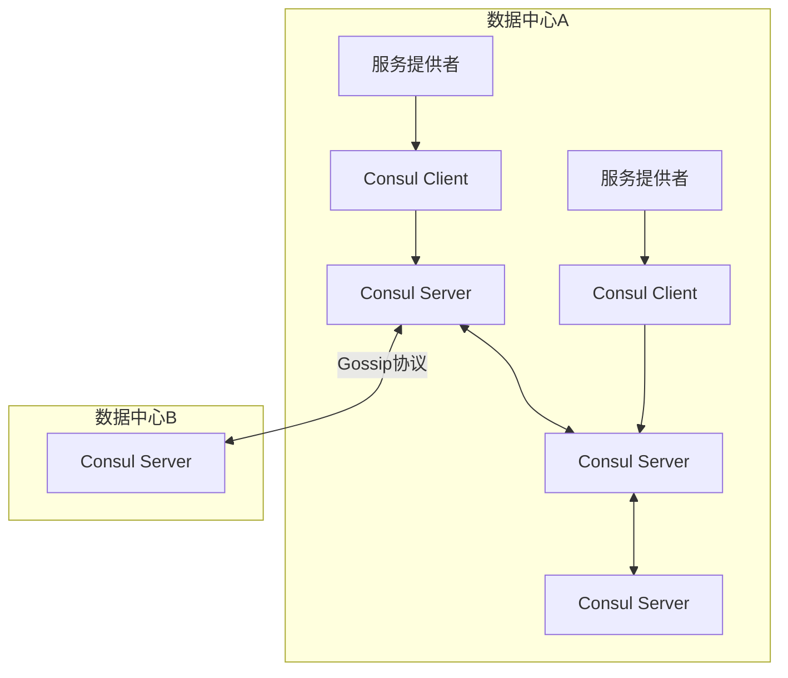

# 📋 注册中心对比与选型

> **文档说明**：注册中心是微服务架构的核心组件，负责服务注册与发现。本文档系统对比 Nacos、Eureka、Consul、ZooKeeper 四大注册中心的架构原理、CAP 特性、健康检查机制、配置集成、高级特性与选型建议，涵盖注册中心核心职责（服务注册 / 服务发现 / 健康检查 / 服务订阅 / 元数据管理）、四大注册中心综合对比表、CAP 深度分析、Nacos 详解（架构 / 临时实例与持久实例 / Distro 协议 / 服务分组与命名空间 / 权重路由 / 保护阈值 / 集成配置 / 灰度发布）、Eureka 详解（Peer 对等架构 / 自我保护机制 / 维护状态 / 迁移建议）、Consul 详解（Agent 模式 / Server-Client 架构 / Raft 协议 / 多数据中心 Gossip / 五种健康检查 / KV 存储 / 集成配置）、ZooKeeper 详解（临时节点原理 / Watcher 机制 / 服务发现实现 / 集成配置 / 优缺点）、健康检查方式对比、选型决策树与场景推荐、生产最佳实践（集群部署 / 客户端缓存 / 优雅上下线 / 监控告警 / 权限控制 / 容灾预案）、常见问题排查（服务注册失败 / 服务列表不更新 / 健康检查误剔除 / 注册中心脑裂 / 性能瓶颈）、与 K8s Service 的对比、知识点深度解析（作用 / 底层原理 / 用法要点三维度）。
>
> **适用人群**：后端工程师、架构师、微服务实践者
>
> **前置知识**：[[微服务核心组件知识点系统梳理_优化版]] · [[Raft共识算法详解]] · [[ZooKeeper核心原理与实战]]

---

## 一、注册中心核心职责



| 职责 | 说明 |
|------|------|
| **服务注册** | 服务启动时注册自己的地址和元数据（IP、端口、版本、权重等） |
| **服务发现** | 消费者获取服务提供者的地址列表，用于负载均衡调用 |
| **健康检查** | 检测服务提供者是否存活，自动剔除不健康实例 |
| **服务订阅** | 消费者订阅服务变更，实时获取最新列表（推送 + 拉取） |
| **元数据管理** | 管理服务版本、权重、分组、环境等元数据，支持灰度和路由 |

---

## 二、四大注册中心对比

### 2.1 综合对比

| 维度 | Nacos | Eureka | Consul | ZooKeeper |
|------|-------|--------|--------|-----------|
| **CAP** | AP/CP 可切换 | AP | CP | CP |
| **健康检查** | 客户端心跳 + TCP/HTTP | 客户端心跳 | Agent + TCP/HTTP/Script | 临时节点 + 会话 |
| **配置中心** | 支持（一体化） | 不支持 | 支持（KV 存储） | 支持（ZK 节点） |
| **多数据中心** | 支持 | 不支持 | 原生支持 | 不支持 |
| **管理界面** | 丰富 | 简单 | 一般 | 无（需第三方） |
| **一致性协议** | Raft / Distro | 无（Peer 复制） | Raft | ZAB |
| **性能** | 高 | 高 | 中 | 中 |
| **社区活跃度** | 高（国内主流） | 低（停止维护） | 中 | 高（老牌） |
| **Spring Cloud 集成** | 原生 | 原生 | 原生 | 需第三方 |
| **开发语言** | Java | Java | Go | Java |
| **最新版本** | 2.x 活跃 | 1.x 维护模式 | 1.x 活跃 | 3.x 活跃 |
| **负载均衡** | 内置（权重/元数据） | 客户端（Ribbon） | 客户端（Fabio/nginx） | 客户端（自行实现） |

### 2.2 CAP 分析

```text
Nacos：
  - 临时实例（AP）：Distro 协议，最终一致，可用性优先
  - 持久实例（CP）：Raft 协议，强一致
  - 可按实例类型切换，灵活度最高

Eureka：
  - AP 架构，Peer 对等复制
  - 网络分区时保留所有实例（包括可能不健康的）
  - 自我保护机制：15 分钟内 85% 实例心跳异常则停止剔除

Consul：
  - CP 架构，Raft 协议
  - 强一致，注册信息实时同步
  - 网络分区时无法注册新服务，但已注册服务仍可发现

ZooKeeper：
  - CP 架构，ZAB 协议
  - 临时节点：会话断开自动删除
  - 网络分区时不可用（需重新选举 Leader）
```

**CAP 选择建议**：
- **AP 优先**：服务发现场景，短暂的不一致可以接受（客户端有缓存），优先保证可用性 → Nacos(临时) / Eureka
- **CP 优先**：需要强一致的服务元数据、配置信息 → Nacos(持久) / Consul / ZooKeeper

---

## 三、Nacos 注册中心

### 3.1 架构



### 3.2 核心特性

- **临时实例（AP）**：客户端心跳续约，超时自动剔除，Distro 协议同步
- **持久实例（CP）**：服务端主动健康检查，Raft 协议强一致
- **服务分组**：Group 分组，不同组服务隔离
- **命名空间**：Namespace 环境隔离（dev/test/prod）
- **权重路由**：实例权重配置，支持灰度发布
- **保护阈值**：健康实例比例低于阈值时，返回所有实例避免流量雪崩
- **同机房优先**：基于元数据的就近访问，减少跨机房延迟
- **优雅上下线**：支持手动上下线，流量平滑过渡

### 3.3 Distro 协议原理

Distro 是 Nacos 自研的 AP 一致性协议，用于临时实例数据同步：

1. **写本地**：写请求先写本地节点，立即返回成功
2. **异步同步**：异步将写操作同步到其他节点
3. **冲突处理**：以最后写入为准（LWW），短暂不一致可接受
4. **数据校验**：定期全量校验，修复不一致数据

> Distro 协议保证了注册中心的高可用——即使部分节点宕机，其他节点仍能正常提供服务注册和发现。

### 3.4 保护阈值

保护阈值是 Nacos 的重要容灾机制：

```text
当健康实例比例 < 保护阈值（默认0.5）时：
  → Nacos 不再剔除不健康实例
  → 返回所有实例（包括不健康的）给消费者
  → 避免因少量健康实例承载全部流量导致雪崩
```

**适用场景**：大面积网络抖动、机房故障时，防止流量集中到少数健康实例导致压垮。

### 3.5 集成配置

```yaml
spring:
  cloud:
    nacos:
      discovery:
        server-addr: nacos1:8848,nacos2:8848,nacos3:8848
        namespace: dev-namespace          # 命名空间（环境隔离）
        group: DEFAULT_GROUP               # 分组
        service: order-service             # 服务名
        weight: 1                           # 权重
        metadata:
          version: v1                       # 版本（灰度用）
          region: shanghai                  # 机房（就近访问用）
        heart-beat-interval: 5000          # 心跳间隔5秒
        heart-beat-timeout: 15000          # 心跳超时15秒
        ip-delete-timeout: 30000           # IP删除超时30秒
        naming-load-cache-at-start: true   # 启动时加载本地缓存
```

### 3.6 灰度发布实现

基于 Nacos 元数据 + 权重实现灰度发布：

```java
// 1. 服务提供者注册时设置版本元数据
@PostConstruct
public void init() {
    registration.getMetadata().put("version", "v2");
}

// 2. 消费者自定义负载均衡规则，按版本路由
public class VersionLoadBalancer implements ReactorServiceInstanceLoadBalancer {
    public Mono<Response<ServiceInstance>> choose(Request request) {
        // 从请求头获取目标版本
        String targetVersion = RequestContext.getHeader("X-Version");
        // 筛选匹配版本的实例
        return instances.stream()
            .filter(i -> targetVersion.equals(i.getMetadata().get("version")))
            .findFirst()
            .map(i -> Mono.just((Response<ServiceInstance>) new DefaultResponse(i)))
            .orElseGet(() -> fallback());
    }
}

// 3. 权重灰度：v2 实例权重设为 0.1，v1 实例权重设为 0.9
//    10% 流量到 v2，90% 流量到 v1，逐步调整权重完成灰度
```

---

## 四、Eureka

### 4.1 架构

- **Peer 对等架构**：所有节点平等，无主从之分
- **服务提供者**：注册 + 续约（心跳，默认 30 秒）
- **服务消费者**：获取服务列表 + 本地缓存（默认 30 秒刷新）
- **自我保护机制**：网络抖动时不剔除实例

### 4.2 自我保护机制

```text
触发条件：15 分钟内超过 85% 的实例心跳异常
效果：
  - 停止剔除心跳异常的实例
  - 保留所有注册信息（包括可能不健康的）
  - 防止因网络抖动导致大面积误剔除
风险：
  - 可能将流量打到真正不健康的实例
  - 需要配合客户端重试和熔断机制
```

### 4.3 状态与迁移

- Eureka 2.0 已停止开发，1.x 进入维护模式
- Spring Cloud Netflix 项目进入维护模式
- **新项目不推荐使用**，建议迁移到 Nacos
- **迁移路径**：Eureka → Nacos（API 兼容，改动小，主要改依赖和配置）

---

## 五、Consul

### 5.1 架构



- **Agent 模式**：每个节点运行 Consul Agent
- **Server 节点**：Raft 协议，存储数据，通常 3-5 个
- **Client 节点**：转发请求，执行健康检查，可水平扩展
- **多数据中心**：Gossip 协议，原生支持跨 DC 服务发现

### 5.2 五种健康检查

| 检查方式 | 说明 | 示例 |
|---------|------|------|
| **TCP 检查** | 检测端口是否可连接 | `tcp://127.0.0.1:8080` |
| **HTTP 检查** | 检测 HTTP 返回码（2xx 健康） | `http://127.0.0.1:8080/health` |
| **Script 检查** | 执行自定义脚本，退出码 0 健康 | `/opt/check.sh` |
| **TTL 检查** | 客户端主动上报，超时未上报则不健康 | `ttl: 30s` |
| **gRPC 检查** | gRPC 健康检查协议 | `grpc://127.0.0.1:9090` |

### 5.3 KV 存储

Consul 内置 KV 存储，可兼做配置中心：

```bash
# 写入配置
consul kv put config/order-service/db.url "jdbc:mysql://localhost:3306/order"

# 读取配置
consul kv get config/order-service/db.url

# 监听变化
consul watch -type=key -key=config/order-service/db.url ./update.sh
```

### 5.4 集成配置

```yaml
spring:
  cloud:
    consul:
      host: consul-server
      port: 8500
      discovery:
        service-name: order-service
        instance-id: ${spring.application.name}:${random.value}
        health-check-path: /actuator/health
        health-check-interval: 10s
        tags:
          - version=v1
          - region=shanghai
        prefer-ip-address: true
      config:
        enabled: true
        prefix: config
        default-context: application
        profile-separator: ','
        format: YAML
```

---

## 六、ZooKeeper

### 6.1 服务发现原理

```text
/services/order-service/
  ├── instance1 (临时节点, 192.168.1.1:8080)
  ├── instance2 (临时节点, 192.168.1.2:8080)
  └── instance3 (临时节点, 192.168.1.3:8080)
```

- **服务注册**：创建临时顺序节点（EPHEMERAL_SEQUENTIAL）
- **服务发现**：获取子节点列表 + Watcher 监听子节点变化
- **健康检查**：会话断开，临时节点自动删除（会话超时默认 30 秒）
- **负载均衡**：ZooKeeper 不提供，需客户端自行实现（如 Curator 的 ServiceDiscovery）

### 6.2 Watcher 机制

```text
Watcher 是一次性的：
  1. 消费者注册 Watcher 监听 /services/order-service 子节点变化
  2. 服务上下线触发 Watcher 通知
  3. 通知后 Watcher 失效，需要重新注册
  4. 反复注册可能导致事件丢失（网络问题时）
```

### 6.3 集成配置（Curator）

```xml
<dependency>
    <groupId>org.apache.curator</groupId>
    <artifactId>curator-x-discovery</artifactId>
    <version>5.5.0</version>
</dependency>
```

```java
// 服务注册
ServiceInstance<InstanceDetails> instance = ServiceInstance.builder()
    .name("order-service")
    .address("192.168.1.1")
    .port(8080)
    .payload(new InstanceDetails("v1", "shanghai"))
    .build();

ServiceDiscovery<InstanceDetails> discovery = ServiceDiscoveryBuilder.builder(InstanceDetails.class)
    .client(curatorFramework)
    .basePath("/services")
    .thisInstance(instance)
    .build();
discovery.start();

// 服务发现
Collection<ServiceInstance<InstanceDetails>> instances = discovery.queryForInstances("order-service");
```

### 6.4 优缺点

| 优点 | 缺点 |
|------|------|
| 强一致性（CP） | Watcher 一次性，需反复注册 |
| 临时节点自动健康检查 | 不支持负载均衡（需客户端实现） |
| 成熟稳定，应用广泛 | 无管理界面 |
| 可兼做配置中心、分布式锁 | 性能一般（写操作需 Leader 处理） |
| 很多公司已有 ZK 集群 | 多数据中心支持差 |

---

## 七、健康检查对比

| 检查方式 | Nacos | Eureka | Consul | ZooKeeper |
|---------|-------|--------|--------|-----------|
| 客户端心跳 | ✅ 临时实例 | ✅ | ✅ TTL | ✅ 会话 |
| TCP 检查 | ✅ 持久实例 | ❌ | ✅ | ❌ |
| HTTP 检查 | ✅ 持久实例 | ❌ | ✅ | ❌ |
| 脚本检查 | ❌ | ❌ | ✅ | ❌ |
| gRPC 检查 | ❌ | ❌ | ✅ | ❌ |
| 自动剔除 | ✅ | ✅（自我保护期除外） | ✅ | ✅（会话断开） |
| 优雅上下线 | ✅ | ✅ | ✅ | ✅ |
| 检查粒度 | 实例级 | 实例级 | 实例级 + 检查项级 | 会话级 |

---

## 八、选型建议

### 8.1 决策树

```text
是否需要同时使用配置中心？
├── 是 → Nacos（一体化，减少组件，降低运维成本）
└── 否 → 是否需要多数据中心？
    ├── 是 → Consul（原生多 DC，Gossip 协议）
    └── 否 → 是否是 Spring Cloud 技术栈？
        ├── 是 → Nacos（国内生态最好，文档丰富）
        └── 否 → 已有 ZK 集群？
            ├── 是 → ZooKeeper（复用基础设施，不引入新组件）
            └── 否 → 技术栈是 Go？
                ├── 是 → Consul（Go 原生，Sidecar 模式）
                └── 否 → Nacos（功能最全面，社区最活跃）
```

### 8.2 场景推荐

| 场景 | 推荐 | 原因 |
|------|------|------|
| Spring Cloud Alibaba | Nacos | 原生集成，配置 + 注册一体化 |
| 已有 ZooKeeper 集群 | ZooKeeper | 复用基础设施，减少运维成本 |
| 多数据中心 / 混合云 | Consul | 原生多 DC 支持，Gossip 跨机房 |
| 强一致性要求 | Consul / ZooKeeper | CP 架构，注册信息强一致 |
| 高可用要求 | Nacos / Eureka | AP 架构，分区时仍可用 |
| 新项目 | Nacos | 社区活跃，功能丰富，文档齐全 |
| Go 技术栈 | Consul | Go 原生，Sidecar 模式，生态好 |
| K8s 环境 | Nacos / Consul | K8s Service 可替代基础发现，但注册中心有更多功能（元数据、权重、灰度） |
| 老系统 Eureka 迁移 | Nacos | API 兼容，改动小，功能更强 |

### 8.3 不推荐 Eureka 的原因

1. **已停止维护**：无新功能，安全漏洞修复慢
2. **无配置中心能力**：需要额外引入配置中心组件
3. **自我保护机制副作用**：可能导致流量打到不健康实例
4. **国内社区资源少**：问题排查困难，中文文档少
5. **功能单一**：相比 Nacos 缺少权重、灰度、命名空间等高级特性

---

## 九、与 K8s Service 的对比

| 维度 | 注册中心（Nacos 等） | K8s Service |
|------|---------------------|-------------|
| **服务发现** | 客户端发现（SDK 获取列表） | 服务端发现（DNS / VIP） |
| **健康检查** | 丰富（心跳/TCP/HTTP/脚本） | Liveness/Readiness Probe |
| **负载均衡** | 客户端（灵活，支持权重/灰度） | kube-proxy（简单，轮询/IPVS） |
| **元数据管理** | 丰富（版本/权重/分组/命名空间） | Labels/Annotations |
| **配置中心** | Nacos 支持 | ConfigMap/Secret |
| **多语言支持** | 需要各语言 SDK | 语言无关（DNS） |
| **跨集群** | 支持（Nacos 多数据中心） | 需额外方案（Istio/联邦） |
| **适用场景** | 微服务治理、灰度发布、流量路由 | 容器编排、基础服务发现 |

> **结论**：K8s Service 解决了「基础的服务发现」，但注册中心提供了更丰富的「服务治理能力」（权重、灰度、元数据、配置一体化）。在 K8s 环境中，两者可以共存——K8s 负责容器编排和基础发现，注册中心负责高级服务治理。

---

## 十、生产最佳实践

1. **集群部署**：至少 3 节点，跨机房部署，避免单点故障
2. **客户端缓存**：消费者缓存服务列表，注册中心不可用时仍可用本地缓存
3. **健康检查**：配置合理的心跳间隔（5 秒）和超时时间（15 秒），避免误剔除
4. **优雅上下线**：服务下线前先从注册中心摘除，等待流量排空（30 秒）再停止进程
5. **监控告警**：监控注册中心健康状态、服务实例数、续约失败率、选举次数
6. **权限控制**：生产环境开启认证（Nacos 的 nacos.core.auth.enabled），限制注册和发现权限
7. **元数据管理**：利用元数据实现灰度发布、流量路由、同机房优先
8. **容灾预案**：注册中心不可用时的降级方案（本地缓存 + 默认服务列表 + 限流）
9. **版本管理**：注册中心版本升级前做好备份和回滚预案
10. **网络配置**：确保注册中心节点间网络稳定，延迟低（跨机房注意带宽和延迟）

---

## 十一、常见问题排查

| 问题 | 可能原因 | 排查方法 |
|------|---------|---------|
| **服务注册失败** | 网络不通 / 认证失败 / 服务名冲突 | 检查网络连通性、认证配置、服务名唯一性 |
| **服务列表不更新** | 客户端缓存未刷新 / Watcher 未重新注册 / 推送失败 | 检查客户端缓存刷新间隔、强制刷新测试、查看注册中心推送日志 |
| **健康检查误剔除** | 心跳间隔过长 / 网络抖动 / GC 停顿 | 调整心跳间隔（5 秒）、开启保护阈值、优化 GC |
| **注册中心脑裂** | 网络分区 / 节点间通信中断 | 检查集群网络、查看 Leader 选举日志、确保奇数节点 |
| **性能瓶颈** | 实例数过多 / 心跳过于频繁 / 单机部署 | 水平扩展节点、调整心跳间隔、集群部署 |
| **消费者调用不到** | 注册了但未就绪 / 健康检查未通过 / 权重为 0 | 检查实例健康状态、就绪探针、权重配置 |
| **跨机房延迟高** | 同机房优先未配置 / 服务列表包含远程机房 | 配置同机房优先元数据、按机房分组 |

---

## 十二、关联笔记

### 微服务与分布式
- [[微服务核心组件知识点系统梳理_优化版]] — 微服务全景
- [[配置中心实战]] — 配置中心
- [[ZooKeeper核心原理与实战]] — ZooKeeper 深度
- [[Raft共识算法详解]] — Nacos CP 模式底层
- [[API网关实战]] — 网关服务发现
- [[分布式系统CAP理论]] — CAP 理论深度
- [[服务网格ServiceMesh入门]] — 下一代服务治理

### 后端技术
- [[SpringCloudAlibaba实战]] — Nacos 集成
- [[SpringCloud入门]] — Eureka 集成
- [[负载均衡原理与实践]] — 客户端负载均衡
- [[分布式链路追踪实战]] — 微服务可观测性

### 导航
- [[MOC-分布式与中间件]] · [[MOC-后端开发]] · [[Home]] · [[学习路线总览]]

> 🔍 **知识点深度解析**
>
> **作用**：注册中心解决的是「微服务架构中服务实例的地址动态变化，消费者如何实时获取可用的服务提供者列表」的核心问题——在单体应用中，服务地址是固定的（写在配置里），但在微服务架构中，服务实例可能动态扩缩容、上下线、故障转移，地址是动态变化的，注册中心就是服务实例的「通讯录」，让消费者能实时找到提供者。
>
> **底层原理**：①注册中心的核心是「服务注册表」——一个存储所有服务实例地址和元数据的分布式数据结构。服务提供者启动时向注册表写入自己的信息（注册），定期发送心跳证明自己还活着（续约），停止时从注册表删除（注销）；服务消费者从注册表读取服务列表（发现），并订阅变更（推送）。注册表需要在多个节点间同步，保证高可用和一致性，这就涉及 CAP 理论的取舍。②AP vs CP 的本质是「可用性 vs 一致性」的权衡——AP 系统（Eureka、Nacos 临时实例）在网络分区时优先保证可用性，即使数据可能短暂不一致（消费者可能拿到已经下线的实例地址，但客户端有重试和熔断机制，影响可控）；CP 系统（Consul、ZooKeeper、Nacos 持久实例）优先保证一致性，网络分区时可能不可用（无法注册新服务，但已注册服务仍可发现）。服务发现场景通常 AP 更合适——短暂的不一致可以通过客户端缓存和重试来容忍，而不可用会导致整个系统瘫痪。③健康检查的本质是「及时发现并剔除不健康实例」——不同注册中心采用不同的健康检查机制：客户端心跳模式（Eureka、Nacos 临时实例）由服务提供者定期发送心跳，超时未收到则剔除，优点是简单高效，缺点是服务进程假死（GC 停顿、死锁）时仍在发心跳；服务端主动检查模式（Consul、Nacos 持久实例）由注册中心主动探测（TCP/HTTP/脚本），优点是能检测进程假死，缺点是增加注册中心负担；临时节点模式（ZooKeeper）利用会话机制，会话断开自动删除节点，优点是天然健康检查，缺点是会话超时时间较长（默认 30 秒），剔除不及时。④Nacos 的「临时实例 vs 持久实例」是其独特设计——临时实例采用 AP 模式（Distro 协议），客户端心跳，适合大多数微服务场景（服务实例动态变化，追求高可用）；持久实例采用 CP 模式（Raft 协议），服务端主动健康检查，适合需要强一致的场景（如数据库、缓存等基础设施服务的注册）。这种设计让 Nacos 能同时满足 AP 和 CP 需求，灵活度最高。⑤保护阈值是 Nacos 的「反雪崩」机制——当大面积网络抖动或机房故障时，健康实例比例急剧下降，如果正常剔除不健康实例，剩余的少量健康实例会承载全部流量，可能被压垮（雪崩）。保护阈值设置一个比例（默认 0.5），当健康实例比例低于阈值时，Nacos 停止剔除，返回所有实例（包括不健康的），让流量分散到所有实例，即使部分请求失败也比全部压垮好。这是一种「两害相权取其轻」的容灾设计。⑥客户端缓存是注册中心高可用的「最后一道防线」——即使注册中心完全不可用，消费者本地缓存的服务列表仍然能让服务调用继续工作（虽然可能不是最新的）。所有主流注册中心的客户端 SDK 都实现了本地缓存（Nacos 的 naming-load-cache-at-start、Eureka 的客户端缓存、Consul 的本地缓存），缓存通常持久化到磁盘，重启后也能加载。这意味着注册中心短暂不可用不会影响服务调用，这也是 AP 系统在服务发现场景更合适的原因之一。⑦服务网格（Service Mesh）是注册中心的「演进方向」——在 K8s 环境中，Service Mesh（Istio、Linkerd）将服务发现、负载均衡、熔断、限流等能力从应用 SDK 下沉到 Sidecar 代理，应用无需集成注册中心 SDK，语言无关。但 Service Mesh 学习成本高、性能有损耗（Sidecar 代理增加延迟），目前注册中心 + SDK 模式仍是主流，两者会长期共存。
>
> **用法要点**：① 注册中心核心职责=服务注册(启动时注册地址元数据)+服务发现(消费者获取列表)+健康检查(剔除不健康实例)+服务订阅(实时推送变更)+元数据管理(版本/权重/分组) ② 四大对比：Nacos(AP/CP切换/配置一体化/国内主流/推荐)、Eureka(AP/已停止维护/不推荐新项目)、Consul(CP/多数据中心/Go生态/健康检查丰富)、ZooKeeper(CP/临时节点/成熟稳定/Watcher一次性) ③ CAP选择：服务发现场景AP优先(短暂不一致可接受，客户端有缓存重试)→Nacos临时/Eureka；强一致元数据/配置→Nacos持久/Consul/ZK ④ Nacos核心：临时实例AP(Distro协议客户端心跳)/持久实例CP(Raft服务端检查)/Namespace环境隔离/Group分组/权重路由/保护阈值(反雪崩)/同机房优先/灰度发布(元数据+权重) ⑤ Nacos配置：server-addr多节点/namespace/group/weight/metadata(version/region)/心跳间隔5秒超时15秒/启动加载本地缓存 ⑥ Consul核心：Server-Client架构/Server Raft(3-5节点)/Client转发+健康检查/Gossip多数据中心/五种检查(TCP/HTTP/Script/TTL/gRPC)/KV存储兼配置中心 ⑦ ZooKeeper核心：临时顺序节点注册/Watcher监听子节点(一次性需重注册)/会话断开自动删除/不提供负载均衡(客户端实现)/Curator的ServiceDiscovery封装 ⑧ 健康检查：Nacos(心跳+TCP/HTTP)/Eureka(心跳)/Consul(五种最丰富)/ZK(会话) ⑨ 选型决策：需要配置中心→Nacos；多数据中心→Consul；SpringCloud→Nacos；已有ZK→ZK复用；Go栈→Consul；新项目→Nacos ⑩ 与K8s对比：K8s Service=基础服务发现(DNS/VIP/语言无关)；注册中心=高级服务治理(权重/灰度/元数据/配置一体化)，K8s环境两者可共存 ⑪ 生产最佳实践：3节点集群跨机房/客户端缓存/心跳5秒超时15秒/优雅上下线(先摘除等30秒再停)/监控(实例数/续约失败率/选举次数)/权限认证/元数据灰度/容灾预案(本地缓存+限流) ⑫ 常见问题：注册失败(网络/认证/冲突)/列表不更新(缓存/Watcher/推送)/误剔除(心跳/抖动/GC→保护阈值)/脑裂(网络分区/奇数节点)/性能瓶颈(实例多/心跳频→水平扩展)/调用不到(未就绪/健康检查/权重0)/跨机房延迟(同机房优先配置)。

> 💡 **深度讲解**：注册中心最核心的智慧是「服务发现的本质是动态的通讯录——在微服务架构中，服务实例的地址是动态变化的（扩缩容、上下线、故障转移），注册中心让消费者能实时找到可用的提供者，而不需要硬编码地址」——这听起来简单，但实现一个生产级的注册中心涉及分布式系统的核心挑战：一致性（多个节点间数据同步）、可用性（节点宕机仍能服务）、分区容错（网络分区时如何取舍）、性能（大量实例注册和心跳的压力）、安全（认证和权限控制）。CAP 理论是理解注册中心的钥匙——AP 系统（Eureka、Nacos 临时实例）在网络分区时优先保证可用，数据可能短暂不一致，但服务发现场景中短暂不一致是可接受的（消费者有本地缓存，调用失败有重试和熔断）；CP 系统（Consul、ZooKeeper）优先保证一致，分区时可能不可用，但对于需要强一致的场景（如配置信息、基础设施服务注册）是必要的。Nacos 的独特之处在于支持 AP/CP 切换——临时实例用 AP（Distro 协议），持久实例用 CP（Raft 协议），一个系统满足两种需求，这也是它成为国内主流的重要原因。健康检查机制的选择直接影响服务的可靠性——客户端心跳模式简单高效，但无法检测进程假死（GC 停顿、死锁时进程还在发心跳但已经不能正常服务）；服务端主动检查能检测假死但增加注册中心负担；临时节点模式天然健康检查但剔除不及时（会话超时 30 秒）。生产环境中通常结合使用——心跳 + 主动检查 + 保护阈值，既及时又安全。保护阈值是一个容易被忽视但极其重要的容灾机制——它的核心思想是「两害相权取其轻」：当大面积故障导致健康实例很少时，如果正常剔除，剩余的少量实例会被全部流量压垮（雪崩），所有请求都失败；如果停止剔除，返回所有实例（包括不健康的），部分请求会失败但至少有成功的可能，而且不会雪崩。这种「宁可部分失败，不可全部崩溃」的设计思想，在分布式系统中很常见。在 K8s 时代，注册中心并没有被淘汰——K8s Service 解决了基础的服务发现（DNS + VIP），但缺少高级服务治理能力（权重路由、灰度发布、元数据管理、配置一体化）。注册中心和 K8s 可以共存：K8s 负责容器编排和基础发现，注册中心负责高级服务治理。Service Mesh（Istio）是另一个方向，将服务治理下沉到 Sidecar，但学习成本高、性能有损耗，目前注册中心 + SDK 仍是主流。选型时不要盲目追新，要根据团队技术栈、业务需求、运维能力综合选择——对于大多数国内 Java 微服务团队，Nacos 是最佳选择（配置 + 注册一体化、社区活跃、文档丰富、Spring Cloud Alibaba 原生集成）。

> 📝 **精简总结**：注册中心=微服务的动态通讯录，核心是服务注册表+健康检查+变更推送。四大对比：Nacos(AP/CP切换/配置一体化/国内主流推荐)、Eureka(AP/已停维/不推荐)、Consul(CP/多数据中心/Go生态/健康检查丰富)、ZooKeeper(CP/临时节点/成熟/Watcher一次性)。CAP：服务发现AP优先(不一致可容忍)，强一致CP。Nacos核心：临时AP(Distro心跳)/持久CP(Raft主动检查)/保护阈值(反雪崩)/权重灰度/同机房优先。选型：要配置中心→Nacos，多DC→Consul，SpringCloud→Nacos，已有ZK→复用，新项目→Nacos。生产：3节点集群/客户端缓存/心跳5秒/优雅上下线/监控告警/权限认证/容灾预案。K8s共存：K8s基础发现+注册中心高级治理。

> **学习路径建议**：先学习 [[微服务核心组件知识点系统梳理_优化版]] 理解微服务全景 → 学习 [[分布式系统CAP理论]] 理解一致性取舍 → 学习 [[Raft共识算法详解]] 理解 CP 注册中心底层 → 实践：用 Nacos 搭建服务注册发现（Spring Cloud Alibaba） → 学习 Nacos 高级特性（权重、灰度、保护阈值） → 学习 [[ZooKeeper核心原理与实战]] 理解 CP 注册中心另一种实现 → 对比 Consul 多数据中心方案 → 学习 [[服务网格ServiceMesh入门]] 了解下一代服务治理 → 形成完整的服务治理知识体系。

---

> **注册中心最核心的智慧是「服务发现的本质是动态的通讯录——在微服务架构中服务实例地址动态变化，注册中心让消费者实时找到可用提供者，而不需要硬编码地址」——这听起来简单，但生产级注册中心涉及分布式系统核心挑战：一致性、可用性、分区容错、性能、安全。CAP 理论是理解注册中心的钥匙——AP 系统在网络分区时优先保证可用，数据可能短暂不一致，但服务发现场景中短暂不一致可接受（消费者有本地缓存，调用失败有重试熔断）；CP 系统优先保证一致，分区时可能不可用，但对需要强一致的场景必要。Nacos 独特之处在于支持 AP/CP 切换——临时实例用 AP（Distro），持久实例用 CP（Raft），一个系统满足两种需求。健康检查机制选择直接影响可靠性——客户端心跳简单高效但无法检测假死，服务端主动检查能检测假死但增加负担，临时节点天然检查但剔除不及时，生产环境通常结合使用。保护阈值是容易被忽视但极重要的容灾机制——核心思想是两害相权取其轻：大面积故障时如果正常剔除，少量健康实例被全部流量压垮雪崩；停止剔除返回所有实例，部分请求失败但至少有成功可能且不会雪崩，这种宁可部分失败不可全部崩溃的设计思想在分布式系统中很常见。在 K8s 时代注册中心并没有被淘汰——K8s Service 解决基础服务发现但缺少高级治理能力（权重、灰度、元数据、配置一体化），两者可以共存。选型时不要盲目追新，根据团队技术栈、业务需求、运维能力综合选择——对大多数国内 Java 微服务团队，Nacos 是最佳选择（配置+注册一体化、社区活跃、文档丰富、Spring Cloud Alibaba 原生集成）。如果你在做微服务架构，注册中心是必须掌握的核心组件——理解它的原理和取舍，才能在生产环境中用好它。**
