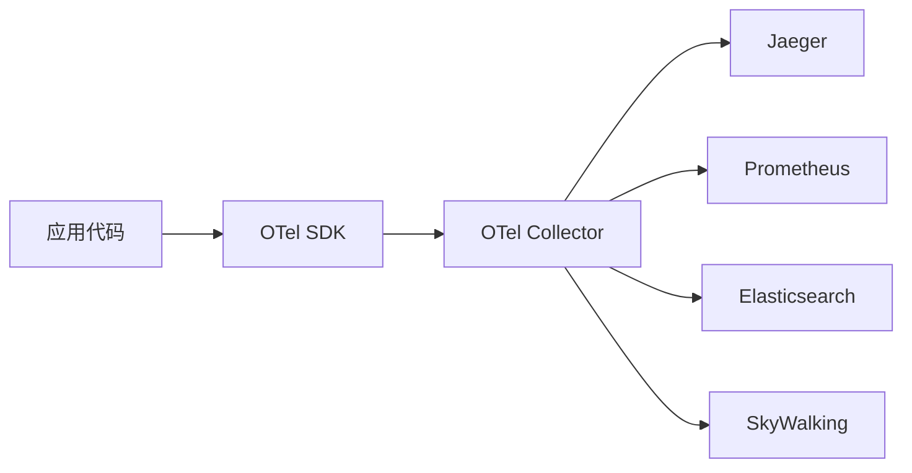
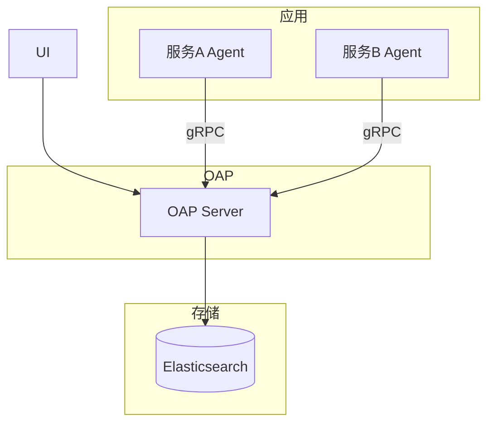

# 分布式链路追踪实战

> **文档说明**：分布式链路追踪是微服务可观测性的核心，通过TraceId串联跨服务调用链，快速定位性能瓶颈和故障。本文档覆盖OpenTelemetry标准、SkyWalking/Zipkin/Jaeger对比、埋点实践、采样策略、告警配置。
>
> **适用人群**：后端工程师、运维、SRE
>
> **前置知识**：微服务架构、可观测性概念

---

## 一、链路追踪核心概念

### 1.1 核心术语

```text
Trace（调用链）：一次完整请求的所有调用，唯一TraceId
  └── Span（跨度）：一次调用，包含开始时间、耗时、标签
       ├── Span A：网关→用户服务
       ├── Span B：用户服务→数据库
       └── Span C：用户服务→订单服务
            └── Span D：订单服务→Redis
```

| 概念 | 说明 |
|------|------|
| **TraceId** | 整条调用链的唯一ID，跨服务传递 |
| **SpanId** | 单个调用的唯一ID |
| **ParentSpanId** | 父调用的SpanId，形成树形结构 |
| **Span** | 一次方法/服务调用，包含耗时、状态、标签 |
| **Annotation** | 事件标注（cs/sr/ss/cr） |
| **Tag** | 键值对标签（URL、状态码、异常信息） |

### 1.2 为什么需要链路追踪

- **故障定位**：微服务调用链复杂，快速找到故障点
- **性能分析**：分析各环节耗时，找到性能瓶颈
- **依赖分析**：梳理服务间依赖关系
- **容量规划**：根据调用量和耗时规划资源
- **根因分析**：异常时快速定位根因服务

---

## 二、OpenTelemetry标准

### 2.1 什么是OpenTelemetry

OpenTelemetry（OTel）是CNCF的可观测性标准，统一了指标、日志、链路追踪的数据格式和SDK。



### 2.2 核心组件

| 组件 | 说明 |
|------|------|
| **API** | 数据采集接口规范 |
| **SDK** | API实现，包含采样、批量处理 |
| **Instrumentation** | 自动埋点库（Spring/MySQL/Redis等） |
| **Collector** | 数据接收、处理、导出的代理 |

### 2.3 Context传播

```text
HTTP Header传播：
  traceparent: 00-{trace_id}-{span_id}-{trace_flags}
  tracestate: vendor1=value1,vendor2=value2

跨进程传递：
  服务A → HTTP Header → 服务B
  服务A → Kafka Header → 服务B
  服务A → gRPC Metadata → 服务B
```

---

## 三、三大追踪系统对比

### 3.1 综合对比

| 维度 | SkyWalking | Zipkin | Jaeger |
|------|-----------|--------|--------|
| **开发公司** | Apache（华为开源） | Twitter | Uber |
| **语言** | Java/Go/多语言 | Java | Go |
| **存储** | ES/MySQL/H2/TiDB | ES/MySQL/Cassandra | ES/Cassandra/Kafka |
| **UI功能** | 丰富（拓扑图/告警/性能剖析） | 简单（搜索/依赖图） | 中等（搜索/对比） |
| **Java Agent** | 无侵入（Java Agent） | 需代码埋点 | 需代码埋点 |
| **性能剖析** | 支持（CPU/内存） | 不支持 | 不支持 |
| **服务网格** | 支持 | 支持 | 支持 |
| **告警** | 内置告警 | 需第三方 | 需第三方 |
| **国内流行度** | 高 | 中 | 中 |
| **资源消耗** | 中 | 低 | 低 |

### 3.2 选型建议

| 场景 | 推荐 |
|------|------|
| Java技术栈，想要无侵入 | SkyWalking（Java Agent自动埋点） |
| 轻量级，已有ELK | Zipkin（简单易集成） |
| 云原生，K8s环境 | Jaeger（CNCF项目，与K8s集成好） |
| 需要性能剖析和告警 | SkyWalking |
| 多语言，标准化 | OpenTelemetry + Jaeger |

---

## 四、SkyWalking实战

### 4.1 架构



| 组件 | 说明 |
|------|------|
| **Agent** | Java Agent，无侵入埋点，采集数据 |
| **OAP** | 接收分析数据，存储到后端 |
| **Storage** | 数据存储（ES推荐生产） |
| **UI** | 可视化界面 |

### 4.2 Java Agent接入

```bash
# 下载Agent
wget https://archive.apache.org/dist/skywalking/8.16.0/apache-skywalking-java-agent-8.16.0.tgz
tar -xzf apache-skywalking-java-agent-8.16.0.tgz

# 启动应用
java -javaagent:/path/skywalking-agent/skywalking-agent.jar \
     -Dskywalking.agent.service_name=order-service \
     -Dskywalking.collector.backend_service=oap:11800 \
     -Dskywalking.agent.sample_n_per_3_secs=100 \
     -jar app.jar
```

### 4.3 关键配置

```properties
# agent.config
agent.service_name=order-service           # 服务名
agent.namespace=production                 # 命名空间
agent.sample_n_per_3_secs=100              # 采样率（每3秒最多100条）
agent.ignore_suffix=.jpg,.jpeg,.png,.css   # 忽略的请求后缀
agent.trace.ignore_path=/health,/metrics   # 忽略的路径
collector.backend_service=oap:11800        # OAP地址
logging.level=INFO                         # 日志级别
plugin.mysql.trace_sql_parameters=true     # 记录SQL参数
plugin.springmvc.use_qualified_name_as_endpoint_name=true
```

### 4.4 自定义埋点

```java
// 方式1：@Trace注解（方法级）
@Trace(operationName = "customOperation")
@Tags({
    @Tag(key = "userId", value = "arg[0]"),
    @Tag(key = "result", value = "returnedObj")
})
public void processOrder(Long userId, OrderDTO dto) {
    // 业务逻辑
}

// 方式2：手动创建Span
@GetMapping("/api/order/{id}")
public Order getOrder(@PathVariable Long id) {
    AbstractSpan span = ContextManager.createLocalSpan("queryOrder");
    span.tag("orderId", String.valueOf(id));
    try {
        return orderService.getById(id);
    } catch (Exception e) {
        span.errorOccurred();
        span.log(e);
        throw e;
    } finally {
        ContextManager.stopSpan();
    }
}
```

### 4.5 核心功能

| 功能 | 说明 |
|------|------|
| **服务拓扑图** | 服务间调用关系可视化 |
| **追踪查询** | 按TraceId/时间/标签查询调用链 |
| **性能剖析** | CPU/内存方法级性能分析 |
| **服务告警** | 响应时间/错误率告警 |
| **JVM监控** | 堆内存/GC/线程监控 |
| **数据库监控** | SQL慢查询统计 |
| **端点监控** | 接口响应时间/吞吐量 |

---

## 五、采样策略

### 5.1 为什么需要采样

- 全量采集存储和网络开销大
- 高并发系统100%采样不现实
- 采样能在保证可观测性的同时降低成本

### 5.2 采样方式

| 方式 | 说明 | 适用 |
|------|------|------|
| **固定比例采样** | 按百分比采样（如10%） | 流量稳定 |
| **限速采样** | 每秒最多N条（如100条/3秒） | 流量波动大 |
| **错误全采** | 错误请求100%采样，正常请求采样 | 生产推荐 |
| **自适应采样** | 根据系统负载动态调整 | 高级场景 |
| **尾部采样** | 先全采，分析后保留异常Trace | 成本高但精准 |

### 5.3 推荐配置

```text
生产环境：
  - 正常请求：10%-30%采样
  - 错误请求：100%采样
  - 慢请求（>1s）：100%采样
  - 核心接口：50%-100%采样
  - 非核心接口：5%-10%采样
```

---

## 六、与日志关联

### 6.1 TraceId注入日志

```xml
<!-- logback-spring.xml -->
<appender name="CONSOLE" class="ch.qos.logback.core.ConsoleAppender">
    <encoder>
        <pattern>%d{yyyy-MM-dd HH:mm:ss.SSS} [%thread] %-5level [%X{traceId}] %logger{50} - %msg%n</pattern>
    </encoder>
</appender>
```

```java
// SkyWalking自动将TraceId放入MDC
// 配置后日志中自动显示traceId
// 通过TraceId可关联日志和调用链
```

### 6.2 日志采集到追踪系统

- SkyWalking支持日志采集（kafka/file）
- 日志中包含TraceId可自动关联到对应Trace
- 异常时可直接在调用链中查看相关日志

---

## 七、生产最佳实践

1. **Agent无侵入优先**：Java技术栈优先使用Agent，减少代码侵入
2. **合理采样**：错误全采+正常采样，平衡成本与可观测性
3. **存储规划**：ES存储按天索引，设置保留时间（7-30天）
4. **告警配置**：响应时间P99、错误率、异常Trace告警
5. **标签规范**：统一标签命名（service/version/region/env）
6. **性能影响**：Agent对应用性能影响<5%，压测验证
7. **跨语言传播**：确保所有服务使用相同的传播格式（W3C TraceContext）
8. **降级方案**：追踪系统不可用时不影响业务（Agent异步发送，本地缓冲）

---

## 八、常见问题

| 问题 | 原因 | 解决方案 |
|------|------|---------|
| 调用链断裂 | 跨服务未传递TraceId | 检查HTTP Header/Kafka Header传播 |
| 数据量太大 | 采样率过高/存储保留太久 | 降低采样率/缩短保留时间 |
| Agent性能影响 | 插件太多/采样太高 | 禁用不需要的插件/调整采样 |
| 看不到数据库调用 | 未启用对应插件 | 启用mysql/redis插件 |
| 拓扑图不准确 | 服务名不一致/异步调用 | 统一服务名/异步上下文传递 |

---

## 关联文档

- [[微服务核心组件知识点系统梳理_优化版]] — 微服务全景
- [[Prometheus-指标采集]] — 指标监控
- [[ELK-日志聚合]] — 日志系统
- [[Grafana-可视化看板]] — 可视化
- [[告警体系设计]] — 告警
- [[高可用架构设计]] — 高可用

---

> 💡 **选型建议**：Java微服务首选SkyWalking，无侵入Agent+丰富UI+内置告警，开箱即用。云原生多语言场景选OpenTelemetry+Jaeger，标准化且与K8s生态融合好。核心是TraceId贯穿日志、指标、链路三大可观测性支柱，实现快速故障定位。


## 补充：概述

分布式链路追踪（Distributed Tracing）是微服务可观测性的三大支柱之一（另外两个是 Metrics 指标监控和 Logging 日志），用于追踪一个请求在分布式系统中经过的所有服务、方法、数据库调用，还原完整的调用链路，帮助开发者快速定位性能瓶颈和故障根因。在微服务架构中，一个请求可能经过 10+ 个服务，出问题时没有链路追踪就像"盲人摸象"，无法快速定位问题。

| 可观测性支柱 | 关注点 | 回答的问题 | 代表工具 |
|-------------|--------|-----------|---------|
| **Metrics（指标）** | 聚合数据、趋势 | "系统现在怎么样？"（QPS、延迟、错误率） | Prometheus、Grafana |
| **Logging（日志）** | 离散事件、详情 | "具体发生了什么？"（错误堆栈、调试信息） | ELK、Loki |
| **Tracing（链路）** | 请求路径、因果 | "这个请求经过了哪里？哪里慢？哪里错？" | Jaeger、Zipkin、SkyWalking |

**核心概念**：
| 概念 | 说明 |
|------|------|
| **Trace** | 一条完整的请求链路，由多个 Span 组成，用 TraceID 唯一标识 |
| **Span** | 链路中的一个操作（调用一个服务、执行一个方法、查询数据库），用 SpanID 标识 |
| **TraceID** | 全局唯一 ID，贯穿整个请求链路，所有 Span 共享 |
| **SpanID** | 单个 Span 的唯一 ID |
| **ParentSpanID** | 父 Span 的 ID，形成树形调用关系 |
| **Annotation** | Span 中的事件标注（cs/cr/sr/ss，或自定义事件） |
| **Tag/Attribute** | Span 的标签/属性（HTTP URL、状态码、数据库 SQL、异常信息） |

**Span 关系**：
```text
TraceID: abc123
├── Span A (网关) [0ms - 100ms]
│   ├── Span B (用户服务) [10ms - 50ms]
│   │   └── Span C (数据库) [15ms - 40ms]
│   └── Span D (订单服务) [55ms - 95ms]
│       ├── Span E (Redis) [60ms - 65ms]
│       └── Span F (数据库) [70ms - 90ms]
```

**主流链路追踪工具对比**：
| 工具 | 特点 | 适用场景 |
|------|------|---------|
| **Jaeger** | CNCF 毕业项目、Uber 开源、OpenTracing 兼容、轻量 | 云原生、K8s 环境 |
| **Zipkin** | Twitter 开源、老牌、简单、Java 生态好 | Java/Spring 技术栈 |
| **SkyWalking** | 国产、Apache 顶级、无侵入 Agent、功能强大（含指标/日志） | 企业级、需要全链路可观测 |
| **OpenTelemetry** | CNCF 标准、统一 Metrics/Logs/Traces API、厂商中立 | 新标准、避免厂商锁定 |
| **Datadog APM** | 商业 SaaS、功能强大、开箱即用 | 有预算、不想自建 |
| **AWS X-Ray** | AWS 托管、与 AWS 服务集成 | AWS 云用户 |

**适用场景**：微服务性能分析（找慢调用）、故障根因定位（找错误服务）、服务依赖梳理（自动生成拓扑图）、容量规划（分析调用频率）、SLA 监控（端到端延迟）。
**不适用场景**：简单单体应用（用日志和 APM 工具即可）、对性能极度敏感的场景（追踪有 ~1-5% 开销）、非 HTTP/RPC 协议的系统（需要自定义埋点）。

---

## 补充：底层原理

### 链路追踪核心机制：上下文传播

链路追踪的核心是**TraceID 的跨服务传播**。当请求从服务 A 调用服务 B 时，需要将 TraceID、ParentSpanID 等上下文信息传递给服务 B，这样服务 B 创建的 Span 才能正确关联到服务 A 的 Span 下。

**传播方式**：
| 协议 | 传播方式 | 示例 Header |
|------|---------|------------|
| **HTTP** | HTTP Header | `X-B3-TraceId`, `X-B3-SpanId`, `X-B3-ParentSpanId`, `traceparent`（W3C 标准） |
| **gRPC** | Metadata | `x-b3-traceid`, `x-b3-spanid` |
| **消息队列** | Message Header/Properties | Kafka Header、RabbitMQ Header |
| **RPC（Dubbo）** | Attachment | Dubbo Attachment |

**W3C Trace Context 标准（推荐）**：
```text
traceparent: 00-4bf92f3577b34da6a3ce929d0e0e4736-00f067aa0ba902b7-01
             │  │                                │                │
             │  └─ TraceID (32位hex)            └─ SpanID (16位hex)
             └─ 版本号                              └─ 标志位（采样=01）
```

### 采样策略

全量采集所有 Trace 会带来巨大的存储和性能开销，生产环境通常使用**采样**：

| 采样策略 | 原理 | 优点 | 缺点 |
|---------|------|------|------|
| **概率采样** | 按固定概率采样（如 10%） | 简单、均匀 | 可能漏掉异常请求 |
| **限速采样** | 每秒最多采样 N 条 | 控制开销 | 高流量时采样率低 |
| **异常采样** | 出错/慢请求 100% 采样，正常请求低比例 | 关注异常 | 正常链路样本少 |
| **自适应采样** | 根据服务重要性动态调整采样率 | 灵活 | 实现复杂 |
| **尾采样（Tail-based）** | 整条链路完成后再决定是否采样 | 准确（能捕获异常链路） | 需要缓存完整链路，资源开销大 |

**推荐策略**：正常请求 1-10% 采样 + 异常/慢请求 100% 采样 + 重要服务提高采样率。

### 埋点方式

| 埋点方式 | 原理 | 优点 | 缺点 |
|---------|------|------|------|
| **手动埋点** | 在代码中显式创建 Span | 精确、灵活 | 侵入性强、工作量大 |
| **自动埋点（Agent）** | Java Agent/字节码增强自动拦截 | 无侵入、开箱即用 | 可能有性能开销、自定义困难 |
| **框架集成** | 框架（Spring Cloud/Dubbo）内置拦截器 | 与框架无缝集成 | 只支持特定框架 |
| **Service Mesh** | Sidecar 代理自动采集 | 完全无侵入、语言无关 | 只能采集网络调用，无法采集内部方法 |

**OpenTelemetry 架构**：
```text
应用代码 → OTel API（创建 Span） → OTel SDK（采样/传播/导出） → OTel Collector（接收/处理/导出） → 后端（Jaeger/Prometheus/Elasticsearch）
```

OTel Collector 是一个独立进程，负责接收所有遥测数据，进行处理（过滤/采样/丰富）后导出到后端，避免应用直接依赖多个后端。

### 性能开销

链路追踪的性能开销主要来自：
| 开销来源 | 典型开销 | 优化方式 |
|---------|---------|---------|
| **Span 创建** | ~1μs/Span | 减少不必要的 Span、采样 |
| **上下文传播** | ~0.1μs | Header 解析开销很小 |
| **数据上报** | 网络 IO | 异步批量上报、采样 |
| **Agent 拦截** | ~1-5% CPU | 优化拦截器、减少拦截点 |

**生产环境影响**：合理采样（1-10%）+ 异步上报，CPU 开销通常 < 3%，延迟影响 < 1ms，可以忽略。
