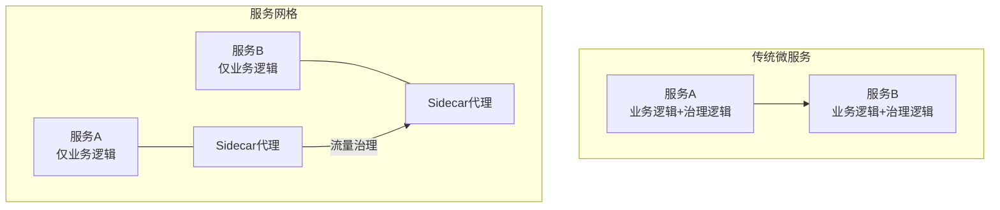
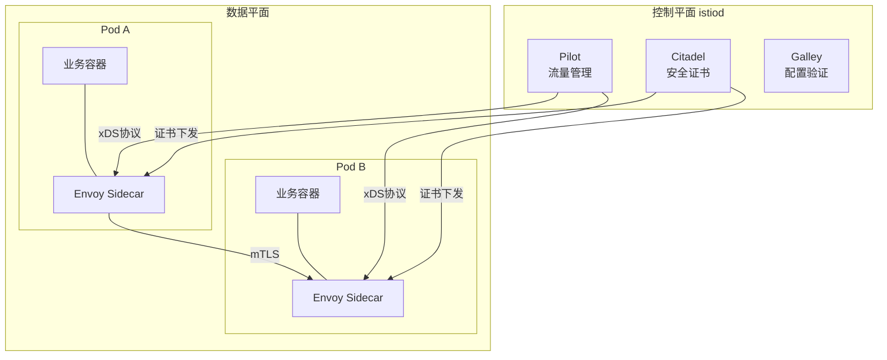

# Istio服务网格实战

> **文档说明**：服务网格（Service Mesh）是微服务架构的下一代基础设施，将流量治理、安全、可观测性从业务代码中剥离到Sidecar代理。本文档覆盖Istio架构、流量管理、安全策略、可观测性、与Spring Cloud对比、落地实践。
>
> **适用人群**：架构师、云原生工程师、高级后端工程师
>
> **前置知识**：Kubernetes、微服务架构、Docker

---

## 一、服务网格概述

### 1.1 什么是服务网格

服务网格是一个专门处理服务间通信的基础设施层，核心思想是**将服务治理能力从业务代码中剥离，下沉到基础设施层**。



### 1.2 为什么需要服务网格

| 问题 | 传统微服务方案 | 服务网格方案 |
|------|--------------|-------------|
| 流量治理 | 代码中实现（重试/超时/熔断） | Sidecar配置，无侵入 |
| 多语言 | 每种语言实现一套治理SDK | 语言无关，统一治理 |
| 安全 | 服务间HTTPS/TLS配置复杂 | mTLS自动加密 |
| 可观测 | 各服务埋点，格式不统一 | 统一指标/日志/链路 |
| 灰度发布 | 需网关+代码配合 | 按比例/Header路由 |
| 升级维护 | SDK升级需所有服务发版 | Sidecar独立升级 |

### 1.3 Istio架构



| 组件 | 说明 |
|------|------|
| **Envoy（Sidecar）** | 数据平面，高性能代理，拦截所有进出流量 |
| **istiod（控制平面）** | 统一管理，包含Pilot/Citadel/Galley |
| **Pilot** | 流量管理，将配置转换为Envoy可识别的xDS协议 |
| **Citadel** | 安全，证书签发和mTLS管理 |
| **Galley** | 配置验证、处理和分发 |

---

## 二、流量管理

### 2.1 核心资源

| 资源 | 说明 |
|------|------|
| **VirtualService** | 虚拟服务，定义路由规则 |
| **DestinationRule** | 目标规则，定义负载均衡/连接池/熔断 |
| **Gateway** | 网关，管理进出网格的流量 |
| **ServiceEntry** | 服务入口，将外部服务纳入网格管理 |
| **EnvoyFilter** | Envoy过滤器，自定义代理逻辑 |

### 2.2 灰度发布（金丝雀）

```yaml
# DestinationRule：定义服务版本
apiVersion: networking.istio.io/v1alpha3
kind: DestinationRule
metadata:
  name: order-service
spec:
  host: order-service
  subsets:
    - name: v1
      labels:
        version: v1
    - name: v2
      labels:
        version: v2
---
# VirtualService：按比例流量分配
apiVersion: networking.istio.io/v1alpha3
kind: VirtualService
metadata:
  name: order-service
spec:
  hosts:
    - order-service
  http:
    - route:
        - destination:
            host: order-service
            subset: v1
          weight: 90      # 90%流量到v1
        - destination:
            host: order-service
            subset: v2
          weight: 10      # 10%流量到v2
```

### 2.3 按Header路由（A/B测试）

```yaml
apiVersion: networking.istio.io/v1alpha3
kind: VirtualService
metadata:
  name: order-service
spec:
  hosts:
    - order-service
  http:
    - match:
        - headers:
            x-user-group:
              exact: beta     # beta用户走v2
      route:
        - destination:
            host: order-service
            subset: v2
    - route:
        - destination:
            host: order-service
            subset: v1        # 其他用户走v1
```

### 2.4 超时与重试

```yaml
apiVersion: networking.istio.io/v1alpha3
kind: VirtualService
metadata:
  name: order-service
spec:
  hosts:
    - order-service
  http:
    - route:
        - destination:
            host: order-service
      timeout: 3s              # 超时3秒
      retries:
        attempts: 3            # 最多重试3次
        perTryTimeout: 2s      # 每次重试超时2秒
        retryOn: 5xx,reset,connect-failure  # 重试条件
```

### 2.5 熔断（DestinationRule）

```yaml
apiVersion: networking.istio.io/v1alpha3
kind: DestinationRule
metadata:
  name: order-service
spec:
  host: order-service
  trafficPolicy:
    connectionPool:
      tcp:
        maxConnections: 100        # 最大连接数
      http:
        http1MaxPendingRequests: 100  # 最大等待请求数
        maxRequestsPerConnection: 10  # 每连接最大请求数
    outlierDetection:
      consecutive5xxErrors: 5        # 连续5次5xx错误
      interval: 30s                  # 检测间隔
      baseEjectionTime: 60s          # 剔除时间60秒
      maxEjectionPercent: 50         # 最多剔除50%实例
```

### 2.6 故障注入（混沌工程）

```yaml
apiVersion: networking.istio.io/v1alpha3
kind: VirtualService
metadata:
  name: order-service
spec:
  hosts:
    - order-service
  http:
    - fault:
        delay:
          percentage:
            value: 10          # 10%请求
          fixedDelay: 5s       # 延迟5秒
        abort:
          percentage:
            value: 5           # 5%请求
          httpStatus: 500      # 返回500错误
      route:
        - destination:
            host: order-service
```

---

## 三、安全

### 3.1 mTLS自动加密

```yaml
# 命名空间级mTLS
apiVersion: security.istio.io/v1beta1
kind: PeerAuthentication
metadata:
  name: default
  namespace: default
spec:
  mtls:
    mode: STRICT    # STRICT: 强制mTLS, PERMISSIVE: 兼容明文, DISABLE: 关闭
```

### 3.2 授权策略

```yaml
# 只允许支付服务调用订单服务的创建接口
apiVersion: security.istio.io/v1beta1
kind: AuthorizationPolicy
metadata:
  name: order-service-policy
  namespace: default
spec:
  selector:
    matchLabels:
      app: order-service
  rules:
    - from:
        - source:
            principals: ["cluster.local/ns/default/sa/payment-service"]
      to:
        - operation:
            methods: ["POST"]
            paths: ["/api/orders"]
```

### 3.3 请求认证（JWT）

```yaml
apiVersion: security.istio.io/v1beta1
kind: RequestAuthentication
metadata:
  name: jwt-auth
spec:
  selector:
    matchLabels:
      app: api-gateway
  jwtRules:
    - issuer: "https://auth.example.com"
      jwksUri: "https://auth.example.com/.well-known/jwks.json"
```

---

## 四、可观测性

### 4.1 指标（Prometheus）

Istio自动生成以下指标，无需业务代码埋点：

| 指标 | 说明 |
|------|------|
| `istio_requests_total` | 请求总数（按服务/版本/状态码） |
| `istio_request_duration_milliseconds` | 请求延迟分布 |
| `istio_request_bytes` | 请求字节数 |
| `istio_response_bytes` | 响应字节数 |
| `istio_tcp_connections_opened_total` | TCP连接数 |

### 4.2 链路追踪

Istio自动生成分布式追踪（Zipkin/Jaeger），Sidecar自动注入Trace Header，业务代码只需透传Header。

### 4.3 Kiali可视化

Kiali是Istio官方的服务网格可视化工具，提供：
- 服务拓扑图
- 流量监控
- 健康状态
- 配置验证

---

## 五、Istio vs Spring Cloud

| 维度 | Istio（服务网格） | Spring Cloud（应用层） |
|------|------------------|----------------------|
| 实现方式 | Sidecar代理，无侵入 | SDK嵌入，代码侵入 |
| 语言支持 | 语言无关 | Java为主 |
| 流量治理 | 配置化，实时生效 | 代码+配置，需发版 |
| 安全 | mTLS自动，授权策略 | 需自行实现 |
| 可观测 | 自动采集，统一 | 需各服务埋点 |
| 性能损耗 | Sidecar代理增加延迟（~2-5ms） | 直接调用，无额外延迟 |
| 复杂度 | 高（K8s+Istio学习曲线） | 中（Java开发者熟悉） |
| 适用 | 多语言、大规模、云原生 | Java技术栈、中小规模 |
| 资源消耗 | 每个Pod多一个Sidecar（~100MB内存） | 无额外进程 |

### 5.1 选型建议

```text
是否多语言微服务？
├── 是 → Istio（语言无关优势明显）
└── 否（纯Java）→ 团队K8s经验？
    ├── 丰富 → Istio（长期收益大）
    └── 一般 → Spring Cloud（上手快，生态成熟）

服务规模？
├── <20个服务 → Spring Cloud足够
├── 20-50个 → 评估Istio
└── >50个 → Istio（治理复杂度需要基础设施层支撑）
```

---

## 六、落地实践

### 6.1 渐进式接入

```text
阶段1：仅观测（PERMISSIVE模式）
  - 注入Sidecar，不改变流量
  - 观察指标和链路追踪
  - 验证性能影响

阶段2：流量治理
  - 灰度发布、超时重试
  - 熔断限流
  - 故障注入测试

阶段3：安全加固
  - 切换到STRICT mTLS
  - 配置授权策略
  - JWT认证

阶段4：全面治理
  - 所有服务纳入网格
  - 外部服务通过ServiceEntry管理
  - 完善监控告警
```

### 6.2 性能优化

| 优化 | 说明 |
|------|------|
| Sidecar资源限制 | requests: 100m/128Mi, limits: 500m/256Mi |
| 协议优化 | HTTP/2多路复用，减少连接数 |
| 精简配置 | 只导出需要的服务，减少xDS推送 |
| 代理日志 | 生产环境关闭access log或采样 |
| 连接池 | 合理配置maxConnections |

### 6.3 常见问题

| 问题 | 原因 | 解决方案 |
|------|------|---------|
| 延迟增加 | Sidecar代理开销 | HTTP/2、连接池、评估是否可接受 |
| 内存占用高 | Sidecar数量多 | 优化资源限制、精简配置 |
| 服务启动慢 | Sidecar先启动 | 配置holdApplicationUntilProxyStarts |
| 503错误 | mTLS模式不匹配 | 统一PeerAuthentication模式 |
| 流量不生效 | VirtualService配置错误 | 检查host和subset匹配 |

---

## 七、部署

```bash
# 安装istioctl
curl -L https://istio.io/downloadIstio | sh -
cd istio-*
export PATH=$PWD/bin:$PATH

# 安装Istio（demo配置用于测试，生产用default）
istioctl install --set profile=default -y

# 为命名空间开启自动注入
kubectl label namespace default istio-injection=enabled

# 部署应用（自动注入Sidecar）
kubectl apply -f <your-app>.yaml

# 验证Sidecar注入
kubectl get pods -n default
# 每个Pod应该有2个容器（业务+Sidecar）

# 安装Kiali
kubectl apply -f samples/addons/kiali.yaml
istioctl dashboard kiali
```

---

## 关联文档

- [[微服务核心组件知识点系统梳理_优化版]] — 微服务全景
- [[API网关实战]] — 网关对比
- [[Sentinel限流熔断实战]] — 应用层限流对比
- [[分布式链路追踪实战]] — 可观测性
- [[高可用架构设计]] — 高可用
- [[技术选型决策指南]] — 架构选型

---

> 💡 **实战建议**：Istio是微服务治理的终极方案，但不是银弹。引入前评估：1. 团队是否有K8s运维能力；2. 服务规模是否足够大（<20个服务不建议）；3. 性能损耗是否可接受（2-5ms延迟）。建议从PERMISSIVE模式开始，先观测再治理，渐进式落地。国内也可考虑替代方案：阿里ASM、腾讯云TEM、华为Mesher。


## 补充：底层原理

### Sidecar 代理原理

Istio 的核心是 Sidecar 模式：在每个服务 Pod 中注入一个 Envoy 代理容器，所有进出服务的网络流量都经过 Envoy 代理，由代理负责服务发现、负载均衡、熔断、限流、认证、监控等横切关注点，业务代码无需任何修改。

流量拦截原理（iptables）：Istio 通过 init 容器配置 iptables 规则，将 Pod 中的网络流量透明地重定向到 Envoy 代理。入站流量目标端口 15006，出站流量目标端口 15001。

### xDS 动态配置协议

Istio 控制面（istiod）通过 xDS 协议向 Envoy 代理动态下发配置，无需重启代理：

| xDS 类型 | 配置内容 |
|---------|---------|
| CDS | 集群（后端服务端点）配置 |
| EDS | 服务端点（IP:Port）列表 |
| LDS | 监听器（端口、协议、过滤器链） |
| RDS | 路由规则（路径匹配、流量转发） |
| SDS | 证书/密钥（mTLS 证书动态下发） |

### mTLS 安全原理

Istio 提供自动双向 TLS（mTLS）：istiod 作为 CA 为每个服务身份签发证书，通过 SDS 动态下发到 Envoy，出站 Envoy 自动用客户端证书加密，入站 Envoy 验证服务端证书。证书自动轮换（默认 24 小时有效期）。

授权策略（AuthorizationPolicy）：基于 SPIFFE ID 的 RBAC 授权，控制哪些服务可以调用哪些服务的哪些 API。

---

## 补充：进阶与最佳实践

### 1. 灰度发布（金丝雀发布）

```yaml
# DestinationRule：定义服务版本子集
apiVersion: networking.istio.io/v1beta1
kind: DestinationRule
metadata:
  name: order-service
spec:
  host: order-service
  subsets:
    - name: v1
      labels: { version: v1 }
    - name: v2
      labels: { version: v2 }
  trafficPolicy:
    outlierDetection:
      consecutive5xxErrors: 5
      interval: 30s
      baseEjectionTime: 30s

---
# VirtualService：按权重灰度（v1 90%，v2 10%）
apiVersion: networking.istio.io/v1beta1
kind: VirtualService
metadata:
  name: order-service
spec:
  hosts: [order-service]
  http:
    - route:
        - destination: { host: order-service, subset: v1 }
          weight: 90
        - destination: { host: order-service, subset: v2 }
          weight: 10
      retries:
        attempts: 3
        perTryTimeout: 2s
      timeout: 5s
```

灰度发布流程：部署 v2（不接收流量）→ 权重设为 v1=99%, v2=1% → 观察监控 → 逐步增加 v2 权重（5%→10%→30%→50%→100%）→ 全量后下线 v1。

### 2. 性能优化

| 优化点 | 措施 |
|--------|------|
| 减少 Sidecar 开销 | 配置 proxyCPU/proxyMemory 资源限制 |
| 控制配置规模 | Sidecar CRD 限制配置下发范围（只下发相关服务） |
| 协议优化 | 使用 HTTP/2（gRPC）、避免 HTTP/1.1 短连接 |
| mTLS 优化 | 只对需要的命名空间开启 mTLS（PERMISSIVE 模式过渡） |
| 日志采样 | 降低访问日志采样率（生产环境 1-10%） |
| 链路采样 | 配置追踪采样率（默认 1%） |

### 3. Istio vs API 网关

| 维度 | Istio（Service Mesh） | API 网关 |
|------|----------------------|---------|
| 位置 | 服务间（东西向流量） | 服务入口（南北向流量） |
| 部署 | Sidecar（每个服务一个） | 集中式（几个实例） |
| 性能开销 | 每跳 ~2-5ms | 入口一次 ~1-2ms |
| 功能 | 服务间治理（mTLS/熔断/可观测） | 入口治理（认证/路由/限流/WAF） |
| 适用规模 | 大规模微服务 | 所有规模 |

最佳实践：两者结合——API 网关处理南北向入口流量，Istio 处理东西向服务间流量。
