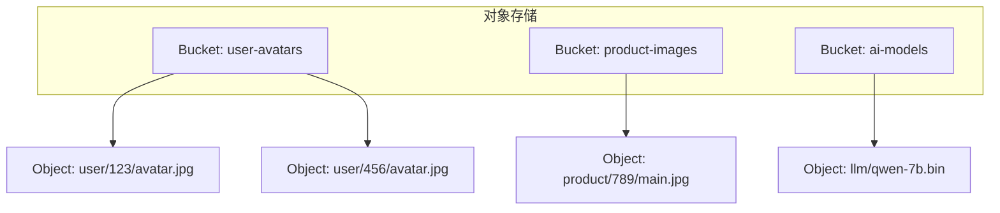
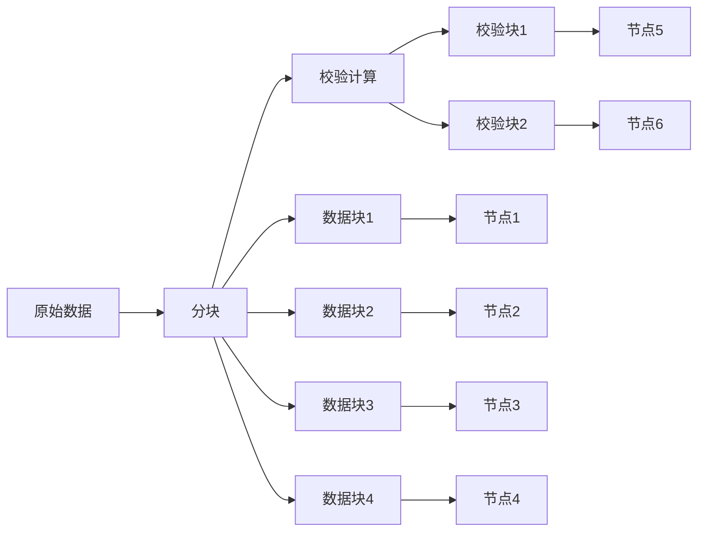

# MinIO分布式对象存储实战

> **文档说明**：MinIO是高性能分布式对象存储，兼容S3 API，是自建对象存储的首选。本文档覆盖架构原理、部署方式、SDK使用、大文件分片上传、权限管理、与AI模型存储结合。
>
> **适用人群**：后端工程师、需要构建文件存储/模型存储的开发者
>
> **前置知识**：HTTP协议、分布式系统概念

---

## 一、对象存储概述

### 1.1 什么是对象存储

对象存储是一种以对象（Object）为单位的存储系统，每个对象包含数据本身、元数据和唯一标识符（Key）。

| 存储类型 | 数据组织 | 访问方式 | 适用 |
|---------|---------|---------|------|
| **块存储** | 固定大小块 | 块地址 | 数据库、虚拟机磁盘 |
| **文件存储** | 目录/文件层级 | 文件路径 | 共享文件、NAS |
| **对象存储** | Bucket/Object扁平结构 | Key/HTTP API | 图片、视频、备份、模型 |

### 1.2 对象存储核心概念



| 概念 | 说明 |
|------|------|
| **Bucket** | 存储桶，对象的容器，全局唯一命名 |
| **Object** | 对象，存储的基本单元（数据+元数据） |
| **Key** | 对象的唯一标识符，类似文件路径 |
| **Metadata** | 对象元数据（自定义键值对） |
| **ACL** | 访问控制列表（私有/公共读/公共读写） |

### 1.3 为什么需要对象存储

| 问题（本地文件存储） | 对象存储解决方案 |
|---------------------|----------------|
| 多服务器文件不共享 | 集中存储，所有服务访问同一存储 |
| 磁盘容量有限 | 无限扩展，PB级存储 |
| 图片/视频访问慢 | CDN加速，就近访问 |
| 备份困难 | 多副本+跨区域复制 |
| 大文件上传难 | 分片上传、断点续传 |

---

## 二、MinIO架构

### 2.1 MinIO特点

| 特性 | 说明 |
|------|------|
| **S3兼容** | 完全兼容AWS S3 API，SDK可直接使用 |
| **高性能** | 标准硬件上读写速度可达183GB/s |
| **云原生** | Kubernetes原生，Operator部署 |
| **纠删码** | 数据分片+校验，可容忍多个节点故障 |
| **轻量级** | 单个二进制文件，部署简单 |
| **开源** | Apache 2.0协议，社区活跃 |

### 2.2 纠删码（Erasure Coding）



- 数据被分成N个数据块和M个校验块
- 只要有N个块（数据+校验）就能恢复原始数据
- 4数据+4校验配置可容忍4个节点故障
- 存储开销 = (N+M)/N，如4+4则2倍开销

### 2.3 分布式部署架构

```text
MinIO集群（4节点，每节点4块磁盘 = 16块磁盘）
  纠删码配置：4数据块 + 4校验块
  可容忍：任意4块磁盘故障
  可用容量：总容量 × (4/8) = 50%
```

---

## 三、部署

### 3.1 Docker单机部署

```bash
# 单机模式（开发测试）
docker run -d \
  --name minio \
  -p 9000:9000 -p 9001:9001 \
  -e MINIO_ROOT_USER=admin \
  -e MINIO_ROOT_PASSWORD=admin123456 \
  -v minio_data:/data \
  minio/minio server /data --console-address ":9001"

# 访问 http://localhost:9001 进入管理控制台
# API端口 9000，控制台端口 9001
```

### 3.2 分布式部署

```bash
# 4节点分布式集群（每节点挂载4块磁盘）
minio server \
  http://minio{1...4}/data{1...4} \
  --console-address ":9001"

# 环境变量
export MINIO_ROOT_USER=admin
export MINIO_ROOT_PASSWORD=admin123456
export MINIO_REGION_NAME=cn-east-1
```

### 3.3 Kubernetes部署（Operator）

```yaml
# MinIO Tenant CRD
apiVersion: minio.min.io/v2
kind: Tenant
metadata:
  name: minio-cluster
spec:
  image: minio/minio:RELEASE.2024-01-01
  pools:
    - servers: 4
      volumesPerServer: 4
      size: 1Ti
  creds:
    name: minio-creds
  console:
    image: minio/console
```

---

## 四、SDK使用（Java）

### 4.1 依赖与配置

```xml
<dependency>
    <groupId>io.minio</groupId>
    <artifactId>minio</artifactId>
    <version>8.5.7</version>
</dependency>
```

```yaml
# application.yml
minio:
  endpoint: http://minio:9000
  access-key: admin
  secret-key: admin123456
  bucket-name: app-files
```

```java
@Configuration
public class MinioConfig {
    @Value("${minio.endpoint}")
    private String endpoint;
    @Value("${minio.access-key}")
    private String accessKey;
    @Value("${minio.secret-key}")
    private String secretKey;

    @Bean
    public MinioClient minioClient() {
        return MinioClient.builder()
            .endpoint(endpoint)
            .credentials(accessKey, secretKey)
            .build();
    }
}
```

### 4.2 Bucket管理

```java
@Service
public class MinioService {
    @Autowired
    private MinioClient minioClient;

    // 创建Bucket
    public void createBucket(String bucketName) throws Exception {
        boolean exists = minioClient.bucketExists(
            BucketExistsArgs.builder().bucket(bucketName).build());
        if (!exists) {
            minioClient.makeBucket(
                MakeBucketArgs.builder().bucket(bucketName).build());
        }
    }

    // 设置Bucket为公共读
    public void setPublicRead(String bucketName) throws Exception {
        String policy = """
            {
              "Version": "2012-10-17",
              "Statement": [{
                "Effect": "Allow",
                "Principal": {"AWS": ["*"]},
                "Action": ["s3:GetObject"],
                "Resource": ["arn:aws:s3:::%s/*"]
              }]
            }
            """.formatted(bucketName);
        minioClient.setBucketPolicy(
            SetBucketPolicyArgs.builder()
                .bucket(bucketName).config(policy).build());
    }
}
```

### 4.3 文件上传下载

```java
// 上传文件（小文件）
public String uploadFile(String bucketName, String objectName,
                         InputStream inputStream, String contentType) throws Exception {
    minioClient.putObject(PutObjectArgs.builder()
        .bucket(bucketName)
        .object(objectName)
        .stream(inputStream, inputStream.available(), -1)
        .contentType(contentType)
        .build());
    return getFileUrl(bucketName, objectName);
}

// 下载文件
public InputStream downloadFile(String bucketName, String objectName) throws Exception {
    return minioClient.getObject(GetObjectArgs.builder()
        .bucket(bucketName)
        .object(objectName)
        .build());
}

// 删除文件
public void deleteFile(String bucketName, String objectName) throws Exception {
    minioClient.removeObject(RemoveObjectArgs.builder()
        .bucket(bucketName)
        .object(objectName)
        .build());
}

// 获取文件URL（私有文件用预签名URL）
public String getPresignedUrl(String bucketName, String objectName,
                              int expirySeconds) throws Exception {
    return minioClient.getPresignedObjectUrl(GetPresignedObjectUrlArgs.builder()
        .method(Method.GET)
        .bucket(bucketName)
        .object(objectName)
        .expiry(expirySeconds)
        .build());
}
```

### 4.4 大文件分片上传

```java
// 大文件分片上传（支持断点续传）
public void multipartUpload(String bucketName, String objectName,
                            File file, int partSize) throws Exception {
    // 1. 初始化分片上传
    String uploadId = minioClient.initiateMultipartUpload(
        InitiateMultipartUploadArgs.builder()
            .bucket(bucketName).object(objectName).build());

    // 2. 分片上传
    List<Part> parts = new ArrayList<>();
    try (RandomAccessFile raf = new RandomAccessFile(file, "r")) {
        long fileLength = file.length();
        int partNumber = 1;
        long offset = 0;
        while (offset < fileLength) {
            long size = Math.min(partSize, fileLength - offset);
            byte[] buffer = new byte[(int) size];
            raf.seek(offset);
            raf.readFully(buffer);

            String etag = minioClient.uploadPart(UploadPartArgs.builder()
                .bucket(bucketName).object(objectName)
                .uploadId(uploadId).partNumber(partNumber)
                .stream(new ByteArrayInputStream(buffer), size, -1)
                .build());
            parts.add(new Part(partNumber, etag));
            offset += size;
            partNumber++;
        }
    }

    // 3. 合并分片
    minioClient.completeMultipartUpload(CompleteMultipartUploadArgs.builder()
        .bucket(bucketName).object(objectName)
        .uploadId(uploadId).parts(parts).build());
}
```

---

## 五、权限管理

### 5.1 IAM策略

```json
{
  "Version": "2012-10-17",
  "Statement": [
    {
      "Effect": "Allow",
      "Action": ["s3:GetObject", "s3:PutObject"],
      "Resource": ["arn:aws:s3:::user-avatars/*"]
    },
    {
      "Effect": "Deny",
      "Action": ["s3:DeleteBucket"],
      "Resource": ["arn:aws:s3:::*"]
    }
  ]
}
```

### 5.2 预签名URL（安全分享）

```java
// 私有文件生成临时访问URL（有效期1小时）
String url = minioClient.getPresignedObjectUrl(
    GetPresignedObjectUrlArgs.builder()
        .method(Method.GET)
        .bucket("private-files")
        .object("report.pdf")
        .expiry(3600)  // 1小时
        .build());
// URL包含签名，过期后无法访问
```

---

## 六、AI模型存储实践

### 6.1 模型文件管理

```text
Bucket: ai-models/
  ├── llm/
  │   ├── qwen-7b/
  │   │   ├── config.json
  │   │   ├── model-00001-of-00002.safetensors
  │   │   └── model-00002-of-00002.safetensors
  │   └── llama3-8b/
  ├── embedding/
  │   └── bge-large-zh/
  └── image/
      └── stable-diffusion-xl/
```

### 6.2 模型加载（从MinIO流式加载）

```python
# Python：从MinIO直接加载模型到vLLM
from minio import Minio
import torch

client = Minio("minio:9000", access_key="admin", secret_key="password", secure=False)

# 下载模型文件到本地缓存（或流式加载）
client.fget_object("ai-models", "llm/qwen-7b/model.safetensors", "/cache/model.safetensors")

# vLLM从本地缓存加载
from vllm import LLM
llm = LLM(model="/cache/qwen-7b", tensor_parallel_size=2)
```

---

## 七、MinIO vs 其他方案

| 维度 | MinIO | AWS S3 | 阿里云OSS | 本地文件 |
|------|-------|--------|----------|---------|
| 部署 | 自建 | 云服务 | 云服务 | 本地 |
| 成本 | 服务器成本 | 按用量付费 | 按用量付费 | 最低 |
| S3兼容 | ✅ | 原生 | ✅ | ❌ |
| 扩展性 | 高 | 无限 | 无限 | 低 |
| 数据主权 | 完全掌控 | 第三方 | 第三方 | 完全掌控 |
| 运维 | 需自己运维 | 免运维 | 免运维 | 简单 |
| 适用 | 私有化/混合云 | 海外/AWS生态 | 国内项目 | 小型项目 |

---

## 关联文档

- [[SpringBoot项目模板与最佳实践]] — 文件上传集成
- [[高可用架构设计]] — 存储高可用
- [[全栈+AI端到端实战]] — AI模型存储
- [[技术选型决策指南]] — 存储选型
- [[云原生与运维]] — K8s部署

---

> 💡 **选型建议**：私有化部署/数据主权要求高选MinIO（S3兼容，迁移成本低）；直接上云选对应云厂商OSS（免运维）；小型项目本地文件存储即可。MinIO的核心优势是"S3兼容+高性能+轻量"，AI模型存储、图片视频存储、备份归档是典型场景。生产环境务必：分布式部署+纠删码+预签名URL+CDN加速。
