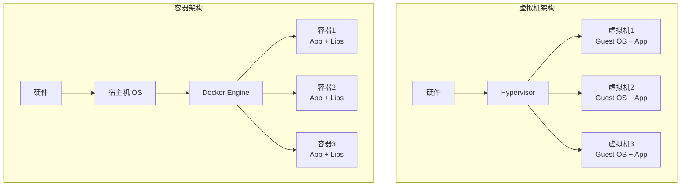
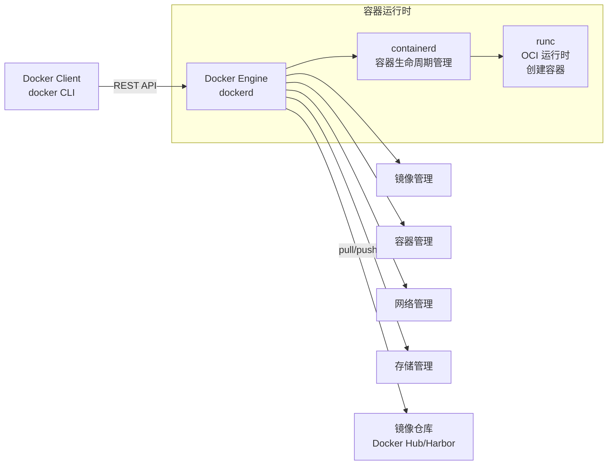
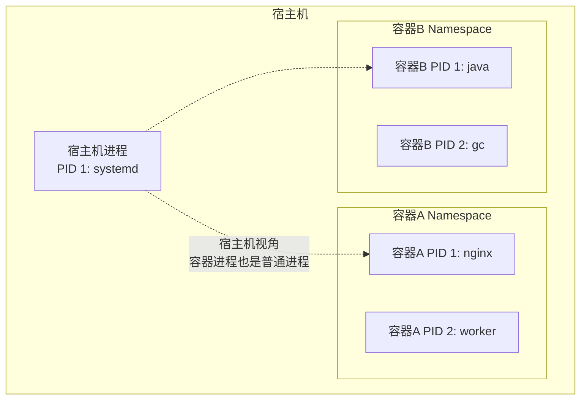
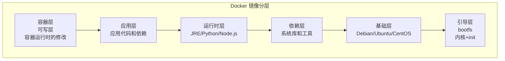
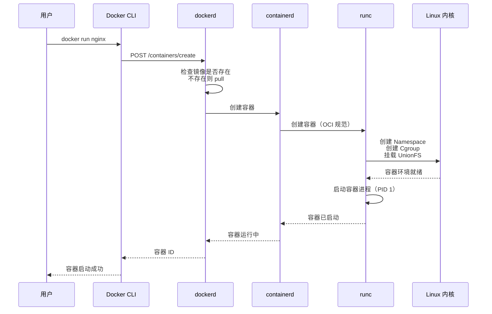

# Docker 核心原理与镜像优化

> **文档说明**：系统讲解 Docker 的核心原理（命名空间、控制组、联合文件系统）、镜像构建、容器管理、网络、存储、镜像优化实战，以及生产环境最佳实践。
>
> **适用人群**：后端开发、全栈工程师、DevOps/SRE、需要容器化部署的开发者
>
> **前置知识**：[[Linux基础命令]]

---

## 一、概述

**Docker** 是一个开源的容器化平台，通过将应用及其依赖打包到轻量级的容器中，实现"一次构建，到处运行"。Docker 是云原生时代的基础技术，也是 Kubernetes 的底层运行时。

### 1. 容器 vs 虚拟机

| 特性 | 容器（Docker） | 虚拟机（VM） |
|------|---------------|-------------|
| 虚拟化层级 | 操作系统级虚拟化 | 硬件级虚拟化 |
| 内核 | 共享宿主机内核 | 独立客户机内核 |
| 启动速度 | 秒级（1-5秒） | 分钟级（30秒-几分钟） |
| 资源占用 | MB 级（镜像几十 MB） | GB 级（镜像几 GB） |
| 性能损耗 | 几乎无损耗（接近原生） | 5-15% 损耗 |
| 隔离性 | 进程级隔离（较弱） | 硬件级隔离（强） |
| 可移植性 | 高（镜像标准化） | 中（依赖 Hypervisor） |
| 适用场景 | 微服务、CI/CD、云原生 | 多操作系统、强隔离需求 |



### 2. Docker 核心组件

| 组件 | 说明 |
|------|------|
| **Docker Engine** | Docker 守护进程（dockerd），管理容器、镜像、网络、存储 |
| **Docker Client** | Docker 命令行工具（docker），通过 REST API 与 Engine 通信 |
| **Image（镜像）** | 只读模板，包含应用和依赖，用于创建容器 |
| **Container（容器）** | 镜像的运行实例，可启动、停止、删除 |
| **Registry（仓库）** | 存储和分发镜像的服务（Docker Hub、Harbor、阿里云 ACR） |
| **Dockerfile** | 构建镜像的脚本文件，包含一系列指令 |
| **Volume（数据卷）** | 容器数据持久化机制，绕过容器文件系统 |
| **Network（网络）** | 容器间通信和外部访问的网络配置 |

### 3. Docker 架构



---

## 二、Docker 核心原理

### 1. Namespace（命名空间）

**Namespace** 是 Linux 内核提供的进程隔离机制，通过将系统资源包装在抽象层中，使容器内的进程只能看到和访问自己的命名空间资源。

| Namespace | 隔离资源 | 说明 |
|-----------|---------|------|
| **PID** | 进程 ID | 容器内进程有独立的 PID 空间，PID 1 是容器主进程 |
| **NET** | 网络栈 | 容器有独立的网络设备、IP 地址、端口、路由表 |
| **MNT** | 挂载点 | 容器有独立的文件系统挂载视图 |
| **UTS** | 主机名和域名 | 容器可以有独立的 hostname |
| **IPC** | 进程间通信 | 容器有独立的 System V IPC 和 POSIX 消息队列 |
| **USER** | 用户和用户组 | 容器有独立的 UID/GID 映射（容器内 root ≠ 宿主机 root） |
| **CGROUP** | 控制组 | 容器有独立的 cgroup 视图（Linux 4.6+） |



**关键理解**：
- 容器内的 PID 1 是容器主进程，主进程退出则容器停止
- 容器内的 root 用户在宿主机上可能是普通用户（User Namespace 映射）
- 容器的网络隔离通过 veth pair + bridge 实现
- Namespace 是轻量级隔离，不是完全隔离（共享内核）

### 2. Cgroups（控制组）

**Cgroups（Control Groups）** 是 Linux 内核提供的资源限制和隔离机制，可以限制进程组使用的 CPU、内存、磁盘 I/O 等资源。

| 子系统 | 限制资源 | Docker 参数 |
|--------|---------|------------|
| **cpu** | CPU 使用量 | `--cpus`, `--cpu-shares`, `--cpuset-cpus` |
| **cpuacct** | CPU 使用统计 | 自动启用 |
| **memory** | 内存使用量 | `--memory`, `--memory-swap` |
| **blkio** | 块设备 I/O | `--device-read-bps`, `--device-write-iops` |
| **pids** | 进程数量 | `--pids-limit` |
| **devices** | 设备访问 | `--device` |
| **net_cls** | 网络流量分类 | 配合 tc 使用 |
| **freezer** | 冻结/恢复进程 | docker pause/unpause |

```bash
# 资源限制示例
docker run -d \
  --name myapp \
  --cpus="2.0" \              # 最多使用 2 个 CPU 核心
  --cpu-shares=512 \          # CPU 相对权重（默认 1024，512=一半）
  --memory="1g" \             # 最多使用 1GB 内存
  --memory-swap="1g" \        # swap = memory-swap - memory = 0（禁用 swap）
  --pids-limit=100 \          # 最多 100 个进程
  --cpuset-cpus="0,1" \       # 绑定到 CPU 0 和 1
  myapp:latest
```

**内存限制注意事项**：
- `--memory` 设置的是用户内存限制，不包括内核内存
- 达到内存限制后，容器内进程会被 OOM Killer 杀死
- `--memory-swap` 必须 ≥ `--memory`，等于 `--memory` 表示禁用 swap
- Java 应用需要注意 JVM 堆内存 + 非堆内存 ≤ 容器内存限制

### 3. UnionFS（联合文件系统）

**UnionFS（Union File System）** 是一种分层文件系统，可以将多个目录（层）联合挂载到同一个目录，形成统一的文件系统视图。Docker 镜像就是基于 UnionFS 构建的分层结构。



| 层 | 说明 | 可写 |
|----|------|------|
| bootfs | 引导文件系统（内核+init），容器启动后卸载 | ❌ 只读 |
| rootfs | 基础操作系统（Debian/Ubuntu/Alpine） | ❌ 只读 |
| 镜像层 | Dockerfile 每条指令生成一层（FROM/RUN/COPY 等） | ❌ 只读 |
| 容器层 | 容器运行时的可写层（修改/新增/删除） | ✅ 可写 |

**关键特性**：
- **写时复制（Copy-on-Write, CoW）**：容器修改文件时，先从只读层复制到可写层，然后修改可写层的副本
- **层共享**：多个镜像可以共享相同的底层（如都基于 Debian），节省存储空间
- **层缓存**：构建镜像时，未变化的层直接使用缓存，加速构建
- **存储驱动**：overlay2（推荐）、aufs、devicemapper、btrfs、zfs

```bash
# 查看镜像分层
docker history myapp:latest
# IMAGE          CREATED         CREATED BY                                      SIZE
# abc123         2 hours ago     /bin/sh -c #(nop)  CMD ["node","app.js"]     0B
# def456         2 hours ago     /bin/sh -c npm install                          150MB
# ghi789         2 hours ago     /bin/sh -c #(nop) COPY dir:abc123             2MB
# jkl012         2 hours ago     /bin/sh -c #(nop) WORKDIR /app                 0B
# mno345         3 weeks ago     /bin/sh -c #(nop)  CMD ["node"]                0B
# ...

# 查看容器文件系统变化
docker diff mycontainer
# C /app/config.json   (C=Changed 修改)
# A /app/logs/app.log  (A=Added 新增)
# D /app/tmp/cache     (D=Deleted 删除)
```

### 4. 容器创建流程



---

## 三、Dockerfile 与镜像构建

### 1. Dockerfile 指令大全

| 指令 | 说明 | 示例 |
|------|------|------|
| **FROM** | 指定基础镜像（必须是第一条指令） | `FROM node:20-alpine` |
| **LABEL** | 添加元数据（维护者、版本等） | `LABEL maintainer="dev@example.com"` |
| **ARG** | 构建时变量（可通过 --build-arg 传递） | `ARG NODE_ENV=production` |
| **ENV** | 环境变量（容器运行时也可用） | `ENV PORT=3000` |
| **RUN** | 构建时执行命令（生成新镜像层） | `RUN npm install` |
| **COPY** | 复制文件到镜像（推荐，比 ADD 简单） | `COPY . /app` |
| **ADD** | 复制文件（支持 URL 和自动解压 tar） | `ADD app.tar.gz /app` |
| **WORKDIR** | 设置工作目录（后续指令的默认目录） | `WORKDIR /app` |
| **EXPOSE** | 声明容器监听的端口（仅文档作用） | `EXPOSE 3000` |
| **CMD** | 容器启动时默认执行的命令（可被覆盖） | `CMD ["node", "app.js"]` |
| **ENTRYPOINT** | 容器启动时执行的命令（不可被轻易覆盖） | `ENTRYPOINT ["node", "app.js"]` |
| **VOLUME** | 声明数据卷（持久化目录） | `VOLUME ["/data"]` |
| **USER** | 设置运行容器的用户 | `USER node` |
| **HEALTHCHECK** | 健康检查命令 | `HEALTHCHECK CMD curl -f http://localhost/ || exit 1` |
| **SHELL** | 设置默认 shell | `SHELL ["/bin/bash", "-c"]` |
| **STOPSIGNAL** | 设置停止容器的信号 | `STOPSIGNAL SIGTERM` |
| **ONBUILD** | 子镜像构建时触发的指令 | `ONBUILD COPY . /app` |
| **MAINTAINER** | 维护者（已废弃，用 LABEL） | `MAINTAINER dev@example.com` |

### 2. CMD vs ENTRYPOINT

| 特性 | CMD | ENTRYPOINT |
|------|-----|-----------|
| 作用 | 容器启动默认命令 | 容器启动主命令 |
| docker run 传参 | 完全覆盖 CMD | 作为参数追加到 ENTRYPOINT |
| 可被覆盖 | `docker run image new_cmd` | `docker run --entrypoint new_cmd` |
| 推荐用法 | 提供默认参数 | 固定主命令 + CMD 提供默认参数 |

```dockerfile
# 最佳实践：ENTRYPOINT 固定主命令，CMD 提供默认参数
ENTRYPOINT ["nginx"]
CMD ["-g", "daemon off;"]
# docker run nginx          → nginx -g daemon off;
# docker run nginx -t        → nginx -t（覆盖 CMD 参数）
```

### 3. 多阶段构建（Multi-stage Build）

多阶段构建是镜像优化的核心技术，可以在一个 Dockerfile 中使用多个 FROM 指令，每个阶段独立构建，最终只复制需要的产物到最终镜像。

```dockerfile
# ========== 阶段1：构建阶段 ==========
FROM node:20 AS builder
WORKDIR /app

# 先复制依赖文件，利用层缓存
COPY package*.json ./
RUN npm ci --only=production

# 复制源码并构建
COPY . .
RUN npm run build

# ========== 阶段2：运行阶段 ==========
FROM node:20-alpine
WORKDIR /app

# 只从构建阶段复制需要的文件
COPY --from=builder /app/node_modules ./node_modules
COPY --from=builder /app/dist ./dist
COPY package*.json ./

# 非 root 用户运行
USER node

EXPOSE 3000
CMD ["node", "dist/app.js"]
```

**多阶段构建的优势**：
- 最终镜像不包含构建工具（编译器、构建依赖、devDependencies）
- 镜像体积大幅减小（通常从 1GB+ 降到 100-300MB）
- 减少攻击面（不需要的工具不进入运行镜像）
- 构建缓存更高效

### 4. 层缓存优化

Docker 构建时按顺序执行指令，每条指令生成一层。如果指令和上下文未变化，直接使用缓存。**优化缓存命中率是加速构建的关键**。

```dockerfile
# ❌ 差的写法：每次源码变化都导致 npm install 缓存失效
FROM node:20
WORKDIR /app
COPY . .              # 复制所有文件（源码变化 → 缓存失效）
RUN npm install       # 每次都重新安装依赖
RUN npm run build
CMD ["node", "app.js"]

# ✅ 好的写法：先复制依赖文件，再复制源码
FROM node:20
WORKDIR /app
COPY package*.json ./  # 只复制依赖文件（依赖不变 → 缓存命中）
RUN npm install        # 依赖不变时直接用缓存
COPY . .               # 再复制源码（源码变化只影响这层之后）
RUN npm run build
CMD ["node", "app.js"]
```

**层缓存原则**：
1. 将变化频率低的指令放在前面（基础镜像、系统依赖、应用依赖）
2. 将变化频率高的指令放在后面（源码复制、构建）
3. 先复制依赖描述文件（package.json/pom.xml/requirements.txt），再安装依赖，最后复制源码
4. 合并相关的 RUN 指令，减少层数（但注意缓存粒度）

### 5. 完整优化 Dockerfile 示例

```dockerfile
# ========== 构建阶段 ==========
FROM maven:3.9-eclipse-temurin-21 AS builder
WORKDIR /build

# 复制 Maven 配置和依赖描述
COPY pom.xml .
COPY .mvn .mvn

# 下载依赖（缓存层）
RUN mvn dependency:go-offline -B

# 复制源码
COPY src ./src

# 构建（跳过测试加速）
RUN mvn package -DskipTests -B

# ========== 运行阶段 ==========
FROM eclipse-temurin:21-jre-alpine
WORKDIR /app

# 安装必要的工具（curl 用于健康检查）
RUN apk add --no-cache curl tzdata && \
    cp /usr/share/zoneinfo/Asia/Shanghai /etc/localtime && \
    echo "Asia/Shanghai" > /etc/timezone && \
    apk del tzdata

# 创建非 root 用户
RUN addgroup -S appgroup && adduser -S appuser -G appgroup

# 从构建阶段复制 jar
COPY --from=builder /build/target/*.jar app.jar

# 切换到非 root 用户
USER appuser

# JVM 参数（适配容器资源限制）
ENV JAVA_OPTS="-XX:+UseContainerSupport -XX:MaxRAMPercentage=75.0 -XX:+UseG1GC"

EXPOSE 8080

# 健康检查
HEALTHCHECK --interval=30s --timeout=3s --retries=3 \
  CMD curl -f http://localhost:8080/actuator/health || exit 1

# 启动命令
ENTRYPOINT ["sh", "-c", "java $JAVA_OPTS -jar app.jar"]
```

---

## 四、镜像优化实战

### 1. 镜像体积优化策略

| 策略 | 效果 | 说明 |
|------|------|------|
| **使用 Alpine 基础镜像** | 减少 50-80% | Alpine 约 5MB，Ubuntu 约 100MB |
| **多阶段构建** | 减少 60-90% | 排除构建工具和 devDependencies |
| **合并 RUN 指令** | 减少 10-30% | 避免中间层残留（如 apt 缓存） |
| **清理包管理器缓存** | 减少 10-30% | apt/yum/npm 缓存不进入镜像 |
| **使用 .dockerignore** | 减少 5-20% | 排除不需要的文件（node_modules/.git） |
| **精简依赖** | 减少 10-50% | 只安装运行时需要的依赖 |
| **使用 distroless 镜像** | 减少 30-60% | 只包含应用和运行时，无 shell/包管理器 |
| **压缩镜像层** | 减少 10-20% | docker-squash 合并层 |

### 2. 基础镜像选择

| 基础镜像 | 大小 | 特点 | 适用场景 |
|---------|------|------|---------|
| **alpine** | ~5MB | 极小，musl libc，apk 包管理 | 大多数场景（推荐） |
| **slim** | ~50MB | Debian slim，glibc，apt | 需要 glibc 兼容性 |
| **debian** | ~100MB | 完整 Debian，apt | 需要完整系统工具 |
| **ubuntu** | ~100MB | Ubuntu，apt | 团队熟悉 Ubuntu |
| **distroless** | ~20MB | 只含运行时，无 shell | 生产环境（最安全） |
| **scratch** | 0MB | 空镜像，只放二进制 | Go 等静态编译语言 |

**Alpine 注意事项**：
- 使用 musl libc 而非 glibc，某些预编译二进制可能不兼容
- 时区数据需要单独安装（`apk add tzdata`）
- 字体需要单独安装（`apk add fontconfig`）
- Python 某些包（含 C 扩展）可能需要编译

### 3. 清理缓存技巧

```dockerfile
# ❌ 差的写法：apt 缓存留在镜像层
RUN apt-get update
RUN apt-get install -y curl
# update 和 install 分开，缓存留在中间层

# ✅ 好的写法：合并并清理缓存
RUN apt-get update && \
    apt-get install -y --no-install-recommends curl && \
    rm -rf /var/lib/apt/lists/*

# Alpine 清理
RUN apk add --no-cache curl tzdata && \
    apk del tzdata  # 用完即删

# npm 清理
RUN npm ci --only=production && \
    npm cache clean --force

# pip 清理
RUN pip install --no-cache-dir -r requirements.txt

# Maven 清理
RUN mvn package -DskipTests && \
    rm -rf /root/.m2/repository
```

### 4. .dockerignore

`.dockerignore` 文件排除不需要发送到 Docker 构建上下文的文件，加速构建并减小镜像。

```css
# .dockerignore
# 版本控制
.git
.gitignore

# 依赖目录（容器内重新安装）
node_modules
vendor
.venv
__pycache__

# 构建产物（容器内重新构建）
dist
build
target
*.class
*.pyc

# IDE
.idea
.vscode
*.swp
*.swo

# 环境文件
.env
.env.local
.env.*.local

# 文档
README.md
docs/
*.md

# 测试
test/
tests/
*.test.js
*.spec.js

# 日志和临时文件
*.log
npm-debug.log*
*.tmp
.DS_Store
```

### 5. 镜像优化效果对比

| 优化阶段 | 镜像大小 | 构建时间 | 说明 |
|---------|---------|---------|------|
| 未优化 | 1.2GB | 5min | Ubuntu 基础 + 全部依赖 + 源码 |
| + Alpine | 400MB | 3min | 换 Alpine 基础镜像 |
| + 多阶段构建 | 150MB | 4min | 构建阶段和运行阶段分离 |
| + 缓存优化 | 150MB | 1min（缓存命中） | 依赖层缓存 |
| + 清理缓存 | 120MB | 1min | 清理包管理器缓存 |
| + distroless | 80MB | 1min | 最精简运行镜像 |

---

## 五、容器管理

### 1. 常用命令速查

```bash
# ===== 镜像 =====
docker images                          # 列出本地镜像
docker pull nginx:latest               # 拉取镜像
docker build -t myapp:1.0 .           # 构建镜像
docker tag myapp:1.0 myapp:latest     # 打标签
docker push myregistry.com/myapp:1.0  # 推送镜像
docker rmi myapp:1.0                   # 删除镜像
docker image prune                     # 清理悬空镜像
docker system prune -a                 # 清理所有未使用的镜像/容器/网络

# ===== 容器 =====
docker run -d --name web -p 8080:80 nginx  # 运行容器
docker ps                                    # 列出运行中的容器
docker ps -a                                 # 列出所有容器
docker start/stop/restart web               # 启动/停止/重启
docker rm web                                # 删除容器（需先停止）
docker rm -f web                             # 强制删除（运行中也删）
docker logs -f web                           # 查看日志（跟随）
docker logs --tail 100 web                  # 查看最后 100 行
docker exec -it web /bin/bash               # 进入容器
docker inspect web                           # 查看容器详细信息
docker stats                                 # 查看容器资源使用
docker top web                               # 查看容器内进程
docker cp web:/etc/nginx/nginx.conf ./      # 从容器复制文件
docker cp ./app.js web:/app/                # 复制文件到容器
docker pause/unpause web                     # 暂停/恢复容器

# ===== 网络 =====
docker network ls                            # 列出网络
docker network create mynet                  # 创建网络
docker network connect mynet web             # 连接容器到网络
docker network inspect mynet                 # 查看网络详情

# ===== 数据卷 =====
docker volume ls                             # 列出数据卷
docker volume create myvol                   # 创建数据卷
docker volume inspect myvol                  # 查看数据卷详情
docker volume rm myvol                       # 删除数据卷
docker volume prune                           # 清理未使用的数据卷
```

### 2. docker run 常用参数

```bash
docker run [OPTIONS] IMAGE [COMMAND] [ARG...]

# 常用参数
-d, --detach              # 后台运行
--name web                # 容器名称
-p 8080:80                # 端口映射（宿主机:容器）
-P                        # 随机端口映射
-v /host:/container       # 挂载数据卷
--volumes-from other      # 从其他容器挂载卷
-e KEY=VALUE              # 设置环境变量
--env-file .env           # 从文件加载环境变量
--network mynet           # 连接到网络
--link other:alias        # 链接到其他容器（已废弃，用网络）
--cpus="2.0"              # CPU 限制
--memory="1g"             # 内存限制
--restart=always          # 重启策略
--health-cmd              # 健康检查命令
--user 1000               # 运行用户
--read-only               # 只读文件系统
--privileged              # 特权模式（慎用！）
--rm                      # 容器停止后自动删除
-it                       # 交互式终端
```

### 3. 重启策略

| 策略 | 说明 | 适用场景 |
|------|------|---------|
| `no` | 不自动重启（默认） | 一次性任务 |
| `on-failure` | 非零退出码时重启 | 可能崩溃的应用 |
| `on-failure:3` | 最多重启 3 次 | 限制重启次数 |
| `always` | 总是重启（手动停止后也重启） | 核心服务 |
| `unless-stopped` | 总是重启，除非手动停止 | 大多数服务（推荐） |

```bash
docker run -d --name web --restart=unless-stopped nginx
```

---

## 六、Docker 网络

### 1. 网络模式

| 网络模式 | 说明 | 特点 |
|---------|------|------|
| **bridge** | 默认桥接网络，容器通过 docker0 网桥通信 | 容器间可通过 IP 通信，需端口映射访问外部 |
| **host** | 共享宿主机网络命名空间 | 性能最好，端口直接绑定宿主机，隔离性差 |
| **none** | 无网络 | 容器只有 lo 接口，完全隔离 |
| **container** | 共享其他容器的网络命名空间 | 多个容器共享网络栈（如 sidecar 模式） |
| **overlay** | 跨主机容器网络（Docker Swarm） | 多主机容器通信 |
| **macvlan** | 容器有独立 MAC 地址，像物理机一样 | 容器直接连接物理网络 |

### 2. 容器间通信

```bash
# 创建自定义网络（推荐，容器名可直接作为域名解析）
docker network create mynet

# 运行容器并连接到网络
docker run -d --name db --network mynet mysql:8
docker run -d --name app --network mynet -p 8080:80 myapp

# app 容器内可以直接通过容器名访问 db
# app 内：mysql -h db -u root -p
# Docker 内置 DNS 会将 "db" 解析为 db 容器的 IP

# 连接已运行的容器到网络
docker network connect mynet existing-container
```

### 3. 端口映射

```bash
# 格式：宿主机IP:宿主机端口:容器端口/协议
-p 8080:80                    # 映射到所有网卡的 8080 端口
-p 127.0.0.1:8080:80          # 只映射到本地回环（更安全）
-p 8080:80/tcp                # 指定协议（TCP）
-p 8080:80/udp                # 指定协议（UDP）
-p 8080-8090:80-90            # 端口范围映射
-P                             # 随机映射所有 EXPOSE 端口
```

---

## 七、数据持久化

### 1. 数据卷类型

| 类型 | 说明 | 生命周期 | 适用场景 |
|------|------|---------|---------|
| **Named Volume** | Docker 管理的命名卷 | 独立于容器 | 数据库数据、持久化存储 |
| **Bind Mount** | 绑定宿主机目录 | 跟随宿主机 | 开发环境、配置文件 |
| **tmpfs Mount** | 挂载到内存 | 容器停止即消失 | 临时数据、敏感信息 |

```bash
# Named Volume（推荐用于生产）
docker volume create dbdata
docker run -d --name db -v dbdata:/var/lib/mysql mysql:8

# Bind Mount（开发环境）
docker run -d --name app -v $(pwd)/src:/app/src -v $(pwd)/config:/app/config myapp

# Windows PowerShell 路径
docker run -d --name app -v ${PWD}/src:/app/src myapp

# tmpfs（内存挂载）
docker run -d --name app --tmpfs /tmp myapp
```

### 2. 数据卷最佳实践

- 数据库数据使用 Named Volume，不要用 Bind Mount（权限和性能问题）
- 配置文件使用 Bind Mount（开发时实时生效）或 ConfigMap（K8s）
- 日志输出到 stdout/stderr，不要写入容器内文件（用 docker logs 查看）
- 备份数据卷：`docker run --rm -v dbdata:/data -v $(pwd):/backup alpine tar czf /backup/db.tar.gz /data`
- 不要在容器层存储重要数据（容器删除数据丢失）

---

## 八、Docker Compose

```text
### 1. docker-compose.yml 示例
```

```yaml
version: "3.8"

services:
  # 前端服务
  frontend:
    build:
      context: ./frontend
      dockerfile: Dockerfile
    ports:
      - "3000:3000"
    environment:
      - NODE_ENV=production
      - API_URL=http://backend:8080
    depends_on:
      - backend
    restart: unless-stopped
    networks:
      - appnet

  # 后端服务
  backend:
    build:
      context: ./backend
      dockerfile: Dockerfile
    ports:
      - "8080:8080"
    environment:
      - SPRING_PROFILES_ACTIVE=prod
      - DB_HOST=db
      - DB_PORT=3306
      - DB_NAME=appdb
      - DB_USER=root
      - DB_PASSWORD=${DB_PASSWORD}
    depends_on:
      db:
        condition: service_healthy
      redis:
        condition: service_started
    restart: unless-stopped
    networks:
      - appnet

  # 数据库
  db:
    image: mysql:8
    environment:
      - MYSQL_ROOT_PASSWORD=${DB_PASSWORD}
      - MYSQL_DATABASE=appdb
    volumes:
      - dbdata:/var/lib/mysql
      - ./init.sql:/docker-entrypoint-initdb.d/init.sql
    healthcheck:
      test: ["CMD", "mysqladmin", "ping", "-h", "localhost"]
      interval: 10s
      timeout: 5s
      retries: 5
    restart: unless-stopped
    networks:
      - appnet

  # 缓存
  redis:
    image: redis:7-alpine
    command: redis-server --appendonly yes
    volumes:
      - redisdata:/data
    restart: unless-stopped
    networks:
      - appnet

  # Nginx 反向代理
  nginx:
    image: nginx:alpine
    ports:
      - "80:80"
      - "443:443"
    volumes:
      - ./nginx.conf:/etc/nginx/nginx.conf:ro
      - ./ssl:/etc/nginx/ssl:ro
    depends_on:
      - frontend
      - backend
    restart: unless-stopped
    networks:
      - appnet

volumes:
  dbdata:
  redisdata:

networks:
  appnet:
    driver: bridge
```

### 2. Compose 常用命令

```bash
docker compose up -d              # 启动所有服务（后台）
docker compose up -d --build      # 重新构建并启动
docker compose down               # 停止并删除容器/网络
docker compose down -v            # 同时删除数据卷（慎用！）
docker compose ps                 # 查看服务状态
docker compose logs -f backend    # 查看某个服务日志
docker compose exec backend bash  # 进入某个服务容器
docker compose restart backend    # 重启某个服务
docker compose pull               # 拉取最新镜像
docker compose config             # 验证并查看最终配置
docker compose top                # 查看服务进程
```

---

## 九、生产环境最佳实践

### 1. 安全最佳实践

- [ ] **使用非 root 用户**：Dockerfile 中 `USER appuser`
- [ ] **只读文件系统**：`--read-only`，需要写的目录用 tmpfs 或 volume
- [ ] **最小权限**：不要用 `--privileged`，只挂载需要的设备
- [ ] **限制资源**：设置 `--cpus`、`--memory`、`--pids-limit`
- [ ] **安全扫描**：构建后用 `docker scan` / Trivy 扫描漏洞
- [ ] **最小基础镜像**：用 Alpine/distroless，减少攻击面
- [ ] **不硬编码密钥**：用环境变量/Secret，不要写在 Dockerfile 或镜像中
- [ ] **固定镜像版本**：用 `nginx:1.25.3-alpine` 而非 `nginx:latest`
- [ ] **多阶段构建**：运行镜像不含构建工具和源码
- [ ] **健康检查**：配置 HEALTHCHECK，及时发现异常容器
- [ ] **日志到 stdout**：不要写文件，用 docker logs 或日志收集器

### 2. 性能最佳实践

- [ ] **层缓存优化**：依赖文件先复制，源码后复制
- [ ] **多阶段构建**：减小镜像体积，加快拉取和启动
- [ ] **使用 Alpine**：减小镜像体积和攻击面
- [ ] **合并 RUN 指令**：减少层数，清理中间产物
- [ ] **.dockerignore**：减小构建上下文
- [ ] **合理设置 JVM 参数**：`-XX:+UseContainerSupport -XX:MaxRAMPercentage=75.0`
- [ ] **使用 BuildKit**：`DOCKER_BUILDKIT=1 docker build`，并行构建、缓存挂载
- [ ] **镜像仓库就近部署**：减少拉取时间
- [ ] **预热镜像**：节点提前拉取常用镜像

### 3. 常见问题排查

| 问题 | 原因 | 解决方案 |
|------|------|---------|
| 容器启动后立即退出 | 主进程退出 / CMD 错误 | 检查日志 `docker logs`，确保前台运行 |
| 端口无法访问 | 端口未映射 / 应用绑定 127.0.0.1 | 检查 `-p` 参数，应用绑定 `0.0.0.0` |
| 容器内无法访问外网 | DNS 配置问题 / 网络模式 | 检查 `--dns`，用默认 bridge 网络 |
| 数据丢失 | 数据存在容器层，容器被删 | 使用 Volume 持久化重要数据 |
| 镜像构建慢 | 缓存未命中 / 上下文过大 | 优化层顺序，配置 .dockerignore |
| OOM Killed | 内存超出限制 | 增加 `--memory`，优化应用内存使用 |
| 权限被拒绝 | 容器内用户无权限 | 检查 USER 指令，调整文件权限 |
| 时间不对 | 容器时区为 UTC | 挂载 `/etc/localtime` 或设置 TZ 环境变量 |
| 磁盘满 | 镜像/容器/日志占用过多 | `docker system prune`，配置日志轮转 |
| 健康检查一直失败 | 命令错误 / 应用启动慢 | 检查 HEALTHCHECK 命令，增加 start-period |

---

## 十、关联笔记

### 云原生
- [[K8s-核心概念与架构]] · [[K8s-弹性伸缩HPA]] · [[高可用架构设计]]
- [[Prometheus监控体系]] · [[日志收集与分析-ELK]] · [[分布式链路追踪实战]]

### 运维
- [[Linux基础命令]] · [[Nginx-反向代理与负载均衡]]
- [[CI-CD持续集成与部署]] · [[容器编排-DockerCompose]]

### 后端
- [[SpringBoot-自动装配原理]] · [[SpringBoot-部署与Docker化]]
- [[Gateway-网关路由与鉴权]]

### 实战
- [[秒杀系统架构设计]] · [[统一AI网关设计与实现]]

### 导航
- [[MOC-云原生与运维]] · [[全栈+AI工程双轨融合学习路线图]]

> **学习路径建议**：先掌握 [[Linux基础命令]] → 学习本文 Docker 核心原理 → 深入 [[K8s-核心概念与架构]] 容器编排 → 实践 [[CI-CD持续集成与部署]] 自动化部署 → 研究 [[Prometheus监控体系]] 可观测性。

---

## 💡 全文深度讲解

本文系统梳理了Docker 核心原理与镜像优化的核心知识体系，从概述入手，深入Docker 核心原理的底层机制，再通过Dockerfile 与镜像构建掌握实战应用，最后涵盖生产环境最佳实践与关联笔记。学习时建议先建立整体认知，再动手实践，最后结合常见问题深化理解。

## 📝 全文精简总结

- **概述**：掌握本模块的核心概念与关键要点
- **Docker 核心原理**：掌握本模块的核心概念与关键要点
- **Dockerfile 与镜像构建**：掌握本模块的核心概念与关键要点
- **镜像优化实战**：掌握本模块的核心概念与关键要点
- **容器管理**：掌握本模块的核心概念与关键要点
- **Docker 网络**：掌握本模块的核心概念与关键要点
- **数据持久化**：掌握本模块的核心概念与关键要点
- **Docker Compose**：掌握本模块的核心概念与关键要点
- 其余2个模块涵盖进阶主题与拓展内容

