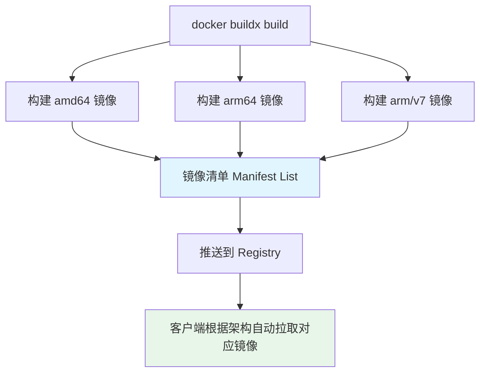

# 多架构镜像构建-buildx

> **文档说明**：系统讲解 Docker Buildx 多架构镜像构建的完整方案，包括 buildx 安装配置、builder 创建、多架构构建、Dockerfile 优化、QEMU 模拟、镜像推送、CI/CD 集成，以及生产级最佳实践和常见问题。
>
> **适用人群**：后端开发者、运维工程师、需要构建 ARM/x86 多架构镜像的开发者
>
> **前置知识**：[[Docker容器化实战]]、[[K8s-核心概念与架构]]、[[容器安全与镜像扫描]]

---

## 一、概述

### 1. 为什么需要多架构镜像

```text
多架构需求场景：
- Apple Silicon（M1/M2/M3）Mac 开发
- AWS Graviton / 阿里云倚天（ARM 服务器）
- 树莓派 / 边缘设备（ARM）
- 混合架构 K8s 集群（x86 + ARM）
- Windows on ARM
```

### 2. 多架构镜像原理



```bash
多架构镜像 = Manifest List（镜像清单）+ 多个架构子镜像

docker pull myapp:latest 时：
1. 客户端先拉取 Manifest List
2. 根据本地架构（如 linux/arm64）选择对应子镜像
3. 拉取对应架构的镜像层
```

### 3. buildx vs 传统 build

| 特性 | docker build | docker buildx build |
|------|-------------|---------------------|
| **多架构** | ❌ 不支持 | ✅ 一次构建多架构 |
| **BuildKit** | 可选 | ✅ 默认使用 |
| **并行构建** | ❌ | ✅ 多架构并行 |
| **缓存导出** | 有限 | ✅ 内联/注册表缓存 |
| **输出格式** | 仅本地 | ✅ docker/oci/registry |

---

## 二、安装与配置

### 1. 安装 buildx

```bash
# Docker Desktop（Mac/Windows）自带 buildx
docker buildx version

# Linux 安装
# 下载二进制
wget https://github.com/docker/buildx/releases/download/v0.12.1/buildx-v0.12.1.linux-amd64
mkdir -p ~/.docker/cli-plugins
mv buildx-v0.12.1.linux-amd64 ~/.docker/cli-plugins/docker-buildx
chmod +x ~/.docker/cli-plugins/docker-buildx

# 验证
docker buildx version
# github.com/docker/buildx v0.12.1
```

### 2. 安装 QEMU（跨架构模拟）

```bash
# Docker Desktop 自带 QEMU

# Linux 安装 QEMU
docker run --privileged --rm tonistiigi/binfmt --install all

# 验证支持的架构
docker buildx ls
# 应该显示 linux/amd64, linux/arm64, linux/arm/v7 等
```

### 3. 创建 Builder

```bash
# 创建支持多架构的 builder
docker buildx create --name multiarch --driver docker-container --use

# 查看 builder
docker buildx ls
# NAME/NODE    DRIVER/ENDPOINT             STATUS  PLATFORMS
# multiarch *  docker-container
#   multiarch0 unix:///var/run/docker.sock running linux/amd64, linux/arm64, ...

# 启动 builder
docker buildx inspect --bootstrap

# 切换 builder
docker buildx use multiarch

# 删除 builder
docker buildx rm multiarch
```

### 4. Builder 驱动对比

| 驱动 | 说明 | 多架构 | 适用场景 |
|------|------|--------|---------|
| **docker** | 默认，使用 Docker 守护进程 | ❌ | 单架构本地构建 |
| **docker-container** | 容器化 BuildKit | ✅ | 多架构构建（推荐） |
| **kubernetes** | K8s Pod 中运行 BuildKit | ✅ | 大规模 CI/CD |
| **remote** | 远程 BuildKit 服务 | ✅ | 远程构建服务 |

---

## 三、构建多架构镜像

### 1. 基本命令

```bash
# 构建并推送多架构镜像
docker buildx build \
  --platform linux/amd64,linux/arm64 \
  --tag myregistry/myapp:latest \
  --push \
  .

# 构建多个标签
docker buildx build \
  --platform linux/amd64,linux/arm64,linux/arm/v7 \
  -t myregistry/myapp:latest \
  -t myregistry/myapp:v1.0.0 \
  --push \
  .

# 构建到本地（不推送，docker-container 驱动需 --load）
docker buildx build \
  --platform linux/amd64 \
  --tag myapp:local \
  --load \
  .
```

### 2. 输出到本地

```bash
# --load：加载到本地 Docker（单架构）
docker buildx build --platform linux/arm64 --load -t myapp:arm64 .

# --output：输出为 OCI 镜像 tar
docker buildx build \
  --platform linux/amd64,linux/arm64 \
  -o type=oci,dest=./myapp-multiarch.tar \
  .

# 输出到目录
docker buildx build \
  --platform linux/amd64,linux/arm64 \
  -o type=local,dest=./output \
  .
```

### 3. 查看多架构镜像

```bash
# 查看镜像清单
docker buildx imagetools inspect myregistry/myapp:latest

# 输出示例：
# Name:      myregistry/myapp:latest
# MediaType: application/vnd.oci.image.index.v1+json
# Digest:    sha256:abc123...
#
# Manifests:
#   Name:      myregistry/myapp:latest@sha256:xxx
#   Platform:  linux/amd64
#
#   Name:      myregistry/myapp:latest@sha256:yyy
#   Platform:  linux/arm64

# 创建 manifest（手动方式）
docker manifest create myapp:multiarch \
  myapp:amd64 \
  myapp:arm64
docker manifest push myapp:multiarch
```

---

## 四、Dockerfile 多架构优化

### 1. 架构相关的基础镜像

```dockerfile
# 官方基础镜像通常已支持多架构
FROM node:20-alpine    # 自动匹配架构
FROM python:3.11-slim  # 自动匹配架构
FROM golang:1.22       # 自动匹配架构

# 查看基础镜像支持的架构
docker buildx imagetools inspect node:20-alpine
```

### 2. 架构条件编译

```dockerfile
# TARGETARCH / TARGETOS 等内置变量（BuildKit）
FROM --platform=$BUILDPLATFORM golang:1.22 AS builder

ARG TARGETOS
ARG TARGETARCH

WORKDIR /app
COPY . .

# 交叉编译
RUN CGO_ENABLED=0 GOOS=$TARGETOS GOARCH=$TARGETARCH \
    go build -o /app/server .

FROM alpine:3.19
COPY --from=builder /app/server /server
CMD ["/server"]
```

### 3. 多阶段构建优化

```dockerfile
# 构建阶段用 BUILDPLATFORM（宿主机架构，快）
# 运行阶段用 TARGETPLATFORM（目标架构）

# syntax=docker/dockerfile:1
FROM --platform=$BUILDPLATFORM golang:1.22 AS builder
ARG TARGETARCH
WORKDIR /src
COPY go.mod go.sum ./
RUN go mod download
COPY . .
RUN CGO_ENABLED=0 GOARCH=$TARGETARCH go build -o /out/server .

FROM --platform=$TARGETPLATFORM alpine:3.19
RUN apk add --no-cache ca-certificates tzdata
COPY --from=builder /out/server /server
EXPOSE 8080
CMD ["/server"]
```

### 4. 架构特定依赖

```dockerfile
# 不同架构安装不同包
FROM ubuntu:22.04

ARG TARGETARCH
RUN if [ "$TARGETARCH" = "amd64" ]; then \
        apt-get install -y some-x86-package; \
    elif [ "$TARGETARCH" = "arm64" ]; then \
        apt-get install -y some-arm-package; \
    fi

# 或用 Dockerfile 中的条件挂载
# --mount=type=cache 缓存依赖
```

### 5. BuildKit 内置变量

| 变量 | 说明 | 示例 |
|------|------|------|
| `TARGETPLATFORM** | 目标平台 | linux/amd64 |
| `TARGETOS` | 目标 OS | linux |
| `TARGETARCH` | 目标架构 | amd64 |
| `TARGETVARIANT` | 目标变体 | v7（arm/v7） |
| `BUILDPLATFORM` | 构建平台 | linux/amd64 |
| `BUILDOS` | 构建 OS | linux |
| `BUILDARCH` | 构建架构 | amd64 |

---

## 五、构建缓存

### 1. 内联缓存

```bash
# 缓存内联到镜像中
docker buildx build \
  --platform linux/amd64,linux/arm64 \
  --cache-to type=inline \
  --cache-from type=registry,ref=myregistry/myapp:buildcache \
  -t myregistry/myapp:latest \
  --push \
  .
```

### 2. 注册表缓存

```bash
# 缓存存储在 Registry（推荐 CI 用）
docker buildx build \
  --platform linux/amd64,linux/arm64 \
  --cache-from type=registry,ref=myregistry/myapp:buildcache \
  --cache-to type=registry,ref=myregistry/myapp:buildcache,mode=max \
  -t myregistry/myapp:latest \
  --push \
  .
```

### 3. 本地缓存

```bash
# 本地目录缓存
docker buildx build \
  --cache-from type=local,src=/tmp/buildcache \
  --cache-to type=local,dest=/tmp/buildcache,mode=max \
  -t myapp:latest \
  .
```

### 4. GitHub Actions 缓存

```yaml
- name: Set up Docker Buildx
  uses: docker/setup-buildx-action@v3

- name: Build and push
  uses: docker/build-push-action@v5
  with:
    platforms: linux/amd64,linux/arm64
    push: true
    tags: myregistry/myapp:latest
    cache-from: type=gha
    cache-to: type=gha,mode=max
```

---

## 六、CI/CD 集成

### 1. GitHub Actions

```yaml
name: Build Multi-Arch
on:
  push:
    tags: ['v*']

jobs:
  build:
    runs-on: ubuntu-latest
    steps:
      - uses: actions/checkout@v4

      - name: Set up QEMU
        uses: docker/setup-qemu-action@v3

      - name: Set up Docker Buildx
        uses: docker/setup-buildx-action@v3

      - name: Login to Registry
        uses: docker/login-action@v3
        with:
          registry: ${{ secrets.REGISTRY }}
          username: ${{ secrets.USERNAME }}
          password: ${{ secrets.PASSWORD }}

      - name: Build and push
        uses: docker/build-push-action@v5
        with:
          context: .
          platforms: linux/amd64,linux/arm64
          push: true
          tags: |
            ${{ secrets.REGISTRY }}/myapp:latest
            ${{ secrets.REGISTRY }}/myapp:${{ github.ref_name }}
          cache-from: type=gha
          cache-to: type=gha,mode=max
```

### 2. GitLab CI

```yaml
build:
  image: docker:24
  services:
    - docker:24-dind
  variables:
    DOCKER_DRIVER: overlay2
  before_script:
    - docker run --privileged --rm tonistiigi/binfmt --install all
    - docker buildx create --use --name multiarch
  script:
    - docker login -u $CI_REGISTRY_USER -p $CI_REGISTRY_PASSWORD $CI_REGISTRY
    - docker buildx build
      --platform linux/amd64,linux/arm64
      --tag $CI_REGISTRY_IMAGE:latest
      --tag $CI_REGISTRY_IMAGE:$CI_COMMIT_TAG
      --push
      .
```

### 3. 原生 ARM Runner（更快）

```yaml
# 使用原生 ARM runner 替代 QEMU 模拟（快 5-10 倍）
jobs:
  build-amd64:
    runs-on: ubuntu-latest
    steps:
      - uses: docker/build-push-action@v5
        with:
          platforms: linux/amd64
          outputs: type=image,name=myapp,push-by-digest=true,name-canonical=true,push=true

  build-arm64:
    runs-on: [self-hosted, linux, ARM64]  # ARM 原生 runner
    steps:
      - uses: docker/build-push-action@v5
        with:
          platforms: linux/arm64
          outputs: type=image,name=myapp,push-by-digest=true,name-canonical=true,push=true

  merge:
    needs: [build-amd64, build-arm64]
    steps:
      - run: |
          docker buildx imagetools create -t myapp:latest \
            myapp@sha256:amd64-digest \
            myapp@sha256:arm64-digest
```

---

## 七、最佳实践

### 1. 构建优化

- [ ] **多阶段构建**：减小最终镜像体积
- [ ] **使用 alpine/slim**：基础镜像尽量小
- [ ] **缓存依赖层**：先复制依赖文件，再复制源码
- [ ] **BUILDPLATFORM 编译**：编译阶段用宿主机架构，快
- [ ] **原生构建优先**：有条件用原生 ARM runner，不用 QEMU
- [ ] **合理选择架构**：只构建需要的架构（amd64 + arm64 通常足够）

### 2. Dockerfile 规范

```dockerfile
# ✅ 依赖层缓存
FROM node:20-alpine
WORKDIR /app
COPY package*.json ./      # 先复制依赖文件
RUN npm ci                 # 安装依赖（缓存层）
COPY . .                   # 再复制源码
RUN npm run build

# ✅ 非 root 用户
RUN addgroup -S app && adduser -S app -G app
USER app

# ✅ 健康检查
HEALTHCHECK --interval=30s --timeout=3s \
  CMD wget -qO- http://localhost:8080/health || exit 1
```

### 3. 安全规范

- [ ] **扫描镜像漏洞**：构建后用 Trivy/Snyk 扫描
- [ ] **使用可信基础镜像**：官方镜像或验证过的镜像
- [ ] **固定基础镜像版本**：不用 latest，用具体 tag 或 digest
- [ ] **最小权限**：非 root 用户运行
- [ ] **多架构都扫描**：每个架构的镜像都要扫描
- [ ] **签名镜像**：用 cosign 签名镜像

---

## 八、常见问题与排查

| 问题 | 原因 | 解决方案 |
|------|------|---------|
| **不支持 arm64** | 未安装 QEMU / builder 不对 | 安装 QEMU、使用 docker-container 驱动 |
| **构建非常慢** | QEMU 模拟慢 | 用原生 ARM runner、优化缓存 |
| **--load 多架构失败** | 本地 Docker 不支持多架构 | 单架构用 --load，多架构用 --push |
| **基础镜像不支持架构** | 基础镜像只有 amd64 | 换支持多架构的基础镜像 |
| **交叉编译失败** | 工具链不支持目标架构 | 安装交叉编译工具链、用对应架构基础镜像 |
| **推送失败** | 未登录 / 权限不足 | docker login、检查权限 |
| **拉取到错误架构** | Manifest 有问题 | 用 imagetools inspect 检查 |
| **缓存不命中** | 缓存配置错误 | 检查 cache-from/cache-to、mode=max |
| **ARM 镜像运行报错** | 二进制架构不对 | 检查构建时的 TARGETARCH、交叉编译配置 |
| **buildx 命令找不到** | 未安装 / 版本旧 | 安装 buildx 插件、升级 Docker |
| **builder 启动失败** | Docker 权限 / 端口占用 | 检查 Docker 权限、换 builder 名 |
| **磁盘空间不足** | 多架构构建占空间 | docker buildx prune、清理缓存 |
| **CI 中 QEMU 慢** | 模拟开销大 | 用原生 runner、减少架构数 |
| **镜像体积差异大** | 架构依赖不同 | 检查各架构安装的包 |
| **测试多架构镜像** | 本地只有一种架构 | docker run --platform linux/arm64 测试 |

---

## 九、关联笔记

### 容器相关
- [[Docker容器化实战]] · [[容器安全与镜像扫描]] · [[K8s-核心概念与架构]]
- [[Kustomize-K8s配置管理]]

### 云原生
- [[K8s-服务发现与负载均衡]] · [[APM应用性能监控-SkyWalking]] · [[SBOM软件物料清单]]
- [[依赖漏洞检测-Snyk]]

### 导航
- [[MOC-云原生与运维]] · [[全栈+AI工程双轨融合学习路线图]]

> **学习路径建议**：先掌握 [[Docker容器化实战]] Docker 基础 → 深入本文多架构镜像构建 → 实践 [[容器安全与镜像扫描]] 镜像安全 → 学习 [[K8s-核心概念与架构]] K8s 部署 → 研究 [[Kustomize-K8s配置管理]] 配置管理 → 构建完整的云原生交付能力。

---

## 💡 全文深度讲解

本文系统梳理了多架构镜像构建-buildx的核心知识体系，从概述入手，深入安装与配置的底层机制，再通过构建多架构镜像掌握实战应用，最后涵盖常见问题与排查与关联笔记。学习时建议先建立整体认知，再动手实践，最后结合常见问题深化理解。

## 📝 全文精简总结

- **概述**：掌握本模块的核心概念与关键要点
- **安装与配置**：掌握本模块的核心概念与关键要点
- **构建多架构镜像**：掌握本模块的核心概念与关键要点
- **Dockerfile 多架构优化**：掌握本模块的核心概念与关键要点
- **构建缓存**：掌握本模块的核心概念与关键要点
- **CI/CD 集成**：掌握本模块的核心概念与关键要点
- **最佳实践**：掌握本模块的核心概念与关键要点
- **常见问题与排查**：掌握本模块的核心概念与关键要点
- 其余1个模块涵盖进阶主题与拓展内容

