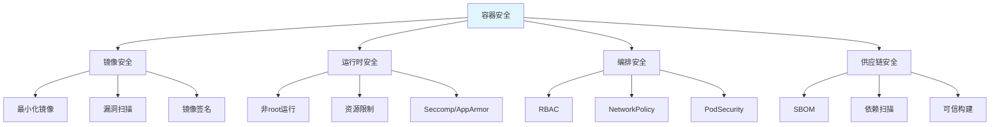

# 容器安全与镜像扫描

> **文档说明**：系统讲解容器全生命周期安全，包括镜像构建安全、镜像漏洞扫描、运行时安全、Kubernetes 安全配置、密钥管理、供应链安全，以及 Dockerfile 最佳实践和常见漏洞防御。
>
> **适用人群**：运维工程师、SRE、后端开发者、DevSecOps 工程师
>
> **前置知识**：[[Docker容器化实战]]、[[多架构镜像构建-buildx]]、[[K8s-核心概念与架构]]

---

## 一、概述

### 1. 容器安全的层次



### 2. 容器 vs 虚拟机安全

| 维度 | 容器 | 虚拟机 |
|------|------|--------|
| **隔离性** | 共享内核，隔离较弱 | 硬件级隔离，强 |
| **攻击面** | 内核漏洞影响所有容器 | 独立内核，影响小 |
| **启动速度** | 秒级 | 分钟级 |
| **资源开销** | 低 | 高 |
| **安全工具** | 容器专用（Trivy、Falco） | 传统安全工具 |

### 3. 容器安全生命周期

```text
1. 构建阶段：Dockerfile 安全、基础镜像选择、依赖扫描
2. 分发阶段：镜像签名、私有仓库、访问控制
3. 部署阶段：准入控制、策略校验、密钥注入
4. 运行阶段：运行时监控、行为检测、网络隔离
5. 销毁阶段：日志留存、数据清理
```

---

## 二、镜像构建安全

### 1. 最小化基础镜像

```text
基础镜像选择原则：
- 优先用 distroless（只含应用和运行时依赖）
- 其次用 alpine（小，但用 musl libc）
- 避免用 latest 标签，用具体版本
- 定期更新基础镜像

镜像大小对比：
- ubuntu:22.04 ≈ 77MB
- debian:bookworm-slim ≈ 80MB
- alpine:3.19 ≈ 7MB
- gcr.io/distroless/base ≈ 20MB
- gcr.io/distroless/static ≈ 2MB
- scratch ≈ 0MB（静态编译程序可用）
```

### 2. 多阶段构建

```dockerfile
# 构建阶段
FROM golang:1.22 AS builder
WORKDIR /app
COPY go.mod go.sum ./
RUN go mod download
COPY . .
RUN CGO_ENABLED=0 go build -o /app/server .

# 运行阶段（distroless）
FROM gcr.io/distroless/static:nonroot
COPY --from=builder /app/server /server
USER nonroot:nonroot
ENTRYPOINT ["/server"]
```

### 3. 非 root 用户运行

```dockerfile
# 创建非 root 用户
RUN groupadd -r appuser && useradd -r -g appuser -d /app -s /sbin/nologin appuser
USER appuser

# 或用 alpine
RUN addgroup -S appgroup && adduser -S appuser -G appgroup
USER appuser

# distroless 内置 nonroot 用户
FROM gcr.io/distroless/base:nonroot
USER nonroot
```

### 4. Dockerfile 安全最佳实践

```dockerfile
# ✅ 好的做法
FROM node:20-alpine AS builder  # 具体版本
WORKDIR /app
COPY package*.json ./            # 先复制依赖，利用缓存
RUN npm ci --only=production     # 只装生产依赖
COPY . .
RUN npm run build

FROM node:20-alpine
WORKDIR /app
COPY --from=builder /app/dist ./dist
COPY --from=builder /app/node_modules ./node_modules
RUN addgroup -S appgroup && adduser -S appuser -G appgroup
USER appuser
EXPOSE 3000
HEALTHCHECK CMD curl -f http://localhost:3000/health || exit 1
CMD ["node", "dist/main.js"]

# ❌ 避免的做法
FROM ubuntu:latest               # latest 标签
RUN apt-get update && apt-get install -y curl  # 不清理缓存
USER root                        # root 运行
COPY . .                         # 复制全部（含 .git、密钥）
RUN npm install                  # 开发依赖也装上
ENV PASSWORD=secret123           # 镜像中硬编码密钥
```

### 5. .dockerignore

```css
# .dockerignore
.git
.gitignore
node_modules
npm-debug.log
Dockerfile
.dockerignore
.env
.env.*
*.md
*.test.js
coverage
.vscode
.idea
```

---

## 三、镜像漏洞扫描

### 1. Trivy（推荐）

```bash
# 安装
brew install trivy
# 或 Docker
alias trivy='docker run --rm -v $PWD:/app -v /var/run/docker.sock:/var/run/docker.sock aquasec/trivy'

# 扫描镜像
trivy image myapp:latest

# 只显示高危漏洞
trivy image --severity HIGH,CRITICAL myapp:latest

# 输出 JSON
trivy image --format json --output result.json myapp:latest

# 扫描文件系统
trivy fs /path/to/project

# 扫描配置文件（Dockerfile/K8s）
trivy config /path/to/k8s

# 扫描仓库
trivy repo https://github.com/org/repo

# 忽略特定漏洞
trivy image --ignorefile .trivyignore myapp:latest
```

```css
# .trivyignore
# 忽略无补丁的漏洞
CVE-2023-1234
CVE-2023-5678
```

### 2. 其他扫描工具

| 工具 | 特点 | 适用场景 |
|------|------|---------|
| **Trivy** | 简单、快速、支持多目标 | CI/CD、日常扫描 |
| **Clair** | 深度集成、API 丰富 | 企业级、镜像仓库集成 |
| **Grype** | 与 Syft 配合、SBOM | 供应链安全 |
| **Snyk** | 商业、修复建议 | 团队协作、依赖管理 |
| **Anchore** | 策略引擎、合规 | 企业合规 |
| **Docker Scout** | Docker 官方集成 | Docker Hub 用户 |

### 3. CI/CD 集成

```yaml
# GitHub Actions
name: Security Scan
on: [push, pull_request]
jobs:
  scan:
    runs-on: ubuntu-latest
    steps:
      - uses: actions/checkout@v4

      - name: Build image
        run: docker build -t myapp:${{ github.sha }} .

      - name: Run Trivy
        uses: aquasecurity/trivy-action@master
        with:
          image-ref: myapp:${{ github.sha }}
          format: 'sarif'
          output: 'trivy-results.sarif'
          severity: 'CRITICAL,HIGH'
          exit-code: '1'  # 高危漏洞阻断构建

      - name: Upload results
        uses: github/codeql-action/upload-sarif@v3
        with:
          sarif_file: trivy-results.sarif
```

---

## 四、运行时安全

### 1. 资源限制

```yaml
# Docker
docker run --memory=512m --cpus=1 --pids-limit=100 myapp

# Docker Compose
services:
  app:
    image: myapp
    deploy:
      resources:
        limits:
          cpus: '1'
          memory: 512M
        reservations:
          cpus: '0.5'
          memory: 256M

# Kubernetes
resources:
  requests:
    cpu: "250m"
    memory: "256Mi"
  limits:
    cpu: "1"
    memory: "512Mi"
```

### 2. 只读文件系统

```yaml
# Docker
docker run --read-only --tmpfs /tmp myapp

# Kubernetes
securityContext:
  readOnlyRootFilesystem: true
volumes:
  - name: tmp
    emptyDir:
      medium: Memory
      sizeLimit: 64Mi
volumeMounts:
  - name: tmp
    mountPath: /tmp
```

### 3. Seccomp

```bash
Seccomp（Secure Computing Mode）：
- 限制容器可以调用的系统调用
- 默认 Docker 有 seccomp 配置，禁用约 44 个系统调用
- 自定义 seccomp profile 可以进一步限制

# 使用自定义 seccomp
docker run --security-opt seccomp=profile.json myapp

# Kubernetes（annotations）
annotations:
  seccomp.security.alpha.kubernetes.io/pod: runtime/default
```

### 4. Capabilities 限制

```yaml
# Docker：删除所有能力，只添加需要的
docker run --cap-drop=ALL --cap-add=NET_BIND_SERVICE myapp

# Kubernetes
securityContext:
  capabilities:
    drop:
      - ALL
    add:
      - NET_BIND_SERVICE
  allowPrivilegeEscalation: false
  runAsNonRoot: true
  runAsUser: 1000
```

### 5. 运行时监控（Falco）

```bash
Falco：云原生运行时安全工具
- 监控系统调用，检测异常行为
- 规则引擎，实时告警
- 支持容器、K8s、主机

# 安装
helm install falco falcosecurity/falco

# 示例规则
- rule: Shell in container
  desc: 容器中启动 shell
  condition: spawned_process and container and shell_procs
  output: "Shell spawned in container (user=%user.name container=%container.name)"
  priority: WARNING
```

---

## 五、Kubernetes 安全

### 1. RBAC 最小权限

```yaml
# 最小权限 ServiceAccount
apiVersion: v1
kind: ServiceAccount
metadata:
  name: app-sa
  namespace: production
---
apiVersion: rbac.authorization.k8s.io/v1
kind: Role
metadata:
  name: app-role
  namespace: production
rules:
  - apiGroups: [""]
    resources: ["configmaps"]
    verbs: ["get", "list"]
  - apiGroups: [""]
    resources: ["secrets"]
    verbs: ["get"]
    resourceNames: ["app-secret"]  # 只允许特定 secret
---
apiVersion: rbac.authorization.k8s.io/v1
kind: RoleBinding
metadata:
  name: app-binding
  namespace: production
subjects:
  - kind: ServiceAccount
    name: app-sa
roleRef:
  kind: Role
  name: app-role
  apiGroup: rbac.authorization.k8s.io
```

### 2. Pod Security Standards

```yaml
# Restricted 策略（最严格）
securityContext:
  runAsNonRoot: true
  runAsUser: 1000
  runAsGroup: 1000
  fsGroup: 1000
  allowPrivilegeEscalation: false
  readOnlyRootFilesystem: true
  seccompProfile:
    type: RuntimeDefault
  capabilities:
    drop:
      - ALL

# 命名空间标签启用 Pod Security Admission
apiVersion: v1
kind: Namespace
metadata:
  name: production
  labels:
    pod-security.kubernetes.io/enforce: restricted
    pod-security.kubernetes.io/audit: restricted
    pod-security.kubernetes.io/warn: restricted
```

### 3. NetworkPolicy

```yaml
# 默认拒绝所有入站
apiVersion: networking.k8s.io/v1
kind: NetworkPolicy
metadata:
  name: default-deny-ingress
  namespace: production
spec:
  podSelector: {}
  policyTypes:
    - Ingress

# 允许特定服务访问
apiVersion: networking.k8s.io/v1
kind: NetworkPolicy
metadata:
  name: allow-api
  namespace: production
spec:
  podSelector:
    matchLabels:
      app: backend
  policyTypes:
    - Ingress
  ingress:
    - from:
        - podSelector:
            matchLabels:
              app: frontend
      ports:
        - protocol: TCP
          port: 8080
```

### 4. Secret 管理

```yaml
# 不要在镜像中硬编码密钥
# 用 K8s Secret 或外部密钥管理

# K8s Secret（Base64 编码，不是加密）
apiVersion: v1
kind: Secret
metadata:
  name: app-secret
type: Opaque
data:
  password: c2VjcmV0MTIz  # base64

# 推荐：External Secrets Operator
# 从 Vault/AWS Secrets Manager/GCP Secret Manager 同步
apiVersion: external-secrets.io/v1beta1
kind: ExternalSecret
metadata:
  name: app-secret
spec:
  refreshInterval: 1h
  secretStoreRef:
    name: vault-backend
    kind: ClusterSecretStore
  target:
    name: app-secret
  data:
    - secretKey: password
      remoteRef:
        key: secret/app
        property: password
```

---

## 六、供应链安全

### 1. SBOM（软件物料清单）

```bash
# 生成 SBOM（Syft）
syft myapp:latest -o spdx-json > sbom.spdx.json
syft myapp:latest -o cyclonedx-json > sbom.cdx.json

# 基于 SBOM 扫描漏洞（Grype）
grype sbom:sbom.spdx.json

# Trivy 生成 SBOM
trivy image --format spdx-json --output sbom.json myapp:latest
```

### 2. 镜像签名

```bash
# Cosign 签名
cosign generate-key-pair
cosign sign --key cosign.key myapp:latest

# 验证签名
cosign verify --key cosign.pub myapp:latest

# K8s 准入控制（Kyverno / Connaisseur）
# 只允许运行已签名的镜像
```

### 3. 可信构建

```text
SLSA 框架（Supply-chain Levels for Software Artifacts）：
- Level 1：有构建过程文档
- Level 2：托管构建服务，生成 provenance
- Level 3：构建环境隔离，防篡改
- Level 4：最高安全，可验证的构建

实践：
- 使用 GitHub Actions / GitLab CI 等托管构建
- 生成构建 provenance（SLSA）
- 镜像签名（Cosign）
- SBOM 生成和扫描
- 依赖锁定（package-lock.json / go.sum）
```

---

## 七、常见漏洞与防御

| 漏洞/风险 | 描述 | 防御措施 |
|-----------|------|---------|
| **镜像漏洞** | 基础镜像/依赖有 CVE | 定期扫描、更新基础镜像、最小化 |
| **密钥泄露** | 镜像中硬编码密码/密钥 | 用 Secret、.dockerignore、多阶段构建 |
| **特权容器** | --privileged 运行 | 禁止特权、最小 capabilities |
| **root 运行** | 容器以 root 运行 | 非 root 用户、runAsNonRoot |
| **资源耗尽** | 无资源限制导致 DoS | 设置 CPU/内存/进程限制 |
| **网络攻击** | 容器间无网络隔离 | NetworkPolicy、服务网格 |
| **内核漏洞** | 容器共享内核 | 及时更新内核、gVisor/Kata 强隔离 |
| **镜像投毒** | 供应链攻击 | 镜像签名、私有仓库、SBOM |
| **日志泄露** | 日志中包含敏感信息 | 日志脱敏、Secret 不打印 |
| **挂载宿主机目录** | -v /:/host 危险挂载 | 禁止挂载宿主机敏感目录 |

---

## 八、最佳实践清单

### 构建阶段
- [ ] 使用具体版本标签，不用 latest
- [ ] 多阶段构建，运行镜像最小化
- [ ] 非 root 用户运行
- [ ] .dockerignore 排除敏感文件
- [ ] 不硬编码密钥，用构建参数或运行时注入
- [ ] 合并 RUN 层，清理包管理器缓存
- [ ] 镜像漏洞扫描，高危阻断 CI

### 运行阶段
- [ ] 设置资源限制（CPU/内存/进程）
- [ ] 只读根文件系统
- [ ] 删除所有 capabilities，只添加必要的
- [ ] 禁止特权容器
- [ ] 禁止 allowPrivilegeEscalation
- [ ] 启用 seccomp/AppArmor
- [ ] 运行时监控（Falco）

### K8s 阶段
- [ ] RBAC 最小权限
- [ ] Pod Security Standards（Restricted）
- [ ] NetworkPolicy 网络隔离
- [ ] Secret 用外部管理（Vault）
- [ ] 镜像拉取策略 Always + 签名验证
- [ ] 审计日志开启
- [ ] 命名空间隔离环境

### 供应链
- [ ] 生成 SBOM
- [ ] 镜像签名（Cosign）
- [ ] 依赖锁定和扫描
- [ ] 可信构建（SLSA）
- [ ] 私有镜像仓库 + 访问控制
- [ ] 定期更新基础镜像和依赖

---

## 九、常见问题与排查

| 问题 | 原因 | 解决方案 |
|------|------|---------|
| **扫描出大量漏洞** | 基础镜像老旧 | 更新基础镜像、用 distroless/alpine |
| **非 root 无法绑定 80 端口** | 1024 以下端口需 root | 用 NET_BIND_SERVICE capability 或改端口 |
| **只读文件系统应用崩溃** | 应用需要写临时文件 | 挂载 tmpfs 到 /tmp、调整应用 |
| **Trivy 扫描慢** | 首次下载漏洞库 | 缓存漏洞库、CI 中用 cache |
| **K8s Pod 被 PSS 拒绝** | 安全配置不达标 | 按 Restricted 策略调整 securityContext |
| **Secret 在镜像中** | COPY 了 .env 或构建时残留 | .dockerignore、多阶段构建、检查镜像 |
| **容器逃逸风险** | 特权/挂载/内核漏洞 | 禁止特权、不挂载敏感目录、更新内核 |
| **NetworkPolicy 不生效** | 未安装 CNI 支持 | 用 Calico/Cilium 等支持 NetworkPolicy 的 CNI |
| **镜像拉取失败** | 私有仓库未配置 secret | 配置 imagePullSecrets |
| **运行时检测不到异常** | Falco 未正确部署 | 检查 DaemonSet、驱动、规则 |
| **SBOM 不准确** | 构建工具不支持 | 用 Syft/Trivy 生成、多阶段构建注意 |
| **密钥在日志中** | 应用打印环境变量 | 日志脱敏、Secret 不输出到日志 |
| **CI 扫描误报多** | 漏洞库更新/无补丁 | 用 .trivyignore 忽略、区分可利用性 |
| **多架构镜像扫描** | 只扫了一个架构 | Trivy 支持 --platform 指定架构 |
| **镜像体积大** | 层多/缓存未清理 | 多阶段构建、合并 RUN、清理缓存 |

---

## 十、关联笔记

### 容器与云原生
- [[Docker容器化实战]] · [[多架构镜像构建-buildx]] · [[K8s-核心概念与架构]]
- [[Kustomize-K8s配置管理]] · [[Operator与CRD开发]]

### 安全相关
- [[常见攻击与防御手段]] · [[密码学基础-对称非对称哈希]] · [[API安全最佳实践]]
- [[依赖漏洞检测-Snyk]] · [[SBOM软件物料清单]]

### 运维
- [[APM应用性能监控-SkyWalking]] · [[kubectl命令速查表]]

### 导航
- [[MOC-云原生与运维]] · [[MOC-计算机基础]] · [[全栈+AI工程双轨融合学习路线图]]

> **学习路径建议**：先掌握 [[Docker容器化实战]] 容器基础 → 深入本文容器安全 → 学习 [[K8s-核心概念与架构]] K8s 安全 → 实践 [[多架构镜像构建-buildx]] 镜像构建 → 研究 [[SBOM软件物料清单]] 供应链安全 → 构建完整的云原生安全体系。

---

## 💡 全文深度讲解

本文系统梳理了容器安全与镜像扫描的核心知识体系，从概述入手，深入镜像构建安全的底层机制，再通过镜像漏洞扫描掌握实战应用，最后涵盖常见问题与排查与关联笔记。学习时建议先建立整体认知，再动手实践，最后结合常见问题深化理解。

## 📝 全文精简总结

- **概述**：掌握本模块的核心概念与关键要点
- **镜像构建安全**：掌握本模块的核心概念与关键要点
- **镜像漏洞扫描**：掌握本模块的核心概念与关键要点
- **运行时安全**：掌握本模块的核心概念与关键要点
- **Kubernetes 安全**：掌握本模块的核心概念与关键要点
- **供应链安全**：掌握本模块的核心概念与关键要点
- **常见漏洞与防御**：掌握本模块的核心概念与关键要点
- **最佳实践清单**：掌握本模块的核心概念与关键要点
- 其余2个模块涵盖进阶主题与拓展内容

