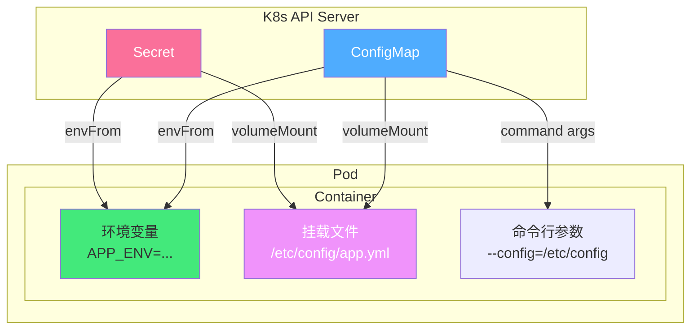

# 🔐 Kubernetes ConfigMap 与 Secret

> **文档说明**：系统讲解 Kubernetes 中 ConfigMap 与 Secret 的完整知识体系，涵盖配置与密钥管理原理、ConfigMap 创建与使用（环境变量/文件挂载/命令行参数）、Secret 类型与使用（Opaque/docker-registry/tls/service-account-token）、配置热更新、不可变配置、RBAC 权限控制、与 Helm 集成、最佳实践与安全加固。ConfigMap 和 Secret 是 K8s 中实现「配置与代码分离」的核心资源对象。
>
> **适用人群**：DevOps 工程师、K8s 开发者、运维工程师、后端开发者
>
> **前置知识**：[[Kubernetes入门与实践]] · [[Docker容器化实战]]

---

## 一、概述

### 1.1 为什么需要 ConfigMap 和 Secret

容器化应用的核心原则之一是「**配置与代码分离**」——同一份镜像应该能在不同环境（开发/测试/生产）中运行，通过外部注入配置来适应不同环境。

| 问题 | 说明 |
|------|------|
| **配置硬编码** | 配置写在代码或镜像中，修改配置需要重新构建镜像 |
| **环境差异** | 开发/测试/生产环境配置不同，需要多份镜像 |
| **敏感信息泄露** | 密码、密钥写在镜像或代码中，存在安全风险 |
| **配置更新困难** | 修改配置需要重新部署应用，无法热更新 |
| **配置分散** | 配置散落在各个服务中，难以统一管理 |

**K8s 的解决方案**：
- **ConfigMap**：存储非敏感配置数据（如应用配置、环境变量、配置文件）
- **Secret**：存储敏感数据（如密码、API 密钥、TLS 证书、Token）

### 1.2 ConfigMap vs Secret

| 维度 | ConfigMap | Secret |
|------|-----------|--------|
| **用途** | 非敏感配置 | 敏感信息（密码/密钥/证书） |
| **存储** | 明文存储（etcd 中） | Base64 编码（etcd 中，非加密） |
| **显示** | `kubectl describe` 可查看明文 | `kubectl describe` 隐藏值（显示大小） |
| **使用方式** | 环境变量/文件挂载/命令行参数 | 环境变量/文件挂载/imagePullSecret |
| **大小限制** | 1MB（etcd 限制） | 1MB（etcd 限制） |
| **不可变** | 支持 `immutable: true` | 支持 `immutable: true` |

> **重要**：Secret 只是 Base64 编码，不是加密！任何能访问 etcd 或有 `get secret` 权限的人都能解码。生产环境应开启 etcd 静态加密。

### 1.3 核心应用场景

| 场景 | 资源 | 说明 |
|------|------|------|
| 应用配置文件 | ConfigMap | nginx.conf、application.yml 等 |
| 环境变量 | ConfigMap | 数据库地址、端口、日志级别等 |
| 命令行参数 | ConfigMap | 容器启动参数 |
| 数据库密码 | Secret | MySQL/Redis 密码 |
| API 密钥 | Secret | 第三方服务 API Key |
| TLS 证书 | Secret | HTTPS 证书（kubernetes.io/tls） |
| 镜像仓库凭证 | Secret | 私有镜像仓库登录凭证（kubernetes.io/dockerconfigjson） |
| ServiceAccount Token | Secret | Pod 访问 K8s API 的凭证 |

---

## 二、底层原理

### 2.1 ConfigMap 数据结构

```yaml
apiVersion: v1
kind: ConfigMap
metadata:
  name: app-config
  namespace: default
data:
  # 键值对形式（用于环境变量）
  APP_ENV: "production"
  LOG_LEVEL: "info"
  MAX_CONNECTIONS: "100"
  
  # 文件内容形式（用于文件挂载）
  app.properties: |
    server.port=8080
    spring.datasource.url=jdbc:mysql://db:3306/app
    spring.datasource.username=admin
  
  nginx.conf: |
    server {
        listen 80;
        server_name example.com;
        location / {
            proxy_pass http://backend:8080;
        }
    }
```

| 字段 | 说明 |
|------|------|
| `data` | 存储配置数据，值为字符串 |
| `binaryData` | 存储二进制数据（Base64 编码），K8s 1.10+ |
| `immutable` | 设为 true 后不可修改，提升安全性和性能 |

### 2.2 Secret 类型

| 类型 | type 字段 | 说明 |
|------|-----------|------|
| **Opaque** | `Opaque` | 默认类型，任意用户定义数据 |
| **Service Account Token** | `kubernetes.io/service-account-token` | ServiceAccount 的 API Token |
| **Docker Config** | `kubernetes.io/dockerconfigjson` | 私有镜像仓库凭证（.dockerconfigjson） |
| **Basic Auth** | `kubernetes.io/basic-auth` | 基本认证（username/password） |
| **SSH Auth** | `kubernetes.io/ssh-auth` | SSH 密钥（ssh-privatekey） |
| **TLS** | `kubernetes.io/tls` | TLS 证书（tls.crt/tls.key） |
| **Bootstrap Token** | `bootstrap.kubernetes.io/token` | 节点加入集群的引导 Token |

### 2.3 Secret 数据结构

```yaml
apiVersion: v1
kind: Secret
metadata:
  name: db-secret
type: Opaque
data:
  # 值必须是 Base64 编码
  username: YWRtaW4=          # admin
  password: c3VwZXJzZWNyZXQ=  # supersecret
---
apiVersion: v1
kind: Secret
metadata:
  name: tls-secret
type: kubernetes.io/tls
data:
  tls.crt: <base64-encoded-cert>
  tls.key: <base64-encoded-key>
---
apiVersion: v1
kind: Secret
metadata:
  name: regcred
type: kubernetes.io/dockerconfigjson
data:
  .dockerconfigjson: <base64-encoded-docker-config>
```

### 2.4 配置注入原理



**三种注入方式对比**：

| 方式 | ConfigMap | Secret | 热更新 | 说明 |
|------|-----------|--------|--------|------|
| **环境变量** | ✅ | ✅ | ❌ 不支持 | Pod 重启才生效 |
| **文件挂载** | ✅ | ✅ | ✅ 支持 | kubelet 定期同步（默认 60s） |
| **命令行参数** | ✅ | ❌ 不推荐 | ❌ 不支持 | 通过 `$(VAR_NAME)` 引用环境变量 |

---

## 三、实操示例

### 3.1 创建 ConfigMap

```bash
# ===== 方式1：从字面量创建 =====
kubectl create configmap app-config \
  --from-literal=APP_ENV=production \
  --from-literal=LOG_LEVEL=info \
  --from-literal=MAX_CONNECTIONS=100

# ===== 方式2：从文件创建（键名为文件名） =====
kubectl create configmap nginx-config \
  --from-file=nginx.conf=./nginx.conf

# ===== 方式3：从目录创建（每个文件一个键） =====
kubectl create configmap app-config \
  --from-file=./config/

# ===== 方式4：从 env 文件创建 =====
kubectl create configmap env-config \
  --from-env-file=./app.env

# ===== 方式5：从 YAML 文件创建 =====
kubectl apply -f configmap.yaml
```

```bash
# app.env 文件内容
APP_ENV=production
LOG_LEVEL=info
MAX_CONNECTIONS=100
```

### 3.2 创建 Secret

```bash
# ===== 方式1：从字面量创建（Opaque） =====
kubectl create secret generic db-secret \
  --from-literal=username=admin \
  --from-literal=password=supersecret

# ===== 方式2：从文件创建 =====
kubectl create secret generic ssh-key \
  --from-file=ssh-privatekey=~/.ssh/id_rsa

# ===== 方式3：TLS 证书 Secret =====
kubectl create secret tls tls-secret \
  --cert=./tls.crt \
  --key=./tls.key

# ===== 方式4：Docker 仓库凭证 =====
kubectl create secret docker-registry regcred \
  --docker-server=registry.example.com \
  --docker-username=admin \
  --docker-password=password \
  --docker-email=admin@example.com

# ===== 方式5：手动 Base64 编码 =====
echo -n 'admin' | base64      # YWRtaW4=
echo -n 'supersecret' | base64 # c3VwZXJzZWNyZXQ=
```

### 3.3 Pod 中使用 ConfigMap

```yaml
# pod-with-configmap.yaml — Pod 中使用 ConfigMap
apiVersion: v1
kind: Pod
metadata:
  name: app-pod
spec:
  containers:
    - name: app
      image: myapp:latest
      
      # ===== 方式1：环境变量（单个键） =====
      env:
        - name: APP_ENV
          valueFrom:
            configMapKeyRef:
              name: app-config
              key: APP_ENV
        - name: LOG_LEVEL
          valueFrom:
            configMapKeyRef:
              name: app-config
              key: LOG_LEVEL
      
      # ===== 方式2：环境变量（全部键，envFrom） =====
      envFrom:
        - configMapRef:
            name: app-config
      
      # ===== 方式3：命令行参数引用环境变量 =====
      command: ["/bin/sh", "-c"]
      args:
        - "echo App env: $APP_ENV; echo Log level: $LOG_LEVEL"
      
      # ===== 方式4：文件挂载 =====
      volumeMounts:
        - name: config-volume
          mountPath: /etc/config
          readOnly: true
        # 只挂载特定文件
        - name: nginx-volume
          mountPath: /etc/nginx/nginx.conf
          subPath: nginx.conf
  
  # 定义 Volume
  volumes:
    - name: config-volume
      configMap:
        name: app-config
    - name: nginx-volume
      configMap:
        name: nginx-config
        items:
          - key: nginx.conf
            path: nginx.conf
            mode: 0644  # 文件权限
```

### 3.4 Pod 中使用 Secret

```yaml
# pod-with-secret.yaml — Pod 中使用 Secret
apiVersion: v1
kind: Pod
metadata:
  name: app-pod
spec:
  containers:
    - name: app
      image: myapp:latest
      
      # ===== 方式1：环境变量 =====
      env:
        - name: DB_USERNAME
          valueFrom:
            secretKeyRef:
              name: db-secret
              key: username
        - name: DB_PASSWORD
          valueFrom:
            secretKeyRef:
              name: db-secret
              key: password
      
      # ===== 方式2：全部键（envFrom） =====
      envFrom:
        - secretRef:
            name: db-secret
      
      # ===== 方式3：文件挂载（推荐，更安全） =====
      volumeMounts:
        - name: secret-volume
          mountPath: /etc/secrets
          readOnly: true
        # TLS 证书挂载
        - name: tls-volume
          mountPath: /etc/tls
          readOnly: true
  
  volumes:
    - name: secret-volume
      secret:
        secretName: db-secret
        # 可选：指定权限和文件模式
        defaultMode: 0400  # 仅所有者可读
    - name: tls-volume
      secret:
        secretName: tls-secret
  
  # ===== 方式4：镜像仓库凭证（imagePullSecrets） =====
  imagePullSecrets:
    - name: regcred
```

### 3.5 配置热更新

```yaml
# ConfigMap 变更后，文件挂载方式会自动更新（环境变量不会）
# 验证热更新：
kubectl exec -it app-pod -- cat /etc/config/app.properties

# 修改 ConfigMap
kubectl edit configmap app-config

# 等待 kubelet 同步（默认 60s，可配置）
# 然后再次查看，文件内容已更新
kubectl exec -it app-pod -- cat /etc/config/app.properties
```

> **注意**：
> - 文件挂载方式支持热更新（kubelet 定期同步）
> - 环境变量方式**不支持**热更新，需要重启 Pod
> - 应用需要支持配置热加载（如监听文件变化或定时重新读取）
> - 不可变 ConfigMap（`immutable: true`）不支持热更新

### 3.6 不可变配置

```yaml
# 不可变 ConfigMap（K8s 1.19+ GA）
apiVersion: v1
kind: ConfigMap
metadata:
  name: immutable-config
data:
  APP_ENV: "production"
immutable: true  # 设为 true 后不可修改，只能删除重建

---
# 不可变 Secret
apiVersion: v1
kind: Secret
metadata:
  name: immutable-secret
type: Opaque
data:
  password: c3VwZXJzZWNyZXQ=
immutable: true
```

**不可变配置的优势**：
- ✅ 防止意外修改导致应用异常
- ✅ kubelet 不需要轮询检查更新，提升性能
- ✅ 提升安全性（敏感配置不可篡改）

### 3.7 RBAC 权限控制

```yaml
# 限制对 Secret 的访问权限
apiVersion: rbac.authorization.k8s.io/v1
kind: Role
metadata:
  namespace: default
  name: secret-reader
rules:
  - apiGroups: [""]
    resources: ["secrets"]
    verbs: ["get", "list", "watch"]  # 谨慎授予！
    resourceNames: ["db-secret"]  # 只允许访问特定 Secret

---
# 禁止查看 Secret 内容（只能查看元数据）
apiVersion: rbac.authorization.k8s.io/v1
kind: ClusterRole
metadata:
  name: secret-metadata-viewer
rules:
  - apiGroups: [""]
    resources: ["secrets"]
    verbs: ["list"]  # 只能 list，不能 get（看不到内容）
```

### 3.8 常用操作命令

```bash
# 查看 ConfigMap
kubectl get configmap
kubectl get configmap app-config -o yaml
kubectl describe configmap app-config

# 查看 Secret（内容隐藏）
kubectl get secret
kubectl get secret db-secret -o yaml
kubectl describe secret db-secret

# 解码 Secret 值
kubectl get secret db-secret -o jsonpath='{.data.password}' | base64 -d

# 删除
kubectl delete configmap app-config
kubectl delete secret db-secret

# 从文件更新 ConfigMap
kubectl create configmap app-config --from-file=app.properties --dry-run=client -o yaml | kubectl apply -f -
```

---

## 四、常见问题与排查

| 问题现象 | 可能原因 | 解决方案 |
|---------|---------|---------|
| **Pod 启动失败，引用的 ConfigMap 不存在** | ConfigMap 未创建或名称错误 | 先创建 ConfigMap；用 `optional: true` 允许不存在 |
| **环境变量不更新** | 环境变量不支持热更新 | 重启 Pod；或改用文件挂载方式 |
| **挂载文件不更新** | kubelet 同步延迟；缓存 | 等待 60s；检查 kubelet 配置；删除 Pod 重建 |
| **Secret 值乱码** | 未 Base64 解码；编码错误 | 用 `echo -n 'value' \| base64` 编码；注意 `-n` 去掉换行 |
| **Secret 泄露** | etcd 未加密；RBAC 权限过宽 | 开启 etcd 静态加密；最小权限原则；用外部密钥管理 |
| **ConfigMap 太大** | 超过 1MB 限制 | 拆分 ConfigMap；用 Volume 挂载大文件；用对象存储 |
| **subPath 挂载不更新** | subPath 已知限制 | 不用 subPath；或重启 Pod；K8s 1.18+ 部分修复 |
| **Secret 作为环境变量不安全** | 环境变量可能在日志/进程信息中泄露 | 用文件挂载替代；设置文件权限 0400；应用读取后清除 |
| **不同环境配置混乱** | 未按环境隔离 | 用 Namespace 隔离；用 Helm values 区分环境；用 Kustomize overlay |
| **配置更新后应用不生效** | 应用未热加载配置 | 应用支持配置热加载；或用 sidecar 监听文件变化；或重启 |
| **imagePullSecret 不生效** | 未在 Pod/SA 中配置；类型错误 | 确认 `type: kubernetes.io/dockerconfigjson`；配置在 Pod 或 ServiceAccount |
| **TLS Secret 不被 Ingress 识别** | 类型错误；证书格式不对 | 确认 `type: kubernetes.io/tls`；证书包含完整链；key 未加密 |

---

## 五、进阶与最佳实践

### 5.1 配置管理策略

```text
配置管理最佳实践：

✅ 配置与代码分离：配置存在 K8s 资源中，不硬编码在镜像里
✅ 按环境隔离：dev/staging/prod 用不同 Namespace 或不同配置
✅ 配置版本化：ConfigMap/Secret 的 YAML 文件纳入 Git 管理
✅ 敏感信息加密：Secret 用 Sealed Secrets / External Secrets / Vault
✅ 非敏感用 ConfigMap：环境变量、配置文件用 ConfigMap
✅ 敏感用 Secret：密码、密钥、证书用 Secret
✅ 文件挂载优先：Secret 优先用文件挂载，比环境变量更安全
✅ 不可变配置：生产环境配置设为 immutable，防止意外修改
✅ 配置验证：应用启动时验证配置，配置错误快速失败
✅ 配置文档：每个配置项有注释说明用途和默认值
```

### 5.2 Secret 安全加固

| 措施 | 说明 |
|------|------|
| **etcd 静态加密** | 开启 `--encryption-provider-config`，Secret 在 etcd 中加密存储 |
| **RBAC 最小权限** | 严格控制谁能 `get`/`list`/`watch` Secret |
| **审计日志** | 开启 K8s Audit，记录 Secret 访问 |
| **外部密钥管理** | 用 HashiCorp Vault / AWS Secrets Manager / 阿里云 KMS |
| **Sealed Secrets** | 用 Bitnami Sealed Secrets 加密 Secret，可安全存入 Git |
| **External Secrets Operator** | 从外部密钥管理系统同步 Secret 到 K8s |
| **文件权限** | Secret 挂载文件设为 0400，仅所有者可读 |
| **避免环境变量** | 环境变量可能在 `/proc/[pid]/environ` 和日志中泄露 |
| **定期轮换** | 定期轮换密码、密钥、证书 |
| **网络隔离** | 限制 Pod 网络访问，防止 Secret 被外传 |

```bash
# etcd 静态加密配置示例（encryption-config.yaml）
apiVersion: apiserver.config.k8s.io/v1
kind: EncryptionConfiguration
resources:
  - resources:
      - secrets
    providers:
      - aescbc:
          keys:
            - name: key1
              secret: <base64-encoded-32-byte-key>
      - identity: {}  # 保留明文作为 fallback（用于迁移）
```

### 5.3 与 Helm 集成

```yaml
# Helm templates/configmap.yaml
apiVersion: v1
kind: ConfigMap
metadata:
  name: {{ .Release.Name }}-config
data:
  APP_ENV: {{ .Values.app.env | quote }}
  LOG_LEVEL: {{ .Values.app.logLevel | quote }}
  app.properties: |
    server.port={{ .Values.app.port }}
    spring.datasource.url={{ .Values.db.url }}

---
# Helm templates/secret.yaml
apiVersion: v1
kind: Secret
metadata:
  name: {{ .Release.Name }}-secret
type: Opaque
data:
  db-password: {{ .Values.db.password | b64enc | quote }}
  api-key: {{ .Values.api.key | b64enc | quote }}
```

```yaml
# values.yaml — 不同环境不同值
# values-dev.yaml
app:
  env: development
  logLevel: debug
  port: 8080
db:
  url: jdbc:mysql://dev-db:3306/app
  password: devpassword

# values-prod.yaml
app:
  env: production
  logLevel: info
  port: 8080
db:
  url: jdbc:mysql://prod-db:3306/app
  password: ${DB_PASSWORD}  # 从环境变量注入，不存入 Git
```

### 5.4 生产环境最佳实践 Checklist

| 类别 | 检查项 | 说明 |
|------|--------|------|
| **安全** | etcd 静态加密 | Secret 在 etcd 中加密 |
| **安全** | RBAC 最小权限 | 严格控制 Secret 访问权限 |
| **安全** | 敏感信息不入 Git | Secret 用 Sealed Secrets 或外部管理 |
| **安全** | 文件挂载优先 | Secret 用文件挂载，不用环境变量 |
| **安全** | 定期轮换密钥 | 密码/证书/Token 定期更新 |
| **可靠性** | 配置验证 | 应用启动验证配置，错误快速失败 |
| **可靠性** | 不可变配置 | 生产环境配置 immutable |
| **可靠性** | 配置备份 | 配置 YAML 纳入 Git 版本管理 |
| **性能** | 合理大小 | ConfigMap/Secret 不超过 1MB |
| **性能** | 减少热更新依赖 | 不依赖 kubelet 同步延迟，需要时重启 |
| **可维护** | 配置文档化 | 每个配置项有注释说明 |
| **可维护** | 按环境隔离 | dev/staging/prod 配置分离 |
| **可维护** | 命名规范 | 统一命名（如 `{app}-config`、`{app}-secret`） |
| **监控** | 配置变更审计 | 记录谁在什么时候改了什么配置 |
| **监控** | 配置异常告警 | 配置加载失败、配置项缺失时告警 |

---

## 六、关联笔记

### K8s 编排
- [[Kubernetes入门与实践]] · [[K8s-资源限制与HPA]] · [[K8s-故障排查手册]]
- [[Service与Ingress]] · [[Helm-Chart包管理]] · [[Docker容器化实战]]

### 云原生与运维
- [[Prometheus监控体系]] · [[告警体系设计]] · [[ELK-日志聚合]]
- [[GitLab-CI配置]] · [[Ansible-配置管理]] · [[Terraform-基础设施编排]]

### 安全
- [[K8s安全最佳实践]] · [[容器安全与镜像扫描]]

### 导航
- [[MOC-云原生与运维]] · [[MOC-K8s编排]] · [[MOC-综合导航]] · [[Home]]

> 🔍 **知识点深度解析**
>
> **作用**：ConfigMap 与 Secret 解决的是「容器化应用中配置与代码分离」的问题，让同一份镜像能在不同环境运行，通过外部注入配置适应不同环境，同时安全地管理敏感信息。
>
> **底层原理**：ConfigMap 和 Secret 都是 K8s 的资源对象，数据存储在 etcd 中。Pod 通过三种方式使用它们：① 环境变量（`envFrom`/`configMapKeyRef`/`secretKeyRef`）——Pod 创建时注入，不支持热更新；② 文件挂载（`volume` + `volumeMount`）——kubelet 定期同步挂载文件（默认 60s），支持热更新；③ 命令行参数——通过 `$(VAR_NAME)` 引用环境变量。Secret 的数据是 Base64 编码（非加密），`kubectl describe` 会隐藏值。Secret 有多种类型（Opaque/TLS/dockerconfigjson 等），不同类型有不同的用途和字段约定。
>
> **用法要点**：① 非敏感配置用 ConfigMap，敏感信息用 Secret ② Secret 优先用文件挂载（比环境变量安全），设置文件权限 0400 ③ 环境变量不支持热更新，文件挂载支持（kubelet 60s 同步） ④ 生产环境配置设为 `immutable: true` ⑤ Secret 只是 Base64 编码不是加密，生产环境开启 etcd 静态加密 ⑥ 大文件不要存在 ConfigMap/Secret（1MB 限制），用 Volume 或对象存储 ⑦ 用 `kubectl create secret generic --from-literal` 创建（自动 Base64），不要手动写 Base64 ⑧ 镜像仓库凭证用 `kubernetes.io/dockerconfigjson` 类型，配置在 `imagePullSecrets` ⑨ TLS 证书用 `kubernetes.io/tls` 类型 ⑩ 配置 YAML 纳入 Git 管理，Secret 用 Sealed Secrets 加密后再入 Git。

> 💡 **深度讲解**：ConfigMap 和 Secret 最容易被误解的点是「Secret 是加密的」——实际上 Secret 只是 Base64 编码，任何能访问 etcd 或有 `get secret` 权限的人都能解码看到明文。生产环境必须开启 etcd 静态加密，并严格控制 RBAC 权限。另一个常见坑是「环境变量热更新」——很多人以为修改 ConfigMap 后环境变量会自动更新，实际上环境变量是在 Pod 创建时注入的，修改后必须重启 Pod 才生效；只有文件挂载方式支持热更新（kubelet 定期同步）。还有一个容易忽视的安全问题：环境变量可能在 `/proc/[pid]/environ`、应用日志、错误报告中泄露，所以敏感信息（如密码）优先用文件挂载，而不是环境变量。实际项目中，推荐用 Helm 管理配置，不同环境用不同的 values 文件，敏感值从环境变量或外部密钥管理系统注入，不直接写在 values 文件中提交到 Git。

> 📝 **精简总结**：ConfigMap = 非敏感配置，Secret = 敏感信息（Base64 编码非加密）。三种注入方式：环境变量（不热更新）、文件挂载（支持热更新，推荐用于 Secret）、命令行参数。生产环境：etcd 加密 + RBAC 最小权限 + immutable 配置 + 文件挂载 Secret + 配置版本化。Secret 类型：Opaque（通用）、kubernetes.io/tls（证书）、kubernetes.io/dockerconfigjson（镜像凭证）。

> **学习路径建议**：先学习 [[Docker容器化实战]] 理解容器化 → 学习 [[Kubernetes入门与实践]] 掌握 K8s 基础 → 学习本文档掌握配置与密钥管理 → 学习 [[Helm-Chart包管理]] 掌握配置模板化 → 学习 [[K8s安全最佳实践]] 深入安全加固 → 在项目中实践完整的配置管理体系。

---

> **ConfigMap 和 Secret 的本质是「给容器注入配置的两种信封」——一个装公开配置，一个装敏感信息。关键不是信封本身，而是你如何管理信封里的内容：版本化、最小权限、加密存储、定期轮换。**
