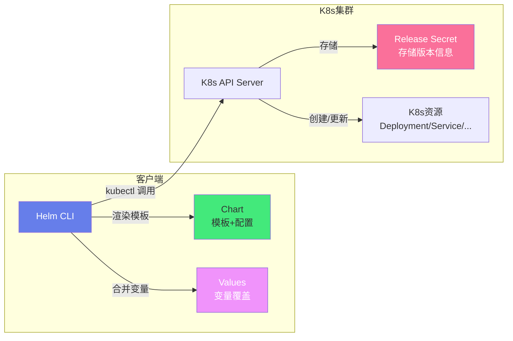
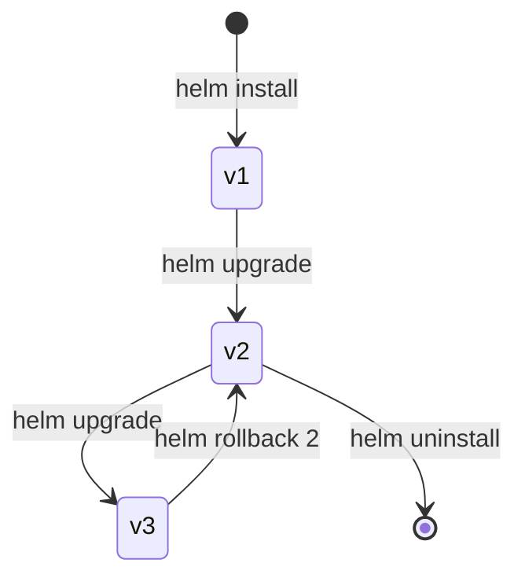

# 📦 Helm Chart 包管理

> **文档说明**：系统讲解 Kubernetes 的包管理工具 Helm 的完整知识体系，涵盖 Helm 核心概念（Chart/Release/Repository/Values）、Chart 目录结构、模板语法（Go Template/Sprig 函数/控制流/范围循环）、Values 变量管理、依赖管理、Chart 仓库、Helm 命令（install/upgrade/rollback/uninstall）、模板调试、Hook 钩子、生产环境最佳实践与常见问题排查。Helm 是 K8s 生态中最主流的应用打包和部署工具。
>
> **适用人群**：DevOps 工程师、K8s 开发者、运维工程师、后端开发者
>
> **前置知识**：[[Kubernetes入门与实践]] · [[ConfigMap与Secret]]

---

## 一、概述

### 1.1 什么是 Helm

Helm 是 **Kubernetes 的包管理工具**，类似于 Linux 的 apt/yum、Python 的 pip、Node.js 的 npm。它将 K8s 应用的所有资源（Deployment/Service/ConfigMap/Ingress 等）打包成一个 **Chart**，通过模板化实现可配置、可复用、可版本化的应用部署。

**Helm 三大概念**：

| 概念 | 说明 | 类比 |
|------|------|------|
| **Chart** | 应用的打包格式，包含 K8s 资源模板和默认配置 | apt 的 .deb 包 / npm 的 package |
| **Release** | Chart 在集群中的一个运行实例 | 安装后的软件实例 |
| **Repository** | Chart 的存储和分发仓库 | apt 源 / npm registry |

### 1.2 解决的问题

| 问题 | 说明 |
|------|------|
| **YAML 重复** | 每个应用都要写大量重复的 K8s YAML 文件 |
| **环境差异** | 开发/测试/生产环境配置不同，需要多份 YAML |
| **版本管理** | 应用部署没有版本概念，难以回滚 |
| **依赖管理** | 应用依赖的中间件（Redis/MySQL）需要单独部署 |
| **分发困难** | 应用难以分享和复用 |
| **升级复杂** | 应用升级需要手动修改多个 YAML 文件 |

### 1.3 Helm 2 vs Helm 3

| 维度 | Helm 2 | Helm 3 |
|------|--------|--------|
| **架构** | Client + Tiller（服务端） | 纯 Client（无 Tiller） |
| **安全** | Tiller 需要高权限，有安全风险 | 直接用 kubeconfig，权限与用户一致 |
| **Release 管理** | Release 存在 Tiller 的 ConfigMap 中 | Release 存在集群的 Secret 中 |
| **删除** | `helm delete`（默认保留历史） | `helm uninstall`（默认删除历史） |
| **命名空间** | Release 全局唯一 | Release 在命名空间内唯一 |
| **CRD** | 不支持 | 支持 `crds/` 目录 |
| **库 Chart** | 不支持 | 支持 Library Chart |

> **当前推荐使用 Helm 3**，本文档所有内容基于 Helm 3。

### 1.4 核心应用场景

- ✅ **应用打包分发**：将应用打包成 Chart，分享给团队或社区
- ✅ **多环境部署**：通过 Values 文件区分 dev/staging/prod 环境
- ✅ **版本管理与回滚**：Release 版本化，支持一键回滚
- ✅ **依赖管理**：Chart 依赖其他 Chart（如应用依赖 Redis）
- ✅ **CI/CD 集成**：在流水线中用 Helm 部署应用
- ✅ **GitOps**：配合 ArgoCD/Flux 实现声明式部署

---

## 二、底层原理

### 2.1 Helm 架构



**Helm 3 的工作流程**：
1. 读取 Chart 模板和 Values 配置
2. 用 Go Template 渲染模板，生成 K8s YAML
3. 通过 K8s API 创建/更新资源
4. 将 Release 信息存储为 Secret（命名空间内）

### 2.2 Chart 目录结构

```text
mychart/
├── Chart.yaml          # Chart 元数据（名称、版本、描述、依赖）
├── values.yaml         # 默认配置值（可被覆盖）
├── values.schema.json  # 配置值的 JSON Schema 校验（可选）
├── charts/             # 依赖的子 Chart
├── crds/               # Custom Resource Definitions（K8s 1.16+）
├── templates/          # K8s 资源模板目录
│   ├── deployment.yaml
│   ├── service.yaml
│   ├── configmap.yaml
│   ├── ingress.yaml
│   ├── serviceaccount.yaml
│   ├── _helpers.tpl    # 模板辅助函数（可复用的模板片段）
│   ├── NOTES.txt       # 安装后的提示信息
│   └── tests/          # 测试模板（helm test）
└── .helmignore         # 打包时忽略的文件
```

| 文件/目录 | 说明 | 必需 |
|-----------|------|------|
| `Chart.yaml` | Chart 元数据 | ✅ |
| `values.yaml` | 默认配置值 | ✅ |
| `templates/` | K8s 资源模板 | ✅ |
| `templates/_helpers.tpl` | 可复用模板片段 | 推荐 |
| `templates/NOTES.txt` | 安装后提示 | 推荐 |
| `charts/` | 依赖子 Chart | 可选 |
| `crds/` | CRD 定义 | 可选 |
| `values.schema.json` | 值校验 | 可选 |

### 2.3 模板渲染原理

Helm 使用 **Go Template** 引擎渲染模板，核心语法：

```json
{{ .Values.key }}          — 引用 Values 中的值
{{ .Release.Name }}        — 引用 Release 信息
{{ .Chart.Name }}          — 引用 Chart 信息
{{ .Capabilities.KubeVersion }} — K8s 集群能力
{{ .Files.Get "file" }}    — 读取 Chart 中的文件
{{ template "name" . }}    — 引用命名模板
{{ include "name" . }}     — 引用命名模板（可管道处理）
{{ if condition }}...{{ end }} — 条件判断
{{ range .Values.list }}...{{ end }} — 循环
{{ with .Values.obj }}...{{ end }} — 作用域
{{ .Values.key | default "value" }} — 管道和函数
```

**Values 合并优先级（从低到高）**：
1. `values.yaml`（Chart 默认值）
2. 父 Chart 的 `values.yaml`
3. 用户提供的 `-f values.yaml`（可多个，后覆盖前）
4. `--set key=value`（命令行参数）

### 2.4 Release 版本管理



| 操作 | 命令 | 说明 |
|------|------|------|
| 安装 | `helm install <name> <chart>` | 创建新 Release |
| 升级 | `helm upgrade <name> <chart>` | 更新 Release |
| 回滚 | `helm rollback <name> <revision>` | 回滚到指定版本 |
| 卸载 | `helm uninstall <name>` | 删除 Release（含历史） |
| 历史 | `helm history <name>` | 查看版本历史 |
| 状态 | `helm status <name>` | 查看 Release 状态 |

---

## 三、实操示例

### 3.1 安装 Helm

```bash
# macOS
brew install helm

# Ubuntu/Debian
curl https://baltocdn.com/helm/signing.asc | sudo apt-key add -
sudo apt-get install apt-transport-https --yes
echo "deb https://baltocdn.com/helm/stable/debian/ all main" | sudo tee /etc/apt/sources.list.d/helm-stable-debian.list
sudo apt-get update && sudo apt-get install helm

# 验证
helm version
```

### 3.2 创建第一个 Chart

```bash
# 创建 Chart 脚手架
helm create myapp

# 查看生成的目录结构
tree myapp/

# 渲染模板（不部署，查看生成的 YAML）
helm template myapp ./myapp

# 安装到集群
helm install myapp ./myapp

# 查看 Release
helm list
helm status myapp
```

### 3.3 Chart.yaml 元数据

```yaml
# Chart.yaml
apiVersion: v2           # Helm 3 用 v2
name: myapp              # Chart 名称
description: 我的应用    # 描述
type: application        # application（应用）或 library（库）
version: 1.0.0           # Chart 版本（语义化版本）
appVersion: "2.1.0"      # 应用版本（镜像版本）
keywords:
  - web
  - myapp
home: https://example.com
sources:
  - https://github.com/example/myapp
maintainers:
  - name: 张三
    email: zhangsan@example.com
icon: https://example.com/icon.png

# 依赖管理
dependencies:
  - name: redis
    version: "~17.0.0"
    repository: "https://charts.bitnami.com/bitnami"
    condition: redis.enabled
    tags:
      - cache
  - name: mysql
    version: "~9.0.0"
    repository: "https://charts.bitnami.com/bitnami"
    condition: mysql.enabled
```

### 3.4 values.yaml 默认配置

```yaml
# values.yaml
replicaCount: 2

image:
  repository: nginx
  pullPolicy: IfNotPresent
  tag: ""

imagePullSecrets: []
nameOverride: ""
fullnameOverride: ""

serviceAccount:
  create: true
  annotations: {}
  name: ""

podAnnotations: {}

podSecurityContext: {}
securityContext: {}

service:
  type: ClusterIP
  port: 80

ingress:
  enabled: false
  className: ""
  annotations: {}
  hosts:
    - host: myapp.local
      paths:
        - path: /
          pathType: ImplementationSpecific
  tls: []

resources:
  limits:
    cpu: 500m
    memory: 512Mi
  requests:
    cpu: 100m
    memory: 128Mi

autoscaling:
  enabled: false
  minReplicas: 1
  maxReplicas: 10
  targetCPUUtilizationPercentage: 80

nodeSelector: {}
tolerations: []
affinity: {}

# 自定义配置
config:
  APP_ENV: production
  LOG_LEVEL: info
  MAX_CONNECTIONS: "100"
```

### 3.5 模板编写

```yaml
# templates/deployment.yaml
apiVersion: apps/v1
kind: Deployment
metadata:
  name: {{ include "myapp.fullname" . }}
  labels:
    {{- include "myapp.labels" . | nindent 4 }}
spec:
  {{- if not .Values.autoscaling.enabled }}
  replicas: {{ .Values.replicaCount }}
  {{- end }}
  selector:
    matchLabels:
      {{- include "myapp.selectorLabels" . | nindent 6 }}
  template:
    metadata:
      {{- with .Values.podAnnotations }}
      annotations:
        {{- toYaml . | nindent 8 }}
      {{- end }}
      labels:
        {{- include "myapp.selectorLabels" . | nindent 8 }}
    spec:
      {{- with .Values.imagePullSecrets }}
      imagePullSecrets:
        {{- toYaml . | nindent 8 }}
      {{- end }}
      serviceAccountName: {{ include "myapp.serviceAccountName" . }}
      securityContext:
        {{- toYaml .Values.podSecurityContext | nindent 8 }}
      containers:
        - name: {{ .Chart.Name }}
          securityContext:
            {{- toYaml .Values.securityContext | nindent 12 }}
          image: "{{ .Values.image.repository }}:{{ .Values.image.tag | default .Chart.AppVersion }}"
          imagePullPolicy: {{ .Values.image.pullPolicy }}
          ports:
            - name: http
              containerPort: {{ .Values.service.port }}
              protocol: TCP
          env:
            {{- range $key, $value := .Values.config }}
            - name: {{ $key }}
              value: {{ $value | quote }}
            {{- end }}
          livenessProbe:
            httpGet:
              path: /
              port: http
          readinessProbe:
            httpGet:
              path: /
              port: http
          resources:
            {{- toYaml .Values.resources | nindent 12 }}
      {{- with .Values.nodeSelector }}
      nodeSelector:
        {{- toYaml . | nindent 8 }}
      {{- end }}
      {{- with .Values.affinity }}
      affinity:
        {{- toYaml . | nindent 8 }}
      {{- end }}
      {{- with .Values.tolerations }}
      tolerations:
        {{- toYaml . | nindent 8 }}
      {{- end }}
```

```yaml
# templates/service.yaml
apiVersion: v1
kind: Service
metadata:
  name: {{ include "myapp.fullname" . }}
  labels:
    {{- include "myapp.labels" . | nindent 4 }}
spec:
  type: {{ .Values.service.type }}
  ports:
    - port: {{ .Values.service.port }}
      targetPort: http
      protocol: TCP
      name: http
  selector:
    {{- include "myapp.selectorLabels" . | nindent 4 }}
```

```yaml
# templates/configmap.yaml
apiVersion: v1
kind: ConfigMap
metadata:
  name: {{ include "myapp.fullname" . }}-config
data:
  {{- range $key, $value := .Values.config }}
  {{ $key }}: {{ $value | quote }}
  {{- end }}
```

### 3.6 _helpers.tpl 辅助模板

```yaml
# templates/_helpers.tpl
{{/*
扩展名称：截断 63 字符，避免 K8s 名称超长
*/}}
{{- define "myapp.name" -}}
{{- default .Chart.Name .Values.nameOverride | trunc 63 | trimSuffix "-" }}
{{- end }}

{{/*
完整名称：Release 名 + Chart 名
*/}}
{{- define "myapp.fullname" -}}
{{- if .Values.fullnameOverride }}
{{- .Values.fullnameOverride | trunc 63 | trimSuffix "-" }}
{{- else }}
{{- $name := default .Chart.Name .Values.nameOverride }}
{{- if contains $name .Release.Name }}
{{- .Release.Name | trunc 63 | trimSuffix "-" }}
{{- else }}
{{- printf "%s-%s" .Release.Name $name | trunc 63 | trimSuffix "-" }}
{{- end }}
{{- end }}
{{- end }}

{{/*
Chart 标签
*/}}
{{- define "myapp.chart" -}}
{{- printf "%s-%s" .Chart.Name .Chart.Version | replace "+" "_" | trunc 63 | trimSuffix "-" }}
{{- end }}

{{/*
选择器标签
*/}}
{{- define "myapp.selectorLabels" -}}
app.kubernetes.io/name: {{ include "myapp.name" . }}
app.kubernetes.io/instance: {{ .Release.Name }}
{{- end }}

{{/*
通用标签
*/}}
{{- define "myapp.labels" -}}
helm.sh/chart: {{ include "myapp.chart" . }}
{{ include "myapp.selectorLabels" . }}
{{- if .Chart.AppVersion }}
app.kubernetes.io/version: {{ .Chart.AppVersion | quote }}
{{- end }}
app.kubernetes.io/managed-by: {{ .Release.Service }}
{{- end }}

{{/*
ServiceAccount 名称
*/}}
{{- define "myapp.serviceAccountName" -}}
{{- if .Values.serviceAccount.create }}
{{- default (include "myapp.fullname" .) .Values.serviceAccount.name }}
{{- else }}
{{- default "default" .Values.serviceAccount.name }}
{{- end }}
{{- end }}
```

### 3.7 多环境 Values

```yaml
# values-dev.yaml — 开发环境
replicaCount: 1
image:
  tag: "dev-latest"
config:
  APP_ENV: development
  LOG_LEVEL: debug
ingress:
  enabled: true
  hosts:
    - host: myapp.dev.local
resources:
  limits:
    cpu: 200m
    memory: 256Mi

---
# values-staging.yaml — 测试环境
replicaCount: 2
image:
  tag: "staging-latest"
config:
  APP_ENV: staging
  LOG_LEVEL: info
ingress:
  enabled: true
  hosts:
    - host: myapp.staging.example.com
resources:
  limits:
    cpu: 500m
    memory: 512Mi

---
# values-prod.yaml — 生产环境
replicaCount: 3
image:
  tag: "2.1.0"
  pullPolicy: Always
config:
  APP_ENV: production
  LOG_LEVEL: warn
ingress:
  enabled: true
  className: nginx
  hosts:
    - host: myapp.example.com
  tls:
    - secretName: myapp-tls
      hosts:
        - myapp.example.com
resources:
  limits:
    cpu: "1"
    memory: 1Gi
autoscaling:
  enabled: true
  minReplicas: 3
  maxReplicas: 10
  targetCPUUtilizationPercentage: 70
```

```bash
# 不同环境部署
helm install myapp ./myapp -f values-dev.yaml
helm install myapp ./myapp -f values-staging.yaml
helm install myapp ./myapp -f values-prod.yaml

# 多个 values 文件叠加（后覆盖前）
helm install myapp ./myapp -f values.yaml -f values-prod.yaml

# 命令行覆盖特定值
helm install myapp ./myapp --set replicaCount=5 --set image.tag=v2.1.0
```

### 3.8 常用 Helm 命令

```bash
# ===== Chart 管理 =====
helm create mychart              # 创建 Chart 脚手架
helm lint ./mychart              # 检查 Chart 语法
helm template ./mychart          # 渲染模板（不部署）
helm package ./mychart           # 打包成 .tgz
helm show values ./mychart       # 查看默认 values
helm show chart ./mychart        # 查看 Chart.yaml

# ===== Repository 管理 =====
helm repo add bitnami https://charts.bitnami.com/bitnami
helm repo list                   # 列出仓库
helm repo update                 # 更新仓库索引
helm repo remove bitnami         # 删除仓库
helm search hub nginx            # 搜索 Artifact Hub
helm search repo nginx           # 搜索已添加的仓库

# ===== Release 管理 =====
helm install myapp ./mychart     # 安装
helm install myapp bitnami/nginx # 从仓库安装
helm upgrade myapp ./mychart     # 升级
helm upgrade --install myapp ./mychart  # 安装或升级（不存在则安装）
helm rollback myapp 1            # 回滚到版本 1
helm uninstall myapp             # 卸载（删除历史）
helm uninstall myapp --keep-history  # 卸载但保留历史
helm list                        # 列出 Release
helm list -A                     # 所有命名空间
helm history myapp               # 版本历史
helm status myapp                # 查看状态
helm get values myapp            # 查看当前 values
helm get manifest myapp          # 查看生成的 K8s 资源
helm get notes myapp             # 查看 NOTES.txt

# ===== 调试 =====
helm install myapp ./mychart --dry-run    # 试运行（不实际部署）
helm install myapp ./mychart --debug      # 调试模式（显示渲染结果）
helm template ./mychart --debug            # 渲染并显示详细信息
helm lint ./mychart                         # 语法检查

# ===== 依赖管理 =====
helm dependency list ./mychart    # 列出依赖
helm dependency update ./mychart  # 更新依赖（下载到 charts/）
helm dependency build ./mychart   # 构建依赖

# ===== 测试 =====
helm test myapp                   # 运行 Chart 中的测试
```

### 3.9 Hook 钩子

```yaml
# templates/hooks/job-migrate.yaml — 数据库迁移 Hook
apiVersion: batch/v1
kind: Job
metadata:
  name: {{ include "myapp.fullname" . }}-migrate
  annotations:
    # Hook 类型：pre-install / post-install / pre-upgrade / post-upgrade / pre-delete / post-delete / pre-rollback / post-rollback / test
    "helm.sh/hook": pre-install,pre-upgrade
    # Hook 权重（数字小的先执行）
    "helm.sh/hook-weight": "-5"
    # Hook 删除策略：hook-succeeded / hook-failed / before-hook-creation
    "helm.sh/hook-delete-policy": before-hook-creation,hook-succeeded
spec:
  template:
    spec:
      restartPolicy: Never
      containers:
        - name: migrate
          image: "{{ .Values.image.repository }}:{{ .Values.image.tag }}"
          command: ["python", "manage.py", "migrate"]
```

| Hook 类型 | 触发时机 |
|-----------|---------|
| `pre-install` | 安装前，模板渲染后 |
| `post-install` | 安装后，所有资源加载后 |
| `pre-upgrade` | 升级前 |
| `post-upgrade` | 升级后 |
| `pre-delete` | 删除前 |
| `post-delete` | 删除后 |
| `pre-rollback` | 回滚前 |
| `post-rollback` | 回滚后 |
| `test` | `helm test` 时 |

### 3.10 NOTES.txt 安装提示

```bash
# templates/NOTES.txt
感谢安装 {{ .Chart.Name }}！

应用已部署到命名空间 {{ .Release.Namespace }}。

{{- if .Values.ingress.enabled }}
访问地址：
{{- range .Values.ingress.hosts }}
  http{{ if $.Values.ingress.tls }}s{{ end }}://{{ .host }}
{{- end }}
{{- else }}
通过以下命令访问：
  export POD_NAME=$(kubectl get pods --namespace {{ .Release.Namespace }} -l "app.kubernetes.io/name={{ include "myapp.name" . }},app.kubernetes.io/instance={{ .Release.Name }}" -o jsonpath="{.items[0].metadata.name}")
  kubectl --namespace {{ .Release.Namespace }} port-forward $POD_NAME 8080:{{ .Values.service.port }}
  然后访问 http://127.0.0.1:8080
{{- end }}

查看 Release 状态：
  helm status {{ .Release.Name }}
查看 Release 历史：
  helm history {{ .Release.Name }}
```

---

## 四、常见问题与排查

| 问题现象 | 可能原因 | 解决方案 |
|---------|---------|---------|
| **模板渲染错误** | Go Template 语法错误；变量未定义 | 用 `helm template --debug` 调试；检查 `{{ }}` 语法；用 `default` 设置默认值 |
| **YAML 缩进错误** | `nindent` 缩进不对；手动缩进错误 | 用 `toYaml` + `nindent` 自动处理；用 `helm template` 检查输出 |
| **Release 已存在** | 同名 Release 已安装 | 用 `helm upgrade --install`；或先 `helm uninstall` |
| **CRD 冲突** | 多个 Chart 安装相同 CRD | 只在一个 Chart 中定义 CRD；用 `--skip-crds` 跳过 |
| **依赖下载失败** | 仓库不可达；版本不存在 | `helm repo update`；检查 `dependencies` 版本范围；手动下载到 `charts/` |
| **回滚失败** | 资源已被手动修改；CRD 不兼容 | 检查资源状态；用 `helm rollback --force`；必要时手动修复 |
| **values 不生效** | 优先级问题；键名拼写错误 | 用 `helm get values` 检查实际值；检查 values 文件路径和键名 |
| **Hook 不执行** | Hook 注解错误；资源类型不对 | 检查 `helm.sh/hook` 注解；用 `helm test` 测试；查看 Hook Pod 日志 |
| **Chart 版本冲突** | 依赖版本范围不兼容 | 检查 `Chart.yaml` 的 `dependencies`；用 `helm dependency list` 查看 |
| **命名超长** | Release 名 + Chart 名超过 63 字符 | 用 `fullnameOverride` 覆盖；缩短 Release 名 |
| **Secret 未更新** | 模板中用了随机值，每次升级都变 | 用 `lookup` 函数检查是否已存在；或用 `helm.sh/resource-policy: keep` |
| **升级时资源不更新** | 资源注解 `helm.sh/resource-policy: keep` | 检查资源注解；手动删除资源后重新升级 |
| **性能慢** | Chart 太大；依赖太多；模板复杂 | 拆分 Chart；减少依赖；优化模板（避免复杂循环） |

---

## 五、进阶与最佳实践

### 5.1 Chart 开发最佳实践

```text
Chart 开发最佳实践：

✅ 用 `helm create` 生成脚手架，遵循标准结构
✅ 模板中用 `_helpers.tpl` 定义可复用片段
✅ 用 `toYaml` + `nindent` 处理 YAML 块，避免手动缩进
✅ 所有可配置项放在 values.yaml，模板中不硬编码
✅ 用 `default` 函数设置默认值，避免变量未定义报错
✅ 用 `required` 函数标记必填项（如密码）
✅ 用 `values.schema.json` 校验 values 格式
✅ 用 `helm lint` 检查语法，用 `helm template` 验证输出
✅ NOTES.txt 提供安装后的使用说明
✅ 用 Hook 处理数据库迁移、初始化任务
✅ 测试用例放在 templates/tests/
✅ Chart 版本用语义化版本（MAJOR.MINOR.PATCH）
✅ 敏感信息用 Secret，不写在 values.yaml 明文
✅ 资源名称用 `fullname` 辅助函数，避免冲突
✅ 标签用标准标签（app.kubernetes.io/name 等）
```

### 5.2 生产环境部署最佳实践

| 类别 | 检查项 | 说明 |
|------|--------|------|
| **版本管理** | Chart 版本和应用版本分离 | `version` 是 Chart 版本，`appVersion` 是应用版本 |
| **版本管理** | 生产用固定版本，不用 latest | `image.tag` 用具体版本号 |
| **配置管理** | 不同环境用不同 values 文件 | values-dev.yaml / values-prod.yaml |
| **配置管理** | 敏感值不入 Git | 用 `--set` 或外部密钥管理注入 |
| **配置管理** | 用 `values.schema.json` 校验 | 防止错误配置导致部署失败 |
| **部署策略** | 用 `helm upgrade --install` | 幂等部署，不存在则安装 |
| **部署策略** | 部署前 `--dry-run` 验证 | 检查渲染结果是否正确 |
| **部署策略** | 蓝绿/金丝雀发布 | 配合 Argo Rollouts 或 Istio |
| **回滚** | 保留 Release 历史 | `helm uninstall --keep-history` |
| **回滚** | 定期测试回滚流程 | 确保回滚可用 |
| **安全** | 最小权限 ServiceAccount | 不默认用 default SA |
| **安全** | 镜像扫描 | 用 Trivy/Clair 扫描镜像漏洞 |
| **安全** | 网络策略 | 限制 Pod 间网络访问 |
| **可观测** | 资源限制 | 设置 requests/limits |
| **可观测** | 健康检查 | 配置 liveness/readiness probe |
| **可观测** | 日志和指标 | 应用输出结构化日志，暴露 Prometheus 指标 |
| **CI/CD** | Chart 入库管理 | 用 ChartMuseum/Harbor/OCI 仓库存储 Chart |
| **CI/CD** | 自动化测试 | CI 中运行 `helm lint` 和 `helm test` |

### 5.3 Chart 仓库

```bash
# 常用公共仓库
helm repo add bitnami https://charts.bitnami.com/bitnami    # Bitnami（最全面）
helm repo add stable https://charts.helm.sh/stable            # 官方 stable（已废弃）
helm repo add ingress-nginx https://kubernetes.github.io/ingress-nginx
helm repo add prometheus-community https://prometheus-community.github.io/helm-charts
helm repo add jetstack https://charts.jetstack.io              # cert-manager
helm repo add elastic https://helm.elastic.co                   # ELK

# 自建 Chart 仓库
# 方案1：ChartMuseum
docker run -d --name chartmuseum -p 8080:8080 -e STORAGE=local -e STORAGE_LOCAL_ROOTDIR=/charts chartmuseum/chartmuseum
helm repo add local http://localhost:8080
helm package ./mychart
curl --data-binary "@mychart-1.0.0.tgz" http://localhost:8080/api/charts

# 方案2：OCI 仓库（Helm 3 支持）
helm package ./mychart
helm push mychart-1.0.0.tgz oci://registry.example.com/charts
helm install myapp oci://registry.example.com/charts/mychart --version 1.0.0

# 方案3：GitHub Pages
# 将 Chart 打包后推到 GitHub Pages，用 helm repo add 添加
```

### 5.4 高级模板技巧

```yaml
{{/* 1. 条件包含整个文件 */}}
{{- if .Values.ingress.enabled }}
# ingress.yaml 内容
{{- end }}

{{/* 2. 字典遍历 */}}
{{- range $key, $value := .Values.config }}
{{ $key }}: {{ $value | quote }}
{{- end }}

{{/* 3. 列表遍历 */}}
{{- range .Values.ingress.hosts }}
- host: {{ .host }}
{{- end }}

{{/* 4. with 作用域（简化 .Values.xxx 前缀） */}}
{{- with .Values.service }}
type: {{ .type }}
port: {{ .port }}
{{- end }}

{{/* 5. 包含子模板并处理结果 */}}
{{- include "myapp.labels" . | nindent 4 }}

{{/* 6. 字符串操作 */}}
{{ .Values.name | trunc 63 | trimSuffix "-" | upper | quote }}

{{/* 7. 日期和随机数 */}}
{{ now | date "2006-01-02" }}
{{ randAlphaNum 16 }}  {{/* 随机字符串（注意：每次升级都会变） */}}

{{/* 8. 查找已存在的资源（避免重复生成随机值） */}}
{{- $existing := lookup "v1" "Secret" .Release.Namespace (include "myapp.fullname" .) }}
{{- if $existing }}
password: {{ $existing.data.password | b64dec }}
{{- else }}
password: {{ randAlphaNum 32 }}
{{- end }}

{{/* 9. 缩进控制 */}}
{{- .Values.annotations | toYaml | nindent 8 }}
{{- .Values.annotations | toYaml | indent 8 }}

{{/* 10. 比较和逻辑 */}}
{{- if and .Values.ingress.enabled (eq .Values.service.type "ClusterIP") }}
{{- if or .Values.ingress.tls .Values.ingress.className }}
{{- if not .Values.autoscaling.enabled }}
```

---

## 六、关联笔记

### K8s 编排
- [[Kubernetes入门与实践]] · [[ConfigMap与Secret]] · [[Service与Ingress]]
- [[K8s-资源限制与HPA]] · [[K8s-故障排查手册]]

### 云原生与运维
- [[Docker容器化实战]] · [[GitLab-CI配置]] · [[Ansible-配置管理]]
- [[Terraform-基础设施编排]] · [[Prometheus监控体系]]

### 导航
- [[MOC-云原生与运维]] · [[MOC-K8s编排]] · [[MOC-综合导航]] · [[Home]]

> 🔍 **知识点深度解析**
>
> **作用**：Helm 解决的是「K8s 应用的打包、配置和版本管理」问题，将应用的所有 K8s 资源模板化，通过 Values 实现可配置、可复用、可版本化的部署，类似 K8s 世界的 apt/pip/npm。
>
> **底层原理**：Helm 3 是纯客户端工具（无 Tiller），工作流程：读取 Chart 模板 + Values 配置 → 用 Go Template 引擎渲染模板生成 K8s YAML → 通过 K8s API 创建/更新资源 → 将 Release 信息（版本、配置、资源）存储为命名空间内的 Secret。模板支持变量引用（`.Values`/`.Release`/`.Chart`）、控制流（if/range/with）、函数管道（default/quote/trunc/toYaml）、子模板（`_helpers.tpl`）。Values 合并优先级：默认 values < 用户 values 文件 < --set 参数。
>
> **用法要点**：① `helm create` 生成脚手架，遵循标准目录结构 ② 模板用 `_helpers.tpl` 定义可复用片段（名称/标签/选择器） ③ 用 `toYaml` + `nindent` 处理 YAML 块，避免手动缩进 ④ 多环境用不同 values 文件（values-dev/prod.yaml） ⑤ 部署用 `helm upgrade --install`（幂等） ⑥ 部署前用 `--dry-run --debug` 验证 ⑦ 敏感值不入 Git，用 `--set` 或外部密钥管理 ⑧ 用 Hook 处理数据库迁移/初始化 ⑨ Chart 版本用语义化版本，与 appVersion 分离 ⑩ 用 `helm lint` + `helm template` 做 CI 检查。

> 💡 **深度讲解**：Helm 最核心的设计是「模板 + Values」的分离——Chart 是模板（应用的骨架），Values 是配置（应用的血肉），同一份 Chart 可以通过不同 Values 部署到不同环境。这解决了 K8s 原生 YAML「硬编码、不可复用」的问题。Helm 3 相比 Helm 2 最大的改进是移除了 Tiller（服务端组件）——Tiller 需要集群管理员权限，存在安全风险，Helm 3 直接用用户的 kubeconfig 权限操作，安全模型更清晰。另一个重要概念是「Release」——它是 Chart 在集群中的一个运行实例，有版本历史，支持回滚，这让应用部署有了「版本控制」的能力，出问题可以一键回滚。实际项目中，推荐将 Chart 也纳入版本控制（Git），用 Chart 仓库（ChartMuseum/Harbor/OCI）分发，CI/CD 中用 `helm upgrade --install` 实现幂等部署。

> 📝 **精简总结**：Helm = K8s 的包管理器，核心三概念：Chart（包）、Release（运行实例）、Repository（仓库）。Chart = 模板（Go Template）+ Values（配置）。工作流：渲染模板 → 生成 YAML → 调用 K8s API → 存储 Release Secret。关键命令：`helm create`（创建）、`helm install/upgrade/rollback/uninstall`（生命周期）、`helm template --debug`（调试）、`helm lint`（检查）。最佳实践：多环境 Values、`upgrade --install` 幂等、`--dry-run` 验证、敏感值不入 Git、Hook 处理迁移。

> **学习路径建议**：先学习 [[Docker容器化实战]] 理解容器化 → 学习 [[Kubernetes入门与实践]] 掌握 K8s 基础 → 学习 [[ConfigMap与Secret]] 理解配置管理 → 学习本文档掌握 Helm 打包部署 → 学习 [[GitLab-CI配置]] 实现 CI/CD 自动化 → 在项目中实践完整的应用打包和部署流程。

---

> **Helm 的本质是「给 K8s 应用装上 package.json」——让应用可以被打包、版本化、依赖管理、一键部署和回滚。没有 Helm，K8s 部署是「手写 YAML 到处复制」；有了 Helm，K8s 部署是「一行命令安装一个应用」。**
