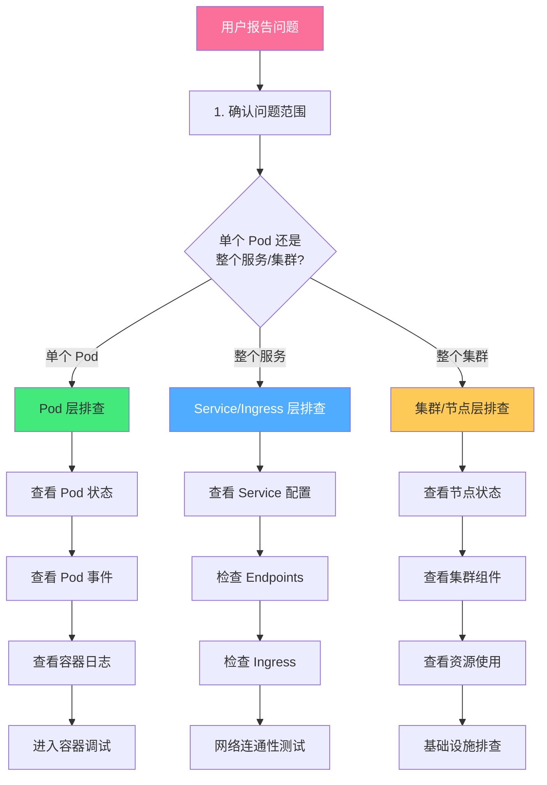
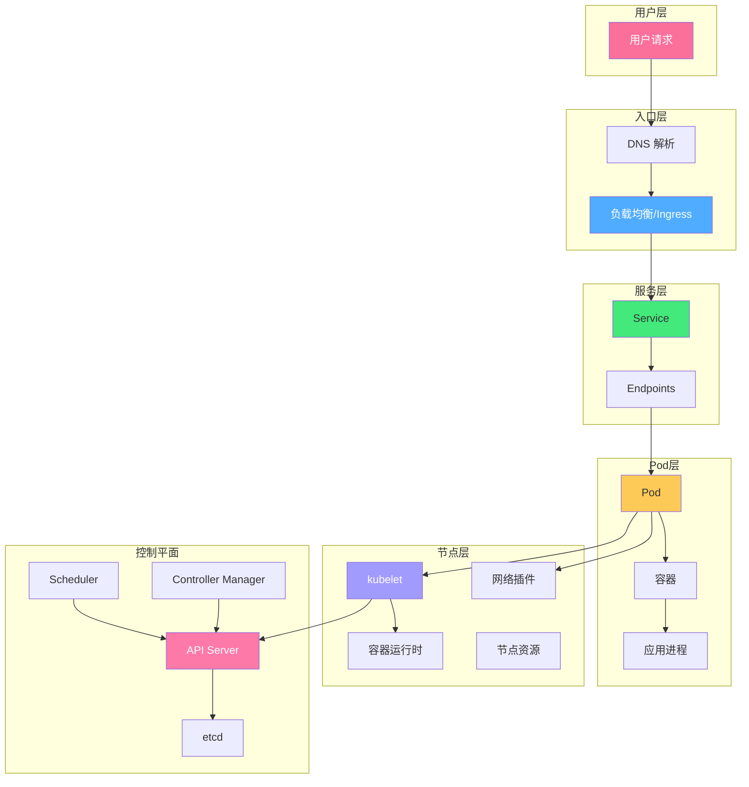

# 🔧 K8s 故障排查手册

> **文档说明**：Kubernetes 生产环境故障排查的完整实战手册，涵盖故障排查方法论（由上到下/由外到内）、kubectl 调试命令大全、Pod 故障排查（Pending/CrashLoopBackOff/ImagePullBackOff/OOMKilled 等）、Service 与网络故障排查、存储与 PVC 故障排查、节点与集群故障排查、日志与事件分析、资源限制与性能问题、网络策略与 DNS 问题、常见错误代码速查表、应急恢复流程与最佳实践。
>
> **适用人群**：K8s 运维工程师、DevOps、SRE、后端开发者、架构师
>
> **前置知识**：[[K8s-核心概念与架构]] · [[K8s-Pod与容器编排]] · [[Service与Ingress]]

---

## 一、概述

### 1.1 K8s 故障排查的核心思路

Kubernetes 故障排查的核心是**分层定位**——从应用层到基础设施层，逐层缩小范围，找到根因。



### 1.2 故障排查黄金法则

| 法则 | 说明 |
|------|------|
| **先看状态，再看日志** | `kubectl get` 看状态 → `kubectl describe` 看事件 → `kubectl logs` 看日志 |
| **由上到下** | 从用户请求入口（Ingress/Service）到 Pod 到容器到应用 |
| **由外到内** | 从集群外部到集群内部到节点到 Pod 到容器 |
| **先复现，再排查** | 确认问题可复现，记录复现步骤 |
| **对比正常** | 找一个正常的 Pod/Service 对比配置和状态 |
| **不要猜，要验证** | 每个假设都要用命令验证，不要凭经验下结论 |
| **保留现场** | 排查前先保存事件和日志，避免 Pod 重建后丢失 |

### 1.3 必备调试工具

```bash
# ===== kubectl 基础 =====
kubectl get pods -n <namespace> -o wide          # 查看 Pod 列表（含节点 IP）
kubectl describe pod <pod> -n <namespace>         # 查看 Pod 详情和事件
kubectl logs <pod> -n <namespace>                  # 查看容器日志
kubectl logs <pod> -c <container> --previous      # 查看上一次崩溃的日志
kubectl exec -it <pod> -- /bin/sh                  # 进入容器
kubectl get events -n <namespace> --sort-by=.lastTimestamp  # 查看事件（按时间排序）

# ===== 高级调试 =====
kubectl debug -it <pod> --image=busybox --target=<container>  # 临时调试容器（K8s 1.18+）
kubectl port-forward <pod> 8080:80               # 端口转发
kubectl proxy --port=8080                          # API 代理
kubectl top pods -n <namespace>                    # 查看 Pod 资源使用（需 metrics-server）
kubectl top nodes                                   # 查看节点资源使用

# ===== 网络调试 =====
kubectl run -it --rm debug --image=busybox --restart=Never -- sh  # 临时调试 Pod
kubectl run -it --rm netshoot --image=nicolaka/netshoot --restart=Never -- bash  # 网络调试工具箱
# netshoot 包含：curl/wget/dig/nslookup/tcpdump/iptables/iproute2/netstat/ss 等

# ===== 配置导出 =====
kubectl get pod <pod> -o yaml > pod-backup.yaml    # 导出 Pod 配置（排查前保存）
kubectl get all -n <namespace> -o yaml > ns-backup.yaml  # 导出命名空间所有资源
```

---

## 二、底层原理：K8s 故障分层模型

### 2.1 K8s 架构与故障点



### 2.2 Pod 生命周期与故障状态

| 状态 | 说明 | 常见原因 |
|------|------|---------|
| **Pending** | Pod 已创建但未调度到节点 | 资源不足、节点亲和性不匹配、污点容忍、PVC 未绑定 |
| **ContainerCreating** | 容器正在创建 | 镜像拉取中、Volume 挂载中、CNI 分配 IP 中 |
| **Running** | 容器正常运行 | — |
| **Succeeded** | 所有容器正常退出（Job） | — |
| **Failed** | 所有容器异常退出 | 应用崩溃、配置错误 |
| **Unknown** | 节点失联 | kubelet 停止、节点宕机、网络分区 |

**容器状态**：
| 状态 | 说明 |
|------|------|
| **Waiting** | 容器等待中（镜像拉取、创建中） |
| **Running** | 容器运行中 |
| **Terminated** | 容器已终止（查看 exitCode 和 reason） |

### 2.3 事件（Events）机制

K8s 事件是排查故障的第一手资料，记录了资源状态变化的原因。

```bash
# 查看命名空间所有事件（按时间排序）
kubectl get events -n <namespace> --sort-by=.lastTimestamp

# 查看特定 Pod 的事件
kubectl describe pod <pod> -n <namespace> | grep -A 20 Events

# 实时监控事件
kubectl get events -n <namespace> -w

# 查看集群级别事件
kubectl get events -A --sort-by=.lastTimestamp | tail -50
```

**常见事件类型**：
| 事件 | 原因 | 说明 |
|------|------|------|
| `FailedScheduling` | 调度失败 | 资源不足/亲和性/污点 |
| `Pulling` | 正在拉取镜像 | 正常 |
| `Pulled` | 镜像拉取完成 | 正常 |
| `Failed` | 拉取镜像失败 | 镜像不存在/认证失败/网络问题 |
| `Created` | 容器已创建 | 正常 |
| `Started` | 容器已启动 | 正常 |
| `BackOff` | 重启退避 | 容器反复崩溃 |
| `Unhealthy` | 健康检查失败 | liveness/readiness probe 失败 |
| `Killing` | 正在杀死容器 | 健康检查失败/OOM/删除 |
| `OOMKilling` | OOM 杀死 | 内存超出限制 |

---

## 三、实操：Pod 故障排查

### 3.1 Pending（调度失败）

```bash
# ===== 排查步骤 =====

# 1. 查看 Pod 事件（最关键！）
kubectl describe pod <pod> -n <namespace>
# 查看 Events 部分，通常会显示：
# "0/3 nodes are available: 3 Insufficient cpu, 3 Insufficient memory."
# "0/3 nodes are available: 3 node(s) didn't match node selector."
# "0/3 nodes are available: 3 node(s) had untolerated taint."

# 2. 查看节点资源
kubectl top nodes
kubectl describe nodes | grep -A 5 "Allocated resources"

# 3. 查看节点污点
kubectl get nodes -o json | jq '.items[].spec.taints'

# 4. 查看节点亲和性/选择器
kubectl get pod <pod> -o yaml | grep -A 10 nodeSelector
kubectl get pod <pod> -o yaml | grep -A 20 affinity
```

**常见原因与解决方案**：

| 原因 | 事件信息 | 解决方案 |
|------|---------|---------|
| **CPU 不足** | `Insufficient cpu` | 减少 requests/cpu；扩容节点；释放资源 |
| **内存不足** | `Insufficient memory` | 减少 requests/memory；扩容节点；排查内存泄漏 |
| **节点选择器不匹配** | `didn't match node selector` | 检查 nodeSelector 标签；给节点打标签；修改选择器 |
| **污点不匹配** | `had untolerated taint` | 添加 toleration；去除节点污点 |
| **PVC 未绑定** | `pod has unbound immediate PersistentVolumeClaims` | 检查 StorageClass；创建 PV；检查 PVC 配置 |
| **节点 NotReady** | `node(s) were not ready` | 排查节点状态；重启 kubelet |
| **宿主端口冲突** | `node(s) didn't have free ports` | 检查 hostPort 冲突；修改端口 |

### 3.2 ImagePullBackOff / ErrImagePull

```bash
# ===== 排查步骤 =====

# 1. 查看事件
kubectl describe pod <pod> -n <namespace>
# 常见错误：
# "Failed to pull image 'xxx': rpc error: code = Unknown desc = Error response from daemon: manifest for xxx not found"
# "Failed to pull image 'xxx': rpc error: code = Unknown desc = Error response from daemon: pull access denied"

# 2. 手动拉取镜像验证（在节点上）
docker pull <image>
# 或
ctr -n k8s.io images pull <image>

# 3. 检查镜像名和标签
kubectl get pod <pod> -o jsonpath='{.spec.containers[*].image}'
```

**常见原因**：
| 原因 | 解决方案 |
|------|---------|
| 镜像名/标签错误 | 检查镜像名和 tag 是否正确；用 `docker pull` 验证 |
| 镜像不存在 | 确认镜像已推送到仓库；检查仓库地址 |
| 认证失败（私有仓库） | 创建 imagePullSecret；在 Pod 中引用；检查 secret 是否正确 |
| 网络不通 | 节点能否访问镜像仓库；检查代理配置；检查防火墙 |
| 仓库限流 | Docker Hub 限流；使用镜像加速器；切换到私有仓库 |
| 架构不匹配 | arm64 节点拉取 amd64 镜像；使用多架构镜像 |

```yaml
# 私有仓库认证配置
apiVersion: v1
kind: Secret
metadata:
  name: regcred
  namespace: default
type: kubernetes.io/dockerconfigjson
data:
  .dockerconfigjson: <base64编码的docker config>
---
apiVersion: v1
kind: Pod
metadata:
  name: mypod
spec:
  containers:
    - name: myapp
      image: private-registry.com/myapp:latest
  imagePullSecrets:
    - name: regcred  # 引用认证 secret
```

### 3.3 CrashLoopBackOff（反复崩溃）

```bash
# ===== 排查步骤 =====

# 1. 查看当前日志
kubectl logs <pod> -n <namespace>

# 2. 查看上一次崩溃的日志（关键！）
kubectl logs <pod> -n <namespace> --previous

# 3. 查看容器退出码
kubectl describe pod <pod> -n <namespace> | grep -A 10 "Last State"
# State:          Terminated
#   Reason:       Error
#   Exit Code:    1        ← 退出码
#   Started:      ...
#   Finished:     ...

# 4. 查看事件
kubectl describe pod <pod> -n <namespace> | grep -A 20 Events
```

**退出码含义**：
| 退出码 | 含义 | 常见原因 |
|--------|------|---------|
| **0** | 正常退出 | Job 完成；容器主动退出 |
| **1** | 通用错误 | 应用异常；配置错误；依赖缺失 |
| **2** | 误用 shell 命令 | 入口命令错误；权限问题 |
| **126** | 无法执行命令 | 命令没有执行权限；不是可执行文件 |
| **127** | 命令未找到 | 入口命令/脚本不存在；PATH 错误 |
| **128** | 无效退出参数 | — |
| **130** | SIGINT (Ctrl+C) | 容器被中断 |
| **137** | SIGKILL (OOM) | 内存超出 limits；被系统杀死 |
| **139** | SIGSEGV | 段错误；应用 bug |
| **143** | SIGTERM | 优雅终止；正常关闭 |
| **255** | 其他错误 | — |

**常见原因与解决方案**：
| 原因 | 排查方法 | 解决方案 |
|------|---------|---------|
| 应用配置错误 | 查看日志中的错误信息 | 检查 ConfigMap/Secret/环境变量 |
| 依赖服务不可用 | 日志中连接超时/拒绝 | 检查数据库/缓存/其他服务 |
| 权限不足 | 日志中 Permission denied | 检查 SecurityContext；调整权限 |
| 文件不存在 | 日志中 No such file | 检查 Volume 挂载；检查工作目录 |
| 端口被占用 | 日志中 Address already in use | 检查容器内端口冲突 |
| OOM（退出码 137） | `kubectl describe` 看 OOMKilled | 增加 memory limits；排查内存泄漏 |
| 健康检查失败 | 事件中 Unhealthy | 调整 probe 配置；检查应用启动时间 |

### 3.4 OOMKilled（内存溢出）

```bash
# ===== 排查步骤 =====

# 1. 确认 OOM
kubectl describe pod <pod> | grep -A 5 "Last State"
# Reason:       OOMKilled
# Exit Code:    137

# 2. 查看内存限制
kubectl get pod <pod> -o jsonpath='{.spec.containers[*].resources}'

# 3. 查看实际内存使用
kubectl top pod <pod> --containers

# 4. 查看节点 dmesg（在节点上）
dmesg | grep -i "out of memory"
dmesg | grep -i "killed process"
```

**解决方案**：
1. **增加 memory limits**：如果是合理使用，增加限制
2. **排查内存泄漏**：用 profiling 工具（pprof/jmap/heap dump）分析
3. **调整 JVM/运行时参数**：Java 应用设置 `-Xmx` 小于 limits
4. **优化应用**：减少内存占用；使用流式处理；及时释放资源
5. **设置合理的 requests**：requests 影响调度，limits 影响 OOM 阈值

```yaml
# 合理的资源配置示例
resources:
  requests:
    cpu: "500m"
    memory: "512Mi"   # 调度时保证的内存
  limits:
    cpu: "2"
    memory: "1Gi"     # 超过此值会被 OOM Kill
```

### 3.5 健康检查失败（Unhealthy）

```bash
# ===== 排查步骤 =====

# 1. 查看事件
kubectl describe pod <pod> | grep -A 20 Events
# "Liveness probe failed: HTTP probe failed with statuscode: 500"
# "Readiness probe failed: dial tcp 10.244.1.5:8080: connect: connection refused"

# 2. 查看日志
kubectl logs <pod>

# 3. 手动测试健康检查端点
kubectl port-forward <pod> 8080:8080
curl http://localhost:8080/health
curl http://localhost:8080/ready

# 4. 进入容器测试
kubectl exec -it <pod> -- wget -O- http://localhost:8080/health
```

**常见原因**：
| 原因 | 解决方案 |
|------|---------|
| 应用启动慢，probe 超时 | 增加 `initialDelaySeconds`；使用 `startupProbe` |
| 健康检查端点返回错误 | 检查应用逻辑；修复端点 |
| 端口配置错误 | 检查 probe 的 port 和容器监听端口 |
| 应用死锁/阻塞 | 查看线程栈；排查死锁 |
| 依赖服务不可用 | readiness 检查依赖时，依赖挂了会导致不就绪 |

```yaml
# 合理的健康检查配置
apiVersion: v1
kind: Pod
metadata:
  name: myapp
spec:
  containers:
    - name: myapp
      image: myapp:latest
      ports:
        - containerPort: 8080
      # 启动探针（K8s 1.18+）：应用启动期间不执行 liveness/readiness
      startupProbe:
        httpGet:
          path: /health
          port: 8080
        failureThreshold: 30   # 最多失败 30 次（30*10=300秒启动时间）
        periodSeconds: 10
      # 存活探针：应用挂了自动重启
      livenessProbe:
        httpGet:
          path: /health
          port: 8080
        initialDelaySeconds: 0  # startupProbe 成功后才开始
        periodSeconds: 10
        failureThreshold: 3
        timeoutSeconds: 5
      # 就绪探针：不就绪时从 Service 移除
      readinessProbe:
        httpGet:
          path: /ready
          port: 8080
        periodSeconds: 5
        failureThreshold: 3
```

### 3.6 容器调试技巧

```bash
# ===== 进入容器调试 =====
kubectl exec -it <pod> -- /bin/sh
kubectl exec -it <pod> -c <container> -- /bin/bash  # 多容器指定

# ===== 临时调试容器（Ephemeral Containers，K8s 1.18+）=====
# 在运行中的 Pod 中临时添加一个调试容器
kubectl debug -it <pod> --image=busybox --target=<container-name>
# --target 共享目标容器的进程命名空间，可以看到目标容器的进程

# 使用 netshoot（强大的网络调试工具箱）
kubectl debug -it <pod> --image=nicolaka/netshoot --target=<container>

# ===== 复制 Pod 进行调试（不影响原 Pod）=====
kubectl debug <pod> -it --image=myapp:debug --copy-to=<pod>-debug --share-processes

# ===== 节点上调试（如果 Pod 无法调度或节点有问题）=====
kubectl debug node/<node> -it --image=busybox
# 会在节点上创建一个特权容器，可以查看节点状态

# ===== 查看容器内进程 =====
kubectl top pod <pod> --containers
kubectl exec <pod> -- ps aux
kubectl exec <pod> -- top

# ===== 网络调试 =====
kubectl exec <pod> -- wget -O- http://<service>:<port>
kubectl exec <pod> -- nslookup <service>
kubectl exec <pod> -- cat /etc/resolv.conf
```

---

## 四、实操：Service 与网络故障排查

### 4.1 Service 无法访问

```bash
# ===== 排查步骤（由上到下）=====

# 1. 检查 Service 是否存在
kubectl get svc -n <namespace>

# 2. 检查 Service 配置
kubectl describe svc <service> -n <namespace>
# 确认：
# - Type: ClusterIP/NodePort/LoadBalancer
# - Port/TargetPort 是否正确
# - Selector 是否匹配 Pod 标签

# 3. 检查 Endpoints（最关键！Service 通过 Endpoints 关联 Pod）
kubectl get endpoints <service> -n <namespace>
kubectl describe endpoints <service> -n <namespace>
# 如果 Endpoints 为空，说明没有匹配的 Pod（Selector 不匹配或 Pod 未就绪）

# 4. 检查 Pod 标签是否匹配 Selector
kubectl get pods --show-labels -n <namespace>
kubectl get svc <service> -o jsonpath='{.spec.selector}'

# 5. 检查 Pod 是否就绪（Readiness）
kubectl get pods -n <namespace>
# READY 列：1/1 表示就绪，0/1 表示未就绪

# 6. 从 Pod 内部测试 Service
kubectl exec -it <test-pod> -- wget -O- http://<service>.<namespace>.svc.cluster.local:<port>

# 7. 直接测试 Pod IP（绕过 Service）
kubectl exec -it <test-pod> -- wget -O- http://<pod-ip>:<port>
```

**常见原因**：
| 原因 | 排查方法 | 解决方案 |
|------|---------|---------|
| Selector 不匹配 | 对比 Service selector 和 Pod labels | 修改 selector 或 Pod 标签 |
| Pod 未就绪 | READY 列为 0/1 | 修复 readiness probe；等待应用启动 |
| 端口配置错误 | Port/TargetPort 不匹配 | 检查容器监听端口和 Service 端口 |
| 协议不匹配 | TCP/UDP 配置错误 | 检查 Service 和容器的协议 |
| 网络策略阻止 | NetworkPolicy 限制了访问 | 检查 NetworkPolicy；添加允许规则 |
| kube-proxy 异常 | 节点上 kube-proxy 未运行 | 重启 kube-proxy；查看日志 |
| iptables/IPVS 规则错误 | 节点上查看规则 | 重启 kube-proxy 重新生成规则 |

### 4.2 Ingress 无法访问

```bash
# ===== 排查步骤 =====

# 1. 检查 Ingress 资源
kubectl get ingress -n <namespace>
kubectl describe ingress <ingress> -n <namespace>
# 确认：
# - Host 和 Path 配置
# - Backend Service 和 Port
# - Address 是否分配（Ingress Controller 的 IP）

# 2. 检查 Ingress Controller
kubectl get pods -n ingress-nginx
kubectl logs -n ingress-nginx <ingress-controller-pod>
# 查看是否有配置错误、证书错误

# 3. 检查 Ingress 关联的 Service
kubectl get svc <backend-service> -n <namespace>
kubectl get endpoints <backend-service> -n <namespace>

# 4. 测试 Ingress
curl -H "Host: example.com" http://<ingress-ip>/path
curl -k https://example.com/path  # 跳过证书验证

# 5. 查看 Ingress Controller 配置
kubectl exec -n ingress-nginx <controller-pod> -- cat /etc/nginx/nginx.conf | grep -A 20 "server_name example.com"
```

**常见原因**：
| 原因 | 解决方案 |
|------|---------|
| Ingress Controller 未安装/未运行 | 安装 Ingress Controller；检查 Pod 状态 |
| Host 配置错误 | 检查域名解析；测试时用 Host header |
| Path 匹配错误 | 检查 pathType（Prefix/Exact）；检查路径 |
| Backend Service 不存在 | 创建 Service；检查 Service 名称和端口 |
| TLS 证书错误 | 检查 Secret；证书域名匹配；证书未过期 |
| 注解配置错误 | 检查 annotations；参考 Controller 文档 |
| 端口未开放 | 云平台安全组；节点防火墙 |

### 4.3 DNS 解析失败

```bash
# ===== 排查步骤 =====

# 1. 从 Pod 内测试 DNS
kubectl exec -it <pod> -- nslookup kubernetes.default
kubectl exec -it <pod> -- nslookup <service>.<namespace>.svc.cluster.local
kubectl exec -it <pod> -- cat /etc/resolv.conf
# nameserver 应该是 CoreDNS 的 Service IP（通常是 10.96.0.10）

# 2. 检查 CoreDNS 状态
kubectl get pods -n kube-system -l k8s-app=kube-dns
kubectl logs -n kube-system -l k8s-app=kube-dns

# 3. 检查 CoreDNS Service
kubectl get svc kube-dns -n kube-system

# 4. 检查 DNS 配置
kubectl get configmap coredns -n kube-system -o yaml

# 5. 测试外部 DNS
kubectl exec -it <pod> -- nslookup www.baidu.com
```

**常见原因**：
| 原因 | 解决方案 |
|------|---------|
| CoreDNS Pod 未运行 | 重启 CoreDNS；检查节点状态 |
| CoreDNS Service IP 错误 | 检查 /etc/resolv.conf；检查 kube-dns Service |
| 网络策略阻止 DNS | 放行 53 端口（UDP/TCP） |
| 上游 DNS 不可用 | 检查 CoreDNS ConfigMap 的 forward 配置 |
| ndots 配置问题 | 短域名解析可能搜索多个域；使用 FQDN |
| CoreDNS 过载 | 增加 CoreDNS 副本；调整资源限制 |

### 4.4 网络策略（NetworkPolicy）问题

```bash
# 查看网络策略
kubectl get networkpolicy -n <namespace>
kubectl describe networkpolicy <policy> -n <namespace>

# 临时禁用网络策略测试（删除后重建）
kubectl delete networkpolicy <policy> -n <namespace>

# 检查 Pod 标签是否匹配策略的 podSelector
kubectl get pods --show-labels -n <namespace>
```

---

## 五、实操：存储与 PVC 故障排查

### 5.1 PVC Pending

```bash
# ===== 排查步骤 =====

# 1. 查看 PVC 状态
kubectl get pvc -n <namespace>
kubectl describe pvc <pvc> -n <namespace>
# 事件通常显示：
# "waiting for a volume to be created, either by external provisioner or manually created"
# "storageclass.storage.k8s.io 'xxx' not found"

# 2. 检查 StorageClass
kubectl get storageclass
kubectl describe storageclass <sc>

# 3. 检查 PV
kubectl get pv
kubectl describe pv <pv>

# 4. 检查 Provisioner 日志
# 如果是动态供给，查看 CSI driver 或 provisioner 日志
kubectl logs -n kube-system <provisioner-pod>
```

**常见原因**：
| 原因 | 解决方案 |
|------|---------|
| StorageClass 不存在 | 创建 StorageClass；修改 PVC 的 storageClassName |
| 没有可用 PV | 创建静态 PV；配置动态供给 |
| Provisioner 未安装 | 安装 CSI driver 或 provisioner |
| 容量不匹配 | PV 容量 >= PVC 请求容量 |
| 访问模式不匹配 | 检查 accessModes（RWO/ROX/RWX） |
| 节点亲和性不匹配 | 检查 PV 的 nodeAffinity |

### 5.2 Volume 挂载失败

```bash
# 查看 Pod 事件
kubectl describe pod <pod> | grep -A 20 Events
# 常见错误：
# "MountVolume.SetUp failed for volume 'xxx': mount failed"
# "Unable to attach or mount volumes: unmounted volumes=[xxx]"

# 检查节点上的挂载状态
# 在节点上执行
mount | grep <volume-name>
df -h | grep <volume-name>

# 检查 CSI driver 日志
kubectl logs -n kube-system <csi-node-pod>
```

---

## 六、实操：节点与集群故障排查

### 6.1 节点 NotReady

```bash
# ===== 排查步骤 =====

# 1. 查看节点状态
kubectl get nodes
kubectl describe node <node>

# 2. 查看节点条件（Conditions）
kubectl get node <node> -o jsonpath='{.status.conditions}' | jq
# 关注：Ready, MemoryPressure, DiskPressure, PIDPressure, NetworkUnavailable

# 3. SSH 到节点检查
# 3.1 检查 kubelet 状态
systemctl status kubelet
journalctl -u kubelet -f --lines 100

# 3.2 检查容器运行时
systemctl status docker   # 或 containerd
crictl ps                  # 查看运行的容器
crictl images              # 查看镜像

# 3.3 检查节点资源
top
free -h
df -h
df -i  # inode 使用

# 3.4 检查网络
ip addr
ip route
ping <api-server-ip>

# 4. 查看节点上的 Pod 状态
kubectl get pods -A -o wide | grep <node>
```

**常见原因**：
| 原因 | 解决方案 |
|------|---------|
| kubelet 停止 | `systemctl restart kubelet`；查看日志找原因 |
| 节点内存不足 | 释放内存；增加内存；驱逐低优先级 Pod |
| 节点磁盘不足 | 清理镜像/日志；扩容磁盘；`docker system prune` |
| 容器运行时异常 | 重启 docker/containerd；查看日志 |
| 网络不通 | 检查网络配置；重启网络插件；检查防火墙 |
| 证书过期 | 续期证书；检查 kubelet 证书 |
| inode 耗尽 | 清理小文件；检查 inode 使用 |

### 6.2 集群组件故障

```bash
# ===== 查看控制平面组件 =====

# kubeadm 部署的集群
kubectl get pods -n kube-system
# 关注：kube-apiserver, kube-controller-manager, kube-scheduler, etcd

# 查看组件日志
kubectl logs -n kube-system <apiserver-pod>
kubectl logs -n kube-system <scheduler-pod>
kubectl logs -n kube-system <controller-manager-pod>
kubectl logs -n kube-system <etcd-pod>

# ===== 二进制部署的集群 =====
# 在控制平面节点上
systemctl status kube-apiserver
journalctl -u kube-apiserver -f
systemctl status kube-scheduler
systemctl status kube-controller-manager
systemctl status etcd

# ===== 常见组件问题 =====

# API Server 无响应
kubectl get --raw='/healthz'
kubectl get --raw='/readyz?verbose'

# Scheduler 不调度
kubectl logs -n kube-system <scheduler-pod> | grep -i error

# Controller Manager 异常
kubectl logs -n kube-system <controller-manager-pod> | grep -i error

# etcd 异常
kubectl exec -n kube-system <etcd-pod> -- etcdctl endpoint health
kubectl exec -n kube-system <etcd-pod> -- etcdctl endpoint status --write-out=table
```

### 6.3 资源不足与驱逐

```bash
# 查看节点资源压力
kubectl describe node <node> | grep -A 10 Conditions
# MemoryPressure=True → 内存压力
# DiskPressure=True → 磁盘压力
# PIDPressure=True → PID 压力

# 查看 Pod 驱逐事件
kubectl get events -A | grep -i evict
kubectl describe pod <evicted-pod>

# 查看资源请求和限制
kubectl get pods -n <namespace> -o custom-columns=NAME:.metadata.name,CPU_REQ:.spec.containers[*].resources.requests.cpu,MEM_REQ:.spec.containers[*].resources.requests.memory,CPU_LIMIT:.spec.containers[*].resources.limits.cpu,MEM_LIMIT:.spec.containers[*].resources.limits.memory

# 查看节点资源分配
kubectl describe nodes | grep -A 10 "Allocated resources"
```

**Pod 驱逐优先级**（从低到高）：
1. 未设置 requests 的 Pod（BestEffort）
2. 超出 requests 的 Pod（Burstable）
3. 未超出 requests 的 Pod（Burstable）
4. Guaranteed 类 Pod（requests = limits）

---

## 七、常见错误速查表

| 错误/状态 | 原因 | 快速解决方案 |
|-----------|------|-------------|
| `Pending` | 调度失败 | `kubectl describe pod` 看事件；检查资源/亲和性/污点 |
| `ContainerCreating` | 容器创建中 | 等待；如果长时间不动，查看事件（镜像/Volume/CNI） |
| `ImagePullBackOff` | 镜像拉取失败 | 检查镜像名/标签/认证/网络 |
| `ErrImagePull` | 镜像拉取错误 | 同上 |
| `CrashLoopBackOff` | 容器反复崩溃 | `kubectl logs --previous` 看崩溃日志；检查退出码 |
| `OOMKilled` | 内存溢出 | 增加 memory limits；排查内存泄漏 |
| `Error` | 容器启动错误 | 查看日志；检查入口命令/配置 |
| `CreateContainerConfigError` | 容器配置错误 | 检查 ConfigMap/Secret 是否存在 |
| `CreateContainerError` | 容器创建失败 | 检查 Volume 挂载；检查安全上下文 |
| `RunContainerError` | 容器运行失败 | 检查入口命令；检查权限 |
| `InvalidImageName` | 镜像名无效 | 检查镜像名格式 |
| `Unauthorized` | 认证失败 | 检查 imagePullSecret；检查仓库认证 |
| `Forbidden` | 权限不足 | 检查 RBAC；检查 SecurityContext |
| `AlreadyExists` | 资源已存在 | 检查资源名称冲突 |
| `NotFound` | 资源不存在 | 检查资源名称/命名空间 |
| `ServiceUnavailable` | 服务不可用 | 检查 Endpoints；检查 Pod 就绪状态 |
| `502 Bad Gateway` | 后端无响应 | Ingress 后端 Service 无可用 Pod |
| `503 Service Unavailable` | 服务过载 | Pod 未就绪；资源不足 |
| `504 Gateway Timeout` | 后端超时 | 应用响应慢；调整超时配置 |
| `Connection refused` | 端口未监听 | 检查容器端口；检查应用启动 |
| `Connection timed out` | 网络不通 | 检查网络策略；检查防火墙；检查路由 |
| `no such host` | DNS 解析失败 | 检查 CoreDNS；检查域名 |
| `TLS handshake timeout` | TLS 握手失败 | 检查证书；检查端口；检查代理 |
| `certificate expired` | 证书过期 | 续期证书 |
| `x509: certificate signed by unknown authority` | 证书不受信任 | 检查 CA；添加信任 |

---

## 八、应急恢复流程

### 8.1 Pod 故障恢复

```bash
# ===== 快速恢复步骤 =====

# 1. 保存现场（排查前）
kubectl describe pod <pod> -n <namespace> > pod-describe-$(date +%Y%m%d-%H%M%S).txt
kubectl logs <pod> -n <namespace> --previous > pod-logs-prev-$(date +%Y%m%d-%H%M%S).txt
kubectl get events -n <namespace> --sort-by=.lastTimestamp > events-$(date +%Y%m%d-%H%M%S).txt

# 2. 重启 Pod（删除后由 Deployment/StatefulSet 重建）
kubectl delete pod <pod> -n <namespace>

# 3. 如果是配置问题，更新配置后滚动重启
kubectl rollout restart deployment/<deployment> -n <namespace>

# 4. 回滚到上一个版本（如果是新版本导致的问题）
kubectl rollout undo deployment/<deployment> -n <namespace>
kubectl rollout status deployment/<deployment> -n <namespace>

# 5. 紧急扩容（如果是流量过载）
kubectl scale deployment/<deployment> --replicas=5 -n <namespace>
```

### 8.2 节点故障恢复

```bash
# 1. 标记节点不可调度（防止新 Pod 调度上来）
kubectl cordon <node>

# 2. 驱逐节点上的 Pod（优雅迁移到其他节点）
kubectl drain <node> --ignore-daemonsets --delete-emptydir-data

# 3. 修复节点（SSH 上去排查修复）
# ...

# 4. 恢复节点可调度
kubectl uncordon <node>

# 5. 如果节点无法修复，从集群移除
kubectl delete node <node>
# 在节点上重置
kubeadm reset
```

### 8.3 etcd 灾难恢复

```bash
# 查看 etcd 健康状态
kubectl exec -n kube-system <etcd-pod> -- etcdctl endpoint health --cluster

# 备份 etcd
kubectl exec -n kube-system <etcd-pod> -- etcdctl snapshot save /tmp/etcd-snapshot.db
kubectl cp kube-system/<etcd-pod>:/tmp/etcd-snapshot.db ./etcd-snapshot.db

# 恢复 etcd（需要谨慎操作，参考官方文档）
# 1. 停止所有 API Server
# 2. 在每个 etcd 节点恢复快照
# 3. 重启 etcd 集群
# 4. 重启 API Server
```

---

## 九、进阶与最佳实践

### 9.1 可观测性建设

```text
K8s 故障排查可观测性三支柱：

📊 监控（Metrics）
   - Prometheus + Grafana
   - 节点资源：CPU/内存/磁盘/网络
   - Pod 资源：CPU/内存/重启次数
   - 业务指标：QPS/延迟/错误率
   - 告警：Prometheus Alertmanager

📝 日志（Logs）
   - ELK / Loki + Grafana
   - 容器日志收集（Fluentd/Fluent Bit）
   - 结构化日志（JSON 格式）
   - 日志聚合与检索

🔗 链路追踪（Tracing）
   - Jaeger / SkyWalking / Zipkin
   - 分布式调用链
   - 慢请求定位
   - 服务依赖分析
```

### 9.2 故障预防最佳实践

```text
✅ 资源管理
   - 所有 Pod 设置 requests 和 limits
   - 使用 LimitRange 设置命名空间默认资源限制
   - 使用 ResourceQuota 限制命名空间总资源
   - 定期审查资源使用，调整 requests/limits

✅ 健康检查
   - 所有应用配置 livenessProbe 和 readinessProbe
   - 慢启动应用使用 startupProbe
   - 合理设置 initialDelaySeconds/periodSeconds/failureThreshold

✅ 部署策略
   - 使用 RollingUpdate 策略，设置 maxSurge/maxUnavailable
   - 关键应用使用 PDB（PodDisruptionBudget）保证可用性
   - 多副本部署，避免单点故障
   - 跨节点/跨可用区部署（podAntiAffinity）

✅ 配置管理
   - 使用 ConfigMap/Secret 管理配置，不硬编码
   - 敏感信息用 Secret，加密存储
   - 配置变更走滚动更新，不直接修改运行中的容器
   - 配置版本化，可回滚

✅ 存储管理
   - 有状态应用使用 StatefulSet + PVC
   - 定期备份数据（Velero/etcd 备份/数据库备份）
   - 使用 StorageClass 动态供给
   - 设置 PVC 存储配额

✅ 安全
   - 使用 RBAC 最小权限原则
   - 容器不以 root 用户运行（SecurityContext）
   - 使用 NetworkPolicy 限制网络访问
   - 镜像扫描（Trivy/Clair），避免漏洞镜像
   - 定期更新基础镜像和依赖

✅ 监控告警
   - 节点资源告警（CPU/内存/磁盘 > 80%）
   - Pod 重启次数告警（5 分钟内重启 > 3 次）
   - 服务不可用告警（Endpoints 为空）
   - 证书过期告警（30 天内过期）
   - 定期演练故障恢复流程
```

### 9.3 常用调试镜像

| 镜像 | 用途 | 包含工具 |
|------|------|---------|
| `busybox` | 基础调试 | sh, wget, ping, nslookup |
| `nicolaka/netshoot` | 网络调试 | curl, wget, dig, nslookup, tcpdump, iptables, iproute2, netstat, ss, iperf, hping3 |
| `praqma/network-multitool` | 网络多工具 | curl, wget, dig, nslookup, tcpdump, telnet, netcat |
| `alpine` | 轻量调试 | sh, wget, apk 包管理器 |
| `ubuntu` | 完整调试 | apt, bash, 各种工具 |
| `bitnami/kubectl` | kubectl 工具 | kubectl |
| `postgres` | PostgreSQL 客户端 | psql |
| `redis` | Redis 客户端 | redis-cli |
| `mysql` | MySQL 客户端 | mysql |

---

## 十、关联笔记

### K8s 核心
- [[K8s-核心概念与架构]] · [[K8s-Pod与容器编排]] · [[Service与Ingress]]
- [[ConfigMap与Secret]] · [[Helm-Chart包管理]] · [[K8s-资源管理与调度]]

### 运维与监控
- [[ELK-日志聚合]] · [[Prometheus监控体系]] · [[Ansible-配置管理]]

### 数据库与高可用
- [[MySQL主从复制与读写分离]] · [[Redis高可用与集群]] · [[高可用架构设计]]

### 导航
- [[MOC-云原生与运维]] · [[MOC-K8s编排]] · [[MOC-综合导航]] · [[Home]]

> 🔍 **知识点深度解析**
>
> **作用**：K8s 故障排查手册解决的是「Kubernetes 生产环境快速定位和恢复故障」问题，提供系统化的排查方法论、常用命令、常见错误速查和应急恢复流程，帮助运维和开发人员在故障发生时快速找到根因并恢复服务。
>
> **底层原理**：K8s 故障排查的核心是「分层定位」——K8s 是一个分层架构（用户层→入口层→服务层→Pod层→节点层→控制平面），每一层都可能成为故障点。排查时由上到下（从用户请求到应用进程）、由外到内（从集群外部到容器内部）逐层缩小范围。关键工具链：`kubectl get` 看状态 → `kubectl describe` 看事件（Events 是第一手资料）→ `kubectl logs` 看应用日志 → `kubectl exec` 进入容器调试 → `kubectl debug` 临时调试容器。Pod 常见故障状态：Pending（调度失败）、ContainerCreating（创建中）、ImagePullBackOff（镜像拉取失败）、CrashLoopBackOff（反复崩溃）、OOMKilled（内存溢出）、Unhealthy（健康检查失败）。每种状态都有对应的排查路径和常见原因。
>
> **用法要点**：① 排查三步法：get 看状态 → describe 看事件 → logs 看日志 ② Pending 看调度事件（资源不足/亲和性/污点/PVC） ③ ImagePullBackOff 检查镜像名/标签/认证/网络 ④ CrashLoopBackOff 用 `--previous` 看上一次崩溃日志，看退出码（137=OOM，127=命令未找到，1=应用错误） ⑤ Service 不通先看 Endpoints 是否为空（Selector 不匹配或 Pod 未就绪） ⑥ 节点 NotReady 检查 kubelet/容器运行时/资源/网络 ⑦ DNS 问题检查 CoreDNS 状态和 /etc/resolv.conf ⑧ 排查前先保存现场（describe/logs/events），避免 Pod 重建后丢失 ⑨ 应急恢复：删除 Pod 重建、滚动重启、回滚版本、扩容副本 ⑩ 长期建设：监控（Prometheus）+ 日志（ELK/Loki）+ 链路追踪（Jaeger）+ 告警 + 定期演练。

> 💡 **深度讲解**：K8s 故障排查最大的误区是「一上来就看应用日志」——很多故障根本不是应用的问题，而是调度、镜像、网络、存储等基础设施层面的问题。正确的顺序是先看 Pod 状态（`kubectl get pods`），如果状态不是 Running，就用 `kubectl describe` 看事件，事件通常会直接告诉你原因（如 "Insufficient cpu"、"Failed to pull image"）。只有当 Pod 是 Running 但应用有问题时，才需要看日志。另一个常见误区是「CrashLoopBackOff 时只看当前日志」——容器反复重启时，当前日志可能是空的（容器刚启动就挂了），必须用 `--previous` 看上一次崩溃的日志，那才是真正的错误信息。退出码是快速定位的关键：137 几乎肯定是 OOM，127 是入口命令不存在，1 是应用内部错误。Service 排查最容易忽略的是 Endpoints——Service 本身只是一个抽象，真正转发流量的是 Endpoints 关联的 Pod IP，如果 Endpoints 为空（Selector 不匹配或 Pod 未就绪），Service 就会返回 503。所以 Service 不通时，第一步就是 `kubectl get endpoints` 看有没有后端。

> 📝 **精简总结**：K8s 故障排查 = 分层定位 + 三步法（get→describe→logs）。Pod 故障：Pending（调度）、ImagePullBackOff（镜像）、CrashLoopBackOff（崩溃，看 --previous 日志和退出码）、OOMKilled（内存，137）、Unhealthy（健康检查）。Service 故障：先看 Endpoints 是否为空。节点故障：NotReady 查 kubelet/容器运行时/资源/网络。DNS 故障：查 CoreDNS。应急恢复：删 Pod 重建、滚动重启、回滚、扩容。长期建设：监控+日志+追踪+告警+演练。

> **学习路径建议**：先学习 [[K8s-核心概念与架构]] 理解 K8s 架构 → 学习 [[K8s-Pod与容器编排]] 掌握 Pod 管理 → 学习 [[Service与Ingress]] 理解服务网络 → 学习本文档掌握故障排查 → 学习 [[Prometheus监控体系]] 建设可观测性 → 在实际项目中积累排查经验。

---

> **K8s 故障排查的本质是「在复杂的分层系统中快速缩小范围」——不要一上来就猜原因，用 get 看状态、describe 看事件、logs 看日志，让数据告诉你答案。每一个事件、每一条日志都是线索，顺着线索一层层往下挖，根因自然会浮现。**
