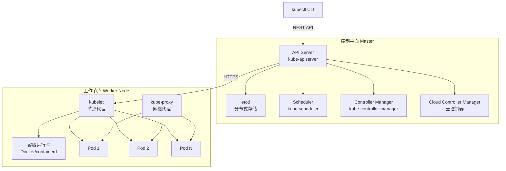
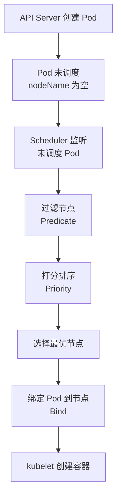

# K8s 核心概念与架构

> **文档说明**：系统讲解 Kubernetes（K8s）的核心架构、控制平面与工作节点、核心资源对象（Pod/Deployment/Service/ConfigMap/Secret/Namespace/Volume/Ingress）、工作负载类型（Deployment/StatefulSet/DaemonSet/Job/CronJob）、服务发现与负载均衡、存储管理（PV/PVC/StorageClass）、调度机制、常用 kubectl 命令，以及生产级最佳实践和常见问题排查。
>
> **适用人群**：后端开发工程师、全栈开发者、DevOps 工程师、云原生架构师
>
> **前置知识**：[[Docker-核心原理与镜像优化]]、[[CI-CD持续集成与部署]]、[[Nginx-反向代理与负载均衡]]

---

## 一、概述

### 1. 什么是 Kubernetes

**Kubernetes（K8s）** 是 Google 开源的容器编排平台，用于自动化部署、扩展和管理容器化应用。它提供了容器编排、服务发现、负载均衡、自动伸缩、滚动更新、存储编排等完整的容器管理能力。

### 2. 核心特性

| 特性 | 说明 |
|------|------|
| **服务发现与负载均衡** | Service 提供稳定访问入口，内置负载均衡 |
| **存储编排** | 自动挂载存储系统（本地/云存储/NFS） |
| **自动部署与回滚** | Deployment 声明式部署，支持滚动更新和回滚 |
| **自动装箱** | 根据资源需求自动调度容器到节点 |
| **自我修复** | 容器崩溃自动重启，节点故障自动迁移 |
| **密钥与配置管理** | ConfigMap/Secret 管理配置和敏感信息 |
| **自动伸缩** | HPA 根据 CPU/内存/自定义指标自动扩缩容 |
| **批处理** | Job/CronJob 支持一次性和定时任务 |

### 3. 架构



### 4. 控制平面组件

| 组件 | 说明 |
|------|------|
| **kube-apiserver** | API 服务器，集群的唯一入口，所有操作通过它，RESTful API，水平扩展 |
| **etcd** | 分布式键值存储，保存集群所有数据（配置、状态、元数据） |
| **kube-scheduler** | 调度器，决定 Pod 运行在哪个节点上，基于资源、亲和性、约束等 |
| **kube-controller-manager** | 控制器管理器，运行多个控制器（Node/Deployment/Service/Endpoint 等） |
| **cloud-controller-manager** | 云控制器，与云服务商 API 集成（负载均衡、存储、路由） |

### 5. 工作节点组件

| 组件 | 说明 |
|------|------|
| **kubelet** | 节点代理，管理 Pod 生命周期（创建/监控/重启），与 API Server 通信 |
| **kube-proxy** | 网络代理，维护节点网络规则，实现 Service 负载均衡 |
| **容器运行时** | 运行容器的软件（Docker、containerd、CRI-O），符合 CRI 标准 |
| **Pod** | K8s 最小调度单元，包含一个或多个容器 |

---

## 二、核心资源对象

### 1. Pod

**Pod** 是 K8s 最小的部署单元，一个 Pod 包含一个或多个容器，共享网络命名空间和存储卷。

```yaml
# pod.yaml
apiVersion: v1
kind: Pod
metadata:
  name: nginx-pod
  labels:
    app: nginx
    tier: frontend
spec:
  containers:
    - name: nginx
      image: nginx:1.25
      ports:
        - containerPort: 80
      resources:
        requests:
          cpu: "100m"
          memory: "128Mi"
        limits:
          cpu: "500m"
          memory: "256Mi"
      env:
        - name: ENV
          value: "production"
      volumeMounts:
        - name: data
          mountPath: /usr/share/nginx/html
  volumes:
    - name: data
      emptyDir: {}
  restartPolicy: Always
```

**Pod 特点**：
- 一个 Pod 内的容器共享 localhost 网络
- 一个 Pod 内的容器可以共享 Volume
- Pod 是临时的，可能随时被销毁和重建
- Pod 有独立的 IP，但重启后 IP 会变

### 2. Deployment

**Deployment** 管理 Pod 的副本数和更新策略，是最常用的工作负载。

```yaml
# deployment.yaml
apiVersion: apps/v1
kind: Deployment
metadata:
  name: nginx-deployment
  labels:
    app: nginx
spec:
  replicas: 3
  selector:
    matchLabels:
      app: nginx
  strategy:
    type: RollingUpdate
    rollingUpdate:
      maxSurge: 1
      maxUnavailable: 0
  template:
    metadata:
      labels:
        app: nginx
    spec:
      containers:
        - name: nginx
          image: nginx:1.25
          ports:
            - containerPort: 80
          resources:
            requests:
              cpu: "100m"
              memory: "128Mi"
            limits:
              cpu: "500m"
              memory: "256Mi"
```

**Deployment 策略**：
| 策略 | 说明 |
|------|------|
| **RollingUpdate（滚动更新）** | 逐步替换旧 Pod，零停机（默认） |
| **Recreate（重建）** | 先删除所有旧 Pod，再创建新 Pod，有停机时间 |

### 3. Service

**Service** 为一组 Pod 提供稳定的访问入口和负载均衡，Pod IP 变化不影响 Service。

```yaml
# service.yaml
apiVersion: v1
kind: Service
metadata:
  name: nginx-service
spec:
  type: ClusterIP  # ClusterIP / NodePort / LoadBalancer / ExternalName
  selector:
    app: nginx
  ports:
    - name: http
      port: 80        # Service 端口
      targetPort: 80  # Pod 端口
      protocol: TCP
```

**Service 类型**：
| 类型 | 说明 | 适用场景 |
|------|------|---------|
| **ClusterIP** | 集群内部虚拟 IP，只能集群内访问（默认） | 内部服务 |
| **NodePort** | 在每个节点上开放端口，通过节点 IP:端口访问 | 开发测试、外部访问 |
| **LoadBalancer** | 云服务商负载均衡器，分配外部 IP | 生产环境对外服务 |
| **ExternalName** | 将 Service 映射到外部域名 | 访问外部服务 |

### 4. Namespace

**Namespace** 用于逻辑隔离集群资源，实现多团队/多环境共享集群。

```yaml
# namespace.yaml
apiVersion: v1
kind: Namespace
metadata:
  name: production
  labels:
    environment: production
```

```bash
# 常用命令
kubectl get namespaces
kubectl create namespace dev
kubectl delete namespace dev
kubectl get pods -n production  # 指定命名空间
```

**默认命名空间**：
| 命名空间 | 说明 |
|---------|------|
| **default** | 默认命名空间，未指定的资源都在这里 |
| **kube-system** | 系统组件（kube-proxy、DNS、Dashboard 等） |
| **kube-public** | 公开资源，所有用户可读 |
| **kube-node-lease** | 节点心跳租约 |

### 5. ConfigMap

**ConfigMap** 存储非敏感配置数据，可挂载为文件或环境变量。

```yaml
# configmap.yaml
apiVersion: v1
kind: ConfigMap
metadata:
  name: app-config
data:
  app.properties: |
    server.port=8080
    app.name=my-app
    log.level=INFO
  database.url: jdbc:mysql://localhost:3306/db
  database.username: root
```

```yaml
# Pod 中使用 ConfigMap
spec:
  containers:
    - name: app
      image: my-app:latest
      env:
        - name: DB_URL
          valueFrom:
            configMapKeyRef:
              name: app-config
              key: database.url
      volumeMounts:
        - name: config
          mountPath: /etc/config
  volumes:
    - name: config
      configMap:
        name: app-config
```

### 6. Secret

**Secret** 存储敏感信息（密码、密钥、证书），Base64 编码，可挂载为文件或环境变量。

```yaml
# secret.yaml
apiVersion: v1
kind: Secret
metadata:
  name: db-secret
type: Opaque
data:
  username: cm9vdA==      # echo -n "root" | base64
  password: MTIzNDU2      # echo -n "123456" | base64
```

```yaml
# Pod 中使用 Secret
spec:
  containers:
    - name: app
      image: my-app:latest
      env:
        - name: DB_PASSWORD
          valueFrom:
            secretKeyRef:
              name: db-secret
              key: password
      volumeMounts:
        - name: secret
          mountPath: /etc/secret
          readOnly: true
  volumes:
    - name: secret
      secret:
        secretName: db-secret
```

> **注意**：Secret 只是 Base64 编码，不是加密。生产环境应启用 etcd 加密或使用外部密钥管理（Vault、KMS）。

---

## 三、工作负载类型

| 类型 | 说明 | 适用场景 |
|------|------|---------|
| **Deployment** | 无状态应用，副本管理，滚动更新 | Web 服务、API 服务 |
| **StatefulSet** | 有状态应用，稳定的网络标识和持久存储 | 数据库（MySQL/Redis）、Kafka |
| **DaemonSet** | 每个节点运行一个 Pod | 日志收集、监控 Agent、网络插件 |
| **Job** | 一次性任务，完成后退出 | 数据处理、批处理、迁移 |
| **CronJob** | 定时任务，按 Cron 表达式执行 | 定时备份、报表生成 |

### 1. StatefulSet

```yaml
apiVersion: apps/v1
kind: StatefulSet
metadata:
  name: mysql
spec:
  serviceName: mysql-headless  # 无头 Service
  replicas: 3
  selector:
    matchLabels:
      app: mysql
  template:
    metadata:
      labels:
        app: mysql
    spec:
      containers:
        - name: mysql
          image: mysql:8.0
          volumeMounts:
            - name: data
              mountPath: /var/lib/mysql
  volumeClaimTemplates:  # 每个 Pod 独立的 PVC
    - metadata:
        name: data
      spec:
        accessModes: ["ReadWriteOnce"]
        resources:
          requests:
            storage: 10Gi
```

**StatefulSet 特点**：
- Pod 名称稳定（mysql-0, mysql-1, mysql-2）
- 有序部署和销毁（0→1→2，2→1→0）
- 稳定的 DNS 名称（mysql-0.mysql-headless.default.svc.cluster.local）
- 每个 Pod 独立的持久化存储

### 2. DaemonSet

```yaml
apiVersion: apps/v1
kind: DaemonSet
metadata:
  name: fluentd
spec:
  selector:
    matchLabels:
      app: fluentd
  template:
    metadata:
      labels:
        app: fluentd
    spec:
      containers:
        - name: fluentd
          image: fluentd:latest
          volumeMounts:
            - name: varlog
              mountPath: /var/log
      volumes:
        - name: varlog
          hostPath:
            path: /var/log
```

### 3. CronJob

```yaml
apiVersion: batch/v1
kind: CronJob
metadata:
  name: backup
spec:
  schedule: "0 2 * * *"  # 每天凌晨 2 点
  jobTemplate:
    spec:
      template:
        spec:
          containers:
            - name: backup
              image: backup-tool:latest
              command: ["/bin/sh", "-c", "backup.sh"]
          restartPolicy: OnFailure
```

---

## 四、服务发现与 Ingress

### 1. 集群 DNS

K8s 内置 DNS 服务（CoreDNS），Pod 和 Service 可通过域名互相访问：

```css
# Service DNS 格式
<service-name>.<namespace>.svc.cluster.local

# 示例
nginx-service.default.svc.cluster.local
mysql.production.svc.cluster.local

# StatefulSet Pod DNS
<pod-name>.<headless-service-name>.<namespace>.svc.cluster.local
mysql-0.mysql-headless.default.svc.cluster.local
```

### 2. Ingress

**Ingress** 管理外部访问集群内服务的 HTTP/HTTPS 路由，提供域名路由、SSL 终止、负载均衡等。

```yaml
# ingress.yaml
apiVersion: networking.k8s.io/v1
kind: Ingress
metadata:
  name: app-ingress
  annotations:
    nginx.ingress.kubernetes.io/rewrite-target: /
spec:
  ingressClassName: nginx
  tls:
    - hosts:
        - app.example.com
      secretName: tls-secret
  rules:
    - host: app.example.com
      http:
        paths:
          - path: /api
            pathType: Prefix
            backend:
              service:
                name: api-service
                port:
                  number: 8080
          - path: /
            pathType: Prefix
            backend:
              service:
                name: web-service
                port:
                  number: 80
```

**Ingress 控制器**：
| 控制器 | 说明 |
|--------|------|
| **Ingress-Nginx** | 最常用，基于 Nginx |
| **Traefik** | 云原生，自动服务发现 |
| **HAProxy** | 高性能负载均衡 |
| **Istio Gateway** | 服务网格入口 |

---

## 五、存储管理

### 1. PV / PVC / StorageClass

| 概念 | 说明 |
|------|------|
| **PV（PersistentVolume）** | 持久化卷，集群级资源，由管理员创建或动态供给 |
| **PVC（PersistentVolumeClaim）** | 持久化卷声明，用户对存储的需求，绑定到 PV |
| **StorageClass** | 存储类，定义动态供给存储的参数（ provisioner、参数） |

```yaml
# StorageClass
apiVersion: storage.k8s.io/v1
kind: StorageClass
metadata:
  name: fast
provisioner: kubernetes.io/aws-ebs
parameters:
  type: gp2
  fsType: ext4
reclaimPolicy: Delete
volumeBindingMode: WaitForFirstConsumer
```

```yaml
# PVC
apiVersion: v1
kind: PersistentVolumeClaim
metadata:
  name: data-pvc
spec:
  accessModes:
    - ReadWriteOnce
  storageClassName: fast
  resources:
    requests:
      storage: 10Gi
```

**访问模式**：
| 模式 | 说明 |
|------|------|
| **ReadWriteOnce（RWO）** | 单节点读写 |
| **ReadOnlyMany（ROX）** | 多节点只读 |
| **ReadWriteMany（RWX）** | 多节点读写 |

### 2. Volume 类型

| 类型 | 说明 |
|------|------|
| **emptyDir** | Pod 内共享，Pod 删除后数据丢失 |
| **hostPath** | 挂载节点文件系统到 Pod |
| **nfs** | 挂载 NFS 共享存储 |
| **configMap/secret** | 挂载配置或密钥为文件 |
| **persistentVolumeClaim** | 挂载 PVC |
| **gitRepo** | 克隆 Git 仓库（已废弃） |

---

## 六、调度机制

### 1. 调度流程



### 2. 调度策略

| 策略 | 说明 |
|------|------|
| **节点选择器（nodeSelector）** | 简单的标签匹配调度 |
| **亲和性（Affinity）** | 更灵活的调度规则（节点亲和性、Pod 亲和性/反亲和性） |
| **污点与容忍（Taint/Toleration）** | 节点排斥 Pod，Pod 可容忍特定污点 |
| **资源请求/限制** | 根据 CPU/内存请求调度 |
| **拓扑分布约束** | Pod 在节点/区域/机架间均匀分布 |

```yaml
# nodeSelector
spec:
  nodeSelector:
    disktype: ssd

# 节点亲和性
spec:
  affinity:
    nodeAffinity:
      requiredDuringSchedulingIgnoredDuringExecution:
        nodeSelectorTerms:
          - matchExpressions:
              - key: disktype
                operator: In
                values: ["ssd"]

# Pod 反亲和性（分散部署）
spec:
  affinity:
    podAntiAffinity:
      preferredDuringSchedulingIgnoredDuringExecution:
        - weight: 100
          podAffinityTerm:
            labelSelector:
              matchLabels:
                app: nginx
            topologyKey: kubernetes.io/hostname
```

### 3. 污点与容忍

```bash
# 给节点打污点
kubectl taint nodes node1 key=value:NoSchedule

# Pod 容忍污点
spec:
  tolerations:
    - key: "key"
      operator: "Equal"
      value: "value"
      effect: "NoSchedule"
```

| 污点效果 | 说明 |
|---------|------|
| **NoSchedule** | 新 Pod 不调度到此节点（已运行的不受影响） |
| **PreferNoSchedule** | 尽量不调度（软限制） |
| **NoExecute** | 新 Pod 不调度，已运行的 Pod 被驱逐 |

---

## 七、常用 kubectl 命令

### 1. 资源管理

```bash
# 创建/更新资源
kubectl apply -f deployment.yaml
kubectl apply -f ./manifests/  # 目录下所有文件

# 查看资源
kubectl get pods
kubectl get pods -n production
kubectl get pods -o wide        # 显示节点和 IP
kubectl get pods -o yaml        # YAML 格式
kubectl get all                 # 所有资源
kubectl get deploy,svc,pvc      # 多种资源

# 查看详情
kubectl describe pod nginx-xxx
kubectl describe deployment nginx

# 删除资源
kubectl delete -f deployment.yaml
kubectl delete pod nginx-xxx
kubectl delete deployment nginx

# 日志
kubectl logs nginx-xxx
kubectl logs -f nginx-xxx       # 实时跟踪
kubectl logs nginx-xxx -c sidecar  # 多容器指定容器
kubectl logs --previous nginx-xxx  # 上一个容器的日志（崩溃后）

# 进入容器
kubectl exec -it nginx-xxx -- /bin/bash
kubectl exec -it nginx-xxx -c sidecar -- /bin/bash

# 端口转发
kubectl port-forward pod/nginx-xxx 8080:80
kubectl port-forward service/nginx-service 8080:80

# 复制文件
kubectl cp local-file.txt nginx-xxx:/path/in/container
kubectl cp nginx-xxx:/path/in/container/file.txt ./local-file.txt
```

### 2. 扩缩容与更新

```bash
# 扩缩容
kubectl scale deployment nginx --replicas=5

# 自动扩缩容（HPA）
kubectl autoscale deployment nginx --min=2 --max=10 --cpu-percent=80

# 滚动更新
kubectl set image deployment/nginx nginx=nginx:1.26
kubectl rollout status deployment/nginx    # 查看更新状态
kubectl rollout history deployment/nginx   # 查看历史版本
kubectl rollout undo deployment/nginx      # 回滚到上一版本
kubectl rollout undo deployment/nginx --to-revision=2  # 回滚到指定版本
kubectl rollout restart deployment/nginx   # 重启（重新拉取镜像）
kubectl rollout pause deployment/nginx     # 暂停更新
kubectl rollout resume deployment/nginx    # 恢复更新
```

### 3. 排错命令

```bash
# 查看事件
kubectl get events --sort-by='.lastTimestamp'
kubectl describe pod nginx-xxx | grep -A 10 Events

# 查看节点状态
kubectl get nodes
kubectl describe node node1
kubectl top nodes    # 节点资源使用
kubectl top pods     # Pod 资源使用

# 查看资源使用
kubectl top pod --all-namespaces

# 调试
kubectl debug -it nginx-xxx --image=busybox --target=nginx  # 临时调试容器
kubectl run debug --image=busybox --rm -it --restart=Never -- /bin/sh
```

---

## 八、生产最佳实践

### 1. 资源配置

- [ ] **设置 requests/limits**：每个容器设置 CPU/内存请求和限制
- [ ] **合理设置副本数**：至少 2 副本保证高可用
- [ ] **使用 HPA**：根据负载自动扩缩容
- [ ] **Pod 反亲和性**：多副本分散到不同节点
- [ ] **优雅终止**：配置 preStop 钩子和 terminationGracePeriodSeconds
- [ ] **健康检查**：配置 livenessProbe 和 readinessProbe

### 2. 配置管理

- [ ] **使用 ConfigMap/Secret**：配置和密钥与镜像分离
- [ ] **环境隔离**：不同环境使用不同 Namespace
- [ ] **配置版本化**：配置变更纳入版本控制
- [ ] **Secret 加密**：启用 etcd 加密或使用外部密钥管理

### 3. 安全

- [ ] **最小权限**：RBAC 权限最小化
- [ ] **非 root 用户**：容器不以 root 运行
- [ ] **只读根文件系统**：securityContext.readOnlyRootFilesystem
- [ ] **网络策略**：NetworkPolicy 限制 Pod 间通信
- [ ] **镜像扫描**：CI/CD 中扫描镜像漏洞
- [ ] **资源配额**：Namespace 设置 ResourceQuota 和 LimitRange

### 4. 监控与日志

- [ ] **Prometheus + Grafana**：集群和应用监控
- [ ] **ELK/Loki**：日志收集和分析
- [ ] **告警**：配置关键指标告警
- [ ] **审计日志**：开启 API Server 审计
- [ ] **分布式追踪**：Jaeger/Zipkin 链路追踪

---

## 九、常见问题与排查

| 问题 | 原因 | 解决方案 |
|------|------|---------|
| **Pod 一直 Pending** | 资源不足 / 节点选择器不匹配 / 污点无法容忍 | 检查资源、nodeSelector、tolerations、describe 事件 |
| **Pod CrashLoopBackOff** | 应用启动失败 / 配置错误 / 健康检查失败 | 查看日志 kubectl logs --previous、检查健康检查配置 |
| **Pod 一直 ContainerCreating** | 镜像拉取失败 / 网络问题 / 存储挂载失败 | 检查镜像地址、网络、PVC 绑定、describe 事件 |
| **Service 无法访问** | 标签选择器不匹配 / 端口配置错误 / 网络策略 | 检查 selector、port/targetPort、NetworkPolicy |
| **Ingress 502/503** | 后端 Service 不可用 / Pod 未就绪 / 配置错误 | 检查 Service 端点、Pod readiness、Ingress 配置 |
| **节点 NotReady** | kubelet 故障 / 网络问题 / 资源耗尽 | 检查 kubelet 状态、节点网络、磁盘/内存 |
| **镜像拉取失败** | 镜像不存在 / 认证失败 / 网络不通 | 检查镜像名、ImagePullSecret、网络、私有仓库配置 |
| **PVC 一直 Pending** | 没有可用 PV / StorageClass 不存在 / 存储配额 | 检查 PV、StorageClass、存储配额 |
| **HPA 不生效** | metrics-server 未安装 / 资源指标缺失 / 目标值设置 | 安装 metrics-server、检查资源请求、HPA 配置 |
| **滚动更新卡住** | maxUnavailable=0 且资源不足 / 就绪探针失败 | 检查资源、readinessProbe、maxSurge/maxUnavailable |
| **OOMKilled** | 内存超过 limit / 应用内存泄漏 | 增加 memory limit、排查内存泄漏 |
| **CPU 节流** | CPU limit 设置过低 / 应用 CPU 密集 | 增加 CPU limit、优化应用 |
| **etcd 性能问题** | 磁盘 IO 慢 / 节点数过多 / 网络延迟 | 使用 SSD、优化 etcd、网络优化 |
| **DNS 解析失败** | CoreDNS 故障 / 网络策略 / 节点 DNS 配置 | 检查 CoreDNS Pod、NetworkPolicy、resolv.conf |
| **Pod 被驱逐** | 节点资源不足 / 污点 NoExecute | 检查节点资源、配置容忍、增加节点 |

---

## 十、关联笔记

### 云原生
- [[Docker-核心原理与镜像优化]] · [[K8s-核心概念与架构]] · [[CI-CD持续集成与部署]]
- [[Nginx-反向代理与负载均衡]] · [[Prometheus监控体系]] · [[Helm包管理器]]

### 微服务
- [[SpringCloud-Alibaba组件体系]] · [[Nacos-注册中心与配置中心]] · [[微服务核心组件知识点系统梳理_优化版]]
- [[Gateway-网关路由与鉴权]] · [[Sentinel-流量控制与熔断]]

### 后端
- [[高可用架构设计]] · [[高并发系统设计案例]] · [[SpringBoot-自动装配原理]]
- [[SpringBoot-配置管理与多环境]] · [[SpringSecurity-认证授权]]

### 分布式
- [[分布式锁知识点系统梳理_优化版]] · [[分布式事务 知识点系统梳理_优化版]] · [[Raft共识算法详解]]
- [[ZooKeeper核心原理与实战]]

### 导航
- [[MOC-云原生与运维]] · [[MOC-后端开发]] · [[全栈+AI工程双轨融合学习路线图]]

> **学习路径建议**：先掌握 [[Docker-核心原理与镜像优化]] 容器基础 → 学习 [[Nginx-反向代理与负载均衡]] 网络基础 → 深入本文 K8s 核心概念与架构 → 实践 Deployment/Service/Ingress 等核心资源 → 研究 [[CI-CD持续集成与部署]] 自动化部署 → 应用于 [[高可用架构设计]] 云原生架构。

---

## 💡 全文深度讲解

本文系统梳理了K8s 核心概念与架构的核心知识体系，从概述入手，深入核心资源对象的底层机制，再通过工作负载类型掌握实战应用，最后涵盖常见问题与排查与关联笔记。学习时建议先建立整体认知，再动手实践，最后结合常见问题深化理解。

## 📝 全文精简总结

- **概述**：掌握本模块的核心概念与关键要点
- **核心资源对象**：掌握本模块的核心概念与关键要点
- **工作负载类型**：掌握本模块的核心概念与关键要点
- **服务发现与 Ingress**：掌握本模块的核心概念与关键要点
- **存储管理**：掌握本模块的核心概念与关键要点
- **调度机制**：掌握本模块的核心概念与关键要点
- **常用 kubectl 命令**：掌握本模块的核心概念与关键要点
- **生产最佳实践**：掌握本模块的核心概念与关键要点
- 其余2个模块涵盖进阶主题与拓展内容

