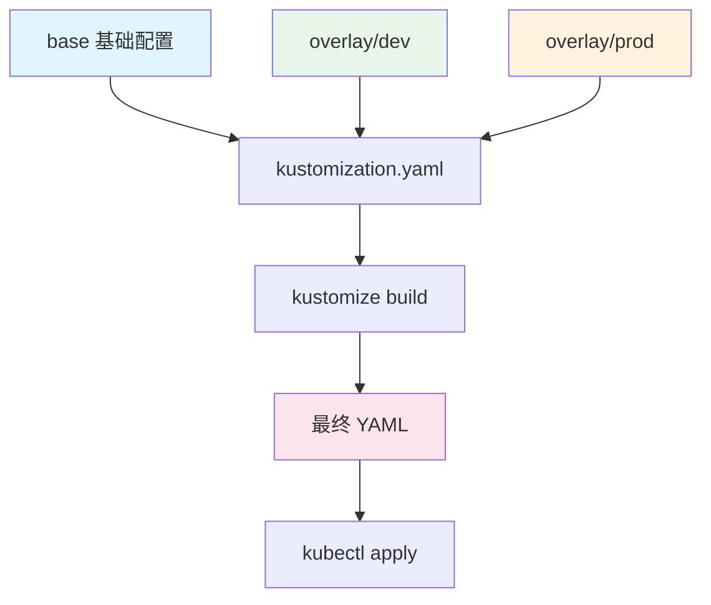

# Kustomize-K8s配置管理

> **文档说明**：系统讲解 Kustomize K8s 配置管理工具的基础概念、目录结构、常用功能、环境管理、补丁机制、组件系统，以及与 Helm 的对比、CI/CD 集成和最佳实践。
>
> **适用人群**：后端开发者、运维工程师、SRE、需要管理 K8s 配置的开发者
>
> **前置知识**：[[K8s-核心概念与架构]]、[[Docker容器化实战]]、[[kubectl命令速查表]]

---

## 一、概述

### 1. 什么是 Kustomize

**Kustomize** 是 Kubernetes 原生的配置管理工具，通过无模板的方式定制 K8s 资源清单。

```text
Kustomize 核心理念：
- 无模板：不使用 Go template，纯 YAML
- 声明式：用 YAML 描述如何修改资源
- 分层：base（基础）+ overlay（环境覆盖）
- 可组合：多个 base 组合、patch 叠加
- 内置：kubectl 内置支持（kubectl apply -k）
```

### 2. Kustomize vs Helm

| 维度 | Kustomize | Helm |
|------|-----------|------|
| **方式** | 无模板，纯 YAML | Go template + values |
| **学习曲线** | 低（懂 YAML 即可） | 高（模板语法复杂） |
| **灵活性** | 中（patch 机制） | 高（模板逻辑） |
| **调试** | 简单（直接看 YAML） | 难（模板渲染后才知道） |
| **版本管理** | Git 原生友好 | 需要 Chart 仓库 |
| **依赖管理** | 弱 | 强（Chart 依赖） |
| **适用场景** | 简单配置、多环境 | 复杂应用、发布包 |
| **内置支持** | kubectl 内置 | 需安装 helm |

### 3. 工作原理



---

## 二、安装与基本使用

### 1. 安装

```bash
# kubectl 内置（1.14+），直接用 kubectl apply -k
# 独立安装（最新版）
brew install kustomize                    # macOS
choco install kustomize                   # Windows
curl -s "https://raw.githubusercontent.com/kubernetes-sigs/kustomize/master/hack/install_kustomize.sh" | bash

# 验证
kustomize version
kubectl kustomize --help
```

### 2. 基本命令

```bash
# 构建（渲染最终 YAML，不应用）
kustomize build ./overlays/dev
kubectl kustomize ./overlays/dev

# 应用到集群
kubectl apply -k ./overlays/dev

# 预览差异
kubectl diff -k ./overlays/dev

# 删除
kubectl delete -k ./overlays/dev

# 输出到文件
kustomize build ./overlays/dev > rendered.yaml
```

---

## 三、目录结构

### 1. 标准目录结构

```text
my-app/
├── base/                          # 基础配置
│   ├── kustomization.yaml
│   ├── deployment.yaml
│   ├── service.yaml
│   ├── configmap.yaml
│   └── ingress.yaml
└── overlays/                      # 环境覆盖
    ├── dev/
    │   ├── kustomization.yaml
    │   ├── deployment-patch.yaml
    │   └── configmap-patch.yaml
    ├── staging/
    │   ├── kustomization.yaml
    │   └── patch.yaml
    └── prod/
        ├── kustomization.yaml
        ├── deployment-patch.yaml
        ├── hpa.yaml
        └── pdb.yaml
```

### 2. base/kustomization.yaml

```yaml
# base/kustomization.yaml
apiVersion: kustomize.config.k8s.io/v1beta1
kind: Kustomization

# 资源列表
resources:
  - deployment.yaml
  - service.yaml
  - configmap.yaml
  - ingress.yaml

# 通用标签（添加到所有资源）
commonLabels:
  app.kubernetes.io/name: my-app
  app.kubernetes.io/managed-by: kustomize

# 通用注解
commonAnnotations:
  maintainer: team@example.com

# 命名空间（所有资源加入此命名空间）
namespace: my-app

# 名称前缀/后缀
namePrefix: my-app-
# nameSuffix: -v1
```

### 3. overlay/kustomization.yaml

```yaml
# overlays/prod/kustomization.yaml
apiVersion: kustomize.config.k8s.io/v1beta1
kind: Kustomization

# 引用 base
resources:
  - ../../base

# 额外资源（prod 特有的）
  - hpa.yaml
  - pdb.yaml

# 补丁
patches:
  - path: deployment-patch.yaml
  - path: configmap-patch.yaml

# 镜像替换
images:
  - name: my-app
    newName: registry.example.com/my-app
    newTag: v1.2.3

# 副本数
replicas:
  - name: my-app
    count: 5

# 配置替换
configMapGenerator:
  - name: app-config
    behavior: merge
    literals:
      - LOG_LEVEL=info
      - ENV=production
```

---

## 四、核心功能

### 1. 镜像替换

```yaml
# kustomization.yaml
images:
  # 简单替换 tag
  - name: nginx
    newTag: "1.25.3"

  # 替换镜像名和 tag
  - name: my-app
    newName: registry.example.com/my-app
    newTag: v1.2.3

  # 只替换 digest
  - name: my-app
    digest: sha256:abc123...
```

```bash
# 命令行设置镜像 tag（CI 常用）
kustomize edit set image my-app=registry.example.com/my-app:${GIT_SHA}
```

### 2. 副本数调整

```yaml
replicas:
  - name: my-app-deployment
    count: 5
```

### 3. 命名空间

```yaml
namespace: production
# 所有资源自动加入 production 命名空间
```

### 4. 标签和注解

```yaml
# 给所有资源加标签
commonLabels:
  environment: production
  team: backend

# 给所有资源加注解
commonAnnotations:
  environment: production

# 给特定资源加标签（用 patch）
```

### 5. 名称前缀/后缀

```yaml
namePrefix: prod-
nameSuffix: -v2
# deployment my-app → prod-my-app-v2
```

### 6. ConfigMap/Secret 生成

```yaml
# 从字面量生成
configMapGenerator:
  - name: app-config
    literals:
      - LOG_LEVEL=debug
      - PORT=8080
    envs:
      - .env  # 从文件读取

# 从文件生成
  - name: nginx-config
    files:
      - nginx.conf
      - conf.d/default.conf

# Secret 生成
secretGenerator:
  - name: db-secret
    literals:
      - username=admin
      - password=secret123
    type: Opaque

# 合并到已有 ConfigMap
configMapGenerator:
  - name: app-config
    behavior: merge  # merge/replace/create
    literals:
      - ENV=prod
```

> Kustomize 会自动给生成的 ConfigMap/Secret 加内容哈希后缀（如 `app-config-7h8c9f2`），配置变更时自动触发滚动更新。

---

## 五、补丁机制

### 1. Strategic Merge Patch

```yaml
# deployment-patch.yaml（Strategic Merge）
apiVersion: apps/v1
kind: Deployment
metadata:
  name: my-app
spec:
  replicas: 5
  template:
    spec:
      containers:
        - name: my-app
          resources:
            requests:
              cpu: "500m"
              memory: "512Mi"
            limits:
              cpu: "2"
              memory: "1Gi"
          env:
            - name: ENV
              value: production
```

### 2. JSON 6902 Patch

```yaml
# kustomization.yaml 中引用
patches:
  - target:
      kind: Deployment
      name: my-app
    patch: |-
      - op: replace
        path: /spec/replicas
        value: 5
      - op: add
        path: /spec/template/spec/containers/0/env/-
        value:
          name: NEW_VAR
          value: "value"
      - op: remove
        path: /spec/template/spec/containers/0/env/0
```

### 3. 按目标选择补丁

```yaml
patches:
  # 按名称和类型匹配
  - target:
      kind: Deployment
      name: my-app
      labelSelector: "app=my-app"
      annotationSelector: "managed-by=kustomize"
    path: patch.yaml

  # 内联补丁
  - target:
      kind: Service
      name: my-app
    patch: |-
      apiVersion: v1
      kind: Service
      metadata:
        name: my-app
      spec:
        type: LoadBalancer
```

### 4. 补丁类型对比

| 类型 | 说明 | 适用场景 |
|------|------|---------|
| **Strategic Merge** | K8s 感知的合并，列表可合并/替换 | 大多数场景，修改 Deployment 等 |
| **JSON 6902** | 标准 JSON Patch，精确操作 | 精确增删改、复杂操作 |
| **Inline Patch** | 内联在 kustomization.yaml | 简单修改 |

---

## 六、组件（Components）

### 1. 组件概念

```text
Component 是可复用的配置片段，可以在多个 overlay 中引用。
类似于 base，但可以有条件地组合。
```

### 2. 使用组件

```yaml
# components/monitoring/kustomization.yaml
apiVersion: kustomize.config.k8s.io/v1alpha1
kind: Component

resources:
  - servicemonitor.yaml
  - podmonitor.yaml

patches:
  - target:
      kind: Deployment
    patch: |-
      apiVersion: apps/v1
      kind: Deployment
      metadata:
        name: any
      spec:
        template:
          metadata:
            annotations:
              prometheus.io/scrape: "true"
```

```yaml
# overlay 中引用组件
components:
  - ../../components/monitoring
  - ../../components/tls
```

---

## 七、多环境管理实战

### 1. 完整示例

```yaml
# base/deployment.yaml
apiVersion: apps/v1
kind: Deployment
metadata:
  name: my-app
spec:
  replicas: 1
  selector:
    matchLabels:
      app: my-app
  template:
    metadata:
      labels:
        app: my-app
    spec:
      containers:
        - name: my-app
          image: my-app:latest
          ports:
            - containerPort: 8080
          env:
            - name: LOG_LEVEL
              value: info
```

```yaml
# overlays/dev/kustomization.yaml
apiVersion: kustomize.config.k8s.io/v1beta1
kind: Kustomization
namespace: dev
resources:
  - ../../base
images:
  - name: my-app
    newTag: dev-latest
configMapGenerator:
  - name: app-config
    literals:
      - ENV=dev
      - LOG_LEVEL=debug
```

```yaml
# overlays/prod/kustomization.yaml
apiVersion: kustomize.config.k8s.io/v1beta1
kind: Kustomization
namespace: prod
resources:
  - ../../base
  - hpa.yaml
  - pdb.yaml
patches:
  - path: deployment-patch.yaml
images:
  - name: my-app
    newName: registry.example.com/my-app
    newTag: v1.2.3
replicas:
  - name: my-app
    count: 5
components:
  - ../../components/monitoring
```

```yaml
# overlays/prod/deployment-patch.yaml
apiVersion: apps/v1
kind: Deployment
metadata:
  name: my-app
spec:
  template:
    spec:
      containers:
        - name: my-app
          resources:
            requests:
              cpu: "500m"
              memory: "512Mi"
            limits:
              cpu: "2"
              memory: "1Gi"
          env:
            - name: LOG_LEVEL
              value: warn
```

### 2. 构建验证

```bash
# 构建 dev 环境
kustomize build overlays/dev

# 构建 prod 环境
kustomize build overlays/prod

# 对比差异
diff <(kustomize build overlays/dev) <(kustomize build overlays/prod)
```

---

## 八、CI/CD 集成

### 1. GitHub Actions

```yaml
name: Deploy
on:
  push:
    branches: [main]

jobs:
  deploy:
    runs-on: ubuntu-latest
    steps:
      - uses: actions/checkout@v4

      - name: Setup Kustomize
        uses: imranismail/setup-kustomize@v2

      - name: Set image tag
        run: |
          cd overlays/prod
          kustomize edit set image my-app=registry.example.com/my-app:${GITHUB_SHA::7}

      - name: Build manifests
        run: kustomize build overlays/prod > manifests.yaml

      - name: Deploy
        run: kubectl apply -f manifests.yaml
```

### 2. ArgoCD（GitOps）

```yaml
# ArgoCD Application
apiVersion: argoproj.io/v1alpha1
kind: Application
metadata:
  name: my-app-prod
spec:
  project: default
  source:
    repoURL: https://github.com/org/k8s-config.git
    targetRevision: main
    path: overlays/prod  # Kustomize 目录
  destination:
    server: https://kubernetes.default.svc
    namespace: prod
  syncPolicy:
    automated:
      prune: true
      selfHeal: true
```

---

## 九、最佳实践

### 1. 目录规范

- [ ] **base 保持通用**：base 中不包含环境特定配置
- [ ] **overlay 只放差异**：overlay 只包含与 base 的不同
- [ ] **按环境分层**：dev/staging/prod 清晰分离
- [ ] **组件复用**：通用功能（监控、TLS）抽为 Component
- [ ] **命名规范**：资源名统一、有意义
- [ ] **Git 管理**：所有配置纳入 Git，PR 审查

### 2. 配置规范

- [ ] **用 ConfigMapGenerator**：自动哈希，配置变更触发更新
- [ ] **Secret 用 sealed-secrets**：不要明文提交 Secret
- [ ] **镜像 tag 固定**：生产环境不用 latest，用具体版本或 SHA
- [ ] **资源限制**：每个环境设置合适的 requests/limits
- [ ] **健康检查**：livenessProbe 和 readinessProbe
- [ ] **HPA/PDB**：生产环境配置自动伸缩和中断预算

### 3. 工作流规范

- [ ] **本地预览**：提交前 `kustomize build` 检查输出
- [ ] **kubectl diff**：应用前 `kubectl diff -k` 查看变更
- [ ] **PR 审查**：配置变更走 PR 流程
- [ ] **GitOps**：用 ArgoCD/Flux 自动同步
- [ ] **版本回滚**：Git 历史即回滚历史
- [ ] **环境一致性**：dev/staging/prod 结构一致，只有参数不同

---

## 十、常见问题与排查

| 问题 | 原因 | 解决方案 |
|------|------|---------|
| **补丁不生效** | 名称/类型不匹配 / 路径错误 | 检查 target 匹配、patch 格式 |
| **ConfigMap 不更新** | 用了普通 configMap 而非 generator | 用 configMapGenerator 自动哈希 |
| **镜像替换失败** | name 不匹配 | 检查 images.name 与 deployment 中镜像名一致 |
| **命名空间重复** | base 和 overlay 都设了 namespace | 只在 overlay 设 namespace |
| **资源名冲突** | namePrefix 导致 Service 引用错误 | 用 vars 或 ref 引用动态名称 |
| **列表被覆盖而非合并** | Strategic Merge 行为 | 用 patch 明确指定 merge 策略 |
| **Secret 明文提交** | 未加密 | 用 Sealed Secrets / SOPS / External Secrets |
| **构建输出乱序** | Kustomize 排序问题 | 不影响应用，或用 sort 排序 |
| **多 base 冲突** | 多个 base 定义同名资源 | 重命名或用 components |
| **kubectl apply -k 版本旧** | kubectl 内置 kustomize 版本低 | 用独立 kustomize 构建后 apply |
| **JSON Patch 路径错误** | 数组索引不对 / 路径不存在 | 先用 build 看结构，再写 patch |
| **环境变量未生效** | ConfigMap 未挂载到 Pod | 检查 envFrom / env 配置 |
| **HPA 不生效** | 未安装 metrics-server / 无资源请求 | 安装 metrics-server、设置 requests |
| **回滚困难** | 配置变更未走 Git | 所有变更走 Git PR，用 Git 回滚 |
| **大仓库构建慢** | 资源太多 / 嵌套深 | 拆分应用、用 components、缓存 |

---

## 十一、关联笔记

### K8s 相关
- [[K8s-核心概念与架构]] · [[K8s-服务发现与负载均衡]] · [[K8s-存储与配置管理]]
- [[kubectl命令速查表]] · [[Operator与CRD开发]]

### 容器与运维
- [[Docker容器化实战]] · [[多架构镜像构建-buildx]] · [[APM应用性能监控-SkyWalking]]
- [[容器安全与镜像扫描]]

### 导航
- [[MOC-云原生与运维]] · [[全栈+AI工程双轨融合学习路线图]]

> **学习路径建议**：先掌握 [[K8s-核心概念与架构]] K8s 基础 → 熟练 [[kubectl命令速查表]] 命令 → 深入本文 Kustomize 配置管理 → 实践 [[多架构镜像构建-buildx]] 镜像构建 → 研究 [[Operator与CRD开发]] 高级扩展 → 构建完整的 K8s 应用交付能力。

---

## 💡 全文深度讲解

本文系统梳理了Kustomize-K8s配置管理的核心知识体系，从概述入手，深入安装与基本使用的底层机制，再通过目录结构掌握实战应用，最后涵盖常见问题与排查与关联笔记。学习时建议先建立整体认知，再动手实践，最后结合常见问题深化理解。

## 📝 全文精简总结

- **概述**：掌握本模块的核心概念与关键要点
- **安装与基本使用**：掌握本模块的核心概念与关键要点
- **目录结构**：掌握本模块的核心概念与关键要点
- **核心功能**：掌握本模块的核心概念与关键要点
- **补丁机制**：掌握本模块的核心概念与关键要点
- **组件（Components）**：掌握本模块的核心概念与关键要点
- **多环境管理实战**：掌握本模块的核心概念与关键要点
- **CI/CD 集成**：掌握本模块的核心概念与关键要点
- 其余3个模块涵盖进阶主题与拓展内容

