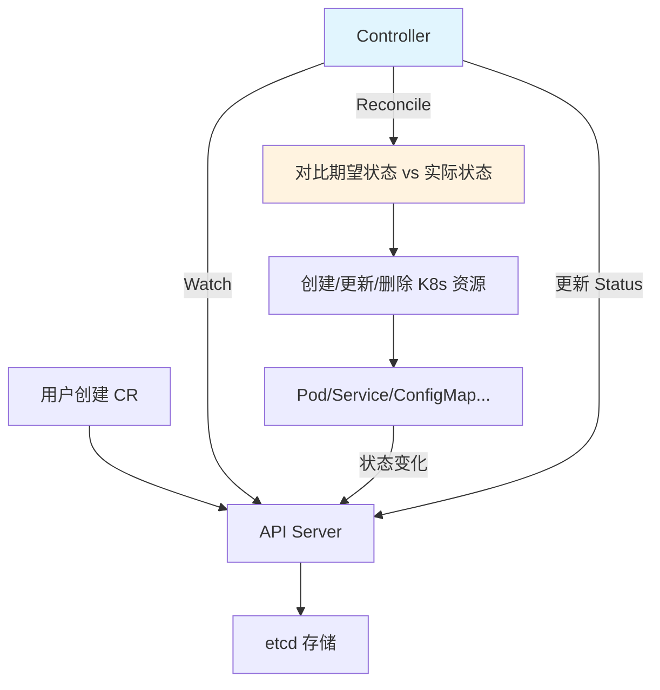

# Operator与CRD开发

> **文档说明**：系统讲解 Kubernetes Operator 模式和 CRD（自定义资源定义）开发，包括 CRD 定义、Operator 框架（Kubebuilder/Operator SDK）、Controller Reconcile 原理、完整开发示例、高级特性（Finalizer/Webhook/Status），以及部署分发和最佳实践。
>
> **适用人群**：运维工程师、SRE、后端开发者、需要扩展 K8s 的开发者
>
> **前置知识**：[[K8s-核心概念与架构]]、[[Kustomize-K8s配置管理]]、[[kubectl命令速查表]]

---

## 一、概述

### 1. 什么是 CRD

**CRD（Custom Resource Definition，自定义资源定义）** 是 Kubernetes 提供的扩展机制，允许用户定义自己的资源类型。

```text
K8s 内置资源：Pod、Service、Deployment、ConfigMap...
CRD 自定义资源：MyApp、Database、RedisCluster、Certificate...

CRD 的作用：
- 将领域知识编码为 K8s 资源
- 用 kubectl 管理自定义资源
- 与 K8s 原生资源一致的体验
- 作为 Operator 的配置入口
```

### 2. 什么是 Operator

**Operator** 是一种打包、部署和管理 Kubernetes 应用的方法，使用 CRD 管理应用及其组件。

```text
Operator = CRD + Controller + 领域知识

核心思想：
- 声明式：用户描述期望状态（Spec）
- 控制器：不断调谐，使实际状态匹配期望状态
- 自动化：安装、升级、备份、故障恢复自动完成

Operator 成熟度模型（Operator Capability Levels）：
Level 1 - 基础安装：自动化安装和配置
Level 2 - 平滑升级：版本升级自动化
Level 3 - 全生命周期：备份、恢复、故障处理
Level 4 - 深度洞察：指标、日志、告警
Level 5 - 自动调优：自动扩展、调优、异常处理
```

### 3. Operator 工作原理



```text
Reconcile 循环（调谐循环）：
1. Watch 自定义资源变化
2. 获取资源的 Spec（期望状态）
3. 查询集群中实际状态
4. 对比差异
5. 执行操作使实际状态匹配期望
6. 更新资源 Status（实际状态）
7. 重复（持续监控）
```

---

## 二、CRD 定义

### 1. 基础 CRD

```yaml
# myapp-crd.yaml
apiVersion: apiextensions.k8s.io/v1
kind: CustomResourceDefinition
metadata:
  name: myapps.example.com
spec:
  group: example.com
  names:
    kind: MyApp
    listKind: MyAppList
    plural: myapps
    singular: myapp
    shortNames:
      - ma
  scope: Namespaced  # 或 Cluster
  versions:
    - name: v1
      served: true
      storage: true
      schema:
        openAPIV3Schema:
          type: object
          properties:
            spec:
              type: object
              properties:
                image:
                  type: string
                replicas:
                  type: integer
                  minimum: 1
                  maximum: 10
                port:
                  type: integer
                env:
                  type: array
                  items:
                    type: object
                    properties:
                      name:
                        type: string
                      value:
                        type: string
            status:
              type: object
              properties:
                readyReplicas:
                  type: integer
                phase:
                  type: string
      subresources:
        status: {}  # 启用 status 子资源
      additionalPrinterColumns:
        - name: Replicas
          type: integer
          jsonPath: .spec.replicas
        - name: Ready
          type: integer
          jsonPath: .status.readyReplicas
        - name: Phase
          type: string
          jsonPath: .status.phase
        - name: Age
          type: date
          jsonPath: .metadata.creationTimestamp
```

### 2. 使用自定义资源

```yaml
# myapp-instance.yaml
apiVersion: example.com/v1
kind: MyApp
metadata:
  name: my-webapp
  namespace: default
spec:
  image: nginx:1.25
  replicas: 3
  port: 80
  env:
    - name: ENV
      value: production
```

```bash
# 操作自定义资源
kubectl get myapps
kubectl get ma  # shortName
kubectl describe myapp my-webapp
kubectl edit myapp my-webapp
kubectl delete myapp my-webapp
```

---

## 三、开发框架

### 1. Kubebuilder vs Operator SDK

| 框架 | 特点 | 适用场景 |
|------|------|---------|
| **Kubebuilder** | K8s SIG 维护、脚手架完善、社区活跃 | 大多数 Operator 开发 |
| **Operator SDK** | Red Hat 维护、基于 Kubebuilder、OLM 集成 | Red Hat 生态、OperatorHub 发布 |
| **纯 client-go** | 最灵活、无脚手架 | 特殊需求、学习原理 |
| **kopf（Python）** | Python 编写、简单 | Python 开发者、快速原型 |
| **metacontroller** | 声明式、Webhook 方式 | 简单控制器、多语言 |

### 2. Kubebuilder 快速开始

```bash
# 安装 Kubebuilder
curl -L https://go.kubebuilder.io/dl/latest/$(go env GOOS)/$(go env GOARCH) | tar -xz -C /tmp/
sudo mv /tmp/kubebuilder_* /usr/local/bin/kubebuilder

# 创建项目
mkdir myapp-operator && cd myapp-operator
kubebuilder init --domain example.com --repo github.com/org/myapp-operator

# 创建 API（CRD + Controller）
kubebuilder create api \
    --group apps \
    --version v1 \
    --kind MyApp \
    --resource true \
    --controller true

# 项目结构
# ├── api/v1/           # CRD 类型定义
# │   ├── myapp_types.go
# │   └── zz_generated.deepcopy.go
# ├── controllers/      # Controller 逻辑
# │   └── myapp_controller.go
# ├── config/           # CRD、RBAC、部署配置
# ├── main.go           # 入口
# └── Makefile          # 构建命令
```

### 3. 类型定义

```go
// api/v1/myapp_types.go
package v1

import (
    metav1 "k8s.io/apimachinery/pkg/apis/meta/v1"
)

// MyAppSpec 定义期望状态
type MyAppSpec struct {
    Image    string        `json:"image"`
    Replicas *int32        `json:"replicas,omitempty"`
    Port     int32         `json:"port,omitempty"`
    Env      []EnvVar      `json:"env,omitempty"`
}

type EnvVar struct {
    Name  string `json:"name"`
    Value string `json:"value"`
}

// MyAppStatus 定义实际状态
type MyAppStatus struct {
    ReadyReplicas int32  `json:"readyReplicas,omitempty"`
    Phase         string `json:"phase,omitempty"`
    Conditions    []metav1.Condition `json:"conditions,omitempty"`
}

// +kubebuilder:object:root=true
// +kubebuilder:subresource:status
// +kubebuilder:printcolumn:name="Replicas",type=integer,JSONPath=`.spec.replicas`
// +kubebuilder:printcolumn:name="Ready",type=integer,JSONPath=`.status.readyReplicas`
// +kubebuilder:printcolumn:name="Phase",type=string,JSONPath=`.status.phase`

type MyApp struct {
    metav1.TypeMeta   `json:",inline"`
    metav1.ObjectMeta `json:"metadata,omitempty"`
    Spec   MyAppSpec   `json:"spec,omitempty"`
    Status MyAppStatus `json:"status,omitempty"`
}

// +kubebuilder:object:root=true
type MyAppList struct {
    metav1.TypeMeta `json:",inline"`
    metav1.ListMeta `json:"metadata,omitempty"`
    Items []MyApp `json:"items"`
}

func init() {
    SchemeBuilder.Register(&MyApp{}, &MyAppList{})
}
```

---

## 四、Controller 开发

### 1. Reconcile 逻辑

```go
// controllers/myapp_controller.go
package controllers

import (
    "context"
    "fmt"

    appsv1 "k8s.io/api/apps/v1"
    corev1 "k8s.io/api/core/v1"
    "k8s.io/apimachinery/pkg/api/errors"
    metav1 "k8s.io/apimachinery/pkg/apis/meta/v1"
    "k8s.io/apimachinery/pkg/runtime"
    "k8s.io/apimachinery/pkg/types"
    ctrl "sigs.k8s.io/controller-runtime"
    "sigs.k8s.io/controller-runtime/pkg/client"
    "sigs.k8s.io/controller-runtime/pkg/controller/controllerutil"
    "sigs.k8s.io/controller-runtime/pkg/log"

    appsv1alpha1 "github.com/org/myapp-operator/api/v1"
)

type MyAppReconciler struct {
    client.Client
    Scheme *runtime.Scheme
}

// +kubebuilder:rbac:groups=apps.example.com,resources=myapps,verbs=get;list;watch;create;update;patch;delete
// +kubebuilder:rbac:groups=apps.example.com,resources=myapps/status,verbs=get;update;patch
// +kubebuilder:rbac:groups=apps,resources=deployments,verbs=get;list;watch;create;update;patch;delete
// +kubebuilder:rbac:groups="",resources=services,verbs=get;list;watch;create;update;patch;delete

func (r *MyAppReconciler) Reconcile(ctx context.Context, req ctrl.Request) (ctrl.Result, error) {
    logger := log.FromContext(ctx)

    // 1. 获取 MyApp 资源
    var myapp appsv1alpha1.MyApp
    if err := r.Get(ctx, req.NamespacedName, &myapp); err != nil {
        if errors.IsNotFound(err) {
            return ctrl.Result{}, nil  // 资源已删除
        }
        return ctrl.Result{}, err
    }

    // 2. 检查 Deployment 是否存在
    var dep appsv1.Deployment
    err := r.Get(ctx, types.NamespacedName{
        Name:      myapp.Name,
        Namespace: myapp.Namespace,
    }, &dep)

    // 3. 不存在则创建
    if errors.IsNotFound(err) {
        dep = r.createDeployment(&myapp)
        if err := controllerutil.SetControllerReference(&myapp, &dep, r.Scheme); err != nil {
            return ctrl.Result{}, err
        }
        if err := r.Create(ctx, &dep); err != nil {
            return ctrl.Result{}, err
        }
        logger.Info("Created Deployment", "name", dep.Name)
        return ctrl.Result{Requeue: true}, nil
    }
    if err != nil {
        return ctrl.Result{}, err
    }

    // 4. 存在则更新（对比期望状态）
    desiredReplicas := int32(1)
    if myapp.Spec.Replicas != nil {
        desiredReplicas = *myapp.Spec.Replicas
    }
    if *dep.Spec.Replicas != desiredReplicas {
        dep.Spec.Replicas = &desiredReplicas
        if err := r.Update(ctx, &dep); err != nil {
            return ctrl.Result{}, err
        }
    }

    // 5. 更新 Status
    myapp.Status.ReadyReplicas = dep.Status.ReadyReplicas
    myapp.Status.Phase = "Running"
    if err := r.Status().Update(ctx, &myapp); err != nil {
        return ctrl.Result{}, err
    }

    return ctrl.Result{}, nil
}

// 创建 Deployment
func (r *MyAppReconciler) createDeployment(myapp *appsv1alpha1.MyApp) appsv1.Deployment {
    replicas := int32(1)
    if myapp.Spec.Replicas != nil {
        replicas = *myapp.Spec.Replicas
    }

    env := []corev1.EnvVar{}
    for _, e := range myapp.Spec.Env {
        env = append(env, corev1.EnvVar{Name: e.Name, Value: e.Value})
    }

    return appsv1.Deployment{
        ObjectMeta: metav1.ObjectMeta{
            Name:      myapp.Name,
            Namespace: myapp.Namespace,
        },
        Spec: appsv1.DeploymentSpec{
            Replicas: &replicas,
            Selector: &metav1.LabelSelector{
                MatchLabels: map[string]string{"app": myapp.Name},
            },
            Template: corev1.PodTemplateSpec{
                ObjectMeta: metav1.ObjectMeta{
                    Labels: map[string]string{"app": myapp.Name},
                },
                Spec: corev1.PodSpec{
                    Containers: []corev1.Container{
                        {
                            Name:  "app",
                            Image: myapp.Spec.Image,
                            Env:   env,
                            Ports: []corev1.ContainerPort{
                                {ContainerPort: myapp.Spec.Port},
                            },
                        },
                    },
                },
            },
        },
    }
}

func (r *MyAppReconciler) SetupWithManager(mgr ctrl.Manager) error {
    return ctrl.NewControllerManagedBy(mgr).
        For(&appsv1alpha1.MyApp{}).
        Owns(&appsv1.Deployment{}).
        Complete(r)
}
```

### 2. 生成和运行

```bash
# 生成 deepcopy 和 CRD YAML
make generate
make manifests

# 安装 CRD 到集群
make install

# 本地运行（开发调试）
make run

# 构建镜像
make docker-build IMG=myapp-operator:v0.1.0
make docker-push IMG=myapp-operator:v0.1.0

# 部署到集群
make deploy IMG=myapp-operator:v0.1.0
```

---

## 五、高级特性

### 1. Finalizer（删除保护）

```go
const myAppFinalizer = "apps.example.com/finalizer"

func (r *MyAppReconciler) Reconcile(ctx context.Context, req ctrl.Request) (ctrl.Result, error) {
    // ... 获取 myapp ...

    // 检查是否被删除
    if myapp.DeletionTimestamp != nil {
        if controllerutil.ContainsFinalizer(&myapp, myAppFinalizer) {
            // 执行清理逻辑（如删除外部资源）
            r.cleanupExternalResources(&myapp)

            // 移除 Finalizer
            controllerutil.RemoveFinalizer(&myapp, myAppFinalizer)
            if err := r.Update(ctx, &myapp); err != nil {
                return ctrl.Result{}, err
            }
        }
        return ctrl.Result{}, nil
    }

    // 添加 Finalizer
    if !controllerutil.ContainsFinalizer(&myapp, myAppFinalizer) {
        controllerutil.AddFinalizer(&myapp, myAppFinalizer)
        if err := r.Update(ctx, &myapp); err != nil {
            return ctrl.Result{}, err
        }
    }
    // ... 正常调谐逻辑 ...
}
```

### 2. Webhook（准入控制）

```bash
# 创建 Webhook
kubebuilder create webhook \
    --group apps \
    --version v1 \
    --kind MyApp \
    --defaulting \
    --programmatic-validation
```

```go
// api/v1/myapp_webhook.go
func (r *MyApp) Default() {
    // 默认值填充
    if r.Spec.Replicas == nil {
        r.Spec.Replicas = new(int32)
        *r.Spec.Replicas = 1
    }
    if r.Spec.Port == 0 {
        r.Spec.Port = 8080
    }
}

func (r *MyApp) ValidateCreate() error {
    // 创建时校验
    if r.Spec.Image == "" {
        return fmt.Errorf("image is required")
    }
    if r.Spec.Replicas != nil && *r.Spec.Replicas > 10 {
        return fmt.Errorf("replicas cannot exceed 10")
    }
    return nil
}

func (r *MyApp) ValidateUpdate(old runtime.Object) error {
    // 更新时校验
    oldApp := old.(*MyApp)
    if oldApp.Spec.Image != r.Spec.Image {
        return fmt.Errorf("image cannot be changed")
    }
    return nil
}
```

### 3. Status 和 Conditions

```go
// 更新 Conditions
func (r *MyAppReconciler) updateStatus(ctx context.Context, myapp *appsv1alpha1.MyApp, phase string, message string) {
    now := metav1.Now()
    condition := metav1.Condition{
        Type:               "Available",
        Status:             metav1.ConditionTrue,
        LastTransitionTime: now,
        Reason:             phase,
        Message:            message,
    }
    meta.SetStatusCondition(&myapp.Status.Conditions, condition)
    myapp.Status.Phase = phase
    r.Status().Update(ctx, myapp)
}
```

---

## 六、部署与分发

### 1. OLM（Operator Lifecycle Manager）

```text
OLM 是 K8s 的 Operator 包管理器：
- 安装、升级、管理 Operator
- 依赖管理
- 权限控制
- OperatorHub 集成

发布到 OperatorHub：
1. 用 Operator SDK 打包
2. 创建 ClusterServiceVersion (CSV)
3. 提交 PR 到 community-operators 仓库
4. 审核后发布
```

### 2. Helm Chart 部署

```bash
# 也可以用 Helm 部署 Operator
helm install myapp-operator ./chart \
    --set image.repository=myapp-operator \
    --set image.tag=v0.1.0
```

---

## 七、最佳实践

### 1. 开发规范

- [ ] **声明式设计**：Spec 描述期望，Controller 调谐实际
- [ ] **幂等性**：Reconcile 可重复执行，结果一致
- [ ] **错误处理**：区分可重试和不可重试错误
- [ ] **状态更新**：用 Status 反映实际状态和 Conditions
- [ ] **Finalizer**：管理外部资源时必须用 Finalizer
- [ ] **Owner Reference**：子资源设置 Owner，自动级联删除
- [ ] **RBAC 最小权限**：只授予必要的权限

### 2. 性能规范

- [ ] **Watch 相关资源**：用 Owns/Watches 减少无关事件
- [ ] **限流**：Reconcile 失败用指数退避
- [ ] **缓存**：用 controller-runtime 的 informer 缓存
- [ ] **批量处理**：避免高频小更新
- [ ] **避免阻塞**：Reconcile 中不做长时间阻塞操作

### 3. 测试规范

- [ ] **单元测试**：Reconcile 逻辑用 envtest 测试
- [ ] **集成测试**：kind 集群端到端测试
- [ ] **边界测试**：删除、更新、错误场景
- [ ] **Webhook 测试**：校验和默认值测试

---

## 八、常见问题与排查

| 问题 | 原因 | 解决方案 |
|------|------|---------|
| **CRD 创建后不生效** | 版本不对 / schema 错误 | 检查 served/storage、OpenAPI schema |
| **Controller 不触发** | RBAC 权限不足 / Watch 未配置 | 检查 RBAC、SetupWithManager |
| **Reconcile 死循环** | 更新触发新事件 / Status 更新 | 对比后再更新、用 Status 子资源 |
| **删除资源卡住** | Finalizer 未移除 | 检查 Finalizer 清理逻辑、手动移除 |
| **子资源不删除** | 未设 OwnerReference | SetControllerReference 设置所有者 |
| **Webhook 不调用** | 证书问题 / service 不对 | 检查 cert-manager、webhook config |
| **镜像拉取失败** | 私有仓库无 secret | 配置 imagePullSecrets |
| **权限被拒** | RBAC 未配置 | 检查 +kubebuilder:rbac 注解、make manifests |
| **Status 更新失败** | 未启用 status 子资源 | +kubebuilder:subresource:status |
| **多实例冲突** | 未选主 | 用 controller-runtime 的 leader election |
| **CRD 版本迁移** | 多版本共存 | 用 conversion webhook |
| **性能差** | 全量 List / 频繁 Reconcile | 用 Watch、缓存、限流 |
| **升级不兼容** | CRD schema 变更 | 兼容性设计、webhook 转换 |
| **测试环境复杂** | 需要真实集群 | 用 envtest / kind |
| **日志不输出** | logger 未初始化 | 用 log.FromContext(ctx) |

---

## 九、关联笔记

### K8s 相关
- [[K8s-核心概念与架构]] · [[K8s-服务发现与负载均衡]] · [[K8s-存储与配置管理]]
- [[Kustomize-K8s配置管理]] · [[kubectl命令速查表]]

### 云原生
- [[Docker容器化实战]] · [[多架构镜像构建-buildx]] · [[容器安全与镜像扫描]]
- [[APM应用性能监控-SkyWalking]]

### 导航
- [[MOC-云原生与运维]] · [[全栈+AI工程双轨融合学习路线图]]

> **学习路径建议**：先掌握 [[K8s-核心概念与架构]] K8s 基础 → 熟练 [[kubectl命令速查表]] 命令 → 学习 [[Kustomize-K8s配置管理]] 配置管理 → 深入本文 Operator 开发 → 实践 [[容器安全与镜像扫描]] 安全 → 构建完整的 K8s 扩展与运维能力。

---

## 💡 全文深度讲解

本文系统梳理了Operator与CRD开发的核心知识体系，从概述入手，深入CRD 定义的底层机制，再通过开发框架掌握实战应用，最后涵盖常见问题与排查与关联笔记。学习时建议先建立整体认知，再动手实践，最后结合常见问题深化理解。

## 📝 全文精简总结

- **概述**：掌握本模块的核心概念与关键要点
- **CRD 定义**：掌握本模块的核心概念与关键要点
- **开发框架**：掌握本模块的核心概念与关键要点
- **Controller 开发**：掌握本模块的核心概念与关键要点
- **高级特性**：掌握本模块的核心概念与关键要点
- **部署与分发**：掌握本模块的核心概念与关键要点
- **最佳实践**：掌握本模块的核心概念与关键要点
- **常见问题与排查**：掌握本模块的核心概念与关键要点
- 其余1个模块涵盖进阶主题与拓展内容

