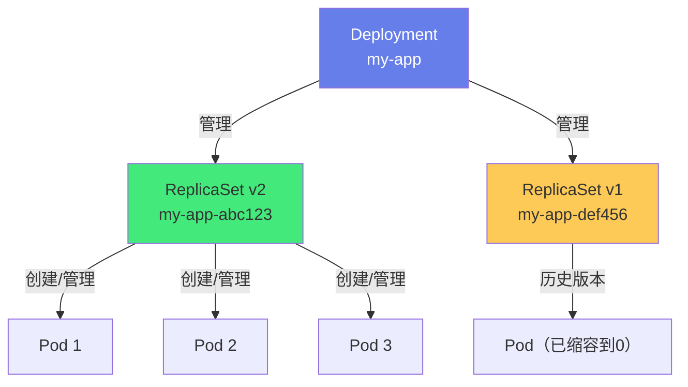
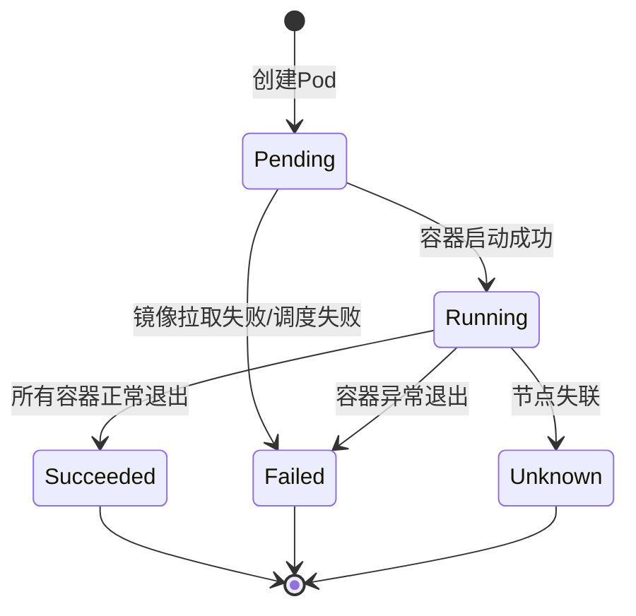
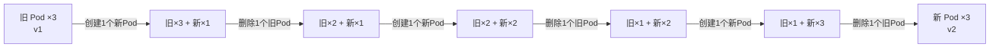
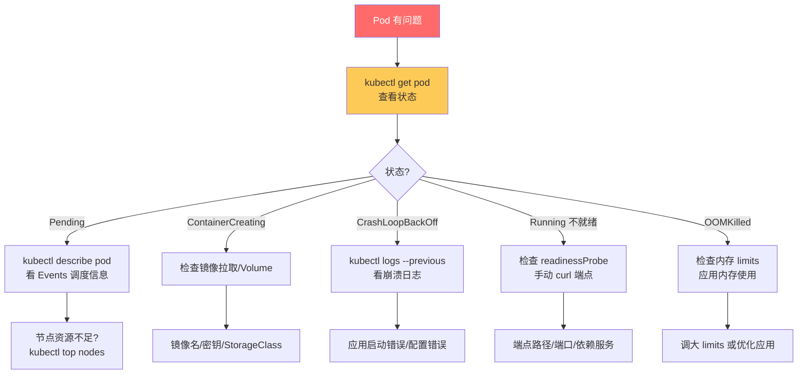

# 🚢 Pod 与控制器 Deployment

> **文档说明**：系统讲解 Kubernetes 中 Pod 与 Deployment 控制器的完整知识体系，涵盖 Pod 的核心概念与设计理念（最小部署单元/共享网络/共享存储/暂停容器）、Pod 生命周期（Pending/Running/Succeeded/Failed/Unknown）、Pod 配置详解（容器定义/资源限制/环境变量/健康检查/生命周期钩子/Init容器/安全上下文）、Deployment 控制器的作用与原理（声明式/期望状态/ReplicaSet/滚动更新）、Deployment 策略（RollingUpdate/Recreate）、滚动更新参数（maxSurge/maxUnavailable）、版本回滚、水平扩缩容、暂停与恢复、其他控制器对比（StatefulSet/DaemonSet/Job/CronJob/ReplicaSet）、完整 YAML 示例、kubectl 常用操作、常见问题排查与最佳实践。
>
> **适用人群**：DevOps 工程师、SRE、后端开发者、云原生学习者、K8s 运维人员
>
> **前置知识**：[[Docker容器化]] · [[K8s-核心概念与架构]] · [[K8s-资源管理]]

---

## 一、概述

### 1.1 什么是 Pod

Pod 是 Kubernetes 中**最小的部署单元**，代表一个或多个容器的集合，这些容器共享网络命名空间（IP 地址和端口空间）和存储卷。

**Pod 的核心设计理念**：
| 理念 | 说明 |
|------|------|
| **最小部署单元** | K8s 不直接管理容器，而是管理 Pod，Pod 是调度和部署的最小单位 |
| **共享网络** | 同一 Pod 内的容器共享同一个 IP 地址和端口空间，通过 `localhost` 互相通信 |
| **共享存储** | 同一 Pod 内的容器可以挂载同一个 Volume，共享文件 |
| **同生共死** | Pod 内的容器一起创建、一起销毁，生命周期一致 |
| **暂停容器（Pause）** | 每个 Pod 有一个 pause 容器（基础设施容器），负责持有网络命名空间和 PID 命名空间 |

**Pod vs 容器**：
| 维度 | 容器（Docker） | Pod（K8s） |
|------|--------------|-----------|
| **管理单位** | Docker 管理容器 | K8s 管理 Pod（Pod 管理容器） |
| **网络** | 每个容器独立 IP | Pod 内容器共享 IP |
| **存储** | 容器独立 Volume | Pod 内容器共享 Volume |
| **生命周期** | 独立 | Pod 内容器同生共死 |
| **调度** | Docker 单机调度 | K8s 跨节点调度 |

**为什么需要 Pod（而不是直接管理容器）**：
1. **亲密容器（Sidecar）模式**：有些容器需要紧密协作（如主应用+日志收集器+代理），共享网络和存储
2. **统一调度**：亲密容器必须调度到同一节点，Pod 保证了这一点
3. **抽象解耦**：K8s 不关心容器运行时（Docker/containerd/CRI-O），只关心 Pod

**Pod 内多容器模式**：
| 模式 | 说明 | 示例 |
|------|------|------|
| **Sidecar（边车）** | 辅助主容器的次要容器 | 日志收集器（Filebeat）、代理（Envoy）、配置同步器 |
| **Ambassador（大使）** | 代理外部连接的容器 | 数据库代理、服务网格代理 |
| **Adapter（适配器）** | 标准化输出的容器 | 日志格式转换、指标标准化 |
| **Init（初始化）** | 启动前执行的初始化容器 | 等待依赖服务、初始化配置、数据库迁移 |

### 1.2 什么是 Deployment

Deployment 是 Kubernetes 中最常用的**工作负载控制器**，用于管理无状态应用的部署，提供声明式的更新和回滚能力。

**Deployment 的作用**：
| 作用 | 说明 |
|------|------|
| **声明式管理** | 描述期望状态（如 3 个副本、镜像版本 v2），K8s 自动达到该状态 |
| **管理 ReplicaSet** | Deployment 通过管理 ReplicaSet 来管理 Pod，不直接管理 Pod |
| **滚动更新** | 默认滚动更新策略，零停机发布新版本 |
| **版本回滚** | 一键回滚到历史版本 |
| **水平扩缩容** | 调整副本数，手动或自动（HPA） |
| **暂停与恢复** | 更新过程中可暂停，修复后继续 |

**Deployment → ReplicaSet → Pod 的关系**：


| 层级 | 作用 | 是否直接管理 Pod |
|------|------|----------------|
| **Deployment** | 声明期望状态、滚动更新、回滚 | ❌ 通过 ReplicaSet |
| **ReplicaSet** | 保证指定数量的 Pod 副本运行 | ✅ 直接创建/删除 Pod |
| **Pod** | 实际运行的容器集合 | - |

> **为什么不直接用 ReplicaSet**：ReplicaSet 只保证副本数量，不支持滚动更新和回滚。Deployment 在 ReplicaSet 之上增加了更新策略管理——更新时创建新的 ReplicaSet，逐步扩容新 RS 并缩容旧 RS，实现滚动更新；历史 ReplicaSet 保留，用于回滚。

---

## 二、Pod 详解

### 2.1 Pod 生命周期



| 状态 | 说明 |
|------|------|
| **Pending** | Pod 已创建，但容器尚未全部启动（等待调度、镜像拉取中） |
| **Running** | Pod 已绑定到节点，所有容器已创建，至少一个容器在运行 |
| **Succeeded** | Pod 中所有容器正常退出（退出码 0），不会重启 |
| **Failed** | Pod 中所有容器已终止，至少一个容器异常退出（非 0 退出码） |
| **Unknown** | 无法获取 Pod 状态（通常是节点失联） |

**容器重启策略（restartPolicy）**：
| 策略 | 说明 | 适用场景 |
|------|------|---------|
| `Always` | 容器退出后总是重启（默认） | 长期运行的服务（Web/API） |
| `OnFailure` | 容器异常退出（非 0）时重启 | 一次性任务（Job） |
| `Never` | 容器退出后不重启 | 一次性任务，不需要重试 |

### 2.2 Pod YAML 配置

```yaml
apiVersion: v1
kind: Pod
metadata:
  name: my-app-pod
  namespace: default
  labels:
    app: my-app
    env: production
  annotations:
    description: "示例 Pod 配置"
spec:
  # 重启策略
  restartPolicy: Always
  
  # 节点选择器（调度到特定标签的节点）
  nodeSelector:
    disktype: ssd
  
  # 容忍度（允许调度到有特定污点的节点）
  tolerations:
    - key: "node-role.kubernetes.io/master"
      operator: "Exists"
      effect: "NoSchedule"
  
  # 亲和性规则
  affinity:
    nodeAffinity:
      requiredDuringSchedulingIgnoredDuringExecution:
        nodeSelectorTerms:
          - matchExpressions:
              - key: kubernetes.io/os
                operator: In
                values: ["linux"]
  
  # Init 容器（主容器启动前执行）
  initContainers:
    - name: init-db
      image: busybox:1.36
      command: ['sh', '-c', 'echo "等待数据库就绪"; sleep 5']
  
  # 主容器列表
  containers:
    - name: my-app
      image: nginx:1.25-alpine
      imagePullPolicy: IfNotPresent
      
      # 端口声明
      ports:
        - name: http
          containerPort: 80
          protocol: TCP
      
      # 环境变量
      env:
        - name: APP_ENV
          value: "production"
        - name: DB_HOST
          valueFrom:
            configMapKeyRef:
              name: app-config
              key: db_host
        - name: DB_PASSWORD
          valueFrom:
            secretKeyRef:
              name: app-secret
              key: db_password
      
      # 资源限制
      resources:
        requests:
          cpu: "100m"
          memory: "128Mi"
        limits:
          cpu: "500m"
          memory: "512Mi"
      
      # 健康检查
      livenessProbe:
        httpGet:
          path: /healthz
          port: 80
        initialDelaySeconds: 10
        periodSeconds: 10
        timeoutSeconds: 3
        failureThreshold: 3
      
      readinessProbe:
        httpGet:
          path: /ready
          port: 80
        initialDelaySeconds: 5
        periodSeconds: 5
      
      startupProbe:
        httpGet:
          path: /startup
          port: 80
        failureThreshold: 30
        periodSeconds: 10
      
      # 生命周期钩子
      lifecycle:
        postStart:
          exec:
            command: ["/bin/sh", "-c", "echo 容器已启动"]
        preStop:
          exec:
            command: ["/bin/sh", "-c", "sleep 10; nginx -s quit"]
      
      # 安全上下文
      securityContext:
        runAsNonRoot: true
        runAsUser: 1000
        allowPrivilegeEscalation: false
        readOnlyRootFilesystem: true
        capabilities:
          drop: ["ALL"]
      
      # 数据卷挂载
      volumeMounts:
        - name: config-volume
          mountPath: /etc/config
        - name: tmp-volume
          mountPath: /tmp
  
  # Sidecar 容器
  - name: log-collector
    image: fluent/fluent-bit:2.2
    volumeMounts:
      - name: tmp-volume
        mountPath: /var/log
  
  # 数据卷定义
  volumes:
    - name: config-volume
      configMap:
        name: app-config
    - name: tmp-volume
      emptyDir: {}
  
  # 镜像拉取密钥（私有仓库）
  imagePullSecrets:
    - name: regcred
```

### 2.3 健康检查

K8s 提供三种探针（Probe）来检查容器健康状态：

| 探针 | 作用 | 失败后果 |
|------|------|---------|
| **livenessProbe**（存活探针） | 检测容器是否还活着 | 失败 → 重启容器 |
| **readinessProbe**（就绪探针） | 检测容器是否准备好接收流量 | 失败 → 从 Service 端点移除，不接收流量 |
| **startupProbe**（启动探针） | 检测容器是否启动完成（慢启动应用） | 失败 → 重启容器（启动成功后才启用 liveness） |

**探针类型**：
| 类型 | 说明 | 示例 |
|------|------|------|
| `httpGet` | HTTP GET 请求 | `httpGet: {path: /health, port: 8080}` |
| `tcpSocket` | TCP 端口连接 | `tcpSocket: {port: 3306}` |
| `exec` | 执行命令 | `exec: {command: ["cat", "/tmp/healthy"]}` |
| `grpc` | gRPC 健康检查 | `grpc: {port: 9090, service: "MyService"}` |

**探针参数**：
| 参数 | 说明 | 默认值 |
|------|------|--------|
| `initialDelaySeconds` | 容器启动后等待多久开始探测 | 0 |
| `periodSeconds` | 探测间隔 | 10 |
| `timeoutSeconds` | 探测超时时间 | 1 |
| `successThreshold` | 连续成功多少次算健康 | 1 |
| `failureThreshold` | 连续失败多少次算不健康 | 3 |

**最佳实践**：
- 慢启动应用用 `startupProbe`，避免 liveness 误杀启动中的容器
- `readinessProbe` 失败只移除流量，不重启，适合依赖外部服务的应用
- `livenessProbe` 检查应用是否卡死（如死锁），不要检查依赖服务
- 探针端点要轻量（< 100ms），不要做复杂逻辑

### 2.4 资源限制

```yaml
resources:
  requests:  # 调度时保证的资源（节点必须有这么多可用资源才能调度）
    cpu: "100m"      # 0.1 核（100 milliCPU）
    memory: "128Mi"   # 128 MiB
  limits:    # 资源上限（超过可能被 OOM Kill 或节流）
    cpu: "500m"      # 0.5 核
    memory: "512Mi"   # 512 MiB
```

| 资源 | requests 作用 | limits 作用 | 超过 limits 后果 |
|------|-------------|------------|----------------|
| **CPU** | 调度保证，最低可用 | CPU 上限 | 被节流（throttle），不杀死 |
| **内存** | 调度保证，最低可用 | 内存上限 | OOM Kill（杀死容器） |

**CPU 单位**：
- `1` = 1 核（AWS vCPU / GCP Core / Azure vCore）
- `100m` = 0.1 核（100 milliCPU）
- `500m` = 0.5 核

**内存单位**：
- `Mi` = MiB（1024*1024 字节）
- `Gi` = GiB（1024*1024*1024 字节）
- `M` = MB（1000*1000 字节）
- `G` = GB（1000*1000*1000 字节）
- 建议用 `Mi`/`Gi`（二进制，与 Linux 一致）

### 2.5 环境变量与配置

**环境变量来源**：
```yaml
env:
  # 1. 直接值
  - name: APP_ENV
    value: "production"
  
  # 2. 从 ConfigMap 读取
  - name: DB_HOST
    valueFrom:
      configMapKeyRef:
        name: app-config
        key: db_host
  
  # 3. 从 Secret 读取
  - name: DB_PASSWORD
    valueFrom:
      secretKeyRef:
        name: app-secret
        key: db_password
  
  # 4. 从 Pod 字段读取（Downward API）
  - name: POD_NAME
    valueFrom:
      fieldRef:
        fieldPath: metadata.name
  - name: POD_NAMESPACE
    valueFrom:
      fieldRef:
        fieldPath: metadata.namespace
  - name: NODE_NAME
    valueFrom:
      fieldRef:
        fieldPath: spec.nodeName
  
  # 5. 从容器资源字段读取
  - name: CPU_REQUEST
    valueFrom:
      resourceFieldRef:
        containerName: my-app
        resource: requests.cpu
```

---

## 三、Deployment 详解

### 3.1 Deployment YAML 配置

```yaml
apiVersion: apps/v1
kind: Deployment
metadata:
  name: my-app
  namespace: default
  labels:
    app: my-app
    env: production
spec:
  # 副本数
  replicas: 3
  
  # 等待 Pod 就绪的最小时间（稳定后才认为更新成功）
  minReadySeconds: 10
  
  # 修订历史保留数量（用于回滚）
  revisionHistoryLimit: 10
  
  # 暂停部署（更新时暂停，手动恢复）
  paused: false
  
  # 滚动更新策略
  strategy:
    type: RollingUpdate  # 或 Recreate
    rollingUpdate:
      maxSurge: 25%       # 更新时最多可以超出期望副本数的数量/比例
      maxUnavailable: 25% # 更新时最多可以不可用的副本数/比例
  
  # Pod 选择器（必须匹配 template.metadata.labels）
  selector:
    matchLabels:
      app: my-app
  
  # Pod 模板
  template:
    metadata:
      labels:
        app: my-app
        version: v2
      annotations:
        prometheus.io/scrape: "true"
        prometheus.io/port: "8080"
    spec:
      restartPolicy: Always
      containers:
        - name: my-app
          image: myregistry/my-app:v2.0.0
          imagePullPolicy: IfNotPresent
          ports:
            - containerPort: 8080
          env:
            - name: APP_ENV
              value: "production"
          resources:
            requests:
              cpu: "100m"
              memory: "128Mi"
            limits:
              cpu: "500m"
              memory: "512Mi"
          livenessProbe:
            httpGet:
              path: /healthz
              port: 8080
            initialDelaySeconds: 10
            periodSeconds: 10
          readinessProbe:
            httpGet:
              path: /ready
              port: 8080
            initialDelaySeconds: 5
            periodSeconds: 5
          lifecycle:
            preStop:
              exec:
                command: ["/bin/sh", "-c", "sleep 10"]
      terminationGracePeriodSeconds: 30
```

### 3.2 更新策略

**RollingUpdate（滚动更新，默认）**：
逐步用新 Pod 替换旧 Pod，零停机。



**maxSurge 和 maxUnavailable**：
| 参数 | 说明 | 示例（replicas=3） |
|------|------|-------------------|
| `maxSurge: 25%` | 更新时最多超出期望副本数 | 最多 4 个 Pod（3+1） |
| `maxUnavailable: 25%` | 更新时最多不可用的副本数 | 最少 2 个可用（3-1） |
| `maxSurge: 1` | 绝对数量 | 最多 4 个 Pod |
| `maxUnavailable: 0` | 0 不可用（必须先建新再删旧） | 始终 3 个可用 |

**常用配置**：
| 场景 | maxSurge | maxUnavailable | 说明 |
|------|----------|---------------|------|
| 默认 | 25% | 25% | 平衡速度和可用性 |
| 快速更新 | 50% | 50% | 更快，但可能有一半不可用 |
| 零停机（保守） | 1 | 0 | 始终全量可用，更新慢 |
| 资源紧张 | 0 | 50% | 不超资源，但有一半不可用 |

**Recreate（重建）**：
先删除所有旧 Pod，再创建新 Pod。有停机时间，但不会有新旧版本共存。

```yaml
strategy:
  type: Recreate
```

适用场景：
- 应用不支持新旧版本共存（如数据库迁移、独占资源）
- 开发/测试环境，不关心停机

### 3.3 版本回滚

Deployment 保留历史 ReplicaSet（`revisionHistoryLimit`，默认 10），可以一键回滚。

```bash
# 查看更新历史
kubectl rollout history deployment/my-app

# 查看某个版本的详情
kubectl rollout history deployment/my-app --revision=2

# 回滚到上一个版本
kubectl rollout undo deployment/my-app

# 回滚到指定版本
kubectl rollout undo deployment/my-app --to-revision=2

# 查看回滚状态
kubectl rollout status deployment/my-app

# 暂停更新（更新过程中暂停）
kubectl rollout pause deployment/my-app

# 恢复更新
kubectl rollout resume deployment/my-app

# 重启所有 Pod（触发滚动更新，镜像不变）
kubectl rollout restart deployment/my-app
```

**回滚原理**：
- 回滚不是删除新 RS 再创建旧 RS，而是将旧 RS 的副本数扩容到期望值，新 RS 缩容到 0
- 回滚也遵循滚动更新策略（maxSurge/maxUnavailable）
- 回滚会创建一个新的 revision（revision 号递增），不是回到旧 revision

### 3.4 水平扩缩容

**手动扩缩容**：
```bash
# 扩容到 5 个副本
kubectl scale deployment/my-app --replicas=5

# 缩容到 2 个副本
kubectl scale deployment/my-app --replicas=2
```

**自动扩缩容（HPA - Horizontal Pod Autoscaler）**：
```yaml
apiVersion: autoscaling/v2
kind: HorizontalPodAutoscaler
metadata:
  name: my-app-hpa
spec:
  scaleTargetRef:
    apiVersion: apps/v1
    kind: Deployment
    name: my-app
  minReplicas: 2
  maxReplicas: 10
  metrics:
    - type: Resource
      resource:
        name: cpu
        target:
          type: Utilization
          averageUtilization: 70  # CPU 使用率超过 70% 时扩容
    - type: Resource
      resource:
        name: memory
        target:
          type: Utilization
          averageUtilization: 80
```

```bash
# 查看 HPA
kubectl get hpa

# 查看 HPA 详情
kubectl describe hpa my-app-hpa
```

> **HPA 前提**：必须安装 metrics-server（提供资源指标），Pod 必须设置 `resources.requests`（HPA 基于 requests 计算使用率）。

---

## 四、其他控制器对比

| 控制器 | 用途 | Pod 标识 | 存储 | 典型场景 |
|--------|------|---------|------|---------|
| **Deployment** | 无状态应用 | 随机名称，可随意替换 | 无状态（Volume 可丢失） | Web/API/微服务 |
| **StatefulSet** | 有状态应用 | 稳定名称（web-0, web-1） | 稳定持久卷（PVC 绑定） | 数据库（MySQL/PostgreSQL）、Kafka、ZooKeeper、Etcd |
| **DaemonSet** | 每个节点一个 Pod | 节点绑定 | 可选 | 日志收集（Fluentd）、监控 Agent（Node Exporter）、网络插件（Calico） |
| **Job** | 一次性任务 | 随机名称 | 可选 | 数据处理、批量计算、数据库迁移 |
| **CronJob** | 定时任务 | 随机名称 | 可选 | 定时备份、定时报表、定时清理 |
| **ReplicaSet** | 保证副本数 | 随机名称 | 无状态 | 通常被 Deployment 管理，不直接使用 |

### 4.1 StatefulSet

```yaml
apiVersion: apps/v1
kind: StatefulSet
metadata:
  name: mysql
spec:
  serviceName: "mysql"  # 必须有 Headless Service
  replicas: 3
  selector:
    matchLabels:
      app: mysql
  template:
    metadata:
      labels:
        app: mysql
    spec:
      containers:
        - name: mysql
          image: mysql:8.0
          volumeMounts:
            - name: data
              mountPath: /var/lib/mysql
  volumeClaimTemplates:  # 每个 Pod 独立的 PVC
    - metadata:
        name: data
      spec:
        accessModes: ["ReadWriteOnce"]
        resources:
          requests:
            storage: 10Gi
```

**StatefulSet 特点**：
- 稳定的 Pod 名称：`mysql-0`、`mysql-1`、`mysql-2`（有序创建，逆序删除）
- 稳定的网络标识：`mysql-0.mysql.default.svc.cluster.local`
- 稳定的持久存储：每个 Pod 有独立的 PVC，删除 Pod 不删除 PVC
- 有序部署和伸缩：按顺序创建（0→1→2），逆序删除（2→1→0）

### 4.2 DaemonSet

```yaml
apiVersion: apps/v1
kind: DaemonSet
metadata:
  name: fluentd
spec:
  selector:
    matchLabels:
      app: fluentd
  template:
    metadata:
      labels:
        app: fluentd
    spec:
      containers:
        - name: fluentd
          image: fluent/fluentd:v1.16
          volumeMounts:
            - name: varlog
              mountPath: /var/log
      volumes:
        - name: varlog
          hostPath:
            path: /var/log
```

**DaemonSet 特点**：
- 每个节点（或匹配条件的节点）运行一个 Pod
- 新增节点时自动创建 Pod
- 删除节点时自动删除 Pod
- 适合节点级别的代理/收集器

### 4.3 Job 与 CronJob

**Job（一次性任务）**：
```yaml
apiVersion: batch/v1
kind: Job
metadata:
  name: data-migration
spec:
  completions: 1      # 需要成功完成的 Pod 数
  parallelism: 1      # 并行运行的 Pod 数
  backoffLimit: 4     # 失败重试次数
  activeDeadlineSeconds: 3600  # 最长运行时间
  template:
    spec:
      restartPolicy: OnFailure  # Job 必须用 OnFailure 或 Never
      containers:
        - name: migrator
          image: myapp/migrator:v1
          command: ["python", "migrate.py"]
```

**CronJob（定时任务）**：
```yaml
apiVersion: batch/v1
kind: CronJob
metadata:
  name: backup
spec:
  schedule: "0 2 * * *"  # 每天凌晨 2 点（Cron 表达式）
  jobTemplate:
    spec:
      template:
        spec:
          restartPolicy: OnFailure
          containers:
            - name: backup
              image: myapp/backup:v1
              command: ["/bin/sh", "-c", "./backup.sh"]
  successfulJobsHistoryLimit: 3   # 保留成功的 Job 历史
  failedJobsHistoryLimit: 1       # 保留失败的 Job 历史
```

**Cron 表达式**：
```json
* * * * *
│ │ │ │ │
│ │ │ │ └── 星期（0-6，0=周日）
│ │ │ └──── 月份（1-12）
│ │ └────── 日期（1-31）
│ └──────── 小时（0-23）
└────────── 分钟（0-59）

示例：
"0 2 * * *"     # 每天凌晨 2 点
"*/5 * * * *"   # 每 5 分钟
"0 9 * * 1-5"   # 周一到周五早上 9 点
"0 0 1 * *"     # 每月 1 号凌晨
```

---

## 五、kubectl 常用操作

### 5.1 Pod 操作

```bash
# 查看 Pod
kubectl get pods                          # 查看所有 Pod
kubectl get pods -o wide                  # 查看 Pod 所在节点和 IP
kubectl get pods -l app=my-app            # 按标签筛选
kubectl get pods -n kube-system           # 指定命名空间
kubectl get pod my-pod -o yaml            # 查看 Pod 完整 YAML
kubectl get pod my-pod -o json            # 查看 Pod JSON

# 查看 Pod 详情（事件、状态、容器信息）
kubectl describe pod my-pod

# 查看日志
kubectl logs my-pod                       # 查看容器日志
kubectl logs my-pod -c container-name     # 多容器时指定容器
kubectl logs my-pod -f                     # 实时跟踪日志
kubectl logs my-pod --tail=100            # 最后 100 行
kubectl logs my-pod --previous            # 查看上一个容器的日志（崩溃后）

# 进入容器
kubectl exec -it my-pod -- /bin/sh       # 进入容器交互
kubectl exec -it my-pod -c container -- /bin/sh  # 指定容器

# 复制文件
kubectl cp my-pod:/path/to/file ./local-file   # 从容器复制到本地
kubectl cp ./local-file my-pod:/path/to/file   # 从本地复制到容器

# 删除 Pod
kubectl delete pod my-pod                  # 删除 Pod（Deployment 会自动重建）
kubectl delete pod my-pod --force --grace-period=0  # 强制删除（不等待优雅退出）

# 端口转发
kubectl port-forward pod/my-pod 8080:80   # 本地 8080 转发到 Pod 80

# 调度
kubectl cordon node-1                     # 标记节点不可调度
kubectl uncordon node-1                   # 恢复节点可调度
kubectl drain node-1                       # 驱逐节点上的 Pod（维护前）
```

### 5.2 Deployment 操作

```bash
# 查看 Deployment
kubectl get deployments
kubectl get deployment my-app -o yaml

# 查看详情
kubectl describe deployment my-app

# 更新镜像
kubectl set image deployment/my-app my-app=myregistry/my-app:v3.0.0

# 查看更新状态
kubectl rollout status deployment/my-app

# 查看更新历史
kubectl rollout history deployment/my-app

# 回滚
kubectl rollout undo deployment/my-app
kubectl rollout undo deployment/my-app --to-revision=2

# 暂停/恢复
kubectl rollout pause deployment/my-app
kubectl rollout resume deployment/my-app

# 重启（滚动更新）
kubectl rollout restart deployment/my-app

# 扩缩容
kubectl scale deployment/my-app --replicas=5

# 编辑配置（在线编辑 YAML）
kubectl edit deployment my-app

# 应用配置文件
kubectl apply -f deployment.yaml

# 删除
kubectl delete deployment my-app
kubectl delete -f deployment.yaml
```

### 5.3 常用排查命令

```bash
# 查看事件（排查调度/启动失败）
kubectl get events --sort-by=.metadata.creationTimestamp
kubectl get events -n default --field-selector type=Warning

# 查看节点状态
kubectl get nodes
kubectl describe node node-1
kubectl top nodes    # 节点资源使用（需 metrics-server）

# 查看 Pod 资源使用
kubectl top pods
kubectl top pods -l app=my-app

# 查看 Service 和 Endpoints
kubectl get svc
kubectl get endpoints
kubectl describe svc my-service

# 查看 ConfigMap 和 Secret
kubectl get configmaps
kubectl get secrets
kubectl describe configmap my-config

# 查看命名空间资源
kubectl get all -n kube-system
kubectl get all --all-namespaces
```

---

## 六、常见问题排查

### 6.1 Pod 常见状态问题

| 状态/现象 | 可能原因 | 排查方法 |
|----------|---------|---------|
| **Pending** | 调度失败（资源不足/节点选择器不匹配/污点容忍度） | `kubectl describe pod` 看 Events，`kubectl get nodes` 看节点资源 |
| **ContainerCreating** | 镜像拉取失败/Volume 挂载失败/网络问题 | `kubectl describe pod` 看 Events，检查镜像名/密钥/StorageClass |
| **ImagePullBackOff** | 镜像不存在/私有仓库无权限/网络问题 | 检查镜像名/标签、imagePullSecrets、节点网络 |
| **CrashLoopBackOff** | 容器启动后立即崩溃（应用错误/配置错误/健康检查失败） | `kubectl logs --previous` 看上一次崩溃日志，检查启动命令/配置 |
| **Running 但不就绪** | readinessProbe 失败（依赖服务未就绪/端口错误） | `kubectl describe pod` 看探针事件，手动 curl 检查端点 |
| **OOMKilled** | 内存超过 limits 被杀死 | 检查 `resources.limits.memory`，看应用内存使用 |
| **Evicted** | 节点资源不足（内存/磁盘压力），Pod 被驱逐 | `kubectl describe node` 看节点压力，检查资源 requests |
| **Unknown** | 节点失联，Kubelet 不响应 | 检查节点状态、Kubelet 服务、网络连通性 |

### 6.2 Deployment 更新问题

| 问题 | 原因 | 解决方案 |
|------|------|---------|
| **更新卡住** | 新 Pod 始终不就绪（readinessProbe 失败） | 检查 readinessProbe 配置和端点，看新 Pod 日志 |
| **更新太慢** | maxSurge 太小/maxUnavailable=0/探针间隔长 | 调整 maxSurge，优化探针参数 |
| **更新后回滚** | 新版本有问题（崩溃/健康检查失败） | 看新 Pod 日志，修复后重新发布 |
| **镜像未更新** | imagePullPolicy=IfNotPresent 且节点有旧镜像缓存 | 用唯一标签（如 commit hash），或 imagePullPolicy=Always |
| **旧 Pod 不删除** | preStop 钩子执行时间长/terminationGracePeriodSeconds 太大 | 检查 preStop 脚本，调整优雅终止时间 |
| **零流量** | Service selector 不匹配 Pod 标签 | 检查 Service selector 和 Pod labels 是否一致 |

### 6.3 排查流程



---

## 七、最佳实践

### 7.1 Pod 最佳实践

1. **始终设置资源 requests 和 limits**：
   - requests 保证调度和最低资源
   - limits 防止单个 Pod 耗尽节点资源
   - CPU 用 milli（100m），内存用 Mi（128Mi）

2. **配置健康检查**：
   - 慢启动应用用 startupProbe
   - livenessProbe 检查应用是否卡死
   - readinessProbe 检查是否准备好接收流量
   - 探针端点要轻量

3. **使用非 root 用户运行**：
   ```yaml
   securityContext:
     runAsNonRoot: true
     runAsUser: 1000
     allowPrivilegeEscalation: false
     readOnlyRootFilesystem: true
     capabilities:
       drop: ["ALL"]
   ```

4. **优雅终止**：
   - 配置 `preStop` 钩子（等待流量排空、保存状态）
   - 设置合理的 `terminationGracePeriodSeconds`（默认 30s）
   - 应用处理 SIGTERM 信号

5. **用 ConfigMap/Secret 管理配置**：
   - 配置文件用 ConfigMap
   - 敏感信息用 Secret
   - 不要硬编码配置在镜像中

6. **镜像优化**：
   - 用最小基础镜像（alpine/distroless）
   - 多阶段构建
   - 固定镜像版本标签（不用 latest）
   - 私有仓库用 imagePullSecrets

7. **标签和注解规范**：
   - 必要标签：`app`、`version`、`env`
   - 注解用于元数据（prometheus 抓取、描述）
   - 标签用于选择器和筛选

### 7.2 Deployment 最佳实践

1. **用 Deployment 管理无状态应用**：
   - 无状态应用用 Deployment
   - 有状态应用用 StatefulSet
   - 节点级代理用 DaemonSet
   - 一次性任务用 Job/CronJob

2. **滚动更新配置**：
   - 生产环境用 `maxSurge: 25%, maxUnavailable: 25%`（默认）
   - 关键应用用 `maxSurge: 1, maxUnavailable: 0`（零不可用）
   - 设置 `minReadySeconds` 等待 Pod 稳定

3. **版本管理**：
   - 镜像标签用唯一版本（commit hash/语义化版本）
   - 保留 `revisionHistoryLimit: 10` 用于回滚
   - 发布前在测试环境验证

4. **健康检查驱动更新**：
   - 滚动更新依赖 readinessProbe 判断新 Pod 是否就绪
   - 没有 readinessProbe 时，Pod 启动即认为就绪，可能导致流量打到未就绪的 Pod

5. **暂停更新排查问题**：
   - 更新出问题时 `kubectl rollout pause` 暂停
   - 排查修复后 `kubectl rollout resume` 继续
   - 或直接 `kubectl rollout undo` 回滚

6. **HPA 自动扩缩容**：
   - 流量波动大的应用配置 HPA
   - 基于 CPU/内存或自定义指标扩缩容
   - 设置合理的 minReplicas/maxReplicas
   - 必须安装 metrics-server

7. **Pod 反亲和性**：
   - 多副本分布在不同节点，提高可用性
   ```yaml
   affinity:
     podAntiAffinity:
       preferredDuringSchedulingIgnoredDuringExecution:
         - weight: 100
           podAffinityTerm:
             labelSelector:
               matchLabels:
                 app: my-app
             topologyKey: kubernetes.io/hostname
   ```

8. **拓扑分布约束**：
   - Pod 均匀分布在不同可用区/节点
   ```yaml
   topologySpreadConstraints:
     - maxSkew: 1
       topologyKey: topology.kubernetes.io/zone
       whenUnsatisfiable: DoNotSchedule
       labelSelector:
         matchLabels:
           app: my-app
   ```

---

## 八、关联笔记

### K8s 与云原生
- [[K8s-核心概念与架构]] · [[K8s-资源管理]] · [[Docker容器化]]
- [[Dockerfile最佳实践]] · [[制品管理与镜像仓库]] · [[Helm包管理]]
- [[K8s-服务发现与负载均衡]] · [[K8s-存储与持久化]] · [[K8s-网络模型]]

### DevOps
- [[CI-CD流水线]] · [[ArgoCD-GitOps持续部署]] · [[Prometheus-指标采集]]
- [[Terraform-基础设施编排]] · [[Ansible-配置管理]]

### 导航
- [[MOC-云原生与运维]] · [[MOC-K8s]] · [[MOC-综合导航]] · [[Home]]

> 🔍 **知识点深度解析**
>
> **作用**：Pod 与 Deployment 解决的是「容器化应用在 Kubernetes 集群中的部署、更新、扩缩容和高可用管理问题」——Docker 解决了「单个容器的打包和运行」，但在生产环境中，应用需要多副本部署、跨节点调度、零停机更新、自动扩缩容、故障自愈等能力，这些是 Docker 本身不提供的。K8s 通过 Pod（最小部署单元，解决容器协作和调度问题）和 Deployment（声明式控制器，解决副本管理、滚动更新、回滚、扩缩容问题），将容器化应用的管理从「手动 docker run」升级为「声明式自动化运维」，让应用部署像「描述期望状态」一样简单。
>
> **底层原理**：①Pod 的核心是「共享命名空间的容器组」——同一 Pod 内的容器共享网络命名空间（同一个 IP 和端口空间，通过 localhost 通信）、PID 命名空间（可选共享）、IPC 命名空间，通过 pause 容器（基础设施容器）持有这些命名空间，业务容器加入 pause 的命名空间。这就是为什么 Pod 内容器可以用 localhost 互相访问——它们在同一个网络命名空间里。②Deployment 的核心是「声明式调和（Reconciliation）」——用户在 Deployment 中描述期望状态（3 个副本、镜像 v2），Deployment Controller 不断对比「期望状态」和「实际状态」，如果不一致就执行操作达到期望状态（副本少了就创建，多了就删除，镜像不对就滚动更新）。这是 K8s 控制器的通用模式——所有控制器都是「对比期望与实际，执行调和操作」。③滚动更新的原理是「双 ReplicaSet 交替扩缩容」——更新时，Deployment 创建一个新的 ReplicaSet（新镜像），逐步扩容新 RS 同时缩容旧 RS，通过 maxSurge（最多超出多少）和 maxUnavailable（最多不可用多少）控制更新速度，保证零停机。更新完成后旧 RS 保留（缩容到 0），用于回滚。④健康检查驱动更新和自愈——readinessProbe 决定 Pod 是否可以接收流量（滚动更新时新 Pod 必须 readiness 通过才会删除旧 Pod），livenessProbe 决定 Pod 是否需要重启（不存活就杀死重建），startupProbe 保护慢启动应用不被 liveness 误杀。⑤调度的原理是「过滤+打分」——Scheduler 先过滤掉不满足条件的节点（资源不足/节点选择器/污点/亲和性），再对剩余节点打分（资源均衡、亲和性、本地数据等），选择分数最高的节点调度 Pod。
>
> **用法要点**：① Pod 配置：containers（镜像/端口/环境变量/资源/探针/生命周期/安全上下文/挂载）、initContainers（初始化）、restartPolicy（Always/OnFailure/Never）、nodeSelector/affinity/tolerations（调度）、volumes（存储）、imagePullSecrets（私有仓库） ② 健康检查：livenessProbe（存活，失败重启）、readinessProbe（就绪，失败移除流量）、startupProbe（启动，慢启动应用）；类型 httpGet/tcpSocket/exec/grpc；参数 initialDelaySeconds/periodSeconds/timeoutSeconds/failureThreshold ③ 资源：requests（调度保证，cpu用m/内存用Mi）、limits（上限，超内存OOM Kill/超CPU节流） ④ Deployment：replicas（副本数）、strategy（RollingUpdate/Recreate，maxSurge/maxUnavailable）、minReadySeconds（稳定等待）、revisionHistoryLimit（历史保留）、selector（必须匹配template labels）、template（Pod模板） ⑤ 更新操作：kubectl set image（更新镜像）、rollout status/history/undo/pause/resume/restart（更新管理）、scale（扩缩容）、edit（在线编辑）、apply（应用文件） ⑥ 其他控制器：StatefulSet（有状态，稳定名称+稳定存储+有序部署）、DaemonSet（每节点一个）、Job（一次性，restartPolicy=OnFailure/Never）、CronJob（定时，schedule cron表达式） ⑦ 排查：kubectl describe pod（看Events）、kubectl logs --previous（崩溃日志）、kubectl get events（集群事件）、kubectl top（资源使用）；常见状态 Pending（调度）、ContainerCreating（镜像/Volume）、CrashLoopBackOff（应用崩溃）、OOMKilled（内存超限）、Evicted（节点压力） ⑧ 最佳实践：始终设 requests/limits、配置三种探针、非root运行、优雅终止（preStop+SIGTERM）、ConfigMap/Secret管理配置、固定镜像标签、滚动更新策略、HPA自动扩缩容、Pod反亲和性/拓扑分布提高可用性。

> 💡 **深度讲解**：Pod 最核心的智慧是「容器组的抽象」——为什么 K8s 不直接管理容器，而要引入 Pod 这个中间层？因为在实际应用中，有些容器需要「亲密协作」——它们需要共享网络（通过 localhost 通信）、共享存储（读写同一个文件）、同生共死（一起创建一起销毁）。典型的例子是 Sidecar 模式：主应用容器 + 日志收集容器 + 代理容器，这三个容器紧密协作，如果分别调度到不同节点，就无法共享网络和存储。Pod 把这些亲密容器打包成一个调度单元，保证它们调度到同一节点、共享命名空间、同生共死。这就像「家庭」这个概念——家庭成员（容器）住在一起（同一节点）、共享客厅（网络命名空间）、共享冰箱（存储卷）、一起搬家（一起调度），而不是每个人（容器）单独租房（单独调度）。理解了「亲密容器需要共置」，你就理解了 Pod 存在的意义。「Deployment 的声明式调和」是 K8s 最核心的设计哲学——传统的部署方式是「命令式」的：你告诉系统「先创建 3 个容器，再删除旧容器，再检查状态」，每一步都需要手动执行和监控。K8s 的 Deployment 是「声明式」的：你只需要描述「我想要 3 个 v2 版本的副本」，Deployment Controller 会自动对比期望和实际，执行所有必要的操作达到期望状态，并且持续监控，一旦实际状态偏离期望（如 Pod 崩溃），自动修复。这种「描述 What 而非 How」的声明式思维，是 K8s 与传统运维工具的本质区别——它把运维从「手动执行步骤」变成「描述期望状态，系统自动调和」，大大降低了运维复杂度，提高了系统自愈能力。「滚动更新的零停机艺术」——Deployment 的滚动更新是一个精妙的设计：它不是简单地「删除旧 Pod，创建新 Pod」（这会导致停机），而是「先创建一个新 Pod，等它就绪后再删除一个旧 Pod，重复直到全部更新」。通过 maxSurge 和 maxUnavailable 两个参数，你可以精确控制更新的「速度」和「安全性」的平衡：maxSurge 大（如 50%）更新快但临时资源占用多；maxUnavailable 为 0 保证零停机但更新慢。这种「渐进式替换」的设计，让应用更新从「停机维护窗口」变成「用户无感知的平滑过渡」，是持续部署的基础。

> 📝 **精简总结**：Pod=K8s最小部署单元，容器组共享网络/存储，同生共死，pause容器持有命名空间。Deployment=无状态应用控制器，声明式管理，通过ReplicaSet管理Pod，支持滚动更新/回滚/扩缩容。Pod配置：containers/initContainers/restartPolicy/资源requests-limits/健康检查(liveness/readiness/startup)/生命周期钩子(preStop)/安全上下文(非root)/环境变量(ConfigMap/Secret)/Volume。Deployment配置：replicas/strategy(RollingUpdate maxSurge-maxUnavailable/Recreate)/minReadySeconds/revisionHistoryLimit/selector/template。操作：kubectl get/describe/logs/exec/apply/set image/rollout status-history-undo-pause-resume-restart/scale。其他控制器：StatefulSet(有状态稳定名称存储)/DaemonSet(每节点一个)/Job(一次性)/CronJob(定时)。排查：describe看Events/logs --previous看崩溃/get events看集群事件/top看资源；常见状态Pending/ContainerCreating/CrashLoopBackOff/OOMKilled/Evicted。最佳实践：设资源限制、配健康检查、非root运行、优雅终止、ConfigMap/Secret、固定镜像标签、滚动更新策略、HPA、Pod反亲和性。

> **学习路径建议**：先学习 [[Docker容器化]] 掌握容器基础 → 学习 [[K8s-核心概念与架构]] 理解 K8s 整体架构 → 学习本文档掌握 Pod 和 Deployment → 实践：用 minikube/kind 部署一个简单应用 → 学习 [[K8s-服务发现与负载均衡]] 理解 Service → 学习 [[K8s-存储与持久化]] 理解 Volume/PVC → 学习 [[Helm包管理]] 掌握应用打包 → 学习 [[ArgoCD-GitOps持续部署]] 掌握 GitOps → 学习 [[K8s-网络模型]] 和 [[K8s-安全]] 深入 → 备考 CKA/CKAD 认证。

---

> **Pod 与 Deployment 的本质是「将容器化应用的管理从手工操作升级为声明式自动化」——在没有 K8s 的时代，部署应用意味着手动 docker run、手动管理容器生命周期、手动处理故障、手动更新版本、手动扩缩容，每一步都需要人工介入，规模一大就变成了运维的噩梦。K8s 通过 Pod 抽象解决了「容器协作和调度」的问题，通过 Deployment 控制器解决了「副本管理、滚动更新、回滚、扩缩容、自愈」的问题，让应用部署从「手动执行命令」变成「描述期望状态，系统自动调和」。这种声明式的思维转变，是云原生运维的核心——你不再需要告诉系统「怎么做」（How），只需要告诉系统「想要什么」（What），系统会自动达到并维持这个状态。当你掌握了 Pod 和 Deployment，你就掌握了 K8s 最核心的工作负载管理能力——你可以声明式地部署应用、零停机更新版本、一键回滚、自动扩缩容、故障自愈，这些都是生产环境运维的基石。这就是 K8s 的力量：它不是「又一个容器编排工具」，而是「云原生时代的操作系统」，让应用管理从「手工艺术」变成「自动化工业」。**
