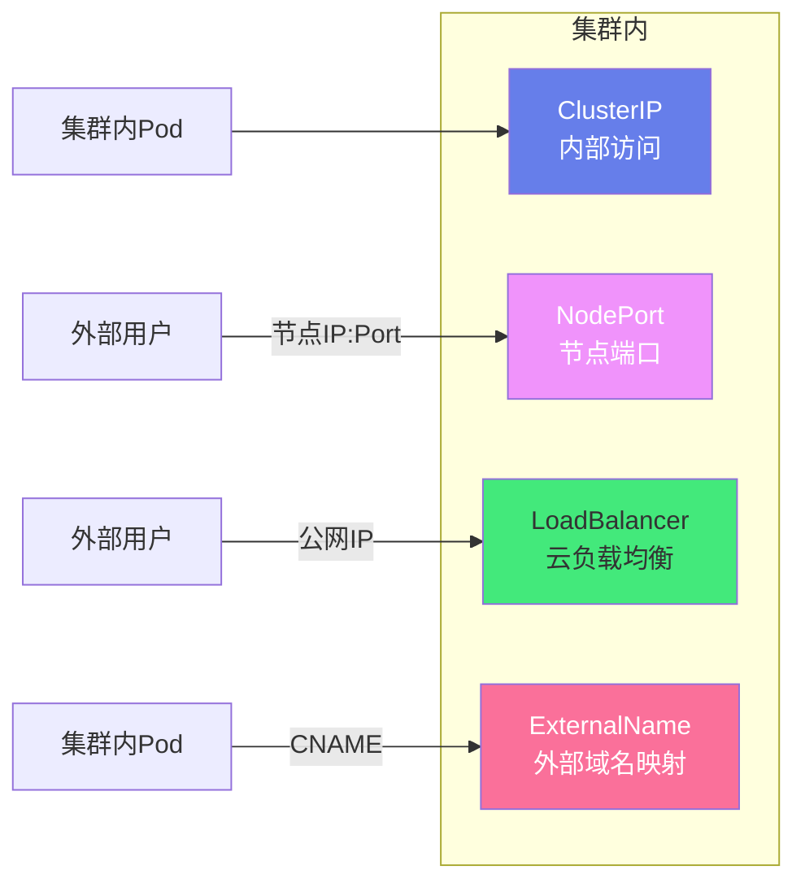
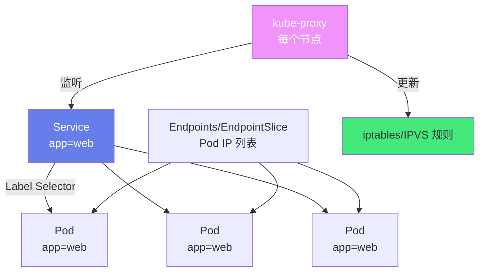
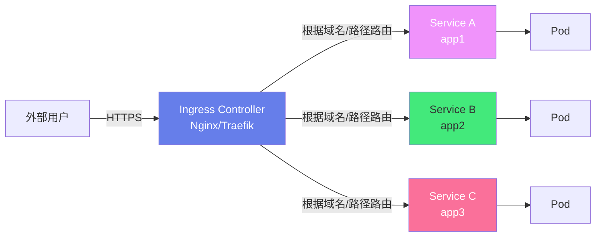

# 🔀 Kubernetes Service 与 Ingress

> **文档说明**：系统讲解 Kubernetes 中 Service 与 Ingress 的完整知识体系，涵盖 Service 类型（ClusterIP/NodePort/LoadBalancer/ExternalName）、Service 工作原理（kube-proxy/iptables/IPVS）、服务发现（DNS/环境变量）、Headless Service、EndpointSlice、Ingress 与 Ingress Controller（Nginx/Traefik）、Ingress 规则配置、TLS 证书、流量管理、金丝雀发布、常见问题排查与最佳实践。Service 解决 Pod 内部通信，Ingress 解决外部流量接入。
>
> **适用人群**：DevOps 工程师、K8s 开发者、运维工程师、后端开发者
>
> **前置知识**：[[Kubernetes入门与实践]] · [[ConfigMap与Secret]]

---

## 一、概述

### 1.1 为什么需要 Service

在 Kubernetes 中，Pod 是**非永久的**——它们可能因为扩缩容、滚动更新、节点故障等原因被创建和销毁，每个 Pod 有自己的 IP 地址，但这个 IP 是动态变化的。

| 问题 | 说明 |
|------|------|
| **Pod IP 动态变化** | Pod 重建后 IP 改变，客户端无法固定访问 |
| **多 Pod 负载均衡** | 一个应用有多个副本，需要在它们之间分配流量 |
| **服务发现** | 应用 A 如何找到应用 B 的地址？ |
| **外部访问** | 集群外的用户如何访问集群内的服务？ |

**Service** 就是为了解决这些问题而设计的——它为一组 Pod 提供一个**稳定的虚拟 IP（ClusterIP）和 DNS 名称**，作为 Pod 的访问入口，并在 Pod 之间做负载均衡。

### 1.2 为什么需要 Ingress

Service 可以暴露服务，但有局限性：
- **NodePort**：每个服务占用一个节点端口（30000-32767），端口数量有限
- **LoadBalancer**：每个服务需要一个云厂商负载均衡器，成本高
- **不支持 HTTP 路由**：无法根据域名/路径路由到不同服务

**Ingress** 是 K8s 的 HTTP/HTTPS 路由规则，通过一个统一的入口（Ingress Controller），根据域名和路径将流量路由到不同的 Service，实现：
- ✅ 多个服务共用一个公网 IP/端口
- ✅ 基于域名的虚拟主机（app1.example.com → Service A）
- ✅ 基于路径的路由（example.com/api → Service A，example.com/web → Service B）
- ✅ TLS/SSL 终止（HTTPS 卸载）
- ✅ 负载均衡、限流、认证等高级功能

### 1.3 Service 与 Ingress 的关系

```text
外部用户
   │
   ▼
Ingress（HTTP/HTTPS 路由）
   │  根据域名/路径路由
   ▼
Service（稳定 IP + 负载均衡）
   │  在 Pod 之间负载均衡
   ▼
Pod（实际处理请求）
```

| 层级 | 资源 | 作用 | 网络层 |
|------|------|------|--------|
| L4 | Service | 稳定 IP + TCP/UDP 负载均衡 | 传输层 |
| L7 | Ingress | HTTP/HTTPS 路由 + TLS 终止 | 应用层 |

---

## 二、底层原理

### 2.1 Service 类型

| 类型 | 说明 | 访问方式 | 适用场景 |
|------|------|---------|---------|
| **ClusterIP**（默认） | 集群内部虚拟 IP，只能集群内访问 | `service-name.namespace.svc.cluster.local` | 内部服务间通信 |
| **NodePort** | 在每个节点上开放一个端口（30000-32767） | `节点IP:NodePort` | 开发测试、外部直接访问 |
| **LoadBalancer** | 集成云厂商负载均衡器，分配公网 IP | `公网IP:端口` | 生产环境对外服务（云环境） |
| **ExternalName** | 将 Service 映射到外部域名（CNAME） | `service-name → external.example.com` | 访问集群外服务 |



### 2.2 Service 工作原理

Service 通过 **Label Selector** 选择一组 Pod，为它们提供稳定的访问入口。



**核心组件**：

| 组件 | 说明 |
|------|------|
| **Service** | 定义稳定的虚拟 IP（ClusterIP）和端口 |
| **Endpoints** | Service 选中的 Pod IP 列表（旧版） |
| **EndpointSlice** | Endpoints 的升级版，更高效（默认启用） |
| **kube-proxy** | 运行在每个节点上，监听 Service/Endpoints 变化，更新网络规则 |
| **iptables/IPVS** | kube-proxy 实现负载均衡的两种模式 |

**kube-proxy 三种模式**：

| 模式 | 说明 | 优点 | 缺点 |
|------|------|------|------|
| **userspace**（旧） | kube-proxy 进程层面转发 | 简单 | 性能差，已废弃 |
| **iptables**（默认） | 内核 netfilter 规则转发 | 稳定、内核态、性能好 | Service 多时规则膨胀、匹配慢 |
| **IPVS**（推荐） | 内核 IPVS 模块转发 | 高性能、支持多种调度算法、大规模 | 需要内核支持 IPVS 模块 |

**IPVS 调度算法**：
- `rr`（Round Robin，轮询，默认）
- `lc`（Least Connection，最少连接）
- `sh`（Source Hashing，源地址哈希）
- `dh`（Destination Hashing，目标地址哈希）
- `sed`（Shortest Expected Delay，最短预期延迟）
- `nq`（Never Queue，永不排队）

### 2.3 服务发现

K8s 提供两种服务发现方式：

#### DNS 发现（推荐）

K8s 内置 DNS 服务（CoreDNS），为每个 Service 分配 DNS 名称：

```text
<service-name>.<namespace>.svc.cluster.local
```

| 格式 | 示例 | 说明 |
|------|------|------|
| 短名称 | `my-service` | 同命名空间内可用 |
| 完整名称 | `my-service.default.svc.cluster.local` | 跨命名空间必须用完整名称 |
| 端口 SRV | `_http._tcp.my-service.default.svc.cluster.local` | DNS SRV 记录，含端口 |

```bash
# 在 Pod 内通过 DNS 访问 Service
curl http://my-service.default.svc.cluster.local:8080
# 同命名空间可简写
curl http://my-service:8080
```

#### 环境变量发现

Pod 创建时，K8s 会自动注入同命名空间内所有 Service 的环境变量：

```bash
MY_SERVICE_SERVICE_HOST=10.96.0.1
MY_SERVICE_SERVICE_PORT=8080
MY_SERVICE_PORT=tcp://10.96.0.1:8080
MY_SERVICE_PORT_8080_TCP=tcp://10.96.0.1:8080
```

> **注意**：环境变量方式有顺序问题——Service 必须在 Pod 之前创建，否则环境变量不会注入。DNS 方式没有这个问题，推荐使用 DNS。

### 2.4 Headless Service

普通 Service 有 ClusterIP，kube-proxy 做负载均衡。**Headless Service** 不分配 ClusterIP（`clusterIP: None`），DNS 直接返回所有 Pod 的 IP（A 记录），客户端自己做负载均衡。

**适用场景**：
- 客户端需要直接访问特定 Pod（如数据库主从、有状态应用）
- 与 StatefulSet 配合使用（每个 Pod 有稳定的 DNS 名称）
- 自定义负载均衡策略

```text
普通 Service DNS：my-service → 10.96.0.1（ClusterIP，一个 IP）
Headless Service DNS：my-service → 10.244.1.5, 10.244.2.6, 10.244.3.7（所有 Pod IP）
StatefulSet Pod DNS：pod-0.my-service → 10.244.1.5（特定 Pod）
```

### 2.5 Ingress 工作原理



**Ingress 由两部分组成**：

| 组件 | 说明 |
|------|------|
| **Ingress 资源** | K8s API 对象，定义 HTTP 路由规则（YAML 配置） |
| **Ingress Controller** | 实际执行路由的软件（如 Nginx Ingress Controller、Traefik、HAProxy），监听 Ingress 资源并动态更新配置 |

> **重要**：Ingress 资源本身不做任何事，必须有 Ingress Controller 才能生效。K8s 不内置 Ingress Controller，需要手动部署。

**常见 Ingress Controller**：

| Controller | 特点 | 适用场景 |
|-----------|------|---------|
| **ingress-nginx** | K8s 官方维护，基于 Nginx，功能丰富 | 通用场景，最流行 |
| **Traefik** | Go 编写，自动发现，配置简单 | 云原生、微服务 |
| **HAProxy Ingress** | 高性能，丰富的负载均衡算法 | 高性能场景 |
| **Istio Gateway** | 服务网格入口，功能强大 | 服务网格场景 |
| **云厂商 Ingress** | ALB/NLB/CLB 集成 | 云环境 |

---

## 三、实操示例

### 3.1 Service 配置

```yaml
# ===== ClusterIP Service（默认，内部访问）=====
apiVersion: v1
kind: Service
metadata:
  name: my-service
  namespace: default
  labels:
    app: myapp
spec:
  type: ClusterIP          # 类型（默认就是 ClusterIP，可省略）
  selector:
    app: myapp             # 选择标签为 app=myapp 的 Pod
  ports:
    - name: http
      protocol: TCP
      port: 80             # Service 端口
      targetPort: 8080     # Pod 端口（容器监听的端口）
    - name: https
      protocol: TCP
      port: 443
      targetPort: 8443

---
# ===== NodePort Service（外部通过节点端口访问）=====
apiVersion: v1
kind: Service
metadata:
  name: my-nodeport-service
spec:
  type: NodePort
  selector:
    app: myapp
  ports:
    - name: http
      port: 80
      targetPort: 8080
      nodePort: 30080      # 指定节点端口（30000-32767，不指定则随机分配）
  # 访问方式：http://<任意节点IP>:30080

---
# ===== LoadBalancer Service（云环境，分配公网 IP）=====
apiVersion: v1
kind: Service
metadata:
  name: my-lb-service
  annotations:
    # 云厂商特定注解
    service.beta.kubernetes.io/aws-load-balancer-type: nlb    # AWS NLB
    service.beta.kubernetes.io/alibaba-cloud-loadbalancer-spec: slb.s1.small  # 阿里云
spec:
  type: LoadBalancer
  selector:
    app: myapp
  ports:
    - name: http
      port: 80
      targetPort: 8080
  # 外部访问：EXTERNAL-IP:80
  # kubectl get service 查看 EXTERNAL-IP

---
# ===== ExternalName Service（映射到外部域名）=====
apiVersion: v1
kind: Service
metadata:
  name: external-db
spec:
  type: ExternalName
  externalName: db.example.com   # 外部域名
  # 访问 external-db.default.svc.cluster.local → CNAME → db.example.com

---
# ===== Headless Service（无 ClusterIP）=====
apiVersion: v1
kind: Service
metadata:
  name: my-headless-service
spec:
  clusterIP: None              # 关键：不分配 ClusterIP
  selector:
    app: myapp
  ports:
    - port: 80
      targetPort: 8080
```

### 3.2 多端口和命名端口

```yaml
apiVersion: v1
kind: Service
metadata:
  name: multi-port-service
spec:
  selector:
    app: myapp
  ports:
    - name: http
      port: 80
      targetPort: http-port    # 引用 Pod 中命名端口
    - name: https
      port: 443
      targetPort: https-port
    - name: metrics
      port: 9090
      targetPort: 9090
---
# Pod 中定义命名端口
apiVersion: v1
kind: Pod
metadata:
  name: myapp-pod
  labels:
    app: myapp
spec:
  containers:
    - name: myapp
      image: myapp:latest
      ports:
        - name: http-port
          containerPort: 8080
        - name: https-port
          containerPort: 8443
        - containerPort: 9090
```

### 3.3 Service 常用命令

```bash
# 查看 Service
kubectl get service
kubectl get svc                    # 简写
kubectl get svc -n namespace
kubectl get svc -o wide            # 显示更多信息（选择器等）
kubectl get svc my-service -o yaml # 查看完整 YAML

# 查看 Endpoints（Service 选中的 Pod IP）
kubectl get endpoints
kubectl get ep my-service
kubectl get endpointslice           # 新版 EndpointSlice

# 描述 Service（详细信息）
kubectl describe svc my-service

# 创建 Service（暴露 Deployment）
kubectl expose deployment my-deployment --port=80 --target-port=8080 --type=ClusterIP
kubectl expose deployment my-deployment --port=80 --type=NodePort
kubectl expose deployment my-deployment --port=80 --type=LoadBalancer

# 端口转发（本地访问集群内 Service）
kubectl port-forward svc/my-service 8080:80    # 本地 8080 → Service 80
kubectl port-forward pod/my-pod 8080:8080       # 本地 8080 → Pod 8080

# 删除 Service
kubectl delete svc my-service
```

### 3.4 Ingress 配置

```yaml
# ===== 基础 Ingress（路径路由）=====
apiVersion: networking.k8s.io/v1
kind: Ingress
metadata:
  name: my-ingress
  namespace: default
  annotations:
    # Nginx Ingress Controller 注解
    nginx.ingress.kubernetes.io/rewrite-target: /$1
    nginx.ingress.kubernetes.io/ssl-redirect: "true"
spec:
  ingressClassName: nginx          # 指定 Ingress Controller 类
  rules:
    - host: example.com
      http:
        paths:
          - path: /api/(.*)
            pathType: Prefix
            backend:
              service:
                name: api-service
                port:
                  number: 8080
          - path: /web/(.*)
            pathType: Prefix
            backend:
              service:
                name: web-service
                port:
                  number: 80
          - path: /(.*)
            pathType: Prefix
            backend:
              service:
                name: default-service
                port:
                  number: 80

---
# ===== 基于域名的虚拟主机 =====
apiVersion: networking.k8s.io/v1
kind: Ingress
metadata:
  name: vhost-ingress
spec:
  ingressClassName: nginx
  rules:
    - host: app1.example.com
      http:
        paths:
          - path: /
            pathType: Prefix
            backend:
              service:
                name: app1-service
                port:
                  number: 80
    - host: app2.example.com
      http:
        paths:
          - path: /
            pathType: Prefix
            backend:
              service:
                name: app2-service
                port:
                  number: 80

---
# ===== TLS/HTTPS Ingress =====
apiVersion: networking.k8s.io/v1
kind: Ingress
metadata:
  name: tls-ingress
  annotations:
    nginx.ingress.kubernetes.io/ssl-redirect: "true"   # HTTP 强制跳转 HTTPS
spec:
  ingressClassName: nginx
  tls:
    - hosts:
        - example.com
        - www.example.com
      secretName: example-tls-secret    # 引用 TLS Secret（kubernetes.io/tls 类型）
  rules:
    - host: example.com
      http:
        paths:
          - path: /
            pathType: Prefix
            backend:
              service:
                name: web-service
                port:
                  number: 80
```

### 3.5 部署 Nginx Ingress Controller

```bash
# ===== 使用 Helm 部署 ingress-nginx =====
helm repo add ingress-nginx https://kubernetes.github.io/ingress-nginx
helm repo update

helm install ingress-nginx ingress-nginx/ingress-nginx \
  --namespace ingress-nginx \
  --create-namespace \
  --set controller.service.type=LoadBalancer \
  --set controller.replicaCount=2

# ===== 使用 kubectl 直接部署 =====
kubectl apply -f https://raw.githubusercontent.com/kubernetes/ingress-nginx/main/deploy/static/provider/cloud/deploy.yaml

# ===== 验证部署 =====
kubectl get pods -n ingress-nginx
kubectl get svc -n ingress-nginx    # 查看 LoadBalancer EXTERNAL-IP

# ===== 本地/裸金属环境（无 LoadBalancer）=====
# 使用 NodePort 或 hostNetwork
helm install ingress-nginx ingress-nginx/ingress-nginx \
  --namespace ingress-nginx \
  --create-namespace \
  --set controller.service.type=NodePort \
  --set controller.service.nodePorts.http=30080 \
  --set controller.service.nodePorts.https=30443
```

### 3.6 cert-manager 自动证书

```bash
# ===== 安装 cert-manager =====
helm repo add jetstack https://charts.jetstack.io
helm repo update

helm install cert-manager jetstack/cert-manager \
  --namespace cert-manager \
  --create-namespace \
  --version v1.13.0 \
  --set installCRDs=true

# ===== 创建 Let's Encrypt ClusterIssuer =====
apiVersion: cert-manager.io/v1
kind: ClusterIssuer
metadata:
  name: letsencrypt-prod
spec:
  acme:
    server: https://acme-v02.api.letsencrypt.org/directory
    email: admin@example.com
    privateKeySecretRef:
      name: letsencrypt-prod
    solvers:
      - http01:
          ingress:
            class: nginx

# ===== Ingress 中使用自动证书 =====
apiVersion: networking.k8s.io/v1
kind: Ingress
metadata:
  name: my-ingress
  annotations:
    cert-manager.io/cluster-issuer: "letsencrypt-prod"   # 自动申请证书
    nginx.ingress.kubernetes.io/ssl-redirect: "true"
spec:
  ingressClassName: nginx
  tls:
    - hosts:
        - example.com
      secretName: example-tls   # cert-manager 自动创建此 Secret
  rules:
    - host: example.com
      http:
        paths:
          - path: /
            pathType: Prefix
            backend:
              service:
                name: web-service
                port:
                  number: 80
```

### 3.7 Ingress 高级配置

```yaml
# ===== 金丝雀发布（Nginx Ingress）=====
# 主 Ingress（100% 流量）
apiVersion: networking.k8s.io/v1
kind: Ingress
metadata:
  name: main-ingress
spec:
  ingressClassName: nginx
  rules:
    - host: example.com
      http:
        paths:
          - path: /
            pathType: Prefix
            backend:
              service:
                name: app-v1
                port:
                  number: 80
---
# 金丝雀 Ingress（20% 流量到 v2）
apiVersion: networking.k8s.io/v1
kind: Ingress
metadata:
  name: canary-ingress
  annotations:
    nginx.ingress.kubernetes.io/canary: "true"
    nginx.ingress.kubernetes.io/canary-weight: "20"   # 20% 流量
spec:
  ingressClassName: nginx
  rules:
    - host: example.com
      http:
        paths:
          - path: /
            pathType: Prefix
            backend:
              service:
                name: app-v2
                port:
                  number: 80

---
# ===== 限流和超时 =====
apiVersion: networking.k8s.io/v1
kind: Ingress
metadata:
  name: advanced-ingress
  annotations:
    # 限流
    nginx.ingress.kubernetes.io/limit-rps: "10"           # 每秒最多 10 请求
    nginx.ingress.kubernetes.io/limit-rpm: "600"          # 每分钟最多 600 请求
    nginx.ingress.kubernetes.io/limit-connections: "5"     # 最多 5 并发连接
    # 超时
    nginx.ingress.kubernetes.io/proxy-connect-timeout: "10"   # 连接超时 10 秒
    nginx.ingress.kubernetes.io/proxy-read-timeout: "60"       # 读取超时 60 秒
    nginx.ingress.kubernetes.io/proxy-send-timeout: "60"       # 发送超时 60 秒
    # 上传大小
    nginx.ingress.kubernetes.io/proxy-body-size: "50m"         # 最大上传 50MB
    # 重写
    nginx.ingress.kubernetes.io/rewrite-target: /$2
    # 跨域
    nginx.ingress.kubernetes.io/enable-cors: "true"
    nginx.ingress.kubernetes.io/cors-allow-origin: "https://app.example.com"
spec:
  ingressClassName: nginx
  rules:
    - host: api.example.com
      http:
        paths:
          - path: /v1/(.*)
            pathType: Prefix
            backend:
              service:
                name: api-service
                port:
                  number: 8080
```

### 3.8 Ingress 常用命令

```bash
# 查看 Ingress
kubectl get ingress
kubectl get ing                    # 简写
kubectl get ing -n namespace
kubectl get ing my-ingress -o yaml

# 描述 Ingress
kubectl describe ing my-ingress

# 查看 Ingress Controller 日志
kubectl logs -n ingress-nginx -l app.kubernetes.io/name=ingress-nginx
kubectl logs -n ingress-nginx ingress-nginx-controller-xxx -f

# 进入 Ingress Controller 查看 Nginx 配置
kubectl exec -it -n ingress-nginx ingress-nginx-controller-xxx -- cat /etc/nginx/nginx.conf

# 删除 Ingress
kubectl delete ing my-ingress
```

---

## 四、常见问题与排查

| 问题现象 | 可能原因 | 解决方案 |
|---------|---------|---------|
| **Service 无法访问** | Label Selector 不匹配；Pod 未就绪；端口错误 | 检查 `kubectl get ep` 是否有 Pod IP；检查 Pod label；检查 targetPort |
| **Connection Refused** | Pod 未监听 targetPort；应用未启动 | 进入 Pod 用 `curl localhost:port` 测试；检查容器端口和 targetPort |
| **Endpoints 为空** | Label Selector 不匹配 Pod；Pod 未 Ready | 检查 Service selector 和 Pod labels；检查 Pod readinessProbe |
| **NodePort 外部无法访问** | 防火墙未开放节点端口；云安全组限制 | 开放 30000-32767 端口范围；检查云厂商安全组 |
| **LoadBalancer EXTERNAL-IP pending** | 非云环境无 LoadBalancer 支持；云厂商配额 | 裸金属用 MetalLB；云环境检查配额和权限；用 NodePort 替代 |
| **Ingress 502 Bad Gateway** | Service 不存在；Pod 未就绪；后端超时 | 检查 Service 和 Endpoints；检查 Pod 状态；增加 proxy-read-timeout |
| **Ingress 404 Not Found** | Ingress 规则不匹配；host/path 错误；Ingress Class 不对 | 检查 host 和 path 配置；确认 ingressClassName；查看 Controller 日志 |
| **Ingress 不生效** | 未部署 Ingress Controller；ingressClassName 错误 | 部署 Ingress Controller；检查 `kubectl get ingressclass`；确认 annotations |
| **TLS 证书不生效** | Secret 不存在或类型错误；域名不匹配；证书过期 | 检查 `kubectl get secret tls-secret`；类型必须是 kubernetes.io/tls；检查证书域名和有效期 |
| **HTTP 不跳转 HTTPS** | 未配置 ssl-redirect 注解；TLS 未配置 | 添加 `nginx.ingress.kubernetes.io/ssl-redirect: "true"`；配置 tls 段 |
| **跨域问题** | Ingress 未配置 CORS；后端未返回 CORS 头 | 添加 `enable-cors: "true"` 注解；或后端配置 CORS |
| **上传文件 413** | 请求体超过默认限制 | 添加 `proxy-body-size: "50m"` 注解 |
| **WebSocket 连接失败** | Nginx 默认不支持 WebSocket 升级 | 添加 `nginx.ingress.kubernetes.io/proxy-read-timeout: "3600"` 和升级头注解 |
| **Service 负载不均** | iptables 模式随机分布；长连接不均衡 | 改用 IPVS 模式；用最少连接算法；应用层做会话保持 |
| **DNS 解析失败** | CoreDNS 未运行；Pod DNS 配置错误 | 检查 `kubectl get pods -n kube-system` CoreDNS 状态；检查 /etc/resolv.conf |
| **Headless Service 不返回 Pod IP** | Pod 未就绪；Selector 不匹配 | 检查 Pod readinessProbe；检查 EndpointSlice |

### 排查流程

```bash
# ===== Service 排查四步走 =====

# 1. 检查 Service 是否存在和配置正确
kubectl get svc my-service -o wide
kubectl describe svc my-service

# 2. 检查 Endpoints（是否有 Pod IP）
kubectl get endpoints my-service
kubectl get endpointslice | grep my-service
# 如果 Endpoints 为空 → Label Selector 不匹配或 Pod 未就绪

# 3. 检查 Pod 状态和标签
kubectl get pods -l app=myapp -o wide
kubectl describe pod my-pod
# 检查 Pod IP 是否在 Endpoints 中

# 4. 直接测试 Pod（绕过 Service）
kubectl port-forward pod/my-pod 8080:8080
curl localhost:8080
# 如果 Pod 正常但 Service 不行 → kube-proxy 或网络策略问题

# ===== Ingress 排查 =====

# 1. 检查 Ingress 规则
kubectl get ing my-ingress -o yaml
kubectl describe ing my-ingress

# 2. 检查 Ingress Controller 状态
kubectl get pods -n ingress-nginx
kubectl logs -n ingress-nginx -l app.kubernetes.io/name=ingress-nginx --tail=50

# 3. 测试 Service（Ingress 后端）
kubectl port-forward svc/my-service 8080:80
curl localhost:8080

# 4. 查看 Nginx 配置
kubectl exec -n ingress-nginx ingress-nginx-controller-xxx -- cat /etc/nginx/nginx.conf | grep -A 20 example.com
```

---

## 五、进阶与最佳实践

### 5.1 Service 最佳实践

```text
Service 最佳实践 Checklist：

✅ 始终为 Service 设置有意义的 name 和 label
✅ 使用命名端口（name: http）而非数字，提高可读性
✅ targetPort 优先使用容器端口名称，而非数字
✅ 内部服务用 ClusterIP，不暴露到外部
✅ 对外服务优先用 Ingress（L7），而非 NodePort/LoadBalancer（L4）
✅ 生产环境用 IPVS 模式替代 iptables（大规模更优）
✅ 配置合理的 sessionAffinity（需要会话保持时用 ClientIP）
✅ 健康检查：readinessProbe 确保只有就绪 Pod 加入 Endpoints
✅ 避免用环境变量做服务发现，用 DNS（更灵活、无顺序依赖）
✅ Headless Service 配合 StatefulSet 用于有状态应用
✅ ExternalName 用于访问集群外服务（数据库、缓存等）
✅ 监控 Service 的 Endpoints 数量变化（异常变化可能有问题）
✅ 网络策略（NetworkPolicy）限制 Service 间访问
✅ 不要创建 selector 为空的 Service（除非手动管理 Endpoints）
```

### 5.2 Ingress 最佳实践

```text
Ingress 最佳实践 Checklist：

✅ 部署 Ingress Controller 时设置多副本（高可用）
✅ 为每个 Ingress 指定 ingressClassName（避免默认类歧义）
✅ 生产环境强制 HTTPS（ssl-redirect: "true"）
✅ 用 cert-manager 自动申请和续期 Let's Encrypt 证书
✅ 配置合理的超时（proxy-read-timeout 等）
✅ 大文件上传配置 proxy-body-size
✅ 限流配置（limit-rps/limit-connections）防止 DDoS
✅ WebSocket 应用配置长超时和升级头
✅ 监控 Ingress Controller 的 QPS、延迟、错误率
✅ 日志接入 ELK/Loki 集中分析
✅ 金丝雀发布用 canary 注解逐步放量
✅ 路径路由用 pathType: Prefix（最常用）
✅ 避免单个 Ingress 规则过多（拆分管理）
✅ 备份 Ingress 配置（YAML 纳入 Git）
✅ 定期审计 Ingress 规则，清理无用规则
✅ 安全：WAF 防护、请求体大小限制、方法限制
✅ 性能：gzip 压缩、HTTP/2、缓存静态资源
```

### 5.3 网络架构选型

| 场景 | 推荐方案 | 说明 |
|------|---------|------|
| 内部服务间通信 | ClusterIP Service + DNS | 最常用，稳定高效 |
| 对外 HTTP/HTTPS 服务 | Ingress + Ingress Controller | L7 路由，统一入口，TLS 终止 |
| 对外 TCP/UDP 服务 | NodePort 或 LoadBalancer | L4 转发，非 HTTP 协议 |
| 有状态应用（数据库） | Headless Service + StatefulSet | 每个 Pod 有稳定 DNS 名称 |
| 访问外部服务 | ExternalName Service | CNAME 映射，统一管理 |
| 大规模集群（>1000 Service） | IPVS 模式 kube-proxy | 比 iptables 性能好 |
| 金丝雀/灰度发布 | Ingress canary 或 Service 权重 | 逐步放量，降低风险 |
| 服务网格 | Istio/Linkerd | 高级流量管理、可观测性、安全 |
| 裸金属集群对外 | MetalLB + Ingress | 提供 LoadBalancer 能力 |

### 5.4 性能优化

| 优化方向 | 方法 | 效果 |
|---------|------|------|
| **kube-proxy** | iptables → IPVS 模式 | 大规模 Service 时性能显著提升 |
| **IPVS 调度** | 用 lc（最少连接）替代 rr | 长连接场景负载更均衡 |
| **DNS** | CoreDNS 调优（缓存、副本数） | 减少 DNS 解析延迟 |
| **Ingress** | Nginx keepalive、worker_processes | 减少连接建立开销 |
| **Ingress** | gzip/Brotli 压缩 | 减少传输数据量 |
| **Ingress** | HTTP/2 | 多路复用，减少连接数 |
| **Ingress** | 静态资源缓存 | 减少回源请求 |
| **Service** | 会话保持（sessionAffinity） | 有状态场景减少缓存失效 |
| **网络** | CNI 插件选择（Calico/Cilium） | Cilium eBPF 性能更好 |
| **监控** | 连接数、延迟、错误率监控 | 及时发现性能问题 |

---

## 六、关联笔记

### K8s 编排
- [[Kubernetes入门与实践]] · [[ConfigMap与Secret]] · [[Helm-Chart包管理]]
- [[K8s-资源限制与HPA]] · [[K8s-故障排查手册]]

### 云原生与运维
- [[Docker容器化实战]] · [[DNS与CDN架构]] · [[HTTPS与TLS握手]]
- [[Prometheus监控体系]] · [[ELK-日志聚合]] · [[告警体系设计]]

### 导航
- [[MOC-云原生与运维]] · [[MOC-K8s编排]] · [[MOC-综合导航]] · [[Home]]

> 🔍 **知识点深度解析**
>
> **作用**：Service 解决「Pod 动态 IP 不稳定、需要负载均衡和服务发现」的问题，为一组 Pod 提供稳定的虚拟 IP 和 DNS 名称；Ingress 解决「外部 HTTP/HTTPS 流量统一接入和路由」的问题，通过域名和路径将流量分发到不同 Service。
>
> **底层原理**：Service 通过 Label Selector 选择 Pod，Endpoints/EndpointSlice 维护 Pod IP 列表，kube-proxy 监听 Service 和 Endpoints 变化，在每个节点上更新 iptables/IPVS 规则实现负载均衡。DNS（CoreDNS）为每个 Service 分配 `svc-name.ns.svc.cluster.local` 域名。Ingress 由 Ingress 资源（定义路由规则）和 Ingress Controller（实际执行路由的软件，如 Nginx）组成，Controller 监听 Ingress 资源动态更新 Nginx 配置，根据 Host 和 Path 将流量路由到后端 Service。
>
> **用法要点**：① Service 四种类型：ClusterIP（内部）、NodePort（节点端口）、LoadBalancer（云负载均衡）、ExternalName（外部域名映射） ② Service 通过 Label Selector 选 Pod，Endpoints 为空说明 Selector 不匹配或 Pod 未就绪 ③ 服务发现优先用 DNS（`svc-name.ns.svc`），不用环境变量 ④ Headless Service（`clusterIP: None`）配合 StatefulSet，DNS 返回所有 Pod IP ⑤ Ingress 必须先部署 Ingress Controller（如 ingress-nginx），否则不生效 ⑥ Ingress 配置：ingressClassName + rules（host/path）+ tls（证书） ⑦ TLS 证书用 cert-manager 自动申请 Let's Encrypt ⑧ 高级功能通过 annotations 配置（限流/超时/重写/金丝雀） ⑨ 对外 HTTP 服务优先用 Ingress，非 HTTP 用 NodePort/LoadBalancer ⑩ 排查四步：Service→Endpoints→Pod→直接测试 Pod。

> 💡 **深度讲解**：Service 最核心的设计是「虚拟 IP + Label Selector」——Pod IP 是动态的，但 Service 的 ClusterIP 是稳定的，客户端只需要知道 Service 的 IP/DNS，不需要关心后端有多少 Pod、Pod IP 是什么。kube-proxy 在每个节点上维护 iptables/IPVS 规则，将访问 ClusterIP 的流量 DNAT 到某个后端 Pod IP，实现负载均衡。这种设计的精妙之处在于「客户端无感知」——客户端不需要做任何特殊处理，正常访问 ClusterIP 就会被自动负载均衡。Ingress 的出现是因为 Service 的 LoadBalancer 类型「太贵」——每个服务一个云负载均衡器，成本高且不灵活。Ingress 通过一个统一的入口（一个 LoadBalancer），在 L7（HTTP）层面根据域名和路径路由到不同服务，大大降低了成本并提供了更丰富的功能（TLS 终止、限流、认证、金丝雀等）。最常见的坑是「创建了 Ingress 但不生效」——因为 K8s 不内置 Ingress Controller，必须手动部署 ingress-nginx/traefik 等 Controller，Ingress 资源只是配置规则，Controller 才是实际执行者。

> 📝 **精简总结**：Service = Pod 的稳定访问入口 + 负载均衡，四种类型：ClusterIP（内部）、NodePort（节点端口）、LoadBalancer（云LB）、ExternalName（外部映射）。Ingress = HTTP/HTTPS 统一入口 + 路由，需要 Ingress Controller（Nginx/Traefik）才能生效。Service 用 Label Selector 选 Pod，Endpoints 维护 Pod IP，kube-proxy 做 iptables/IPVS 负载均衡。DNS 服务发现：`svc-name.ns.svc.cluster.local`。排查：Service→Endpoints→Pod→直接测 Pod。

> **学习路径建议**：先学习 [[Docker容器化实战]] 理解容器化 → 学习 [[Kubernetes入门与实践]] 掌握 K8s 基础 → 学习本文档掌握 Service 与 Ingress → 学习 [[ConfigMap与Secret]] 理解配置管理 → 学习 [[Helm-Chart包管理]] 掌握应用打包 → 学习 [[K8s-故障排查手册]] 掌握排障 → 在项目中实践完整的 K8s 服务暴露和流量管理方案。

---

> **Service 是 K8s 服务的「门牌号」——不管里面的人（Pod）怎么换，门牌号不变；Ingress 是 K8s 集群的「前台接待」——根据你要找的名字（域名/路径），把你领到正确的门牌号（Service）。一个管内部通信，一个管外部接入，二者配合构成 K8s 网络的核心。**
