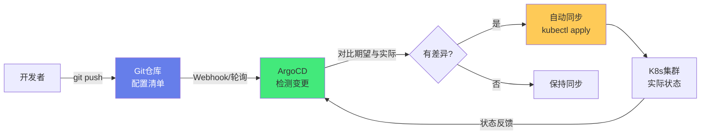
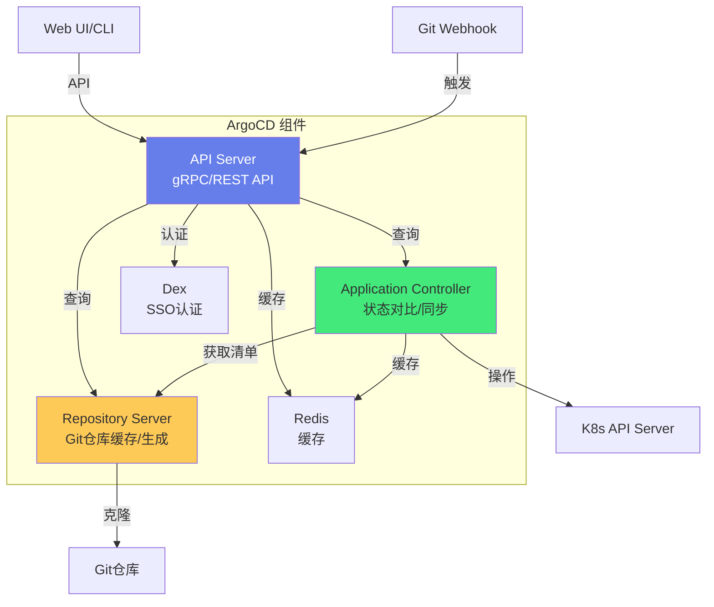
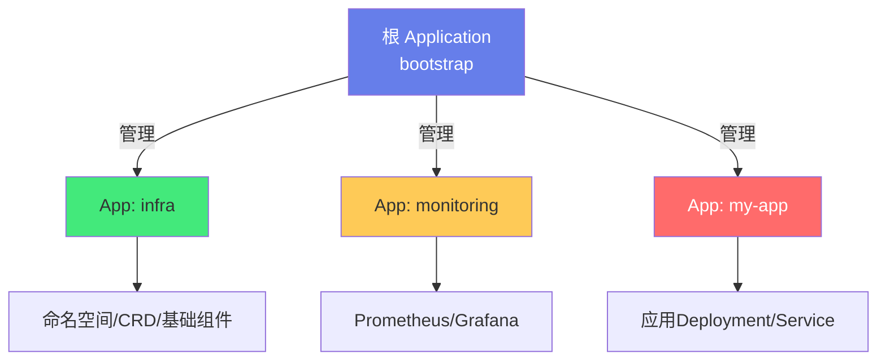
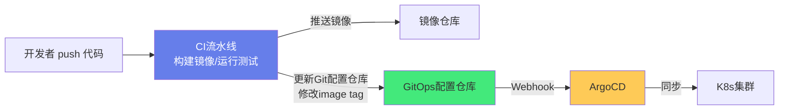

# 🚀 ArgoCD GitOps 持续部署

> **文档说明**：系统讲解 ArgoCD 与 GitOps 持续部署的完整知识体系，涵盖 GitOps 核心理念（声明式/版本控制/自动同步/可审计）、ArgoCD 架构（API Server/Repository Server/Application Controller/Dex/Redis）、安装与配置（kubectl/Helm/Operator）、Application 管理（创建/同步/回滚/删除）、同步策略（自动同步/修剪/自修复/同步波次）、健康检查与状态、多集群管理、声明式 Application（App of Apps 模式）、ArgoCD CLI 常用命令、RBAC 权限控制、Webhook 触发同步、密钥管理（Sealed Secrets/External Secrets/SOPS）、ArgoCD Projects、与 CI 流水线集成（GitHub Actions/GitLab CI）、渐进式交付（Argo Rollouts）、常见问题排查与最佳实践。
>
> **适用人群**：DevOps 工程师、SRE、云原生开发者、K8s 运维人员、平台工程师
>
> **前置知识**：[[K8s-核心概念与架构]] · [[CI-CD流水线]] · [[Helm包管理]] · [[Pod与控制器Deployment]]

---

## 一、概述

### 1.1 什么是 GitOps

GitOps 是一种**持续部署的方法论**，核心思想是：**Git 仓库是基础设施和应用配置的唯一真实来源（Single Source of Truth）**，所有部署都通过 Git 提交驱动，自动化工具（如 ArgoCD）持续对比 Git 中的期望状态和集群中的实际状态，自动同步差异。



**GitOps 的四大原则**：
| 原则 | 说明 |
|------|------|
| **声明式** | 基础设施和应用配置用声明式语言描述（YAML/Kustomize/Helm），而不是命令式脚本 |
| **版本控制** | 所有配置存储在 Git 中，版本化、可审计、可回滚 |
| **自动拉取** | 部署工具从 Git 拉取配置并应用到集群，而不是从 CI 推送 |
| **持续调和** | 工具持续对比期望状态和实际状态，自动修正漂移 |

**GitOps vs 传统 CI/CD**：
| 维度 | 传统 CI/CD（Push 模式） | GitOps（Pull 模式） |
|------|------------------------|-------------------|
| **部署方式** | CI 工具 kubectl apply 推送到集群 | ArgoCD 从 Git 拉取并应用 |
| **凭证管理** | CI 工具需要集群凭证（kubeconfig） | ArgoCD 在集群内运行，凭证在集群内 |
| **配置来源** | CI 流水线中的变量/脚本 | Git 仓库中的声明式配置 |
| **回滚** | 重新运行旧版本 CI 流水线 | git revert 或选择旧版本同步 |
| **漂移检测** | 无（手动 kubectl 改了不知道） | 自动检测并告警/自修复 |
| **审计** | CI 日志 | Git 提交历史（不可变、可审计） |
| **安全性** | CI 工具被攻破 = 集群被攻破 | 集群凭证不暴露给 CI |

### 1.2 什么是 ArgoCD

ArgoCD 是一个**基于 GitOps 的 Kubernetes 持续交付工具**，CNCF 毕业项目，是目前最流行的 GitOps 实现之一。

**ArgoCD 的核心能力**：
| 能力 | 说明 |
|------|------|
| **自动同步** | 检测 Git 变更，自动应用到集群 |
| **状态可视化** | Web UI 展示应用状态、资源拓扑、同步状态 |
| **漂移检测** | 检测集群实际状态与 Git 期望状态的差异 |
| **自修复** | 自动修正漂移（可选） |
| **回滚** | 一键回滚到历史版本（Git commit） |
| **多集群** | 管理多个 K8s 集群的部署 |
| **多源支持** | Kustomize/Helm/Jsonnet/纯 YAML |
| **SSO/RBAC** | 企业级权限管理（OIDC/SAML/RBAC） |
| **Webhook** | Git 推送触发即时同步（无需等待轮询） |

**ArgoCD 架构**：


| 组件 | 作用 |
|------|------|
| **API Server** | 提供 gRPC/REST API，Web UI 和 CLI 都通过它交互 |
| **Repository Server** | 克隆 Git 仓库，缓存仓库内容，生成 K8s 资源清单（Helm/Kustomize 渲染） |
| **Application Controller** | 核心控制器，持续对比 Git 期望状态和集群实际状态，执行同步操作 |
| **Dex** | 身份认证服务，支持 OIDC/SAML/LDAP 等 SSO |
| **Redis** | 缓存 Git 仓库和资源状态，提升性能 |

---

## 二、安装与配置

### 2.1 安装方式

```bash
# 方式1：kubectl 直接安装（最简单）
kubectl create namespace argocd
kubectl apply -n argocd -f https://raw.githubusercontent.com/argoproj/argo-cd/stable/manifests/install.yaml

# 方式2：Helm 安装（推荐，可配置）
helm repo add argo https://argoproj.github.io/argo-helm
helm install argocd argo/argo-cd \
  --namespace argocd \
  --create-namespace \
  --set server.service.type=LoadBalancer \
  --set server.extraArgs[0]="--insecure"  # 卸载TLS终止时使用

# 方式3：Operator 安装
kubectl create namespace argocd
kubectl apply -n argocd -f https://raw.githubusercontent.com/argoproj-labs/argocd-operator/master/deploy/operator.yaml
# 然后创建 ArgoCD CR
```

### 2.2 初始登录

```bash
# 获取初始 admin 密码（Pod 名）
kubectl -n argocd get secret argocd-initial-admin-secret \
  -o jsonpath="{.data.password}" | base64 -d

# 端口转发访问 Web UI
kubectl port-forward svc/argocd-server -n argocd 8080:443
# 浏览器访问 https://localhost:8080
# 用户名 admin，密码为上面获取的值

# 修改密码
argocd account update-password

# 或删除初始密码 Secret（重启后生成新密码）
kubectl -n argocd delete secret argocd-initial-admin-secret
```

### 2.3 ArgoCD CLI 安装

```bash
# Linux
curl -sSL -o argocd https://github.com/argoproj/argo-cd/releases/latest/download/argocd-linux-amd64
chmod +x argocd
sudo mv argocd /usr/local/bin/

# macOS
brew install argocd

# Windows
# 从 GitHub Releases 下载 argocd-windows-amd64.exe

# 验证
argocd version

# 登录
argocd login localhost:8080 --username admin --password <password> --insecure
```

---

## 三、Application 管理

### 3.1 创建 Application

**方式1：CLI 创建**
```bash
argocd app create my-app \
  --repo https://github.com/myorg/my-app-config.git \
  --path k8s/overlays/production \
  --dest-server https://kubernetes.default.svc \
  --dest-namespace production \
  --sync-policy automated \
  --auto-prune \
  --self-heal
```

**方式2：声明式 YAML（推荐，GitOps 管理 ArgoCD 本身）**
```yaml
apiVersion: argoproj.io/v1alpha1
kind: Application
metadata:
  name: my-app
  namespace: argocd
  finalizers:
    - resources-finalizer.argocd.argoproj.io  # 删除Application时同步删除资源
spec:
  project: default
  
  # 源配置
  source:
    repoURL: https://github.com/myorg/my-app-config.git
    targetRevision: main  # 分支/标签/commit
    path: k8s/overlays/production
    
    # Helm 配置（如果是 Helm 仓库）
    # helm:
    #   valueFiles:
    #     - values-production.yaml
    #   parameters:
    #     - name: image.tag
    #       value: v1.2.3
    
    # Kustomize 配置
    # kustomize:
    #   namePrefix: prod-
    #   images:
    #     - myapp:v1.2.3
  
  # 多源应用（ArgoCD 2.6+）
  # sources:
  #   - repoURL: https://github.com/myorg/helm-charts.git
  #     path: charts/my-app
  #     targetRevision: main
  #   - repoURL: https://github.com/myorg/my-app-config.git
  #     path: envs/production
  #     targetRevision: main
  
  # 目标集群
  destination:
    server: https://kubernetes.default.svc  # 集群内
    # name: production-cluster  # 或用已注册的集群名
    namespace: production
  
  # 同步策略
  syncPolicy:
    automated:
      prune: true       # 自动删除Git中不存在的资源
      selfHeal: true    # 自动修正漂移
      allowEmpty: false # 不允许同步空目录（防止误删）
    syncOptions:
      - CreateNamespace=true    # 自动创建命名空间
      - PrunePropagationPolicy=foreground  # 删除策略
      - PruneLast=true          # 最后删除资源
      - ApplyOutOfSyncOnly=true # 只同步不同步的资源
      - ServerSideApply=true    # 使用服务端应用（避免注解过大）
  
  # 忽略差异（某些字段不参与对比）
  ignoreDifferences:
    - group: apps
      kind: Deployment
      jsonPointers:
        - /spec/replicas  # 忽略HPA修改的副本数
    - group: ""
      kind: ConfigMap
      name: my-config
      jsonPointers:
        - /data/timestamp
  
  # 同步波次（按顺序同步资源）
  # syncWaves: 通过注解 argocd.argoproj.io/sync-wave 控制
```

### 3.2 同步操作

```bash
# 手动同步
argocd app sync my-app

# 同步并等待完成
argocd app sync my-app --wait

# 只同步特定资源
argocd app sync my-app --resource apps:Deployment:my-app

# 同步到特定版本（回滚）
argocd app sync my-app --revision <commit-sha>

# 查看同步状态
argocd app get my-app

# 查看应用资源列表
argocd app resources my-app

# 查看差异
argocd app diff my-app

# 刷新（重新拉取Git并对比）
argocd app get my-app --refresh

# 硬刷新（清除缓存重新拉取）
argocd app get my-app --hard-refresh

# 删除应用
argocd app delete my-app
argocd app delete my-app --cascade  # 级联删除资源
```

### 3.3 回滚

```bash
# 查看历史记录
argocd app history my-app

# 回滚到特定版本（按历史ID）
argocd app rollback my-app 3

# 或同步到特定 Git commit
argocd app sync my-app --revision abc123

# 回滚后查看状态
argocd app get my-app
```

> **回滚原理**：ArgoCD 的回滚不是「恢复集群状态」，而是「将 Application 的 targetRevision 切换到旧的 Git commit，然后同步」。这意味着回滚也是 GitOps 驱动的——集群状态始终与 Git 中的某个版本一致。

---

## 四、同步策略详解

### 4.1 自动同步

```yaml
syncPolicy:
  automated:
    prune: true       # 自动修剪：Git中删除的资源，集群中也删除
    selfHeal: true    # 自修复：集群中手动修改的资源，自动恢复到Git状态
    allowEmpty: false # 允许同步空目录（防止误删所有资源）
```

| 配置 | 作用 | 风险 |
|------|------|------|
| `prune: true` | Git 中删除的资源自动在集群中删除 | 误删 Git 文件会导致集群资源被删 |
| `selfHeal: true` | 手动修改的资源自动恢复 | 调试时修改会被覆盖，需先暂停同步 |
| `allowEmpty: false` | 防止同步空目录导致全部删除 | 安全措施，建议保持 false |

### 4.2 同步波次（Sync Waves）

通过注解控制资源同步的先后顺序：

```yaml
# 先同步（波次-1）
apiVersion: v1
kind: Namespace
metadata:
  name: my-app
  annotations:
    argocd.argoproj.io/sync-wave: "-1"

---
# 正常同步（波次0，默认）
apiVersion: v1
kind: ConfigMap
metadata:
  name: my-config
  annotations:
    argocd.argoproj.io/sync-wave: "0"

---
# 后同步（波次1）
apiVersion: apps/v1
kind: Deployment
metadata:
  name: my-app
  annotations:
    argocd.argoproj.io/sync-wave: "1"
```

**波次规则**：
- 波次值越小越先同步（负数先于正数）
- 同一波次的资源并行同步
- 前一个波次的资源全部健康后才开始下一个波次
- 典型场景：Namespace(-1) → CRD/ConfigMap(0) → Deployment(1) → Service/Ingress(2) → Job(3)

### 4.3 同步钩子（Sync Hooks）

```yaml
apiVersion: batch/v1
kind: Job
metadata:
  name: db-migration
  annotations:
    argocd.argoproj.io/hook: PreSync  # 同步前执行
    argocd.argoproj.io/hook-delete-policy: BeforeHookCreation,HookSucceeded
spec:
  template:
    spec:
      containers:
        - name: migrate
          image: myapp/migrator:v1
      restartPolicy: Never
```

| 钩子类型 | 执行时机 |
|---------|---------|
| `PreSync` | 同步前执行（如数据库迁移、配置检查） |
| `Sync` | 同步时执行（与普通资源一起） |
| `PostSync` | 同步后执行（如健康检查、通知、集成测试） |
| `SyncFail` | 同步失败时执行（如回滚、告警） |
| `PreDelete` | 删除前执行（如数据备份、清理） |
| `PostDelete` | 删除后执行 |

---

## 五、健康检查

ArgoCD 内置了常见 K8s 资源的健康检查逻辑：

| 资源 | 健康状态判断 |
|------|------------|
| **Deployment** | 期望副本数 = 可用副本数 = 更新副本数，且无不可用副本 |
| **StatefulSet** | 期望副本数 = 就绪副本数 |
| **DaemonSet** | 期望节点数 = 就绪节点数 |
| **Pod** | Pod 相位为 Running 且所有容器就绪 |
| **Service** | 存在 Endpoints（有后端 Pod） |
| **Ingress** | 存在外部 IP/主机名 |
| **Job** | Job 完成（成功） |
| **PVC** | PVC 状态为 Bound |
| **自定义资源** | 需配置自定义健康检查 |

**健康状态**：
| 状态 | 含义 |
|------|------|
| `Healthy` | 健康，运行正常 |
| `Progressing` | 进行中（如 Deployment 正在滚动更新） |
| `Degraded` | 降级（如 Pod 崩溃、副本数不足） |
| `Suspended` | 暂停（如 CronJob 暂停） |
| `Missing` | 资源缺失 |
| `Unknown` | 未知状态 |

**自定义健康检查**（在 argocd-cm ConfigMap 中配置）：
```yaml
data:
  resource.customizations.health.argoproj.io_Rollout: |
    hs = {}
    if obj.status ~= nil then
      if obj.status.phase == "Healthy" then
        hs.status = "Healthy"
        hs.message = "Rollout is healthy"
      elseif obj.status.phase == "Degraded" then
        hs.status = "Degraded"
        hs.message = "Rollout is degraded"
      else
        hs.status = "Progressing"
        hs.message = "Rollout is progressing"
      end
    end
    return hs
```

---

## 六、多集群管理

### 6.1 添加集群

```bash
# 查看当前 kubeconfig 中的集群
kubectl config get-contexts

# 添加集群到 ArgoCD（使用当前 kubeconfig 中的上下文）
argocd cluster add <context-name>

# 查看已注册的集群
argocd cluster list

# 查看集群详情
argocd cluster get <cluster-name>

# 删除集群
argocd cluster rm <cluster-name>
```

### 6.2 多集群 Application

```yaml
apiVersion: argoproj.io/v1alpha1
kind: Application
metadata:
  name: my-app-production
spec:
  destination:
    name: production-cluster  # 使用已注册的集群名
    namespace: production
  # 或使用 server URL
  # destination:
  #   server: https://prod-cluster-api:6443
  #   namespace: production
```

**多集群部署模式**：
| 模式 | 说明 |
|------|------|
| **每集群一个 Application** | 为每个集群创建独立的 Application，配置各自的 destination |
| **ApplicationSet** | 用 ApplicationSet 自动为多个集群生成 Application |
| **App of Apps** | 一个根 Application 管理多个子 Application（每个子 Application 对应一个集群） |

---

## 七、App of Apps 模式

App of Apps 是 ArgoCD 的推荐模式：用一个根 Application 管理其他 Application 的创建，实现 Application 的 GitOps 管理。



**根 Application 配置**：
```yaml
apiVersion: argoproj.io/v1alpha1
kind: Application
metadata:
  name: bootstrap
  namespace: argocd
spec:
  project: default
  source:
    repoURL: https://github.com/myorg/gitops-config.git
    targetRevision: main
    path: apps  # 该目录下存放所有 Application 的 YAML
  destination:
    server: https://kubernetes.default.svc
    namespace: argocd
  syncPolicy:
    automated:
      prune: true
      selfHeal: true
```

**apps/ 目录结构**：
```text
apps/
├── infra.yaml          # 基础设施 Application
├── monitoring.yaml     # 监控 Application
├── my-app.yaml         # 应用 Application
└── ingress-nginx.yaml  # Ingress 控制器
```

每个子 Application 文件：
```yaml
# apps/my-app.yaml
apiVersion: argoproj.io/v1alpha1
kind: Application
metadata:
  name: my-app
  namespace: argocd
  finalizers:
    - resources-finalizer.argocd.argoproj.io
spec:
  project: default
  source:
    repoURL: https://github.com/myorg/my-app-config.git
    targetRevision: main
    path: k8s/overlays/production
  destination:
    server: https://kubernetes.default.svc
    namespace: production
  syncPolicy:
    automated:
      prune: true
      selfHeal: true
    syncOptions:
      - CreateNamespace=true
```

---

## 八、Projects（项目）

ArgoCD Projects 用于对 Application 进行逻辑分组和权限隔离：

```yaml
apiVersion: argoproj.io/v1alpha1
kind: AppProject
metadata:
  name: team-a
  namespace: argocd
spec:
  description: "Team A's applications"
  
  # 允许的源仓库
  sourceRepos:
    - https://github.com/myorg/team-a/*
    - https://github.com/myorg/shared-charts/*
  
  # 允许的目标集群和命名空间
  destinations:
    - server: https://kubernetes.default.svc
      namespace: team-a-*
    - name: staging-cluster
      namespace: team-a-staging
  
  # 允许的资源类型（黑名单/白名单）
  clusterResourceWhitelist:
    - group: ''
      kind: Namespace
  namespaceResourceWhitelist:
    - group: '*'
      kind: '*'
  
  # 角色（RBAC）
  roles:
    - name: developer
      description: "Developer access"
      policies:
        - p, proj:team-a:developer, applications, get, team-a/*, allow
        - p, proj:team-a:developer, applications, sync, team-a/*, allow
      groups:
        - myorg:team-a-developers
```

---

## 九、与 CI 流水线集成

### 9.1 CI/CD 分工



**CI 负责**：代码构建、单元测试、镜像构建、镜像推送、更新 GitOps 配置仓库中的镜像版本
**CD（ArgoCD）负责**：检测 Git 变更、同步到集群、健康检查、回滚

### 9.2 GitHub Actions 示例

```yaml
# .github/workflows/ci.yml
name: CI/CD

on:
  push:
    branches: [main]

jobs:
  build:
    runs-on: ubuntu-latest
    steps:
      - uses: actions/checkout@v4
      
      - name: Build and push image
        run: |
          docker build -t myregistry/myapp:${{ github.sha }} .
          docker push myregistry/myapp:${{ github.sha }}
      
      - name: Update GitOps config
        run: |
          git clone https://x-access-token:${{ secrets.GITOPS_TOKEN }}@github.com/myorg/gitops-config.git
          cd gitops-config
          # 使用 yq 或 sed 更新镜像版本
          yq eval ".images[0].newTag = \"${{ github.sha }}\"" -i k8s/overlays/production/kustomization.yaml
          git config user.name "github-actions"
          git config user.email "actions@github.com"
          git add .
          git commit -m "Update myapp image to ${{ github.sha }}"
          git push
```

### 9.3 ArgoCD Image Updater

ArgoCD Image Updater 是一个辅助工具，可以自动检测镜像仓库的新版本并更新 Application：

```yaml
# Application 注解
apiVersion: argoproj.io/v1alpha1
kind: Application
metadata:
  annotations:
    argocd-image-updater.argoproj.io/image-list: myapp=myregistry/myapp
    argocd-image-updater.argoproj.io/myapp.update-strategy: semver
    argocd-image-updater.argoproj.io/myapp.allow-tags: regexp:^v\d+\.\d+\.\d+$
    argocd-image-updater.argoproj.io/write-back-method: git  # 写回Git仓库
```

---

## 十、密钥管理

GitOps 的挑战：Git 是公开/半公开的，不能直接存储明文密钥。

### 10.1 Sealed Secrets

```bash
# 安装 Sealed Secrets
kubectl apply -f https://github.com/bitnami-labs/sealed-secrets/releases/latest/download/controller.yaml

# 安装 kubeseal CLI
brew install kubeseal

# 创建 Secret 并加密
kubectl create secret generic my-secret \
  --from-literal=password=secret123 \
  --dry-run=client -o yaml > secret.yaml

# 加密为 SealedSecret（可以安全提交到 Git）
kubeseal --format=yaml < secret.yaml > sealed-secret.yaml

# sealed-secret.yaml 可以提交到 Git，ArgoCD 同步后控制器自动解密为 Secret
```

### 10.2 External Secrets Operator

从外部密钥管理系统（AWS Secrets Manager/Vault/Azure Key Vault）同步密钥到 K8s：

```yaml
apiVersion: external-secrets.io/v1beta1
kind: ExternalSecret
metadata:
  name: my-secret
spec:
  refreshInterval: 1h
  secretStoreRef:
    name: vault-backend
    kind: ClusterSecretStore
  target:
    name: my-k8s-secret  # 生成的 K8s Secret 名
  data:
    - secretKey: password
      remoteRef:
        key: secret/myapp
        property: password
```

### 10.3 SOPS + age/PGP

```bash
# 加密文件
sops --age=age1xxx --encrypt secrets.yaml > secrets.enc.yaml

# 解密
sops --decrypt secrets.enc.yaml

# ArgoCD 配置 SOPS 解密（在 argocd-cm 中配置）
# 需要安装 sops 到 ArgoCD 容器
```

---

## 十一、Webhook 配置

默认 ArgoCD 每 3 分钟轮询 Git 仓库，配置 Webhook 可以实现推送后即时同步。

### 11.1 GitHub Webhook

```bash
# 获取 ArgoCD Webhook 密钥
kubectl -n argocd get secret argocd-secret \
  -o jsonpath="{.data.webhook.github.secret}" | base64 -d

# 或在 argocd-cm 中配置自定义密钥
# data:
#   webhook.github.secret: my-webhook-secret
```

GitHub 仓库设置 → Webhooks → Add webhook：
- Payload URL: `https://argocd.example.com/api/webhook`
- Content type: `application/json`
- Secret: 上面的密钥
- Events: `Just the push event`

### 11.2 GitLab Webhook

GitLab 项目 → Settings → Webhooks：
- URL: `https://argocd.example.com/api/webhook`
- Secret Token: ArgoCD 配置的 `webhook.gitlab.secret`
- Trigger: `Push events`

---

## 十二、常见问题排查

### 12.1 应用不同步

```bash
# 查看差异
argocd app diff my-app

# 刷新
argocd app get my-app --refresh

# 硬刷新（清除缓存）
argocd app get my-app --hard-refresh

# 手动同步
argocd app sync my-app

# 查看同步日志
argocd app logs my-app
```

**常见原因**：
| 原因 | 解决方案 |
|------|---------|
| Git 仓库访问失败 | 检查仓库凭证（SSH 密钥/Token）、网络连通性 |
| 目标分支不存在 | 检查 targetRevision 是否正确 |
| 路径不存在 | 检查 path 是否正确 |
| Helm/Kustomize 渲染失败 | 本地手动渲染排查：`helm template` / `kustomize build` |
| 资源被其他控制器修改 | 配置 ignoreDifferences 忽略该字段 |
| 同步波次/钩子失败 | 查看钩子 Job 日志 |

### 12.2 健康检查失败

```bash
# 查看应用资源状态
argocd app resources my-app

# 查看不健康的资源
argocd app resources my-app --health-status Degraded

# 查看资源详情
kubectl describe deployment my-app -n production
kubectl get pods -n production
kubectl logs <pod-name> -n production
```

### 12.3 权限问题

```bash
# 查看 ArgoCD 服务账户权限
kubectl get clusterrolebinding -n argocd

# 查看 Application 控制器日志
kubectl logs -n argocd -l app.kubernetes.io/name=argocd-application-controller

# 查看 API Server 日志
kubectl logs -n argocd -l app.kubernetes.io/name=argocd-server
```

### 12.4 性能问题

```bash
# 查看 Redis 状态
kubectl get pods -n argocd -l app.kubernetes.io/name=argocd-redis

# 调整 Application 控制器并行度
# argocd-cmd-params-cm ConfigMap
# data:
#   controller.parallelism.limit: "20"  # 默认10，大集群可增大

# 调整仓库服务器并行度
#   reposerver.parallelism.limit: "20"
```

---

## 十三、最佳实践

### 13.1 目录结构

```text
gitops-config/
├── apps/                    # App of Apps 根目录
│   ├── bootstrap.yaml       # 根 Application
│   ├── infra.yaml
│   ├── monitoring.yaml
│   └── my-app.yaml
├── charts/                  # 自定义 Helm Chart
│   └── my-app/
│       ├── Chart.yaml
│       ├── values.yaml
│       └── templates/
├── environments/            # 环境配置
│   ├── dev/
│   │   ├── kustomization.yaml
│   │   └── patches/
│   ├── staging/
│   └── production/
└── sealed-secrets/          # 加密密钥
    └── my-secret.yaml
```

### 13.2 配置建议

| 建议 | 说明 |
|------|------|
| **使用声明式 Application** | Application 本身也用 GitOps 管理（App of Apps），不要手动创建 |
| **启用自动同步 + 自修复** | 生产环境建议开启，防止配置漂移 |
| **谨慎使用 prune** | 误删 Git 文件会导致集群资源被删，建议配合 `allowEmpty: false` |
| **使用 Sync Waves** | 控制资源同步顺序（Namespace → ConfigMap → Deployment → Service） |
| **配置 ignoreDifferences** | 忽略 HPA 修改的 replicas、自动注入的 sidecar 等 |
| **使用 Projects 隔离** | 不同团队/环境用不同 Project，限制源仓库和目标集群 |
| **密钥用 Sealed Secrets/External Secrets** | 不要在 Git 中存储明文密钥 |
| **配置 Webhook** | 减少轮询延迟，推送后即时同步 |
| **使用 ServerSideApply** | 避免 kubectl apply 注解过大问题 |
| **定期备份 ArgoCD 配置** | 备份 argocd 命名空间的所有资源 |

### 13.3 渐进式交付（Argo Rollouts）

ArgoCD 配合 Argo Rollouts 实现金丝雀发布/蓝绿部署：

```yaml
apiVersion: argoproj.io/v1alpha1
kind: Rollout
metadata:
  name: my-app
spec:
  replicas: 10
  strategy:
    canary:
      steps:
        - setWeight: 10      # 10% 流量到新版本
        - pause: {duration: 5m}  # 观察5分钟
        - setWeight: 30      # 30%
        - pause: {duration: 5m}
        - setWeight: 60      # 60%
        - pause: {duration: 5m}
        - setWeight: 100     # 100%
  selector:
    matchLabels:
      app: my-app
  template:
    # Pod 模板（同 Deployment）
```

---

## 十四、关联笔记

### CI/CD 与 DevOps
- [[CI-CD流水线]] · [[GitHub-Actions流水线设计]] · [[GitLab-CI配置]]
- [[Helm包管理]] · [[Kustomize-K8s配置管理]] · [[Jenkins持续集成]]

### K8s 与云原生
- [[K8s-核心概念与架构]] · [[Pod与控制器Deployment]] · [[K8s-服务发现与负载均衡]]
- [[Terraform-基础设施编排]] · [[Prometheus-指标采集]]

### 导航
- [[MOC-云原生与运维]] · [[MOC-CICD]] · [[MOC-综合导航]] · [[Home]]

> 🔍 **知识点深度解析**
>
> **作用**：ArgoCD GitOps 持续部署解决的是「Kubernetes 环境中应用部署的自动化、可审计、可回滚和一致性问题」——传统的 CI/CD 部署方式（CI 工具 kubectl apply 推送到集群）存在诸多问题：CI 工具需要集群凭证（安全风险）、部署过程不可审计（CI 日志易失）、配置漂移无法检测（手动 kubectl 改了不知道）、回滚困难（需要重新运行旧流水线）、多环境配置管理混乱。GitOps 通过「Git 作为唯一真实来源 + 自动拉取同步 + 持续状态对比」，将部署过程变成了「Git 提交驱动的声明式自动化」——所有变更都有 Git 历史（可审计、可回滚），集群状态始终与 Git 一致（无漂移），凭证在集群内（更安全），多环境通过 Git 分支/目录管理（清晰）。ArgoCD 是 GitOps 理念的最佳实现之一，提供了可视化 UI、自动同步、漂移检测、自修复、多集群、SSO/RBAC 等企业级能力。
>
> **底层原理**：①GitOps 的核心是「声明式 + 拉取模式 + 持续调和」——声明式意味着用 YAML 描述期望状态（而不是命令式脚本），拉取模式意味着部署工具从 Git 拉取配置应用到集群（而不是 CI 推送），持续调和意味着工具不断对比期望状态和实际状态，有差异就自动修正。这三个特性共同保证了「集群状态 = Git 状态」。②ArgoCD 的 Application Controller 是核心——它是一个 K8s Controller，持续监听 Application CR 的变化，定期（默认3分钟）从 Git 拉取最新配置，通过 Repository Server 渲染成 K8s 资源清单（Helm template/Kustomize build），然后对比集群中的实际资源状态（通过 K8s API 获取），如果有差异就执行同步（kubectl apply/delete）。这是典型的「控制器模式」——对比期望与实际，执行调和操作。③漂移检测的原理是「三方对比」——ArgoCD 对比三个状态：Git 中的期望状态（desired）、集群中的实际状态（live）、上次同步时的状态（applied）。如果 live ≠ desired，就是「不同步（OutOfSync）」；如果 live ≠ applied 且 live ≠ desired，就是「漂移（drift）」——有人手动修改了集群资源。selfHeal 会自动将 live 恢复到 desired。④同步波次的原理是「注解驱动的优先级排序」——ArgoCD 读取资源的 `argocd.argoproj.io/sync-wave` 注解，按波次值从小到大排序，同一波次的资源并行同步，前一波次全部健康后才开始下一波次。这解决了「资源依赖顺序」问题（如 Namespace 必须先于 Deployment）。⑤App of Apps 的原理是「Application 也是 K8s 资源」——ArgoCD 的 Application 是一个 CRD（Custom Resource Definition），所以 Application 本身也可以被另一个 Application 管理。根 Application 同步时，会创建/更新/删除子 Application，子 Application 再管理实际的应用资源。这种递归管理实现了「ArgoCD 本身的 GitOps 化」——所有 Application 配置都在 Git 中，不需要手动在 UI 中创建。
>
> **用法要点**：① 安装：kubectl apply/Helm/Operator 三种方式，推荐 Helm（可配置）；初始密码在 argocd-initial-admin-secret 中 ② Application 配置：source（repoURL/targetRevision/path/helm/kustomize）、destination（server/name/namespace）、syncPolicy（automated.prune/selfHeal/allowEmpty + syncOptions）、ignoreDifferences（忽略HPA副本数等）、finalizers（级联删除） ③ 同步操作：argocd app sync/get/diff/history/rollback/delete；手动同步、自动同步、同步到特定commit（回滚） ④ 同步策略：prune（自动删除Git中不存在的资源）、selfHeal（自动修正漂移）、allowEmpty:false（防止误删）、Sync Waves（注解控制顺序）、Sync Hooks（PreSync/PostSync/SyncFail） ⑤ 健康检查：内置Deployment/StatefulSet/Pod/Service等健康判断；状态Healthy/Progressing/Degraded；自定义健康检查用Lua脚本 ⑥ 多集群：argocd cluster add 添加；Application destination用name或server；ApplicationSet/App of Apps管理多集群 ⑦ App of Apps：根Application管理apps/目录下的Application YAML；实现Application的GitOps化 ⑧ Projects：sourceRepos/destinations/资源白名单/角色RBAC；团队和环境隔离 ⑨ CI集成：CI负责构建镜像+更新Git配置仓库，ArgoCD负责同步；用yq/sed更新image tag；ArgoCD Image Updater自动检测新版本 ⑩ 密钥管理：Sealed Secrets（加密后提交Git）、External Secrets（从Vault/AWS同步）、SOPS（文件级加密）；不要明文存储密钥 ⑪ Webhook：GitHub/GitLab配置Payload URL指向/api/webhook，减少轮询延迟 ⑫ 排查：app diff看差异、app logs看日志、controller logs看控制器、kubectl describe看资源状态；常见问题Git访问失败/渲染失败/健康检查失败/权限不足 ⑬ 最佳实践：声明式Application、自动同步+自修复、谨慎prune、Sync Waves、ignoreDifferences、Projects隔离、密钥加密、Webhook、ServerSideApply、配合Argo Rollouts做金丝雀发布。

> 💡 **深度讲解**：GitOps 最核心的智慧是「将运维操作变成代码审查」——在传统的运维模式中，部署是一个「操作」：工程师在 CI 中点击按钮，或者手动运行 kubectl apply，这个操作的过程和结果只存在于 CI 日志或终端历史中，不可审计、不可回滚、不可复现。而在 GitOps 模式中，部署变成了一个「代码变更」：工程师修改 Git 中的 YAML 文件，提交 Pull Request，经过代码审查后合并，ArgoCD 自动检测变更并同步到集群。这个转变的意义是革命性的——所有部署变更都有 Git 提交历史（谁、什么时候、改了什么、为什么改），都可以通过 git revert 一键回滚，都可以通过 PR 审查流程保证质量，都可以通过 CI 检查（YAML  lint/策略检查/安全扫描）在合并前发现问题。运维操作从此有了「代码级别的质量保障和可追溯性」。这就是 GitOps 的本质——不是「用 Git 部署」，而是「将运维纳入软件开发的最佳实践（版本控制、代码审查、CI 检查、自动化）」。「拉取模式比推送模式更安全」——这是 GitOps 被广泛采用的另一个核心理由。传统 CI/CD 的推送模式中，CI 工具需要持有所有目标集群的 kubeconfig/凭证，CI 工具一旦被攻破（如 CI 日志泄露凭证、CI 服务器被入侵），攻击者就可以访问所有集群。而且随着集群数量增加，凭证管理变得越来越复杂和危险。GitOps 的拉取模式中，ArgoCD 运行在每个集群内部（或管理集群中），凭证存储在集群的 Secret 中，不需要暴露给 CI 工具。CI 工具只需要「更新 Git 仓库」的权限，不需要「访问集群」的权限——攻击面大大缩小。这就是「最小权限原则」在部署架构中的应用。「漂移检测是 GitOps 的杀手级特性」——在传统部署模式中，如果有人手动在集群中修改了资源（如 kubectl edit deployment 改了副本数、调试时改了环境变量），这个修改不会被记录，也不会被发现——直到出了问题才会排查到「原来有人手动改了配置」。这种「配置漂移」是生产环境的隐形杀手——集群状态和代码中的配置不一致，导致「代码是一套，运行是另一套」，问题难以复现和排查。GitOps 的漂移检测通过持续对比 Git 期望状态和集群实际状态，一旦发现差异就告警（或自动修复），保证了「集群状态始终等于 Git 状态」——这就是「单一真实来源」的真正含义。selfHeal 功能更进一步：发现漂移后自动恢复，连告警都不需要——集群会自己「治愈」。这种自动化的一致性保障，是传统部署模式无法提供的。

> 📝 **精简总结**：ArgoCD=基于GitOps的K8s持续部署工具，CNCF毕业项目。GitOps四原则：声明式、版本控制、自动拉取、持续调和。ArgoCD架构：API Server/Repository Server/Application Controller/Dex/Redis。Application配置：source(repo/path/revision/helm/kustomize)、destination(cluster/namespace)、syncPolicy(automated.prune/selfHeal)、ignoreDifferences。同步：手动sync/自动同步/回滚(rollback或sync --revision)/Sync Waves(注解顺序)/Sync Hooks(PreSync/PostSync)。健康检查：内置资源健康判断，状态Healthy/Progressing/Degraded。多集群：cluster add，destination用name/server。App of Apps：根Application管理子Application。Projects：源仓库/目标集群/资源/RBAC隔离。CI集成：CI构建镜像+更新Git配置，ArgoCD同步。密钥：Sealed Secrets/External Secrets/SOPS。Webhook：GitHub/GitLab配置即时同步。排查：app diff/logs、controller日志、kubectl describe。最佳实践：声明式Application、自动同步+自修复、谨慎prune、Sync Waves、Projects隔离、密钥加密、配合Argo Rollouts金丝雀发布。

> **学习路径建议**：先学习 [[K8s-核心概念与架构]] 和 [[Pod与控制器Deployment]] 掌握 K8s 基础 → 学习 [[Helm包管理]] 和 [[Kustomize-K8s配置管理]] 掌握 K8s 配置管理 → 学习 [[CI-CD流水线]] 理解 CI/CD 概念 → 学习本文档掌握 ArgoCD GitOps → 实践：用 minikube/kind 安装 ArgoCD，创建第一个 Application，体验自动同步和回滚 → 学习 App of Apps 模式和多集群管理 → 学习 [[Argo Rollouts渐进式交付]] 掌握金丝雀/蓝绿部署 → 学习密钥管理（Sealed Secrets/External Secrets） → 学习 Projects 和 RBAC 企业级配置 → 在实际项目中落地 GitOps，积累最佳实践和排障经验。

---

> **ArgoCD GitOps 的本质是「将 Kubernetes 应用部署从『手动操作/CI推送』升级为『Git驱动的声明式自动化』——在没有 GitOps 的时代，部署应用意味着 CI 工具拿着集群凭证去 kubectl apply，这个过程不可审计、不可回滚、无法检测漂移，集群多了之后凭证管理就是一场噩梦。GitOps 重新定义了部署的范式：Git 是唯一真实来源，所有变更都通过 Git 提交驱动，ArgoCD 自动拉取并同步，持续对比期望与实际状态，发现漂移就告警或自修复。这个转变的意义不仅是『部署自动化』，更是『运维操作的代码化』——部署变更变成了 Pull Request，可以代码审查、可以 CI 检查、可以 git revert 回滚、有完整的提交历史可审计。运维从此有了和软件开发同等的质量保障和可追溯性。当你掌握了 ArgoCD GitOps，你就不再是『手动 kubectl apply 的运维』，而是『用 Git 管理整个集群状态的平台工程师』——你可以用代码审查保障部署质量，用 Git 历史审计所有变更，用一键回滚应对故障，用漂移检测保证一致性，用多集群管理统一管理数十个集群。这就是云原生时代的部署哲学：基础设施即代码，部署即 Git 提交，一致性即自动化调和。**
