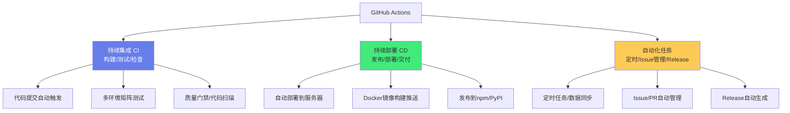
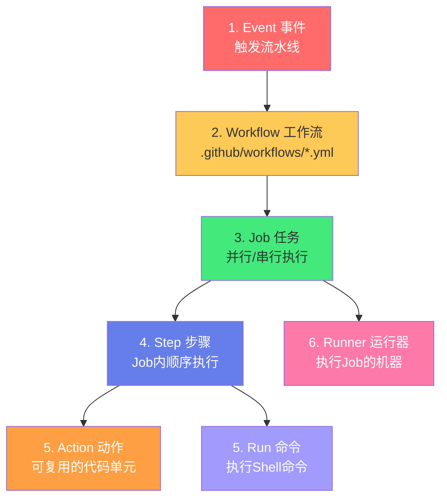
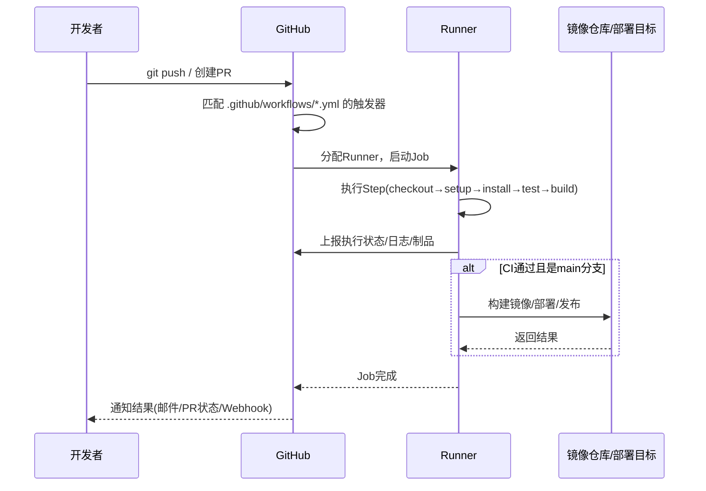
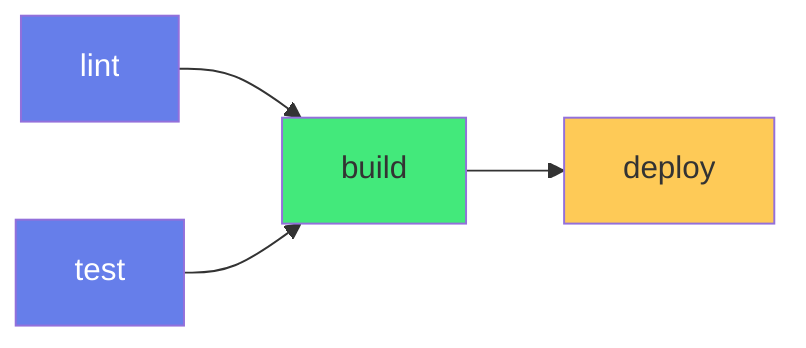
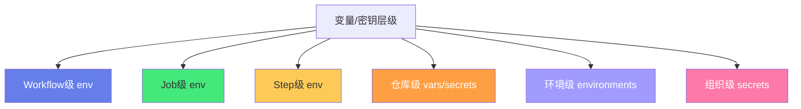

# 🚀 GitHub Actions 流水线设计

> **文档说明**：系统讲解 GitHub Actions 的核心概念、YAML 语法、触发器、Job 控制、常用 Actions、缓存与制品、矩阵构建、环境部署、完整流水线示例与生产最佳实践，涵盖 GitHub Actions 的架构（Workflow/Job/Step/Action/Runner/Event 六层模型）、YAML 配置文件结构（.github/workflows/*.yml）、触发器详解（push/pull_request/schedule/workflow_dispatch/release/issues/project/外部webhook等20+事件）、Job 控制（runs-on/needs/strategy/matrix/if/continue-on-error/timeout-minutes）、Step 类型（run 执行命令/uses 引用 Action/with 传参/env 环境变量）、官方常用 Actions（actions/checkout/actions/setup-node/actions/setup-java/actions/setup-python/actions/cache/actions/upload-artifact/actions/download-artifact/actions/create-release）、变量与密钥管理（vars/secrets/GITHUB_TOKEN/environments/环境保护规则）、依赖缓存优化（actions/cache 缓存 npm/maven/gradle/pip 依赖）、制品管理（artifact 上传下载/保留期/跨Job传递）、矩阵构建（matrix 多OS×多语言版本并行测试）、条件执行（if 表达式/上下文/状态函数）、并行与依赖（needs 控制执行顺序/扇入扇出）、自托管 Runner（self-hosted runner 安装/标签/安全）、完整流水线示例（前端Vite+React CI/后端Spring Boot CI+Docker镜像/全栈项目CI/CD/定时任务/Release发布）、流水线优化策略（并行化/缓存/最小权限/超时控制/失败快速）、安全最佳实践（Secrets管理/权限最小化/依赖扫描/CodeQL/Secret扫描）、成本控制（免费额度/分钟数计算/自托管Runner）、可维护性（复合Action/可复用Workflow/模板）、常见问题排查（权限错误/缓存失效/跨平台问题/超时）、与 Jenkins/GitLab CI/CircleCI 的对比。
>
> **适用人群**：后端开发者、前端开发者、DevOps工程师、全栈开发者、开源项目维护者、运维工程师
>
> **前置知识**：[[Git-高级命令与底层原理]] · [[Docker容器化]] · [[CI-CD流水线设计]] · [[YAML语法]]

---

## 一、概述

### 1.1 什么是 GitHub Actions

**GitHub Actions** 是 GitHub 内置的**持续集成/持续部署（CI/CD）平台**，允许你在 GitHub 仓库中直接构建、测试、打包、发布和部署代码，无需额外搭建 Jenkins 等 CI 服务器。



**核心优势**：
- **原生集成**：与 GitHub 深度集成，无需额外配置 Webhook
- **YAML 即代码**：流水线配置存储在仓库中，版本可控
- **丰富生态**：GitHub Marketplace 有上万种现成 Action
- **矩阵构建**：轻松实现多 OS × 多版本并行测试
- **免费额度**：公开仓库无限免费，私有仓库每月 2000 分钟免费
- **自托管**：可在自己的服务器上运行 Runner，无分钟数限制

### 1.2 核心概念六层模型



| 层级 | 概念 | 说明 |
|------|------|------|
| **1. Event（事件）** | 触发流水线的事件 | push、pull_request、schedule、release、workflow_dispatch 等 |
| **2. Workflow（工作流）** | 一个完整的流水线 | `.github/workflows/` 下的 YAML 文件，一个仓库可有多条 |
| **3. Job（任务）** | Workflow 中的执行单元 | 默认并行，可用 `needs` 设为串行，每个 Job 在独立 Runner 上运行 |
| **4. Step（步骤）** | Job 中的执行单元 | 顺序执行，每个 Step 是一个 Action 或一条 Shell 命令 |
| **5. Action（动作）** | 可复用的代码单元 | 从 Marketplace 引用或自己编写，如 `actions/checkout` |
| **6. Runner（运行器）** | 执行 Job 的机器 | GitHub 托管（ubuntu/windows/macos）或自托管 |

### 1.3 工作原理



---

## 二、YAML 配置结构

### 2.1 最小可用示例

```yaml
# .github/workflows/ci.yml
name: CI Pipeline                    # Workflow名称（可选，显示在Actions页面）

on:                                  # 触发器
  push:
    branches: [main, develop]
  pull_request:
    branches: [main]

jobs:                                # 任务集合
  build:                             # Job ID
    runs-on: ubuntu-latest           # 运行环境
    steps:                           # 步骤
      - uses: actions/checkout@v4    # 拉取代码
      - uses: actions/setup-node@v4  # 安装Node
        with:
          node-version: '20'
      - run: npm ci                  # 安装依赖
      - run: npm test                # 运行测试
      - run: npm run build           # 构建
```

### 2.2 完整结构

```yaml
name: Workflow Name

on:
  # 触发器配置（详见第三章）

env:                                   # 全局环境变量
  NODE_VERSION: '20'
  REGISTRY: ghcr.io

permissions:                           # 全局权限（最小权限原则）
  contents: read
  packages: write

defaults:                              # 默认设置
  run:
    shell: bash
    working-directory: ./app

jobs:
  job-id:
    name: Job Display Name             # 显示名称
    runs-on: ubuntu-latest             # 运行环境
    needs: [other-job]                 # 依赖的Job（串行）
    if: github.event_name == 'push'    # 条件执行
    strategy:                          # 矩阵构建
      matrix:
        os: [ubuntu-latest, windows-latest]
        node: [18, 20, 22]
    continue-on-error: true            # 失败不阻断
    timeout-minutes: 30                # 超时时间
    environment: production            # 部署环境
    env:                               # Job级环境变量
      NODE_ENV: production
    outputs:                           # Job输出（供其他Job使用）
      image-tag: ${{ steps.meta.outputs.tag }}
    steps:
      - name: Checkout                 # Step名称
        uses: actions/checkout@v4
        with:
          fetch-depth: 0
      - name: Setup Node
        uses: actions/setup-node@v4
        with:
          node-version: ${{ env.NODE_VERSION }}
          cache: 'npm'
      - name: Install & Test
        run: |
          npm ci
          npm test
      - name: Build
        run: npm run build
        id: build                      # Step ID（供引用）
      - name: Upload Artifact
        uses: actions/upload-artifact@v4
        with:
          name: dist
          path: dist/
```

---

## 三、触发器详解

### 3.1 代码事件

| 触发器 | 说明 | 示例 |
|--------|------|------|
| `push` | 代码推送 | `push: { branches: [main], tags: ['v*'] }` |
| `pull_request` | PR 创建/更新 | `pull_request: { branches: [main], types: [opened, synchronize] }` |
| `pull_request_target` | PR 触发但用基础分支代码（安全） | 用于需要 secrets 的 PR 检查 |
| `create` | 创建分支/标签 | `create:` |
| `delete` | 删除分支/标签 | `delete:` |
| `fork` | 仓库被 Fork | `fork:` |
| `watch` | 有人 Star 仓库 | `watch: { types: [started] }` |

### 3.2 发布与部署事件

| 触发器 | 说明 |
|--------|------|
| `release` | Release 创建/发布（`types: [published, created]`） |
| `deployment` | 部署事件 |
| `deployment_status` | 部署状态变更 |
| `page_build` | GitHub Pages 构建 |

### 3.3 Issue 与项目事件

| 触发器 | 说明 |
|--------|------|
| `issues` | Issue 创建/编辑/关闭 |
| `issue_comment` | Issue/PR 评论 |
| `project` / `project_card` / `project_column` | GitHub Projects 事件 |
| `discussion` | Discussion 事件 |

### 3.4 定时与手动

```yaml
on:
  schedule:
    - cron: '0 3 * * *'        # 每天UTC 3:00（注意是UTC！）
  workflow_dispatch:            # 手动触发
    inputs:
      environment:
        description: '部署环境'
        required: true
        default: 'staging'
        type: choice
        options: [staging, production]
      version:
        description: '版本号'
        required: false
  workflow_call:                # 被其他Workflow调用（可复用Workflow）
    inputs:
      environment:
        required: true
        type: string
    secrets:
      deploy-key:
        required: true
```

> **重要**：`schedule` 使用 **UTC 时间**。北京时间凌晨3点 = UTC 前一天19:00 → `cron: '0 19 * * *'`。

### 3.5 外部事件

| 触发器 | 说明 |
|--------|------|
| `repository_dispatch` | 外部系统通过 API 触发（`POST /repos/{owner}/{repo}/dispatches`） |
| `workflow_run` | 另一个 Workflow 完成后触发 |
| `registry_package` | GitHub Packages 包发布 |

---

## 四、Job 控制

### 4.1 运行环境 runs-on

| 环境 | 说明 |
|------|------|
| `ubuntu-latest` / `ubuntu-22.04` | Linux（最常用，最快最便宜） |
| `windows-latest` / `windows-2022` | Windows |
| `macos-latest` / `macos-14` | macOS（M1，贵） |
| `macos-13` | macOS（Intel） |
| `[self-hosted, linux, x64]` | 自托管 Runner（按标签匹配） |

> **成本提示**：Linux 分钟数 1x，Windows 2x，macOS 10x。优先用 ubuntu-latest。

### 4.2 并行与串行 needs

```yaml
jobs:
  lint:
    runs-on: ubuntu-latest
    steps:
      - run: npm run lint

  test:
    runs-on: ubuntu-latest
    steps:
      - run: npm test

  build:
    needs: [lint, test]          # 等lint和test都通过后才执行
    runs-on: ubuntu-latest
    steps:
      - run: npm run build

  deploy:
    needs: build                 # 等build完成
    if: github.ref == 'refs/heads/main'
    runs-on: ubuntu-latest
    steps:
      - run: ./deploy.sh
```



### 4.3 矩阵构建 strategy.matrix

```yaml
jobs:
  test:
    runs-on: ${{ matrix.os }}
    strategy:
      matrix:
        os: [ubuntu-latest, windows-latest, macos-latest]
        node-version: [18, 20, 22]
        exclude:
          - os: macos-latest
            node-version: 18    # 排除macOS+Node18组合
        include:
          - os: ubuntu-latest
            node-version: 23    # 额外增加组合
      fail-fast: true            # 一个失败则取消所有（默认true）
      max-parallel: 3            # 最大并行数
    steps:
      - uses: actions/checkout@v4
      - uses: actions/setup-node@v4
        with:
          node-version: ${{ matrix.node-version }}
      - run: npm ci && npm test
```

> 上述矩阵会生成 3×3 - 1(exclude) + 1(include) = **9 个并行 Job**。

### 4.4 条件执行 if

```yaml
jobs:
  deploy:
    runs-on: ubuntu-latest
    if: github.ref == 'refs/heads/main' && github.event_name == 'push'
    steps:
      - name: Deploy Production
        if: success()            # 前面步骤都成功才执行
        run: ./deploy.sh prod
      
      - name: Deploy Staging
        if: github.ref == 'refs/heads/develop'
        run: ./deploy.sh staging
      
      - name: Notify Failure
        if: failure()            # 有步骤失败时执行
        run: ./notify.sh
```

**状态检查函数**：

| 函数 | 含义 |
|------|------|
| `success()` | 所有前面步骤成功（默认） |
| `failure()` | 有前面步骤失败 |
| `cancelled()` | Workflow 被取消 |
| `always()` | 总是执行（即使失败/取消） |

**常用上下文表达式**：

| 表达式 | 含义 |
|--------|------|
| `github.ref` | 当前分支引用（如 `refs/heads/main`） |
| `github.event_name` | 触发事件名 |
| `github.sha` | 当前 commit SHA |
| `github.repository` | 仓库名（owner/repo） |
| `github.actor` | 触发者用户名 |
| `github.run_number` | 第几次运行 |
| `matrix.os` | 矩阵中的值 |
| `env.VAR_NAME` | 环境变量 |
| `secrets.SECRET_NAME` | 密钥 |
| `steps.step-id.outputs.key` | Step输出 |

### 4.5 其他 Job 控制

| 属性 | 说明 |
|------|------|
| `timeout-minutes: 30` | Job 最大执行时间（默认360分钟，建议设小） |
| `continue-on-error: true` | 该Job失败不阻断其他Job |
| `environment: production` | 使用环境（可配置保护规则和环境密钥） |
| `concurrency` | 并发控制（同一组只允许一个运行） |

**concurrency 示例**：
```yaml
concurrency:
  group: ${{ github.workflow }}-${{ github.ref }}
  cancel-in-progress: true    # 新提交时取消正在运行的旧构建
```

---

## 五、常用 Actions

### 5.1 官方核心 Actions

| Action | 用途 | 示例 |
|--------|------|------|
| `actions/checkout@v4` | 拉取代码 | `uses: actions/checkout@v4` |
| `actions/setup-node@v4` | 安装 Node.js | `with: { node-version: '20', cache: 'npm' }` |
| `actions/setup-java@v4` | 安装 JDK | `with: { distribution: 'temurin', java-version: '17', cache: 'maven' }` |
| `actions/setup-python@v5` | 安装 Python | `with: { python-version: '3.12', cache: 'pip' }` |
| `actions/setup-go@v5` | 安装 Go | `with: { go-version: '1.22' }` |
| `actions/cache@v4` | 通用缓存 | 缓存依赖/构建产物 |
| `actions/upload-artifact@v4` | 上传制品 | `with: { name: dist, path: dist/ }` |
| `actions/download-artifact@v4` | 下载制品 | `with: { name: dist }` |
| `actions/create-release@v1` | 创建 Release | （已弃用，推荐 softprops/action-gh-release） |

### 5.2 checkout 高级用法

```yaml
- uses: actions/checkout@v4
  with:
    fetch-depth: 0              # 拉取完整历史（默认只拉1层，需要git log/tag时设0）
    submodules: recursive       # 递归拉取子模块
    token: ${{ secrets.PAT }}   # 用PAT拉取私有子模块
    ref: ${{ github.head_ref }} # 拉取PR的源分支
    persist-credentials: false  # 不保留git凭据（安全）
```

```text
### 5.3 setup-* 缓存
```

setup-node/setup-java/setup-python 内置依赖缓存：
```yaml
- uses: actions/setup-node@v4
  with:
    node-version: '20'
    cache: 'npm'                # 自动缓存 ~/.npm
    cache-dependency-path: '**/package-lock.json'
```

### 5.4 常用第三方 Actions

| Action | 用途 |
|--------|------|
| `docker/login-action@v3` | 登录 Docker 镜像仓库 |
| `docker/build-push-action@v5` | 构建并推送 Docker 镜像 |
| `docker/metadata-action@v5` | 生成镜像标签和元数据 |
| `softprops/action-gh-release@v2` | 创建 GitHub Release |
| `codecov/codecov-action@v4` | 上传代码覆盖率 |
| `dorny/paths-filter@v3` | 按文件路径过滤执行 |
| `peter-evans/create-pull-request@v6` | 自动创建 PR |
| `stefanzweifel/git-auto-commit-action@v5` | 自动提交更改 |

---

## 六、变量、密钥与环境

### 6.1 变量与密钥层级



| 层级 | 定义位置 | 引用方式 | 适用 |
|------|---------|---------|------|
| Workflow env | YAML 中 `env:` | `${{ env.VAR }}` | 流水线内通用变量 |
| Job env | Job 下 `env:` | `${{ env.VAR }}` | 单个Job内变量 |
| Step env | Step 下 `env:` | `${{ env.VAR }}` 或 `$VAR` | 单个步骤变量 |
| 仓库 vars | Settings → Secrets and variables → Actions → Variables | `${{ vars.VAR }}` | 非敏感配置 |
| 仓库 secrets | Settings → Secrets and variables → Actions → Secrets | `${{ secrets.VAR }}` | 敏感信息（API Key等） |
| 环境 secrets | Settings → Environments → 环境名 → Secrets | `${{ secrets.VAR }}`（需指定environment） | 部署环境相关密钥 |
| 组织 secrets | 组织 Settings → Secrets | `${{ secrets.VAR }}` | 组织内所有仓库共享 |

### 6.2 GITHUB_TOKEN

每个 Workflow 运行时自动生成一个临时令牌 `GITHUB_TOKEN`，用于访问当前仓库：

```yaml
permissions:
  contents: read          # 拉取代码
  packages: write         # 推送GHCR镜像
  pull-requests: write    # 评论PR
  issues: write           # 管理Issue
  actions: write          # 管理Actions
```

> **最佳实践**：默认 `GITHUB_TOKEN` 权限较宽，建议在 Workflow 顶部用 `permissions` 显式设置最小权限。

### 6.3 环境与保护规则

```yaml
jobs:
  deploy:
    runs-on: ubuntu-latest
    environment: production     # 使用production环境
    steps:
      - run: ./deploy.sh
```

在 GitHub 仓库 Settings → Environments 中可配置：
- **保护规则**：需要审核人审批、等待时间（如30分钟）
- **环境变量和密钥**：仅该环境的 Job 可访问
- **部署分支限制**：只允许特定分支部署到该环境

---

## 七、缓存优化

### 7.1 actions/cache

```yaml
- name: Cache npm dependencies
  uses: actions/cache@v4
  with:
    path: ~/.npm               # 缓存路径
    key: ${{ runner.os }}-node-${{ hashFiles('**/package-lock.json') }}
    restore-keys: |
      ${{ runner.os }}-node-
```

**缓存 key 设计原则**：
- 包含 OS（`runner.os`）——不同系统依赖不同
- 包含锁文件 hash（`hashFiles`）——依赖变更时缓存失效
- `restore-keys` 提供降级匹配——精确 key 不命中时用前缀匹配

### 7.2 各语言缓存路径

| 语言/工具 | 缓存路径 | setup-* 内置缓存 |
|-----------|---------|-----------------|
| npm | `~/.npm` | `cache: 'npm'` |
| pnpm | `~/.local/share/pnpm/store` | `cache: 'pnpm'` |
| yarn | `~/.cache/yarn` | `cache: 'yarn'` |
| Maven | `~/.m2/repository` | `cache: 'maven'` |
| Gradle | `~/.gradle/caches` | `cache: 'gradle'` |
| pip | `~/.cache/pip` | `cache: 'pip'` |
| Go | `~/go/pkg/mod` | `cache: true` |
| Cargo | `~/.cargo/registry` | - |

### 7.3 构建缓存

除了依赖缓存，还可以缓存构建产物加速增量构建：
```yaml
- name: Cache build output
  uses: actions/cache@v4
  with:
    path: |
      .next/cache
      dist
    key: ${{ runner.os }}-build-${{ github.sha }}
    restore-keys: |
      ${{ runner.os }}-build-
```

---

## 八、制品管理

### 8.1 上传与下载制品

```yaml
jobs:
  build:
    runs-on: ubuntu-latest
    steps:
      - uses: actions/checkout@v4
      - run: npm ci && npm run build
      - uses: actions/upload-artifact@v4
        with:
          name: dist-${{ github.run_number }}
          path: |
            dist/
            !dist/**/*.map       # 排除sourcemap
          retention-days: 7      # 保留7天（默认90天）

  deploy:
    needs: build
    runs-on: ubuntu-latest
    steps:
      - uses: actions/download-artifact@v4
        with:
          name: dist-${{ github.run_number }}
          path: ./dist
      - run: ./deploy.sh
```

### 8.2 制品注意事项

- 制品在 Job 之间传递数据（每个 Job 在独立 Runner 上，文件系统不共享）
- 单个制品最大 5GB（GitHub Free 账户总存储 500MB）
- 默认保留 90 天，可设 `retention-days` 缩短以节省空间
- v4 版本支持 `merge-multiple` 和 `overwrite` 选项

---

## 九、完整流水线示例

### 9.1 前端项目（Vite + React）

```yaml
name: Frontend CI/CD

on:
  push:
    branches: [main]
  pull_request:
    branches: [main]

permissions:
  contents: read
  pages: write
  id-token: write

concurrency:
  group: pages-${{ github.ref }}
  cancel-in-progress: true

jobs:
  lint-test-build:
    runs-on: ubuntu-latest
    steps:
      - uses: actions/checkout@v4
      - uses: actions/setup-node@v4
        with:
          node-version: '20'
          cache: 'npm'
      - run: npm ci
      - run: npm run lint
      - run: npm run test -- --coverage
      - run: npm run build
      - uses: actions/upload-artifact@v4
        with:
          name: dist
          path: dist/

  deploy-pages:
    needs: lint-test-build
    if: github.ref == 'refs/heads/main'
    runs-on: ubuntu-latest
    environment:
      name: github-pages
      url: ${{ steps.deployment.outputs.page_url }}
    steps:
      - uses: actions/download-artifact@v4
        with:
          name: dist
          path: dist
      - uses: actions/configure-pages@v5
      - uses: actions/upload-pages-artifact@v3
        with:
          path: dist
      - id: deployment
        uses: actions/deploy-pages@v4
```

### 9.2 后端项目（Spring Boot + Docker）

```yaml
name: Backend CI/CD

on:
  push:
    branches: [main]
    tags: ['v*']
  pull_request:
    branches: [main]

env:
  REGISTRY: ghcr.io
  IMAGE_NAME: ${{ github.repository }}

permissions:
  contents: read
  packages: write

jobs:
  test:
    runs-on: ubuntu-latest
    steps:
      - uses: actions/checkout@v4
      - uses: actions/setup-java@v4
        with:
          distribution: 'temurin'
          java-version: '17'
          cache: 'maven'
      - run: mvn -B verify

  build-image:
    needs: test
    if: github.event_name == 'push'
    runs-on: ubuntu-latest
    steps:
      - uses: actions/checkout@v4
      - uses: docker/setup-buildx-action@v3
      - uses: docker/login-action@v3
        with:
          registry: ${{ env.REGISTRY }}
          username: ${{ github.actor }}
          password: ${{ secrets.GITHUB_TOKEN }}
      - id: meta
        uses: docker/metadata-action@v5
        with:
          images: ${{ env.REGISTRY }}/${{ env.IMAGE_NAME }}
          tags: |
            type=ref,event=branch
            type=ref,event=tag
            type=sha,format=short
      - uses: docker/build-push-action@v5
        with:
          context: .
          push: true
          tags: ${{ steps.meta.outputs.tags }}
          labels: ${{ steps.meta.outputs.labels }}
          cache-from: type=gha
          cache-to: type=gha,mode=max
```

### 9.3 定时任务

```yaml
name: Scheduled Tasks

on:
  schedule:
    - cron: '0 19 * * *'    # 北京时间每天凌晨3点（UTC 19:00）
  workflow_dispatch:

jobs:
  backup:
    runs-on: ubuntu-latest
    steps:
      - uses: actions/checkout@v4
      - name: Run backup
        env:
          DB_URL: ${{ secrets.DB_URL }}
          DB_PASSWORD: ${{ secrets.DB_PASSWORD }}
        run: ./scripts/backup.sh
      - name: Upload backup
        uses: actions/upload-artifact@v4
        with:
          name: backup-${{ github.run_number }}
          path: backups/
          retention-days: 30
```

### 9.4 Release 自动发布

```yaml
name: Release

on:
  push:
    tags: ['v*']

permissions:
  contents: write

jobs:
  release:
    runs-on: ubuntu-latest
    steps:
      - uses: actions/checkout@v4
        with:
          fetch-depth: 0
      - uses: actions/setup-node@v4
        with:
          node-version: '20'
      - run: npm ci && npm run build
      - name: Generate changelog
        id: changelog
        run: |
          echo "changelog<<EOF" >> $GITHUB_OUTPUT
          git log --pretty=format:"- %s" $(git describe --tags --abbrev=0 HEAD^)..HEAD >> $GITHUB_OUTPUT
          echo "EOF" >> $GITHUB_OUTPUT
      - uses: softprops/action-gh-release@v2
        with:
          body: ${{ steps.changelog.outputs.changelog }}
          files: |
            dist/*.zip
            dist/*.tar.gz
```

---

## 十、自托管 Runner

### 10.1 安装自托管 Runner

```bash
# 在目标服务器上
mkdir actions-runner && cd actions-runner
curl -o actions-runner-linux-x64-2.311.0.tar.gz -L https://github.com/actions/runner/releases/download/v2.311.0/actions-runner-linux-x64-2.311.0.tar.gz
tar xzf actions-runner-linux-x64-2.311.0.tar.gz

# 配置（从GitHub Settings → Actions → Runners 获取token）
./config.sh --url https://github.com/owner/repo --token <TOKEN> --name my-runner --labels linux,x64,production

# 安装为服务
sudo ./svc.sh install
sudo ./svc.sh start
```

### 10.2 使用自托管 Runner

```yaml
jobs:
  deploy:
    runs-on: [self-hosted, linux, production]    # 按标签匹配
    steps:
      - run: ./deploy.sh
```

### 10.3 安全注意事项

- **不要在公开仓库使用自托管 Runner**——PR 可能执行恶意代码
- 自托管 Runner 有网络访问权限，需限制其权限
- 定期更新 Runner 版本
- 使用标签区分环境（如 `production` / `staging`）

---

## 十一、流水线优化策略

### 11.1 速度优化

| 策略 | 说明 | 效果 |
|------|------|------|
| **依赖缓存** | actions/cache 或 setup-* 内置缓存 | 减少50-80%依赖安装时间 |
| **并行化** | 拆分 Job 并行执行（lint/test/build 并行） | 总时间=最长Job而非总和 |
| **矩阵构建** | 多OS×多版本并行测试 | 同时覆盖多环境 |
| **按需执行** | paths-filter 按变更文件跳过无关Job | 减少不必要的运行 |
| **Docker层缓存** | buildx + gha cache | 镜像构建加速 |
| **浅克隆** | checkout 默认只拉1层（无需完整历史时） | 减少clone时间 |
| **合理超时** | timeout-minutes 设小（如15-30分钟） | 防止卡死浪费分钟数 |
| **concurrency** | 同分支新提交取消旧构建 | 避免重复运行 |

### 11.2 成本优化

| 策略 | 说明 |
|------|------|
| **优先 Ubuntu** | Linux 1x，Windows 2x，macOS 10x |
| **缩短保留期** | artifact retention-days 设为 7 天而非默认 90 天 |
| **自托管 Runner** | 长时间运行的任务用自托管，无分钟数限制 |
| **跳过不必要的运行** | paths 过滤、[skip ci] 提交信息 |
| **矩阵精简** | 不需要的组合用 exclude 排除 |

### 11.3 可维护性优化

| 策略 | 说明 |
|------|------|
| **复合 Action** | 将常用步骤封装为 composite Action |
| **可复用 Workflow** | `workflow_call` 定义可被其他仓库调用的 Workflow |
| **模板仓库** | 用 .github/workflows-templates 统一模板 |
| **命名规范** | Job/Step 名称清晰，Workflow 文件按用途命名 |
| **注释** | 复杂逻辑加注释 |

---

## 十二、安全最佳实践

### 12.1 Secrets 管理

- 敏感信息用 `secrets`，不要硬编码在 YAML 中
- 不同环境用不同密钥（环境级 secrets）
- 定期轮换密钥
- PR 中的 `pull_request` 事件不暴露 secrets（用 `pull_request_target` 需谨慎）
- 用 `GITHUB_TOKEN` 而非个人 PAT（最小权限）

### 12.2 权限最小化

```yaml
permissions:
  contents: read          # 大多数情况只需read
  # 只在需要时才开write
  # packages: write       # 推送镜像时
  # pull-requests: write  # 评论PR时
```

### 12.3 代码安全扫描

```yaml
name: Code Security

on:
  push:
    branches: [main]
  pull_request:
    branches: [main]

permissions:
  contents: read
  security-events: write

jobs:
  codeql:
    runs-on: ubuntu-latest
    steps:
      - uses: actions/checkout@v4
      - uses: github/codeql-action/init@v3
        with:
          languages: [javascript, java]
      - uses: github/codeql-action/analyze@v3

  dependency-review:
    runs-on: ubuntu-latest
    steps:
      - uses: actions/checkout@v4
      - uses: actions/dependency-review-action@v4
```

### 12.4 Secret 扫描

GitHub 内置 secret scanning，可自动检测提交中的 API Key、密码等敏感信息。在 Settings → Code security 中启用。

---

## 十三、常见问题排查

| 问题 | 原因 | 解决方案 |
|------|------|---------|
| **Permission denied (publickey)** | checkout 私有子模块/仓库无权限 | 用 PAT 作为 checkout token |
| **Secrets not found** | 密钥名错误/未设置/环境不匹配 | 检查 Settings → Secrets 中的名称 |
| **缓存不命中** | key 不匹配/路径错误/锁文件变更 | 检查 key 设计和 path 配置 |
| **跨平台脚本失败** | Windows 不支持 bash 命令 | 用 `shell: bash` 或跨平台脚本 |
| **npm ci 失败** | package-lock.json 与 package.json 不一致 | 本地运行 npm install 并提交 lock 文件 |
| **Docker 构建慢** | 无缓存/层顺序不合理 | 用 buildx cache，Dockerfile 优化层顺序 |
| **自托管 Runner offline** | 服务未启动/网络问题 | 检查 `./svc.sh status`，查看日志 |
| **环境部署卡住** | 环境配置了保护规则需审批 | 在 GitHub UI 中审批 |
| **GITHUB_TOKEN 权限不足** | 默认权限不够 | 在 permissions 中显式授权 |
| **schedule 不触发** | UTC时间错误/仓库不活跃 | 检查cron表达式（UTC），定期有提交 |

---

## 十四、与其他 CI/CD 对比

| 维度 | GitHub Actions | Jenkins | GitLab CI | CircleCI |
|------|---------------|---------|-----------|----------|
| **托管方式** | GitHub托管/自托管 | 自托管为主 | GitLab托管/自托管 | 托管/自托管 |
| **配置语言** | YAML | Groovy/Jenkinsfile | YAML | YAML |
| **与代码平台集成** | GitHub原生 | 需插件 | GitLab原生 | 多平台 |
| **免费额度** | 公开无限/私有2000分钟/月 | 免费（自托管） | 公开无限/私有400分钟/月 | 免费层有限 |
| **生态/插件** | Marketplace Actions | 极丰富插件 | 较丰富 | Orbs |
| **矩阵构建** | 原生支持 | 需插件 | 原生支持 | 原生支持 |
| **学习曲线** | 低（YAML简单） | 高（Groovy+插件） | 低 | 低 |
| **企业级功能** | 中等 | 极强 | 强 | 中等 |
| **适用场景** | GitHub仓库/开源项目 | 复杂企业级流水线 | GitLab仓库 | 多平台快速CI |

---

## 十五、关联笔记

### CI/CD 与 DevOps
- [[CI-CD流水线设计]] · [[Docker容器化]] · [[K8s-核心概念与架构]]
- [[Git-高级命令与底层原理]] · [[Nginx-反向代理与负载均衡]]
- [[监控与告警体系]] · [[Linux基础命令]]

### 开发与工具
- [[YAML语法]] · [[Shell脚本基础]] · [[VSCode-核心配置与插件]]
- [[定时任务与Cron表达式]]

### 导航
- [[MOC-云原生与运维]] · [[MOC-通用工具]] · [[Home]] · [[学习路线总览]]

> 🔍 **知识点深度解析**
>
> **作用**：GitHub Actions 解决的是「如何在代码仓库中直接实现自动化的持续集成、持续部署和各种自动化任务，无需额外搭建和维护 CI 服务器」的问题——传统 CI/CD 需要搭建 Jenkins 服务器、配置 Webhook、管理插件和节点，运维成本高。GitHub Actions 将 CI/CD 能力内置到 GitHub 中，用 YAML 文件定义流水线，提交代码即自动触发构建、测试、部署，极大降低了自动化的门槛和成本。它不仅能做 CI/CD，还能做定时任务、Issue 管理、Release 发布、数据同步等各种自动化任务，是 GitHub 生态中最强大的自动化工具。
>
> **底层原理**：①GitHub Actions 的核心是「事件驱动+声明式流水线+托管Runner」——当代码仓库发生特定事件（push/PR/release/schedule等）时，GitHub 匹配 `.github/workflows/` 下的 YAML 配置，将其中定义的 Job 分配到 Runner（GitHub托管的虚拟机或自托管服务器）上执行，每个 Job 在独立的干净环境中运行，Step 顺序执行，Action 是可复用的代码单元。这种「事件驱动」模型让自动化可以响应各种仓库事件，「声明式YAML」让流水线配置即代码、版本可控，「托管Runner」让用户无需管理基础设施。②Job 之间默认并行、Step 之间默认串行是 GitHub Actions 的执行模型核心——Job 是独立的执行单元（每个在独立Runner上，文件系统不共享），所以默认并行以最大化效率；Step 是同一Job内的顺序步骤（共享文件系统和环境），所以串行执行以保证依赖顺序。`needs` 关键字建立 Job 间依赖（扇入），`if` 控制条件执行，`strategy.matrix` 生成多个并行 Job（扇出），这套组合可以表达复杂的 DAG 流水线。③缓存是 CI/CD 性能优化的核心手段——每次 Job 在干净的虚拟机上运行，依赖需要重新安装，这是最大的时间开销。`actions/cache` 通过「key→path」的映射，将依赖目录在 Job 之间持久化：第一次运行时安装依赖并缓存，后续运行时如果 key 匹配（通常是锁文件hash+OS），直接恢复缓存而非重新下载安装，可减少 50-80% 的依赖安装时间。setup-node/setup-java 等 Action 内置了对应语言的依赖缓存，进一步简化配置。④Secrets 和 GITHUB_TOKEN 是安全模型的核心——Secrets 是加密存储的敏感信息（API Key、密码），在 Workflow 运行时注入为环境变量，日志中自动脱敏；`GITHUB_TOKEN` 是每次运行自动生成的临时令牌，用于访问当前仓库 API，权限可通过 `permissions` 字段精细控制。`pull_request` 事件（来自 Fork 的 PR）不暴露 Secrets，防止恶意 PR 窃取密钥；`pull_request_target` 虽可访问 Secrets 但运行基础分支代码，需谨慎使用。⑤矩阵构建（matrix）是「配置即循环」的声明式表达——通过定义变量的多个取值（如 OS × Node版本），GitHub Actions 自动生成笛卡尔积的多个并行 Job，每个 Job 用一组变量值运行。这让「在多个环境中测试」变得极其简单，只需声明变量取值范围，无需手写多个 Job 配置。`exclude` 和 `include` 可以精细调整组合，`fail-fast` 控制是否一个失败就取消全部。⑥环境（environments）是部署安全的关键抽象——通过在 Settings 中定义环境（如 staging/production），可以配置保护规则（人工审批、等待时间）和环境专属 Secrets，Workflow 中通过 `environment:` 引用。这实现了「部署到生产环境需要审批」的安全门禁，且环境密钥与仓库密钥隔离，进一步降低风险。
>
> **用法要点**：① 六层模型：Event(触发)→Workflow(.yml文件)→Job(并行/串行)→Step(顺序)→Action/Run(执行)→Runner(机器) ② YAML位置：`.github/workflows/*.yml`，一个仓库可有多条Workflow ③ 触发器：push(分支/标签)/pull_request/schedule(UTC时间)/workflow_dispatch(手动)/release/workflow_call(复用)/repository_dispatch(外部) ④ Job控制：runs-on(ubuntu/windows/macos/self-hosted)/needs(依赖串行)/if(条件)/strategy.matrix(矩阵)/timeout-minutes(超时)/continue-on-error/concurrency(并发取消) ⑤ Step类型：uses(引用Action，如actions/checkout@v4)/run(执行Shell命令)/with(传参)/env(环境变量)/id(标识) ⑥ 常用Action：checkout(拉代码)/setup-node(装Node+缓存npm)/setup-java(装JDK+缓存maven)/cache(通用缓存)/upload-artifact/download-artifact(制品传递) ⑦ 变量密钥：env(Workflow/Job/Step级)/vars(仓库非敏感)/secrets(仓库/环境/组织级敏感)/GITHUB_TOKEN(临时令牌+permissions最小权限) ⑧ 缓存：actions/cache的key含OS+锁文件hash，restore-keys降级匹配；setup-*内置缓存更简单 ⑨ 制品：upload-artifact上传+download-artifact下载，用于跨Job传递文件，设retention-days节省存储 ⑩ 环境：environment字段引用，Settings中配置审批和环境密钥 ⑪ 优化：依赖缓存/Job并行/matrix/paths-filter/浅克隆/合理超时/concurrency取消旧构建 ⑫ 安全：secrets不硬编码/permissions最小权限/pull_request不暴露secrets/CodeQL扫描/secret scanning ⑬ 成本：优先Ubuntu/缩短artifact保留期/自托管Runner/[skip ci]/精简matrix ⑭ 自托管：config.sh配置+svc.sh安装服务，按标签runs-on:[self-hosted,...]匹配，公开仓库慎用 ⑮ 调试：看Actions日志/echo环境变量/用workflow_dispatch手动触发/本地用act工具测试。

> 💡 **深度讲解**：GitHub Actions 最核心的智慧是「将 CI/CD 从『需要专门运维的基础设施』降级为『代码仓库中的一个 YAML 文件』」——在 GitHub Actions 之前，做 CI/CD 意味着：买服务器、装 Jenkins、配插件、连 Git Webhook、管理节点和权限、维护 Jenkins 升级……这是一套需要专门运维的基础设施，小团队往往望而却步。GitHub Actions 彻底改变了这个范式：你只需要在仓库里放一个 `.github/workflows/ci.yml` 文件，提交代码，GitHub 就自动帮你跑构建和测试——没有服务器要管，没有插件要装，没有 Webhook 要配，一切都内置在 GitHub 中。这种「CI/CD 即代码」的范式让自动化的门槛降到了极低，甚至个人项目和开源仓库都能轻松拥有专业级的 CI/CD 流水线。更重要的是，GitHub Actions 不仅仅是「CI/CD 工具」，更是「通用自动化平台」——它的事件模型可以响应 push、PR、Issue、Release、schedule、甚至外部 webhook，它的 Step 可以执行任何 Shell 命令或引用任何 Action，这意味着你可以用 GitHub Actions 做几乎任何自动化任务：定时备份数据、自动管理 Issue、发布 npm 包、同步数据到其他平台、甚至运行爬虫。这种「通用事件驱动自动化平台」的定位，让 GitHub Actions 超越了传统 CI/CD 的范畴，成为 GitHub 生态的「自动化中枢」。GitHub Actions 的另一个智慧是「生态即力量」——GitHub Marketplace 上有上万种现成的 Action，从部署到 AWS 到发送 Slack 通知，从代码扫描到自动生成 Changelog，几乎你能想到的自动化任务都有现成的 Action 可以直接引用。这让编写流水线变成了「搭积木」——不需要自己写复杂的脚本，只需要组合现成的 Action。这种丰富的生态是 GitHub Actions 相比 Jenkins（需要自己找插件和写 Groovy）、GitLab CI（生态相对小）的最大优势。理解了 GitHub Actions 的「事件驱动+声明式YAML+托管Runner+丰富生态」四大支柱，你就能快速设计出高效、安全、可维护的自动化流水线，将重复性工作交给机器，专注于创造。

> 📝 **精简总结**：GitHub Actions=GitHub内置的CI/CD与自动化平台。六层模型：Event→Workflow(.yml)→Job(并行/串行)→Step(顺序)→Action/Run→Runner。YAML在`.github/workflows/`。触发器：push/pull_request/schedule(UTC)/workflow_dispatch/release/workflow_call。Job控制：runs-on(ubuntu优先)/needs(串行)/if(条件)/matrix(矩阵并行)/timeout/concurrency。Step：uses(Action)或run(命令)。常用Action：checkout/setup-node/setup-java/cache/upload-artifact/download-artifact。变量：env/vars/secrets/GITHUB_TOKEN(permissions最小权限)。缓存：actions/cache(key=OS+锁文件hash)或setup-*内置。制品：upload/download-artifact跨Job传文件。环境：environment+审批+环境密钥。优化：缓存/并行/matrix/paths-filter/超时/concurrency。安全：secrets不硬编码/最小权限/CodeQL/secret扫描。成本：Ubuntu优先/缩短保留期/自托管/[skip ci]。示例：前端CI+Pages部署/后端Maven测试+Docker镜像/定时任务/Release自动发布。对比Jenkins(企业级重)/GitLab CI(GitLab原生)/CircleCI(多平台)。

> **学习路径建议**：先学习 [[Git-高级命令与底层原理]] 和 [[YAML语法]] → 实践：在GitHub仓库创建第一个简单Workflow（push触发，运行echo） → 学习本文档掌握核心概念和YAML结构 → 实践：为你的项目配置完整CI（checkout→setup→install→lint→test→build） → 学习 [[Docker容器化]]，实践Docker镜像构建推送流水线 → 学习 [[K8s-核心概念与架构]]，实践自动部署到K8s → 学习高级特性：矩阵构建、缓存优化、环境部署、可复用Workflow → 学习安全：Secrets管理、CodeQL扫描、权限最小化 → 实践：设计生产级CI/CD流水线（含质量门禁、安全扫描、多环境部署、监控告警） → 学习复合Action和可复用Workflow开发，提升团队效率 → 探索：用GitHub Actions做非CI/CD自动化（定时任务、Issue管理、数据同步）。

---

> **GitHub Actions 的本质是「将自动化从『需要专门运维的基础设施』变成『代码仓库中的一个 YAML 文件』，让每个开发者都能轻松拥有专业级的持续集成、持续部署和自动化能力」——在软件工程中，「重复」是万恶之源：重复的构建、重复的测试、重复的部署、重复的发布……这些重复性工作不仅浪费时间，更容易引入人为错误。CI/CD 的核心价值就是「将重复性工作自动化」：每次代码提交自动构建和测试，保证代码质量；每次合并到主分支自动部署，保证交付效率；每次打标签自动发布，保证发布一致性。GitHub Actions 将这种自动化能力做到了极致——它不需要你搭建和维护任何基础设施，只需要一个 YAML 文件，就能拥有从代码提交到生产部署的完整自动化流水线。更重要的是，GitHub Actions 的「事件驱动+通用执行」模型让它超越了传统 CI/CD 的范畴，成为一个「通用自动化平台」：你可以用它定时备份数据库、自动管理 Issue 和 PR、同步数据到其他平台、运行定时任务、甚至做任何你能想到的自动化工作。这种「一切皆可自动化」的理念，正是现代软件工程的核心——将人类从重复性工作中解放出来，让我们专注于创造性的工作。从今天开始，审视你的开发流程，找出那些「每次都要手动做」的重复性工作，用 GitHub Actions 将它们自动化——你会发现，省下的不仅是时间，更是心智负担和出错概率，让你的开发流程更高效、更可靠、更专业。**
