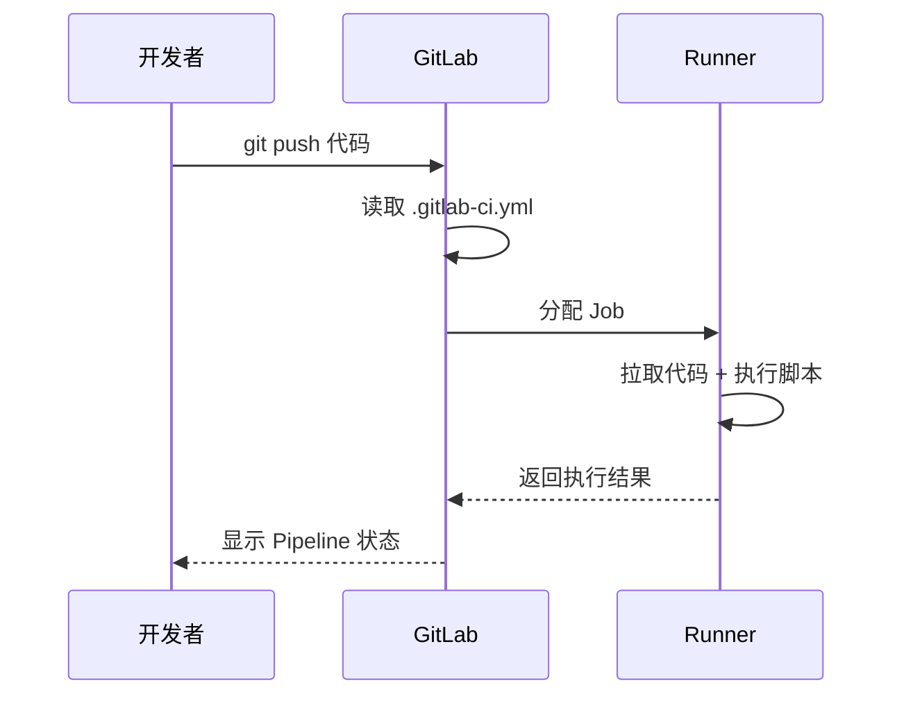

# 🔧 GitLab CI/CD 配置详解

> **文档说明**：系统讲解 GitLab CI/CD 的完整知识体系，涵盖核心概念（Pipeline/Stage/Job/Runner）、`.gitlab-ci.yml` 配置语法、Runner 安装与注册、缓存与制品、变量与密钥、多环境部署、Docker 构建、常见问题与最佳实践。GitLab CI 是最流行的 CI/CD 工具之一，通过代码仓库中的 `.gitlab-ci.yml` 文件定义自动化流水线。
>
> **适用人群**：全栈开发者、DevOps 工程师、运维工程师
>
> **前置知识**：[[Git-高级命令与底层原理]] · [[Docker容器化实战]]

---

## 一、概述

### 1.1 什么是 GitLab CI/CD

GitLab CI/CD 是 GitLab 内置的持续集成与持续部署工具，通过在代码仓库根目录放置 `.gitlab-ci.yml` 文件，自动触发构建、测试、部署等流水线。

**核心价值**：
- ✅ 代码提交后自动构建和测试，提前发现问题
- ✅ 自动化部署，减少人为操作失误
- ✅ 统一团队构建和部署流程
- ✅ 与 GitLab 代码仓库深度集成，无需额外工具

### 1.2 核心概念

```mermaid
flowchart TB
    subgraph Pipeline（流水线）
        S1[Stage: build] --> S2[Stage: test]
        S2 --> S3[Stage: deploy]
        S1 --> J1[Job1]
        S1 --> J2[Job2]
        S2 --> J3[Job3]
        S3 --> J4[Job4]
    end

    R[GitLab Runner<br/>执行Job] --> J1
    R --> J2

    style S1 fill:#667eea,color:#fff
    style S2 fill:#f093fb,color:#fff
    style S3 fill:#43e97b,color:#333
    style R fill:#fa709a,color:#fff
```

| 概念 | 说明 |
|------|------|
| **Pipeline（流水线）** | 一次完整的 CI/CD 执行过程，包含多个 Stage |
| **Stage（阶段）** | 流水线的一个阶段，包含多个 Job，同 Stage 的 Job 并行执行 |
| **Job（任务）** | 具体的执行单元，定义在 Runner 上运行的脚本 |
| **Runner（运行器）** | 执行 Job 的机器/容器，可以是共享的或项目专属的 |
| **Artifact（制品）** | Job 产生的文件，可在后续 Job 中使用或供下载 |
| **Cache（缓存）** | 跨 Pipeline 保存的文件，加速构建（如依赖包） |

### 1.3 执行流程



---

## 二、底层原理

### 2.1 Pipeline 触发条件

| 触发方式 | 说明 |
|---------|------|
| **代码推送** | `git push` 到仓库时自动触发 |
| **合并请求** | 创建/更新 MR 时触发 |
| **定时任务** | 通过 `schedule` 定时触发 |
| **手动触发** | 在 GitLab UI 手动点击运行 |
| **API 触发** | 通过 GitLab API 触发 |
| **标签推送** | 推送 tag 时触发（常用于发布） |

### 2.2 Runner 类型

| 类型 | 说明 | 适用场景 |
|------|------|---------|
| **Shared Runner（共享）** | GitLab 实例所有项目可用 | 通用构建、测试 |
| **Group Runner（组）** | 组内所有项目可用 | 团队共享 |
| **Specific Runner（项目）** | 仅当前项目可用 | 专有构建、部署 |

**Runner 执行器（Executor）**：
- Shell：直接在宿主机执行
- Docker：在 Docker 容器中执行（推荐，环境隔离）
- Docker Machine：自动创建 Docker 主机
- Kubernetes：在 K8s 集群中执行
- SSH：通过 SSH 远程执行

### 2.3 缓存 vs 制品

| 维度 | Cache（缓存） | Artifact（制品） |
|------|--------------|----------------|
| **目的** | 加速构建（如依赖包） | 传递构建产物（如 jar/war） |
| **生命周期** | 跨 Pipeline，可设置过期时间 | 当前 Pipeline 内，后续 Job 可用 |
| **存储位置** | Runner 本地或分布式缓存 | GitLab 服务器 |
| **典型用途** | node_modules、.m2、go mod | 编译产物、测试报告、Docker 镜像 |

---

## 三、实操示例

```text
### 3.1 基础 `.gitlab-ci.yml`
```

```yaml
# .gitlab-ci.yml — 基础示例
stages:
  - build
  - test
  - deploy

# 构建阶段
build-job:
  stage: build
  image: node:18-alpine
  script:
    - echo "开始构建..."
    - npm install
    - npm run build
  artifacts:
    paths:
      - dist/
    expire_in: 1 week

# 测试阶段
test-job:
  stage: test
  image: node:18-alpine
  script:
    - echo "运行测试..."
    - npm install
    - npm run test
  cache:
    paths:
      - node_modules/

# 部署阶段
deploy-job:
  stage: deploy
  image: alpine:latest
  script:
    - echo "部署到生产环境..."
    - apk add --no-cache rsync
    - rsync -avz dist/ user@server:/var/www/app/
  only:
    - main  # 仅 main 分支触发
```

### 3.2 Runner 安装与注册

```bash
# ===== Linux 安装 GitLab Runner =====
# 1. 添加仓库
curl -L "https://packages.gitlab.com/install/repositories/runner/gitlab-runner/script.deb.sh" | sudo bash

# 2. 安装
sudo apt install gitlab-runner

# 3. 注册 Runner
sudo gitlab-runner register \
  --url "https://gitlab.example.com/" \
  --registration-token "PROJECT_REGISTRATION_TOKEN" \
  --description "docker-runner" \
  --tag-list "docker,linux" \
  --run-untagged="true" \
  --executor "docker" \
  --docker-image "alpine:latest"

# 4. 启动
sudo gitlab-runner start

# 5. 查看状态
sudo gitlab-runner status
```

### 3.3 变量与密钥管理

```yaml
# .gitlab-ci.yml — 变量使用
variables:
  # 普通变量（可在 .gitlab-ci.yml 中定义）
  APP_NAME: "my-app"
  NODE_ENV: "production"
  # 从 GitLab CI/CD Variables 读取（在项目 Settings > CI/CD > Variables 中配置）
  # DOCKER_REGISTRY_USER, DOCKER_REGISTRY_PASSWORD 等敏感变量在 UI 中设置

build:
  stage: build
  script:
    - echo "应用名: $APP_NAME"
    - echo "环境: $NODE_ENV"
    - echo "注册表用户: $DOCKER_REGISTRY_USER"  # 从 GitLab 变量读取
    - docker login -u $DOCKER_REGISTRY_USER -p $DOCKER_REGISTRY_PASSWORD
```

**GitLab 变量类型**：
| 类型 | 说明 | 示例 |
|------|------|------|
| **Variable** | 普通环境变量 | `API_URL=https://api.example.com` |
| **File** | 文件类型，值写入临时文件 | `kubeconfig` 内容 |
| **Masked** | 掩码变量，日志中显示为 `[MASKED]` | 密码、密钥 |
| **Protected** | 受保护变量，仅受保护分支可用 | 生产部署密钥 |

### 3.4 多环境部署

```yaml
# .gitlab-ci.yml — 多环境部署
stages:
  - build
  - test
  - deploy-staging
  - deploy-production

build:
  stage: build
  script:
    - docker build -t my-app:$CI_COMMIT_SHORT_SHA .
    - docker push my-app:$CI_COMMIT_SHORT_SHA

test:
  stage: test
  script:
    - npm run test

# 测试环境部署（所有分支）
deploy_staging:
  stage: deploy-staging
  script:
    - kubectl set image deployment/my-app my-app=my-app:$CI_COMMIT_SHORT_SHA -n staging
  environment:
    name: staging
    url: https://staging.example.com
  only:
    - develop

# 生产环境部署（仅 main 分支，手动确认）
deploy_production:
  stage: deploy-production
  script:
    - kubectl set image deployment/my-app my-app=my-app:$CI_COMMIT_SHORT_SHA -n production
  environment:
    name: production
    url: https://www.example.com
  when: manual  # 手动触发
  only:
    - main
```

### 3.5 Docker 构建与推送

```yaml
# .gitlab-ci.yml — Docker 构建
variables:
  DOCKER_REGISTRY: "registry.example.com"
  IMAGE_NAME: "my-app"

build_image:
  stage: build
  image: docker:24
  services:
    - docker:24-dind  # Docker-in-Docker
  variables:
    DOCKER_HOST: "tcp://docker:2376"
    DOCKER_TLS_CERTDIR: "/certs"
  script:
    # 登录镜像仓库
    - docker login -u $REGISTRY_USER -p $REGISTRY_PASSWORD $DOCKER_REGISTRY
    # 构建镜像
    - docker build -t $DOCKER_REGISTRY/$IMAGE_NAME:$CI_COMMIT_SHORT_SHA .
    - docker tag $DOCKER_REGISTRY/$IMAGE_NAME:$CI_COMMIT_SHORT_SHA $DOCKER_REGISTRY/$IMAGE_NAME:latest
    # 推送
    - docker push $DOCKER_REGISTRY/$IMAGE_NAME:$CI_COMMIT_SHORT_SHA
    - docker push $DOCKER_REGISTRY/$IMAGE_NAME:latest
```

### 3.6 并行与矩阵构建

```yaml
# .gitlab-ci.yml — 并行矩阵构建
stages:
  - test

# 多版本并行测试
test:
  stage: test
  image: node:$NODE_VERSION
  parallel:
    matrix:
      - NODE_VERSION: ["16", "18", "20"]
        OS: [alpine]
  script:
    - node --version
    - npm install
    - npm run test

# 多平台构建
build:
  stage: build
  parallel:
    matrix:
      - ARCH: [amd64, arm64]
  script:
    - docker build --platform linux/$ARCH -t my-app:$ARCH .
```

### 3.7 常用预定义变量

| 变量 | 说明 |
|------|------|
| `CI_COMMIT_SHA` | 完整 commit SHA |
| `CI_COMMIT_SHORT_SHA` | 短 commit SHA（8位） |
| `CI_COMMIT_BRANCH` | 分支名 |
| `CI_COMMIT_TAG` | tag 名（如果是 tag 触发） |
| `CI_PROJECT_NAME` | 项目名 |
| `CI_PROJECT_PATH` | 项目路径（组/项目） |
| `CI_PIPELINE_ID` | 流水线 ID |
| `CI_JOB_NAME` | Job 名称 |
| `CI_REGISTRY` | 容器注册表地址 |
| `CI_ENVIRONMENT_NAME` | 环境名 |

---

## 四、常见问题与排查

| 问题现象 | 可能原因 | 解决方案 |
|---------|---------|---------|
| **Pipeline 不触发** | `.gitlab-ci.yml` 语法错误；分支过滤；Runner 无可用标签 | 用 CI Lint 检查语法；检查 `only/except/rules`；确认 Runner 标签匹配 |
| **Job 一直 pending** | 没有可用 Runner；Runner 标签不匹配；Runner 离线 | 注册 Runner；检查标签；确认 Runner 在线 |
| **缓存不生效** | 缓存路径错误；不同 Runner 不共享缓存 | 检查 `cache.paths`；用分布式缓存（S3/MinIO） |
| **制品找不到** | 路径错误；制品过期；Job 失败不保存制品 | 检查 `artifacts.paths`；设置 `expire_in`；用 `when: always` |
| **Docker 构建失败** | dind 服务未配置；权限不足 | 添加 `services: docker:dind`；配置 `DOCKER_HOST` |
| **变量不生效** | 变量未设置；作用域不对；受保护变量在非保护分支 | 检查 Settings > CI/CD > Variables；确认变量类型和保护设置 |
| **部署失败** | 密钥错误；网络不通；权限不足 | 检查部署密钥；测试网络连接；确认服务账号权限 |
| **构建很慢** | 没有缓存；每次重新下载依赖；Runner 性能差 | 配置缓存；用更快的 Runner；优化 Dockerfile 层缓存 |
| **YAML 语法错误** | 缩进错误；关键字拼写错误 | 用 GitLab CI Lint 工具验证；注意 YAML 缩进（2空格） |
| **Job 被跳过** | `rules/only/except` 条件不满足 | 检查触发条件；用 `CI_DEBUG_TRACE` 调试 |
| **并发冲突** | 多个 Pipeline 同时部署 | 用 `resource_group` 限制并发；加锁 |
| **日志乱码** | 终端编码问题 | 设置 `LC_ALL=C.UTF-8`；用支持 UTF-8 的基础镜像 |

---

## 五、进阶与最佳实践

### 5.1 Pipeline 设计原则

```text
好的 CI/CD 设计 Checklist：

✅ 快速反馈：测试阶段控制在 5-10 分钟内
✅ 阶段清晰：build → test → deploy，职责分明
✅ 缓存依赖：node_modules/.m2/go mod 等必须缓存
✅ 制品传递：构建产物用 artifacts 传递，不重复构建
✅ 环境隔离：用 Docker 镜像统一构建环境
✅ 密钥安全：敏感信息用 Masked/Protected 变量
✅ 手动确认：生产部署加 when: manual
✅ 失败通知：Pipeline 失败自动通知（邮件/钉钉/飞书）
✅ 可回滚：部署保留历史版本，支持快速回滚
✅ 可观测：记录部署时间、版本、执行人
```

### 5.2 高级配置

```yaml
# .gitlab-ci.yml — 高级配置示例

# 包含其他配置文件（模块化）
include:
  - local: '/ci/build.yml'
  - local: '/ci/deploy.yml'
  - project: 'group/ci-templates'
    ref: 'main'
    file: '/templates/node.yml'

# 规则驱动（替代 only/except）
job:
  script: echo "test"
  rules:
    - if: '$CI_COMMIT_BRANCH == "main"'
      when: always
    - if: '$CI_PIPELINE_SOURCE == "merge_request_event"'
      when: manual
    - when: never

# 资源组（限制并发）
deploy:
  script: deploy.sh
  resource_group: production-deploy  # 同一资源组的 Job 排队执行

# 失败重试
test:
  script: run_test.sh
  retry:
    max: 2
    when:
      - runner_system_failure
      - stuck_or_timeout_failure

# 超时设置
long_job:
  script: long_running_task.sh
  timeout: 2 hours
```

### 5.3 性能优化

| 优化点 | 方法 | 预期效果 |
|--------|------|---------|
| **依赖缓存** | `cache.paths` 缓存 node_modules/.m2 | 节省 50-80% 安装时间 |
| **Docker 层缓存** | 优化 Dockerfile，利用层缓存 | 节省 30-60% 构建时间 |
| **并行 Job** | 同 Stage 多 Job 并行 | 线性扩展 |
| **矩阵构建** | `parallel.matrix` 多版本并行 | 多版本测试同时完成 |
| **按需触发** | `rules` 只在需要时运行 | 减少无效构建 |
| **更快 Runner** | 用高配置机器或 K8s 弹性 Runner | 提升执行速度 |
| **浅克隆** | `GIT_DEPTH: 1` 减少克隆时间 | 大仓库效果明显 |
| **制品优化** | 只传递必要文件，压缩制品 | 减少上传下载时间 |

### 5.4 生产环境最佳实践

| 类别 | 建议 |
|------|------|
| **安全** | 敏感变量用 Masked + Protected；生产密钥仅保护分支可用 |
| **安全** | 不在日志中打印密钥；用 `CI_DEBUG_TRACE` 调试后关闭 |
| **部署** | 生产部署 `when: manual`，需人工确认 |
| **部署** | 用 `environment` 管理部署环境，支持回滚 |
| **部署** | 蓝绿部署/金丝雀发布，降低风险 |
| **质量** | 测试覆盖率门禁，不达标不部署 |
| **质量** | 代码扫描（SonarQube）、安全扫描（SAST/DAST） |
| **监控** | Pipeline 失败自动通知；部署后自动健康检查 |
| **维护** | 定期清理旧制品和缓存；维护 Runner |
| **文档** | Pipeline 变更有记录；部署流程文档化 |

---

## 六、关联笔记

### DevOps
- [[Docker容器化实战]] · [[Kubernetes入门与实践]] · [[Jenkins流水线配置]]
- [[GitHub-Actions配置]] · [[ArgoCD-GitOps持续部署]]

### 版本控制
- [[Git-高级命令与底层原理]] · [[Git-Workflow分支策略]]

### 云原生
- [[Helm-K8s包管理器]] · [[Prometheus监控体系]] · [[告警体系设计]]

### 导航
- [[MOC-云原生与运维]] · [[MOC-CICD流水线]] · [[MOC-综合导航]] · [[Home]]

> 🔍 **知识点深度解析**
>
> **作用**：GitLab CI/CD 解决的是「代码提交后如何自动化构建、测试、部署」的问题，是 DevOps 的核心工具，让软件交付从手动变成自动化、标准化、可追溯。
>
> **底层原理**：开发者 push 代码后，GitLab 读取仓库根目录的 `.gitlab-ci.yml`，解析为 Pipeline（包含多个 Stage，每个 Stage 包含多个 Job）。GitLab 将 Job 分配给注册的 Runner 执行，Runner 拉取代码、在 Docker 容器中运行脚本、返回结果。同 Stage 的 Job 并行执行，不同 Stage 顺序执行。通过 artifacts 在 Job 间传递文件，通过 cache 跨 Pipeline 缓存依赖。
>
> **用法要点**：① 核心结构：`stages` 定义阶段，每个 Job 指定 `stage` 和 `script` ② 用 `image` 指定 Docker 镜像，统一构建环境 ③ 依赖用 `cache`，产物用 `artifacts` ④ 敏感信息在 Settings > CI/CD > Variables 中配置，用 Masked/Protected ⑤ 生产部署加 `when: manual` 手动确认 ⑥ 多环境用 `environment` 管理 ⑦ Docker 构建需要 `services: docker:dind` ⑧ 用 `rules` 替代 `only/except` 控制触发条件 ⑨ 用 GitLab CI Lint 验证 YAML 语法。

> 💡 **深度讲解**：GitLab CI 最核心的设计是「Pipeline as Code」——流水线定义和代码一起版本管理，变更可追溯、可回滚。很多新手的问题是「缓存不生效」和「制品找不到」，关键是理解两者的区别：cache 是跨 Pipeline 的（用来加速，如 node_modules），artifacts 是当前 Pipeline 内 Job 间传递的（如编译后的 dist）。另一个常见坑是「Docker 构建失败」——需要配置 `services: docker:dind`（Docker-in-Docker）和正确的 `DOCKER_HOST`。生产环境部署一定要加 `when: manual`，避免代码一合并就自动部署到生产。建议用 `environment` 关键字管理部署环境，GitLab 会记录部署历史，支持一键回滚。

> 📝 **精简总结**：GitLab CI = `.gitlab-ci.yml` + Runner。核心：stages（阶段）→ jobs（任务）→ script（脚本）。缓存加速构建，制品传递产物，变量管理密钥。生产部署手动确认，多环境用 environment。Docker 构建需要 dind 服务。

> **学习路径建议**：先学习 [[Git-高级命令与底层原理]] 掌握版本控制 → 学习 [[Docker容器化实战]] 理解容器化 → 学习本文档掌握 GitLab CI 配置 → 学习 [[Kubernetes入门与实践]] 理解容器编排 → 学习 [[ArgoCD-GitOps持续部署]] 掌握 GitOps 部署 → 在项目中实践完整的 CI/CD 流水线。

---

> **CI/CD 的本质是「把重复的事情自动化」——代码提交、构建、测试、部署，每一步都自动化，每一步都可追溯，让软件交付像呼吸一样自然。**
