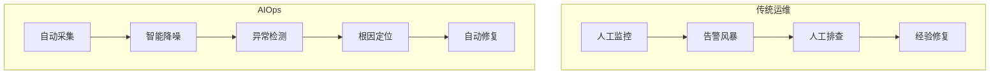
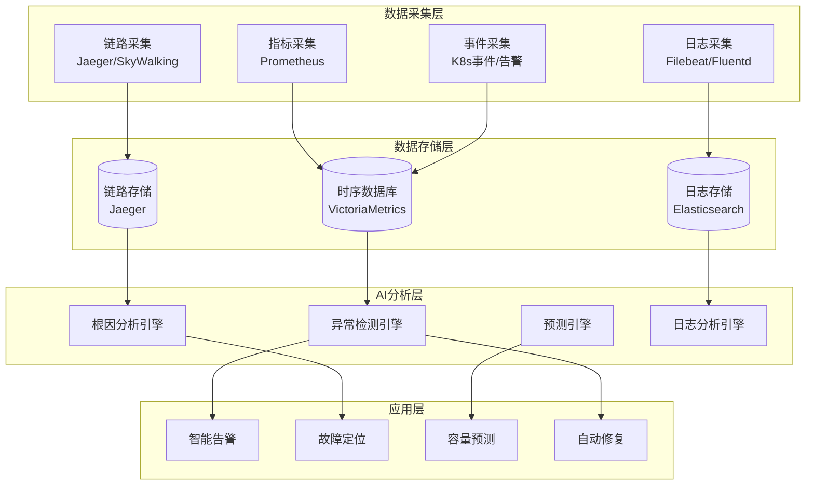
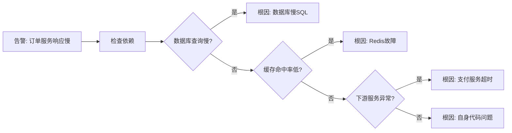

# AIOps智能运维实战

> **文档说明**：AIOps（Artificial Intelligence for IT Operations）是将AI应用于IT运维的领域，通过机器学习自动分析监控数据、预测故障、定位根因、自动修复。本文档覆盖AIOps概念、核心能力、技术架构、主流工具、落地实践、与传统监控的区别。
>
> **适用人群**：运维工程师、SRE、平台工程师、对智能运维感兴趣的开发者
>
> **前置知识**：监控系统（Prometheus/Grafana）、日志系统（ELK）、机器学习基础

---

## 一、AIOps概述

### 1.1 什么是AIOps

AIOps是利用大数据和机器学习技术，自动分析IT运维产生的海量数据（指标、日志、链路、事件），实现**智能告警、异常检测、根因分析、预测性维护、自动修复**的运维范式。



### 1.2 为什么需要AIOps

| 传统运维痛点 | AIOps解决方案 |
|-------------|-------------|
| 告警风暴（每天上千条告警） | 智能降噪+告警聚合，只通知关键告警 |
| 故障排查慢（平均30分钟+） | 自动根因分析，分钟级定位 |
| 依赖个人经验 | 知识沉淀为模型，可复制 |
| 被动响应（故障后才处理） | 预测性维护，故障前预警 |
| 系统复杂（微服务+云原生） | AI自动分析跨系统依赖关系 |
| 数据量爆炸（TB级日志/天） | 自动分析海量数据，人工无法处理 |

### 1.3 AIOps核心能力

| 能力 | 说明 | 技术 |
|------|------|------|
| **异常检测** | 自动发现指标/日志中的异常 | 统计方法、孤立森林、LSTM、AutoEncoder |
| **告警降噪** | 聚合相关告警，抑制重复告警 | 聚类、相关性分析、拓扑聚合 |
| **根因分析** | 自动定位故障根因节点 | 因果推断、知识图谱、拓扑分析 |
| **趋势预测** | 预测资源使用和故障发生 | 时间序列预测（ARIMA/Prophet/LSTM） |
| **日志分析** | 自动解析日志，发现异常模式 | NLP、日志模板提取、异常检测 |
| **自动修复** | 故障后自动执行修复动作 | 规则引擎+机器学习+运维脚本 |
| **容量规划** | 基于历史数据预测资源需求 | 回归分析、趋势预测 |

---

## 二、AIOps技术架构

### 2.1 分层架构



### 2.2 数据来源

| 数据类型 | 来源 | 用途 |
|---------|------|------|
| **指标（Metrics）** | Prometheus、node_exporter | 异常检测、趋势预测、容量规划 |
| **日志（Logs）** | 应用日志、系统日志 | 日志异常检测、模式发现 |
| **链路（Traces）** | Jaeger、SkyWalking | 调用链分析、根因定位 |
| **事件（Events）** | K8s事件、变更记录 | 变更关联、故障归因 |
| **拓扑（Topology）** | 服务依赖、网络拓扑 | 根因传播分析 |
| **告警（Alerts）** | AlertManager、Zabbix | 告警降噪、聚合 |

---

## 三、核心技术详解

### 3.1 异常检测

**统计方法（简单有效）**

```python
# 3-Sigma异常检测
import numpy as np

def detect_anomaly_3sigma(data, threshold=3):
    mean = np.mean(data)
    std = np.std(data)
    upper = mean + threshold * std
    lower = mean - threshold * std
    anomalies = [(i, v) for i, v in enumerate(data)
                 if v > upper or v < lower]
    return anomalies, upper, lower

# 适用：平稳指标（CPU、内存）
# 不适用：有周期性/趋势的指标（QPS、请求量）
```

**机器学习方法（复杂场景）**

```python
# 孤立森林（Isolation Forest）- 适合多维异常检测
from sklearn.ensemble import IsolationForest

def detect_anomaly_iforest(features):
    # features: [cpu, memory, disk_io, network, qps]
    model = IsolationForest(
        n_estimators=100,
        contamination=0.01,  # 异常比例1%
        random_state=42
    )
    model.fit(features)
    predictions = model.predict(features)  # 1正常, -1异常
    return predictions

# LSTM AutoEncoder - 适合时序异常检测
# 正常序列训练编码器，重构误差大的为异常
```

### 3.2 告警降噪

```python
# 告警聚合策略
from collections import defaultdict
from datetime import datetime, timedelta

class AlertAggregator:
    def __init__(self):
        self.active_alerts = defaultdict(list)

    def process_alert(self, alert):
        # 1. 按服务+告警类型聚合
        key = f"{alert['service']}:{alert['type']}"
        self.active_alerts[key].append(alert)

        # 2. 时间窗口内去重（5分钟内相同告警只通知一次）
        recent = [a for a in self.active_alerts[key]
                  if a['time'] > datetime.now() - timedelta(minutes=5)]

        # 3. 拓扑关联：同一服务的多个告警合并为一个
        if len(recent) >= 3:
            return self._create_summary_alert(recent)
        elif len(recent) == 1:
            return alert  # 首次告警直接通知
        else:
            return None  # 重复告警抑制

    def _create_summary_alert(self, alerts):
        return {
            'type': 'SUMMARY',
            'service': alerts[0]['service'],
            'count': len(alerts),
            'message': f"{alerts[0]['service']}发生{len(alerts)}个相关告警",
            'severity': max(a['severity'] for a in alerts)
        }
```

### 3.3 根因分析



**基于知识图谱的根因分析**

```python
# 服务依赖拓扑 + 因果推断
service_topology = {
    'order-service': ['mysql', 'redis', 'payment-service', 'inventory-service'],
    'payment-service': ['mysql', 'third-party-api'],
    'inventory-service': ['mysql', 'redis'],
}

def root_cause_analysis(alert_service, metrics):
    """从告警服务沿依赖链向下查找根因"""
    queue = [alert_service]
    visited = set()
    while queue:
        service = queue.pop(0)
        if service in visited:
            continue
        visited.add(service)
        # 检查当前服务是否异常
        if is_anomalous(metrics.get(service, {})):
            # 继续向下游查找
            for dep in service_topology.get(service, []):
                queue.append(dep)
        else:
            # 当前服务正常，上游是根因
            return service
    return alert_service
```

### 3.4 趋势预测

```python
# Prophet时间序列预测（Facebook开源）
from prophet import Prophet
import pandas as pd

def predict_resource_usage(history_df, periods=24):
    """预测未来24小时资源使用量"""
    # history_df: ds(时间), y(CPU使用率)
    model = Prophet(
        yearly_seasonality=False,
        weekly_seasonality=True,
        daily_seasonality=True,
        changepoint_prior_scale=0.05
    )
    model.fit(history_df)
    future = model.make_future_dataframe(periods=periods, freq='H')
    forecast = model.predict(future)
    # forecast包含yhat(预测值), yhat_lower, yhat_upper(置信区间)
    return forecast[['ds', 'yhat', 'yhat_lower', 'yhat_upper']]

# 应用：提前扩容、容量规划、故障预警
```

---

## 四、主流AIOps工具

| 工具 | 类型 | 特点 | 适用 |
|------|------|------|------|
| **Prometheus+AlertManager** | 监控+告警 | 云原生标准，需自建AIOps层 | 中小规模 |
| **Grafana ML** | AIOps平台 | Grafana生态，异常检测+预测 | 已用Grafana的团队 |
| **Datadog** | 商业SaaS | 全功能AIOps，开箱即用 | 预算充足的团队 |
| **Dynatrace** | 商业SaaS | Davis AI引擎，自动根因分析 | 大型企业 |
| **Moogsoft** | AIOps平台 | 告警降噪+根因分析 | 告警管理 |
| **Zabbix** | 传统监控 | 有简单AIOps插件 | 传统运维团队 |
| **开源AIOps** | 自建 | Elastic ML、SkyWalking、OpenSearch | 技术能力强的团队 |

### 4.1 Grafana ML实战

```yaml
# Grafana ML异常检测配置
apiVersion: grafana.com/v1alpha1
kind: AnomalyDetectionJob
metadata:
  name: cpu-anomaly-detection
spec:
  datasource: prometheus
  query: 'rate(node_cpu_seconds_total{mode="idle"}[5m])'
  algorithm: prophet  # 或 isolation_forest, lstm
  interval: 5m
  threshold: 0.95  # 95%置信区间外为异常
  alert:
    enabled: true
    severity: warning
    notification: slack-ops-channel
```

---

## 五、AIOps落地实践

### 5.1 落地路线图

```text
阶段1（1-2月）：数据基础建设
  → 统一监控（Prometheus+Grafana）
  → 统一日志（ELK/Loki）
  → 统一链路（Jaeger/SkyWalking）

阶段2（2-3月）：智能告警
  → 告警规则优化
  → 告警降噪与聚合
  → 告警分级与路由

阶段3（3-6月）：异常检测
  → 关键指标异常检测
  → 日志异常检测
  → 预测性告警

阶段4（6-12月）：根因分析
  → 服务拓扑自动发现
  → 变更关联分析
  → 自动根因定位

阶段5（12月+）：自动修复
  → 常见故障自动修复（重启/扩容/切流）
  → 运维知识图谱
  → 全链路自动化
```

### 5.2 常见场景

| 场景 | AIOps方案 | 效果 |
|------|----------|------|
| **CPU突增** | 异常检测+自动扩容 | 分钟级响应，无需人工 |
| **数据库慢查询** | 日志分析+SQL模式识别 | 自动发现慢SQL并告警 |
| **服务雪崩** | 拓扑分析+根因定位 | 快速定位源头服务 |
| **磁盘满** | 趋势预测+提前告警 | 提前3天预警 |
| **发布故障** | 变更关联+异常检测 | 发布后自动检测异常 |
| **网络抖动** | 链路分析+异常检测 | 自动发现网络问题 |

### 5.3 自动修复示例

```python
# 自动修复：CPU持续过高 → 自动扩容
class AutoRemediation:
    def __init__(self, k8s_client):
        self.k8s = k8s_client

    def handle_high_cpu(self, service, cpu_percent):
        if cpu_percent > 85:
            # 1. 检查当前副本数
            current = self.k8s.get_replicas(service)
            if current < 10:  # 上限保护
                # 2. 扩容
                new_replicas = min(current + 2, 10)
                self.k8s.scale(service, new_replicas)
                # 3. 记录操作
                self.audit(f"自动扩容 {service}: {current} → {new_replicas}")
                return True
        return False

    def handle_service_down(self, service):
        # 服务不可用 → 自动重启
        self.k8s.restart_deployment(service)
        self.audit(f"自动重启 {service}")
```

---

## 六、AIOps的挑战与局限

| 挑战 | 说明 | 应对 |
|------|------|------|
| **数据质量** | 监控数据缺失/噪声影响模型 | 先做好数据治理，保证数据质量 |
| **误报率** | AI检测可能误报，影响信任 | 人机协同，AI建议+人工确认 |
| **冷启动** | 新系统无历史数据 | 先用规则+统计方法，逐步引入ML |
| **可解释性** | 黑盒模型难以解释根因 | 优先使用可解释模型（规则+知识图谱） |
| **成本** | AIOps平台建设成本高 | 分阶段落地，先解决高价值场景 |
| **安全** | 自动修复可能引发更大故障 | 设置安全边界，关键操作需人工确认 |

---

## 七、AIOps vs 传统运维

| 维度 | 传统运维 | AIOps |
|------|---------|-------|
| 告警处理 | 人工筛选，告警风暴 | 智能降噪，只通知关键 |
| 故障定位 | 经验驱动，分钟~小时级 | AI驱动，秒~分钟级 |
| 响应方式 | 被动响应 | 预测+主动 |
| 知识沉淀 | 个人经验，人员流动即流失 | 模型+知识库，可复制 |
| 扩展性 | 人工有上限 | AI可无限扩展 |
| 适用规模 | 中小系统 | 大规模复杂系统 |

---

## 关联文档

- [[云原生与运维知识点系统梳理_优化版]] — 云原生基础
- [[高可用架构设计]] — 高可用
- [[线上故障排查手册]] — 故障排查
- [[数据库安全与审计实战]] — 安全审计
- [[全栈+AI端到端实战]] — AI应用

---

> 💡 **落地建议**：AIOps不是一蹴而就的，遵循"先基础后智能、先规则后学习、先辅助后自动"的原则。1. 先建好监控/日志/链路三大基础；2. 从告警降噪和异常检测入手（ROI最高）；3. 根因分析需要服务拓扑数据，逐步建设；4. 自动修复要谨慎，先从低风险操作（扩容/重启）开始；5. 人机协同是关键，AI做建议，人做决策。AIOps的目标不是替代运维，而是让运维从"救火队"变成"预防者"。


## 补充：底层原理

### AIOps 核心技术栈

AIOps（Artificial Intelligence for IT Operations）是将人工智能应用于 IT 运维领域，通过自动化分析海量运维数据（指标、日志、事件、拓扑），实现异常检测、根因分析、故障预测、智能告警、自动化修复。

| 技术层 | 核心技术 |
|--------|---------|
| 数据采集层 | Agent、eBPF、OpenTelemetry、日志采集 |
| 数据存储层 | 时序数据库（Prometheus/InfluxDB）、日志（ES/Loki）、图数据库 |
| 数据处理层 | 流处理（Flink/Kafka Streams）、批处理（Spark） |
| 算法层 | 统计方法、机器学习、深度学习、图算法 |
| 应用层 | 智能告警、根因分析、故障预测、自动修复、容量规划 |

### 异常检测算法原理

| 算法类型 | 代表算法 | 适用场景 |
|---------|---------|---------|
| 统计方法 | 3sigma、Z-Score、IQR | 平稳指标（CPU/内存） |
| 时间序列分解 | STL、季节性分解 | 有明显周期性的指标（QPS） |
| 机器学习 | Isolation Forest、One-Class SVM | 多维指标、复杂模式 |
| 深度学习 | LSTM-Autoencoder、Transformer | 复杂时序、长依赖 |
| 变化点检测 | CUSUM、PELT | 指标突增/突降 |
| 同比/环比 | 同时段对比、前一天/前一周对比 | 有强周期性的业务指标 |

告警降噪原理：告警聚合（同一根因的多个告警合并）、告警抑制（高级别抑制低级别）、告警分级（P0/P1/P2/P3）、动态阈值（基于历史数据自动计算）。

### 根因分析（RCA）原理

| 方法 | 原理 | 优点 | 缺点 |
|------|------|------|------|
| 基于规则 | 专家经验编写规则 | 准确、可解释 | 规则维护成本高 |
| 基于拓扑 | 服务依赖拓扑图，从告警节点回溯 | 直观、可解释 | 依赖拓扑可能不准确 |
| 基于因果推断 | 因果发现算法（PC算法、Granger） | 数据驱动 | 计算复杂、可能误判 |
| 基于知识图谱 | 构建运维知识图谱，推理匹配 | 可解释、可积累 | 图谱构建成本高 |
| 基于机器学习 | 历史故障数据训练模型 | 数据驱动 | 需要大量标注数据 |

根因定位流程：故障发生 → 异常检测 → 告警聚合 → 拓扑回溯 → 因果分析 → 知识匹配 → 根因排序。

---

## 补充：进阶与最佳实践

### 1. AIOps 实施路线图

| 阶段 | 目标 | 周期 |
|------|------|------|
| L1 数据基础 | 建立可观测性基础（Prometheus/Grafana/ELK） | 1-3 个月 |
| L2 自动化 | 减少人工操作（自动化告警/部署/扩容） | 3-6 个月 |
| L3 智能告警 | 告警降噪和异常检测（动态阈值/告警聚合） | 6-9 个月 |
| L4 根因分析 | 自动定位根因（服务拓扑/因果分析/知识图谱） | 9-12 个月 |
| L5 预测与自愈 | 故障预测和自动修复（容量预测/自动修复） | 12-18 个月 |

不要跳级：AIOps 建立在良好的可观测性和自动化基础上，没有数据基础就上 AI 算法是空中楼阁。

### 2. 主流 AIOps 工具

| 工具 | 类型 | 特点 |
|------|------|------|
| Prometheus + AlertManager | 指标+告警 | 开源、云原生、生态丰富 |
| Grafana | 可视化 | 开源、多数据源、面板丰富 |
| ELK/Elastic Stack | 日志+分析 | 开源、功能强大、机器学习（X-Pack） |
| SkyWalking | 全链路可观测 | 开源、Apache、无侵入、含 AIOps |
| Datadog | 商业 SaaS | 功能强大、开箱即用、AIOps 完善 |
| Dynatrace | 商业 SaaS | AI 驱动（Davis AI）、自动发现、根因分析 |

### 3. AIOps 最佳实践

- 数据质量优先：Garbage In, Garbage Out，确保采集数据的准确性
- 从简单场景切入：先做告警降噪和动态阈值（价值大、难度低）
- 人机协作：AIOps 是辅助工具，关键决策需要人工确认
- 可解释性：AI 决策需要可解释，否则无法信任
- 持续反馈：运维人员对 AI 结果的反馈是模型持续优化的关键
- 避免过度自动化：自动修复先从低风险操作（重启/扩容）开始
- 统一数据平台：指标、日志、链路、事件数据要打通
- 关注业务指标：不仅监控技术指标，更要监控业务指标（订单量/转化率）
- 定期评估：定期评估 AIOps 效果（告警减少率、MTTR 降低、误报率）

### 4. AIOps 的局限与挑战

| 挑战 | 说明 | 应对 |
|------|------|------|
| 数据质量 | 监控数据可能缺失、不准确、有噪声 | 数据治理、数据校验、多源交叉验证 |
| 标注数据稀缺 | 故障数据少，标注成本高 | 半监督/无监督学习、数据增强、仿真生成 |
| 系统复杂性 | 微服务系统复杂，依赖关系动态变化 | 自动拓扑发现、因果推断、知识图谱 |
| 误报率 | 异常检测误报多，运维人员不信任 | 持续优化阈值、人工反馈、多算法融合 |
| 可解释性 | 深度学习模型是黑盒 | 可解释 AI（SHAP/LIME）、规则+模型混合 |
| 实时性要求 | 故障发生时需要秒级定位 | 流处理、预计算、模型优化 |
| 组织变革 | AIOps 需要运维流程和组织配合 | 逐步推进、展示价值、培训赋能 |
