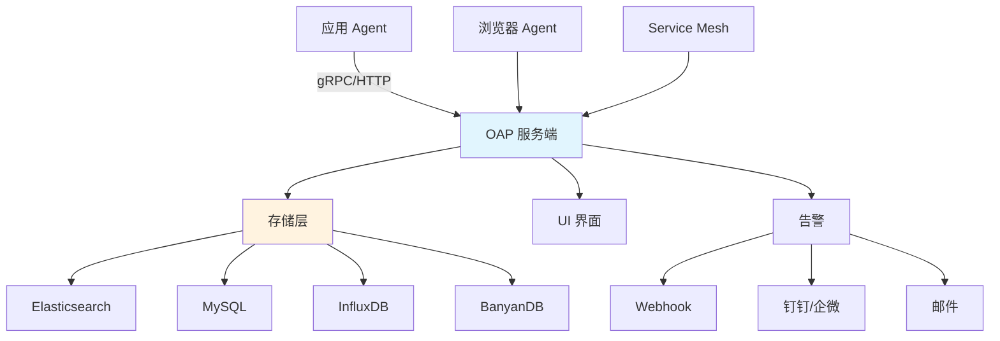

# APM应用性能监控-SkyWalking

> **文档说明**：系统讲解 Apache SkyWalking APM 的架构、安装部署、多语言 Agent 接入、核心功能（拓扑、追踪、指标、告警）、自定义埋点，以及生产级最佳实践和常见问题。
>
> **适用人群**：后端开发者、运维工程师、SRE、需要监控分布式系统性能的开发者
>
> **前置知识**：[[Java-应用性能调优实战]]、[[K8s-核心概念与架构]]、[[分布式系统-高可用架构设计]]

---

## 一、概述

### 1. 什么是 APM

**APM（Application Performance Monitoring，应用性能监控）** 是对应用程序的性能和可用性进行监控和管理的工具。

```text
APM 核心能力：
- 分布式追踪（Distributed Tracing）：跨服务调用链路
- 服务拓扑（Service Map）：服务间依赖关系可视化
- 性能指标（Metrics）：响应时间、吞吐量、错误率
- 告警（Alerting）：异常时自动通知
- 日志关联（Log Correlation）：追踪与日志关联
- 浏览器监控（Browser Monitoring）：前端性能
```

### 2. SkyWalking 简介

**Apache SkyWalking** 是开源的 APM 工具，专为微服务、云原生和容器化架构设计。

| 特性 | 说明 |
|------|------|
| **多语言支持** | Java、.NET、Node.js、Go、Python、PHP、C++、Rust |
| **无侵入** | Java Agent 字节码增强，无需改代码 |
| **高性能** | 低开销，适合生产环境 |
| **云原生** | 支持 K8s、Service Mesh、Serverless |
| **告警系统** | 内置告警，支持 Webhook、钉钉、企业微信 |
| **日志集成** | 支持日志采集和关联 |

### 3. APM 工具对比

| 工具 | 语言 | 侵入性 | 存储 | 特点 |
|------|------|--------|------|------|
| **SkyWalking** | 多语言 | 低（Agent） | Elasticsearch/MySQL/InfluxDB | 功能全、中文友好 |
| **Jaeger** | 多语言 | 中（SDK） | Cassandra/Elasticsearch | CNCF、轻量 |
| **Zipkin** | 多语言 | 中（SDK） | MySQL/Elasticsearch | 简单、老牌 |
| **Pinpoint** | Java/PHP | 低（Agent） | HBase | 功能强、Java 专精 |
| **Datadog** | 多语言 | 低 | 商业 SaaS | 商业、全栈 |
| **Prometheus+Grafana** | 多语言 | 中 | 时序数据库 | 指标监控、需配合追踪 |

---

## 二、SkyWalking 架构

### 1. 核心组件



| 组件 | 说明 |
|------|------|
| **Agent** | 埋点采集，运行在应用进程中 |
| **OAP（Observability Analysis Platform）** | 后端服务，接收数据、分析、存储 |
| **UI** | Web 界面，可视化展示 |
| **Storage** | 数据存储（ES/MySQL/BanyanDB） |
| **Alarm** | 告警引擎 |

### 2. 数据流程

```text
1. Agent 采集：方法调用、请求响应、异常、SQL、MQ 等
2. Agent 上报：通过 gRPC 发送到 OAP（批量、压缩）
3. OAP 分析：聚合指标、构建拓扑、生成追踪
4. OAP 存储：写入存储层
5. UI 查询：从 OAP 查询展示
6. 告警触发：指标超阈值时触发告警
```

---

## 三、安装部署

### 1. Docker Compose 快速部署

```yaml
# docker-compose.yml
version: '3.8'
services:
  elasticsearch:
    image: docker.elastic.co/elasticsearch/elasticsearch:7.17.0
    environment:
      - discovery.type=single-node
      - "ES_JAVA_OPTS=-Xms512m -Xmx512m"
    ports:
      - "9200:9200"
    volumes:
      - es-data:/usr/share/elasticsearch/data

  oap:
    image: apache/skywalking-oap-server:9.7.0
    depends_on:
      - elasticsearch
    environment:
      SW_STORAGE: elasticsearch
      SW_STORAGE_ES_CLUSTER_NODES: elasticsearch:9200
    ports:
      - "11800:11800"  # gRPC
      - "12800:12800"  # HTTP

  ui:
    image: apache/skywalking-ui:9.7.0
    depends_on:
      - oap
    environment:
      SW_OAP_ADDRESS: http://oap:12800
    ports:
      - "8080:8080"

volumes:
  es-data:
```

```bash
# 启动
docker-compose up -d

# 访问 UI
# http://localhost:8080
```

### 2. Kubernetes 部署（Helm）

```bash
# 添加 Helm 仓库
helm repo add skywalking https://apache.jfrog.io/artifactory/skywalking-helm
helm repo update

# 安装
helm install skywalking skywalking/skywalking \
  --set oap.replicas=2 \
  --set ui.image.tag=9.7.0 \
  --set elasticsearch.replicas=3 \
  --namespace skywalking \
  --create-namespace

# 查看
kubectl get pods -n skywalking
kubectl port-forward svc/skywalking-ui 8080:80 -n skywalking
```

### 3. 存储选择

| 存储 | 优点 | 缺点 | 适用场景 |
|------|------|------|---------|
| **Elasticsearch** | 全文检索、成熟 | 资源消耗大 | 中大型、需要日志搜索 |
| **MySQL** | 简单、易维护 | 性能有限 | 小型、测试 |
| **InfluxDB** | 时序性能好 | 不支持追踪详情 | 指标为主 |
| **BanyanDB** | SkyWalking 原生、高性能 | 较新 | 大规模、推荐 |

---

## 四、Java Agent 接入

### 1. 下载 Agent

```bash
# 下载 SkyWalking Java Agent
wget https://archive.apache.org/dist/skywalking/java-agent/9.1.0/apache-skywalking-java-agent-9.1.0.tgz
tar -xzf apache-skywalking-java-agent-9.1.0.tgz
```

### 2. 启动参数

```bash
# 基础接入
java -javaagent:/path/to/skywalking-agent/skywalking-agent.jar \
     -Dskywalking.agent.service_name=my-app \
     -Dskywalking.collector.backend_service=oap:11800 \
     -jar my-app.jar

# 完整参数
java -javaagent:/path/to/skywalking-agent/skywalking-agent.jar \
     -Dskywalking.agent.service_name=my-app \
     -Dskywalking.agent.instance_name=my-app-1 \
     -Dskywalking.collector.backend_service=oap:11800 \
     -Dskywalking.agent.sample_n_per_3_secs=100 \
     -Dskywalking.logging.level=INFO \
     -jar my-app.jar
```

### 3. agent.config 配置

```properties
# agent.config
agent.service_name=${SW_AGENT_NAME:my-app}
agent.instance_name=${SW_AGENT_INSTANCE:}
agent.namespace=${SW_AGENT_NAMESPACE:}

collector.backend_service=${SW_AGENT_COLLECTOR_BACKEND_SERVICES:oap:11800}

# 采样率（每秒采样数，-1 表示全采样）
agent.sample_n_per_3_secs=${SW_AGENT_SAMPLE:-1}

# 日志级别
logging.level=${SW_LOGGING_LEVEL:INFO}

# 插件启用/禁用
plugin.mysql.enable=true
plugin.redis.enable=true
plugin.kafka.enable=true
plugin.springmvc.enable=true
plugin.tomcat.enable=true

# 慢SQL阈值（ms）
plugin.jdbc.slow_sql_threshold=1000

# 异常堆栈最大长度
plugin.max_depth=500
```

### 4. Spring Boot 接入

```yaml
# application.yml
skywalking:
  agent:
    service-name: my-springboot-app
    collector-backend-service: oap:11800

# 或通过环境变量
# SW_AGENT_NAME=my-app
# SW_AGENT_COLLECTOR_BACKEND_SERVICES=oap:11800
```

```dockerfile
# Dockerfile 集成
FROM openjdk:17-jdk-slim

# 复制 agent
COPY skywalking-agent /skywalking/agent

ENV JAVA_TOOL_OPTIONS="-javaagent:/skywalking/agent/skywalking-agent.jar"
ENV SW_AGENT_NAME=my-app
ENV SW_AGENT_COLLECTOR_BACKEND_SERVICES=oap:11800

COPY target/my-app.jar /app.jar
CMD ["java", "-jar", "/app.jar"]
```

### 5. K8s Sidecar 注入

```yaml
# 初始化容器复制 agent
initContainers:
  - name: skywalking-agent
    image: apache/skywalking-java-agent:9.1.0
    command: ["cp", "-r", "/skywalking/agent", "/sidecar"]
    volumeMounts:
      - name: skywalking-agent
        mountPath: /sidecar

containers:
  - name: my-app
    env:
      - name: JAVA_TOOL_OPTIONS
        value: "-javaagent:/sidecar/agent/skywalking-agent.jar"
      - name: SW_AGENT_NAME
        value: "my-app"
      - name: SW_AGENT_COLLECTOR_BACKEND_SERVICES
        value: "skywalking-oap.skywalking:11800"
    volumeMounts:
      - name: skywalking-agent
        mountPath: /sidecar

volumes:
  - name: skywalking-agent
    emptyDir: {}
```

---

## 五、其他语言接入

### 1. Python

```bash
# 安装
pip install skywalking

# 使用
from skywalking import agent, config

config.init(
    service_name="my-python-app",
    collector_address="oap:11800",
)
agent.start()

# Flask/FastAPI 自动埋点
# skywalking 支持 Flask、Django、FastAPI、Tornado 等
```

### 2. Node.js

```bash
# 安装
npm install skywalking-backend-js

# 使用
const { default: agent } = require('skywalking-backend-js');
agent.start({
  serviceName: 'my-node-app',
  collectorAddress: 'oap:11800',
});

// Express/Koa 自动埋点
```

### 3. Go

```go
import (
    "github.com/apache/skywalking-go"
    _ "github.com/apache/skywalking-go/plugins/core"
)

func main() {
    // 编译时注入：go build -toolexec=skywalking-go-agent-inject
    // 或使用 go-agent 自动 instrumentation
}
```

---

## 六、核心功能

### 1. 服务拓扑（Service Map）

```text
功能：
- 自动发现服务间依赖关系
- 可视化调用链路
- 显示每个服务的响应时间、吞吐量、错误率
- 点击节点查看详情
- 支持上下游分析

使用场景：
- 了解系统架构
- 发现异常服务（红色节点）
- 分析调用瓶颈
```

### 2. 分布式追踪（Trace）

```text
功能：
- 单次请求的完整调用链
- 每个 Span 的耗时、状态、标签
- 慢调用定位
- 异常堆栈查看
- SQL/MQ/Redis 调用详情
- 日志关联（traceId 关联日志）

Trace 结构：
Trace（一次请求）
└── Span（一个调用单元）
    ├── 服务名 + 端点
    ├── 开始时间 + 耗时
    ├── 标签（URL、SQL、参数等）
    └── 子 Span
```

### 3. 性能指标（Metrics）

```text
服务维度：
- 响应时间（平均、P50、P90、P99）
- 吞吐量（CPM - Calls Per Minute）
- 错误率（SLA）
- Apdex 评分

实例维度：
- JVM 指标（堆内存、GC、线程）
- CPU 使用率
- 类加载
- 进程信息

数据库维度：
- SQL 响应时间
- 慢 SQL 排行
- 数据库访问量
```

### 4. 告警（Alarm）

```yaml
# alarm-settings.yml
rules:
  service_resp_time_rule:
    metrics-name: service_resp_time
    op: ">"
    threshold: 1000
    period: 10
    count: 3
    silence-period: 5
    message: 服务 {name} 响应时间超过 1000ms

  service_error_rate_rule:
    metrics-name: service_sla
    op: "<"
    threshold: 9800  # 98%
    period: 10
    count: 2
    message: 服务 {name} 错误率超过 2%

# 告警通知
hooks:
  webhook:
    - http://alertmanager:8080/webhook
  dingtalk:
    - https://oapi.dingtalk.com/robot/send?access_token=xxx
```

### 5. 日志关联

```css
# 在日志中输出 traceId（logback 配置）
<encoder>
  <pattern>%d{yyyy-MM-dd HH:mm:ss} [%tid] %-5level %logger{36} - %msg%n</pattern>
</encoder>
# %tid 会输出 SkyWalking traceId

# 支持的日志框架：
# - Logback
# - Log4j2
# - log4j
```

---

## 七、自定义埋点

### 1. 注解埋点

```java
import org.apache.skywalking.apm.toolkit.trace.Trace;
import org.apache.skywalking.apm.toolkit.trace.Tag;
import org.apache.skywalking.apm.toolkit.trace.Tags;

// 标记方法为 Span
@Trace(operationName = "custom-operation")
@Tags({
    @Tag(key = "userId", value = "arg[0]"),
    @Tag(key = "result", value = "returnedObj")
})
public void process(String userId) {
    // 业务逻辑
}

// 只追踪，不记录参数
@Trace
public void backgroundTask() {
    // ...
}
```

### 2. 手动 API

```java
import org.apache.skywalking.apm.toolkit.trace.ActiveSpan;

public void process() {
    // 自定义 Span
    ActiveSpan.tag("custom-key", "custom-value");
    ActiveSpan.error("错误信息");
    ActiveSpan.setOperationName("custom-operation");

    // 记录日志
    ActiveSpan.error(new RuntimeException("业务异常"));
}
```

### 3. 跨线程传递

```java
// 线程池包装（自动传递 trace 上下文）
import org.apache.skywalking.apm.toolkit.trace.RunnableWrapper;
import org.apache.skywalking.apm.toolkit.trace.CallableWrapper;

executor.execute(RunnableWrapper.of(() -> {
    // 异步任务中 trace 上下文自动传递
    doSomething();
}));

// @Async 注解的方法自动支持
```

---

## 八、最佳实践

### 1. 部署规范

- [ ] **生产用 ES/BanyanDB**：MySQL 只适合测试
- [ ] **OAP 集群部署**：高可用，至少 2 个 OAP 节点
- [ ] **存储资源充足**：ES 至少 16G 内存，SSD 磁盘
- [ ] **数据保留策略**：设置合理的保留时间（默认 7 天）
- [ ] **网络隔离**：Agent 到 OAP 用内网，UI 用外网/内网
- [ ] **监控 OAP 自身**：OAP 也需要监控

### 2. Agent 规范

- [ ] **服务命名规范**：`{项目}-{模块}-{环境}`，如 `order-service-prod`
- [ ] **实例名唯一**：包含 IP 或 Pod 名，便于定位
- [ ] **合理采样**：高流量服务降低采样率，减少开销
- [ ] **禁用不用的插件**：减少 Agent 开销
- [ ] **慢SQL阈值**：根据业务调整，默认 1000ms
- [ ] **敏感信息过滤**：配置 trace 忽略敏感参数

### 3. 使用规范

- [ ] **关注 P99 而非平均**：平均响应时间可能掩盖长尾问题
- [ ] **拓扑定期审查**：发现不必要的依赖和循环调用
- [ ] **告警分级**：P0/P1/P2 不同级别不同通知方式
- [ ] **Trace 采样**：错误 Trace 全采样，正常 Trace 采样
- [ ] **与日志关联**：通过 traceId 串联日志和追踪
- [ ] **定期清理**：清理无用服务和历史数据

---

## 九、常见问题与排查

| 问题 | 原因 | 解决方案 |
|------|------|---------|
| **UI 看不到服务** | Agent 未连上 OAP / 服务名未配置 | 检查 collector 地址、服务名、Agent 日志 |
| **拓扑不完整** | 某些服务未接入 / 跨线程丢失 | 所有服务接入、线程池用 RunnableWrapper |
| **Trace 断链** | 异步调用未传递上下文 | 用 @Trace 注解或 RunnableWrapper |
| **性能开销大** | 全采样 / 插件过多 | 降低采样率、禁用不用的插件 |
| **OAP 内存高** | 数据量大 / 聚合多 | 增加内存、调整数据保留、用 BanyanDB |
| **ES 磁盘满** | 保留时间太长 | 调整 SW_CORE_RECORD_DATA_TTL |
| **告警不触发** | 规则配置错误 / 指标名不对 | 检查 alarm-settings.yml、指标名 |
| **慢SQL不显示** | 插件未启用 / 阈值太高 | 启用 jdbc 插件、调整 slow_sql_threshold |
| **Agent 启动失败** | 路径错误 / 权限不足 | 检查 javaagent 路径、文件权限 |
| **多环境数据混** | 服务名未区分环境 | 服务名加环境后缀、用 namespace |
| **K8s 中 Pod IP 变** | 实例名用 IP | 用 Pod 名或 hostname 做实例名 |
| **Trace 无参数** | 插件不支持 / 被过滤 | 检查插件、配置 trace.ignore |
| **UI 加载慢** | OAP 性能差 / 数据量大 | 优化 OAP、增加资源、清理数据 |
| **告警风暴** | 阈值太低 / 静默期短 | 调整阈值、增加 silence-period |
| **版本不兼容** | Agent 和 OAP 版本差大 | Agent 和 OAP 大版本保持一致 |

---

## 十、关联笔记

### 性能调优
- [[Java-应用性能调优实战]] · [[JVM-调优工具实战-Arthas]] · [[JVM-垃圾回收机制详解]]

### 云原生
- [[K8s-核心概念与架构]] · [[Docker容器化实战]] · [[多架构镜像构建-buildx]]
- [[Kustomize-K8s配置管理]]

### 分布式
- [[分布式系统-高可用架构设计]] · [[分布式系统-CAP定理与一致性]] · [[Raft共识算法详解]]

### 导航
- [[MOC-云原生与运维]] · [[MOC-后端开发]] · [[全栈+AI工程双轨融合学习路线图]]

> **学习路径建议**：先掌握 [[Java-应用性能调优实战]] 性能基础 → 深入本文 SkyWalking APM → 学习 [[JVM-调优工具实战-Arthas]] 在线调优 → 实践 [[分布式系统-高可用架构设计]] 分布式架构 → 构建完整的可观测性体系。

---

## 💡 全文深度讲解

本文系统梳理了APM应用性能监控-SkyWalking的核心知识体系，从概述入手，深入SkyWalking 架构的底层机制，再通过安装部署掌握实战应用，最后涵盖常见问题与排查与关联笔记。学习时建议先建立整体认知，再动手实践，最后结合常见问题深化理解。

## 📝 全文精简总结

- **概述**：掌握本模块的核心概念与关键要点
- **SkyWalking 架构**：掌握本模块的核心概念与关键要点
- **安装部署**：掌握本模块的核心概念与关键要点
- **Java Agent 接入**：掌握本模块的核心概念与关键要点
- **其他语言接入**：掌握本模块的核心概念与关键要点
- **核心功能**：掌握本模块的核心概念与关键要点
- **自定义埋点**：掌握本模块的核心概念与关键要点
- **最佳实践**：掌握本模块的核心概念与关键要点
- 其余2个模块涵盖进阶主题与拓展内容

