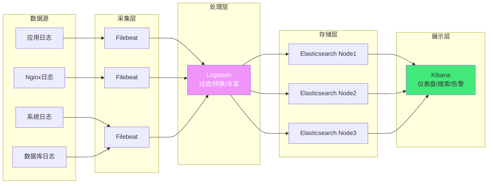
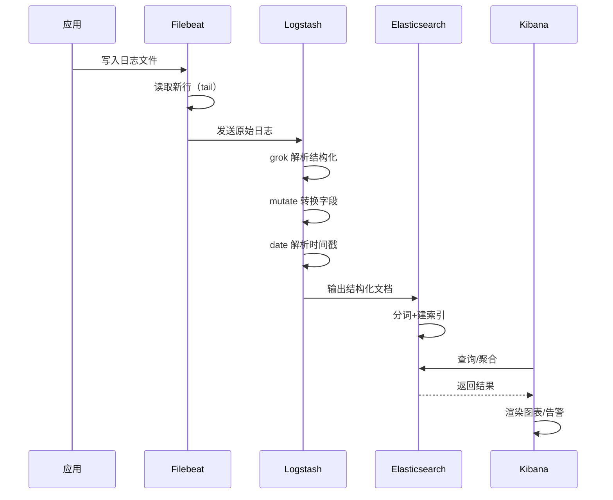

# 📊 ELK 日志聚合体系

> **文档说明**：系统讲解 ELK（Elasticsearch + Logstash + Kibana）日志聚合体系的完整知识体系，涵盖架构设计、各组件原理、Filebeat 日志采集、Logstash 数据处理管道、Elasticsearch 索引与搜索、Kibana 可视化与告警、Docker Compose 部署、性能优化、常见问题与最佳实践。ELK 是最主流的开源日志聚合方案，实现日志的集中采集、存储、搜索和可视化。
>
> **适用人群**：DevOps 工程师、后端开发者、运维工程师、SRE
>
> **前置知识**：[[Linux系统管理与常用命令]] · [[Docker容器化实战]]

---

## 一、概述

### 1.1 什么是 ELK

ELK 是三个开源项目的首字母缩写，构成完整的日志聚合与分析平台：

| 组件 | 全称 | 角色 | 说明 |
|------|------|------|------|
| **E** | Elasticsearch | 存储与搜索 | 分布式搜索和分析引擎，存储日志数据 |
| **L** | Logstash | 数据处理管道 | 数据采集、过滤、转换、输出 |
| **K** | Kibana | 可视化界面 | 数据可视化、仪表盘、告警 |

**ELK 家族扩展（ELK Stack）**：
- **Beats**（Filebeat/Metricbeat/Heartbeat 等）：轻量级数据采集器，替代 Logstash 做采集
- **完整架构**：Beats → Logstash → Elasticsearch → Kibana

### 1.2 解决的问题

| 问题 | 说明 |
|------|------|
| **日志分散** | 多台服务器、多个服务的日志分散在各处，排查困难 |
| **搜索困难** | 纯文本日志无法快速搜索和过滤 |
| **无法可视化** | 无法直观展示日志趋势、错误分布、请求量等 |
| **告警缺失** | 日志中出现异常无法及时通知 |
| **日志丢失** | 服务器重启或磁盘满导致日志丢失 |
| **跨服务追踪** | 微服务架构下，一个请求涉及多个服务，难以串联 |

### 1.3 核心应用场景

- ✅ **集中式日志管理**：所有服务日志统一采集和存储
- ✅ **故障排查**：通过关键词、时间范围、服务名快速定位问题
- ✅ **安全审计**：登录日志、操作日志的审计和告警
- ✅ **业务分析**：用户行为分析、访问量统计、转化率分析
- ✅ **性能监控**：接口响应时间、错误率、慢查询分析
- ✅ **合规要求**：日志留存、审计追溯

---

## 二、底层原理

### 2.1 ELK 整体架构



### 2.2 各组件核心原理

#### Elasticsearch（存储与搜索）

| 概念 | 说明 |
|------|------|
| **索引（Index）** | 一类文档的集合，类似数据库的表 |
| **文档（Document）** | 一条日志记录，JSON 格式 |
| **分片（Shard）** | 索引的水平拆分，每个分片是一个 Lucene 实例 |
| **副本（Replica）** | 分片的备份，提高可用性和读性能 |
| **倒排索引** | 词 → 文档列表的映射，实现快速全文搜索 |
| **分词器（Analyzer）** | 将文本拆分为词项（Token），支持中文分词（IK） |

**数据流**：
```text
日志文档 → 分词 → 倒排索引 → 存储到分片 → 副本同步
```

#### Logstash（数据处理管道）

Logstash 的处理流程分为三个阶段：


| 阶段 | 常用插件 | 说明 |
|------|---------|------|
| **Input** | beats、file、tcp、kafka、redis | 数据来源 |
| **Filter** | grok、mutate、date、json、geoip、drop | 数据清洗和转换 |
| **Output** | elasticsearch、file、kafka、stdout | 数据输出目标 |

#### Kibana（可视化）

| 功能 | 说明 |
|------|------|
| **Discover** | 日志搜索和浏览 |
| **Visualize** | 图表创建（折线图、柱状图、饼图等） |
| **Dashboard** | 仪表盘，组合多个图表 |
| **Alerting** | 基于阈值的告警 |
| **Dev Tools** | Elasticsearch API 调试工具 |
| **Stack Monitoring** | ELK 集群监控 |

#### Filebeat（轻量采集器）

Filebeat 是 Beats 家族中最常用的采集器，替代 Logstash 做日志采集：
- 轻量级，Go 语言编写，资源占用低
- 支持文件 tail、多行日志合并
- 支持断点续传（记录读取位置）
- 支持背压（下游慢时自动减速）

### 2.3 日志处理流程



---

## 三、实操示例

### 3.1 Docker Compose 部署 ELK

```yaml
# docker-compose.yml — ELK 单机部署
version: '3.8'

services:
  # ===== Elasticsearch =====
  elasticsearch:
    image: docker.elastic.co/elasticsearch/elasticsearch:8.11.0
    container_name: elasticsearch
    environment:
      - discovery.type=single-node
      - xpack.security.enabled=false  # 开发环境关闭安全认证
      - "ES_JAVA_OPTS=-Xms512m -Xmx512m"  # JVM 内存
    ulimits:
      memlock:
        soft: -1
        hard: -1
    volumes:
      - es_data:/usr/share/elasticsearch/data
    ports:
      - "9200:9200"  # REST API
      - "9300:9300"  # 节点通信
    networks:
      - elk

  # ===== Logstash =====
  logstash:
    image: docker.elastic.co/logstash/logstash:8.11.0
    container_name: logstash
    volumes:
      - ./logstash/pipeline:/usr/share/logstash/pipeline  # 管道配置
      - ./logstash/config/logstash.yml:/usr/share/logstash/config/logstash.yml
    ports:
      - "5044:5044"  # Beats 输入
      - "9600:9600"  # 监控 API
    environment:
      - "LS_JAVA_OPTS=-Xms256m -Xmx256m"
    networks:
      - elk
    depends_on:
      - elasticsearch

  # ===== Kibana =====
  kibana:
    image: docker.elastic.co/kibana/kibana:8.11.0
    container_name: kibana
    environment:
      - ELASTICSEARCH_HOSTS=http://elasticsearch:9200
    ports:
      - "5601:5601"  # Web 界面
    networks:
      - elk
    depends_on:
      - elasticsearch

volumes:
  es_data:
    driver: local

networks:
  elk:
    driver: bridge
```

### 3.2 Logstash 管道配置

```ruby
# logstash/pipeline/logstash.conf — 日志处理管道
input {
  # 接收 Filebeat 发送的日志
  beats {
    port => 5044
  }
}

filter {
  # 1. 解析 Nginx 访问日志（grok 模式匹配）
  if [fields][log_type] == "nginx-access" {
    grok {
      match => {
        "message" => '%{IPORHOST:client_ip} - %{USERNAME:remote_user} \[%{HTTPDATE:timestamp}\] "%{WORD:method} %{URIPATHPARAM:request} HTTP/%{NUMBER:http_version}" %{NUMBER:status} %{NUMBER:body_bytes_sent} "%{URI:referer}" "%{DATA:user_agent}"'
      }
    }
    # 转换字段类型
    mutate {
      convert => {
        "status" => "integer"
        "body_bytes_sent" => "integer"
      }
    }
    # 解析时间戳为 @timestamp
    date {
      match => ["timestamp", "dd/MMM/yyyy:HH:mm:ss Z"]
      target => "@timestamp"
    }
  }

  # 2. 解析应用 JSON 日志
  if [fields][log_type] == "app-json" {
    json {
      source => "message"
    }
  }

  # 3. 通用处理：添加字段、去除多余字段
  mutate {
    add_field => {
      "environment" => "production"
      "pipeline_version" => "1.0"
    }
    remove_field => ["@version", "host", "agent", "ecs"]  # 去除不需要的字段
  }

  # 4. 丢弃无效日志（如健康检查）
  if [request] == "/health" {
    drop { }
  }
}

output {
  # 输出到 Elasticsearch，按日志类型分索引
  if [fields][log_type] == "nginx-access" {
    elasticsearch {
      hosts => ["http://elasticsearch:9200"]
      index => "nginx-access-%{+YYYY.MM.dd}"  # 按天滚动索引
    }
  } else if [fields][log_type] == "app-json" {
    elasticsearch {
      hosts => ["http://elasticsearch:9200"]
      index => "app-log-%{+YYYY.MM.dd}"
    }
  } else {
    elasticsearch {
      hosts => ["http://elasticsearch:9200"]
      index => "other-log-%{+YYYY.MM.dd}"
    }
  }

  # 调试时输出到标准输出
  # stdout { codec => rubydebug }
}
```

### 3.3 Filebeat 配置

```yaml
# filebeat.yml — Filebeat 采集配置
filebeat.inputs:
  # Nginx 访问日志
  - type: log
    enabled: true
    paths:
      - /var/log/nginx/access.log
    fields:
      log_type: nginx-access
      service: nginx
    fields_under_root: false
    multiline:  # 多行日志合并（如异常堆栈）
      pattern: '^\['
      negate: true
      match: after

  # 应用日志
  - type: log
    enabled: true
    paths:
      - /var/log/app/*.log
    fields:
      log_type: app-json
      service: my-app
    json.keys_under_root: true  # JSON 日志直接展开
    json.add_error_key: true

# 输出到 Logstash
output.logstash:
  hosts: ["logstash:5044"]
  worker: 2
  compression_level: 3

# 输出直接到 Elasticsearch（可跳过 Logstash）
# output.elasticsearch:
#   hosts: ["elasticsearch:9200"]
#   index: "filebeat-%{+yyyy.MM.dd}"

# Filebeat 自身监控
monitoring.enabled: false
logging.level: info
logging.to_files: true
logging.files:
  path: /var/log/filebeat
  name: filebeat
  keepfiles: 7
```

### 3.4 Elasticsearch 索引模板

```json
// 创建索引模板，统一字段映射
PUT _index_template/app-log-template
{
  "index_patterns": ["app-log-*"],
  "template": {
    "settings": {
      "number_of_shards": 3,
      "number_of_replicas": 1,
      "refresh_interval": "5s",  # 刷新间隔，平衡实时性和性能
      "index.lifecycle.name": "app-log-policy",
      "index.lifecycle.rollover_alias": "app-log"
    },
    "mappings": {
      "properties": {
        "@timestamp": { "type": "date" },
        "level": { "type": "keyword" },
        "service": { "type": "keyword" },
        "message": { "type": "text", "analyzer": "ik_max_word" },
        "trace_id": { "type": "keyword" },
        "duration_ms": { "type": "integer" },
        "client_ip": { "type": "ip" },
        "status": { "type": "integer" },
        "request": { "type": "keyword" }
      }
    }
  }
}
```

### 3.5 Kibana 常用查询（KQL）

```kql
// 1. 按服务和日志级别过滤
service : "my-app" and level : "ERROR"

// 2. 按时间范围（Kibana 时间选择器）
@timestamp >= "2026-08-28T00:00:00" and @timestamp < "2026-08-29T00:00:00"

// 3. 模糊搜索消息内容
message : "NullPointerException" or message : "timeout"

// 4. 按 trace_id 追踪完整请求链路
trace_id : "abc123def456"

// 5. 错误状态码
status >= 500

// 6. 慢请求（超过 1 秒）
duration_ms > 1000 and level : "WARN"

// 7. 排除健康检查
not request : "/health" and not request : "/metrics"
```

### 3.6 Elasticsearch 常用 API

```bash
# 查看集群健康状态
curl -s http://localhost:9200/_cluster/health?pretty

# 查看所有索引
curl -s http://localhost:9200/_cat/indices?v&s=index

# 查看索引大小
curl -s http://localhost:9200/_cat/indices?v&h=index,store.size&s=store.size:desc

# 搜索（DSL 查询）
curl -s -X POST "http://localhost:9200/app-log-*/_search" -H 'Content-Type: application/json' -d '
{
  "query": {
    "bool": {
      "must": [
        { "match": { "level": "ERROR" } },
        { "range": { "@timestamp": { "gte": "now-1h" } } }
      ]
    }
  },
  "size": 10,
  "sort": [{ "@timestamp": "desc" }]
}'

# 删除旧索引（按日期）
curl -X DELETE "http://localhost:9200/app-log-2026.07.*"

# 强制刷新索引
curl -X POST "http://localhost:9200/app-log-*/_refresh"
```

---

## 四、常见问题与排查

| 问题现象 | 可能原因 | 解决方案 |
|---------|---------|---------|
| **Filebeat 不发送日志** | 路径错误；权限不足；日志无新行 | 检查 paths 配置；确认 Filebeat 有读权限；检查日志文件是否有写入 |
| **Logstash 解析失败** | grok 模式不匹配；JSON 格式错误 | 用 Grok Debugger 调试；检查日志格式；加 `tag_on_failure` 标记 |
| **Elasticsearch 磁盘满** | 索引未清理；分片太多 | 配置 ILM 自动删除旧索引；删除无用索引；扩容磁盘 |
| **查询很慢** | 索引太大；没有合理分片；查询未优化 | 按时间分索引；增加分片；用 filter 替代 query；限制查询时间范围 |
| **Kibana 连不上 ES** | 网络不通；ES 未启动；配置错误 | 检查 ELASTICSEARCH_HOSTS；curl 测试 ES 连通性；查看日志 |
| **日志丢失** | Filebeat 位置文件损坏；Logstash 处理不过来 | 检查 registry 文件；增加 Logstash worker；用 Kafka 做缓冲 |
| **中文搜索不准** | 未配置中文分词器 | 安装 IK 分词器；索引 mapping 指定 `analyzer: ik_max_word` |
| **@timestamp 不对** | date filter 未正确解析；时区问题 | 检查 date match 格式；配置时区 `timezone => "Asia/Shanghai"` |
| **ES OOM** | JVM 内存太小；查询聚合太复杂 | 增大 Xmx；限制聚合桶数；优化查询；用 circuit breaker |
| **分片未分配** | 节点不足；磁盘水位线 | 增加节点；删除旧索引释放空间；调整 `cluster.routing.allocation.disk.watermark` |
| **日志重复** | Filebeat 重启重复发送；Logstash 重试 | 检查 registry 文件；配置 Logstash persistent queue；ES 用文档 ID 去重 |
| **多行日志被拆分** | multiline 配置错误 | 检查 multiline pattern；用 `negate: true` + `match: after` |

---

## 五、进阶与最佳实践

### 5.1 性能优化

| 优化点 | 方法 | 预期效果 |
|--------|------|---------|
| **Filebeat** | 增加 `worker` 数；批量发送 `bulk_max_size` | 提升采集吞吐量 |
| **Logstash** | 增加 `pipeline.workers`；调整 `batch.size` | 提升处理速度 |
| **Logstash** | 用 `mutate` 替代复杂 `ruby` 过滤 | 减少 CPU 消耗 |
| **Elasticsearch** | 合理设置分片数（每分片 20-50GB） | 平衡查询和写入 |
| **Elasticsearch** | `refresh_interval` 设为 30s（非实时场景） | 提升写入性能 |
| **Elasticsearch** | 用 `_bulk` 批量写入 | 减少网络开销 |
| **Elasticsearch** | 关闭 `_source` 或 `_all`（不需要时） | 节省存储空间 |
| **索引管理** | 按天/周滚动索引 + ILM 自动删除 | 控制索引大小 |
| **查询优化** | 用 `filter` 替代 `must`（不计算评分） | 提升查询速度 |
| **查询优化** | 限制时间范围和返回条数 | 减少扫描数据量 |
| **JVM** | Xms = Xmx，设为物理内存 50%（不超过 32GB） | 避免堆内存动态调整 |
| **操作系统** | 关闭 swap；增加文件描述符限制 | 提升稳定性和性能 |

### 5.2 索引生命周期管理（ILM）

```json
// ILM 策略：热→温→冷→删除
PUT _ilm/policy/app-log-policy
{
  "policy": {
    "phases": {
      "hot": {
        "min_age": "0ms",
        "actions": {
          "rollover": {
            "max_size": "50gb",
            "max_age": "1d"
          },
          "set_priority": { "priority": 100 }
        }
      },
      "warm": {
        "min_age": "7d",
        "actions": {
          "set_priority": { "priority": 50 },
          "shrink": { "number_of_shards": 1 },
          "forcemerge": { "max_num_segments": 1 }
        }
      },
      "cold": {
        "min_age": "30d",
        "actions": {
          "set_priority": { "priority": 0 },
          "freeze": {}
        }
      },
      "delete": {
        "min_age": "90d",
        "actions": {
          "delete": {}
        }
      }
    }
  }
}
```

### 5.3 生产环境最佳实践 Checklist

| 类别 | 检查项 | 说明 |
|------|--------|------|
| **架构** | 集群至少 3 节点 | 避免脑裂，高可用 |
| **架构** | 专用主节点（Master）和数据节点（Data） | 大集群分离角色 |
| **架构** | Kafka 做缓冲层 | 日志峰值时削峰填谷 |
| **安全** | 开启 X-Pack 安全认证 | 生产环境必须 |
| **安全** | HTTPS 加密传输 | 防止日志数据泄露 |
| **安全** | 敏感字段脱敏 | 日志中不存密码、手机号等 |
| **存储** | 按天/周滚动索引 | 控制单个索引大小 |
| **存储** | ILM 自动清理旧索引 | 避免磁盘满 |
| **存储** | 冷热数据分离 | 热数据 SSD，冷数据 HDD |
| **性能** | JVM 内存合理设置（不超 32GB） | 避免 GC 问题 |
| **性能** | 关闭 swap | 避免性能骤降 |
| **性能** | 批量写入 + 合理 refresh_interval | 提升写入吞吐 |
| **监控** | 监控集群健康状态、磁盘、JVM | 及时发现问题 |
| **监控** | 监控 Filebeat/Logstash 延迟 | 避免日志积压 |
| **备份** | 定期快照备份 | 数据可恢复 |
| **日志规范** | 应用输出结构化 JSON 日志 | 减少 Logstash 解析成本 |
| **日志规范** | 统一日志字段（trace_id/level/service） | 便于搜索和关联 |

### 5.4 日志规范建议

```json
应用日志最佳实践：

✅ 输出 JSON 格式（而非纯文本）
   {"timestamp":"2026-08-28T10:00:00Z","level":"ERROR","service":"order-service",
    "trace_id":"abc123","message":"订单创建失败","exception":"NullPointerException",
    "stack_trace":"...","duration_ms":150}

✅ 包含 trace_id / span_id（分布式追踪）
✅ 包含 service 名称和环境标识
✅ 日志级别合理使用（DEBUG/INFO/WARN/ERROR）
✅ 异常日志包含完整堆栈
✅ 敏感信息脱敏（密码/手机号/身份证）
✅ 时间戳用 ISO 8601 格式，带时区
✅ 不要在循环中打大量日志
✅ 关键操作记录审计日志
```

---

## 六、关联笔记

### 可观测性
- [[Prometheus监控体系]] · [[告警体系设计]] · [[Jaeger-分布式链路追踪]]
- [[Grafana-可视化看板]]

### 云原生
- [[Docker容器化实战]] · [[Kubernetes入门与实践]] · [[Docker-Compose编排]]
- [[K8s-故障排查手册]]

### 工具
- [[Linux系统管理与常用命令]] · [[curl高级用法]] · [[网络抓包与调试]]

### 导航
- [[MOC-云原生与运维]] · [[MOC-监控可观测]] · [[MOC-综合导航]] · [[Home]]

> 🔍 **知识点深度解析**
>
> **作用**：ELK 日志聚合解决的是「分布式系统中日志分散、难以搜索和分析」的问题，实现日志的集中采集、存储、搜索和可视化，是故障排查和可观测性的核心组件。
>
> **底层原理**：Filebeat 轻量采集日志文件（tail 模式，记录读取位置），发送给 Logstash；Logstash 通过 Input→Filter→Output 三阶段管道，用 grok 解析非结构化日志、mutate 转换字段、date 解析时间戳，输出结构化文档到 Elasticsearch；Elasticsearch 是分布式搜索引擎，通过倒排索引实现快速全文搜索，数据分片存储保证水平扩展；Kibana 提供可视化界面，支持搜索、仪表盘和告警。整体数据流：应用写日志 → Filebeat 采集 → Logstash 处理 → Elasticsearch 存储 → Kibana 展示。
>
> **用法要点**：① 架构：Filebeat（采集）→ Logstash（处理）→ Elasticsearch（存储）→ Kibana（展示） ② 应用日志输出 JSON 格式，减少 Logstash 解析成本 ③ 按日志类型分索引（nginx-access/app-log），按天滚动 ④ 配置 ILM 自动管理索引生命周期（热→温→冷→删除） ⑤ 中文搜索安装 IK 分词器 ⑥ Logstash grok 用 Kibana Grok Debugger 调试 ⑦ 大集群用 Kafka 做缓冲层削峰 ⑧ 生产环境开启 X-Pack 安全认证 ⑨ JVM 内存不超过 32GB，Xms=Xmx ⑩ 监控集群健康、磁盘、Filebeat 延迟。

> 💡 **深度讲解**：ELK 最核心的设计是「倒排索引」——传统数据库是「文档→词」的映射（找包含某个词的文档要遍历所有文档），倒排索引是「词→文档列表」的映射（找某个词直接定位到包含它的文档），这就是 Elasticsearch 搜索快的根本原因。很多人部署 ELK 后遇到的最大问题是「磁盘满」——日志量增长很快，必须配置 ILM（索引生命周期管理）自动删除旧索引，否则磁盘会被写满导致集群崩溃。另一个常见坑是「中文搜索不准」——Elasticsearch 默认分词器对中文是按字分词（「中国」分成「中」「国」），搜索效果差，必须安装 IK 分词器。架构上，小团队可以用 Filebeat 直接输出到 Elasticsearch（跳过 Logstash），简化架构；大团队建议保留 Logstash 做统一处理，并用 Kafka 做缓冲层应对日志峰值。

> 📝 **精简总结**：ELK = Elasticsearch（存储搜索）+ Logstash（数据处理）+ Kibana（可视化），加 Filebeat（轻量采集）。流程：Filebeat 采集 → Logstash 解析转换 → Elasticsearch 倒排索引存储 → Kibana 搜索展示。关键：JSON 日志减少解析、按天分索引、ILM 自动清理、IK 中文分词、JVM 不超 32GB。

> **学习路径建议**：先学习 [[Linux系统管理与常用命令]] 掌握基础 → 学习 [[Docker容器化实战]] 理解容器化部署 → 学习本文档掌握 ELK 体系 → 学习 [[Prometheus监控体系]] 掌握指标监控 → 学习 [[Jaeger-分布式链路追踪]] 掌握链路追踪 → 学习 [[告警体系设计]] 建立告警体系 → 在生产环境中实践完整的可观测性体系。

---

> **ELK 的本质是「给日志装上搜索引擎和仪表盘」——让分散在各处的日志集中起来，让排查问题从「翻日志」变成「搜日志」，让趋势从「看不见」变成「图表化」。**
