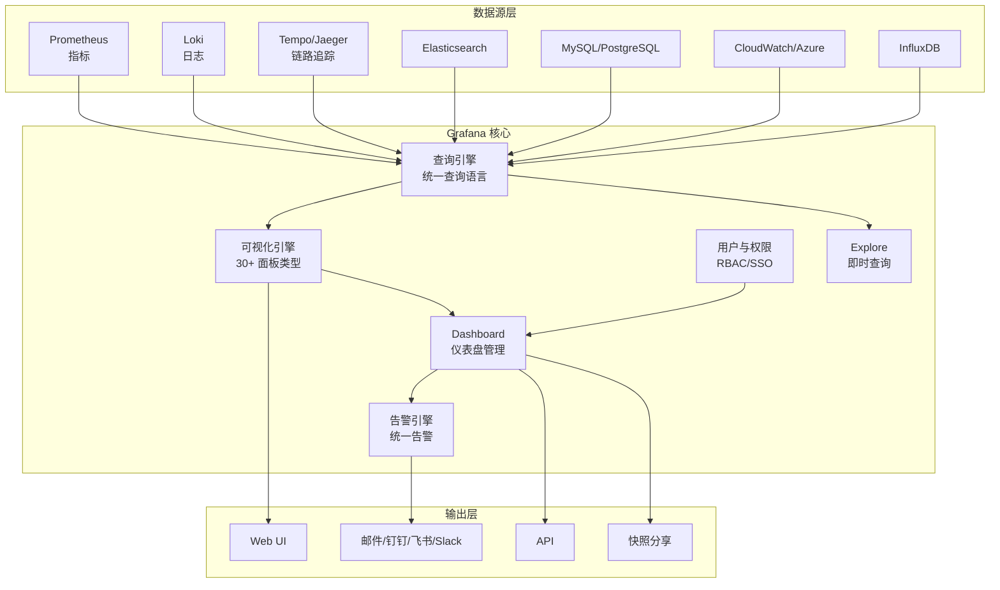
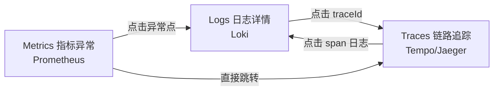
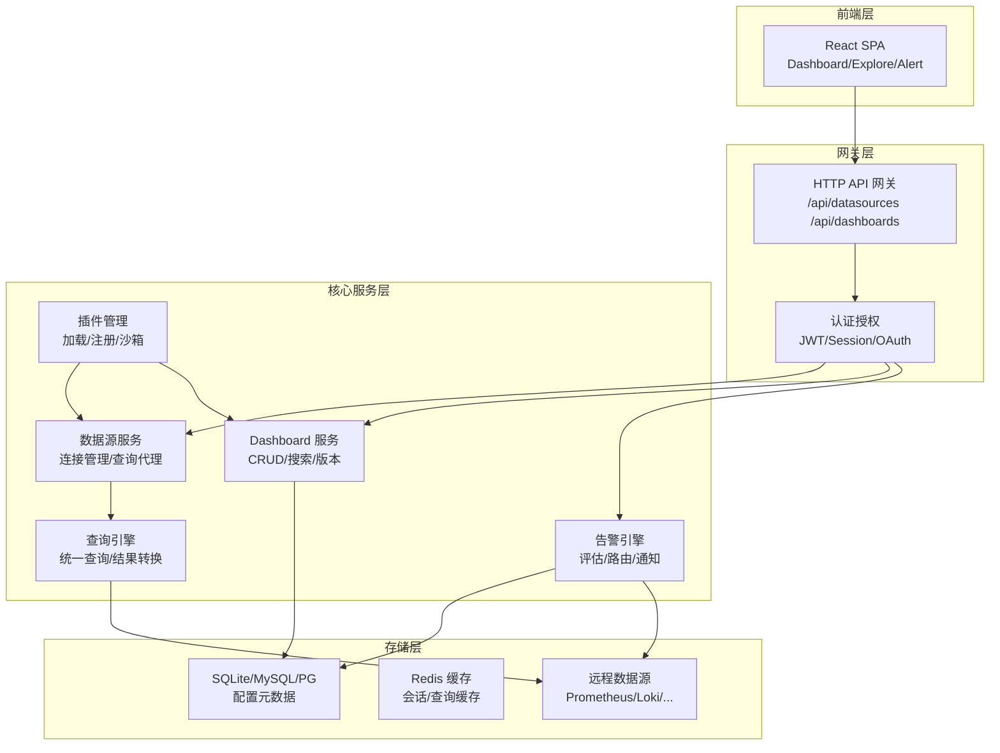
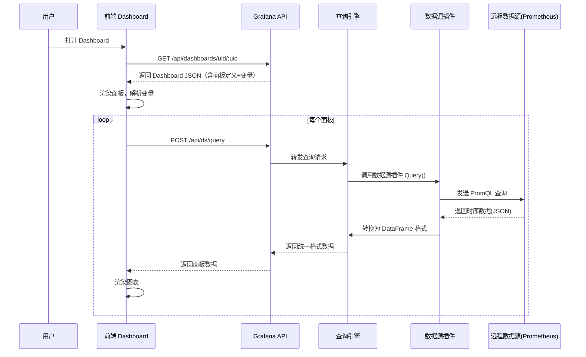
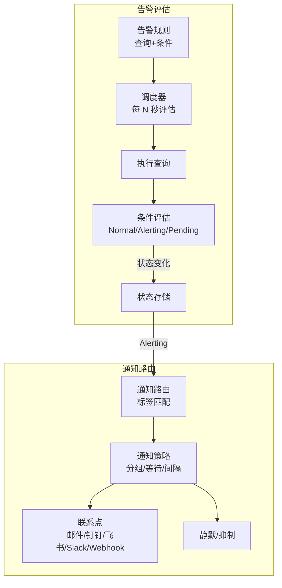
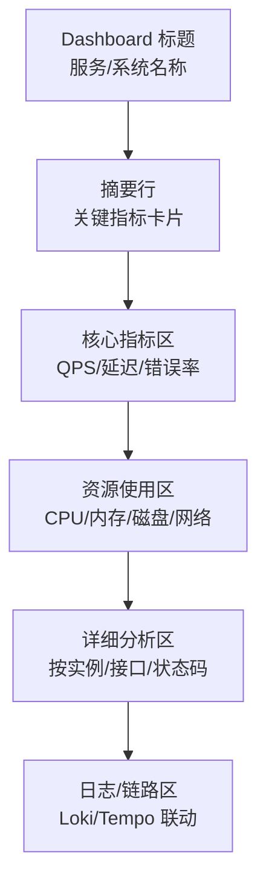
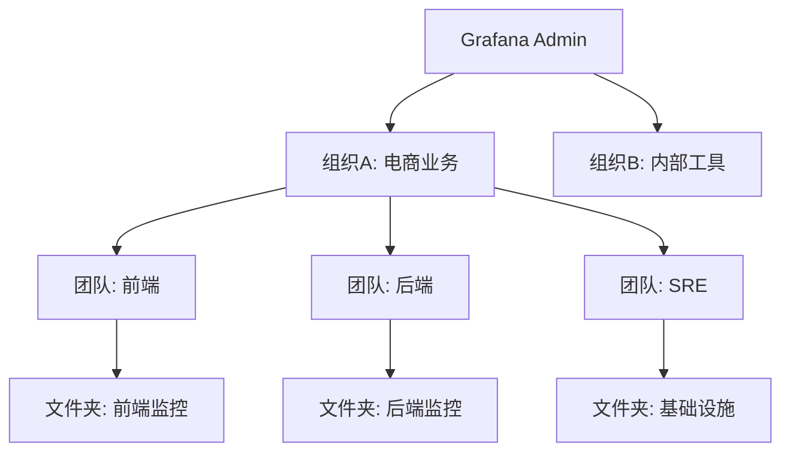
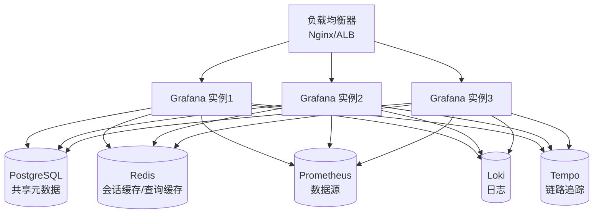

# Grafana 可视化看板

> **文档说明**：系统讲解 Grafana 可视化看板的核心概念、架构原理、数据源配置、面板类型、Dashboard 构建、变量与模板、告警配置、权限管理与生产级部署实践，含完整的 Prometheus + Grafana 集成配置、常用面板 JSON、Loki 日志查询、Tempo 链路追踪集成与常见问题排查。
>
> **适用人群**：DevOps 工程师、SRE、后端开发者、需要搭建监控可视化体系的全栈工程师
>
> **前置知识**：[[Prometheus-指标采集]]、[[监控与告警体系]]、Docker/Kubernetes 基础

---

## 一、概述

### 1. Grafana 是什么

Grafana 是一个开源的**数据可视化与监控分析平台**，支持将多种数据源的时序数据、日志、链路追踪等以图表、仪表盘的形式展示，并提供告警、通知、协作等能力。

| 维度 | 说明 |
|------|------|
| **核心定位** | 统一的可观测性（Observability）可视化层 |
| **三大支柱** | Metrics（指标）、Logs（日志）、Traces（链路追踪） |
| **开源协议** | AGPLv3（Grafana OSS），企业版商业授权 |
| **开发语言** | Go（后端）+ React（前端） |
| **部署方式** | 二进制、Docker、Kubernetes、Helm、云托管 |

### 2. 核心能力



| 能力 | 说明 |
|------|------|
| **多数据源支持** | 内置 30+ 数据源，支持 Prometheus、Loki、Tempo、Elasticsearch、MySQL、PostgreSQL、InfluxDB、CloudWatch 等 |
| **丰富面板类型** | 时序图、柱状图、饼图、热力图、状态面板、表格、仪表盘、日志面板、追踪面板等 30+ 种 |
| **Dashboard 管理** | 文件夹组织、版本历史、导入导出、JSON 模板、变量模板 |
| **统一告警** | 支持多数据源告警、告警路由、静默、通知策略、OnCall 集成 |
| **Explore 模式** | 即时查询和调试，支持 Metrics/Logs/Traces 联动 |
| **权限管理** | RBAC、团队、文件夹权限、SSO（OAuth/SAML/LDAP） |
| **插件生态** | 社区插件 100+，包括数据源插件、面板插件、App 插件 |

### 3. 可观测性三大支柱集成

Grafana 的核心优势是将 Metrics、Logs、Traces 三大支柱统一在一个平台中，并实现**联动跳转**：



| 支柱 | 数据源 | 查询语言 | 典型面板 |
|------|--------|---------|---------|
| **Metrics** | Prometheus | PromQL | 时序图、仪表盘、热力图 |
| **Logs** | Loki | LogQL | 日志面板、日志柱状图 |
| **Traces** | Tempo / Jaeger | TraceQL | 追踪面板、服务拓扑图 |

### 4. 版本对比

| 特性 | OSS（免费） | Enterprise（付费） | Cloud（托管） |
|------|------------|-------------------|--------------|
| 核心可视化 | ✅ | ✅ | ✅ |
| 告警 | ✅ | ✅ | ✅ |
| 数据源 | 内置 30+ | 内置 + 企业插件 | 全部 |
| RBAC | 基础 | 高级（细粒度） | 高级 |
| SSO | OAuth | OAuth + SAML + LDAP | 全部 |
| 审计日志 | ❌ | ✅ | ✅ |
| 报表导出（PDF） | ❌ | ✅ | ✅ |
| 高可用 | 需自行配置 | 支持 | 托管 |
| 升级维护 | 自行 | 自行 | 托管 |

---

## 二、底层原理

### 1. Grafana 架构



**核心组件说明**：

| 组件 | 作用 | 技术实现 |
|------|------|---------|
| **HTTP API 网关** | 处理所有前端请求，RESTful API | Go + Gin-like 路由 |
| **认证授权** | 登录、Session、JWT、OAuth、RBAC | Go + 自定义中间件 |
| **数据源服务** | 管理数据源连接，代理查询请求 | Go + 数据源插件接口 |
| **查询引擎** | 统一查询接口，将不同数据源的结果转换为统一格式（DataFrame） | Go + Arrow DataFrame |
| **Dashboard 服务** | Dashboard 的 CRUD、搜索、版本管理 | Go + ORM（XORM） |
| **告警引擎** | 告警规则评估、路由、通知 | Go + 调度器 + Alertmanager 兼容 |
| **插件管理** | 加载和管理前端/后端插件 | Go + 插件签名验证 |
| **元数据存储** | 存储 Dashboard、数据源、用户、告警等配置 | SQLite（默认）/MySQL/PostgreSQL |

### 2. 数据流与查询原理

Grafana 本身**不存储时序数据**，它只是一个可视化层，数据来自外部数据源。查询流程如下：



**关键设计**：
- **DataFrame 统一格式**：所有数据源的查询结果都被转换为 Arrow DataFrame（列式存储），前端统一处理
- **查询代理**：Grafana 作为代理，前端不直接访问数据源，便于权限控制和缓存
- **并发查询**：多个面板的查询并发执行，提升 Dashboard 加载速度
- **查询缓存**：企业版支持查询结果缓存，减少数据源压力

### 3. Dashboard JSON 模型

Dashboard 以 JSON 格式存储，核心结构如下：

```json
{
  "id": 123,
  "uid": "abc123def",
  "title": "Node Exporter Full",
  "tags": ["linux", "node-exporter"],
  "timezone": "browser",
  "schemaVersion": 39,
  "version": 5,
  "refresh": "30s",
  "time": { "from": "now-6h", "to": "now" },
  "templating": {
    "list": [
      {
        "name": "instance",
        "type": "query",
        "datasource": { "type": "prometheus", "uid": "prometheus" },
        "query": "label_values(node_cpu_seconds_total, instance)",
        "refresh": 2,
        "includeAll": true,
        "multi": true
      }
    ]
  },
  "panels": [
    {
      "id": 1,
      "type": "timeseries",
      "title": "CPU Usage",
      "datasource": { "type": "prometheus", "uid": "prometheus" },
      "gridPos": { "x": 0, "y": 0, "w": 12, "h": 8 },
      "targets": [
        {
          "expr": "100 - (avg by(instance) (rate(node_cpu_seconds_total{mode=\"idle\"}[$__rate_interval])) * 100)",
          "legendFormat": "{{instance}}"
        }
      ],
      "fieldConfig": {
        "defaults": {
          "unit": "percent",
          "min": 0,
          "max": 100,
          "thresholds": {
            "steps": [
              { "color": "green", "value": null },
              { "color": "yellow", "value": 70 },
              { "color": "red", "value": 90 }
            ]
          }
        }
      }
    }
  ]
}
```

**核心字段说明**：

| 字段 | 说明 |
|------|------|
| `uid` | Dashboard 唯一标识，URL 中使用 |
| `schemaVersion` | JSON Schema 版本，升级时自动迁移 |
| `version` | Dashboard 版本号，每次保存自增 |
| `templating.list` | 变量定义列表 |
| `panels` | 面板数组，每个面板有独立的查询和配置 |
| `gridPos` | 面板在网格中的位置（x, y, w, h），24 列网格 |
| `targets` | 查询目标，包含数据源特定的查询表达式 |
| `fieldConfig` | 字段配置（单位、阈值、颜色、覆盖等） |

### 4. 变量与模板原理

变量是 Grafana Dashboard 的核心特性，允许用户动态过滤数据：


| 变量类型 | 说明 | 示例 |
|---------|------|------|
| `query` | 通过查询数据源获取选项 | `label_values(node_cpu_seconds_total, instance)` |
| `custom` | 手动定义选项 | `dev, staging, prod` |
| `interval` | 时间间隔选项 | `1m, 5m, 1h, 1d` |
| `datasource` | 数据源选择 | 切换不同的 Prometheus 实例 |
| `textbox` | 自由文本输入 | 自定义搜索关键词 |
| `constant` | 常量（不可在 UI 更改） | 环境标识 |
| `adhoc` | 临时键值对过滤 | 动态添加 label 过滤 |

**变量替换语法**：
- `$varname` 或 `${varname}`：基本替换
- `${varname:csv}`：多值以逗号分隔
- `${varname:regex}`：正则替换
- `${varname:pipe}`：多值以管道分隔

### 5. 告警引擎原理（Grafana Alerting）

Grafana 8.0 起引入了统一告警引擎，替代了旧的面板告警：



**告警状态机**：

```text
Normal ──(条件满足)──> Pending ──(持续 for 时间)──> Alerting
  ↑                        │                              │
  │                        │(条件恢复)                    │(条件恢复)
  └────────────────────────┴──────────────────────────────┘
```

| 状态 | 说明 |
|------|------|
| **Normal** | 正常，条件不满足 |
| **Pending** | 待触发，条件已满足但未持续到 `for` 时间 |
| **Alerting** | 告警中，条件满足且持续超过 `for` 时间 |
| **NoData** | 无数据，查询返回空 |
| **Error** | 评估出错（查询失败等） |

---

## 三、实操示例

### 1. Docker Compose 快速部署（Prometheus + Grafana + Loki + Tempo）

```yaml
# docker-compose.yml
version: '3.8'

services:
  grafana:
    image: grafana/grafana:11.0.0
    container_name: grafana
    restart: unless-stopped
    ports:
      - "3000:3000"
    environment:
      - GF_SECURITY_ADMIN_USER=admin
      - GF_SECURITY_ADMIN_PASSWORD=admin123
      - GF_USERS_ALLOW_SIGN_UP=false
      - GF_INSTALL_PLUGINS=grafana-piechart-panel,grafana-clock-panel
    volumes:
      - grafana_data:/var/lib/grafana
      - ./grafana/provisioning:/etc/grafana/provisioning
    networks:
      - monitoring

  prometheus:
    image: prom/prometheus:v2.52.0
    container_name: prometheus
    restart: unless-stopped
    ports:
      - "9090:9090"
    volumes:
      - ./prometheus/prometheus.yml:/etc/prometheus/prometheus.yml
      - prometheus_data:/prometheus
    command:
      - '--config.file=/etc/prometheus/prometheus.yml'
      - '--storage.tsdb.path=/prometheus'
      - '--web.console.libraries=/etc/prometheus/console_libraries'
      - '--web.console.templates=/etc/prometheus/consoles'
      - '--storage.tsdb.retention.time=30d'
    networks:
      - monitoring

  loki:
    image: grafana/loki:3.0.0
    container_name: loki
    restart: unless-stopped
    ports:
      - "3100:3100"
    volumes:
      - ./loki/loki-config.yml:/etc/loki/local-config.yaml
      - loki_data:/loki
    command: -config.file=/etc/loki/local-config.yaml
    networks:
      - monitoring

  tempo:
    image: grafana/tempo:2.4.0
    container_name: tempo
    restart: unless-stopped
    ports:
      - "3200:3200"
      - "4317:4317"  # OTLP gRPC
    volumes:
      - ./tempo/tempo-config.yml:/etc/tempo/tempo.yaml
      - tempo_data:/tmp/tempo
    command: [ "-config.file=/etc/tempo/tempo.yaml" ]
    networks:
      - monitoring

  node-exporter:
    image: prom/node-exporter:v1.8.1
    container_name: node-exporter
    restart: unless-stopped
    ports:
      - "9100:9100"
    networks:
      - monitoring

volumes:
  grafana_data:
  prometheus_data:
  loki_data:
  tempo_data:

networks:
  monitoring:
    driver: bridge
```

### 2. Grafana 配置文件（grafana.ini）

```ini
# /etc/grafana/grafana.ini

[server]
http_port = 3000
domain = grafana.example.com
root_url = %(protocol)s://%(domain)s:%(http_port)s/
serve_from_sub_path = false

[database]
type = postgres
host = db.example.com:5432
name = grafana
user = grafana
password = ${GRAFANA_DB_PASSWORD}
ssl_mode = require

[security]
admin_user = admin
admin_password = ${GRAFANA_ADMIN_PASSWORD}
disable_gravatar = true
cookie_secure = true
cookie_samesite = lax
allow_embedding = true

[auth]
disable_login_form = false
disable_signout_menu = false

[auth.anonymous]
enabled = false

[auth.basic]
enabled = true

[auth.oauth]
auto_login = false

[auth.generic_oauth]
name = Keycloak
enabled = true
allow_sign_up = true
client_id = grafana
client_secret = ${OAUTH_CLIENT_SECRET}
scopes = openid email profile
auth_url = https://keycloak.example.com/realms/master/protocol/openid-connect/auth
token_url = https://keycloak.example.com/realms/master/protocol/openid-connect/token
api_url = https://keycloak.example.com/realms/master/protocol/openid-connect/userinfo
role_attribute_path = contains(roles[*], 'admin') && 'Admin' || 'Viewer'

[users]
allow_sign_up = false
auto_assign_org = true
auto_assign_org_role = Viewer
default_theme = dark

[analytics]
reporting_enabled = false
check_for_updates = false

[alerting]
enabled = true
execute_alerts = true

[unified_alerting]
enabled = true

[smtp]
enabled = true
host = smtp.example.com:587
user = grafana@example.com
password = ${SMTP_PASSWORD}
from_address = grafana@example.com
from_name = Grafana Alerting

[log]
mode = console file
level = info
[log.file]
path = /var/log/grafana
max_lines = 1000000
max_size_shift = 28
daily_rotate = true
max_days = 30

[metrics]
enabled = true
basic_auth_username = metrics
basic_auth_password = ${METRICS_PASSWORD}
```

### 3. 数据源自动配置（Provisioning）

```yaml
# /etc/grafana/provisioning/datasources/datasources.yml
apiVersion: 1

datasources:
  - name: Prometheus
    type: prometheus
    uid: prometheus
    access: proxy
    url: http://prometheus:9090
    isDefault: true
    editable: true
    jsonData:
      timeInterval: 15s
      httpMethod: POST
      manageAlerts: true
      alertmanagerUid: alertmanager

  - name: Loki
    type: loki
    uid: loki
    access: proxy
    url: http://loki:3100
    editable: true
    jsonData:
      maxLines: 1000
      derivedFields:
        - datasourceUid: tempo
          matcherRegex: "traceid=(\\w+)"
          name: TraceID
          url: '$${__value.raw}'

  - name: Tempo
    type: tempo
    uid: tempo
    access: proxy
    url: http://tempo:3200
    editable: true
    jsonData:
      tracesToLogs:
        datasourceUid: loki
        tags: ['job', 'instance', 'pod', 'namespace']
      serviceMap:
        datasourceUid: prometheus
      nodeGraph:
        enabled: true

  - name: Alertmanager
    type: alertmanager
    uid: alertmanager
    access: proxy
    url: http://alertmanager:9093
    jsonData:
      implementation: prometheus
      handleGrafanaManagedAlerts: true
```

### 4. 常用 PromQL 查询与面板

#### CPU 使用率

```promql
# 整体 CPU 使用率（排除 idle）
100 - (avg by(instance) (rate(node_cpu_seconds_total{mode="idle"}[$__rate_interval])) * 100)

# 按 CPU 核心
avg by(cpu) (rate(node_cpu_seconds_total{mode!="idle"}[$__rate_interval]) * 100)

# 按 mode 分类
sum by(mode) (rate(node_cpu_seconds_total[$__rate_interval])) * 100
```

#### 内存使用率

```promql
# 内存使用率
(1 - (node_memory_MemAvailable_bytes / node_memory_MemTotal_bytes)) * 100

# 内存使用量（GB）
(node_memory_MemTotal_bytes - node_memory_MemAvailable_bytes) / 1024 / 1024 / 1024

# Swap 使用率
(1 - (node_memory_SwapFree_bytes / node_memory_SwapTotal_bytes)) * 100
```

#### 磁盘使用率

```promql
# 磁盘使用率（按挂载点）
(1 - (node_filesystem_avail_bytes{fstype!~"tmpfs|overlay"} / node_filesystem_size_bytes{fstype!~"tmpfs|overlay"})) * 100

# 磁盘 IO 读/写
rate(node_disk_read_bytes_total[$__rate_interval]) / 1024 / 1024
rate(node_disk_written_bytes_total[$__rate_interval]) / 1024 / 1024
```

#### 网络流量

```promql
# 网络接收/发送（MB/s）
rate(node_network_receive_bytes_total{device!~"lo|docker.*|veth.*"}[$__rate_interval]) / 1024 / 1024
rate(node_network_transmit_bytes_total{device!~"lo|docker.*|veth.*"}[$__rate_interval]) / 1024 / 1024

# TCP 连接数
node_netstat_Tcp_CurrEstab
```

#### 服务可用性

```promql
# 实例在线状态
up{job="node-exporter"}

# HTTP 请求率（QPS）
sum by(route) (rate(http_requests_total[$__rate_interval]))

# HTTP 错误率（5xx）
sum by(service) (rate(http_requests_total{status=~"5.."}[$__rate_interval]))
/
sum by(service) (rate(http_requests_total[$__rate_interval])) * 100

# P99 延迟
histogram_quantile(0.99, sum by(le, route) (rate(http_request_duration_seconds_bucket[$__rate_interval])))
```

### 5. Loki LogQL 查询示例

```logql
# 基础查询：查看所有日志
{job="varlogs"}

# 多标签过滤
{job="varlogs", instance=~"server-0[1-5]"}

# 文本过滤（管道）
{job="varlogs"} |= "error" != "timeout"

# 正则过滤
{job="varlogs"} |~ "ERROR|FATAL"

# JSON 解析
{job="api"} | json | status >= 500

# 日志级别统计
sum by(level) (
  count_over_time({job="api"} | json | level="error" [5m])
)

# 日志速率（按服务）
sum by(service) (rate({job="api"} | json [5m]))

# 提取字段并过滤
{job="api"} | json | latency > 1000 | status=~"5.."

# 日志面板中显示 trace 链接
{job="api"} | json | traceid!=""
```

### 6. 告警规则配置

```yaml
# /etc/grafana/provisioning/alerting/rules.yml
apiVersion: 1

groups:
  - orgId: 1
    name: Node Exporter Alerts
    folder: Infrastructure
    interval: 30s
    rules:
      - uid: node-high-cpu
        title: "Node High CPU Usage"
        condition: C
        data:
          - refId: A
            datasourceUid: prometheus
            relativeTimeRange:
              from: 300
              to: 0
            model:
              expr: '100 - (avg by(instance) (rate(node_cpu_seconds_total{mode="idle"}[5m])) * 100)'
              legendFormat: "{{instance}}"
          - refId: B
            datasourceUid: __expr__
            model:
              type: reduce
              reducer: last
              expression: A
          - refId: C
            datasourceUid: __expr__
            model:
              type: threshold
              expression: B
              conditions:
                - evaluator:
                    type: gt
                    params: [90]
        noDataState: NoData
        execErrState: Error
        for: 5m
        labels:
          severity: critical
          team: infrastructure
        annotations:
          summary: "Instance {{ $labels.instance }} CPU usage is above 90%"
          description: "CPU usage has been above 90% for more than 5 minutes. Current value: {{ $values.B.Value }}%"
          runbook_url: "https://wiki.example.com/runbooks/high-cpu"

      - uid: node-high-memory
        title: "Node High Memory Usage"
        condition: C
        data:
          - refId: A
            datasourceUid: prometheus
            model:
              expr: '(1 - (node_memory_MemAvailable_bytes / node_memory_MemTotal_bytes)) * 100'
          - refId: B
            datasourceUid: __expr__
            model:
              type: reduce
              reducer: last
              expression: A
          - refId: C
            datasourceUid: __expr__
            model:
              type: threshold
              expression: B
              conditions:
                - evaluator:
                    type: gt
                    params: [85]
        for: 10m
        labels:
          severity: warning
          team: infrastructure
        annotations:
          summary: "Instance {{ $labels.instance }} memory usage is above 85%"
          description: "Memory usage has been above 85% for more than 10 minutes."
```

### 7. 通知策略与联系点

```yaml
# /etc/grafana/provisioning/alerting/contactpoints.yml
apiVersion: 1

contactPoints:
  - orgId: 1
    name: "Infrastructure Team"
    receivers:
      - uid: infra-email
        type: email
        settings:
          addresses: "infra-team@example.com,sre@example.com"
          singleEmail: false
      - uid: infra-dingtalk
        type: dingtalk
        settings:
          url: "https://oapi.dingtalk.com/robot/send?access_token=xxx"
          secret: "${DINGTALK_SECRET}"
          msgType: markdown
          title: "Grafana Alert"
      - uid: infra-webhook
        type: webhook
        settings:
          url: "https://oncall.example.com/api/grafana-webhook"
          httpMethod: POST
          maxAlerts: 10

  - orgId: 1
    name: "Dev Team"
    receivers:
      - uid: dev-feishu
        type: feishu
        settings:
          url: "https://open.feishu.cn/open-apis/bot/v2/hook/xxx"
          msgType: interactive
```

```yaml
# /etc/grafana/provisioning/alerting/notificationpolicies.yml
apiVersion: 1

policies:
  - orgId: 1
    receiver: "Infrastructure Team"
    group_by: ['alertname', 'cluster', 'service']
    group_wait: 30s
    group_interval: 5m
    repeat_interval: 4h
    routes:
      - receiver: "Dev Team"
        object_matchers:
          - ['team', '=', 'development']
        group_wait: 10s
        repeat_interval: 2h
      - receiver: "Infrastructure Team"
        object_matchers:
          - ['severity', '=', 'critical']
        group_wait: 0s
        repeat_interval: 1h
```

### 8. Kubernetes 部署（Helm）

```bash
# 添加 Grafana Helm 仓库
helm repo add grafana https://grafana.github.io/helm-charts
helm repo update

# 安装 Grafana
helm install grafana grafana/grafana \
  --namespace monitoring \
  --create-namespace \
  --set persistence.enabled=true \
  --set persistence.size=10Gi \
  --set adminPassword=admin123 \
  --set service.type=NodePort \
  --set plugins="grafana-piechart-panel,grafana-clock-panel" \
  --set ingress.enabled=true \
  --set ingress.hosts[0]=grafana.example.com
```

```yaml
# values.yaml — 生产级配置
replicaCount: 2

persistence:
  enabled: true
  size: 20Gi
  storageClassName: gp2

adminPassword: ${GRAFANA_ADMIN_PASSWORD}

grafana.ini:
  server:
    root_url: https://grafana.example.com
  database:
    type: postgres
    host: postgres-rds.example.com:5432
    name: grafana
    user: grafana
    password: ${GRAFANA_DB_PASSWORD}
  auth.generic_oauth:
    enabled: true
    name: SSO
    client_id: grafana
    client_secret: ${OAUTH_SECRET}
    scopes: openid email profile
    auth_url: https://sso.example.com/auth
    token_url: https://sso.example.com/token
    api_url: https://sso.example.com/userinfo

datasources:
  datasources.yaml:
    apiVersion: 1
    datasources:
      - name: Prometheus
        type: prometheus
        uid: prometheus
        url: http://kube-prometheus-stack-prometheus.monitoring:9090
        isDefault: true

dashboardProviders:
  dashboardproviders.yaml:
    apiVersion: 1
    providers:
      - name: 'default'
        orgId: 1
        folder: ''
        type: file
        disableDeletion: false
        editable: true
        options:
          path: /var/lib/grafana/dashboards

dashboards:
  default:
    node-exporter:
      gnetId: 1860
      revision: 37
      datasource: Prometheus
    kubernetes-cluster:
      gnetId: 7249
      revision: 10
      datasource: Prometheus

image:
  tag: 11.0.0

resources:
  limits:
    cpu: 500m
    memory: 512Mi
  requests:
    cpu: 100m
    memory: 256Mi

ingress:
  enabled: true
  annotations:
    kubernetes.io/ingress.class: nginx
    cert-manager.io/cluster-issuer: letsencrypt-prod
  hosts:
    - grafana.example.com
  tls:
    - secretName: grafana-tls
      hosts:
        - grafana.example.com
```

---

## 四、常见问题与排查

### 1. 数据源连接问题

| 现象 | 原因 | 解决方案 |
|------|------|---------|
| `Bad Gateway` 连接 Prometheus 失败 | Grafana 无法访问数据源 URL | 检查网络连通性、防火墙、DNS；使用 `access: proxy` 而非 `direct` |
| `401 Unauthorized` | 数据源需要认证 | 配置 Basic Auth 或 Bearer Token；检查 Prometheus 的 `--web.enable-admin-api` |
| `403 Forbidden` | 权限不足 | 检查数据源的认证凭据、CORS 配置 |
| 查询超时 | 数据源响应慢或网络延迟 | 增加 `timeout` 配置；优化 PromQL 查询；检查数据源负载 |
| `x509: certificate signed by unknown authority` | 自签名证书 | 配置 `tlsSkipVerify: true` 或添加 CA 证书 |

**排查命令**：
```bash
# 从 Grafana 容器内测试数据源连通性
docker exec -it grafana wget -O- http://prometheus:9090/-/healthy

# 测试 PromQL 查询
curl -G 'http://prometheus:9090/api/v1/query' \
  --data-urlencode 'query=up'

# 查看 Grafana 日志
docker logs grafana --tail 100 -f

# 开启 Grafana 调试日志
# grafana.ini: [log] level = debug
```

### 2. Dashboard 面板问题

| 现象 | 原因 | 解决方案 |
|------|------|---------|
| 面板显示 `No data` | 查询返回空或时间范围不对 | 检查 PromQL 表达式、时间范围、变量过滤；在 Explore 中调试查询 |
| 面板显示 `N/A` | 单位配置错误或数据格式不对 | 检查 `fieldConfig.defaults.unit` 配置 |
| 图表不显示数据点 | 数据点间隔太大或 `null` 值处理 | 配置 `nullValue: connected`；减小 `step`/`min step` |
| 变量下拉为空 | 变量查询失败 | 在变量设置中点击 `Run query` 调试；检查数据源连接 |
| Dashboard 加载慢 | 查询过多或单个查询慢 | 减少面板数量；启用查询缓存；优化慢查询；检查数据源性能 |
| 图例显示 `{instance="..."}` | 未设置 `legendFormat` | 配置 `legendFormat: "{{instance}}"` 自定义图例 |

### 3. 告警问题

| 现象 | 原因 | 解决方案 |
|------|------|---------|
| 告警不触发 | 条件不满足或 `for` 时间未到 | 在告警规则页面查看评估状态；检查查询结果；确认 `for` 时长 |
| 告警频繁抖动（flapping） | 阈值附近波动 | 增加 `for` 持续时间；设置 `pending` 状态；调整阈值 |
| 收不到通知 | 联系点配置错误或通知策略不匹配 | 测试联系点（"Test"按钮）；检查通知策略的标签匹配；查看告警历史 |
| 告警状态显示 `NoData` | 查询返回空 | 配置 `noDataState: Alerting` 或 `OK`；检查数据源和查询 |
| 重复收到告警 | `repeat_interval` 太短或分组不当 | 增加 `repeat_interval`；合理配置 `group_by` |

### 4. 性能优化

| 优化手段 | 说明 | 效果 |
|---------|------|------|
| **减少面板数量** | 单个 Dashboard 面板数控制在 20-30 个 | 减少并发查询数 |
| **查询缓存** | 企业版启用查询结果缓存 | 减少数据源压力 50%+ |
| **优化 PromQL** | 避免高基数标签、使用 `$__rate_interval` | 查询速度提升 2-10 倍 |
| **合理设置刷新间隔** | 不要所有面板都 5s 刷新 | 减少查询频率 |
| **数据源连接池** | 配置 `maxIdleConns`、`maxOpenConns` | 避免连接耗尽 |
| **Grafana 高可用** | 多实例 + 共享数据库 + Redis 缓存 | 提升并发能力 |
| **记录慢查询** | 开启 `query_logging` 定位慢查询 | 针对性优化 |

```ini
# grafana.ini 性能相关配置
[dataproxy]
logging = true
timeout = 30
keep_alive_seconds = 30

[analytics]
check_for_updates = false

[dashboards]
versions_to_keep = 20

[quota]
# 限制每个组织的 Dashboard 和数据源数量
```

### 5. 安全加固

| 安全项 | 配置 | 说明 |
|--------|------|------|
| **修改默认密码** | `admin_password` | 首次登录后立即修改 |
| **禁用匿名访问** | `[auth.anonymous] enabled = false` | 防止未授权访问 |
| **禁用注册** | `[users] allow_sign_up = false` | 只允许管理员创建用户 |
| **启用 HTTPS** | `[server] protocol = https` | 配置 TLS 证书 |
| **Cookie 安全** | `cookie_secure = true`, `cookie_samesite = strict` | 防止 CSRF |
| **SSO 集成** | OAuth/SAML/LDAP | 统一身份认证 |
| **RBAC 权限** | 企业版细粒度权限 | 最小权限原则 |
| **审计日志** | 企业版 | 记录所有操作 |
| **API Key 管理** | 定期轮换、最小权限 | 避免长期有效的 API Key |
| **网络隔离** | 防火墙/安全组 | 只开放必要端口 |

---

## 五、进阶与最佳实践

### 1. Dashboard 设计规范



**设计原则**：
1. **自上而下，从概览到细节**：顶部是关键指标摘要，底部是详细分析
2. **统一时间范围和刷新间隔**：整个 Dashboard 使用统一的时间控制
3. **变量驱动**：使用变量（环境、服务、实例）实现动态过滤
4. **颜色一致**：统一使用绿色=正常、黄色=警告、红色=严重
5. **单位规范**：百分比用 `percent`，字节用 `bytes`，时间用 `s`/`ms`
6. **阈值标注**：关键指标设置阈值线，直观显示异常
7. **避免信息过载**：单个面板不超过 10 条线，使用变量过滤

### 2. 黄金信号（Golden Signals）Dashboard

Google SRE 提出的四大黄金信号，是服务监控 Dashboard 的标准结构：

| 信号 | 说明 | PromQL 示例 |
|------|------|------------|
| **延迟（Latency）** | 请求处理时间 | `histogram_quantile(0.99, rate(http_request_duration_seconds_bucket[5m]))` |
| **流量（Traffic）** | 请求量/QPS | `sum(rate(http_requests_total[5m]))` |
| **错误（Errors）** | 错误率 | `sum(rate(http_requests_total{status=~"5.."}[5m])) / sum(rate(http_requests_total[5m])) * 100` |
| **饱和度（Saturation）** | 资源使用程度 | CPU/内存/磁盘/连接池使用率 |

### 3. Dashboard as Code（仪表盘即代码）

将 Dashboard 配置纳入版本控制，实现可追溯、可评审、可自动化部署：

```bash
# 工具：grafonnet（Jsonnet）、grafana-dash-gen、terraform-provider-grafana

# 使用 Terraform 管理 Dashboard
terraform {
  required_providers {
    grafana = {
      source  = "grafana/grafana"
      version = "~> 2.0"
    }
  }
}

provider "grafana" {
  url  = "https://grafana.example.com"
  auth = var.grafana_api_key
}

resource "grafana_dashboard" "service_overview" {
  config_json = templatefile("${path.module}/dashboards/service-overview.json", {
    service_name = var.service_name
    datasource   = var.datasource_uid
  })
}
```

### 4. 多租户与组织管理



**权限模型**：
- **Organization（组织）**：最高隔离单位，数据源、Dashboard、用户完全隔离
- **Team（团队）**：组织内的用户组，用于批量授权
- **Folder（文件夹）**：Dashboard 的组织单位，可设置团队级权限
- **Role（角色）**：Viewer（只读）、Editor（可编辑）、Admin（管理员）

### 5. 高可用部署架构



**高可用要点**：
1. **共享数据库**：使用 MySQL/PostgreSQL 替代默认 SQLite，多实例共享元数据
2. **会话存储**：配置 Redis 存储会话，避免用户登录状态在实例间丢失
3. **负载均衡**：使用 Nginx/ALB 分发请求，配置健康检查
4. **告警评估去重**：企业版支持告警评估高可用（HA），避免多实例重复评估
5. **数据源高可用**：Prometheus/Loki/Tempo 自身需配置高可用

### 6. 常用 Dashboard ID（Grafana.com）

| Dashboard | ID | 说明 |
|-----------|-----|------|
| Node Exporter Full | 1860 | Linux 主机监控（最常用） |
| Kubernetes Cluster Monitoring | 7249 | K8s 集群监控 |
| Prometheus 2.0 Overview | 3662 | Prometheus 自身监控 |
| MySQL Overview | 7362 | MySQL 数据库监控 |
| Redis Dashboard | 763 | Redis 监控 |
| Nginx Dashboard | 12708 | Nginx 监控 |
| Docker Dashboard | 12290 | Docker 容器监控 |
| JVM Dashboard | 8563 | Java JVM 监控 |
| Spring Boot Dashboard | 12900 | Spring Boot 应用监控 |
| Blackbox Exporter | 13659 | HTTP/TCP 黑盒监控 |

```bash
# 导入 Dashboard
# 方式1：Web UI → Dashboards → Import → 输入 ID
# 方式2：API 导入
curl -X POST -H "Authorization: Bearer $API_KEY" \
  -H "Content-Type: application/json" \
  -d '{"dashboard": {"id": null, "uid": null, "title": "Imported"}, "overwrite": true}' \
  https://grafana.example.com/api/dashboards/import
```

---

## 六、关联笔记

### 监控可观测
- [[Prometheus-指标采集]] · [[监控与告警体系]] · [[AIOps智能运维实战]]
- [[分布式链路追踪实战]] · [[日志收集与分析-ELK]]

### 云原生
- [[Kubernetes入门与实践]] · [[Docker容器化部署]] · [[CI-CD流水线设计]]
- [[Linux-运维常用命令手册]]

### 后端
- [[SpringBoot-监控与Actuator]] · [[API网关实战]] · [[Sentinel限流熔断实战]]

### 实战
- [[实战-全栈监控告警体系搭建]] · [[项目复盘模板]]

### 导航
- [[MOC-DevOps-四级展开]] · [[MOC-可观测性]] · [[MOC-监控可观测]]

> **学习路径建议**：先掌握 [[Prometheus-指标采集]] 理解时序数据 → 学习本文 Grafana 可视化配置 → 结合 [[监控与告警体系]] 搭建完整监控 → 进阶学习 Loki 日志和 Tempo 链路追踪实现可观测性三大支柱 → 实践 [[实战-全栈监控告警体系搭建]] 完整项目。
