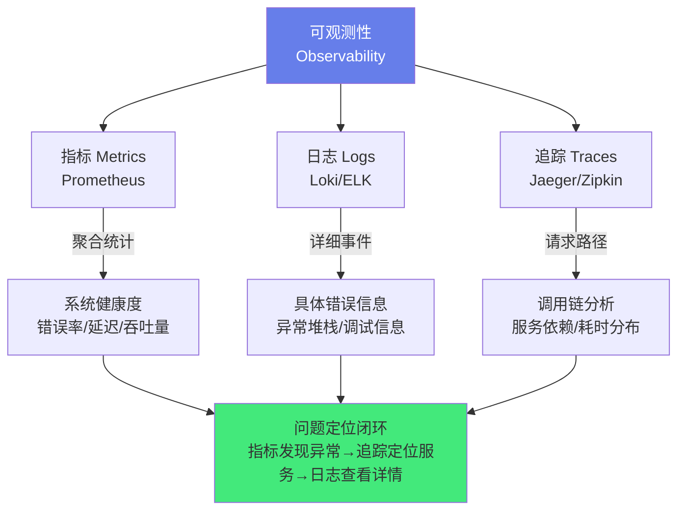
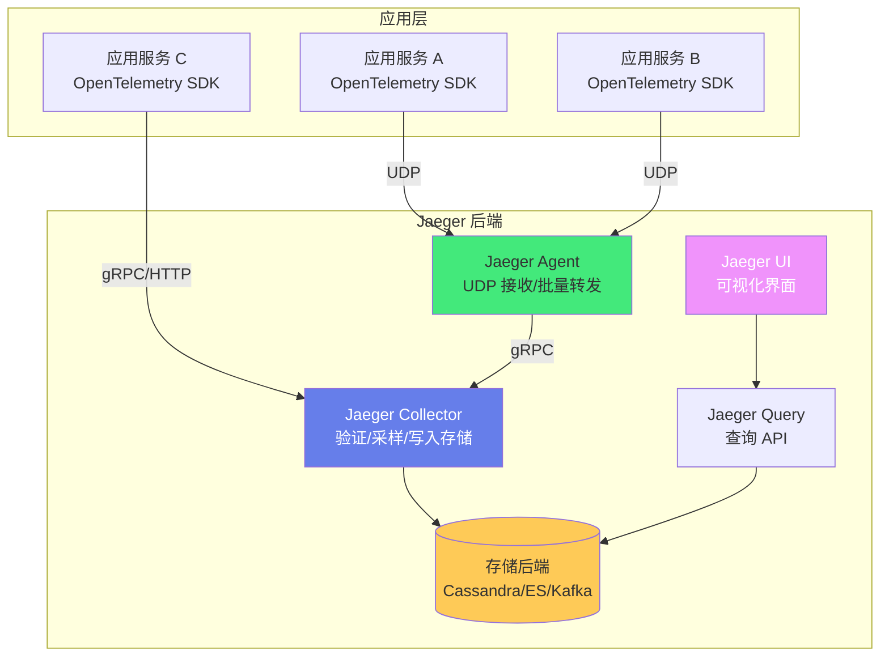

# 🔗 Jaeger 分布式链路追踪

> **文档说明**：系统讲解 Jaeger 分布式链路追踪的完整知识体系，涵盖分布式追踪的核心概念与价值（Trace/Span/Tag/Log/Baggage）、Jaeger 的架构与组件（Agent/Collector/Query/UI/Storage）、OpenTelemetry 标准与接入方式、部署模式（all-in-one/生产部署/Operator）、存储后端（Cassandra/Elasticsearch/Kafka/内存）、采样策略（常量/概率/速率限制/自适应/远程）、各语言 SDK 接入（Java/Go/Python/Node.js）、上下文传播（HTTP/gRPC/消息队列）、与 Prometheus/Grafana/Loki 的可观测性三支柱集成、链路数据分析与性能优化、常见问题与最佳实践。
>
> **适用人群**：DevOps 工程师、SRE、后端开发者、微服务架构师、可观测性工程师
>
> **前置知识**：[[Prometheus-指标采集]] · [[微服务架构设计]] · [[K8s-核心概念与架构]]

---

## 一、概述

### 1.1 什么是分布式链路追踪

分布式链路追踪（Distributed Tracing）是一种用于观察和监控分布式系统中请求流转路径的技术。在微服务架构中，一个用户请求可能经过多个服务（网关→认证→订单→库存→支付→通知），链路追踪将这些跨服务的调用串联起来，形成完整的调用链，帮助开发者理解请求的完整路径、每个环节的耗时、错误发生的位置。

**为什么需要分布式追踪**：
| 问题 | 没有追踪的困境 | 有追踪的解决方案 |
|------|--------------|----------------|
| **请求慢** | 不知道哪个服务慢，逐个服务查日志 | 链路图一目了然，每个 Span 的耗时清晰可见 |
| **请求失败** | 不知道错误发生在哪个服务 | 链路中标红失败的 Span，直接定位错误服务 |
| **调用关系复杂** | 不清楚服务间依赖关系 | 链路图自动展示服务依赖拓扑 |
| **跨服务排查** | 用 requestId 手动 grep 多个服务日志 | TraceID 一键串联所有服务的调用 |
| **性能瓶颈** | 无法量化各环节耗时占比 | Span 耗时瀑布图，快速定位瓶颈 |
| **微服务数量多** | 服务间调用关系混乱 | 服务依赖拓扑图自动生成 |

**可观测性三支柱**：


| 支柱 | 工具 | 回答的问题 | 数据特点 |
|------|------|-----------|---------|
| **指标（Metrics）** | Prometheus | 系统是否健康？错误率多少？延迟多少？ | 数值型，可聚合，低成本 |
| **日志（Logs）** | Loki/ELK | 具体发生了什么错误？异常堆栈是什么？ | 文本型，高基数，详细 |
| **追踪（Traces）** | Jaeger/Zipkin | 请求经过了哪些服务？哪个环节慢？ | 结构化，跨服务，关联请求 |

> **核心洞察**：三支柱不是孤立的，而是协同工作的——指标发现异常（如错误率升高）→ 追踪定位问题服务（Trace 中哪个 Span 失败）→ 日志查看详细错误（该服务的错误日志）。这是可观测性的「问题定位闭环」。

### 1.2 Jaeger 简介

Jaeger 是 Uber 开源的分布式链路追踪系统，受 Google Dapper 和 OpenZipkin 启发，2017 年开源，2019 年成为 CNCF 毕业项目（与 Kubernetes、Prometheus 同级别）。

**Jaeger 的核心特性**：
| 特性 | 说明 |
|------|------|
| **分布式上下文传播** | 跨服务传递 Trace 上下文（HTTP/gRPC/消息队列） |
| **事务监控** | 展示请求的完整调用路径和耗时分布 |
| **根因分析** | 快速定位错误和性能瓶颈的服务 |
| **服务依赖分析** | 自动生成服务依赖拓扑图 |
| **性能优化** | 识别关键路径和耗时瓶颈 |
| **OpenTelemetry 兼容** | 支持 OpenTelemetry 标准协议（OTLP） |
| **云原生** | 支持 Kubernetes 部署，有官方 Operator |
| **多存储后端** | 支持 Cassandra/Elasticsearch/Kafka/内存/GRPC |
| **高可用** | 组件可水平扩展，支持多租户 |

**Jaeger vs Zipkin vs SkyWalking**：
| 维度 | Jaeger | Zipkin | SkyWalking |
|------|--------|--------|------------|
| **开源方** | Uber | Twitter | 华为/个人 |
| **CNCF 状态** | 毕业项目 | 不是 | Apache 顶级项目 |
| **语言** | Go | Java/Scala | Java |
| **UI** | 现代 React UI | 较简单 | 功能丰富的中文 UI |
| **存储** | Cassandra/ES/Kafka | MySQL/ES/Cassandra | MySQL/ES/InfluxDB |
| **采样** | 客户端+服务端 | 客户端 | 服务端 |
| **生态** | OpenTelemetry 首选 | OpenZipkin 生态 | 国内生态好，APM 功能全 |
| **适用场景** | 云原生、K8s、OpenTelemetry | 简单场景、Java 生态 | 国内团队、需要 APM 全功能 |

### 1.3 核心概念

| 概念 | 说明 | 类比 |
|------|------|------|
| **Trace（追踪）** | 一个完整请求的调用链，由多个 Span 组成 | 一次旅行的完整行程 |
| **Span（跨度）** | 一次具体的操作/调用，有开始时间和持续时间 | 旅行中的一段行程（如坐飞机） |
| **TraceID** | 唯一标识一个 Trace，所有 Span 共享 | 旅行订单号 |
| **SpanID** | 唯一标识一个 Span | 每段行程的编号 |
| **ParentSpanID** | 父 Span 的 ID，形成调用树 | 上一段行程的编号 |
| **Tag（标签）** | Span 的键值对属性，用于索引和查询（如 http.method、error） | 行程的属性（如舱位、航空公司） |
| **Log（日志）** | Span 内的时间戳事件，用于记录详细信息（如异常堆栈） | 行程中的事件（如登机、延误） |
| **Baggage（行李）** | 跨服务传递的键值对，贯穿整个 Trace | 旅行中随身携带的物品 |
| **采样（Sampling）** | 只记录部分 Trace，减少性能开销和存储成本 | 只记录部分旅行用于统计 |

**Trace 结构示例**：
```text
TraceID: abc123
├── Span 1: GET /api/order (服务: gateway, 耗时: 100ms)
│   ├── Span 2: GET /auth/verify (服务: auth, 耗时: 20ms)
│   └── Span 3: POST /order/create (服务: order, 耗时: 70ms)
│       ├── Span 4: SELECT inventory (服务: inventory, 耗时: 15ms)
│       └── Span 5: POST /payment/charge (服务: payment, 耗时: 40ms)
│           └── Span 6: 调用第三方支付API (服务: payment, 耗时: 35ms)
```

---

## 二、Jaeger 架构

### 2.1 组件架构



| 组件 | 说明 | 部署方式 |
|------|------|---------|
| **Client SDK** | 应用中集成的追踪库，负责创建 Span、上下文传播、发送数据 | 嵌入应用 |
| **Agent（可选）** | 监听 UDP 端口接收客户端数据，批量转发给 Collector，做采样决策 | Sidecar/主机模式 |
| **Collector** | 接收 Agent/客户端的数据，验证、采样、转换格式，写入存储 | 无状态，可水平扩展 |
| **Storage** | 存储 Trace 数据，支持 Cassandra/Elasticsearch/Kafka/内存/GRPC插件 | 有状态，独立部署 |
| **Query** | 提供查询 API，从存储中检索 Trace 数据 | 无状态 |
| **UI** | Web 界面，展示 Trace 列表、详情、依赖图 | 静态资源+Query API |

### 2.2 部署模式

| 模式 | 说明 | 适用场景 |
|------|------|---------|
| **all-in-one** | 所有组件在一个进程中，内存存储 | 开发/测试/演示 |
| **生产部署** | 各组件独立部署，Cassandra/ES 存储 | 生产环境 |
| **Kubernetes Operator** | Jaeger Operator 管理，自动配置 | K8s 环境 |
| **无 Agent 模式** | 客户端直接发送到 Collector（OTLP/gRPC） | 云原生/Serverless |

**all-in-one 快速启动**：
```bash
# Docker 运行 all-in-one
docker run -d --name jaeger \
  -e COLLECTOR_ZIPKIN_HOST_PORT=:9411 \
  -p 5775:5775/udp \
  -p 6831:6831/udp \
  -p 6832:6832/udp \
  -p 5778:5778 \
  -p 16686:16686 \
  -p 14268:14268 \
  -p 14250:14250 \
  -p 9411:9411 \
  jaegertracing/all-in-one:1.52

# 访问 UI: http://localhost:16686
```

**Kubernetes 部署（Operator）**：
```yaml
# 安装 Jaeger Operator
kubectl create namespace observability
kubectl apply -f https://github.com/jaegertracing/jaeger-operator/releases/download/v1.49.0/jaeger-operator.yaml -n observability

# 创建 Jaeger 实例
apiVersion: jaegertracing.io/v1
kind: Jaeger
metadata:
  name: simplest
spec:
  strategy: allInOne  # 或 production/streaming
```

### 2.3 存储后端

| 存储 | 特点 | 适用场景 |
|------|------|---------|
| **内存（Memory）** | 重启丢失，零配置 | 开发/测试 |
| **Cassandra** | 高可用、线性扩展、Jaeger 原生支持 | 大规模生产环境 |
| **Elasticsearch** | 全文检索、强大查询、Kibana 集成 | 需要复杂查询/日志关联 |
| **Kafka** | 作为 Collector 前置缓冲，解耦采集和存储 | 高吞吐量、流处理 |
| **GRPC 插件** | 自定义存储后端，通过 gRPC 插件扩展 | 特殊存储需求 |
| **Badger** | 嵌入式键值存储，单机持久化 | 单机/边缘场景 |

**生产环境存储选择建议**：
- 中小规模（< 10亿 Span/天）：Elasticsearch（查询灵活，运维简单）
- 大规模（> 10亿 Span/天）：Cassandra（写入性能好，线性扩展）
- 超高吞吐：Kafka + Cassandra/ES（Kafka 做缓冲，削峰填谷）

---

## 三、OpenTelemetry 接入

### 3.1 OpenTelemetry 简介

OpenTelemetry（OTel）是 CNCF 的可观测性标准，统一了指标、日志、追踪的数据模型和采集 API，是 Jaeger 推荐的接入方式（替代旧的 Jaeger Client SDK）。

**OpenTelemetry 的核心组件**：
| 组件 | 说明 |
|------|------|
| **API** | 语言无关的接口定义，用于在代码中生成遥测数据 |
| **SDK** | API 的实现，负责处理、导出遥测数据 |
| **Instrumentation** | 自动/手动埋点库，为框架/库自动生成 Span |
| **Collector** | 独立进程，接收、处理、导出遥测数据（可选） |
| **OTLP** | OpenTelemetry Protocol，标准传输协议（gRPC/HTTP） |

**为什么用 OpenTelemetry 而非 Jaeger SDK**：
- ✅ **厂商中立**：一次接入，可切换 Jaeger/Zipkin/Tempo/SkyWalking 等后端
- ✅ **统一标准**：指标+日志+追踪统一数据模型，三支柱关联
- ✅ **活跃生态**：CNCF 毕业项目，社区活跃，自动埋点丰富
- ✅ **Jaeger 官方推荐**：Jaeger 客户端 SDK 已进入维护模式，推荐 OTel

### 3.2 Java 接入（Spring Boot）

```xml
<!-- pom.xml -->
<dependency>
    <groupId>io.opentelemetry.instrumentation</groupId>
    <artifactId>opentelemetry-spring-boot-starter</artifactId>
</dependency>
```

```yaml
# application.yml
otel:
  service-name: order-service
  traces-exporter: otlp
  exporter:
    otlp:
      endpoint: http://jaeger-collector:4317
```

**Java Agent 自动埋点（推荐）**：
```bash
# 下载 OpenTelemetry Java Agent
wget https://github.com/open-telemetry/opentelemetry-java-instrumentation/releases/latest/download/opentelemetry-javaagent.jar

# 启动时挂载 Agent
java -javaagent:opentelemetry-javaagent.jar \
     -Dotel.service.name=order-service \
     -Dotel.exporter.otlp.endpoint=http://jaeger-collector:4317 \
     -jar app.jar
```

> Java Agent 方式无需修改代码，自动为 Spring MVC、RestTemplate、Feign、JDBC、Redis、Kafka 等主流框架埋点。

### 3.3 Go 接入

```go
package main

import (
    "go.opentelemetry.io/otel"
    "go.opentelemetry.io/otel/exporters/otlp/otlptrace/otlptracegrpc"
    "go.opentelemetry.io/otel/sdk/resource"
    sdktrace "go.opentelemetry.io/otel/sdk/trace"
    semconv "go.opentelemetry.io/otel/semconv/v1.21.0"
)

func initTracer() (*sdktrace.TracerProvider, error) {
    exporter, err := otlptracegrpc.New(ctx,
        otlptracegrpc.WithEndpoint("jaeger-collector:4317"),
        otlptracegrpc.WithInsecure(),
    )
    if err != nil {
        return nil, err
    }
    
    tp := sdktrace.NewTracerProvider(
        sdktrace.WithBatcher(exporter),
        sdktrace.WithResource(resource.NewWithAttributes(
            semconv.SchemaURL,
            semconv.ServiceNameKey.String("order-service"),
        )),
    )
    otel.SetTracerProvider(tp)
    return tp, nil
}

// 创建 Span
func handleRequest(ctx context.Context) {
    tracer := otel.Tracer("order-service")
    ctx, span := tracer.Start(ctx, "handleRequest")
    defer span.End()
    
    // 设置 Tag
    span.SetAttributes(attribute.String("http.method", "POST"))
    span.SetAttributes(attribute.Int("http.status_code", 200))
    
    // 记录 Log
    span.AddEvent("processing order", trace.WithAttributes(
        attribute.String("order_id", "12345"),
    ))
}
```

### 3.4 Python 接入

```python
from opentelemetry import trace
from opentelemetry.exporter.otlp.proto.grpc.trace_exporter import OTLPSpanExporter
from opentelemetry.sdk.trace import TracerProvider
from opentelemetry.sdk.trace.export import BatchSpanProcessor
from opentelemetry.sdk.resources import Resource

# 初始化
resource = Resource.create({"service.name": "order-service"})
provider = TracerProvider(resource=resource)
exporter = OTLPSpanExporter(endpoint="http://jaeger-collector:4317", insecure=True)
provider.add_span_processor(BatchSpanProcessor(exporter))
trace.set_tracer_provider(provider)

# 使用
tracer = trace.get_tracer(__name__)

with tracer.start_as_current_span("handle_request") as span:
    span.set_attribute("http.method", "POST")
    span.set_attribute("http.status_code", 200)
    span.add_event("order_created", {"order_id": "12345"})
```

### 3.5 Node.js 接入

```javascript
const { NodeSDK } = require('@opentelemetry/sdk-node');
const { OTLPTraceExporter } = require('@opentelemetry/exporter-trace-otlp-grpc');
const { HttpInstrumentation } = require('@opentelemetry/instrumentation-http');
const { ExpressInstrumentation } = require('@opentelemetry/instrumentation-express');

const sdk = new NodeSDK({
  serviceName: 'order-service',
  traceExporter: new OTLPTraceExporter({
    url: 'grpc://jaeger-collector:4317',
  }),
  instrumentations: [
    new HttpInstrumentation(),
    new ExpressInstrumentation(),
  ],
});

sdk.start();
```

---

## 四、上下文传播

### 4.1 传播机制

上下文传播（Context Propagation）是分布式追踪的核心——Trace 上下文（TraceID/SpanID/Baggage）需要在跨服务调用时传递，才能将多个服务的 Span 串联成一个完整的 Trace。

**传播格式**：
| 格式 | 说明 | Header |
|------|------|--------|
| **W3C TraceContext** | 标准（推荐） | `traceparent`, `tracestate` |
| **Jaeger** | Jaeger 原生 | `uber-trace-id` |
| **B3** | Zipkin 格式 | `X-B3-TraceId`, `X-B3-SpanId` 等 |
| **Baggage** | W3C 标准，跨服务传递数据 | `baggage` |

**W3C TraceContext 示例**：
```css
traceparent: 00-4bf92f3577b34da6a3ce929d0e0e4736-00f067aa0ba902b7-01
# 格式: version-traceid-spanid-traceflags
# version: 00
# traceid: 4bf92f3577b34da6a3ce929d0e0e4736 (32位hex)
# spanid: 00f067aa0ba902b7 (16位hex)
# traceflags: 01 (01=已采样, 00=未采样)
```

### 4.2 各协议传播

| 协议 | 传播方式 |
|------|---------|
| **HTTP** | 通过 HTTP Header 传递（traceparent/uber-trace-id） |
| **gRPC** | 通过 gRPC Metadata 传递（等价于 HTTP Header） |
| **消息队列（Kafka/RabbitMQ）** | 通过消息 Header/Properties 传递 |
| **GraphQL** | 通过 HTTP Header 传递 |
| **数据库** | 通常不传播（数据库调用是叶子 Span），但可以通过 SQL 注释传递 |

**手动传播示例（HTTP）**：
```go
// 注入上下文到 HTTP 请求
req, _ := http.NewRequest("GET", "http://other-service/api", nil)
otel.GetTextMapPropagator().Inject(ctx, propagation.HeaderCarrier(req.Header))
http.DefaultClient.Do(req)

// 从 HTTP 请求提取上下文
ctx := otel.GetTextMapPropagator().Extract(
    context.Background(),
    propagation.HeaderCarrier(r.Header),
)
```

---

## 五、采样策略

### 5.1 为什么需要采样

全量采集所有 Trace 会带来：
- **性能开销**：每个请求都创建 Span、序列化、网络传输
- **存储成本**：Trace 数据量大，存储成本高
- **网络带宽**：大量 Span 数据传输占用带宽

采样（Sampling）只记录部分 Trace，在可观测性和成本之间取得平衡。

### 5.2 采样类型

| 采样类型 | 说明 | 配置 |
|---------|------|------|
| **常量采样（Constant）** | 全采样或全不采样 | `sampler=const`, `param=1`(全采)/`0`(全不采) |
| **概率采样（Probabilistic）** | 按概率采样 | `sampler=probabilistic`, `param=0.1`(10%) |
| **速率限制（Rate Limiting）** | 每秒最多采样 N 条 | `sampler=ratelimiting`, `param=10`(10条/秒) |
| **自适应（Adaptive）** | 根据后端负载动态调整采样率 | Jaeger Agent 自动调整 |
| **远程采样（Remote）** | 从 Collector 拉取采样策略 | 按服务/操作配置不同采样率 |
| **尾采样（Tail-based）** | 根据 Trace 完整信息决定（如只保留错误/慢请求） | Collector 端处理，需要缓存 |

**采样决策点**：
| 决策点 | 说明 | 优缺点 |
|--------|------|--------|
| **客户端采样（Head-based）** | 应用 SDK 在 Trace 开始时决定是否采样 | 简单、低开销，但无法根据 Trace 结果决策 |
| **服务端采样（Tail-based）** | Collector 收到完整 Trace 后决定 | 可以只保留错误/慢 Trace，但需要缓存完整 Trace，内存开销大 |

**生产环境采样建议**：
- 开发/测试环境：100% 采样（const=1）
- 生产环境：概率采样 1%-10%，错误请求 100% 采样（尾采样）
- 关键服务：较高采样率（如 20%）
- 非关键服务：较低采样率（如 1%）

---

## 六、Jaeger UI 使用

### 6.1 搜索页面

Jaeger UI 提供强大的 Trace 搜索功能：
- **服务筛选**：选择特定服务
- **操作筛选**：选择特定操作（API 端点）
- **标签筛选**：按 Tag 搜索（如 `http.status_code=500`、`error=true`）
- **时间范围**：最近 1 小时/6 小时/24 小时/自定义
- **最小持续时间**：只看慢请求（如 > 1s）
- **限制数量**：返回结果数量

### 6.2 Trace 详情页

| 视图 | 说明 |
|------|------|
| **瀑布图（Waterfall）** | 每个 Span 的时间轴，展示调用顺序和耗时 |
| **Span 详情** | 点击 Span 查看 Tags、Logs、进程信息 |
| **耗时统计** | 每个 Span 的持续时间和占比 |
| **错误标记** | 失败的 Span 标红显示 |
| **比较功能** | 对比两个 Trace 的差异 |

### 6.3 系统架构图

Jaeger 自动根据 Trace 数据生成服务依赖拓扑图：
- 节点：服务
- 边：服务间调用关系
- 边的粗细：调用频率
- 边的颜色：错误率（红色表示错误率高）

---

## 七、与可观测性生态集成

### 7.1 Prometheus + Jaeger

- **指标关联追踪**：Prometheus 指标异常时，通过 exemplar（范例）关联到具体 Trace
- **统一服务发现**：K8s 环境中统一服务发现
- **Grafana 统一面板**：Grafana 中同时展示指标和 Jaeger Trace 链接

### 7.2 Grafana Tempo（Jaeger 替代）

Grafana Tempo 是兼容 Jaeger 的分布式追踪后端，特点：
- 只需要对象存储（S3/GCS），无需 Cassandra/ES
- 与 Grafana 深度集成
- 支持 OTLP、Jaeger、Zipkin 多种协议
- 成本更低（对象存储比 ES/Cassandra 便宜）

### 7.3 OpenTelemetry Collector

OTel Collector 是遥测数据的处理管道，可以替代 Jaeger Agent/Collector：
```text
应用 SDK → OTel Collector（接收/处理/导出）→ Jaeger / Prometheus / Loki
```

**Collector 优势**：
- 统一接收指标+日志+追踪
- 灵活的处理管道（过滤/转换/采样/批处理）
- 多后端导出（一份数据同时发 Jaeger+Prometheus+Loki）
- 解耦应用和后端，切换后端无需改应用

---

## 八、常见问题与最佳实践

### 8.1 常见问题

| 问题 | 原因 | 解决方案 |
|------|------|---------|
| **Jaeger UI 看不到 Trace** | 采样率为0/端点配置错/防火墙 | 检查采样配置、OTLP 端点、网络连通性、Collector 日志 |
| **Trace 不完整（缺 Span）** | 上下文未传播/异步任务未传递 context | 检查跨服务 Header 传播、异步线程传递 context、goroutine 传递 ctx |
| **性能开销大** | 采样率太高/Span 太多 | 降低采样率、减少不必要的 Span、使用批量导出 |
| **存储成本高** | 全量采样/保留时间太长 | 降低采样率、缩短保留时间、用对象存储（Tempo）、尾采样只保留异常 |
| **服务依赖图不准确** | 部分服务未接入/采样率低 | 确保所有服务接入、提高关键服务采样率 |
| **Span 名称不规范** | 自动埋点生成的名称不统一 | 自定义 Span 名称、按 RESTful 路径模板命名（如 `/users/{id}` 而非 `/users/123`） |
| **高基数 Tag 导致查询慢** | Tag 值基数太高（如 userID、requestID） | 高基数信息放 Log 而非 Tag，Tag 用于索引查询 |
| **异步任务 Trace 断裂** | 新线程/goroutine 未继承 context | 手动传递 context、使用 context 感知的线程池/协程 |
| **消息队列 Trace 断裂** | 消费者未从消息 Header 提取 context | 生产者注入 context 到消息 Header，消费者提取 |
| **Collector 丢数据** |  Collector 内存不足/后端写入慢 | 增加 Collector 副本、用 Kafka 做缓冲、优化存储写入 |
| **多语言 Trace 不兼容** | 传播格式不一致 | 统一用 W3C TraceContext 格式 |
| **本地开发看不到 Trace** | all-in-one 容器没启动/端口映射错 | 检查容器状态、端口映射、应用端点配置 |

### 8.2 最佳实践

1. **统一用 OpenTelemetry**：
   - 所有服务用 OTel SDK 接入，不用旧的 Jaeger/Zipkin SDK
   - 统一传播格式为 W3C TraceContext
   - 统一导出协议为 OTLP

2. **合理的采样策略**：
   - 开发/测试：100% 采样
   - 生产：概率采样 1%-10% + 错误请求 100%（尾采样）
   - 关键服务高采样率，非关键服务低采样率
   - 定期评估采样率，平衡可观测性和成本

3. **规范的 Span 设计**：
   - Span 名称用操作名而非具体值（`/users/{id}` 而非 `/users/123`）
   - Tag 用于索引和查询（http.method、http.status_code、error、db.statement）
   - Log 用于详细事件（异常堆栈、调试信息、高基数数据）
   - 每个 Span 有明确的开始和结束，避免长生命周期 Span

4. **完整的上下文传播**：
   - HTTP/gRPC 自动传播（OTel Instrumentation 已处理）
   - 消息队列：生产者注入、消费者提取
   - 异步任务：手动传递 context（线程池/goroutine）
   - 跨线程：用 context 感知的执行器

5. **服务命名规范**：
   - 服务名统一（如 `order-service`、`payment-service`）
   - 环境通过 Tag 区分（`deployment.environment=production`）
   - 版本通过 Tag 标注（`service.version=1.2.3`）

6. **与指标/日志关联**：
   - 日志中输出 TraceID（`trace_id=xxx`），便于从日志跳转到 Trace
   - 指标用 exemplar 关联 Trace
   - Grafana 统一面板，指标→Trace→日志联动

7. **存储与保留**：
   - 热数据（最近 7 天）：ES/Cassandra，快速查询
   - 冷数据（7-30 天）：对象存储，成本低
   - 超过 30 天：归档或删除
   - 定期清理过期数据

8. **性能优化**：
   - 批量导出 Span（BatchSpanProcessor）
   - 合理设置导出超时和队列大小
   - Collector 水平扩展
   - 高吞吐场景用 Kafka 做缓冲

9. **安全**：
   - Collector 端点不暴露公网
   - 存储后端访问控制
   - 敏感信息不放在 Tag/Log 中（如密码、token）
   - Baggage 不传递敏感数据

10. **告警与监控**：
    - 监控 Jaeger 组件健康状态（Collector/Query/Storage）
    - 监控 Trace 上报量和延迟
    - 错误率高的服务自动提高采样率
    - 慢请求阈值告警

---

## 九、关联笔记

### 可观测性
- [[Prometheus-指标采集]] · [[Grafana-可视化看板_backup_skeleton]] · [[日志收集与分析]]
- [[ELK日志栈]] · [[Loki轻量日志]]

### 微服务与云原生
- [[微服务架构设计]] · [[K8s-核心概念与架构]] · [[服务网格Istio]]
- [[API网关设计]] · [[Seata-分布式事务]]

### DevOps
- [[CI-CD流水线]] · [[Docker容器化]] · [[K8s-资源管理]]

### 导航
- [[MOC-云原生与运维]] · [[MOC-可观测性]] · [[MOC-综合导航]] · [[Home]]

> 🔍 **知识点深度解析**
>
> **作用**：Jaeger 分布式链路追踪解决的是「微服务架构中请求跨服务流转的可观测性问题」——在单体应用中，一个请求的所有逻辑都在一个进程中，查日志就能看到完整调用链；但在微服务架构中，一个请求可能经过 5-10 个服务，每个服务有自己的日志，传统方式用 requestId 手动 grep 多个服务的日志，效率极低且容易遗漏。分布式追踪通过 TraceID 将跨服务的调用串联成一个完整的调用链（Trace），每个操作（Span）有耗时、标签、日志，让开发者能一目了然地看到请求的完整路径、每个环节的耗时、错误发生的位置，是微服务架构下问题定位和性能优化的核心工具。
>
> **底层原理**：分布式追踪的核心是「上下文传播 + 树状结构」。①上下文传播：每个请求开始时生成一个唯一的 TraceID，在跨服务调用时通过 HTTP Header/gRPC Metadata/消息队列 Header 传递 TraceID 和当前 SpanID，被调用服务提取后创建子 Span（ParentSpanID 指向调用方的 SpanID），这样所有服务的 Span 通过 TraceID 关联，通过 ParentSpanID 形成树状调用链。②Span 模型：每个 Span 包含 TraceID、SpanID、ParentSpanID、操作名、开始时间、持续时间、Tag（键值对属性，用于索引）、Log（时间戳事件，用于详细信息）、Baggage（跨服务传递的键值对）。③采样：全量采集开销大，采样只记录部分 Trace——客户端采样（Head-based）在 Trace 开始时决定，简单但无法根据结果决策；服务端采样（Tail-based）收到完整 Trace 后决定，可以只保留错误/慢请求，但需要缓存。④存储与查询：Collector 接收 Span 数据，写入 Cassandra/Elasticsearch/Kafka，Query 从存储检索 Trace 并通过 UI 展示瀑布图和依赖拓扑。⑤OpenTelemetry 统一了数据模型和采集 API，OTLP 协议标准化传输，让应用一次接入可切换多个后端。
>
> **用法要点**：① 核心概念：Trace（完整调用链）、Span（单次操作）、TraceID/SpanID/ParentSpanID（关联）、Tag（索引属性）、Log（详细事件）、Baggage（跨服务数据）、采样（部分记录） ② 架构：SDK（应用埋点）→ Agent（可选，UDP接收转发）→ Collector（验证/采样/写入）→ Storage（Cassandra/ES/Kafka）→ Query（查询API）→ UI（可视化） ③ 接入：用 OpenTelemetry SDK（推荐，替代旧 Jaeger SDK），Java 用 Agent 自动埋点（零代码），Go/Python/Node.js 手动初始化+自动 Instrumentation ④ 上下文传播：统一 W3C TraceContext 格式（traceparent header），HTTP/gRPC 自动传播，消息队列手动注入/提取，异步任务传递 context ⑤ 采样：开发100%，生产概率1%-10%+错误100%（尾采样），关键服务高采样率，客户端采样简单/服务端采样精准 ⑥ 部署：all-in-one（开发测试）、生产独立部署（Collector+ES/Cassandra）、K8s Operator、OTel Collector 替代 ⑦ UI：搜索（服务/操作/Tag/时间/最小耗时）、瀑布图（Span时间轴）、依赖拓扑（服务调用关系） ⑧ 最佳实践：统一 OTel+W3C+OTLP、合理采样、规范 Span 名称（模板而非具体值）、Tag 用于索引/Log 用于详情、完整上下文传播（含异步/消息队列）、与指标日志关联（TraceID 打日志）、存储分层（热/冷）、批量导出、安全（不暴露公网/敏感信息不入Tag） ⑨ 常见坑：看不到Trace（采样/端点/网络）、Trace断裂（上下文未传播/异步未传ctx）、性能开销大（采样率高）、存储贵（全量+保留长）、高基数Tag慢（用Log替代）。

> 💡 **深度讲解**：Jaeger 最核心的智慧是「用一个 ID 串联分布式世界」——在微服务架构中，请求像水流一样穿过多个服务，每个服务只看到水流的一小段，没有人看到完整的河流。分布式追踪给每滴水（请求）一个唯一的编号（TraceID），在每个服务的入口记录「这滴水从哪里来（ParentSpanID）、在这里做了什么（Span）、停留了多久（耗时）」，最后把所有服务的记录按 TraceID 聚合，就还原出了水流的完整路径。这就像快递追踪——每个快递有一个单号（TraceID），经过每个中转站（服务）时扫描记录（Span），最后在系统中能看到快递的完整路径和每个环节的耗时。理解了这个比喻，你就理解了分布式追踪的本质。「上下文传播是分布式追踪最难的部分」——技术上创建 Span 很简单，但确保 Trace 上下文在跨服务、跨协议、跨线程时不丢失，是工程上的挑战。HTTP/gRPC 因为有 Header，OTel 自动 Instrumentation 已经处理好了；但消息队列（Kafka/RabbitMQ）需要手动把 context 注入消息 Header，消费者提取；异步任务（线程池/goroutine）需要手动传递 context，否则新线程看不到父 Span，Trace 就断裂了。这也是为什么很多团队接入 Jaeger 后发现 Trace 不完整——不是 Jaeger 的问题，而是上下文传播没有覆盖所有场景。「采样是可观测性和成本的艺术」——全量采样能看到所有请求，但存储成本可能是天文数字（每秒 1 万请求，每个请求 10 个 Span，一天就是 86 亿 Span）；完全不采样又失去了可观测性。好的采样策略是「正常请求低采样率，异常请求高采样率」——用尾采样（Tail-based）在 Collector 端判断，如果 Trace 中有错误或耗时超过阈值，就 100% 保留；正常请求只保留 1%。这样既能抓住所有问题，又控制了成本。这就像机场安检——大多数乘客快速通过（低采样），可疑人员重点检查（高采样），在安全和效率之间取得平衡。

> 📝 **精简总结**：Jaeger = CNCF 毕业的分布式链路追踪系统，核心概念 Trace（调用链）/Span（操作）/Tag（索引）/Log（详情）/Baggage（跨服务数据）。架构：SDK→Agent→Collector→Storage(Cassandra/ES/Kafka)→Query→UI。接入用 OpenTelemetry（推荐），Java Agent 零代码自动埋点，Go/Python/Node.js 手动+自动 Instrumentation。上下文传播统一 W3C TraceContext，HTTP/gRPC自动，消息队列/异步手动传递。采样：开发100%，生产概率1%-10%+错误尾采样。部署：all-in-one（开发）、生产独立、K8s Operator。vs Zipkin/SkyWalking：Jaeger 云原生+OTel首选，SkyWalking 国内APM全功能。最佳实践：统一OTel+W3C+OTLP、合理采样、规范Span名、Tag索引/Log详情、完整传播、与指标日志关联、存储分层。坑：看不到Trace（配置/网络）、Trace断裂（传播/异步）、性能/存储成本（采样率）。

> **学习路径建议**：先学习 [[微服务架构设计]] 理解为什么需要分布式追踪 → 学习 [[Prometheus-指标采集]] 掌握可观测性第一支柱 → 学习本文档掌握 Jaeger 分布式追踪 → 实践：用 all-in-one 快速体验，为一个 Spring Boot 服务接入 OTel Java Agent → 学习 [[日志收集与分析]] 掌握第三支柱 → 学习 OpenTelemetry Collector 统一三支柱采集 → 学习 [[服务网格Istio]] 理解自动追踪（Sidecar 自动埋点）→ 学习 Grafana Tempo 作为 Jaeger 替代（更低成本）→ 在生产环境部署高可用 Jaeger 集群。

---

> **Jaeger 的本质是「分布式系统的时间机器」——在没有分布式追踪的时代，微服务的问题排查是「盲人摸象」——每个服务的日志是大象的一部分，没有人看到完整的大象，排查一个跨服务的问题可能需要几个小时甚至几天。分布式追踪给了我们「上帝视角」——通过 TraceID，我们能看到请求的完整旅程，它经过了哪些服务、每个服务做了什么、花了多少时间、在哪里出错了。这不仅仅是工具的升级，更是思维方式的转变——从「各自为战的服务视角」到「全局统一的请求视角」。当你的系统有了完善的分布式追踪，问题排查从「小时级」变成「分钟级」，性能优化从「猜测」变成「数据驱动」，这就是可观测性的力量。Jaeger 作为 CNCF 毕业的分布式追踪标准，配合 OpenTelemetry 的统一采集，已经成为云原生可观测性的标配——它不是「可选的高级功能」，而是「微服务架构的基础设施」，就像日志和监控一样，是生产环境不可或缺的一部分。**
