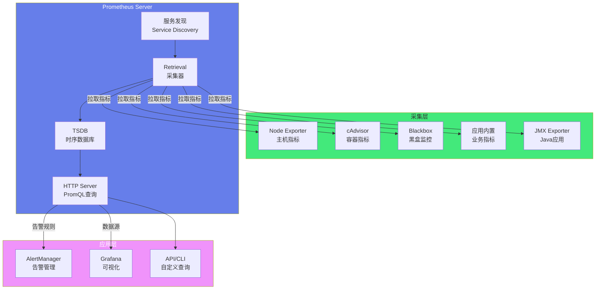
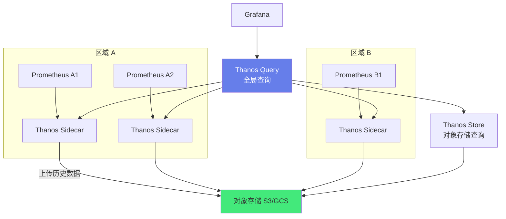

# 📊 Prometheus 指标采集与监控

> **文档说明**：系统讲解 Prometheus 监控系统的完整知识体系，涵盖 Prometheus 核心概念与架构、数据模型（指标/标签/样本/时间序列）、四种指标类型（Counter/Gauge/Histogram/Summary）、PromQL 查询语言（选择器/函数/聚合/操作符）、Exporter 原理与常用 Exporter（Node Exporter/Blackbox/cAdvisor/JMX）、服务发现（静态/K8s/EC2/Consul）、配置文件详解、告警规则与 AlertManager、Grafana 可视化集成、Prometheus 部署与高可用、远程存储（Thanos/Cortex/M3DB）、性能调优、常见问题与最佳实践。
>
> **适用人群**：运维工程师、SRE、DevOps、后端开发者、监控系统搭建者、云原生学习者
>
> **前置知识**：[[Linux系统管理与常用命令]] · [[Docker容器化]] · [[K8s-核心概念与架构]]

---

## 一、概述

### 1.1 什么是 Prometheus

Prometheus 是一个开源的系统监控和告警工具包，最初由 SoundCloud 开发，2016 年加入 CNCF（云原生计算基金会），是继 Kubernetes 之后第二个毕业的 CNCF 项目。它是目前云原生监控的事实标准。

**核心特点**：
- **多维数据模型**：指标名 + 键值对标签，灵活强大
- **PromQL 查询语言**：强大的查询和聚合语言
- **拉模型（Pull）**：主动从目标拉取指标，而非被动接收
- **无依赖存储**：内置时序数据库，不需要外部存储（小规模）
- **服务发现**：支持静态配置和多种动态服务发现（K8s/Consul/EC2 等）
- **告警集成**：内置告警规则，配合 AlertManager 实现告警路由/分组/抑制
- **生态丰富**：大量官方和社区 Exporter，覆盖各种系统和服务



### 1.2 Prometheus vs 传统监控

| 维度 | 传统监控（Zabbix/Nagios） | Prometheus |
|------|--------------------------|-----------|
| **数据模型** | 主机+监控项，维度少 | 指标+标签，多维灵活 |
| **采集方式** | 推模型（Agent 主动上报） | 拉模型（Server 主动拉取） |
| **查询语言** | 弱（简单函数） | 强（PromQL，强大的聚合和计算） |
| **服务发现** | 手动注册/自动发现弱 | 强大的服务发现（K8s/Consul/EC2 等） |
| **存储** | 关系型数据库（MySQL） | 内置时序数据库（TSDB），高性能 |
| **告警** | 内置，功能简单 | AlertManager，强大的路由/分组/抑制/静默 |
| **可视化** | 内置图表，功能有限 | 配合 Grafana，强大的可视化 |
| **云原生** | 支持弱 | 云原生事实标准，K8s 深度集成 |
| **扩展性** | 集中式，扩展难 | 联邦集群/远程存储，可扩展 |
| **配置** | Web UI 配置 | YAML 配置文件，GitOps 友好 |

### 1.3 可观测性三大支柱

| 支柱 | 说明 | Prometheus 相关 |
|------|------|----------------|
| **指标（Metrics）** | 数值型时间序列数据，可聚合可计算 | Prometheus 核心能力 |
| **日志（Logs）** | 离散事件的文本记录，详细但量大 | Loki（Prometheus 团队开发的日志系统） |
| **追踪（Traces）** | 请求的完整调用链，定位延迟和错误 | Jaeger/Zipkin/Tempo（Grafana 团队） |

> Prometheus 专注于指标（Metrics），是可观测性的基础。日志和追踪通常配合其他工具（Loki/Jaeger/Tempo），通过标签关联实现统一可观测性。

---

## 二、数据模型

### 2.1 核心概念

| 概念 | 说明 | 示例 |
|------|------|------|
| **指标名（Metric Name）** | 指标的名称，描述测量的内容 | `http_requests_total`、`node_cpu_seconds_total` |
| **标签（Label）** | 键值对，区分同一指标的不同维度 | `method="GET"`、`status="200"`、`instance="node1"` |
| **样本（Sample）** | 一个时间点的值，包含时间戳和值 | `(t=2024-01-01T00:00:00Z, v=42)` |
| **时间序列（Time Series）** | 指标名 + 一组唯一标签 = 一个时间序列 | `http_requests_total{method="GET",status="200"}` |
| **实例（Instance）** | 被监控的目标，通常是 IP:端口 | `192.168.1.10:9100` |
| **作业（Job）** | 一组相同类型的实例集合 | `node_exporter`、`kubernetes-pods` |

**时间序列标识**：
```text
<metric_name>{<label_name>=<label_value>, ...}

示例：
http_requests_total{method="GET", status="200", instance="web1:8080", job="web"}
node_cpu_seconds_total{cpu="0", mode="user", instance="node1:9100", job="node"}
```

> **关键原则**：指标名 + 标签组合唯一标识一个时间序列。标签是 Prometheus 多维数据模型的核心——通过不同的标签组合，可以灵活地筛选、聚合、对比数据。

### 2.2 标签设计最佳实践

| 原则 | 说明 | 反例 | 正例 |
|------|------|------|------|
| **标签基数低** | 标签值的数量应该有限，避免高基数 | `user_id="12345"`（百万用户） | `status="200"`（有限状态码） |
| **标签维度稳定** | 标签应该是描述性维度，不是频繁变化的值 | `request_id="abc-123"`（每次请求不同） | `method="GET"`（HTTP 方法） |
| **使用 snake_case** | 指标名和标签名使用下划线命名 | `httpRequestsTotal` | `http_requests_total` |
| **单位在指标名** | 单位放在指标名后缀，不放在标签 | `temperature{unit="celsius"}` | `temperature_celsius` |
| **标签值规范化** | 标签值应该是有限的、可枚举的 | `url="/user/123/profile"` | `url="/user/:id/profile"`（规范化） |
| **避免过多标签** | 每个时间序列的标签数不宜过多（<10） | 20+ 标签 | 5-8 个核心标签 |

> **高基数警告**：高基数标签（如 user_id、request_id、url 原始路径）会导致时间序列数量爆炸，严重影响 Prometheus 性能和存储。一个 Prometheus 实例通常能处理百万级时间序列，超过会导致内存和查询性能问题。

### 2.3 四种指标类型

| 类型 | 说明 | 特点 | 示例 |
|------|------|------|------|
| **Counter（计数器）** | 只增不减的累计值，重启后归零 | 单调递增，适合计数 | `http_requests_total`、`process_cpu_seconds_total` |
| **Gauge（仪表盘）** | 可增可减的瞬时值 | 任意变化，适合测量当前状态 | `node_memory_MemAvailable_bytes`、`go_goroutines` |
| **Histogram（直方图）** | 统计样本分布在各个桶（bucket）中的数量 | 可计算分位数（p50/p99），服务端聚合 | `http_request_duration_seconds` |
| **Summary（摘要）** | 客户端直接计算分位数 | 客户端计算分位数，无法聚合，性能开销大 | `http_request_duration_seconds`（客户端计算） |

**Counter 示例**：
```css
# HELP http_requests_total Total HTTP requests
# TYPE http_requests_total counter
http_requests_total{method="GET",status="200"} 1027
http_requests_total{method="POST",status="200"} 512
http_requests_total{method="GET",status="404"} 35
```

**Gauge 示例**：
```css
# HELP node_memory_MemAvailable_bytes Available memory
# TYPE node_memory_MemAvailable_bytes gauge
node_memory_MemAvailable_bytes{instance="node1"} 8589934592
node_memory_MemAvailable_bytes{instance="node2"} 4294967296
```

**Histogram 示例**：
```css
# HELP http_request_duration_seconds Request duration
# TYPE http_request_duration_seconds histogram
http_request_duration_seconds_bucket{le="0.1"} 500    # 500个请求 < 0.1s
http_request_duration_seconds_bucket{le="0.5"} 800    # 800个请求 < 0.5s
http_request_duration_seconds_bucket{le="1"} 950      # 950个请求 < 1s
http_request_duration_seconds_bucket{le="+Inf"} 1000  # 总共1000个请求
http_request_duration_seconds_sum 350.5                 # 总耗时 350.5s
http_request_duration_seconds_count 1000                # 总请求数
```

**Histogram vs Summary**：
| 维度 | Histogram | Summary |
|------|-----------|---------|
| 分位数计算 | 服务端（PromQL histogram_quantile） | 客户端（应用直接计算） |
| 可聚合性 | 可聚合（多个实例的直方图可合并） | 不可聚合（分位数无法直接合并） |
| 性能开销 | 客户端低（只计数），服务端查询时计算 | 客户端高（需要排序/计算分位数） |
| 精度 | 依赖 bucket 配置，近似值 | 精确值 |
| 适用场景 | 服务端聚合、跨实例对比 | 单实例精确分位数 |
| 推荐 | **推荐使用 Histogram** | 仅在不需要聚合时使用 |

---

## 三、PromQL 查询语言

### 3.1 基本查询

```promql
# 查询所有时间序列的最新值
http_requests_total

# 按标签筛选
http_requests_total{method="GET", status="200"}

# 标签匹配操作符
# =  精确匹配
# != 不匹配
# =~ 正则匹配
# !~ 正则不匹配
http_requests_total{method=~"GET|POST"}
http_requests_total{status!~"5.."}

# 查询过去 5 分钟的时间序列（范围向量）
http_requests_total[5m]

# 偏移查询（1 小时前的数据）
http_requests_total offset 1h

# 时间单位：s(秒) m(分) h(时) d(天) w(周) y(年)
```

### 3.2 常用函数

| 函数 | 说明 | 示例 |
|------|------|------|
| `rate()` | 计算 Counter 每秒平均增长率（最常用） | `rate(http_requests_total[5m])` |
| `irate()` | 计算瞬时增长率（基于最后两个样本） | `irate(http_requests_total[5m])` |
| `increase()` | 计算时间范围内的增长量 | `increase(http_requests_total[1h])` |
| `sum()` | 求和聚合 | `sum(rate(http_requests_total[5m]))` |
| `avg()` | 平均值聚合 | `avg(node_memory_MemAvailable_bytes)` |
| `max()/min()` | 最大/最小值 | `max(goroutines)` |
| `count()` | 计数 | `count(up == 0)` |
| `topk()` | 前 K 个最大值 | `topk(5, rate(http_requests_total[5m]))` |
| `bottomk()` | 后 K 个最小值 | `bottomk(5, node_filesystem_avail_bytes)` |
| `histogram_quantile()` | 计算直方图分位数 | `histogram_quantile(0.99, rate(http_request_duration_seconds_bucket[5m]))` |
| `delta()` | Gauge 的变化量 | `delta(node_memory_MemAvailable_bytes[1h])` |
| `deriv()` | Gauge 的导数（变化速率） | `deriv(node_memory_MemAvailable_bytes[1h])` |
| `predict_linear()` | 线性预测（预测磁盘满时间） | `predict_linear(node_filesystem_avail_bytes[1h], 24*3600)` |
| `abs()` | 绝对值 | `abs(node_memory_MemAvailable_bytes)` |
| `clamp_min()/clamp_max()` | 限制最小值/最大值 | `clamp_max(rate(...), 100)` |
| `label_replace()` | 替换/添加标签 | `label_replace(up, "host", "$1", "instance", "(.*):.*")` |
| `label_join()` | 合并标签 | `label_join(up, "endpoint", "-", "instance", "job")` |
| `time()` | 当前时间戳 | `time() - process_start_time_seconds`（运行时长） |
| `vector()` | 创建标量向量 | `vector(1)` |
| `scalar()` | 单元素向量转标量 | `scalar(up{job="prometheus"})` |

### 3.3 聚合操作

```promql
# 按标签聚合（by）
sum by (job) (rate(http_requests_total[5m]))

# 排除标签聚合（without）
sum without (instance) (node_memory_MemAvailable_bytes)

# 多维度聚合
sum by (namespace, pod) (rate(container_cpu_usage_seconds_total[5m]))

# 聚合修饰符
# sum/avg/max/min/count/count_values/stddev/stdvar
# topk/bottomk/quantile/limit_values/limit_offset
avg by (instance) (rate(node_cpu_seconds_total{mode!="idle"}[5m]))
```

### 3.4 操作符

```promql
# 算术操作符：+ - * / % ^
node_memory_MemTotal_bytes - node_memory_MemAvailable_bytes  # 已用内存

# 比较操作符：== != > < >= <=
up == 0                    # 宕机的实例
rate(http_requests_total[5m]) > 100  # QPS > 100

# 逻辑操作符：and or unless
up == 1 and rate(http_requests_total[5m]) > 100  # 在线且 QPS 高
up == 1 unless up{job="node"}  # 除了 node 之外的在线实例

# 操作符可以带 bool 修饰符，返回 0/1 而非过滤
up == bool 0  # 返回 1（宕机）或 0（在线），不过滤

# 向量匹配（on/ignoring/group_left/group_right）
# 两个向量按标签匹配后进行运算
node_memory_MemTotal_bytes / on(instance) node_cpu_seconds_total
```

### 3.5 常用查询示例

```promql
# ===== CPU =====
# CPU 使用率（按实例）
100 - (avg by(instance) (rate(node_cpu_seconds_total{mode="idle"}[5m])) * 100)

# CPU 负载
node_load1 / count by(instance) (node_cpu_seconds_total{mode="idle"})

# ===== 内存 =====
# 内存使用率
100 * (1 - node_memory_MemAvailable_bytes / node_memory_MemTotal_bytes)

# ===== 磁盘 =====
# 磁盘使用率
100 * (1 - node_filesystem_avail_bytes / node_filesystem_size_bytes)

# 预测磁盘 24 小时后是否会满（预测值 < 0 表示会满）
predict_linear(node_filesystem_avail_bytes{fstype!~"tmpfs|overlay"}[1h], 24*3600) < 0

# ===== 网络 =====
# 网络入站流量（字节/秒）
rate(node_network_receive_bytes_total{device!~"lo|docker.*|veth.*"}[5m]) * 8

# 网络出站流量
rate(node_network_transmit_bytes_total{device!~"lo|docker.*|veth.*"}[5m]) * 8

# ===== HTTP/应用 =====
# QPS（每秒请求数）
sum by (job) (rate(http_requests_total[5m]))

# 错误率（5xx 占比）
sum by (job) (rate(http_requests_total{status=~"5.."}[5m])) 
/ sum by (job) (rate(http_requests_total[5m])) * 100

# P99 延迟（直方图）
histogram_quantile(0.99, sum by (le, job) (rate(http_request_duration_seconds_bucket[5m])))

# ===== 容器/K8s =====
# 容器 CPU 使用率
sum by (namespace, pod) (rate(container_cpu_usage_seconds_total{container!=""}[5m]))

# 容器内存使用率
sum by (namespace, pod) (container_memory_working_set_bytes{container!=""})

# Pod 重启次数
increase(kube_pod_container_status_restarts_total[1h]) > 0

# ===== 系统健康 =====
# 实例存活状态
up

# 进程运行时长（秒）
time() - process_start_time_seconds

# Goroutine 数量（Go 应用）
go_goroutines
```

---

## 四、Exporter 与指标采集

### 4.1 Exporter 原理

Exporter 是 Prometheus 的指标采集代理，运行在被监控目标上，将目标的指标转换为 Prometheus 格式，通过 HTTP `/metrics` 端点暴露，Prometheus Server 定期拉取。


**Exporter 的两种模式**：
| 模式 | 说明 | 示例 |
|------|------|------|
| **独立 Exporter** | 独立进程，采集其他系统/服务的指标 | Node Exporter、MySQL Exporter、Redis Exporter |
| **内置指标** | 应用直接集成 Prometheus 客户端库，暴露 `/metrics` | 应用内置业务指标、Go/Java 应用内置运行时指标 |

### 4.2 常用 Exporter

| Exporter | 监控对象 | 端口 | 说明 |
|----------|---------|------|------|
| **Node Exporter** | Linux 主机（CPU/内存/磁盘/网络） | 9100 | 最常用，主机基础指标 |
| **cAdvisor** | 容器（Docker/K8s） | 8080 | 容器资源指标，K8s 内置 |
| **Blackbox Exporter** | 黑盒监控（HTTP/TCP/ICMP/DNS） | 9115 | 探测端点可用性和延迟 |
| **MySQL Exporter** | MySQL 数据库 | 9104 | MySQL 性能指标 |
| **Redis Exporter** | Redis 缓存 | 9121 | Redis 性能指标 |
| **PostgreSQL Exporter** | PostgreSQL | 9187 | PostgreSQL 性能指标 |
| **MongoDB Exporter** | MongoDB | 9216 | MongoDB 性能指标 |
| **Kafka Exporter** | Kafka | 9308 | Kafka 性能指标 |
| **Nginx Exporter** | Nginx | 9113 | Nginx 连接/请求指标 |
| **JMX Exporter** | Java 应用（JVM） | 可配置 | JVM 指标（内存/GC/线程） |
| **Elasticsearch Exporter** | Elasticsearch | 9114 | ES 集群/索引指标 |
| **RabbitMQ Exporter** | RabbitMQ | 9419 | 队列/消息指标 |
| **SNMP Exporter** | 网络设备（交换机/路由器） | 9116 | SNMP 协议采集 |
| **IPMI Exporter** | 服务器硬件（IPMI） | 9290 | 硬件传感器（温度/风扇/电源） |

### 4.3 Node Exporter 部署

```bash
# 下载安装 Node Exporter
wget https://github.com/prometheus/node_exporter/releases/download/v1.7.0/node_exporter-1.7.0.linux-amd64.tar.gz
tar xzf node_exporter-1.7.0.linux-amd64.tar.gz
cd node_exporter-1.7.0.linux-amd64
sudo cp node_exporter /usr/local/bin/

# 创建 systemd 服务
sudo tee /etc/systemd/system/node_exporter.service << 'EOF'
[Unit]
Description=Node Exporter
After=network.target

[Service]
User=node_exporter
Group=node_exporter
Type=simple
ExecStart=/usr/local/bin/node_exporter \
  --web.listen-address=:9100 \
  --collector.systemd \
  --collector.processes \
  --collector.filesystem.mount-points-exclude="^/(sys|proc|dev|run)($|/)"

[Install]
WantedBy=multi-user.target
EOF

# 创建用户并启动
sudo useradd -rs /bin/false node_exporter
sudo systemctl daemon-reload
sudo systemctl enable --now node_exporter

# 验证
curl http://localhost:9100/metrics
```

### 4.4 应用内置指标（客户端库）

**Go 应用**：
```go
import (
    "github.com/prometheus/client_golang/prometheus"
    "github.com/prometheus/client_golang/prometheus/promhttp"
    "net/http"
)

// 定义指标
var (
    httpRequestsTotal = prometheus.NewCounterVec(
        prometheus.CounterOpts{
            Name: "http_requests_total",
            Help: "Total HTTP requests",
        },
        []string{"method", "path", "status"},
    )
    httpRequestDuration = prometheus.NewHistogramVec(
        prometheus.HistogramOpts{
            Name:    "http_request_duration_seconds",
            Help:    "HTTP request duration",
            Buckets: prometheus.DefBuckets,
        },
        []string{"method", "path"},
    )
)

func init() {
    prometheus.MustRegister(httpRequestsTotal)
    prometheus.MustRegister(httpRequestDuration)
}

func main() {
    // 暴露 /metrics 端点
    http.Handle("/metrics", promhttp.Handler())
    http.ListenAndServe(":8080", nil)
}
```

**Java 应用（Micrometer + Spring Boot）**：
```xml
<!-- pom.xml -->
<dependency>
    <groupId>org.springframework.boot</groupId>
    <artifactId>spring-boot-starter-actuator</artifactId>
</dependency>
<dependency>
    <groupId>io.micrometer</groupId>
    <artifactId>micrometer-registry-prometheus</artifactId>
</dependency>
```

```yaml
# application.yml
management:
  endpoints:
    web:
      exposure:
        include: health,info,prometheus
  metrics:
    tags:
      application: ${spring.application.name}
```

访问 `http://localhost:8080/actuator/prometheus` 获取指标。

**Python 应用（prometheus_client）**：
```python
from prometheus_client import start_http_server, Counter, Histogram
import time

# 定义指标
REQUESTS = Counter('http_requests_total', 'Total requests', ['method', 'endpoint'])
LATENCY = Histogram('http_request_duration_seconds', 'Request latency')

if __name__ == '__main__':
    start_http_server(8000)  # 暴露 /metrics 在 8000 端口
    while True:
        REQUESTS.labels(method='GET', endpoint='/api').inc()
        with LATENCY.time():
            time.sleep(0.1)
```

### 4.5 Blackbox Exporter（黑盒监控）

Blackbox Exporter 用于黑盒监控——通过探测端点（HTTP/TCP/ICMP/DNS）的可用性和延迟，不需要在目标上安装 Agent。

```yaml
# prometheus.yml 中配置 Blackbox 探测
scrape_configs:
  - job_name: 'blackbox-http'
    metrics_path: /probe
    params:
      module: [http_2xx]  # 探测模块
    static_configs:
      - targets:
        - https://example.com
        - https://api.example.com/health
    relabel_configs:
      - source_labels: [__address__]
        target_label: __param_target
      - source_labels: [__param_target]
        target_label: instance
      - target_label: __address__
        replacement: blackbox-exporter:9115  # Blackbox Exporter 地址
```

**常用探测模块**：
| 模块 | 说明 |
|------|------|
| `http_2xx` | HTTP GET，期望 2xx 响应 |
| `http_post_2xx` | HTTP POST，期望 2xx |
| `tcp_connect` | TCP 连接测试 |
| `icmp` | ICMP ping 测试 |
| `dns` | DNS 解析测试 |

---

## 五、Prometheus 配置

### 5.1 prometheus.yml 核心配置

```yaml
# prometheus.yml

# 全局配置
global:
  scrape_interval: 15s          # 全局采集间隔
  evaluation_interval: 15s      # 告警规则评估间隔
  scrape_timeout: 10s           # 采集超时
  external_labels:              # 外部标签（添加到所有时间序列）
    cluster: production
    environment: prod

# 告警规则文件
rule_files:
  - "rules/*.yml"

# AlertManager 配置
alerting:
  alertmanagers:
    - static_configs:
        - targets:
          - alertmanager:9093

# 采集配置
scrape_configs:
  # Prometheus 自身
  - job_name: 'prometheus'
    static_configs:
      - targets: ['localhost:9090']

  # Node Exporter（静态配置）
  - job_name: 'node_exporter'
    static_configs:
      - targets:
        - 'node1:9100'
        - 'node2:9100'
        - 'node3:9100'
        labels:
          env: production

  # Kubernetes 服务发现
  - job_name: 'kubernetes-pods'
    kubernetes_sd_configs:
      - role: pod
    relabel_configs:
      - source_labels: [__meta_kubernetes_pod_annotation_prometheus_io_scrape]
        action: keep
        regex: true
      - source_labels: [__meta_kubernetes_pod_annotation_prometheus_io_path]
        action: replace
        target_label: __metrics_path__
        regex: (.+)
      - source_labels: [__address__, __meta_kubernetes_pod_annotation_prometheus_io_port]
        action: replace
        regex: ([^:]+)(?::\d+)?;(\d+)
        replacement: $1:$2
        target_label: __address__

  # Consul 服务发现
  - job_name: 'consul'
    consul_sd_configs:
      - server: 'consul:8500'
        services: ['web', 'api']

  # 文件服务发现
  - job_name: 'file_sd'
    file_sd_configs:
      - files:
        - 'targets/*.json'
        refresh_interval: 5m
```

### 5.2 服务发现

Prometheus 支持多种服务发现机制，避免手动维护目标列表：

| 服务发现 | 说明 | 适用场景 |
|---------|------|---------|
| **static_configs** | 静态配置目标列表 | 小规模、固定目标 |
| **file_sd_configs** | 从 JSON/YAML 文件读取目标 | 配合外部工具动态生成文件 |
| **kubernetes_sd_configs** | K8s API 发现 Pod/Service/Endpoint/Node | Kubernetes 环境 |
| **consul_sd_configs** | Consul 服务目录发现 | Consul 服务注册中心 |
| **ec2_sd_configs** | AWS EC2 实例发现 | AWS 环境 |
| **azure_sd_configs** | Azure VM 发现 | Azure 环境 |
| **gce_sd_configs** | GCP GCE 实例发现 | GCP 环境 |
| **dns_sd_configs** | DNS A/SRV 记录发现 | DNS 服务发现 |
| **openstack_sd_configs** | OpenStack 实例发现 | OpenStack 环境 |
| **dockerswarm_sd_configs** | Docker Swarm 服务发现 | Docker Swarm 环境 |

**relabel_configs（重标记）**：在采集前对目标标签进行修改，是 Prometheus 服务发现的核心机制。

| 动作 | 说明 |
|------|------|
| `replace` | 替换标签值 |
| `keep` | 保留匹配的目标，丢弃不匹配的 |
| `drop` | 丢弃匹配的目标 |
| `labelmap` | 映射标签名（正则匹配标签名，重命名） |
| `labeldrop` | 删除匹配的标签 |
| `labelkeep` | 只保留匹配的标签 |
| `hashmod` | 按哈希取模（用于分片） |

---

## 六、告警与 AlertManager

### 6.1 告警规则

```yaml
# rules/alerts.yml
groups:
  - name: node-alerts
    rules:
      # 实例宕机
      - alert: InstanceDown
        expr: up == 0
        for: 2m
        labels:
          severity: critical
        annotations:
          summary: "Instance {{ $labels.instance }} down"
          description: "{{ $labels.instance }} of job {{ $labels.job }} has been down for more than 2 minutes."

      # CPU 使用率 > 90%
      - alert: HighCPUUsage
        expr: 100 - (avg by(instance) (rate(node_cpu_seconds_total{mode="idle"}[5m])) * 100) > 90
        for: 10m
        labels:
          severity: warning
        annotations:
          summary: "High CPU usage on {{ $labels.instance }}"
          description: "CPU usage is {{ $value }}% for more than 10 minutes."

      # 内存使用率 > 90%
      - alert: HighMemoryUsage
        expr: 100 * (1 - node_memory_MemAvailable_bytes / node_memory_MemTotal_bytes) > 90
        for: 10m
        labels:
          severity: warning
        annotations:
          summary: "High memory usage on {{ $labels.instance }}"
          description: "Memory usage is {{ $value }}%."

      # 磁盘使用率 > 85%
      - alert: HighDiskUsage
        expr: 100 * (1 - node_filesystem_avail_bytes{fstype!~"tmpfs|overlay"} / node_filesystem_size_bytes) > 85
        for: 5m
        labels:
          severity: warning
        annotations:
          summary: "Disk usage high on {{ $labels.instance }}"
          description: "Disk {{ $labels.mountpoint }} is {{ $value }}% full."

      # 磁盘预测 24 小时内会满
      - alert: DiskWillFillIn24Hours
        expr: predict_linear(node_filesystem_avail_bytes{fstype!~"tmpfs|overlay"}[1h], 24*3600) < 0
        for: 1h
        labels:
          severity: critical
        annotations:
          summary: "Disk will fill in 24 hours on {{ $labels.instance }}"
          description: "Disk {{ $labels.mountpoint }} will be full within 24 hours."

  - name: k8s-alerts
    rules:
      # Pod  CrashLoopBackOff
      - alert: PodCrashLooping
        expr: rate(kube_pod_container_status_restarts_total[15m]) * 60 * 5 > 0
        for: 5m
        labels:
          severity: warning
        annotations:
          summary: "Pod {{ $labels.namespace }}/{{ $labels.pod }} is crash looping"

      # 5xx 错误率 > 5%
      - alert: HighErrorRate
        expr: sum(rate(http_requests_total{status=~"5.."}[5m])) by (job) / sum(rate(http_requests_total[5m])) by (job) * 100 > 5
        for: 5m
        labels:
          severity: critical
        annotations:
          summary: "High error rate on {{ $labels.job }}"
          description: "Error rate is {{ $value }}%."
```

**告警规则字段**：
| 字段 | 说明 |
|------|------|
| `alert` | 告警名称 |
| `expr` | PromQL 表达式，结果非零则触发 |
| `for` | 持续时间，表达式持续为真多久才触发（防止抖动） |
| `labels` | 告警标签（severity 等） |
| `annotations` | 告警注解（summary/description，支持模板变量） |

**模板变量**：
- `{{ $labels.<label_name> }}`：标签值
- `{{ $value }}`：告警表达式的计算值
- `{{ $externalLabels.<label> }}`：外部标签

### 6.2 AlertManager

AlertManager 负责接收 Prometheus 的告警，进行分组、抑制、静默，然后路由到不同的通知渠道（邮件/钉钉/企业微信/Slack/PagerDuty 等）。

```yaml
# alertmanager.yml
global:
  resolve_timeout: 5m
  smtp_smarthost: 'smtp.example.com:587'
  smtp_from: 'alert@example.com'
  smtp_auth_username: 'alert@example.com'
  smtp_auth_password: 'password'

# 告警路由树
route:
  group_by: ['alertname', 'cluster', 'service']
  group_wait: 30s        # 组内第一个告警等待多久再发送（等待同组其他告警）
  group_interval: 5m     # 同组新告警间隔多久发送
  repeat_interval: 4h    # 已发送告警重复发送间隔
  receiver: 'default'
  routes:
    - match:
        severity: critical
      receiver: 'critical'
      repeat_interval: 1h
    - match:
        severity: warning
      receiver: 'warning'

# 接收者
receivers:
  - name: 'default'
    email_configs:
      - to: 'ops@example.com'
        send_resolved: true

  - name: 'critical'
    email_configs:
      - to: 'oncall@example.com'
        send_resolved: true
    webhook_configs:
      - url: 'http://dingtalk-webhook/send'  # 钉钉/企业微信 webhook
        send_resolved: true

  - name: 'warning'
    email_configs:
      - to: 'dev@example.com'
        send_resolved: true

# 告警抑制（高优先级告警抑制低优先级）
inhibit_rules:
  - source_match:
      severity: 'critical'
    target_match:
      severity: 'warning'
    equal: ['alertname', 'cluster', 'service']

# 静默（临时屏蔽告警，维护时使用）
# 通过 AlertManager API 或 UI 创建静默规则
```

**AlertManager 核心功能**：
| 功能 | 说明 |
|------|------|
| **分组（Grouping）** | 将相似告警分组为一个通知，避免告警风暴 |
| **抑制（Inhibition）** | 高优先级告警触发时，抑制低优先级告警（如节点宕机抑制该节点上的服务告警） |
| **静默（Silences）** | 临时屏蔽特定告警（维护窗口） |
| **路由（Routing）** | 按标签将告警路由到不同接收者（严重级别/团队/服务） |
| **去重** | 相同告警只发送一次 |
| **恢复通知** | 告警恢复时发送恢复通知 |

---

## 七、部署与高可用

### 7.1 Docker Compose 部署

```yaml
# docker-compose.yml
version: '3.8'

services:
  prometheus:
    image: prom/prometheus:v2.48.0
    container_name: prometheus
    restart: unless-stopped
    ports:
      - "9090:9090"
    volumes:
      - ./prometheus.yml:/etc/prometheus/prometheus.yml
      - ./rules:/etc/prometheus/rules
      - prometheus_data:/prometheus
    command:
      - '--config.file=/etc/prometheus/prometheus.yml'
      - '--storage.tsdb.path=/prometheus'
      - '--storage.tsdb.retention.time=30d'
      - '--web.console.libraries=/usr/share/prometheus/console_libraries'
      - '--web.console.templates=/usr/share/prometheus/consoles'

  alertmanager:
    image: prom/alertmanager:v0.26.0
    container_name: alertmanager
    restart: unless-stopped
    ports:
      - "9093:9093"
    volumes:
      - ./alertmanager.yml:/etc/alertmanager/alertmanager.yml
      - alertmanager_data:/alertmanager

  node-exporter:
    image: prom/node-exporter:v1.7.0
    container_name: node-exporter
    restart: unless-stopped
    ports:
      - "9100:9100"
    volumes:
      - /proc:/host/proc:ro
      - /sys:/host/sys:ro
      - /:/rootfs:ro
    command:
      - '--path.procfs=/host/proc'
      - '--path.sysfs=/host/sys'
      - '--path.rootfs=/rootfs'

  grafana:
    image: grafana/grafana:10.2.0
    container_name: grafana
    restart: unless-stopped
    ports:
      - "3000:3000"
    volumes:
      - grafana_data:/var/lib/grafana
    environment:
      - GF_SECURITY_ADMIN_PASSWORD=admin
      - GF_USERS_ALLOW_SIGN_UP=false

volumes:
  prometheus_data:
  alertmanager_data:
  grafana_data:
```

### 7.2 Kubernetes 部署（Prometheus Operator）

生产环境 K8s 中推荐使用 **Prometheus Operator**（kube-prometheus-stack），它通过 CRD 管理 Prometheus/AlertManager/ServiceMonitor/PodMonitor 等资源。

```bash
# 使用 Helm 安装 kube-prometheus-stack
helm repo add prometheus-community https://prometheus-community.github.io/helm-charts
helm repo update

helm install kube-prometheus-stack prometheus-community/kube-prometheus-stack \
  --namespace monitoring \
  --create-namespace \
  --set prometheus.prometheusSpec.retention=30d \
  --set prometheus.prometheusSpec.storageSpec.volumeClaimTemplate.spec.resources.requests.storage=50Gi \
  --set grafana.adminPassword=admin
```

**核心 CRD**：
| CRD | 说明 |
|-----|------|
| `Prometheus` | Prometheus 实例定义 |
| `Alertmanager` | AlertManager 实例定义 |
| `ServiceMonitor` | 监控 K8s Service（自动发现 Service 端点） |
| `PodMonitor` | 监控 K8s Pod |
| `PrometheusRule` | 告警规则和记录规则 |
| `Probe` | Blackbox 探测配置 |

### 7.3 高可用方案

| 方案 | 说明 | 适用场景 |
|------|------|---------|
| **主备（Active-Standby）** | 两个 Prometheus 实例采集相同目标，一个主一个备，故障切换 | 中小规模 |
| **联邦集群（Federation）** | 全局 Prometheus 从多个区域 Prometheus 拉取聚合数据 | 多区域/大规模 |
| **远程存储（Remote Write）** | Prometheus 将数据写入远程存储（Thanos/Cortex/M3DB），查询时从远程读 | 长期存储/大规模 |
| **Thanos** | 在 Prometheus 基础上提供全局查询、长期存储、降采样 | 生产级高可用 |
| **Cortex** | 多租户、水平扩展的 Prometheus 远程存储 | 多租户/SaaS |
| **Mimir** | Grafana 团队开发的 Prometheus 兼容长期存储 | 大规模/云原生 |

**Thanos 架构**：


---

## 八、性能调优

### 8.1 存储优化

| 参数 | 说明 | 建议 |
|------|------|------|
| `--storage.tsdb.retention.time` | 数据保留时间 | 根据需求，通常 15-90 天 |
| `--storage.tsdb.retention.size` | 数据保留大小（磁盘上限） | 建议设置，防止磁盘满 |
| `--storage.tsdb.wal-compression` | WAL 压缩 | 开启（默认） |
| `--storage.tsdb.max-block-duration` | 最大块时长 | 默认 2h，长期存储可调大 |
| `--storage.tsdb.min-block-duration` | 最小块时长 | 默认 2h |

### 8.2 采集优化

| 优化 | 说明 |
|------|------|
| **合理设置 scrape_interval** | 不需要 1s 采集的就设 15s/30s/1m，减少时间序列和存储 |
| **使用 relabel_configs 过滤** | 只采集需要的目标和指标，丢弃不需要的 |
| **metric_relabel_configs** | 采集后丢弃不需要的指标（减少存储） |
| **避免高基数标签** | 高基数标签导致时间序列爆炸 |
| **分库/分片** | 大规模时按 job/区域分片到多个 Prometheus 实例 |
| **远程存储** | 长期数据用远程存储（Thanos/Cortex），本地只保留近期热数据 |

**metric_relabel_configs 示例**：
```yaml
scrape_configs:
  - job_name: 'kubelet'
    metric_relabel_configs:
      - source_labels: [__name__]
        regex: 'go_gc_duration_seconds.*'  # 丢弃 Go GC 指标
        action: drop
```

### 8.3 查询优化

| 优化 | 说明 |
|------|------|
| **使用 rate() 而非 irate()** | rate() 更平滑，适合大盘；irate() 适合瞬时尖峰 |
| **指定时间范围** | 查询时指定合理的时间范围，避免全量查询 |
| **使用 recording rules** | 常用的复杂查询预计算为记录规则，查询时直接用 |
| **避免高基数查询** | 避免对高基数标签做聚合 |
| **分页/限制** | API 查询时限制返回数量 |
| **查询超时** | 设置合理的查询超时，防止慢查询拖垮 Prometheus |

**Recording Rules（记录规则）示例**：
```yaml
groups:
  - name: recording-rules
    rules:
      # 预计算 CPU 使用率
      - record: instance:node_cpu_utilization:rate5m
        expr: 100 - (avg by(instance) (rate(node_cpu_seconds_total{mode="idle"}[5m])) * 100)
      
      # 预计算错误率
      - record: job:http_error_rate:ratio_rate5m
        expr: sum(rate(http_requests_total{status=~"5.."}[5m])) by (job) / sum(rate(http_requests_total[5m])) by (job)
```

### 8.4 监控 Prometheus 自身

```promql
# Prometheus 自身指标（prometheus_* 前缀）

# 时间序列数量
prometheus_tsdb_head_series

# 内存使用
process_resident_memory_bytes{job="prometheus"}

# 采集目标数量
prometheus_sd_discovered_targets

# 采集失败数量
prometheus_target_scrapes_exceeded_sample_limit_total

# 查询延迟
prometheus_engine_query_duration_seconds

# 存储写入量
prometheus_tsdb_head_samples_appended_total

# WAL 大小
prometheus_tsdb_wal_segment_current
```

---

## 九、常见问题与最佳实践

### 9.1 常见问题

| 问题 | 原因 | 解决方案 |
|------|------|---------|
| **Prometheus 内存占用高** | 时间序列数量过多/高基数标签 | 检查 `prometheus_tsdb_head_series`，减少高基数标签，增加采集间隔 |
| **采集目标 DOWN** | 网络不通/防火墙/Exporter 未启动/端口错误 | `curl http://target:port/metrics` 测试，检查防火墙和 Exporter 状态 |
| **查询慢/超时** | 复杂查询/时间范围大/高基数聚合 | 优化查询，使用 recording rules，限制时间范围，增加查询超时 |
| **磁盘空间不足** | 保留时间太长/指标太多 | 缩短 retention.time，设置 retention.size，用 metric_relabel 丢弃无用指标，远程存储 |
| **告警不触发** | 表达式错误/for 时间太长/标签不匹配 | 在 Prometheus UI 测试表达式，检查 for 时间，检查告警规则加载 |
| **AlertManager 不发通知** | 路由配置错误/接收者配置错误/静默规则 | 检查 AlertManager 路由树，测试接收者，检查静默规则 |
| **告警风暴** | 没有合理分组/抑制 | 配置 group_by，配置 inhibit_rules，合理设置 for 时间 |
| **K8s 服务发现不工作** | RBAC 权限不足/标签不匹配/网络策略 | 检查 ServiceAccount 权限，检查 relabel_configs，检查网络策略 |
| **时间序列乱序** | 时钟不同步/Exporter 问题 | 确保 NTP 同步，检查 Exporter 时间戳 |
| **remote write 延迟高** | 网络带宽不足/远程存储慢 | 增加网络带宽，优化远程存储，调整 remote write 并发 |

### 9.2 最佳实践

1. **标签设计**：低基数、规范化、有意义，避免高基数标签（user_id/request_id/原始 URL）
2. **指标命名**：snake_case，单位在后缀（`_seconds`/`_bytes`/`_total`），Counter 用 `_total` 后缀
3. **指标类型**：计数用 Counter，测量用 Gauge，分布用 Histogram（推荐），分位数用 Summary（仅单实例）
4. **采集间隔**：根据指标重要性设置，核心指标 15s，一般指标 30s-1m，避免 1s 采集（除非必要）
5. **告警分级**：critical（立即处理）/warning（工作时间处理）/info（记录），不同级别不同接收者和重复间隔
6. **告警可操作**：每个告警都应该是可操作的，避免"知道了但没用"的告警
7. **记录规则**：常用复杂查询预计算为 recording rules，提升查询性能
8. **数据保留**：热数据本地保留 15-30 天，冷数据用远程存储（Thanos/Cortex）
9. **高可用**：生产环境至少两个 Prometheus 实例（主备或双活），AlertManager 集群（Gossip 协议）
10. **版本管理**：prometheus.yml/告警规则/Dashboard 用 Git 管理，GitOps 方式部署
11. **Dashboard**：用 Grafana，按服务/团队/层级组织 Dashboard，核心指标一目了然
12. **SLO**：基于 Prometheus 指标定义 SLO（可用性/延迟/错误率），用错误预算驱动改进

---

## 十、关联笔记

### 监控与可观测
- [[Grafana-可视化看板_backup_skeleton]] · [[AlertManager告警]] · [[ELK-日志聚合]]
- [[Jaeger链路追踪]] · [[可观测性三支柱]]

### 云原生与运维
- [[K8s-核心概念与架构]] · [[K8s-故障排查手册]] · [[Linux性能调优]]
- [[Docker容器化]] · [[CI-CD流水线]]

### 性能与架构
- [[性能优化方法论]] · [[高可用架构设计]] · [[微服务架构设计]]
- [[SLO与错误预算]]

### 导航
- [[MOC-云原生与运维]] · [[MOC-监控可观测]] · [[MOC-综合导航]] · [[Home]]

> 🔍 **知识点深度解析**
>
> **作用**：Prometheus 解决的是「系统监控与告警」问题——通过多维数据模型和强大的 PromQL 查询语言，采集、存储、查询系统和应用的指标数据，配合 AlertManager 实现灵活的告警管理，配合 Grafana 实现可视化，是云原生时代监控的事实标准。它让运维和开发能够实时了解系统状态，快速发现和定位问题，保障系统稳定性。
>
> **底层原理**：Prometheus 采用拉模型（Pull）——Prometheus Server 定期（scrape_interval）通过 HTTP 从目标的 `/metrics` 端点拉取指标，而非被动接收推送。拉模型的优势是：Prometheus 可以控制采集频率和目标，可以主动检查目标健康状态（up 指标），目标只需要暴露简单的 HTTP 端点即可。数据模型是多维时间序列——指标名 + 一组键值对标签唯一标识一个时间序列，每个时间序列是按时间排序的（时间戳, 值）样本流。存储采用自研的 TSDB（时序数据库），按 2 小时分块（Block），每块包含索引和样本数据，样本按时间排序压缩存储，倒排索引加速标签查询。查询引擎解析 PromQL，从 TSDB 读取数据，进行选择、聚合、计算，返回结果。告警引擎定期（evaluation_interval）评估告警规则表达式，结果持续为真超过 for 时间则触发告警，发送给 AlertManager。AlertManager 对告警进行分组（相似告警合并）、抑制（高优先级抑制低优先级）、静默（临时屏蔽）、路由（按标签路由到不同接收者），然后发送通知。
>
> **用法要点**：① 四种指标类型：Counter（只增不减，计数）、Gauge（可增可减，测量）、Histogram（分布，服务端可聚合，推荐）、Summary（客户端分位数，不可聚合） ② PromQL 核心：`rate()` 计算 Counter 增长率（最常用）、`sum by()` 按标签聚合、`histogram_quantile()` 计算分位数、`topk()` 前 K 个、`predict_linear()` 预测（磁盘满预测） ③ 标签设计：低基数（避免 user_id/request_id）、规范化（URL 路径参数替换为占位符）、snake_case 命名 ④ Exporter：Node Exporter（主机指标，9100）、cAdvisor（容器，K8s 内置）、Blackbox（黑盒探测，9115）、应用内置（客户端库暴露 /metrics） ⑤ 服务发现：static_configs（静态）、kubernetes_sd_configs（K8s）、consul_sd_configs（Consul）、file_sd_configs（文件），配合 relabel_configs 过滤和重写标签 ⑥ 告警：告警规则（expr + for + labels + annotations），AlertManager（分组/抑制/静默/路由），告警分级（critical/warning/info），告警可操作原则 ⑦ 部署：Docker Compose（小规模）、Prometheus Operator/kube-prometheus-stack（K8s 生产）、Thanos/Cortex（高可用+长期存储） ⑧ 性能优化：合理采集间隔、metric_relabel 丢弃无用指标、避免高基数标签、recording rules 预计算、远程存储冷数据 ⑨ 常见问题：内存高（时间序列多/高基数）、目标 DOWN（网络/防火墙/Exporter）、查询慢（复杂查询/大范围）、磁盘满（保留太长/指标多） ⑩ 最佳实践：Git 管理配置、Grafana 可视化、SLO 驱动、高可用部署、定期审查告警（减少告警疲劳）。

> 💡 **深度讲解**：Prometheus 最核心的设计是「多维数据模型 + 拉模型 + 本地存储」。多维数据模型是 Prometheus 区别于传统监控（Zabbix/Nagios）的关键——传统监控是「主机+监控项」的二维模型，而 Prometheus 是「指标名+任意标签」的多维模型，可以灵活地按 service/instance/method/status 等任意维度筛选和聚合数据。比如 `http_requests_total{method="GET",status="200",service="api",instance="web1"}`，可以按 service 聚合、按 method 聚合、按 status 计算错误率，这种灵活性是传统监控做不到的。拉模型（Pull）是另一个有争议但经过验证的设计——很多人觉得推模型（Push）更自然（应用主动上报），但拉模型有独特优势：Prometheus 可以控制采集频率（不同目标不同频率），可以主动检查目标健康（目标不响应就是 down），目标只需要暴露简单的 HTTP 端点（不需要 SDK 和配置推送地址），可以通过服务发现自动发现目标。本地存储是 Prometheus 早期的一个限制（不能水平扩展），但通过 TSDB 的高效设计（分块+压缩+倒排索引），单实例可以处理百万级时间序列，满足大多数场景；大规模场景通过联邦集群和远程存储（Thanos/Cortex）解决。Histogram vs Summary 是另一个容易混淆的点——Histogram 在服务端只计数（每个 bucket 的数量），分位数在查询时由 PromQL 的 `histogram_quantile()` 计算，优点是可以跨实例聚合（多个实例的直方图可以合并后计算总分位数），缺点是分位数是近似值（依赖 bucket 配置）；Summary 在客户端直接计算分位数，优点是精确，缺点是无法跨实例聚合（分位数不能直接相加）。生产环境推荐用 Histogram，因为监控通常需要全局视图（整个服务的 P99，而不是单个实例的 P99）。

> 📝 **精简总结**：Prometheus = 多维时序数据库 + PromQL 查询 + 拉模型采集 + AlertManager 告警 + Grafana 可视化。数据模型：指标名+标签=时间序列，四种类型（Counter/Gauge/Histogram/Summary）。PromQL：rate()/sum by()/histogram_quantile()/topk()/predict_linear()。Exporter：Node Exporter(9100)/cAdvisor/Blackbox(9115)/应用内置。服务发现：static/k8s/consul/file + relabel_configs。告警：规则(expr+for)+AlertManager(分组/抑制/静默/路由)。部署：Docker Compose/Prometheus Operator/Thanos(高可用长期存储)。优化：合理采集间隔、低基数标签、metric_relabel、recording rules、远程存储。最佳实践：Git管理配置、Grafana可视化、SLO驱动、告警可操作、高可用部署。

> **学习路径建议**：先学习 [[Linux系统管理与常用命令]] 理解系统指标 → 学习本文档掌握 Prometheus 基础 → 学习 [[Grafana-可视化看板_backup_skeleton]] 掌握 Dashboard 制作 → 学习 [[AlertManager告警]] 掌握告警管理 → 学习 [[K8s-核心概念与架构]] 理解 K8s 服务发现 → 实践部署 Prometheus + Grafana + AlertManager → 学习 [[ELK-日志聚合]] 和 [[Jaeger链路追踪]] 完善可观测性 → 学习 Thanos/Cortex 掌握高可用和长期存储。

---

> **Prometheus 的本质是「用数据驱动运维」——它不是一个简单的监控工具，而是一套以指标为核心的可观测性体系。通过多维数据模型，它让系统的每一个维度都可度量；通过 PromQL，它让这些度量可计算、可聚合、可预测；通过告警，它让异常可发现、可通知、可响应。Prometheus 哲学的核心是「Everything is metrics」——一切皆可指标，一切皆可监控。当你把系统的每一个关键指标都采集上来、可视化出来、告警到位，你就拥有了系统的「上帝视角」——不再是盲目地猜测和救火，而是基于数据的洞察和决策。这就是监控的真正价值：不是为了监控而监控，而是为了在问题发生前发现它，在问题发生时快速定位它，在问题解决后预防它再次发生。**
