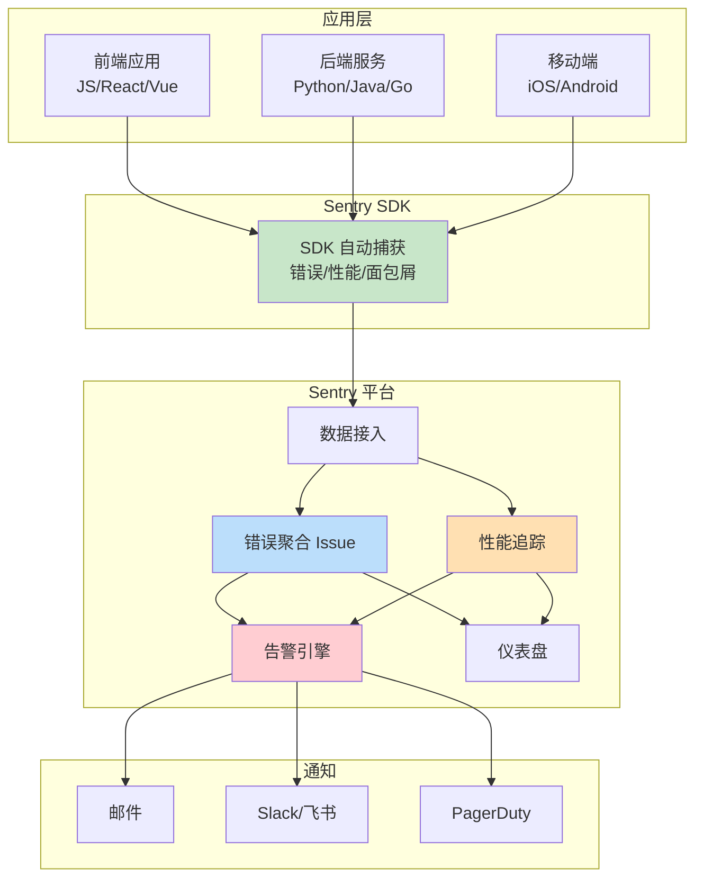

# Sentry错误监控与追踪

> **文档说明**：系统讲解 Sentry 错误监控与性能追踪平台，包括核心概念（Issue/Event/Release/Breadcrumb）、多语言 SDK 集成（前端/后端/移动端）、SourceMap 上传、性能监控与分布式追踪、告警规则配置、Issue 管理工作流、自托管部署、最佳实践和常见问题。
>
> **适用人群**：前端开发者、后端开发者、DevOps 工程师、SRE、全栈开发者、需要线上错误监控的工程师
>
> **前置知识**：[[SourceMap管理与错误追踪]]、[[APM应用性能监控-SkyWalking]]、[[前端构建产物分析与优化]]

---

## 一、概述

### 1. Sentry 是什么

```text
Sentry：
- 开源的应用监控与错误追踪平台
- 2012 年由 David Cramer 创建
- 最初是 Django 的错误日志工具，后来发展为全平台监控
- 支持 30+ 编程语言和框架
- 有 SaaS 版（sentry.io）和自托管版（Self-Hosted）

核心能力：
1. 错误追踪（Error Tracking）
   - 自动捕获异常和错误
   - 聚合重复错误为 Issue
   - 完整的堆栈追踪，支持 SourceMap 还原
   - 面包屑（Breadcrumbs）记录错误前的操作
   - 用户上下文（哪个用户遇到了错误）

2. 性能监控（Performance / APM）
   - 分布式追踪（Distributed Tracing）
   - 事务（Transaction）性能监控
   - 慢查询、慢接口识别
   - Web Vitals 指标（LCP/FID/CLS）
   - 服务依赖图谱

3. 告警（Alerts）
   - 错误率告警
   - 性能阈值告警
   - 新错误告警
   - 多渠道通知（邮件、Slack、飞书、钉钉、PagerDuty）

4. 发布管理（Releases）
   - 关联版本与错误
   - 每个版本的错误趋势
   - 提交记录关联（GitHub/GitLab）
   - 部署追踪

5. 会话与用户追踪
   - 用户会话追踪
   - 崩溃率统计
   - 用户影响分析
   - 受影响用户数

6. 集成生态
   - GitHub/GitLab/Gitea（Issue 关联）
   - Slack/飞书/钉钉/Teams（通知）
   - Jira/Linear（任务管理）
   - PagerDuty/Opsgenie（告警升级）
   - Vercel/Netlify（部署集成）
   - DataDog/New Relic（可观测性集成）
```



### 2. Sentry vs 其他监控工具

| 维度 | Sentry | Datadog | New Relic | SkyWalking | Prometheus + Grafana |
|------|--------|---------|-----------|------------|----------------------|
| **定位** | 错误追踪 + APM | 全栈可观测性 | APM + 可观测性 | APM（Java为主） | 指标监控 |
| **错误追踪** | 强（核心能力） | 中 | 中 | 弱 | 无 |
| **性能监控** | 中强 | 强 | 强 | 强 | 强 |
| **日志** | 弱（Breadcrumb） | 强 | 中 | 中 | 弱（需 Loki） |
| **基础设施监控** | 弱 | 强 | 中 | 中 | 强 |
| **SourceMap** | 原生支持 | 支持 | 支持 | 不支持 | 不支持 |
| **用户追踪** | 强 | 中 | 中 | 弱 | 弱 |
| **开源/自托管** | 支持（自托管版） | 商业 | 商业 | 开源 | 开源 |
| **价格** | 免费版有限，付费较贵 | 较贵 | 较贵 | 免费 | 免费（自建成本） |
| **上手难度** | 简单 | 中等 | 中等 | 中等 | 较难 |
| **适用场景** | 应用错误追踪、线上排障 | 全栈监控、基础设施 | APM、企业级 | Java 微服务 | 指标监控、告警 |

选择建议：
- 应用错误追踪 + 基本性能 → Sentry（首选）
- 全栈可观测性 + 基础设施 → Datadog/New Relic
- Java 微服务 APM → SkyWalking
- 指标监控 + 自建 → Prometheus + Grafana
- 可以组合使用：Sentry（错误）+ Prometheus（指标）+ SkyWalking（链路）
```css

---

## 二、核心概念

### 1. Issue（问题）

```
Issue（问题）：
- Sentry 中聚合后的错误单元
- 多个相似的 Event（事件）被聚合为一个 Issue
- 聚合依据：错误类型、错误信息、堆栈追踪（指纹 Fingerprint）
- 每个 Issue 有状态、优先级、负责人、标签

Issue 状态：
- Unresolved（未解决）：新错误或重新出现的错误
- Resolved（已解决）：开发者标记为已修复
- Ignored（已忽略）：暂时不关注的错误
- Archived（已归档）：长期不出现的错误，自动归档

Issue 优先级：
- High（高）：影响大量用户、核心功能崩溃
- Medium（中）：影响部分用户、非核心功能
- Low（低）：影响少数用户、边缘情况
- 优先级可以手动设置或根据规则自动分配

Issue 关键信息：
- 标题：错误类型 + 错误信息
- 堆栈追踪：完整的调用栈，支持 SourceMap 还原
- 事件数：该 Issue 发生了多少次
- 受影响用户数：多少用户遇到了这个错误
- 首次出现/最后出现时间
- 环境：production/staging/development
- 发布版本：哪个版本引入的
- 标签：自定义标签（模块、功能、严重程度等）
- 负责人：分配给谁处理
- 关联 Issue：GitHub/GitLab/Jira 中的任务
```css

### 2. Event（事件）

```
Event（事件）：
- 一次错误或性能数据的上报
- 每个 Event 包含完整的上下文信息
- 多个 Event 聚合为一个 Issue

Event 包含的信息：
1. 错误信息
   - exception：异常类型和消息
   - stacktrace：堆栈追踪
   - level：错误级别（fatal/error/warning/info/debug）

2. 用户信息
   - id：用户 ID
   - username：用户名
   - email：邮箱
   - ip_address：IP 地址

3. 上下文
   - request：HTTP 请求信息（URL、方法、headers、body）
   - response：响应信息
   - extra：自定义额外数据
   - tags：自定义标签
   - contexts：设备、操作系统、浏览器、运行时

4. 面包屑（Breadcrumbs）
   - 错误发生前的操作轨迹
   - 类型：用户点击、路由变化、API 请求、控制台日志、UI 事件
   - 时间戳、类别、消息、数据

5. 环境信息
   - environment：环境（production/staging）
   - release：版本号
   - server_name：服务器名
   - modules：依赖模块及版本

6. 性能信息（性能 Event）
   - transaction：事务名
   - spans：跨度（子操作）
   - duration：耗时
   - measurements：测量值
```css

### 3. Release（发布）

```
Release（发布/版本）：
- 关联代码版本与错误/性能数据
- 每个 Release 有独立的错误趋势和性能指标
- 可以关联 Git commit 和部署记录

Release 关键功能：
1. 版本对比
   - 对比两个版本的错误数、错误率、性能
   - 快速定位哪个版本引入了新错误

2. 提交记录
   - 关联 GitHub/GitLab 的 commit
   - 看到每个版本的代码变更
   - 可疑提交（Suspect Commits）：可能引入错误的提交

3. 部署追踪
   - 记录每次部署的时间、环境、版本
   - 部署后错误率变化
   - 部署健康度评估

4. SourceMap 关联
   - 每个 Release 上传对应的 SourceMap
   - 错误堆栈自动还原到源代码

5. 版本健康度
   - 崩溃率（Crash Free Rate）
   - 错误率趋势
   - 性能指标变化
   - 受影响用户数

Release 命名规范：
- 语义化版本：1.2.3
- Git commit hash：a1b2c3d
- 构建号：build-12345
- 日期版本：2024.01.15
- 建议：用 package.json 的 version 或 git describe
```css

### 4. Breadcrumb（面包屑）

```
Breadcrumb（面包屑）：
- 错误发生前的操作轨迹
- 类似用户行为日志，帮助复现错误
- 错误发生前的最后 100 条面包屑会被上报

面包屑类型：
1. default：默认
2. debug：调试信息
3. error：错误日志
4. navigation：路由/页面导航
5. http：HTTP 请求
6. info：信息日志
7. query：数据库查询
8. ui：UI 交互（点击、输入）
9. user：用户行为
10. warning：警告日志

面包屑字段：
- type：类型
- category：类别（如 console.log、xhr、ui.click）
- message：消息
- data：附加数据（如 URL、状态码、元素选择器）
- level：级别
- timestamp：时间戳

自动收集的面包屑（前端）：
- console.log/error/warn
- XMLHttpRequest / fetch 请求
- 路由变化（History API）
- DOM 点击事件
- 错误事件

手动添加面包屑：
```javascript
Sentry.addBreadcrumb({
  category: 'user.action',
  message: 'User clicked submit button',
  level: 'info',
  data: { formId: 'login-form', button: 'submit' },
})
```

面包屑的价值：
- 复现错误：知道用户在错误前做了什么
- 定位触发条件：什么操作导致了错误
- 理解上下文：错误发生时的应用状态
- 优先级判断：错误是否在核心操作路径上
```css

---

## 三、前端集成

### 1. 基础集成（JavaScript）

```
```bash
# 安装
npm install @sentry/browser @sentry/tracing
```
## 或
yarn add @sentry/browser @sentry/tracing
```text

```
// main.js - Sentry 初始化（必须在应用代码之前）
import * as Sentry from '@sentry/browser'
import { BrowserTracing } from '@sentry/tracing'

Sentry.init({
  // DSN：项目唯一标识，在 Sentry 项目设置中获取
  dsn: 'https://your-public-key@o123456.ingest.sentry.io/123456',

  // 环境
  environment: process.env.NODE_ENV,

  // 版本号（关联 Release）
  release: process.env.RELEASE_VERSION || 'dev',

  // 错误采样率（0-1，1 表示全部采集）
  sampleRate: 1.0,

  // 性能监控采样率（生产建议 0.1-0.3，开发 1.0）
  tracesSampleRate: process.env.NODE_ENV === 'production' ? 0.1 : 1.0,

  // 集成
  integrations: [
    new BrowserTracing({
      // 追踪的请求来源（只追踪自己的 API）
      tracingOrigins: ['localhost', 'example.com', /^\//],
      // 路由名称生成
      routingInstrumentation: Sentry.vueRouterInstrumentation(router),
    }),
  ],

  // 忽略特定错误
  ignoreErrors: [
    'Script error.',
    'ResizeObserver loop limit exceeded',
    'Non-Error promise rejection captured',
    'NetworkError',
    'Loading chunk',
    /^No error$/,
  ],

  // 忽略特定 URL 的错误（第三方脚本）
  denyUrls: [
    /google-analytics\.com/i,
    /doubleclick\.net/i,
    /facebook\.net/i,
    /cdn\.segment\.com/i,
  ],

  // 只允许特定 URL 的错误（可选）
  // allowUrls: [/https:\/\/example\.com/i],

  // 发送前修改事件（过滤敏感信息）
  beforeSend(event, hint) {
    // 过滤 Cookie
    if (event.request?.cookies) {
      delete event.request.cookies
    }
    // 过滤 Authorization header
    if (event.request?.headers?.Authorization) {
      delete event.request.headers.Authorization
    }
    // 过滤请求体中的敏感字段
    if (event.request?.data) {
      try {
        const data = JSON.parse(event.request.data)
        delete data.password
        delete data.token
        delete data.creditCard
        event.request.data = JSON.stringify(data)
      } catch (e) {
        // 不是 JSON，不处理
      }
    }
    return event
  },

  // 发送前修改事务（性能数据）
  beforeSendTransaction(event) {
    // 忽略健康检查等低价值事务
    if (event.transaction === '/health') {
      return null
    }
    return event
  },

  // 附加默认 PII（个人身份信息），默认 false
  sendDefaultPii: false,

  // 调试模式（开发时开启，查看 SDK 日志）
  debug: process.env.NODE_ENV === 'development',

  // 最大面包屑数（默认 100）
  maxBreadcrumbs: 100,

  // 附加堆栈跟踪到消息日志
  attachStacktrace: true,
})

// 设置用户信息（登录后调用）
Sentry.setUser({
  id: '12345',
  username: 'zhangsan',
  email: 'zhangsan@example.com',
  // ip_address: '{{auto}}',  // 自动获取 IP（需 sendDefaultPii: true）
})

// 清除用户信息（登出时调用）
// Sentry.setUser(null)

// 设置全局标签
Sentry.setTag('page_locale', 'zh-CN')
Sentry.setTag('app_version', process.env.APP_VERSION)

// 设置全局额外信息
Sentry.setExtra('battery_level', '85%')

// 设置上下文
Sentry.setContext('character', {
  name: 'Mighty Fighter',
  level: 19,
  attack_type: 'melee',
})

// 手动捕获异常
try {
  // 可能出错的代码
} catch (error) {
  Sentry.captureException(error)
}

// 手动捕获消息
Sentry.captureMessage('Something went wrong', 'warning')

// 添加面包屑
Sentry.addBreadcrumb({
  category: 'user.action',
  message: 'User clicked submit',
  level: 'info',
  data: { button: 'submit-form' },
})
```css

### 2. React 集成

```
npm install @sentry/react @sentry/tracing
```text

```
// main.jsx
import React from 'react'
import ReactDOM from 'react-dom'
import * as Sentry from '@sentry/react'
import { BrowserTracing } from '@sentry/tracing'
import App from './App'

Sentry.init({
  dsn: 'your-dsn',
  release: process.env.RELEASE_VERSION,
  environment: process.env.NODE_ENV,
  tracesSampleRate: 0.1,
  integrations: [new BrowserTracing()],
})

// React 错误边界（Sentry 提供）
const SentryErrorBoundary = Sentry.ErrorBoundary

ReactDOM.render(
  <SentryErrorBoundary
    fallback={({ error, resetError }) => (
      <div>
        <h1>出错了</h1>
        <p>{error.message}</p>
        <button onClick={resetError}>重试</button>
      </div>
    )}
    showDialog  // 显示用户反馈对话框
  >
    <App />
  </SentryErrorBoundary>,
  document.getElementById('root')
)

// 组件内手动捕获
import * as Sentry from '@sentry/react'

function MyComponent() {
  const handleClick = () => {
    try {
      // 操作
    } catch (error) {
      Sentry.captureException(error, {
        tags: { component: 'MyComponent' },
        extra: { userId: '123' },
      })
    }
  }
  return <button onClick={handleClick}>点击</button>
}

// useEffect 中的错误捕获
useEffect(() => {
  fetchData().catch(error => {
    Sentry.captureException(error)
  })
}, [])
```css

### 3. Vue 集成

```
npm install @sentry/vue @sentry/tracing
```text

```
// main.js
import { createApp } from 'vue'
import * as Sentry from '@sentry/vue'
import { BrowserTracing } from '@sentry/tracing'
import App from './App.vue'
import router from './router'

const app = createApp(App)

Sentry.init({
  app,
  dsn: 'your-dsn',
  release: process.env.RELEASE_VERSION,
  environment: process.env.NODE_ENV,
  tracesSampleRate: 0.1,
  integrations: [
    new BrowserTracing({
      routingInstrumentation: Sentry.vueRouterInstrumentation(router),
      tracingOrigins: ['localhost', 'example.com', /^\//],
    }),
  ],
  // Vue 特定配置
  logErrors: true,  // 同时在控制台打印错误
  attachProps: true,  // 附加组件 props
  trackComponents: true,  // 追踪组件渲染
})

app.use(router)
app.mount('#app')

// 组件内使用
import { captureException } from '@sentry/vue'

export default {
  methods: {
    handleError(error) {
      captureException(error, {
        tags: { component: 'MyComponent' },
      })
    },
  },
}
```css

---

## 四、后端集成

### 1. Python（Django/Flask/FastAPI）

```
pip install sentry-sdk
```text

```
```python
# settings.py - Django 集成
import sentry_sdk
from sentry_sdk.integrations.django import DjangoIntegration
from sentry_sdk.integrations.logging import LoggingIntegration
from sentry_sdk.integrations.redis import RedisIntegration
from sentry_sdk.integrations.sqlalchemy import SqlalchemyIntegration

sentry_sdk.init(
    dsn="your-dsn",
    release=os.getenv("RELEASE_VERSION", "dev"),
    environment=os.getenv("ENV", "development"),
    traces_sample_rate=0.1,  # 性能监控采样率
    send_default_pii=False,

    integrations=[
        DjangoIntegration(),
        LoggingIntegration(
            level=logging.INFO,         # 捕获 INFO 及以上日志作为面包屑
            event_level=logging.ERROR,  # ERROR 及以上作为事件上报
```
        ),
        RedisIntegration(),
        SqlalchemyIntegration(),
    ],

```text
    # 忽略特定错误
    ignore_errors=[
```
        "django.http.Http404",
        "django.security.DisallowedHost",
        "rest_framework.exceptions.NotFound",
    ],

```text
    # 发送前过滤
    before_send=lambda event, hint: event if "/health" not in event.get("request", {}).get("url", "") else None,
```
)
```text

```
```python
# FastAPI 集成
import sentry_sdk
from sentry_sdk.integrations.asgi import SentryAsgiMiddleware
from fastapi import FastAPI

sentry_sdk.init(
    dsn="your-dsn",
    release="1.0.0",
    environment="production",
    traces_sample_rate=0.1,
```
)

```python
app = FastAPI()
app.add_middleware(SentryAsgiMiddleware)

# 手动捕获
import sentry_sdk

try:
```
```text
    # 操作
except Exception as e:
    sentry_sdk.capture_exception(e)
    sentry_sdk.capture_message("Something went wrong", level="warning")
```

```text
# 设置用户
sentry_sdk.set_user({"id": "123", "email": "user@example.com"})
```

```text
# 设置标签
sentry_sdk.set_tag("region", "us-east-1")
```

```text
# 添加面包屑
sentry_sdk.add_breadcrumb(
    category="db.query",
    message="SELECT * FROM users",
    level="info",
```
)
```css

### 2. Java（Spring Boot）

```
<!-- pom.xml -->
<dependency>
    <groupId>io.sentry</groupId>
    <artifactId>sentry-spring-boot-starter</artifactId>
    <version>7.0.0</version>
</dependency>
<dependency>
    <groupId>io.sentry</groupId>
    <artifactId>sentry-logback</artifactId>
    <version>7.0.0</version>
</dependency>
```text

```
```text
## application.yml
```
sentry:
  dsn: your-dsn
  release: 1.0.0
  environment: production
  traces-sample-rate: 0.1
  send-default-pii: false
  logging:
    enabled: true
    minimum-event-level: error
    minimum-breadcrumb-level: info
  exception-resolver:
    enabled: true
    order: -2147483647
  ignored-exceptions-for-type:
    - org.springframework.web.servlet.NoHandlerFoundException
    - org.springframework.security.access.AccessDeniedException
```text

```
// 手动使用
import io.sentry.Sentry;
import io.sentry.SentryLevel;

try {
    // 操作
} catch (Exception e) {
    Sentry.captureException(e);
}

Sentry.captureMessage("Something went wrong", SentryLevel.WARNING);

// 设置用户
Sentry.setUser(new User()
    .setId("123")
    .setEmail("user@example.com"));

// 设置标签
Sentry.setTag("region", "us-east-1");

// 添加面包屑
Sentry.addBreadcrumb(Breadcrumb.info("db.query", "SELECT * FROM users"));
```css

### 3. Node.js

```
npm install @sentry/node @sentry/tracing
```text

```
// server.js
const Sentry = require('@sentry/node')
const { nodeProfilingIntegration } = require('@sentry/profiling-node')

Sentry.init({
  dsn: 'your-dsn',
  release: process.env.RELEASE_VERSION,
  environment: process.env.NODE_ENV,
  tracesSampleRate: 0.1,
  profilesSampleRate: 0.1,  // CPU 性能分析
  integrations: [
    nodeProfilingIntegration(),
  ],
})

// Express 中间件
const express = require('express')
const app = express()

// 必须在所有路由之前
app.use(Sentry.Handlers.requestHandler())
app.use(Sentry.Handlers.tracingHandler())

// 路由
app.get('/', (req, res) => {
  res.send('Hello World')
})

// 错误处理中间件，必须在所有路由之后、其他错误处理之前
app.use(Sentry.Handlers.errorHandler())

// 可选：自定义错误响应
app.use((err, req, res, next) => {
  res.status(500).json({ error: 'Internal Server Error' })
})
```css

---

## 五、SourceMap 上传

```
```bash
# 安装 sentry-cli
npm install -g @sentry/cli
```
```bash
# 或
curl -sL https://sentry.io/get-cli/ | bash
```

```bash
# 配置认证
export SENTRY_AUTH_TOKEN=your-auth-token
export SENTRY_ORG=your-org
export SENTRY_PROJECT=your-project
```

## 创建版本
sentry-cli releases new $RELEASE_VERSION

```text
# 上传 SourceMap（关键步骤）
sentry-cli releases files $RELEASE_VERSION upload-sourcemaps ./dist \
```
  --rewrite \          # 重写源文件路径（推荐）
  --strip-prefix /app  # 去掉路径前缀

## 关联 commit
sentry-cli releases set-commits $RELEASE_VERSION --auto

## 完成版本
sentry-cli releases finalize $RELEASE_VERSION

## 部署标记
sentry-cli releases deploys $RELEASE_VERSION new -e production
```text

```
// Vite 插件方式
import { sentryVitePlugin } from '@sentry/vite-plugin'

export default {
  build: {
    sourcemap: true,  // 必须开启
  },
  plugins: [
    sentryVitePlugin({
      org: 'your-org',
      project: 'your-project',
      authToken: process.env.SENTRY_AUTH_TOKEN,
      release: {
        name: process.env.RELEASE_VERSION,
        cleanArtifacts: true,  // 上传后删除 SourceMap
      },
      sourcemaps: {
        assets: './dist/**/*.map',
      },
    }),
  ],
}
```css

---

## 六、性能监控（APM）

```
Sentry 性能监控核心概念：

1. Transaction（事务）
   - 一个完整的操作单元（如一次 HTTP 请求、一个页面加载）
   - 有名称、开始时间、结束时间、耗时
   - 包含多个 Span（跨度）

2. Span（跨度）
   - 事务中的子操作（如数据库查询、API 调用、渲染）
   - 有 op（操作类型）、description、耗时
   - 形成树状结构（Span 树）

3. 分布式追踪
   - 跨服务的事务关联
   - 通过 trace_id 和 span_id 关联
   - HTTP header 传递：sentry-trace 和 baggage

4. Web Vitals（前端性能指标）
   - LCP（Largest Contentful Paint）：最大内容绘制
   - FID（First Input Delay）：首次输入延迟
   - CLS（Cumulative Layout Shift）：累积布局偏移
   - FCP（First Contentful Paint）：首次内容绘制
   - TTFB（Time to First Byte）：首字节时间

5. 慢查询/慢操作
   - 自动识别耗时最长的 Span
   - 数据库慢查询、慢 API 调用
   - 性能瓶颈定位

性能监控配置要点：
- tracesSampleRate：采样率，生产 0.1-0.3
- 只追踪有价值的事务（忽略健康检查、静态资源）
- 合理命名事务（URL 模板而非具体 URL）
- 数据库查询自动追踪（需要对应集成）
```css

---

## 七、告警配置

```
Sentry 告警类型：

1. 错误告警（Issue Alerts）
   - 新错误出现时告警
   - 错误频率超过阈值时告警
   - 错误重新出现时告警
   - 受影响用户数超过阈值时告警

2. 性能告警（Performance Alerts）
   - 事务耗时超过阈值
   - 错误率超过阈值
   - Apdex 分数低于阈值
   - LCP/FID/CLS 超过阈值

3. 指标告警（Metric Alerts）
   - 自定义指标阈值告警
   - 支持聚合（count、avg、p50/p95/p99）

告警条件示例：
- "错误事件数在 5 分钟内超过 100 次"
- "受影响用户数在 1 小时内超过 50 人"
- "新错误出现（首次出现）"
- "API /api/checkout 的 p95 耗时超过 3 秒"
- "错误率超过 5%"
- "LCP 超过 4 秒的页面占比超过 10%"

告警通知渠道：
- 邮件（Email）
- Slack
- 飞书（Feishu/Lark）
- 钉钉（DingTalk）
- Microsoft Teams
- PagerDuty
- Opsgenie
- Discord
- Webhook（自定义）
- Jira（创建 Issue）
- GitHub/GitLab（创建 Issue）

告警最佳实践：
- 分级告警：P0（立即处理）、P1（工作时间处理）、P2（日常关注）
- 避免告警疲劳：合理设置阈值，合并相似告警
- 告警升级：一定时间未处理自动升级
- 告警关联：关联代码提交、部署记录
- 静默期：部署期间、维护期间临时静默
```css

---

## 八、Issue 管理工作流

```
Sentry Issue 管理流程：

1. 发现（Triage）
   - 新错误自动创建 Issue
   - 查看错误详情、堆栈、面包屑
   - 判断优先级和严重程度
   - 分配给对应负责人

2. 修复（Fix）
   - 开发者认领 Issue
   - 复现错误，定位根因
   - 修复代码
   - 关联 PR/Commit

3. 验证（Verify）
   - 部署修复版本
   - 监控 Issue 是否重新出现
   - Sentry 自动检测：新版本中不再出现 → 标记为 Resolved
   - 手动标记 Resolved（选择"在下一个版本解决"）

4. 回归（Regression）
   - 已解决的 Issue 重新出现
   - Sentry 自动标记为 Unresolved
   - 通知负责人
   - 重新进入修复流程

5. 忽略/归档（Ignore/Archive）
   - 已知问题、低优先级、第三方错误 → Ignored
   - 长期不出现的 Issue → 自动 Archived
   - 归档后重新出现会自动恢复

Issue 操作：
- 分配（Assign）：分配给团队成员
- 合并（Merge）：合并重复的 Issue
- 分享（Share）：生成公开链接分享
- 标记为已解决（Resolve）：选择立即解决或下版本解决
- 忽略（Ignore）：暂时忽略，可设置忽略时长
- 归档（Archive）：长期归档
- 删除（Delete）：删除 Issue（不可恢复）
- 添加评论（Comment）：团队讨论
- 创建任务（Create Task）：在 Jira/GitHub 创建任务
- 订阅（Subscribe）：关注 Issue 动态

最佳实践：
- 定期 triage（每周/每两周）
- 每个 Issue 都有负责人
- 高优先级 Issue 立即处理
- 利用 Suspect Commits 快速定位引入错误的提交
- 利用 Issue 链接关联相关错误
- 建立错误分类标准（按模块、严重程度）
```css

---

## 九、自托管部署

```
Sentry 自托管（Self-Hosted）：
- 适合数据安全要求高、不想用 SaaS 的团队
- 开源免费，但需要自己维护基础设施
- 最低配置：4 CPU、8GB RAM、20GB 磁盘
- 推荐配置：8 CPU、16GB RAM、100GB SSD
- 依赖：Docker、Docker Compose、Git

部署步骤：
```bash
# 1. 克隆自托管仓库
git clone https://github.com/getsentry/self-hosted.git
cd self-hosted

# 2. 运行安装脚本
./install.sh

# 3. 启动
docker compose up -d

# 4. 创建管理员账号
docker compose run --rm web createuser

# 5. 访问
# http://localhost:9000
# 默认账号：admin@localhost / admin
```

自托管组件：
- Web：Sentry Web 界面
- Worker：异步任务处理
- Cron：定时任务
- Postgres：主数据库
- Redis：缓存和队列
- Kafka：事件流
- ClickHouse：性能数据存储
- Zookeeper：Kafka 协调
- Memcached：缓存
- Nginx：反向代理
- Symbolicator：SourceMap 处理
- Snuba：查询服务（ClickHouse 接口）
- Vroom：性能分析

自托管 vs SaaS 对比：
| 维度 | 自托管 | SaaS |
|------|--------|------|
| 成本 | 基础设施成本 | 按事件量付费 |
| 数据安全 | 完全自控 | Sentry 服务器 |
| 维护 | 自己维护升级 | 官方维护 |
| 功能 | 基本完整 | 全部功能（部分高级功能） |
| 性能 | 取决于基础设施 | 官方优化 |
| 支持 | 社区支持 | 官方支持 |
| 升级 | 手动升级 | 自动升级 |
| 适合 | 数据敏感、大团队 | 中小团队、快速上线 |

注意事项：
- 定期备份数据
- 监控 Sentry 自身的健康状态
- 及时升级版本
- 配置合理的事件保留策略（避免磁盘满）
- 配置邮件、存储等外部服务
```css

---

## 十、最佳实践

### 1. 集成配置

- [ ] **尽早初始化**：Sentry.init() 在应用代码之前执行
- [ ] **设置 release**：每次发布都有唯一版本号，关联 SourceMap 和 commit
- [ ] **设置 environment**：区分 production/staging/development
- [ ] **合理采样率**：错误 100%，性能生产 0.1-0.3，开发 1.0
- [ ] **配置 ignoreErrors**：忽略已知无害错误（Script error、ResizeObserver 等）
- [ ] **配置 denyUrls**：忽略第三方脚本错误
- [ ] **beforeSend 过滤敏感信息**：删除 Cookie、Token、密码、身份证
- [ ] **sendDefaultPii: false**：默认不收集 PII，需要时手动设置
- [ ] **设置用户信息**：登录后 setUser，登出后 setUser(null)
- [ ] **设置全局标签**：环境、版本、地区、设备类型

### 2. 错误捕获

- [ ] **全局捕获 + 手动捕获结合**：SDK 自动捕获大部分，关键路径手动捕获
- [ ] **Promise 错误**：确保 unhandledrejection 被捕获（SDK 默认处理）
- [ ] **异步错误**：async/await 用 try-catch，catch 中 captureException
- [ ] **回调错误**：回调函数中的错误手动捕获
- [ ] **框架错误边界**：React/Vue 用 Sentry 提供的错误边界
- [ ] **附加上下文**：捕获错误时附加 tags、extra、user 信息
- [ ] **面包屑**：关键操作路径添加面包屑（用户操作、API 请求、状态变化）
- [ ] **错误分级**：用 level 区分 fatal/error/warning/info/debug

### 3. SourceMap

- [ ] **生产环境开启 sourcemap**：构建时生成 .map 文件
- [ ] **构建后自动上传**：CI/CD 中自动上传 SourceMap 到 Sentry
- [ ] **上传后删除 .map**：不部署到 CDN，避免源代码泄露
- [ ] **用 hidden-source-map**：不在 JS 中加 sourceMappingURL
- [ ] **版本对应**：SourceMap 与 release 版本严格对应
- [ ] **验证**：部署后触发一个错误，确认堆栈能正确还原

### 4. 告警与响应

- [ ] **分级告警**：P0 立即通知，P1 工作时间，P2 日报汇总
- [ ] **避免告警疲劳**：合理阈值，合并相似告警，静默低优先级
- [ ] **新错误告警**：首次出现的错误立即通知
- [ ] **错误率告警**：错误率突增时告警（可能是部署问题）
- [ ] **性能告警**：核心接口 p95 耗时、错误率阈值
- [ ] **告警升级**：一定时间未处理自动升级到更高渠道
- [ ] **部署静默**：部署期间临时静默，避免部署过程的临时错误
- [ ] **定期 review**：每周/每两周 review 告警规则，清理无效告警

### 5. Issue 管理

- [ ] **定期 triage**：每周处理新 Issue，分配负责人
- [ ] **优先级明确**：按影响用户数、频率、核心功能判断优先级
- [ ] **负责人明确**：每个 Issue 都有负责人
- [ ] **关联代码**：利用 Suspect Commits 快速定位，关联 PR
- [ ] **修复后验证**：部署后监控是否回归
- [ ] **定期清理**：归档长期不出现的 Issue，忽略已知低优先级
- [ ] **错误复盘**：严重错误事后复盘，更新监控和测试

### 6. 性能监控

- [ ] **核心事务命名**：用 URL 模板而非具体 URL（如 /api/users/:id 而非 /api/users/123）
- [ ] **忽略低价值事务**：健康检查、静态资源、内部接口
- [ ] **数据库追踪**：开启 SQL 查询追踪（需要对应集成）
- [ ] **分布式追踪**：跨服务传递 trace header
- [ ] **Web Vitals**：前端监控 LCP/FID/CLS，设定目标
- [ ] **慢查询告警**：数据库查询超过阈值告警
- [ ] **定期性能 review**：查看慢事务列表，优化 Top N

---

## 十一、常见问题与排查

| 问题 | 原因 | 解决方案 |
|------|------|---------|
| **Sentry 没有收到错误** | DSN 错/初始化晚/被 ignoreErrors 过滤/网络问题 | 检查 DSN 是否正确；确认 Sentry.init 在最前面；检查 ignoreErrors/denyUrls；浏览器 Network 面板看是否有 sentry.io 请求；开启 debug 模式看日志 |
| **堆栈还是压缩代码** | SourceMap 未上传/版本不匹配/上传失败 | 确认 release 版本一致；检查 Sentry 项目 Release 页面是否有 SourceMap；重新上传；用 hidden-source-map；验证 SourceMap 文件是否正确 |
| **Script error.** | 跨域脚本无 CORS/crossorigin | CDN 脚本加 crossorigin="anonymous"；CDN 返回 Access-Control-Allow-Origin；两者必须同时配置 |
| **错误率高但都是第三方错误** | 未配置 denyUrls | 配置 denyUrls 忽略第三方脚本（Google Analytics、Facebook 等）；或配置 allowUrls 只允许自己的域名 |
| **性能数据没有上报** | tracesSampleRate=0/未集成 BrowserTracing/事务被过滤 | 确认 tracesSampleRate > 0；确认集成了 BrowserTracing；检查 beforeSendTransaction 是否返回 null；查看是否有性能数据上报请求 |
| **用户信息缺失** | 未调用 setUser/sendDefaultPii=false | 登录后调用 Sentry.setUser({id, email, username})；需要 IP 时设 sendDefaultPii:true；确认 setUser 在错误发生前调用 |
| **面包屑太少** | maxBreadcrumbs 太小/未自动收集 | 增大 maxBreadcrumbs（默认 100）；确认集成了对应插件（console、http、dom）；关键路径手动 addBreadcrumb |
| **告警太多/告警疲劳** | 阈值太低/未分级/未忽略低优先级 | 提高阈值；分级告警（P0/P1/P2）；配置 ignoreErrors 忽略已知错误；合并相似 Issue；设置静默期 |
| **告警收不到** | 通知渠道未配置/规则未触发/被静默 | 检查通知渠道配置（Slack/飞书/邮件）；检查告警规则条件是否满足；检查是否在静默期；测试告警规则 |
| **Issue 太多无法管理** | 未 triage/未合并/未归档 | 定期 triage（每周）；合并重复 Issue；归档长期不出现的；忽略低优先级；分配负责人 |
| **自托管 Sentry 启动失败** | 资源不足/端口冲突/Docker 版本问题 | 检查最低配置（4CPU/8GB）；检查端口占用（9000、9001等）；升级 Docker/Docker Compose；查看 docker compose logs |
| **自托管磁盘满** | 事件保留太久/未配置清理策略 | 配置事件保留策略（默认 90 天）；定期清理；增大磁盘；配置归档到对象存储 |
| **React 错误边界不工作** | 未用 Sentry.ErrorBoundary/版本不对 | 用 @sentry/react 的 ErrorBoundary 包裹应用；确认版本兼容；检查 fallback 渲染 |
| **Vue 错误未捕获** | 未用 @sentry/vue/logErrors 未开 | 用 @sentry/vue 并传入 app 实例；开启 logErrors:true；确认 Sentry.init 在 app.mount 之前 |
| **SourceMap 上传失败** | auth token 错/org/project 错/网络问题 | 检查 SENTRY_AUTH_TOKEN 权限（project:releases）；确认 org 和 project 名称正确；检查网络是否能访问 sentry.io；用 --log-level=debug 看详细日志 |
| **同一错误分成多个 Issue** | 指纹不同/堆栈差异大 | 检查是否有动态内容在错误信息中（如 ID、时间戳）；用 fingerprint 规则合并；在 SDK 中设置统一的 fingerprint |
| **敏感信息泄露** | 未配置 beforeSend/sendDefaultPii=true | 配置 beforeSend 过滤 Cookie、Authorization、密码、Token；sendDefaultPii 设为 false；检查 request data 中的敏感字段 |
| **生产环境性能影响** | 采样率太高/SDK 开销 | 生产 tracesSampleRate 设 0.1-0.3；错误采样率可 1.0（错误量通常不大）；SDK 本身开销很小（<1%）；用 CDN 加载 SDK |
| **Release 关联不到 commit** | 未配置代码仓库集成/未 set-commits | Sentry 项目设置中集成 GitHub/GitLab；sentry-cli releases set-commits --auto；确认 git 仓库可访问 |
| **部署后错误率突增** | 新版本引入 bug/部署问题 | 查看 Release 对比页面；看 Suspect Commits；快速回滚；配置部署后错误率告警 |

---

## 十二、关联笔记

### 前端工程
- [[SourceMap管理与错误追踪]] · [[前端工程化与构建工具]] · [[前端构建产物分析与优化]]
- [[Web性能指标与监控-LCP-FID-CLS]] · [[Vite-构建原理与插件开发]]

### 云原生与运维
- [[APM应用性能监控-SkyWalking]] · [[K8s-核心概念与架构]] · [[Jenkins流水线实战]]
- [[混沌工程-ChaosMesh]]

### 后端开发
- [[Java-应用性能调优实战]] · [[Python-Web框架FastAPI实战]] · [[SpringValidation-参数校验]]
- [[Python-Sentry错误监控集成]]

### 导航
- [[MOC-云原生与运维]] · [[MOC-前端开发]] · [[MOC-后端开发]] · [[全栈+AI工程双轨融合学习路线图]]

> **学习路径建议**：先掌握 [[SourceMap管理与错误追踪]] SourceMap 基础 → 深入本文 Sentry 平台使用 → 学习 [[APM应用性能监控-SkyWalking]] 全链路监控 → 实践 [[Web性能指标与监控-LCP-FID-CLS]] 前端性能 → 研究 [[混沌工程-ChaosMesh]] 稳定性验证 → 构建完整的应用可观测性与稳定性保障体系。

```

---

## 💡 全文深度讲解

本文系统梳理了Sentry错误监控与追踪的核心知识体系，从概述入手，深入或的底层机制，再通过创建版本掌握实战应用，最后涵盖完成版本与部署标记。学习时建议先建立整体认知，再动手实践，最后结合常见问题深化理解。

## 📝 全文精简总结

- **概述**：掌握本模块的核心概念与关键要点
- **或**：掌握本模块的核心概念与关键要点
- **创建版本**：掌握本模块的核心概念与关键要点
- **关联 commit**：掌握本模块的核心概念与关键要点
- **完成版本**：掌握本模块的核心概念与关键要点
- **部署标记**：掌握本模块的核心概念与关键要点

