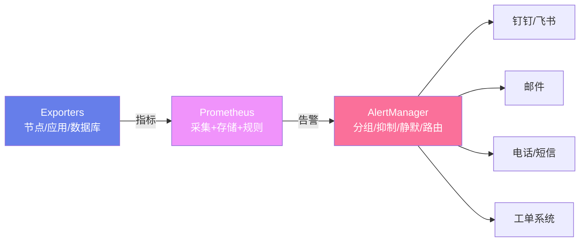
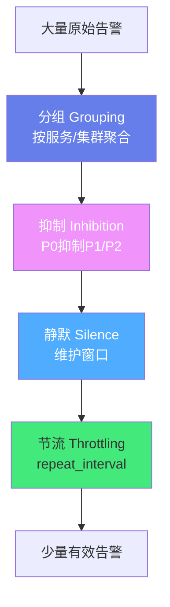
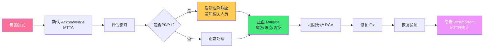

# 🚨 告警体系设计

> **文档说明**：系统讲解告警体系设计的完整知识体系，涵盖告警分级（P0-P3）、告警指标设计（黄金信号/USE/RED）、告警规则编写、Prometheus + AlertManager 实战、告警降噪（聚合/抑制/静默）、通知渠道（钉钉/飞书/邮件/电话）、On-Call 值班机制、故障响应流程（MTTA/MTTR）、告警复盘与持续优化。好的告警体系是系统稳定性的第一道防线，目标是「及时发现、准确通知、快速响应」。
>
> **适用人群**：DevOps 工程师、SRE、后端开发者、运维工程师
>
> **前置知识**：[[Prometheus监控体系]] · [[日志体系设计]]

---

## 一、概述

### 1.1 为什么需要告警体系

告警体系是系统稳定性的**第一道防线**，目标是在问题影响用户之前发现并通知相关人员。

**没有告警的后果**：
- ❌ 系统挂了，用户先发现，客服才知道
- ❌ 磁盘满了导致数据库崩溃，事后才发现
- ❌ 接口报错率飙升，开发毫不知情

**好的告警体系**：
- ✅ 问题刚出现就通知到正确的人
- ✅ 告警准确，不狼来了（告警疲劳是最大敌人）
- ✅ 有明确的响应流程和升级机制
- ✅ 每次故障都有复盘，持续改进

### 1.2 告警体系核心目标

| 目标 | 说明 | 衡量指标 |
|------|------|---------|
| **及时发现** | 问题发生后快速检测到 | 检测延迟（从发生到告警） |
| **准确通知** | 告警准确，不多不少 | 误报率、漏报率 |
| **快速响应** | 通知到正确的人并开始处理 | MTTA（平均确认时间） |
| **快速恢复** | 故障快速解决 | MTTR（平均恢复时间） |
| **持续改进** | 每次故障复盘，优化告警 | 故障重复率 |

### 1.3 告警生命周期


---

## 二、底层原理

### 2.1 告警分级（P0-P3）

| 级别 | 名称 | 影响范围 | 响应时间 | 通知方式 | 示例 |
|------|------|---------|---------|---------|------|
| **P0** | 紧急 | 全站不可用/核心功能完全中断 | 5 分钟内 | 电话 + 短信 + 即时通讯 | 支付系统宕机、数据库主库挂了 |
| **P1** | 严重 | 核心功能部分受损/大量用户受影响 | 15 分钟内 | 即时通讯 + 短信 | 订单创建失败率 >10%、API 错误率 >5% |
| **P2** | 警告 | 非核心功能异常/潜在风险 | 1 小时内 | 即时通讯 | 磁盘使用率 >80%、非核心接口慢 |
| **P3** | 提示 | 轻微异常/需要关注 | 工作日处理 | 邮件/工单 | 磁盘使用率 >70%、证书 30 天内过期 |

> **原则**：P0/P1 必须 7×24 响应，P2/P3 工作时间处理。P0 告警要少而精，每个 P0 都必须是真正的紧急事件。

### 2.2 告警指标设计方法论

#### 黄金信号（Google SRE）

| 信号 | 说明 | 指标示例 |
|------|------|---------|
| **延迟（Latency）** | 请求处理时间 | P50/P95/P99 响应时间 |
| **流量（Traffic）** | 请求量 | QPS、并发数 |
| **错误（Errors）** | 请求失败率 | 5xx 比例、错误率 |
| **饱和度（Saturation）** | 资源使用程度 | CPU/内存/磁盘使用率 |

#### USE 方法（资源维度）

| 维度 | 说明 | 指标 |
|------|------|------|
| **Utilization（使用率）** | 资源使用比例 | CPU 使用率、内存使用率 |
| **Saturation（饱和度）** | 资源排队/等待程度 | 运行队列长度、磁盘 IO 等待 |
| **Errors（错误）** | 资源错误事件 | 磁盘错误、网络丢包 |

#### RED 方法（服务维度）

| 维度 | 说明 | 指标 |
|------|------|------|
| **Rate（速率）** | 请求量 | QPS |
| **Errors（错误）** | 错误数/率 | 5xx 数量、错误率 |
| **Duration（耗时）** | 响应时间 | P95/P99 延迟 |

### 2.3 告警规则设计原则

```text
好的告警规则 Checklist：

✅ 有明确的含义：告警标题说明「什么出了问题」
✅ 有可操作的建议：告警内容说明「该怎么处理」
✅ 阈值合理：基于历史数据设定，不是拍脑袋
✅ 持续时间：瞬时波动不告警，持续异常才告警（for: 5m）
✅ 分级明确：P0-P3 区分清楚
✅ 可聚合：同类告警合并，不刷屏
✅ 可静默：维护期间可静默
✅ 有负责人：每个告警有明确的 Owner
✅ 定期审查：每月 review 告警规则，删除无用告警
```

---

## 三、实操示例

### 3.1 Prometheus + AlertManager 架构



### 3.2 Prometheus 告警规则

```yaml
# prometheus.rules.yml — 告警规则
groups:
  - name: node-alerts
    rules:
      # ===== 主机告警 =====
      - alert: HighCPUUsage
        expr: 100 - (avg by(instance)(rate(node_cpu_seconds_total{mode="idle"}[5m])) * 100) > 80
        for: 5m
        labels:
          severity: P2
        annotations:
          summary: "主机 CPU 使用率过高"
          description: "主机 {{ $labels.instance }} CPU 使用率 {{ $value | printf \"%.2f\" }}%，持续 5 分钟"
          action: "登录主机检查进程，必要时扩容"

      - alert: HighMemoryUsage
        expr: (1 - (node_memory_MemAvailable_bytes / node_memory_MemTotal_bytes)) * 100 > 85
        for: 5m
        labels:
          severity: P2
        annotations:
          summary: "主机内存使用率过高"
          description: "主机 {{ $labels.instance }} 内存使用率 {{ $value | printf \"%.2f\" }}%"
          action: "检查内存泄漏，考虑扩容"

      - alert: DiskWillFillIn4Hours
        expr: predict_linear(node_filesystem_avail_bytes{fstype!~"tmpfs|overlay"}[1h], 4 * 3600) < 0
        for: 10m
        labels:
          severity: P1
        annotations:
          summary: "磁盘将在 4 小时内写满"
          description: "主机 {{ $labels.instance }} 挂载点 {{ $labels.mountpoint }} 预计 4 小时内写满"
          action: "立即清理磁盘或扩容"

  - name: service-alerts
    rules:
      # ===== 服务告警 =====
      - alert: HighErrorRate
        expr: sum(rate(http_requests_total{status=~"5.."}[5m])) by(service) / sum(rate(http_requests_total[5m])) by(service) > 0.05
        for: 3m
        labels:
          severity: P1
        annotations:
          summary: "服务 {{ $labels.service }} 错误率过高"
          description: "错误率 {{ $value | printf \"%.2f\" }}%，持续 3 分钟"
          action: "检查服务日志，查看错误原因"

      - alert: HighP99Latency
        expr: histogram_quantile(0.99, sum(rate(http_request_duration_seconds_bucket[5m])) by(le, service)) > 1
        for: 5m
        labels:
          severity: P2
        annotations:
          summary: "服务 {{ $labels.service }} P99 延迟过高"
          description: "P99 延迟 {{ $value }}s，持续 5 分钟"
          action: "分析慢请求，优化性能"

      - alert: ServiceDown
        expr: up{job="api-server"} == 0
        for: 1m
        labels:
          severity: P0
        annotations:
          summary: "服务 {{ $labels.job }} 宕机"
          description: "实例 {{ $labels.instance }} 已下线 1 分钟"
          action: "立即检查服务状态，重启或切换流量"
```

### 3.3 AlertManager 配置

```yaml
# alertmanager.yml — AlertManager 配置
global:
  resolve_timeout: 5m
  # 钉钉/飞书 Webhook
  webhook_url: "https://oapi.dingtalk.com/robot/send?access_token=xxx"

# 路由树：按标签路由到不同通知渠道
route:
  receiver: 'default'
  group_by: ['alertname', 'cluster', 'service']
  group_wait: 30s       # 组内第一个告警等待 30s（聚合）
  group_interval: 5m    # 同组新告警间隔 5m
  repeat_interval: 4h   # 重复告警间隔 4h
  routes:
    # P0 告警：电话 + 钉钉
    - matchers:
        - severity = "P0"
      receiver: 'p0-phone'
      repeat_interval: 30m
    # P1 告警：钉钉 + 短信
    - matchers:
        - severity = "P1"
      receiver: 'p1-dingtalk-sms'
      repeat_interval: 1h
    # P2/P3：钉钉群
    - matchers:
        - severity =~ "P2|P3"
      receiver: 'dev-dingtalk'

# 接收者
receivers:
  - name: 'default'
    webhook_configs:
      - url: 'https://oapi.dingtalk.com/robot/send?access_token=default'

  - name: 'p0-phone'
    webhook_configs:
      - url: 'https://oapi.dingtalk.com/robot/send?access_token=p0'
    # 电话通知（通过第三方服务）
    # phone_call_configs: ...

  - name: 'p1-dingtalk-sms'
    webhook_configs:
      - url: 'https://oapi.dingtalk.com/robot/send?access_token=p1'

  - name: 'dev-dingtalk'
    webhook_configs:
      - url: 'https://oapi.dingtalk.com/robot/send?access_token=dev'

# 抑制规则：P0 触发时抑制同服务的 P1/P2
inhibit_rules:
  - source_matchers:
      - severity = "P0"
    target_matchers:
      - severity =~ "P1|P2"
    equal: ['service', 'cluster']

# 静默规则：维护期间静默（通过 API 动态添加）
# silence: 维护窗口期间静默所有告警
```

### 3.4 告警通知模板（钉钉）

```json
{
  "msgtype": "markdown",
  "markdown": {
    "title": "【P0】服务宕机告警",
    "text": "## 🚨 P0 告警：服务宕机\n\n**服务**：api-server\n**实例**：10.0.0.1:8080\n**时间**：2026-08-28 14:30:00\n**持续**：1 分钟\n\n**描述**：实例已下线，健康检查失败\n\n**处理建议**：\n1. 检查服务进程状态\n2. 查看最近部署记录\n3. 必要时切换流量到备用实例\n\n**负责人**：@张三 @李四\n\n[查看 Grafana](http://grafana/d/api-server) | [查看日志](http://kibana/api-server)"
  },
  "at": {
    "atMobiles": ["13800138000"],
    "isAtAll": false
  }
}
```

### 3.5 业务告警示例

```yaml
# 业务告警规则
groups:
  - name: business-alerts
    rules:
      # 订单量异常下降
      - alert: OrderDrop
        expr: rate(order_created_total[5m]) < (rate(order_created_total[1h] offset 1d) * 0.5)
        for: 10m
        labels:
          severity: P1
        annotations:
          summary: "订单量异常下降"
          description: "当前订单量较昨日同期下降超过 50%"
          action: "检查支付网关、下单接口是否正常"

      # 支付成功率下降
      - alert: LowPaymentSuccessRate
        expr: sum(rate(payment_success_total[5m])) / sum(rate(payment_total[5m])) < 0.95
        for: 5m
        labels:
          severity: P0
        annotations:
          summary: "支付成功率低于 95%"
          description: "当前支付成功率 {{ $value | printf \"%.2f\" }}%"
          action: "立即检查支付渠道，必要时切换备用渠道"

      # 注册量异常
      - alert: RegistrationAnomaly
        expr: rate(user_registered_total[5m]) > (rate(user_registered_total[1h] offset 1d) * 3)
        for: 5m
        labels:
          severity: P2
        annotations:
          summary: "注册量异常飙升"
          description: "注册量较昨日同期超过 3 倍，可能是刷量"
          action: "检查是否有恶意注册，开启验证码"
```

---

## 四、常见问题与排查

| 问题现象 | 可能原因 | 解决方案 |
|---------|---------|---------|
| **告警风暴** | 一个根因触发大量相关告警 | 用抑制规则（inhibit_rules）；按服务分组聚合 |
| **告警疲劳** | 告警太多，P2/P3 刷屏 | 提高阈值；增加持续时间；删除无用告警；分级通知 |
| **误报多** | 阈值太低；瞬时波动 | 调高阈值；增加 `for` 持续时间；用同比/环比替代绝对值 |
| **漏报** | 阈值太高；指标没采集 | 降低阈值；检查 Exporter 是否正常；补充关键指标 |
| **告警没人处理** | 没有 On-Call；通知渠道不对 | 建立值班制度；P0 电话通知；告警有明确 Owner |
| **重复告警** | repeat_interval 太短；没配置 resolve | 增大 repeat_interval；配置 resolve_timeout |
| **维护期间告警** | 没静默 | 维护前创建 silence；用维护窗口自动静默 |
| **告警恢复不通知** | 没配置恢复通知 | AlertManager 默认发送 resolved 通知；检查接收者配置 |
| **钉钉收不到** | Webhook 地址错误；关键词不匹配 | 检查 Webhook URL；钉钉机器人需配置关键词或加签 |
| **Prometheus 告警不触发** | 规则语法错误；指标不存在 | `promtool check rules` 校验；用 PromQL 验证表达式 |
| **告警延迟高** | 采集间隔大；评估间隔大 | 缩短 scrape_interval（15s）；evaluation_interval（15s） |
| **磁盘告警太晚** | 用固定阈值（>90%） | 用 predict_linear 预测磁盘写满时间，提前告警 |

---

## 五、进阶与最佳实践

### 5.1 告警降噪策略



| 策略 | 说明 | 实现 |
|------|------|------|
| **分组** | 同类告警合并为一条 | AlertManager `group_by` |
| **抑制** | 高级别告警抑制低级别 | `inhibit_rules` |
| **静默** | 维护期间不告警 | `silence`（API/UI 创建） |
| **节流** | 重复告警间隔 | `repeat_interval` |
| **延迟** | 等待聚合时间 | `group_wait` |
| **持续时间** | 瞬时波动不告警 | Prometheus `for` |

### 5.2 On-Call 值班机制

```text
On-Call 制度设计：

1. 值班轮换
   - 主值班（Primary）：7×24 响应 P0/P1
   - 备份值班（Secondary）：主值班无响应时升级
   - 轮换周期：每周/每两周轮换

2. 响应时间要求
   - P0：5 分钟内确认（Acknowledge）
   - P1：15 分钟内确认
   - P2：1 小时内确认（工作时间）
   - 超时未确认 → 自动升级到备份值班 → 升级到主管

3. 交接流程
   - 值班开始：检查未解决告警、进行中事件
   - 值班结束：交接未解决事件、注意事项
   - 交接文档：记录值班期间发生的事件

4. 值班工具
   - 排班：PagerDuty / Opsgenie / 自建排班表
   - 通知：电话 + 短信 + 钉钉/飞书
   - 升级：自动升级链（5分钟未响应→备份→主管）
```

### 5.3 故障响应流程



**关键指标**：
- **MTTA**（Mean Time To Acknowledge）：平均确认时间，目标 < 5 分钟（P0）
- **MTTR**（Mean Time To Resolve）：平均恢复时间，目标因系统而异
- **MTBF**（Mean Time Between Failures）：平均故障间隔，越长越好

### 5.4 告警复盘与持续改进

```text
故障复盘（Postmortem）模板：

1. 事件概要
   - 时间线：发生时间、发现时间、恢复时间
   - 影响范围：影响用户数、功能、时长
   - 严重等级：P0/P1/P2

2. 根因分析（5 Whys）
   - 直接原因：什么导致了故障
   - 根本原因：为什么会发生（追问 5 次为什么）

3. 告警分析
   - 告警是否及时？检测延迟多少？
   - 告警是否准确？有没有误报/漏报？
   - 通知是否到位？有没有通知到正确的人？

4. 改进项（Action Items）
   - 技术改进：修复根因、增加监控、优化架构
   - 流程改进：优化告警规则、完善 Runbook
   - 每个改进项有负责人和截止时间

5. 告警规则优化
   - 本次故障是否有对应告警？没有就新增
   - 告警阈值是否合理？不合理就调整
   - 是否有告警风暴？优化聚合/抑制规则
```

### 5.5 生产环境最佳实践 Checklist

| 类别 | 检查项 | 说明 |
|------|--------|------|
| **指标** | 黄金信号全覆盖 | 延迟/流量/错误/饱和度都有监控 |
| **指标** | 业务指标监控 | 订单量、支付成功率等核心业务指标 |
| **规则** | 告警分级 P0-P3 | 每级有明确的响应时间和通知方式 |
| **规则** | 阈值基于历史数据 | 不是拍脑袋，用同比/环比/预测 |
| **规则** | 持续时间过滤 | 瞬时波动不告警（for: 5m） |
| **降噪** | 分组聚合 | 同服务告警合并 |
| **降噪** | 抑制规则 | P0 抑制同服务 P1/P2 |
| **降噪** | 维护静默 | 发布/维护期间自动静默 |
| **通知** | 分级通知 | P0 电话，P1 短信+IM，P2/P3 IM |
| **通知** | 告警有 Owner | 每个告警有明确负责人 |
| **通知** | 恢复通知 | 故障恢复时发送通知 |
| **流程** | On-Call 值班 | 7×24 值班，自动升级 |
| **流程** | Runbook | 每个告警有对应的处理手册 |
| **流程** | 故障复盘 | 每次 P0/P1 故障必须复盘 |
| **持续** | 月度告警 Review | 每月审查告警规则，删除无用告警 |
| **持续** | 告警质量指标 | 跟踪误报率、MTTA、MTTR |

---

## 六、关联笔记

### 可观测性
- [[Prometheus监控体系]] · [[Grafana-可视化看板]] · [[日志体系设计]]
- [[链路追踪实践]] · [[ELK日志栈实战]]

### DevOps
- [[Kubernetes入门与实践]] · [[GitLab-CI配置]] · [[高可用架构设计]]
- [[性能优化方法论]]

### 导航
- [[MOC-云原生与运维]] · [[MOC-监控可观测]] · [[MOC-综合导航]] · [[Home]]

> 🔍 **知识点深度解析**
>
> **作用**：告警体系解决的是「如何在系统异常时及时发现并通知正确的人，快速响应和恢复」的问题，是系统稳定性保障的核心机制。
>
> **底层原理**：通过指标采集（Prometheus）→ 规则评估（告警表达式）→ 告警生成 → 降噪处理（分组/抑制/静默）→ 通知分发（多渠道）→ 人员响应 → 故障恢复 → 复盘改进的完整闭环。核心方法论包括黄金信号（延迟/流量/错误/饱和度）、USE 方法（资源维度）、RED 方法（服务维度）。告警分级 P0-P3 确保紧急问题优先处理。降噪是告警体系的关键——告警疲劳会让真正的紧急告警被忽视。
>
> **用法要点**：① 告警分级 P0-P3，P0 少而精，每级有明确响应时间 ② 指标覆盖黄金信号 + 业务指标 ③ 阈值用持续时间（for: 5m）过滤瞬时波动 ④ AlertManager 配置分组、抑制、静默降噪 ⑤ P0 电话通知，建立 On-Call 值班 ⑥ 每个告警有 Owner 和 Runbook ⑦ 每次故障复盘，优化告警规则 ⑧ 月度 Review 告警质量，删除无用告警 ⑨ 用 predict_linear 预测磁盘等资源耗尽，提前告警 ⑩ 业务告警用同比/环比替代固定阈值。

> 💡 **深度讲解**：告警体系最大的敌人不是「告警太少」，而是「告警太多」——告警疲劳会让运维人员对所有告警麻木，包括真正的紧急告警。所以降噪比新增告警更重要。一个好的告警体系应该做到「每个告警都值得被叫醒」——如果凌晨 3 点的告警不需要爬起来处理，那它就不应该是 P0。另一个关键点是「告警要有可操作性」——告警内容不能只说「CPU 高了」，还要说「哪台机器、高了多少、该怎么处理」。Prometheus 的 `predict_linear` 是一个被低估的函数，它可以预测磁盘/内存何时耗尽，比固定阈值（>90%）更智能——可能 80% 但增长很快比 90% 但稳定更危险。记住：**告警体系的目标不是「多」，而是「准」**。

> 📝 **精简总结**：告警体系 = 指标采集 + 规则评估 + 降噪 + 通知 + 响应 + 复盘。核心：P0-P3 分级，黄金信号监控，AlertManager 降噪（分组/抑制/静默），On-Call 值班，故障复盘。目标：及时发现、准确通知、快速响应、持续改进。最大敌人是告警疲劳，降噪比新增更重要。

> **学习路径建议**：先学习 [[Prometheus监控体系]] 掌握指标采集 → 学习本文档掌握告警设计 → 学习 [[Grafana-可视化看板]] 掌握可视化 → 学习 [[日志体系设计]] 和 [[链路追踪实践]] 完善可观测性 → 学习 [[高可用架构设计]] 从架构层面减少故障 → 在生产环境中实践告警体系并持续优化。

---

> **告警体系的本质是「给系统装一个敏锐的报警器」——不是越响越好，而是在真正着火的时候准确响起，并且有人能听到、能处理、能复盘。**
