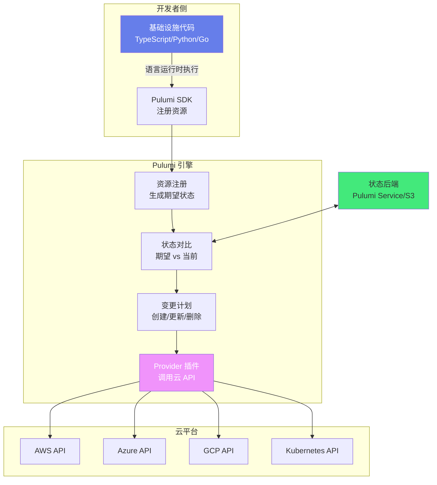

# ☁️ Pulumi 现代基础设施即代码

> **文档说明**：系统讲解 Pulumi 现代 IaC（基础设施即代码）工具的完整知识体系，涵盖核心概念（Stack/Resource/Provider）、架构原理（语言运行时→期望状态→云API对比→变更执行）、多语言支持（TypeScript/Python/Go/C#/Java）、多云部署（AWS/Azure/GCP/Kubernetes）、组件复用（ComponentResource）、策略即代码（CrossGuard）、多环境管理、状态后端、与 Terraform 对比、CI/CD 集成和生产级最佳实践。Pulumi 用通用编程语言定义基础设施，比 Terraform 的 HCL 更灵活，支持真实的循环、函数、类和类型系统。
>
> **适用人群**：DevOps 工程师、SRE、云架构师、全栈开发者
>
> **前置知识**：[[Terraform-基础设施编排]] · [[Ansible-配置管理]] · [[Kustomize-K8s配置管理]]

---

## 一、概述

### 1.1 什么是 Pulumi

Pulumi 是一个**现代基础设施即代码（IaC）工具**，与 Terraform 最大的区别是：**使用通用编程语言（TypeScript、Python、Go、C#、Java、YAML）定义基础设施**，而不是专用的 DSL（HCL）。

这意味着你可以用熟悉的语言特性：循环、条件、函数、类、类型系统、包管理、单元测试，来定义和管理云基础设施。

### 1.2 IaC 的价值

基础设施即代码（Infrastructure as Code）是将基础设施的定义、配置和管理用代码描述，纳入版本控制，实现：

| 价值 | 说明 |
|------|------|
| **可重复** | 相同代码在任何环境产出相同基础设施 |
| **可版本化** | Git 管理变更，可追溯、可回滚 |
| **可审查** | 变更走 PR/Code Review，减少人为错误 |
| **自动化** | CI/CD 自动部署，减少手工操作 |
| **一致性** | dev/staging/prod 环境配置一致 |
| **文档化** | 代码即文档，基础设施状态一目了然 |

### 1.3 Pulumi vs Terraform

| 维度 | Pulumi | Terraform |
|------|--------|-----------|
| **语言** | 通用语言（TS/Python/Go/C#/Java） | 专用 DSL（HCL） |
| **学习曲线** | 开发者熟悉语言，上手快 | 需学 HCL |
| **灵活性** | 真实语言特性（循环/函数/类/类型） | HCL 有限的表达式 |
| **状态管理** | Pulumi Service 托管 / 自托管 / S3 | Terraform Cloud / S3 / 本地 |
| **Provider 生态** | 可复用 Terraform Provider（通过 bridge） | 原生 Provider 生态最丰富 |
| **多语言** | 同一基础设施可多语言编写 | 仅 HCL |
| **测试** | 可用语言原生测试框架 | 需第三方工具（terratest） |
| **成熟度** | 较新（2018年），快速发展 | 成熟（2014年），行业标准 |
| **社区** | 较小但活跃 | 庞大，资料丰富 |
| **成本** | 开源免费，企业版收费 | 开源免费，企业版收费 |

> **选择建议**：团队以开发者为主、追求灵活性和类型安全 → Pulumi；追求成熟稳定和丰富生态 → Terraform。两者可以共存（Pulumi 可调用 Terraform Provider）。

### 1.4 核心应用场景

| 场景 | 说明 |
|------|------|
| **多云部署** | 一套代码管理 AWS/Azure/GCP 资源 |
| **Kubernetes 管理** | 用代码定义 K8s 资源，替代 YAML |
| **Serverless 应用** | 定义函数、API 网关、触发器等 |
| **基础设施复用** | 封装组件（ComponentResource），团队共享 |
| **合规策略** | CrossGuard 策略即代码，自动检查合规 |
| **CI/CD 集成** | GitOps 工作流，PR 自动预览变更 |
| **临时环境** | 每个 PR 创建临时环境，测试后销毁 |

---

## 二、底层原理

### 2.1 Pulumi 架构



**核心流程**：
1. **语言运行时**：执行你的基础设施代码（如 Python 解释器运行 `__main__.py`）
2. **资源注册**：代码中创建的资源通过 SDK 注册到 Pulumi 引擎
3. **期望状态**：引擎收集所有资源定义，形成期望状态
4. **状态对比**：与状态文件中的当前状态对比，计算差异
5. **变更计划**：生成执行计划（创建/更新/删除哪些资源）
6. **执行变更**：通过 Provider 插件调用云 API 执行变更
7. **更新状态**：变更完成后更新状态文件

### 2.2 核心概念

| 概念 | 说明 | 类比 Terraform |
|------|------|---------------|
| **Project** | 一个 Pulumi 项目，包含代码和配置 | 一个 Terraform 项目目录 |
| **Stack** | 一个独立的部署环境（dev/staging/prod） | Workspace / 独立 state |
| **Resource** | 基础设施资源（EC2 实例、S3 桶等） | Resource |
| **Provider** | 云提供商插件（AWS/Azure/GCP/K8s） | Provider |
| **ComponentResource** | 自定义复合资源，封装多个子资源 | Module |
| **Output** | 资源的异步输出属性（资源创建后才有值） | Attribute |
| **Stack Reference** | 跨 Stack 引用输出 | Remote State |
| **Policy Pack** | 合规策略包（CrossGuard） | Sentinel |

### 2.3 Stack 多环境管理

Stack 是 Pulumi 的环境隔离机制，每个 Stack 有独立的配置和状态：

```text
my-project/
├── Pulumi.yaml          # 项目配置（名称、运行时）
├── Pulumi.dev.yaml      # dev 环境配置
├── Pulumi.staging.yaml  # staging 环境配置
├── Pulumi.prod.yaml     # prod 环境配置
├── __main__.py          # 基础设施代码（共享）
└── requirements.txt
```

```bash
# 创建和切换 Stack
pulumi stack init dev        # 创建 dev 环境
pulumi stack init staging    # 创建 staging 环境
pulumi stack select prod     # 切换到 prod 环境
pulumi stack ls              # 列出所有 Stack
pulumi stack rm dev          # 删除 Stack
```

### 2.4 Output 系统

Pulumi 的 Output 是一个核心概念：资源的属性在创建前是未知的，因此用 `Output[T]` 包装，表示「未来会有值」。

```python
# Output 的使用
bucket = s3.Bucket("my-bucket")
# bucket.id 是 Output[str]，不是普通 str

# 正确：用 apply 处理 Output
bucket.id.apply(lambda id: print(f"Bucket ID: {id}"))

# 正确：用 concat 拼接 Output
pulumi.export("arn", bucket.arn)

# 错误：不能直接当 str 用
# print(bucket.id)  # 输出 Output object，不是实际值
```

> **Output 本质**：类似 JavaScript 的 Promise 或 Python 的 Future，代表异步计算结果。Pulumi 通过 Output 构建资源依赖图，自动决定创建顺序。

### 2.5 状态管理

Pulumi 的状态文件记录当前基础设施的实际状态，用于下次变更时对比。

| 状态后端 | 说明 | 适用场景 |
|---------|------|---------|
| **Pulumi Service（默认）** | Pulumi 托管，支持锁定、历史、团队协作 | 大多数团队 |
| **自托管 Service** | 私有部署 Pulumi Service | 数据不出内网 |
| **S3/GCS/Azure Blob** | 对象存储 + 锁（DynamoDB 等） | 已有云基础设施 |
| **本地文件** | 本地 JSON 文件 | 个人开发/测试 |

```bash
# 登录到 Pulumi Service（默认）
pulumi login

# 登录到自托管后端
pulumi login https://pulumi.internal.company.com

# 使用 S3 后端
pulumi login s3://my-pulumi-state-bucket
```

---

## 三、实操示例

### 3.1 快速入门：AWS S3 + EC2

```python
# __main__.py
"""
Pulumi 快速入门：创建 S3 桶 + EC2 实例
"""
import pulumi
from pulumi_aws import s3, ec2

# 1. 创建 S3 桶（配置静态网站）
bucket = s3.Bucket(
    "my-website-bucket",
    website=s3.BucketWebsiteArgs(
        index_document="index.html",
        error_document="error.html",
    ),
    tags={"Environment": "dev", "ManagedBy": "Pulumi"},
)

# 上传 index.html
s3.BucketObject(
    "index.html",
    bucket=bucket.id,
    content="<html><body><h1>Hello Pulumi!</h1></body></html>",
    content_type="text/html",
)

# 2. 创建安全组
security_group = ec2.SecurityGroup(
    "web-sg",
    description="Allow HTTP and SSH",
    ingress=[
        ec2.SecurityGroupIngressArgs(
            protocol="tcp", from_port=80, to_port=80,
            cidr_blocks=["0.0.0.0/0"],
        ),
        ec2.SecurityGroupIngressArgs(
            protocol="tcp", from_port=22, to_port=22,
            cidr_blocks=["0.0.0.0/0"],
        ),
    ],
    egress=[
        ec2.SecurityGroupEgressArgs(
            protocol="-1", from_port=0, to_port=0,
            cidr_blocks=["0.0.0.0/0"],
        ),
    ],
)

# 3. 创建 EC2 实例
server = ec2.Instance(
    "web-server",
    instance_type="t2.micro",
    ami="ami-0c55b159cbfafe1f0",  # Amazon Linux 2
    vpc_security_group_ids=[security_group.id],
    tags={"Name": "web-server", "Environment": "dev"},
)

# 4. 输出（Stack Outputs）
pulumi.export("bucket_name", bucket.id)
pulumi.export("bucket_website_endpoint", bucket.website_endpoint)
pulumi.export("server_public_ip", server.public_ip)
pulumi.export("server_public_dns", server.public_dns)
```

```bash
# 部署流程
pulumi stack init dev                    # 创建环境
pulumi config set aws:region us-east-1   # 配置区域
pulumi up                                # 预览并部署（会显示变更计划，确认后执行）
pulumi stack output                      # 查看输出
pulumi destroy                            # 销毁所有资源
```

### 3.2 配置管理

```python
"""
Pulumi 配置：不同环境不同参数
"""
import pulumi

# 获取配置
config = pulumi.Config()

# 读取配置值
instance_type = config.get("instanceType") or "t2.micro"  # 可选配置
db_password = config.require_secret("dbPassword")         # 必填 + 加密

# 读取嵌套配置
db_config = config.get_object("database") or {}
db_name = db_config.get("name", "mydb")
db_size = db_config.get("size", 20)

# 使用配置
server = ec2.Instance(
    "server",
    instance_type=instance_type,
    ami="ami-xxx",
)
```

```bash
# 配置命令
pulumi config set aws:region us-east-1        # 普通配置
pulumi config set --secret dbPassword xxx     # 加密配置（密文存储）
pulumi config get aws:region                   # 读取配置
pulumi config                                   # 列出所有配置
```

### 3.3 自定义组件（ComponentResource）

```python
"""
自定义组件：封装一个完整的 Web 服务（EC2 + SG + EIP）
类似 Terraform 的 Module，但用真实类实现
"""
import pulumi
from pulumi_aws import ec2


class WebService(pulumi.ComponentResource):
    """可复用的 Web 服务组件"""

    def __init__(self, name: str, instance_type: str = "t2.micro",
                 ami: str = "ami-xxx", vpc_id: str = None,
                 opts: pulumi.ResourceOptions = None):
        super().__init__("custom:WebService", name, {}, opts)

        # 安全组
        self.security_group = ec2.SecurityGroup(
            f"{name}-sg",
            description=f"Security group for {name}",
            ingress=[
                ec2.SecurityGroupIngressArgs(
                    protocol="tcp", from_port=80, to_port=80,
                    cidr_blocks=["0.0.0.0/0"],
                ),
            ],
            vpc_id=vpc_id,
            opts=pulumi.ResourceOptions(parent=self),
        )

        # EC2 实例
        self.instance = ec2.Instance(
            f"{name}-server",
            instance_type=instance_type,
            ami=ami,
            vpc_security_group_ids=[self.security_group.id],
            tags={"Name": name},
            opts=pulumi.ResourceOptions(parent=self),
        )

        # 弹性 IP
        self.eip = ec2.Eip(
            f"{name}-eip",
            instance=self.instance.id,
            opts=pulumi.ResourceOptions(parent=self),
        )

        # 注册输出
        self.register_outputs({
            "public_ip": self.eip.public_ip,
            "instance_id": self.instance.id,
        })


# 使用自定义组件
web1 = WebService("web1", instance_type="t2.small")
web2 = WebService("web2", instance_type="t2.micro")

pulumi.export("web1_ip", web1.public_ip)
pulumi.export("web2_ip", web2.public_ip)
```

### 3.4 Kubernetes 部署

```python
"""
Pulumi 管理 Kubernetes：用代码替代 YAML
"""
import pulumi
from pulumi_kubernetes import apps, core, meta, provider

# 创建 K8s Provider（可连接不同集群）
k8s_provider = provider.Provider(
    "k8s-provider",
    kubeconfig=kubeconfig,  # 从配置或文件读取
)

# Namespace
namespace = core.v1.Namespace(
    "app-namespace",
    metadata=meta.v1.ObjectMetaArgs(name="my-app"),
    opts=pulumi.ResourceOptions(provider=k8s_provider),
)

# Deployment
deployment = apps.v1.Deployment(
    "app-deployment",
    metadata=meta.v1.ObjectMetaArgs(
        name="web-app",
        namespace=namespace.metadata["name"],
        labels={"app": "web"},
    ),
    spec=apps.v1.DeploymentSpecArgs(
        replicas=3,
        selector=meta.v1.LabelSelectorArgs(
            match_labels={"app": "web"},
        ),
        template=core.v1.PodTemplateSpecArgs(
            metadata=meta.v1.ObjectMetaArgs(labels={"app": "web"}),
            spec=core.v1.PodSpecArgs(
                containers=[
                    core.v1.ContainerArgs(
                        name="web",
                        image="nginx:latest",
                        ports=[core.v1.ContainerPortArgs(container_port=80)],
                        resources=core.v1.ResourceRequirementsArgs(
                            requests={"cpu": "100m", "memory": "128Mi"},
                            limits={"cpu": "500m", "memory": "256Mi"},
                        ),
                    ),
                ],
            ),
        ),
    ),
    opts=pulumi.ResourceOptions(provider=k8s_provider),
)

# Service
service = core.v1.Service(
    "app-service",
    metadata=meta.v1.ObjectMetaArgs(
        name="web-service",
        namespace=namespace.metadata["name"],
    ),
    spec=core.v1.ServiceSpecArgs(
        type="LoadBalancer",
        selector={"app": "web"},
        ports=[core.v1.ServicePortArgs(port=80, target_port=80)],
    ),
    opts=pulumi.ResourceOptions(provider=k8s_provider),
)

pulumi.export("service_ip", service.status["load_balancer"]["ingress"][0]["ip"])
```

### 3.5 策略即代码（CrossGuard）

```python
"""
CrossGuard 合规策略：自动检查基础设施是否合规
"""
# policy_pack/__main__.py
from pulumi_policy import PolicyPack, ResourceValidationArgs, ResourceValidationResult, PolicyViolation


def require_tags(args: ResourceValidationArgs, report_violation):
    """所有资源必须有 Environment 和 ManagedBy 标签"""
    if "tags" in args.props:
        tags = args.props["tags"] or {}
        if "Environment" not in tags:
            report_violation("资源必须有 Environment 标签")
        if "ManagedBy" not in tags:
            report_violation("资源必须有 ManagedBy 标签")


def forbid_public_s3(args: ResourceValidationArgs, report_violation):
    """禁止公开的 S3 桶"""
    if args.resource_type == "aws:s3/bucket:Bucket":
        if args.props.get("acl") == "public-read":
            report_violation("S3 桶不能设置为 public-read")


def enforce_instance_type(args: ResourceValidationArgs, report_violation):
    """EC2 实例类型必须在允许列表中"""
    if args.resource_type == "aws:ec2/instance:Instance":
        allowed = ["t2.micro", "t2.small", "t3.micro", "t3.small"]
        if args.props.get("instance_type") not in allowed:
            report_violation(f"EC2 实例类型 {args.props.get('instance_type')} 不在允许列表中")


PolicyPack(
    name="company-compliance",
    policies=[
        {
            "name": "require-tags",
            "description": "所有资源必须有标准标签",
            "enforcement_level": "mandatory",  # mandatory=强制阻止, advisory=仅警告
            "validate_resource": require_tags,
        },
        {
            "name": "forbid-public-s3",
            "description": "禁止公开 S3 桶",
            "enforcement_level": "mandatory",
            "validate_resource": forbid_public_s3,
        },
        {
            "name": "enforce-instance-type",
            "description": "限制 EC2 实例类型",
            "enforcement_level": "advisory",
            "validate_resource": enforce_instance_type,
        },
    ],
)
```

```bash
# 运行策略检查
pulumi policy new aws-python    # 创建策略包
pulumi up --policy-pack ./policy_pack  # 部署时应用策略
```

### 3.6 CI/CD 集成（GitHub Actions）

```yaml
# .github/workflows/pulumi.yml
name: Pulumi Deploy
on:
  push:
    branches: [main]
  pull_request:
    branches: [main]

jobs:
  preview:
    name: Preview
    runs-on: ubuntu-latest
    if: github.event_name == 'pull_request'
    steps:
      - uses: actions/checkout@v4
      - uses: actions/setup-python@v5
        with: { python-version: '3.11' }
      - run: pip install -r requirements.txt
      - uses: pulumi/actions@v5
        with:
          command: preview
          stack-name: dev
        env:
          PULUMI_ACCESS_TOKEN: ${{ secrets.PULUMI_ACCESS_TOKEN }}
          AWS_ACCESS_KEY_ID: ${{ secrets.AWS_ACCESS_KEY_ID }}
          AWS_SECRET_ACCESS_KEY: ${{ secrets.AWS_SECRET_ACCESS_KEY }}

  update:
    name: Deploy
    runs-on: ubuntu-latest
    if: github.ref == 'refs/heads/main' && github.event_name == 'push'
    steps:
      - uses: actions/checkout@v4
      - uses: actions/setup-python@v5
        with: { python-version: '3.11' }
      - run: pip install -r requirements.txt
      - uses: pulumi/actions@v5
        with:
          command: up
          stack-name: prod
        env:
          PULUMI_ACCESS_TOKEN: ${{ secrets.PULUMI_ACCESS_TOKEN }}
          AWS_ACCESS_KEY_ID: ${{ secrets.AWS_ACCESS_KEY_ID }}
          AWS_SECRET_ACCESS_KEY: ${{ secrets.AWS_SECRET_ACCESS_KEY }}
```

---

## 四、常见问题与排查

| 问题现象 | 可能原因 | 解决方案 |
|---------|---------|---------|
| **状态文件冲突** | 多人同时操作同一 Stack；状态后端未加锁 | 使用 Pulumi Service（自动锁）或 S3+DynamoDB 锁；确保同一时间只有一个人部署 |
| **资源删除失败** | 资源有依赖未删除；云平台资源被外部修改；删除保护开启 | 检查依赖关系，先删依赖资源；`pulumi refresh` 同步状态；关闭删除保护 |
| **云 API 限流** | 资源太多并发创建；云平台 API 速率限制 | 调整 `--parallel` 参数降低并发；分批部署；添加重试配置 |
| **Provider 插件下载失败** | 网络问题；版本不兼容；代理配置 | 配置代理；手动下载插件；检查 Pulumi 和 Provider 版本兼容性 |
| **Output 值拿不到** | 资源未创建完成；直接打印 Output 对象 | 用 `.apply()` 处理；用 `pulumi.export` 输出；不要在代码中直接使用 Output 值 |
| **Stack 切换后配置丢失** | 配置是 Stack 级别的，切换后用新 Stack 的配置 | 每个 Stack 单独配置；用 `pulumi config set` 设置；配置文件 `Pulumi.<stack>.yaml` |
| **导入现有资源失败** | 资源 ID 不正确；资源已被其他 Stack 管理；权限不足 | 确认资源 ID（云控制台查看）；`pulumi import` 命令；检查 IAM 权限 |
| **预览和实际不一致** | 状态文件过期；外部修改了资源；Provider bug | `pulumi refresh` 同步状态；避免手动修改被 Pulumi 管理的资源 |
| **Kubernetes Provider 连不上** | kubeconfig 路径错误；集群不可达；证书过期 | 检查 kubeconfig 内容；测试 `kubectl` 连接；更新证书 |
| **秘密配置泄露** | 配置未用 `--secret`；代码中硬编码密钥 | 所有敏感配置用 `pulumi config set --secret`；代码中用 `config.require_secret()` |
| **组件资源无法删除** | ComponentResource 的子资源有依赖；自定义组件有 bug | 检查子资源依赖；用 `pulumi state delete` 强制删除；修复组件代码 |
| **升级 Provider 后报错** | API 变更；属性重命名；默认值变化 | 查看 Provider CHANGELOG；逐步升级；测试环境先验证 |
| **大规模部署慢** | 资源数量多；串行依赖多；网络延迟 | 增加并行度 `--parallel`；优化依赖关系；拆分大 Stack 为多个小 Stack |

---

## 五、进阶与最佳实践

### 5.1 项目结构最佳实践

```text
infrastructure/
├── Pulumi.yaml                  # 项目配置
├── Pulumi.dev.yaml              # dev 环境配置
├── Pulumi.staging.yaml          # staging 环境配置
├── Pulumi.prod.yaml             # prod 环境配置
├── __main__.py                  # 入口，组合各模块
├── requirements.txt
├── components/                  # 自定义组件
│   ├── __init__.py
│   ├── web_service.py           # Web 服务组件
│   ├── database.py              # 数据库组件
│   └── networking.py            # 网络组件
├── stacks/                      # 按环境/模块拆分
│   ├── network.py               # 网络层
│   ├── compute.py               # 计算层
│   ├── database.py              # 数据层
│   └── app.py                   # 应用层
└── tests/                       # 单元测试
    ├── test_web_service.py
    └── test_database.py
```

### 5.2 Stack 拆分策略

大规模基础设施不要放在一个 Stack 中，按层或领域拆分：

| 拆分方式 | 说明 | 优点 |
|---------|------|------|
| **按层拆分** | network / compute / database / app | 职责清晰，变更影响小 |
| **按环境拆分** | dev / staging / prod | 环境隔离，独立部署 |
| **按团队拆分** | team-a / team-b / shared | 团队自治，减少冲突 |
| **按生命周期拆分** | 持久（数据库）/ 临时（应用） | 持久资源不频繁变更 |

```python
# 跨 Stack 引用（Stack Reference）
import pulumi

# 引用 network Stack 的输出
network_stack = pulumi.StackReference("myorg/network/prod")
vpc_id = network_stack.get_output("vpc_id")
subnet_ids = network_stack.get_output("subnet_ids")

# 在当前 Stack 中使用
server = ec2.Instance("server", subnet_id=vpc_id, ...)
```

### 5.3 单元测试

```python
"""
Pulumi 单元测试：用 Python 原生测试框架验证基础设施
"""
import unittest
import pulumi
from components.web_service import WebService


class TestWebService(unittest.TestCase):

    @pulumi.runtime.test
    def test_security_group_has_http(self):
        """测试安全组开放了 80 端口"""
        ws = WebService("test", instance_type="t2.micro")

        def check_ingress(args):
            sg_id, ingress = args
            # 验证有 80 端口的入站规则
            ports = [rule["from_port"] for rule in ingress]
            self.assertIn(80, ports, "安全组必须开放 80 端口")

        return pulumi.Output.all(
            ws.security_group.id,
            ws.security_group.ingress,
        ).apply(check_ingress)

    @pulumi.runtime.test
    def test_instance_type(self):
        """测试实例类型正确"""
        ws = WebService("test2", instance_type="t2.small")

        def check_instance(args):
            instance_type = args[0]
            self.assertEqual(instance_type, "t2.small")

        return ws.instance.instance_type.apply(lambda t: self.assertEqual(t, "t2.small"))
```

### 5.4 生产环境最佳实践 Checklist

| 类别 | 最佳实践 | 说明 |
|------|---------|------|
| **项目结构** | 按层/领域拆分 Stack | 避免单 Stack 过大，减少冲突和影响范围 |
| **项目结构** | 自定义 ComponentResource 复用 | 封装通用模式，团队共享 |
| **配置** | 敏感配置用 `--secret` | 密码/密钥加密存储，不明文 |
| **配置** | 不同环境独立配置 | dev/staging/prod 配置分离 |
| **命名** | 资源名包含环境前缀 | 如 `prod-web-server`，避免混淆 |
| **标签** | 所有资源打标准标签 | Environment/Team/ManagedBy/CostCenter |
| **状态** | 使用远程状态后端 | Pulumi Service 或 S3+锁，不用本地 |
| **状态** | 定期 `pulumi refresh` | 同步外部变更，保持状态准确 |
| **部署** | CI/CD 自动部署 | 手动部署容易出错，GitOps 工作流 |
| **部署** | PR 自动预览（preview） | 变更前看到影响，Code Review |
| **部署** | 生产环境手动确认 | `pulumi up` 需要人工确认 |
| **策略** | CrossGuard 合规策略 | 强制标签、安全组、实例类型等规范 |
| **策略** | 策略分 mandatory/advisory | 严重问题阻止，一般问题警告 |
| **安全** | 最小权限 IAM | Pulumi 服务账号只给必要权限 |
| **安全** | 禁止公开资源 | S3/数据库不公开，安全组限制来源 |
| **测试** | 基础设施单元测试 | 验证组件行为和配置 |
| **测试** | 临时环境测试 | 每个 PR 创建环境，测试后销毁 |
| **监控** | 部署通知 | Slack/钉钉通知部署结果 |
| **监控** | 资源成本监控 | 定期检查云资源成本 |
| **文档** | README 说明部署流程 | 新人能快速上手 |
| **文档** | 架构图和资源清单 | `pulumi stack export` 导出 |
| **备份** | 状态文件备份 | 定期备份状态，防止丢失 |
| **回滚** | 变更可回滚 | Git 回退 + `pulumi up` 恢复 |

### 5.5 与 Terraform 互操作

```python
"""
Pulumi 调用 Terraform Provider（通过 pulumi-terraform-bridge）
大多数 Pulumi Provider 本身就是 Terraform Provider 的桥接
"""
# Pulumi AWS Provider 底层就是 Terraform AWS Provider
# 可以直接使用，无需特殊处理

# 也可以调用 Terraform 远程状态
import pulumi
from pulumi import terraform

# 引用 Terraform 远程状态（S3）
tf_state = terraform.state.RemoteStateReference(
    "tf-network",
    backend_type="s3",
    args={
        "bucket": "my-terraform-state",
        "key": "network/terraform.tfstate",
        "region": "us-east-1",
    },
)

vpc_id = tf_state.get_output("vpc_id")
```

---

## 六、关联笔记

### DevOps 与 IaC
- [[Terraform-基础设施编排]] · [[Ansible-配置管理]] · [[Kustomize-K8s配置管理]]
- [[Helm-K8s包管理器]] · [[Docker容器化]] · [[Kubernetes核心概念]]

### 云原生
- [[Kubernetes运维实战]] · [[Prometheus监控体系]] · [[CI-CD流水线设计]]
- [[云原生架构设计]]

### 导航
- [[MOC-云原生与运维]] · [[MOC-基础设施即代码]] · [[MOC-综合导航]] · [[Home]]

> 🔍 **知识点深度解析**
>
> **作用**：Pulumi 现代 IaC 解决的是「用通用编程语言定义和管理云基础设施」的问题，让开发者用熟悉的语言（TS/Python/Go）管理 AWS/Azure/GCP/K8s 资源，实现基础设施的自动化、版本化和可重复部署。
>
> **底层原理**：Pulumi 架构 = 语言运行时 + 资源引擎 + Provider 插件 + 状态后端。代码执行时通过 SDK 注册资源，引擎收集期望状态，与状态文件对比后生成变更计划，通过 Provider 调用云 API 执行。核心概念：Stack（环境隔离）、Resource（资源）、Provider（云插件）、Output（异步属性）、ComponentResource（复合组件）。Output 系统构建资源依赖图，自动决定创建顺序。
>
> **用法要点**：① 用通用语言写基础设施代码，享受类型安全和 IDE 提示 ② 多环境用 Stack 隔离（dev/staging/prod） ③ 敏感配置用 `--secret` 加密 ④ 自定义 ComponentResource 复用模式 ⑤ CrossGuard 策略即代码做合规检查 ⑥ 大规模按层/领域拆分 Stack ⑦ CI/CD 集成，PR 自动预览 ⑧ 远程状态后端 + 锁 ⑨ 所有资源打标准标签 ⑩ 单元测试验证组件。

> 💡 **深度讲解**：Pulumi 和 Terraform 的核心区别不是「谁更好」，而是「思维方式不同」。Terraform 的 HCL 是声明式的，专注于「描述想要什么」，适合运维和平台团队；Pulumi 用通用语言，适合开发者团队，能复用已有的编程技能和工具链（类型系统、包管理、单元测试）。Pulumi 的 Output 系统是学习曲线最陡的部分，它本质是 Promise/Future，代表资源创建后的异步值，不能直接当普通值用，需要 `.apply()` 或 `pulumi.all()` 处理。生产环境最大的坑是「状态不一致」——有人手动在云控制台修改了被 Pulumi 管理的资源，导致状态和实际不符，解决方法是定期 `pulumi refresh` 同步，并禁止手动修改 IaC 管理的资源。

> 📝 **精简总结**：Pulumi = 用通用语言（TS/Python/Go）写 IaC，替代 Terraform HCL。架构：语言运行时→资源注册→状态对比→变更执行→Provider调云API。核心：Stack（多环境）、Resource（资源）、Output（异步属性）、ComponentResource（复用组件）、CrossGuard（合规策略）。vs Terraform：更灵活、类型安全、可单元测试，但生态较小。生产必备：远程状态+锁、Stack拆分、秘密配置、标签规范、CI/CD预览、策略检查。

> **学习路径建议**：先学习 [[Terraform-基础设施编排]] 理解 IaC 基础概念 → 学习本文档掌握 Pulumi 用法 → 对比两者差异选择适合团队的工具 → 在项目中实践 ComponentResource 复用和 CrossGuard 策略 → 学习 [[Kubernetes核心概念]] 用 Pulumi 管理 K8s → CI/CD 集成实现 GitOps。

---

> **基础设施即代码的终极目标不是「用代码写配置」，而是「让基础设施的变更像应用代码一样可审查、可测试、可回滚」。Pulumi 让这个目标离开发者更近一步。**
