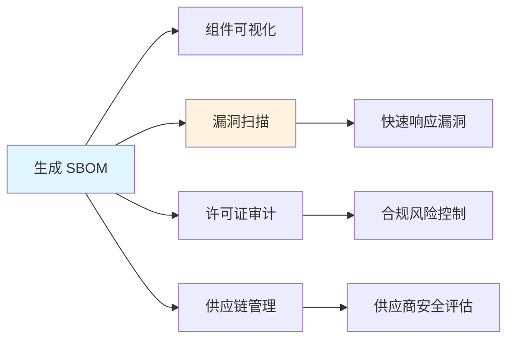

# SBOM软件物料清单

> **文档说明**：系统讲解 SBOM（软件物料清单）的概念、标准格式、生成工具、各语言生成方法、漏洞管理集成、合规要求，以及生产级最佳实践。
>
> **适用人群**：后端开发者、运维工程师、安全工程师、需要管理软件供应链的开发者
>
> **前置知识**：[[依赖漏洞检测-Snyk]]、[[容器安全与镜像扫描]]、[[密码学基础与应用]]

---

## 一、概述

### 1. 什么是 SBOM

**SBOM（Software Bill of Materials，软件物料清单）** 是软件组件的完整清单，类似于食品配料表，列出软件中包含的所有开源和第三方组件。

```text
SBOM 包含的信息：
- 组件名称和版本
- 组件供应商
- 组件许可证
- 依赖关系（直接/间接依赖）
- 组件哈希值（完整性校验）
- 组件下载地址
- 组件关系层次
```

### 2. 为什么需要 SBOM

| 驱动因素 | 说明 |
|---------|------|
| **供应链安全** | 快速定位受漏洞影响的组件（如 Log4j、OpenSSL） |
| **合规要求** | 美国 EO 14028、欧盟 CRA、中国网络安全审查 |
| **漏洞响应** | 漏洞爆发时快速评估影响范围 |
| **许可证合规** | 管理开源许可证，避免法律风险 |
| **资产可视化** | 了解软件中使用了哪些第三方组件 |
| **风险管理** | 基于组件风险做安全决策 |

### 3. SBOM 的价值



---

## 二、SBOM 标准格式

### 1. 主流格式对比

| 格式 | 发起方 | 特点 | 适用场景 |
|------|--------|------|---------|
| **SPDX** | Linux 基金会 | 国际标准（ISO/IEC 5962）、全面 | 通用、合规 |
| **CycloneDX** | OWASP | 轻量、面向安全、扩展好 | 安全工具、DevSecOps |
| **SWID** | ISO/IEC | 软件标识标准 | 软件资产管理 |

### 2. SPDX 格式

```json
{
  "spdxVersion": "SPDX-2.3",
  "dataLicense": "CC0-1.0",
  "SPDXID": "SPDXRef-DOCUMENT",
  "name": "my-app",
  "documentNamespace": "https://example.com/my-app",
  "creationInfo": {
    "created": "2026-08-27T10:00:00Z",
    "creators": ["Tool: syft-0.90.0"]
  },
  "packages": [
    {
      "SPDXID": "SPDXRef-Package-1",
      "name": "log4j-core",
      "versionInfo": "2.14.1",
      "supplier": "Organization: Apache",
      "downloadLocation": "https://repo1.maven.org/maven2/log4j-core-2.14.1.jar",
      "licenseConcluded": "Apache-2.0",
      "checksums": [
        {"algorithm": "SHA1", "checksumValue": "1a2b3c..."}
      ]
    }
  ],
  "relationships": [
    {
      "spdxElementId": "SPDXRef-DOCUMENT",
      "relationshipType": "CONTAINS",
      "relatedSpdxElement": "SPDXRef-Package-1"
    }
  ]
}
```

### 3. CycloneDX 格式

```json
{
  "bomFormat": "CycloneDX",
  "specVersion": "1.5",
  "serialNumber": "urn:uuid:3e671687-395b-41f5-a30f-a58921a69b79",
  "version": 1,
  "metadata": {
    "timestamp": "2026-08-27T10:00:00Z",
    "tools": [{"vendor": "anchore", "name": "syft", "version": "0.90.0"}],
    "component": {
      "type": "application",
      "name": "my-app",
      "version": "1.0.0"
    }
  },
  "components": [
    {
      "type": "library",
      "bom-ref": "pkg:maven/org.apache.logging.log4j/log4j-core@2.14.1",
      "name": "log4j-core",
      "version": "2.14.1",
      "group": "org.apache.logging.log4j",
      "purl": "pkg:maven/org.apache.logging.log4j/log4j-core@2.14.1",
      "licenses": [{"license": {"id": "Apache-2.0"}}],
      "hashes": [{"alg": "SHA-1", "content": "1a2b3c..."}]
    }
  ],
  "dependencies": [
    {
      "ref": "pkg:maven/org.apache.logging.log4j/log4j-core@2.14.1",
      "dependsOn": ["pkg:maven/org.apache.logging.log4j/log4j-api@2.14.1"]
    }
  ]
}
```

### 4. 格式选择建议

```text
选择建议：
- 合规/法律 → SPDX（国际标准）
- 安全工具链 → CycloneDX（OWASP，工具支持好）
- 企业内部 → 任选一种，保持一致
- 两种都生成 → 用工具转换（syft 支持多格式输出）
```

---

## 三、SBOM 生成工具

### 1. Syft（推荐）

```bash
# 安装
# macOS
brew install syft

# Linux
curl -sSfL https://raw.githubusercontent.com/anchore/syft/main/install.sh | sh

# Windows
scoop install syft

# 生成 SBOM（扫描当前目录）
syft . -o spdx-json > sbom.spdx.json
syft . -o cyclonedx-json > sbom.cdx.json

# 扫描容器镜像
syft my-app:latest -o spdx-json > image-sbom.json

# 扫描目录
syft /path/to/project -o cyclonedx-json

# 输出格式选项
# -o spdx (tag-value)
# -o spdx-json
# -o cyclonedx-xml
# -o cyclonedx-json
# -o github-json
# -o syft-json
```

### 2. Trivy

```bash
# 安装
brew install trivy

# 生成 SBOM
trivy fs --format spdx-json --output sbom.json .
trivy image --format cyclonedx --output sbom.json my-app:latest

# 同时扫描漏洞
trivy fs --scanners vuln,misconfig .
```

### 3. CycloneDX CLI

```bash
# 安装
npm install -g @cyclonedx/cyclonedx-cli

# 从 node_modules 生成
cyclonedx-bom -o bom.xml

# 转换格式
cyclonedx-cli convert --input-file sbom.json --output-format spdxjson
```

### 4. 各语言专用工具

| 语言 | 工具 | 命令 |
|------|------|------|
| **Java** | cyclonedx-maven-plugin | `mvn org.cyclonedx:cyclonedx-maven-plugin:makeAggregateBom` |
| **Java** | spdx-maven-plugin | `mvn org.spdx:spdx-maven-plugin:spdx` |
| **Node.js** | @cyclonedx/cyclonedx-npm | `npx @cyclonedx/cyclonedx-npm` |
| **Python** | cyclonedx-bom | `cyclonedx-py environment` |
| **Python** | pip-tools + syft | `syft .` |
| **Go** | cyclonedx-gomod | `cyclonedx-gomod app` |
| **.NET** | CycloneDX | `dotnet CycloneDX` |
| **PHP** | cyclonedx-php-composer | `composer make-bom` |
| **Ruby** | cyclonedx-ruby | `cyclonedx-ruby` |
| **Rust** | cargo-cyclonedx | `cargo cyclonedx` |

---

## 四、各语言生成 SBOM

### 1. Java（Maven）

```xml
<!-- pom.xml -->
<build>
  <plugins>
    <plugin>
      <groupId>org.cyclonedx</groupId>
      <artifactId>cyclonedx-maven-plugin</artifactId>
      <version>2.7.11</version>
      <executions>
        <execution>
          <phase>package</phase>
          <goals><goal>makeAggregateBom</goal></goals>
        </execution>
      </executions>
      <configuration>
        <outputFormat>json</outputFormat>
        <outputName>bom</outputName>
      </configuration>
    </plugin>
  </plugins>
</build>
```

```bash
# 生成
mvn package
# 输出：target/bom.json
```

### 2. Node.js

```bash
# 安装
npm install -g @cyclonedx/cyclonedx-npm

# 生成
npx @cyclonedx/cyclonedx-npm --output-format JSON --output-file bom.json

# 或使用 syft
syft . -o cyclonedx-json > bom.json
```

### 3. Python

```bash
# 安装
pip install cyclonedx-bom

# 从环境生成
cyclonedx-py environment --output-format json --output-file bom.json

# 从 requirements.txt 生成
cyclonedx-py requirements -i requirements.txt -o bom.json

# 从 Poetry 项目生成
cyclonedx-py poetry
```

### 4. Go

```bash
# 安装
go install github.com/CycloneDX/cyclonedx-gomod/cmd/cyclonedx-gomod@latest

# 生成
cyclonedx-gomod app -json -output bom.json -main cmd/app .
```

### 5. 容器镜像

```bash
# 构建时生成（Dockerfile 多阶段）
# 或构建后扫描
syft my-app:latest -o spdx-json > image-sbom.json

# Docker Buildx 内置 SBOM（BuildKit 0.11+）
docker buildx build --sbom=true -t my-app:latest .
```

---

## 五、SBOM 与漏洞管理

### 1. 漏洞扫描工具

```bash
# Grype（基于 SBOM 扫描漏洞）
grype sbom:./sbom.json
grype my-app:latest

# Trivy（直接扫描或基于 SBOM）
trivy sbom sbom.json
trivy fs --scanners vuln .

# Dependency-Check（OWASP）
dependency-check --scan . --format JSON

# Snyk
snyk test --all-projects
snyk sbom --format cyclonedx1.4+json
```

### 2. 漏洞响应流程

```text
漏洞爆发（如 Log4j）时：
1. 生成/获取所有项目的 SBOM
2. 搜索 SBOM 中是否包含受影响组件
3. 定位受影响的项目和版本
4. 评估风险（是否使用了受影响功能）
5. 制定修复计划（升级/缓解）
6. 修复并重新生成 SBOM
7. 验证修复效果
```

### 3. 自动化集成

```yaml
# GitHub Actions 示例
name: SBOM
on: [push, pull_request]

jobs:
  sbom:
    runs-on: ubuntu-latest
    steps:
      - uses: actions/checkout@v4

      - name: Generate SBOM
        uses: anchore/sbom-action@v0
        with:
          format: spdx-json
          output-file: sbom.spdx.json

      - name: Scan for vulnerabilities
        uses: anchore/scan-action@v3
        with:
          sbom: sbom.spdx.json

      - name: Upload SBOM
        uses: actions/upload-artifact@v4
        with:
          name: sbom
          path: sbom.spdx.json
```

---

## 六、SBOM 管理与共享

### 1. 存储位置

```text
SBOM 文件管理：
- 随代码仓库存储：bom.json 提交到 Git
- 构建产物附带：CI/CD 生成后上传到制品库
- 集中管理平台：Dependency-Track、GUAC
- 容器镜像标注：OCI image 附带 SBOM（cosign）
```

```text
### 2. Dependency-Track（推荐）
```

```bash
Dependency-Track 是 OWASP 的 SBOM 管理平台：
- 集中管理所有项目的 SBOM
- 自动漏洞扫描和告警
- 许可证合规分析
- 风险指标仪表盘
- API 支持自动化

部署：
docker run -d -p 8080:8080 dependencytrack/apiserver
docker run -d -p 8081:8080 dependencytrack/frontend
```

### 3. 签名 SBOM

```bash
# 使用 cosign 签名 SBOM（确保完整性和来源可信）
cosign attest --predicate sbom.json --type cyclonedx my-app:latest

# 验证
cosign verify-attestation --type cyclonedx my-app:latest
```

---

## 七、合规要求

### 1. 主要法规

| 法规 | 地区 | 要求 |
|------|------|------|
| **EO 14028** | 美国 | 联邦采购软件必须提供 SBOM |
| **CRA** | 欧盟 | 数字产品需提供 SBOM（2027年生效） |
| **网络安全审查办法** | 中国 | 关键信息基础设施需供应链安全 |
| **NIST SSDF** | 美国 | 安全开发框架建议生成 SBOM |
| **ISO 27001** | 国际 | 资产管理建议包含组件清单 |

### 2. SBOM 最低要素（NTIA）

```text
NTIA 定义的 SBOM 最低要素：
1. 数据字段：
   - 供应商名称
   - 组件名称
   - 组件版本
   - 其他唯一标识符
   - 依赖关系
   - SBOM 作者
   - 时间戳

2. 自动化支持：
   - 机器可读格式（SPDX/CycloneDX）
   - 可传输和可解析

3. 实践与流程：
   - 频率：每次发布更新
   - 深度：包含传递依赖
   - 已知漏洞：可关联查询
   - 分发：可获取
   - 访问控制：按需提供
```

---

## 八、最佳实践

### 1. 生成规范

- [ ] **每次构建生成**：CI/CD 流水线自动生成 SBOM
- [ ] **包含传递依赖**：递归扫描所有间接依赖
- [ ] **多格式输出**：同时生成 SPDX 和 CycloneDX
- [ ] **版本化管理**：SBOM 随软件版本管理
- [ ] **签名验证**：对 SBOM 签名，确保完整性
- [ ] **容器镜像附带**：使用 cosign 将 SBOM 附加到镜像

### 2. 工具链集成

- [ ] **CI/CD 集成**：构建阶段自动生成和扫描
- [ ] **制品库存储**：SBOM 随制品一起存储
- [ ] **集中管理**：使用 Dependency-Track 等平台
- [ ] **漏洞告警**：新漏洞发布时自动匹配 SBOM 告警
- [ ] **准入控制**：有高危漏洞的组件禁止上线

### 3. 运营规范

- [ ] **定期审计**：定期审查 SBOM 准确性
- [ ] **供应商要求**：要求供应商提供 SBOM
- [ ] **应急响应**：漏洞爆发时基于 SBOM 快速评估
- [ ] **许可证管理**：基于 SBOM 做许可证合规审计
- [ ] **团队培训**：开发团队了解 SBOM 价值和使用

---

## 九、常见问题与排查

| 问题 | 原因 | 解决方案 |
|------|------|---------|
| **SBOM 不完整** | 工具未识别某些包管理器 | 用多种工具交叉验证、手动补充 |
| **传递依赖缺失** | 锁文件缺失 / 工具限制 | 确保有 lock 文件、使用支持传递依赖的工具 |
| **版本不准确** | 版本范围未解析 | 安装依赖后再扫描、使用 lock 文件 |
| **组件重复** | 多个包管理器混用 | 统一包管理、去重处理 |
| **许可证识别错误** | 工具识别能力有限 | 人工审核关键组件、补充许可证信息 |
| **生成速度慢** | 项目依赖多 | 缓存、增量扫描、并行处理 |
| **SBOM 体积大** | 依赖树庞大 | 压缩存储、只保留必要字段 |
| **格式不兼容** | 工具支持的版本不同 | 统一格式版本、使用转换工具 |
| **容器镜像扫不到** | 镜像无包管理器元数据 | 用 syft 多目录扫描、构建时生成 |
| **私有仓库组件缺失** | 工具无法访问私有仓库 | 配置认证、手动添加私有组件 |
| **SBOM 过时** | 未随版本更新 | CI/CD 自动生成、版本化管理 |
| **漏洞误报** | CPE 匹配不准确 | 用 PURL 替代 CPE、人工确认 |
| **合规不通过** | 缺少必要字段 | 按 NTIA 最低要素检查、补充字段 |
| **无法分享给供应商** | 格式不统一 | 使用标准格式（SPDX/CycloneDX） |
| **SBOM 泄露敏感信息** | 包含内部组件信息 | 按需分享、脱敏处理、访问控制 |

---

## 十、关联笔记

### 安全相关
- [[依赖漏洞检测-Snyk]] · [[容器安全与镜像扫描]] · [[密码学基础与应用]]
- [[API安全最佳实践]] · [[AI安全与对齐基础]]

### 云原生
- [[Docker容器化实战]] · [[K8s-核心概念与架构]] · [[多架构镜像构建-buildx]]
- [[APM应用性能监控-SkyWalking]]

### 导航
- [[MOC-云原生与运维]] · [[MOC-计算机基础]] · [[全栈+AI工程双轨融合学习路线图]]

> **学习路径建议**：先掌握 [[依赖漏洞检测-Snyk]] 漏洞检测基础 → 深入本文 SBOM 软件物料清单 → 实践 [[容器安全与镜像扫描]] 容器安全 → 研究 [[密码学基础与应用]] 安全基础 → 构建完整的软件供应链安全体系。

---

## 💡 全文深度讲解

本文系统梳理了SBOM软件物料清单的核心知识体系，从概述入手，深入SBOM 标准格式的底层机制，再通过SBOM 生成工具掌握实战应用，最后涵盖常见问题与排查与关联笔记。学习时建议先建立整体认知，再动手实践，最后结合常见问题深化理解。

## 📝 全文精简总结

- **概述**：掌握本模块的核心概念与关键要点
- **SBOM 标准格式**：掌握本模块的核心概念与关键要点
- **SBOM 生成工具**：掌握本模块的核心概念与关键要点
- **各语言生成 SBOM**：掌握本模块的核心概念与关键要点
- **SBOM 与漏洞管理**：掌握本模块的核心概念与关键要点
- **SBOM 管理与共享**：掌握本模块的核心概念与关键要点
- **合规要求**：掌握本模块的核心概念与关键要点
- **最佳实践**：掌握本模块的核心概念与关键要点
- 其余2个模块涵盖进阶主题与拓展内容

