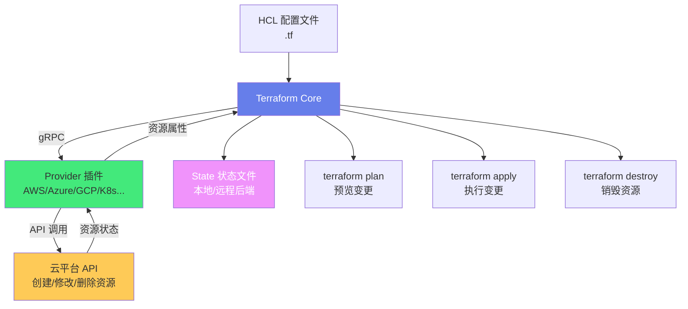
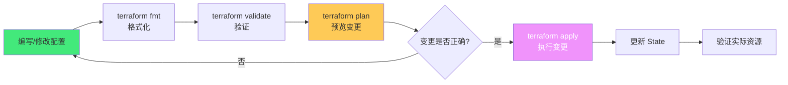

# 🏗️ Terraform 基础设施编排

> **文档说明**：系统讲解 Terraform 基础设施即代码（IaC）工具的完整知识体系，涵盖 IaC 核心理念与价值、Terraform 架构与原理、HCL（HashiCorp Configuration Language）语法、Provider 机制、Resource 与 Data Source、变量与输出、Module（模块）设计与复用、State（状态）管理与后端、Terraform 工作流（init/plan/apply/destroy）、多云编排（AWS/Azure/GCP/阿里云）、Kubernetes 资源编排、条件与循环、函数与表达式、Workspace 与环境管理、CI/CD 集成、Terraform Cloud/Enterprise、常见问题与最佳实践。
>
> **适用人群**：DevOps 工程师、SRE、运维工程师、云架构师、后端开发者、云原生学习者
>
> **前置知识**：[[Docker容器化]] · [[K8s-核心概念与架构]] · [[Linux系统管理与常用命令]]

---

## 一、概述

### 1.1 什么是基础设施即代码（IaC）

基础设施即代码（Infrastructure as Code, IaC）是用代码（而非手动操作）来定义和管理基础设施（服务器、网络、数据库、负载均衡等）的实践。

**传统基础设施管理 vs IaC**：

| 维度 | 传统手动管理 | 基础设施即代码（IaC） |
|------|------------|---------------------|
| **配置方式** | 手动点击控制台/SSH 命令 | 代码定义（HCL/YAML/JSON） |
| **可重复性** | 差（手动操作容易出错，环境不一致） | 好（同样的代码产生同样的基础设施） |
| **版本控制** | 无（配置变更无历史记录） | 有（代码用 Git 管理，变更可追溯） |
| **可审计** | 难（谁在什么时候改了什么难以追踪） | 易（Git commit 记录所有变更） |
| **环境一致性** | 差（开发/测试/生产环境配置不一致） | 好（同一份代码部署到不同环境） |
| **可复用** | 差（配置无法复用，每次重新配置） | 好（模块可复用，参数化配置） |
| **自动化** | 难（依赖人工操作） | 易（CI/CD 流水线自动部署） |
| **可测试** | 无 | 有（plan 预览变更，策略检查） |
| **灾难恢复** | 慢（需要手动重建） | 快（重新 apply 代码即可） |
| **规模化** | 难（手动管理百台服务器是噩梦） | 易（代码管理数千台服务器） |

**IaC 的核心价值**：
1. **一致性**：消除「在我机器上能跑」的问题，所有环境一致
2. **可追溯**：所有基础设施变更都有 Git 历史，可审计、可回滚
3. **可复用**：模块化设计，基础设施代码可在项目间复用
4. **自动化**：与 CI/CD 集成，基础设施变更自动测试和部署
5. **效率**：几分钟内从零搭建完整基础设施，而非几天手动配置
6. **降低风险**：plan 预览变更，避免手动操作的误操作风险

> **核心洞察**：IaC 不是「用代码写配置」这么简单，它是将软件工程的最佳实践（版本控制、代码审查、自动化测试、CI/CD、模块化）应用到基础设施管理领域，让基础设施从「手工艺术品」变成「可重复、可测试、可审计的工业产品」。

### 1.2 Terraform 简介

Terraform 是 HashiCorp 公司开发的开源基础设施即代码工具，是目前最流行的 IaC 工具之一。

**核心特点**：
| 特点 | 说明 |
|------|------|
| **多云编排** | 一个工具管理 AWS/Azure/GCP/阿里云/K8s 等数百种 Provider |
| **声明式语法** | 描述「想要什么」而非「怎么做」，Terraform 自动决定执行步骤 |
| **执行计划** | `plan` 命令预览将要执行的变更，确认后才 `apply` |
| **资源图谱** | 自动分析资源依赖关系，并行创建无依赖的资源 |
| **模块化** | Module 机制，基础设施代码可复用、可组合 |
| **状态管理** | State 文件记录基础设施的实际状态，作为变更的基准 |
| **插件架构** | Provider 插件机制，社区贡献了 2000+ Provider |
| **开源免费** | 核心功能开源免费，Terraform Cloud/Enterprise 提供团队协作功能 |

**Terraform vs 其他 IaC 工具**：

| 工具 | 类型 | 语言 | 特点 | 适用场景 |
|------|------|------|------|---------|
| **Terraform** | 编排工具 | HCL | 多云、声明式、模块化、生态最丰富 | 多云基础设施编排、云资源管理 |
| **Ansible** | 配置管理 | YAML | 无 Agent、SSH 管理、配置管理强 | 服务器配置管理、应用部署 |
| **Puppet** | 配置管理 | Puppet DSL | 有 Agent、声明式、成熟稳定 | 大规模服务器配置管理 |
| **Chef** | 配置管理 | Ruby | 有 Agent、命令式、灵活 | 复杂配置管理 |
| **CloudFormation** | 编排工具 | YAML/JSON | AWS 原生、深度集成 | 纯 AWS 环境 |
| **Pulumi** | 编排工具 | Python/TS/Go/Java | 通用编程语言、类型安全 | 喜欢用通用语言写 IaC 的团队 |
| **CDK** | 编排工具 | TS/Java/Python | AWS 原生、编译为 CloudFormation | AWS 环境、喜欢通用语言 |
| **Kustomize** | K8s 配置 | YAML | K8s 原生、无模板、补丁式 | K8s 应用配置管理 |
| **Helm** | K8s 包管理 | YAML模板 | K8s 包管理、模板化、Chart 生态 | K8s 应用打包分发 |

> **Terraform 的定位**：Terraform 是「编排工具」（Orchestration），专注于基础设施资源的创建和管理（虚拟机、网络、数据库、负载均衡等），而不是服务器内部的配置管理（安装软件、配置文件、服务管理）。配置管理通常用 Ansible/Puppet/Chef，或者用 Terraform  provisioner 调用配置管理工具。两者是互补关系，不是替代关系。

### 1.3 Terraform 架构



**核心组件**：
| 组件 | 说明 |
|------|------|
| **Terraform Core** | 核心引擎，解析 HCL、构建资源图谱、生成执行计划、管理状态 |
| **Provider** | 插件，封装特定平台（AWS/Azure/GCP/K8s）的 API 调用，负责资源的 CRUD |
| **Provisioner** | 插件，在资源创建后执行本地脚本或远程命令（如初始化服务器） |
| **State** | 状态文件，记录基础设施的实际状态，作为变更计算的基准 |
| **Backend** | 状态存储后端，支持本地文件、S3、Consul、Terraform Cloud 等 |

**Terraform 的执行流程**：
1. **初始化（init）**：下载 Provider 插件、初始化后端、下载 Module
2. **刷新（refresh）**：读取实际基础设施状态，更新 State 文件
3. **计划（plan）**：对比配置文件与 State，计算需要执行的变更（创建/修改/删除）
4. **应用（apply）**：执行 plan 中的变更，更新 State 文件
5. **销毁（destroy）**：销毁 State 中记录的所有资源

---

## 二、HCL 语法基础

### 2.1 HCL 简介

HCL（HashiCorp Configuration Language）是 Terraform 使用的配置语言，设计目标是「人类友好的机器可读配置语言」。

**HCL 的特点**：
- 声明式：描述「想要什么」，而非「怎么做」
- 块结构：用块（Block）组织配置，类似 JSON 但更友好
- 表达式：支持变量、函数、条件、循环等表达式
- 注释：支持 `#`、`//`、`/* */` 三种注释方式
- 字符串：支持双引号字符串和 heredoc（多行字符串）

### 2.2 基本语法

```hcl
# 单行注释
// 也是单行注释
/* 多行注释 */

# 块结构：块类型 + 资源类型 + 资源名称 + 块体
resource "aws_instance" "web" {
  # 属性：键 = 值
  ami           = "ami-0c55b159cbfafe1f0"
  instance_type = "t2.micro"
  
  # 嵌套块
  tags = {
    Name = "web-server"
    Env  = "production"
  }
}

# 字符串
name = "hello world"

# 多行字符串（heredoc）
script = <<-EOT
  #!/bin/bash
  echo "Hello World"
EOT

# 数字
count = 3
price = 9.99

# 布尔值
enabled = true

# 列表（List）
ports = [80, 443, 8080]

# 映射（Map）
tags = {
  Name = "web"
  Env  = "prod"
}

# 变量引用
instance_type = var.instance_type

# 属性引用
vpc_id = aws_vpc.main.id

# 字符串插值
name = "web-${var.environment}"

# 类型约束（变量声明中）
variable "instance_type" {
  type        = string
  description = "EC2 instance type"
  default     = "t2.micro"
}
```

### 2.3 变量与输出

**输入变量（Input Variables）**：
```hcl
# variables.tf
variable "region" {
  description = "AWS region"
  type        = string
  default     = "us-east-1"
  validation {
    condition     = contains(["us-east-1", "us-west-2", "eu-west-1"], var.region)
    error_message = "Invalid region."
  }
}

variable "instance_types" {
  type    = list(string)
  default = ["t2.micro", "t2.small", "t2.medium"]
}

variable "tags" {
  type = map(string)
  default = {
    Project = "my-project"
    Owner   = "devops"
  }
}

# 变量赋值方式：
# 1. 默认值（default）
# 2. terraform.tfvars 文件
# 3. -var 参数：terraform apply -var="region=us-west-2"
# 4. 环境变量：TF_VAR_region=us-west-2
```

**输出值（Output Values）**：
```hcl
# outputs.tf
output "web_server_ip" {
  description = "Public IP of web server"
  value       = aws_instance.web.public_ip
}

output "web_server_dns" {
  value       = aws_instance.web.public_dns
  sensitive   = true  # 敏感信息，不显示在输出中
}

output "vpc_id" {
  value = aws_vpc.main.id
}
```

### 2.4 数据来源（Data Sources）

Data Source 用于读取已存在的资源信息（不是创建资源），如查询已有的 AMI、VPC、可用区等。

```hcl
# 查询最新的 Amazon Linux 2 AMI
data "aws_ami" "amazon_linux" {
  most_recent = true
  owners      = ["amazon"]
  
  filter {
    name   = "name"
    values = ["amzn2-ami-hvm-*-x86_64-gp2"]
  }
}

# 使用查询到的 AMI
resource "aws_instance" "web" {
  ami           = data.aws_ami.amazon_linux.id
  instance_type = "t2.micro"
}

# 查询可用区
data "aws_availability_zones" "available" {
  state = "available"
}

# 查询当前 VPC
data "aws_vpc" "default" {
  default = true
}
```

### 2.5 条件与循环

**条件表达式**：
```hcl
# 三元运算符：condition ? true_val : false_val
instance_type = var.environment == "production" ? "t2.large" : "t2.micro"

# count 条件创建（count = 0 不创建，count = 1 创建）
resource "aws_eip" "web" {
  count = var.environment == "production" ? 1 : 0
  instance = aws_instance.web.id
}

# for_each 条件
resource "aws_security_group_rule" "ingress" {
  for_each = var.enable_ssh ? toset(["22"]) : toset([])
  type        = "ingress"
  from_port   = each.value
  to_port     = each.value
  protocol    = "tcp"
  cidr_blocks = ["0.0.0.0/0"]
  security_group_id = aws_security_group.web.id
}
```

**count 循环**：
```hcl
# 创建多个 EC2 实例
resource "aws_instance" "web" {
  count         = 3
  ami           = data.aws_ami.amazon_linux.id
  instance_type = "t2.micro"
  
  tags = {
    Name = "web-${count.index}"  # count.index 从 0 开始
  }
}

# 引用：aws_instance.web[0], aws_instance.web[1], aws_instance.web[2]
```

**for_each 循环**：
```hcl
variable "users" {
  type = map(string)
  default = {
    "alice" = "Alice Smith"
    "bob"   = "Bob Jones"
  }
}

resource "aws_iam_user" "users" {
  for_each = var.users
  name     = each.key
  tags = {
    FullName = each.value
  }
}

# 引用：aws_iam_user.users["alice"], aws_iam_user.users["bob"]
```

**for 表达式（列表/映射推导）**：
```hcl
# 列表推导
[for s in var.names : upper(s)]  # ["ALICE", "BOB"]

# 映射推导
{ for k, v in var.tags : k => upper(v) }

# 带条件的推导
[for s in var.names : upper(s) if length(s) > 3]
```

### 2.6 常用函数

```hcl
# 字符串函数
upper("hello")           # "HELLO"
lower("HELLO")           # "hello"
length("hello")          # 5
join("-", ["a", "b"])    # "a-b"
split(",", "a,b,c")      # ["a", "b", "c"]
replace("hello", "l", "L")  # "heLLo"
trim("  hello  ")        # "hello"
format("Hello, %s!", "World")  # "Hello, World!"
regex("^[a-z]+$", "hello")    # ["hello"]

# 集合函数
length([1, 2, 3])       # 3
element(["a", "b"], 0)  # "a"
concat([1, 2], [3, 4])  # [1, 2, 3, 4]
merge({a=1}, {b=2})     # {a=1, b=2}
keys({a=1, b=2})        # ["a", "b"]
values({a=1, b=2})      # [1, 2]
contains(["a", "b"], "a")  # true
distinct(["a", "a", "b"])  # ["a", "b"]
flatten([[1, 2], [3]])     # [1, 2, 3]

# 类型转换
tostring(123)           # "123"
tonumber("123")         # 123
tolist(["a", "b"])      # ["a", "b"]
tomap({a=1})            # {"a"=1}

# 编码函数
jsonencode({a=1})       # "{\"a\":1}"
jsondecode("{\"a\":1}") # {"a"=1}
base64encode("hello")    # "aGVsbG8="
base64decode("aGVsbG8=") # "hello"
urlencode("a b")         # "a%20b"

# 数学函数
max(1, 2, 3)            # 3
min(1, 2, 3)            # 1
ceil(1.2)               # 2
floor(1.8)              # 1
abs(-5)                 # 5
log(100)                # 4.605...
pow(2, 3)               # 8
signum(-5)              # -1

# 时间函数
timestamp()              # "2024-01-01T00:00:00Z"
formatdate("YYYY-MM-DD", timestamp())  # "2024-01-01"
timeadd(timestamp(), "1h")  # 1小时后

# 文件函数
file("${path.module}/script.sh")  # 读取文件内容
fileexists("${path.module}/config.json")  # 文件是否存在
templatefile("${path.module}/template.tpl", {name="world"})  # 模板文件渲染
```

---

## 三、Provider 与 Resource

### 3.1 Provider 机制

Provider 是 Terraform 的插件，封装了特定平台的 API 调用，负责资源的创建、读取、更新、删除（CRUD）。

```hcl
# 声明 Provider
terraform {
  required_providers {
    aws = {
      source  = "hashicorp/aws"
      version = "~> 5.0"  # 版本约束：>=5.0, <6.0
    }
    kubernetes = {
      source  = "hashicorp/kubernetes"
      version = "~> 2.0"
    }
  }
}

# 配置 Provider
provider "aws" {
  region = "us-east-1"
  # 凭证可以通过环境变量 AWS_ACCESS_KEY_ID/AWS_SECRET_ACCESS_KEY
  # 或共享凭证文件 ~/.aws/credentials
}

# 多个 Provider 实例（别名）
provider "aws" {
  alias  = "us-east"
  region = "us-east-1"
}

provider "aws" {
  alias  = "us-west"
  region = "us-west-2"
}

# 使用别名 Provider
resource "aws_instance" "east" {
  provider = aws.us-east
  ami      = "ami-xxx"
  instance_type = "t2.micro"
}

resource "aws_instance" "west" {
  provider = aws.us-west
  ami      = "ami-yyy"
  instance_type = "t2.micro"
}
```

**常用 Provider**：
| Provider | 平台 | 说明 |
|----------|------|------|
| `hashicorp/aws` | AWS | 亚马逊云 |
| `hashicorp/azurerm` | Azure | 微软云 |
| `hashicorp/google` | GCP | 谷歌云 |
| `aliyun/alicloud` | 阿里云 | 阿里云 |
| `tencentcloudstack/tencentcloud` | 腾讯云 | 腾讯云 |
| `hashicorp/kubernetes` | Kubernetes | K8s 资源编排 |
| `hashicorp/helm` | Helm | K8s Helm Chart 部署 |
| `hashicorp/docker` | Docker | 容器管理 |
| `hashicorp/random` | Random | 随机资源（密码、ID） |
| `hashicorp/local` | Local | 本地文件 |
| `hashicorp/null` | Null | 空资源（用于触发 provisioner） |
| `hashicorp/tls` | TLS | TLS 证书/密钥 |
| `hashicorp/cloudinit` | Cloud-init | 云初始化配置 |

> **Provider 版本约束**：
> - `= 1.0.0`：精确版本
> - `!= 1.0.0`：不等于
> - `> 1.0.0`：大于
> - `>= 1.0.0, < 2.0.0`：范围
> - `~> 1.0`：>=1.0, <2.0（允许次版本和修订号升级）
> - `~> 1.0.0`：>=1.0.0, <1.1.0（只允许修订号升级）
> 
> 生产环境建议锁定 Provider 版本，避免意外升级导致不兼容。

### 3.2 Resource 详解

Resource 是 Terraform 最核心的概念，代表一个基础设施资源（EC2 实例、S3 桶、VPC 等）。

**Resource 语法**：
```hcl
resource "<PROVIDER>_<TYPE>" "<NAME>" {
  # 配置参数
  argument_1 = value_1
  argument_2 = value_2
  
  # 嵌套块
  nested_block {
    nested_argument = value
  }
  
  # 元参数（Meta-Arguments）
  depends_on = [aws_vpc.main]
  count      = 1
  for_each   = var.map
  provider   = aws.us-east
  lifecycle {
    create_before_destroy = true
    prevent_destroy       = true
    ignore_changes        = [tags]
  }
  
  # Provisioner
  provisioner "local-exec" {
    command = "echo ${self.id} created"
  }
}
```

**Resource 元参数（Meta-Arguments）**：
| 元参数 | 说明 |
|--------|------|
| `depends_on` | 显式声明依赖关系，确保资源创建顺序 |
| `count` | 创建多个相同资源（数字） |
| `for_each` | 创建多个资源（map/set），比 count 更稳定 |
| `provider` | 指定使用哪个 Provider 实例（别名） |
| `lifecycle` | 生命周期规则（create_before_destroy/prevent_destroy/ignore_changes） |

**lifecycle 规则**：
```hcl
resource "aws_instance" "web" {
  ami           = "ami-xxx"
  instance_type = "t2.micro"
  
  lifecycle {
    # 先创建新资源，再销毁旧资源（零停机更新）
    create_before_destroy = true
    
    # 防止资源被意外销毁（生产环境重要资源）
    prevent_destroy = true
    
    # 忽略某些属性的变更（不触发更新）
    ignore_changes = [
      tags,                    # 忽略 tags 变更
      ami,                     # 忽略 ami 变更
      all,                     # 忽略所有变更
    ]
    
    # 替换触发条件（指定哪些属性变更时触发替换）
    replace_triggered_by = [
      aws_s3_bucket.data.id   # S3 桶变更时替换此实例
    ]
  }
}
```

**Provisioner（资源制备器）**：
```hcl
resource "aws_instance" "web" {
  ami           = "ami-xxx"
  instance_type = "t2.micro"
  
  # local-exec：在本地执行命令
  provisioner "local-exec" {
    command = "echo ${self.public_ip} > ip.txt"
  }
  
  # remote-exec：在远程资源上执行命令（通过 SSH/WinRM）
  provisioner "remote-exec" {
    inline = [
      "sudo apt-get update",
      "sudo apt-get install -y nginx",
    ]
    connection {
      type        = "ssh"
      host        = self.public_ip
      user        = "ubuntu"
      private_key = file("~/.ssh/id_rsa")
    }
  }
  
  # file：复制文件到远程
  provisioner "file" {
    source      = "config/nginx.conf"
    destination = "/etc/nginx/nginx.conf"
    connection {
      type        = "ssh"
      host        = self.public_ip
      user        = "ubuntu"
      private_key = file("~/.ssh/id_rsa")
    }
  }
  
  # 销毁时执行
  provisioner "local-exec" {
    when    = destroy
    command = "echo ${self.id} is being destroyed"
  }
}
```

> **Provisioner 使用建议**：HashiCorp 官方建议尽量避免使用 Provisioner，因为它们使配置变得复杂且不可预测。优先使用云平台的原生功能（如 AWS UserData、cloud-init）或配置管理工具（Ansible/Chef）。Provisioner 只在没有其他替代方案时使用。

---

## 四、Module（模块）

### 4.1 Module 简介

Module 是 Terraform 代码的复用单元，将一组相关的资源封装为一个可复用的模块，通过变量参数化配置。

**Module 的价值**：
| 价值 | 说明 |
|------|------|
| **代码复用** | 相同的基础设施模式只需写一次，多处调用 |
| **封装复杂性** | 模块内部的复杂性对调用者透明，调用者只需关心输入输出 |
| **标准化** | 团队统一使用标准模块，保证基础设施配置的一致性和最佳实践 |
| **版本管理** | 模块可以版本化，调用者可以指定版本，稳定可控 |
| **权限隔离** | 模块可以封装权限敏感的操作，调用者不需要直接访问凭证 |

**Module 的来源**：
| 来源 | 说明 | 示例 |
|------|------|------|
| **本地路径** | 本地文件系统中的模块 | `source = "./modules/vpc"` |
| **Terraform Registry** | 公共/私有 Registry | `source = "terraform-aws-modules/vpc/aws"` |
| **Git 仓库** | Git 仓库（GitHub/GitLab） | `source = "git::https://github.com/org/module.git?ref=v1.0.0"` |
| **HTTP URL** | HTTP 下载的压缩包 | `source = "https://example.com/module.zip"` |
| **S3 桶** | S3 存储的压缩包 | `source = "s3::https://bucket.s3.amazonaws.com/module.zip"` |

### 4.2 Module 使用示例

**调用 Module**：
```hcl
# main.tf
module "vpc" {
  source = "./modules/vpc"  # 本地模块路径
  
  # 输入变量
  vpc_cidr            = "10.0.0.0/16"
  public_subnets      = ["10.0.1.0/24", "10.0.2.0/24"]
  private_subnets     = ["10.0.10.0/24", "10.0.20.0/24"]
  availability_zones  = ["us-east-1a", "us-east-1b"]
  enable_nat_gateway  = true
  tags = {
    Project = "my-project"
    Env     = "production"
  }
}

module "web_server" {
  source = "terraform-aws-modules/ec2-instance/aws"  # Registry 模块
  version = "~> 5.0"
  
  name           = "web"
  instance_count = 2
  ami            = "ami-xxx"
  instance_type  = "t2.micro"
  subnet_ids     = module.vpc.public_subnets
  vpc_security_group_ids = [module.web_sg.security_group_id]
  tags = {
    Project = "my-project"
  }
}

# 引用模块输出
output "vpc_id" {
  value = module.vpc.vpc_id
}
```

**Module 目录结构**：
```text
modules/
└── vpc/
    ├── main.tf        # 资源定义
    ├── variables.tf   # 输入变量
    ├── outputs.tf     # 输出值
    ├── versions.tf    # Provider 版本约束
    ├── README.md      # 模块文档
    └── examples/      # 使用示例
        └── basic/
            └── main.tf
```

**Module 内部（variables.tf）**：
```hcl
# modules/vpc/variables.tf
variable "vpc_cidr" {
  description = "CIDR block for VPC"
  type        = string
  default     = "10.0.0.0/16"
}

variable "public_subnets" {
  description = "List of public subnet CIDRs"
  type        = list(string)
}

variable "private_subnets" {
  description = "List of private subnet CIDRs"
  type        = list(string)
}

variable "availability_zones" {
  description = "List of availability zones"
  type        = list(string)
}

variable "enable_nat_gateway" {
  description = "Enable NAT gateway"
  type        = bool
  default     = false
}

variable "tags" {
  description = "Tags to apply to resources"
  type        = map(string)
  default     = {}
}
```

**Module 内部（outputs.tf）**：
```hcl
# modules/vpc/outputs.tf
output "vpc_id" {
  description = "VPC ID"
  value       = aws_vpc.main.id
}

output "public_subnets" {
  description = "List of public subnet IDs"
  value       = aws_subnet.public[*].id
}

output "private_subnets" {
  description = "List of private subnet IDs"
  value       = aws_subnet.private[*].id
}

output "vpc_cidr_block" {
  description = "VPC CIDR block"
  value       = aws_vpc.main.cidr_block
}
```

### 4.3 Module 设计最佳实践

| 原则 | 说明 |
|------|------|
| **单一职责** | 一个模块只做一件事（如 VPC 模块只管理 VPC 相关资源） |
| **合理抽象** | 封装复杂性，但不过度抽象（不要为了抽象而抽象） |
| **完整文档** | 每个模块有 README，说明用途、变量、输出、示例 |
| **版本化** | 模块使用语义化版本，调用者指定版本 |
| **可测试** | 模块有示例和测试（terratest/kitchen-terraform） |
| **灵活配置** | 通过变量参数化，有合理的默认值 |
| **输出必要属性** | 输出调用者可能需要的所有属性（ID、ARN、名称等） |
| **避免硬编码** | 不要在模块中硬编码区域、AMI、CIDR 等，用变量 |
| **遵循命名规范** | 资源名、变量名、输出名遵循一致的命名规范 |
| **使用 Registry 模块** | 优先使用官方/社区成熟的 Registry 模块，而非自己造轮子 |

---

## 五、State（状态）管理

### 5.1 State 的作用

State 文件是 Terraform 的核心，它记录了基础设施的实际状态，是 Terraform 计算变更的基准。

**State 的作用**：
1. **映射资源**：将配置文件中的资源与实际基础设施资源映射起来
2. **元数据存储**：存储资源依赖关系、Provider 版本、依赖等元数据
3. **性能优化**：不需要每次都查询所有资源，直接从 State 读取
4. **同步机制**：远程 State 后端提供锁机制，防止多人同时修改

**State 文件格式（JSON）**：
```json
{
  "version": 4,
  "terraform_version": "1.6.0",
  "serial": 5,
  "lineage": "abc123-def456",
  "outputs": {
    "vpc_id": {
      "value": "vpc-0abc123",
      "type": "string"
    }
  },
  "resources": [
    {
      "mode": "managed",
      "type": "aws_vpc",
      "name": "main",
      "provider": "provider[\"registry.terraform.io/hashicorp/aws\"]",
      "instances": [
        {
          "attributes": {
            "id": "vpc-0abc123",
            "cidr_block": "10.0.0.0/16",
            "tags": {"Name": "main"}
          }
        }
      ]
    }
  ]
}
```

### 5.2 后端（Backend）

Backend 决定了 State 文件的存储位置和锁机制。

**Backend 类型**：
| 类型 | 说明 | 锁支持 |
|------|------|--------|
| `local` | 本地文件（默认），`terraform.tfstate` | 否 |
| `s3` | AWS S3 桶 + DynamoDB 锁 | 是 |
| `azurerm` | Azure Storage Account | 是 |
| `gcs` | GCP Cloud Storage | 是 |
| `oss` | 阿里云 OSS | 是 |
| `cos` | 腾讯云 COS | 是 |
| `consul` | Consul KV | 是 |
| `etcd` | etcd KV | 是 |
| `http` | HTTP REST API | 是 |
| `kubernetes` | K8s Secret | 是 |
| `pg` | PostgreSQL | 是 |
| `remote` | Terraform Cloud/Enterprise | 是 |

**S3 后端配置（推荐生产环境）**：
```hcl
terraform {
  backend "s3" {
    bucket         = "my-terraform-state"
    key            = "production/terraform.tfstate"
    region         = "us-east-1"
    encrypt        = true
    dynamodb_table = "terraform-locks"
    kms_key_id     = "arn:aws:kms:us-east-1:xxx:key/xxx"
  }
}
```

**S3 后端的优势**：
- **高可用**：S3 本身高可用，数据多副本存储
- **加密**：S3 服务端加密 + KMS 密钥
- **版本控制**：S3 版本控制保留 State 历史版本，可回滚
- **锁机制**：DynamoDB 表提供 State 锁，防止并发修改
- **访问控制**：IAM 策略控制谁能读写 State

> **State 安全注意事项**：
> - State 文件可能包含敏感信息（密码、密钥），必须加密存储
> - 不要将 State 文件提交到 Git（加入 .gitignore）
> - 使用远程后端而非本地文件，便于团队协作和备份
> - 限制 State 文件的访问权限，只有必要的人能访问
> - 定期备份 State 文件

### 5.3 State 常用命令

```bash
# 查看 State 中的资源列表
terraform state list

# 查看某个资源的 State
terraform state show aws_instance.web

# 移动资源（重命名/移动到模块）
terraform state mv aws_instance.web aws_instance.web_server
terraform state mv aws_instance.web module.web.aws_instance.web

# 从 State 中移除资源（不再管理，但不销毁实际资源）
terraform state rm aws_instance.web

# 拉取远程 State 到本地查看
terraform state pull > state.json

# 推送本地 State 到远程（谨慎使用）
terraform state push state.json

# 替换 Provider（升级 Provider 后）
terraform state replace-provider hashicorp/aws registry.terraform.io/hashicorp/aws
```

### 5.4 State 漂移与修复

**State 漂移（Drift）**：实际基础设施与 State 记录不一致（有人手动修改了资源，或外部系统修改了资源）。

**检测漂移**：
```bash
# refresh：读取实际资源状态，更新 State（不修改资源）
terraform refresh

# plan：对比配置与 State，显示差异（包括漂移）
terraform plan
```

**修复漂移**：
1. **如果实际状态是正确的**：更新配置文件匹配实际状态，然后 `terraform apply`
2. **如果配置是正确的**：直接 `terraform apply`，Terraform 会将实际资源改回配置状态
3. **导入已存在的资源**：`terraform import` 将手动创建的资源导入 State

**导入资源（Import）**：
```bash
# 导入已存在的 EC2 实例
terraform import aws_instance.web i-0abc123def456

# 导入 S3 桶
terraform import aws_s3_bucket.data my-bucket-name

# 导入后需要在配置文件中定义对应的 resource，否则下次 plan 会删除它
```

---

## 六、Terraform 工作流

### 6.1 核心命令

| 命令 | 说明 |
|------|------|
| `terraform init` | 初始化：下载 Provider、初始化后端、下载 Module |
| `terraform plan` | 预览：计算将要执行的变更，不实际执行 |
| `terraform apply` | 应用：执行 plan 中的变更，创建/修改/销毁资源 |
| `terraform destroy` | 销毁：销毁 State 中记录的所有资源 |
| `terraform validate` | 验证：检查配置文件语法是否正确 |
| `terraform fmt` | 格式化：格式化配置文件（统一缩进和风格） |
| `terraform refresh` | 刷新：读取实际资源状态，更新 State |
| `terraform output` | 输出：显示输出变量的值 |
| `terraform graph` | 图谱：生成资源依赖关系图（DOT 格式） |
| `terraform taint` | 标记：标记资源为「被污染」，下次 apply 时销毁重建 |
| `terraform untaint` | 取消标记：取消资源的污染标记 |
| `terraform import` | 导入：将已存在的资源导入 State |
| `terraform workspace` | 工作区：管理多个工作区（环境） |
| `terraform console` | 控制台：交互式控制台，测试表达式 |
| `terraform providers` | 查看 Provider：显示当前配置使用的 Provider |
| `terraform version` | 版本：显示 Terraform 版本 |

### 6.2 标准工作流



**详细步骤**：
1. **编写配置**：编写或修改 `.tf` 配置文件
2. **格式化**：`terraform fmt` 格式化代码，统一风格
3. **验证**：`terraform validate` 验证语法和内部一致性
4. **初始化**：`terraform init` 初始化（首次或变更 Provider/Module 后）
5. **预览**：`terraform plan -out=tfplan` 预览变更，保存计划文件
6. **审查**：团队审查 plan 输出，确认变更正确
7. **应用**：`terraform apply tfplan` 执行变更（使用保存的计划，确保执行的就是审查过的变更）
8. **验证**：验证实际基础设施是否符合预期

### 6.3 Workspace（工作区）

Workspace 允许在同一配置下管理多个环境（开发/测试/生产），每个 Workspace 有独立的 State。

```bash
# 查看当前工作区
terraform workspace show

# 列出所有工作区
terraform workspace list

# 创建工作区
terraform workspace new dev
terraform workspace new staging
terraform workspace new production

# 切换工作区
terraform workspace select dev

# 删除工作区
terraform workspace delete dev
```

**在配置中使用 Workspace**：
```hcl
# 根据 workspace 选择不同的配置
locals {
  env_config = {
    dev = {
      instance_type = "t2.micro"
      instance_count = 1
    }
    staging = {
      instance_type = "t2.small"
      instance_count = 2
    }
    production = {
      instance_type = "t2.large"
      instance_count = 3
    }
  }
  current = local.env_config[terraform.workspace]
}

resource "aws_instance" "web" {
  count         = local.current.instance_count
  instance_type = local.current.instance_type
  ami           = "ami-xxx"
  
  tags = {
    Name = "web-${terraform.workspace}-${count.index}"
    Env  = terraform.workspace
  }
}
```

> **Workspace vs 目录分离**：Workspace 适合简单的环境分离（相同配置，不同参数）。如果不同环境的配置差异很大，建议用目录分离（每个环境一个目录），或用 Module + 不同的变量文件。生产环境建议用目录分离 + 独立 State，更安全可控。

---

## 七、多云与 K8s 编排

### 7.1 多云编排

Terraform 的核心优势之一是「一个工具管理多云」——同一份配置可以管理 AWS、Azure、GCP、阿里云等多个云平台的资源。

```hcl
terraform {
  required_providers {
    aws = {
      source  = "hashicorp/aws"
      version = "~> 5.0"
    }
    azurerm = {
      source  = "hashicorp/azurerm"
      version = "~> 3.0"
    }
    google = {
      source  = "hashicorp/google"
      version = "~> 5.0"
    }
  }
}

# AWS Provider
provider "aws" {
  region = "us-east-1"
}

# Azure Provider
provider "azurerm" {
  features {}
}

# GCP Provider
provider "google" {
  project = "my-project"
  region  = "us-central1"
}

# AWS 资源
resource "aws_s3_bucket" "data" {
  bucket = "my-aws-data-bucket"
}

# Azure 资源
resource "azurerm_storage_account" "data" {
  name                     = "myazuredata"
  resource_group_name      = azurerm_resource_group.main.name
  location                 = "East US"
  account_tier             = "Standard"
  account_replication_type = "GRS"
}

# GCP 资源
resource "google_storage_bucket" "data" {
  name     = "my-gcp-data-bucket"
  location = "US"
}
```

### 7.2 Kubernetes 编排

Terraform 可以管理 Kubernetes 资源（Deployment/Service/ConfigMap 等），与云资源统一编排。

```hcl
terraform {
  required_providers {
    kubernetes = {
      source  = "hashicorp/kubernetes"
      version = "~> 2.0"
    }
    helm = {
      source  = "hashicorp/helm"
      version = "~> 2.0"
    }
  }
}

# K8s Provider
provider "kubernetes" {
  config_path = "~/.kube/config"
}

# Helm Provider
provider "helm" {
  kubernetes {
    config_path = "~/.kube/config"
  }
}

# K8s Namespace
resource "kubernetes_namespace" "app" {
  metadata {
    name = "my-app"
    labels = {
      name = "my-app"
    }
  }
}

# K8s Deployment
resource "kubernetes_deployment" "web" {
  metadata {
    name      = "web"
    namespace = kubernetes_namespace.app.metadata[0].name
    labels = {
      app = "web"
    }
  }
  
  spec {
    replicas = 3
    
    selector {
      match_labels = {
        app = "web"
      }
    }
    
    template {
      metadata {
        labels = {
          app = "web"
        }
      }
      
      spec {
        container {
          name  = "web"
          image = "nginx:1.25"
          port {
            container_port = 80
          }
          resources {
            limits = {
              cpu    = "500m"
              memory = "256Mi"
            }
            requests = {
              cpu    = "250m"
              memory = "128Mi"
            }
          }
        }
      }
    }
  }
}

# K8s Service
resource "kubernetes_service" "web" {
  metadata {
    name      = "web"
    namespace = kubernetes_namespace.app.metadata[0].name
  }
  
  spec {
    selector = {
      app = "web"
    }
    port {
      port        = 80
      target_port = 80
    }
    type = "LoadBalancer"
  }
}

# Helm Chart 部署
resource "helm_release" "prometheus" {
  name       = "prometheus"
  repository = "https://prometheus-community.github.io/helm-charts"
  chart      = "kube-prometheus-stack"
  version    = "55.0.0"
  namespace  = "monitoring"
  
  set {
    name  = "prometheus.prometheusSpec.retention"
    value = "30d"
  }
}
```

> **Terraform K8s vs Helm vs Kustomize**：
> - Terraform K8s Provider：适合管理少量 K8s 资源，与云资源统一编排，不适合复杂应用
> - Helm：适合打包和分发复杂应用，模板化强，Chart 生态丰富
> - Kustomize：适合无模板的 K8s 配置管理，补丁式覆盖，K8s 原生
> - 实际项目中可以组合使用：Terraform 管理云基础设施 + Helm 部署应用 + Kustomize 管理应用配置

---

## 八、CI/CD 集成

### 8.1 GitLab CI 示例

```yaml
# .gitlab-ci.yml
stages:
  - validate
  - plan
  - apply

variables:
  TF_ROOT: ${CI_PROJECT_DIR}/terraform
  TF_ADDRESS: ${CI_API_V4_URL}/projects/${CI_PROJECT_ID}/terraform/state/${CI_ENVIRONMENT_NAME}

default:
  image: hashicorp/terraform:1.6
  before_script:
    - cd ${TF_ROOT}
    - terraform init

validate:
  stage: validate
  script:
    - terraform fmt -check
    - terraform validate
  only:
    - merge_requests

plan:
  stage: plan
  script:
    - terraform plan -out=tfplan
    - terraform show -json tfplan > plan.json
  artifacts:
    paths:
      - ${TF_ROOT}/tfplan
  only:
    - merge_requests

apply:
  stage: apply
  script:
    - terraform apply tfplan
  environment:
    name: production
  when: manual  # 手动触发
  only:
    - main
```

### 8.2 GitHub Actions 示例

```yaml
# .github/workflows/terraform.yml
name: Terraform CI/CD

on:
  pull_request:
    paths: ['terraform/**']
  push:
    branches: [main]
    paths: ['terraform/**']

env:
  TF_WORKING_DIR: ./terraform

jobs:
  validate:
    name: Validate
    runs-on: ubuntu-latest
    steps:
      - uses: actions/checkout@v4
      - uses: hashicorp/setup-terraform@v3
        with:
          terraform_version: 1.6.0
      - name: Terraform Init
        run: terraform init
        working-directory: ${{ env.TF_WORKING_DIR }}
      - name: Terraform Format
        run: terraform fmt -check
        working-directory: ${{ env.TF_WORKING_DIR }}
      - name: Terraform Validate
        run: terraform validate
        working-directory: ${{ env.TF_WORKING_DIR }}

  plan:
    name: Plan
    runs-on: ubuntu-latest
    needs: validate
    if: github.event_name == 'pull_request'
    steps:
      - uses: actions/checkout@v4
      - uses: hashicorp/setup-terraform@v3
      - name: Terraform Init
        run: terraform init
        working-directory: ${{ env.TF_WORKING_DIR }}
        env:
          AWS_ACCESS_KEY_ID: ${{ secrets.AWS_ACCESS_KEY_ID }}
          AWS_SECRET_ACCESS_KEY: ${{ secrets.AWS_SECRET_ACCESS_KEY }}
      - name: Terraform Plan
        run: terraform plan -out=tfplan
        working-directory: ${{ env.TF_WORKING_DIR }}
        env:
          AWS_ACCESS_KEY_ID: ${{ secrets.AWS_ACCESS_KEY_ID }}
          AWS_SECRET_ACCESS_KEY: ${{ secrets.AWS_SECRET_ACCESS_KEY }}

  apply:
    name: Apply
    runs-on: ubuntu-latest
    needs: validate
    if: github.ref == 'refs/heads/main'
    environment: production
    steps:
      - uses: actions/checkout@v4
      - uses: hashicorp/setup-terraform@v3
      - name: Terraform Init
        run: terraform init
        working-directory: ${{ env.TF_WORKING_DIR }}
        env:
          AWS_ACCESS_KEY_ID: ${{ secrets.AWS_ACCESS_KEY_ID }}
          AWS_SECRET_ACCESS_KEY: ${{ secrets.AWS_SECRET_ACCESS_KEY }}
      - name: Terraform Apply
        run: terraform apply -auto-approve
        working-directory: ${{ env.TF_WORKING_DIR }}
        env:
          AWS_ACCESS_KEY_ID: ${{ secrets.AWS_ACCESS_KEY_ID }}
          AWS_SECRET_ACCESS_KEY: ${{ secrets.AWS_SECRET_ACCESS_KEY }}
```

---

## 九、常见问题与最佳实践

### 9.1 常见问题

| 问题 | 原因 | 解决方案 |
|------|------|---------|
| **Provider 下载慢/失败** | 网络问题（国内访问 Registry 慢） | 使用镜像源、配置代理、手动下载 Provider |
| **State 锁冲突** | 多人同时 apply，或上次 apply 异常中断 | 检查锁持有者，确认无操作后手动释放锁（`terraform force-unlock`） |
| **State 漂移** | 手动修改了资源，或外部系统修改了资源 | `terraform refresh` 检测，更新配置或 `apply` 修复 |
| **资源删除失败** | 资源有依赖，或被其他资源引用 | 先删除依赖资源，或检查资源是否被外部引用 |
| **循环依赖** | 资源 A 依赖 B，B 又依赖 A | 重构配置，用 Data Source 或打破循环 |
| **count 索引变更** | 用 count 创建的资源，删除中间一个导致索引重排 | 用 for_each 替代 count，用 map/set 而非列表 |
| **敏感信息泄露** | State 文件或日志中包含密码/密钥 | 用 `sensitive = true` 标记敏感输出，State 加密存储，日志脱敏 |
| **Module 版本不兼容** | Module 升级后有 breaking change | 锁定 Module 版本，阅读 CHANGELOG，逐步升级 |
| **apply 超时** | 资源创建时间长（如 RDS、K8s 集群） | 增加超时时间，或检查资源是否真的卡住 |
| **变量类型错误** | 传入变量类型与声明不匹配 | 检查变量类型，用 type 约束，用 `terraform console` 测试 |
| **远程 State 访问失败** | 凭证错误、网络问题、权限不足 | 检查凭证、网络、IAM 权限，测试 S3/Storage 访问 |
| **资源名称冲突** | 同名资源已存在（手动创建的） | 用 `terraform import` 导入，或删除手动创建的资源 |
| **计划外变更** | Provider 升级后默认值变化，或资源被外部修改 | 仔细审查 plan，用 `ignore_changes` 忽略不需要的变更 |

### 9.2 最佳实践

1. **代码结构规范**：
   ```text
   project/
   ├── main.tf           # 主配置（Provider、Module 调用）
   ├── variables.tf      # 输入变量
   ├── outputs.tf        # 输出值
   ├── versions.tf       # Terraform 和 Provider 版本
   ├── terraform.tfvars  # 变量值（不提交 Git）
   ├── .gitignore        # 忽略 .tfstate、.tfvars、.terraform/
   └── modules/          # 自定义模块
       ├── vpc/
       └── ec2/
   ```

2. **版本锁定**：锁定 Terraform 版本和 Provider 版本，避免意外升级导致不兼容
   ```hcl
   terraform {
     required_version = "~> 1.6.0"
     required_providers {
       aws = { source = "hashicorp/aws", version = "~> 5.0" }
     }
   }
   ```

3. **远程 State**：生产环境必须用远程 State 后端（S3+DynamoDB/Azure Storage/GCS），不要用本地文件

4. **State 分离**：不同环境（dev/staging/prod）用独立的 State，不同项目/团队也用独立 State，减少爆炸半径

5. **最小权限**：Terraform 使用的云凭证遵循最小权限原则，只授予必要的权限

6. **敏感信息管理**：
   - 不要在配置中硬编码密码/密钥
   - 用环境变量、Secret Manager、Vault 管理敏感信息
   - 敏感输出标记 `sensitive = true`
   - State 文件加密存储

7. **模块化**：
   - 复用的基础设施模式封装为 Module
   - 优先使用官方/社区成熟的 Registry Module
   - Module 有完整文档和示例
   - Module 版本化，调用者指定版本

8. **代码质量**：
   - `terraform fmt` 格式化代码
   - `terraform validate` 验证语法
   - 用 `tflint` 做 Lint 检查
   - 用 `checkov`/`tfsec` 做安全扫描
   - 代码审查（Code Review）

9. **Plan 审查**：
   - apply 前必须审查 plan 输出
   - 生产环境 apply 手动触发（不要自动 apply）
   - 保存 plan 文件，确保执行的就是审查过的变更

10. **避免 Provisioner**：尽量不用 Provisioner，用云平台原生功能（UserData/cloud-init）或配置管理工具

11. **用 for_each 替代 count**：for_each 比 count 更稳定（删除中间元素不会导致索引重排）

12. **文档化**：
    - 每个项目有 README，说明用途、用法、变量
    - 变量有 description
    - 输出有 description
    - 复杂逻辑有注释

13. **测试**：
    - 用 `terratest`（Go）或 `kitchen-terraform`（Ruby）写自动化测试
    - 测试 Module 的创建、更新、销毁
    - CI 中运行测试

14. **渐进式采用**：
    - 从简单资源开始（S3 桶、安全组）
    - 逐步管理更复杂的资源（VPC、RDS、K8s）
    - 不要一开始就尝试管理所有基础设施

15. **灾难恢复**：
    - 定期备份 State 文件
    - 演练 `terraform destroy` 和重建
    - 确保关键资源有 `prevent_destroy` 保护

---

## 十、关联笔记

### 云原生与运维
- [[Docker容器化]] · [[K8s-核心概念与架构]] · [[K8s-资源管理]]
- [[CI-CD流水线]] · [[制品管理与镜像仓库]] · [[Prometheus-指标采集]]
- [[Docker-Compose编排]] · [[Linux系统管理与常用命令]]

### 基础设施即代码
- [[Ansible-配置管理]] · [[Helm包管理]] · [[Kustomize-K8s配置管理]]
- [[云原生架构设计]] · [[多云架构设计]]

### 导航
- [[MOC-云原生与运维]] · [[MOC-DevOps-四级展开]] · [[MOC-综合导航]] · [[Home]]

> 🔍 **知识点深度解析**
>
> **作用**：Terraform 解决的是「基础设施的自动化、可重复、可审计管理」问题——传统手动管理基础设施（点击控制台、SSH 命令）存在环境不一致、变更不可追溯、无法复用、难以规模化、灾难恢复慢等问题。Terraform 作为基础设施即代码（IaC）工具，用声明式配置（HCL）定义基础设施，通过执行计划（plan）预览变更，自动管理资源依赖和生命周期，支持多云编排，让基础设施管理从「手工艺术」变成「可重复、可测试、可审计的工业产品」。
>
> **底层原理**：Terraform 的核心是「声明式配置 + 状态管理 + 资源图谱 + Provider 插件」。①声明式配置：用户描述「想要什么状态」（如「我要一个 t2.micro 的 EC2 实例」），而非「怎么做」（如「调用 RunInstances API，参数...」），Terraform 自动决定需要创建/修改/删除哪些资源来达到目标状态。②状态管理（State）：State 文件记录了基础设施的实际状态，是 Terraform 计算变更的基准——每次 plan 时，Terraform 对比「配置文件的期望状态」与「State 记录的实际状态」，计算出差异（需要创建/修改/删除的资源）。③资源图谱：Terraform 分析资源间的依赖关系（如 EC2 依赖 VPC 和子网），构建有向无环图（DAG），无依赖的资源可以并行创建，有依赖的资源按顺序创建，大大提升效率。④Provider 插件：Provider 是 Terraform 与特定平台（AWS/Azure/GCP/K8s）之间的桥梁，封装了平台 API 的调用（资源的 CRUD），通过 gRPC 与 Terraform Core 通信。这种插件架构让 Terraform 可以支持 2000+ 平台，且新增平台只需开发新的 Provider。⑤执行流程：init（下载 Provider 和 Module，初始化后端）→ refresh（读取实际资源状态更新 State）→ plan（对比期望状态与 State，计算变更，生成执行计划）→ apply（执行计划中的变更，更新 State）。⑥LSM Tree 不适用（Terraform 不是数据库），但 State 的远程后端（如 S3）通常用对象存储+锁机制（DynamoDB）实现并发控制。
>
> **用法要点**：① 核心命令：init（初始化）→ fmt（格式化）→ validate（验证）→ plan（预览）→ apply（执行）→ destroy（销毁） ② HCL 语法：块结构（resource/data/provider/variable/output/module）、表达式（变量引用/字符串插值/条件/循环/函数）、类型（string/number/bool/list/map/object/tuple） ③ Provider：声明 required_providers（source+version），配置 provider 块（区域/凭证），多 Provider 用别名，版本锁定（~> 5.0） ④ Resource：resource "<provider>_<type>" "<name>"，元参数（depends_on/count/for_each/provider/lifecycle），lifecycle（create_before_destroy/prevent_destroy/ignore_changes），Provisioner（local-exec/remote-exec/file，尽量避免） ⑤ 变量与输出：variable（type/default/description/validation），output（value/description/sensitive），变量赋值（tfvars/-var/环境变量 TF_VAR_） ⑥ Module：source（本地路径/Registry/Git/HTTP/S3），version，输入变量，输出值，单一职责，版本化，优先用成熟 Registry Module ⑦ State：远程后端（S3+DynamoDB/Azure Storage/GCS），加密存储，不提交 Git，锁机制防并发，常用命令（list/show/mv/rm/pull/push/import/replace-provider），漂移检测（refresh+plan） ⑧ 工作流：编写→fmt→validate→init→plan（审查）→apply（手动）→验证，生产环境手动 apply，保存 plan 文件 ⑨ Workspace：多环境分离，terraform workspace new/select/list，配置中用 terraform.workspace 区分 ⑩ CI/CD：GitLab CI/GitHub Actions 集成，自动 fmt/validate/plan，手动 apply，环境变量管理凭证 ⑪ 多云：同一配置管理多 Provider（AWS/Azure/GCP），资源统一编排 ⑫ K8s：kubernetes Provider 管理 K8s 资源，helm Provider 部署 Helm Chart ⑬ 常见坑：State 锁冲突（force-unlock）、漂移（refresh+修复）、count 索引变更（用 for_each）、敏感信息泄露（sensitive+加密）、Provisioner 复杂（用 UserData/Ansible）、循环依赖（重构/Data Source） ⑭ 最佳实践：版本锁定、远程 State、State 分离、最小权限、模块化、代码质量（fmt/validate/tflint/checkov）、plan 审查、避免 Provisioner、for_each 替代 count、文档化、测试（terratest）、渐进式采用、灾难恢复（备份+prevent_destroy）。

> 💡 **深度讲解**：Terraform 最核心的智慧是「声明式 + 幂等性 + 状态管理」。声明式意味着你只需要描述「想要什么」，不需要描述「怎么做」——你说「我要一个 t2.micro 的 EC2 实例」，Terraform 自动决定是创建新的、修改现有的、还是什么都不做（如果已经有一个匹配的）。这种声明式的抽象大大降低了基础设施管理的复杂度——你不需要记住每个 API 的参数和调用顺序，只需要描述目标状态。幂等性是声明式的必然结果——同样的配置执行多次，结果是一样的（如果资源已经存在且匹配，就什么都不做；如果不匹配，就修改到匹配）。这与命令式脚本（如 Bash 脚本）形成鲜明对比——命令式脚本执行多次可能会出错（如重复创建资源报错），而 Terraform 的幂等性让重复执行变得安全。状态管理（State）是 Terraform 实现声明式和幂等性的基础——State 记录了「实际有什么」，配置文件描述了「想要什么」，Terraform 对比两者计算差异。没有 State，Terraform 就无法知道哪些资源是它管理的、资源的实际属性是什么，也就无法计算变更。这也是为什么 State 文件如此重要——它是 Terraform 的「记忆」，丢失 State 意味着 Terraform 忘记了它管理的所有资源，需要重新导入或重建。另一个关键点是「资源图谱与并行执行」。Terraform 自动分析资源间的依赖关系（如 EC2 实例依赖子网，子网依赖 VPC），构建有向无环图（DAG）。在 apply 时，无依赖的资源可以并行创建（如两个独立的 S3 桶可以同时创建），有依赖的资源按拓扑顺序创建（VPC→子网→EC2）。这大大提升了大规模基础设施的部署效率——手动操作可能需要几小时，Terraform 并行执行可能只需要几分钟。这种自动依赖分析也是声明式的优势——你不需要手动指定执行顺序，Terraform 从资源引用中自动推断。「Module 的封装与复用」是 Terraform 工程化的核心。没有 Module，所有资源都写在一个大文件里，无法复用，难以维护。Module 将一组相关资源封装为可复用的单元，通过变量参数化，通过输出暴露必要属性。这就像编程中的函数——封装复杂性，提供简洁的接口，可复用可测试。成熟的 Terraform 项目通常由多层 Module 组成——底层是基础资源 Module（VPC/安全组/数据库），上层是应用 Module（Web 服务/微服务），最顶层是环境配置（dev/staging/prod 调用不同 Module 组合）。这种分层结构让基础设施代码像应用代码一样有组织、可维护、可复用。「多云编排」是 Terraform 区别于云厂商原生 IaC 工具（如 CloudFormation）的核心优势。CloudFormation 只能管理 AWS 资源，Azure Resource Manager 只能管理 Azure 资源，而 Terraform 可以用同一套语法、同一个工具管理 AWS+Azure+GCP+阿里云+K8s+Docker 等 2000+ 平台的资源。这在多云战略下尤为重要——你可以用同一份配置管理跨云的基础设施（如 AWS 的计算 + GCP 的数据库 + Cloudflare 的 CDN），用同一套工作流（plan/apply），用同一套工具链（CI/CD/测试）。这种「一个工具管所有」的统一性大大降低了多云管理的复杂度。

> 📝 **精简总结**：Terraform = 基础设施即代码（IaC）工具，声明式 HCL 配置，plan 预览变更，自动管理资源依赖，多云编排。核心概念：Provider（平台插件，2000+）、Resource（资源，CRUD）、Data Source（读取已有资源）、Variable（输入变量）、Output（输出值）、Module（可复用模块）、State（状态文件，变更基准）、Backend（State 存储后端，S3/Azure/GCS）、Workspace（多环境）。核心命令：init/fmt/validate/plan/apply/destroy/refresh/import。语法：块结构、表达式、条件（count/for_each/三元）、函数（字符串/集合/编码/数学）、lifecycle（create_before_destroy/prevent_destroy/ignore_changes）。最佳实践：版本锁定、远程 State（加密+锁）、State 分离（环境/项目）、最小权限、模块化（优先 Registry Module）、代码质量（fmt/validate/tflint/checkov）、plan 审查（生产手动 apply）、避免 Provisioner、for_each 替代 count、敏感信息管理（sensitive+Secret Manager）、文档化、测试（terratest）、灾难恢复。选型：多云→Terraform，纯 AWS→CloudFormation/CDK，K8s 应用→Helm/Kustomize，服务器配置→Ansible。坑：State 锁冲突、漂移、count 索引变更、敏感信息泄露、Provisioner 复杂、循环依赖、Provider 版本不兼容。

> **学习路径建议**：先学习 [[Docker容器化]] 和 [[Linux系统管理与常用命令]] 掌握基础设施基础 → 学习本文档掌握 Terraform 基础（安装/语法/核心命令/简单资源） → 实践：用 Terraform 管理简单云资源（S3 桶/EC2 实例/安全组） → 学习 Module 和 State 管理（远程后端/锁/漂移） → 学习多云和 K8s 编排 → 学习 CI/CD 集成和最佳实践 → 学习高级主题（自定义 Provider/tfsec/checkov/terratest） → 阅读《Terraform: Up and Running》深入理解 → 参与开源 Module 贡献或构建自己的 Module 库。

---

> **Terraform 的本质是「将软件工程的最佳实践应用到基础设施管理」——版本控制、代码审查、自动化测试、CI/CD、模块化、复用、文档化，这些在软件开发中已经成熟的实践，通过 IaC 工具（Terraform）被应用到了基础设施管理领域。传统的基础设施管理是「手工艺术」——每个工程师手动点击控制台或写一次性脚本，配置散落在各处，变更没有记录，环境不一致，无法复用，难以规模化，灾难恢复慢。Terraform 让基础设施变成了「代码」——可以用 Git 版本控制（每次变更都有记录，可审计可回滚），可以用代码审查（变更前团队审查），可以用 CI/CD 自动化（自动验证/预览/部署），可以模块化复用（相同的基础设施模式写一次到处用），可以测试（terratest 自动化测试）。这种从「手工」到「代码」的转变，不仅仅是工具的替换，更是思维方式的升级——基础设施不再是「神秘的、不可控的、需要专家手动操作的黑盒」，而是「透明的、可预测的、可测试的、像应用代码一样可管理的工程产物」。这就是「基础设施即代码」的终极意义：不是为了用代码而用代码，而是为了让基础设施管理变得像软件开发一样高效、可靠、可规模化、可审计。当你的基础设施全部由 Terraform 管理时，你可以在几分钟内从零搭建一套完整的生产环境（VPC+计算+数据库+缓存+负载均衡+监控），可以在灾难发生后快速重建，可以在团队中共享和复用基础设施模式，可以精确追踪每一次变更的原因和影响——这就是「基础设施即代码」的力量，也是云原生时代运维工程师的核心竞争力。**
