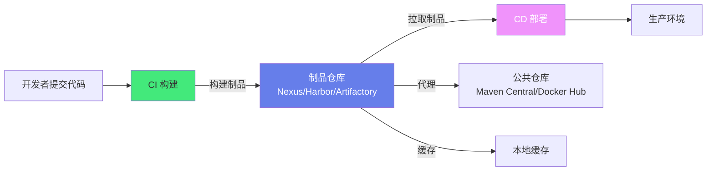
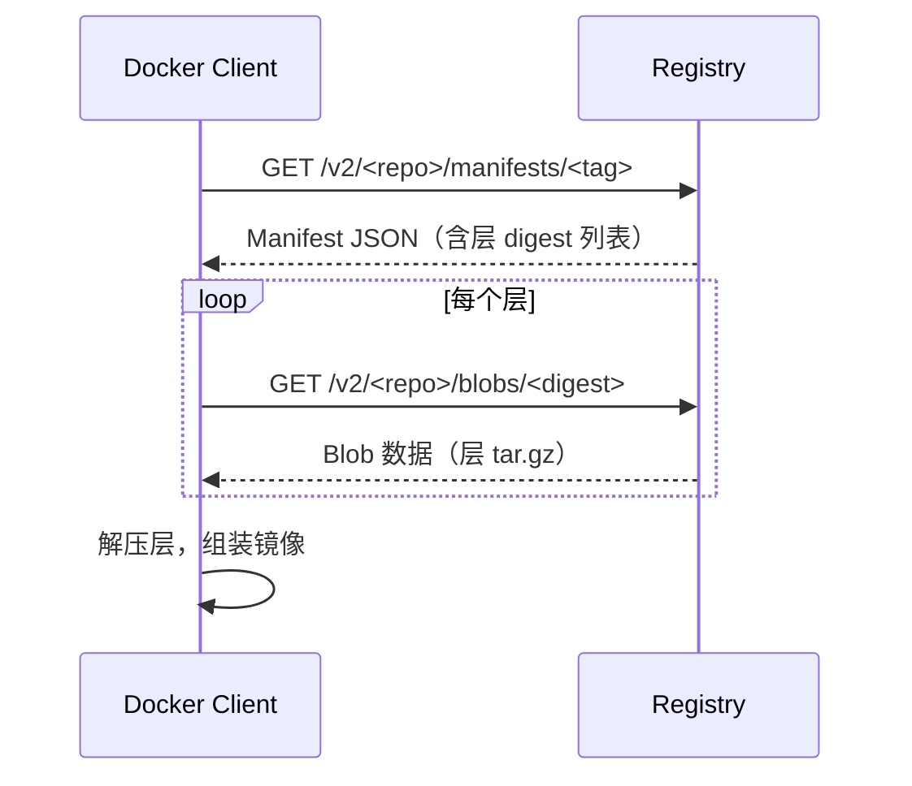
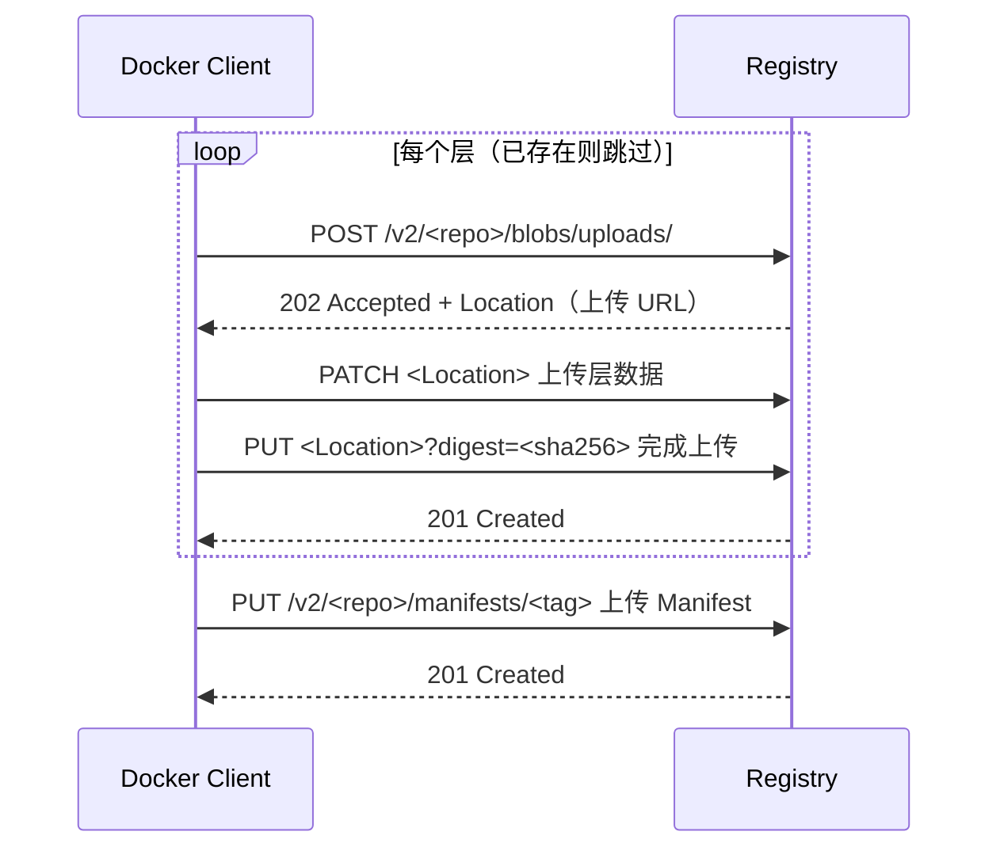
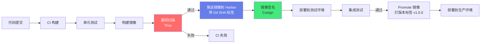

# 📦 制品管理与镜像仓库

> **文档说明**：系统讲解软件制品管理与容器镜像仓库的完整知识体系，涵盖制品管理核心概念（制品/版本/仓库/ promoted）、制品仓库类型（代理仓库/托管仓库/虚拟仓库）、主流制品仓库对比（Nexus/Artifactory/Harbor/GitLab Container Registry）、Docker Registry 原理与 API（V2 协议/Manifest/Blob/分层存储）、Harbor 部署与配置（项目/用户/角色/扫描/复制/签名）、镜像构建最佳实践（多阶段构建/最小基础镜像/层缓存/.dockerignore/非root用户）、镜像标签与版本管理（SemVer/不可变标签/浮动标签/latest陷阱）、多架构镜像（buildx/manifest-tool/arm64+amd64）、镜像安全扫描（Trivy/Clair/Snyk/CVE）、镜像签名与验证（Cosign/Notary/Docker Content Trust）、镜像清理与垃圾回收、镜像加速与缓存（registry mirror/拉取缓存/P2P分发）、CI/CD 集成、常见问题与最佳实践。
>
> **适用人群**：DevOps 工程师、SRE、运维工程师、后端开发者、云原生学习者
>
> **前置知识**：[[Docker容器化]] · [[CI-CD流水线]] · [[K8s-核心概念与架构]]

---

## 一、概述

### 1.1 什么是制品管理

**软件制品（Artifact）**是软件构建过程中产生的可部署/可分发的文件，包括：
- 二进制包（JAR/WAR/EXE/Deb/RPM）
- 容器镜像（Docker Image）
- 前端构建产物（JS/CSS/HTML 压缩包）
- 移动应用包（APK/IPA）
- 配置包、Helm Chart、Terraform Module 等

**制品仓库（Artifact Repository）**是专门用于存储、管理、分发软件制品的中央仓库，是 CI/CD 流水线中的核心环节——构建产生制品 → 上传到制品仓库 → 部署时从制品仓库拉取。



**制品仓库的核心价值**：
| 价值 | 说明 |
|------|------|
| **单一可信源** | 所有制品集中管理，版本可追溯，避免「本地构建的制品」流入生产 |
| **依赖管理** | 代理公共仓库，缓存第三方依赖，加速构建，避免公共仓库不可用导致构建失败 |
| **版本控制** | 制品版本化，支持保留历史版本，可回滚 |
| **访问控制** | 用户/团队/项目级别的权限管理，谁能上传/下载/删除 |
| **安全扫描** | 内置或集成漏洞扫描，自动检测制品中的安全漏洞 |
| **Promotion 流程** | 制品从开发→测试→预发→生产的晋升流程，保证质量 |
| **合规审计** | 记录谁在什么时候上传/下载了什么制品，满足合规要求 |
| **高可用分发** | 多区域复制，CDN 加速，支持大规模并发拉取 |

### 1.2 制品仓库的三种类型

| 类型 | 说明 | 用途 |
|------|------|------|
| **代理仓库（Proxy）** | 代理外部公共仓库，缓存下载的制品 | 加速构建，避免直接访问公共仓库，节省带宽 |
| **托管仓库（Hosted）** | 存储自己构建/上传的制品 | 存储内部构建的 JAR、Docker 镜像等 |
| **虚拟仓库（Virtual）** | 聚合多个代理/托管仓库，对外提供统一访问入口 | 简化配置，开发者只配置一个仓库地址即可访问所有制品 |

**示例（Nexus）**：
```text
maven-public（虚拟仓库）
├── maven-central（代理仓库 → https://repo1.maven.org/maven2/）
├── maven-releases（托管仓库 → 内部 release 制品）
└── maven-snapshots（托管仓库 → 内部 snapshot 制品）
```

开发者只需要配置 `maven-public` 一个地址，就能同时访问中央仓库的依赖和内部仓库的制品。

### 1.3 主流制品仓库对比

| 产品 | 类型 | 开源/商业 | 支持格式 | 特点 | 适用场景 |
|------|------|----------|---------|------|---------|
| **Sonatype Nexus** | 通用制品仓库 | OSS 开源 / Pro 商业 | Maven/Docker/npm/PyPI/Go/Ruby/Helm/Apt/Yum 等 30+ | 功能全面，生态成熟，企业级功能（Pro） | 通用企业制品管理，多语言多格式 |
| **JFrog Artifactory** | 通用制品仓库 | 开源（受限） / 商业 | 几乎所有格式 | 元数据丰富，高级复制，Xray 安全扫描，企业级 | 大型企业，复杂制品管理，安全合规要求高 |
| **Harbor** | 容器镜像仓库 | 开源（CNCF 毕业） | Docker/OCI/Helm Chart | 专为容器设计，RBAC，漏洞扫描，镜像签名，多租户，复制策略 | 云原生/K8s 环境，容器镜像管理 |
| **GitLab Container Registry** | 容器镜像仓库 | 开源/商业 | Docker/OCI | 与 GitLab 深度集成，每个项目自带仓库 | GitLab 用户，简单容器镜像管理 |
| **GitHub Container Registry (GHCR)** | 容器镜像仓库 | 免费/付费 | Docker/OCI | 与 GitHub 深度集成，支持公开/私有镜像 | GitHub 用户，开源项目 |
| **Docker Hub** | 公共镜像仓库 | 免费/付费 | Docker/OCI | 最大的公共镜像仓库，官方镜像丰富 | 公共镜像分发，个人项目 |
| **AWS ECR / Azure ACR / GCP GAR** | 云厂商镜像仓库 | 付费 | Docker/OCI | 与云平台深度集成，跨区域复制，IAM 权限 | 云原生环境，对应云平台用户 |
| **Verdaccio** | npm 私有仓库 | 开源 | npm | 轻量级，零配置，适合小型团队 | 前端团队，npm 私有包管理 |
| **DevPi** | Python 私有仓库 | 开源 | PyPI | 轻量级，支持索引和镜像 | Python 团队 |

> **选型建议**：
> - 只需要容器镜像 → **Harbor**（开源、功能强、云原生标准）
> - 需要多格式通用制品管理 → **Nexus OSS**（开源、格式全、社区成熟）
> - 大型企业、安全合规要求高 → **Artifactory Pro**（企业级功能、Xray 扫描）
> - 已经用 GitLab/GitHub → 用自带的 Container Registry（集成简单）

---

## 二、Docker Registry 原理

### 2.1 Registry V2 协议

Docker Registry V2 是当前标准的容器镜像仓库协议，基于 HTTP REST API，使用 JSON Manifest 和内容寻址存储。

**核心概念**：
| 概念 | 说明 |
|------|------|
| **Repository（仓库）** | 一组相关镜像的集合，如 `library/nginx` |
| **Tag（标签）** | 镜像的版本标识，如 `latest`、`1.25.0`、`1.25.0-alpine` |
| **Manifest（清单）** | 描述镜像的元数据 JSON，包含层列表、配置、架构等 |
| **Blob（二进制块）** | 镜像层和配置文件的实际内容，内容寻址（以 SHA256 哈希命名） |
| **Digest（摘要）** | 内容的 SHA256 哈希，唯一标识一个 Manifest 或 Blob |
| **Manifest List（清单列表）** | 多架构镜像的入口，包含不同架构的 Manifest 引用 |

**镜像的存储结构**：
```text
registry/
└── docker/registry/v2/
    ├── repositories/
    │   └── library/nginx/
    │       ├── _manifests/
    │       │   ├── revisions/        # 按 digest 存储的 manifest
    │       │   │   └── sha256:abc123.../link
    │       │   └── tags/             # 按 tag 存储的引用
    │       │       ├── latest/
    │       │       │   └── current/link
    │       │       └── 1.25.0/
    │       │           └── current/link
    │       └── _layers/              # 层的引用（实际 blob 在 blobs 目录）
    └── blobs/
        └── sha256/
            ├── ab/abc123.../data     # 实际的 blob 数据（层/配置）
            └── de/def456.../data
```

> **内容寻址（Content Addressing）**：Blob 以其内容的 SHA256 哈希命名，相同内容只存储一份（去重）。这意味着如果多个镜像共享同一个层，该层在仓库中只存储一份，大大节省存储空间。

### 2.2 Registry API 核心端点

| 方法 | 端点 | 说明 |
|------|------|------|
| GET | `/v2/` | 检查 API 版本和认证 |
| GET | `/v2/_catalog` | 列出所有仓库（需管理员权限） |
| GET | `/v2/<repo>/tags/list` | 列出仓库的所有标签 |
| GET | `/v2/<repo>/manifests/<tag\|digest>` | 获取镜像 Manifest |
| PUT | `/v2/<repo>/manifests/<tag>` | 上传 Manifest（推送镜像的最后一步） |
| DELETE | `/v2/<repo>/manifests/<digest>` | 删除 Manifest（按 digest，不能按 tag） |
| GET | `/v2/<repo>/blobs/<digest>` | 下载 Blob（镜像层/配置） |
| POST | `/v2/<repo>/blobs/uploads/` | 初始化 Blob 上传（返回上传 URL） |
| PATCH | `/v2/<repo>/blobs/uploads/<uuid>` | 上传 Blob 数据（分块或整体） |
| PUT | `/v2/<repo>/blobs/uploads/<uuid>?digest=<sha256>` | 完成 Blob 上传 |
| DELETE | `/v2/<repo>/blobs/<digest>` | 删除 Blob（需先删除引用它的 Manifest） |

**拉取镜像的流程**：


**推送镜像的流程**：


### 2.3 Manifest 结构

**单架构 Manifest（application/vnd.docker.distribution.manifest.v2+json）**：
```json
{
  "schemaVersion": 2,
  "mediaType": "application/vnd.docker.distribution.manifest.v2+json",
  "config": {
    "mediaType": "application/vnd.docker.container.image.v1+json",
    "size": 7023,
    "digest": "sha256:b5b2b2c507a0944348e0303114d8d93aaaa081732b86451d9bce1f432a537b"
  },
  "layers": [
    {
      "mediaType": "application/vnd.docker.image.rootfs.diff.tar.gzip",
      "size": 32654,
      "digest": "sha256:e692418e4cbaf95f88c9f52a61c3b6c2c2c2c2c2c2c2c2c2c2c2c2c2c2c2c"
    },
    {
      "mediaType": "application/vnd.docker.image.rootfs.diff.tar.gzip",
      "size": 16724,
      "digest": "sha256:3c3a4604a545cdc127456d94e421cd355bca5b528f4a9c1905b15da2eb4a4c"
    }
  ]
}
```

**多架构 Manifest List（application/vnd.docker.distribution.manifest.list.v2+json）**：
```json
{
  "schemaVersion": 2,
  "mediaType": "application/vnd.docker.distribution.manifest.list.v2+json",
  "manifests": [
    {
      "mediaType": "application/vnd.docker.distribution.manifest.v2+json",
      "size": 7143,
      "digest": "sha256:abc123...",
      "platform": {
        "architecture": "amd64",
        "os": "linux"
      }
    },
    {
      "mediaType": "application/vnd.docker.distribution.manifest.v2+json",
      "size": 7143,
      "digest": "sha256:def456...",
      "platform": {
        "architecture": "arm64",
        "os": "linux"
      }
    }
  ]
}
```

---

## 三、Harbor 部署与配置

### 3.1 Harbor 简介

Harbor 是 CNCF 毕业的开源容器镜像仓库，由 VMware 发起，专为企业环境设计，提供：
- **多租户**：项目（Project）级别的隔离
- **RBAC**：项目管理员/开发者/访客/维护者等角色
- **漏洞扫描**：集成 Trivy/Clair，自动扫描镜像 CVE
- **镜像签名**：集成 Cosign/Notary，镜像内容信任
- **复制策略**：跨 Harbor 实例/跨区域镜像复制
- **垃圾回收**：自动清理未引用的 Blob
- **Webhook**：镜像推送/扫描完成等事件通知
- **Helm Chart**：同时支持 Helm Chart 仓库
- **代理缓存**：代理 Docker Hub/GCR/Quay 等公共仓库

### 3.2 Harbor 部署（Docker Compose）

```bash
# 下载 Harbor 安装包
wget https://github.com/goharbor/harbor/releases/download/v2.10.0/harbor-offline-installer-v2.10.0.tgz
tar xzf harbor-offline-installer-v2.10.0.tgz
cd harbor

# 复制配置模板
cp harbor.yml.tmpl harbor.yml

# 编辑 harbor.yml
vim harbor.yml
```

```yaml
# harbor.yml 核心配置
hostname: harbor.example.com          # Harbor 访问地址

http:
  port: 80

https:                                # 生产环境必须启用 HTTPS
  port: 443
  certificate: /data/cert/server.crt
  private_key: /data/cert/server.key

harbor_admin_password: Harbor12345   # admin 初始密码

database:
  password: root123                   # 内部数据库密码
  max_idle_conns: 100
  max_open_conns: 900

data_volume: /data/harbor             # 数据存储目录

# 启用 Trivy 漏洞扫描
trivy:
  enabled: true
  skip_update: false
  offline_scan: false

# 启用 Notary 镜像签名
notary:
  enabled: true

# 启用日志
log:
  level: info
  local:
    rotate_count: 50
    rotate_size: 200M
    location: /var/log/harbor
```

```bash
# 安装（带 Trivy 扫描和 Notary 签名）
sudo ./install.sh --with-trivy --with-notary

# 验证
docker-compose ps
# 访问 https://harbor.example.com，用 admin/Harbor12345 登录
```

### 3.3 Harbor 核心概念

| 概念 | 说明 |
|------|------|
| **项目（Project）** | 镜像仓库的顶层隔离单位，分为公开和私有 |
| **仓库（Repository）** | 项目下的具体镜像仓库，如 `library/nginx` |
| **标签（Tag）** | 镜像的版本标识 |
| **用户（User）** | Harbor 的登录用户 |
| **角色（Role）** | 项目管理员/维护者/开发者/访客/受限访客 |
| **机器人账户（Robot Account）** | 用于 CI/CD 自动化的服务账户，有限权限和过期时间 |
| **复制策略（Replication）** | 从其他 Registry 拉取或向其他 Registry 推送镜像 |
| **保留策略（Retention）** | 自动清理旧镜像标签（如保留最近 10 个） |
| **不可变标签（Immutable Tag）** | 禁止覆盖特定模式的标签（如 `v*` 版本标签不可变） |
| **漏洞扫描（Vulnerability Scanning）** | 自动扫描镜像中的 CVE 漏洞 |
| **CVE 白名单（CVE Allowlist）** | 忽略特定的 CVE（如确认无影响的漏洞） |
| **部署安全（Deployment Security）** | 阻止有高危漏洞的镜像被拉取部署 |

**角色权限矩阵**：
| 操作 | 访客 | 受限访客 | 开发者 | 维护者 | 项目管理员 |
|------|------|---------|--------|--------|-----------|
| 查看项目/镜像 | ✅ | ✅ | ✅ | ✅ | ✅ |
| 拉取镜像 | ✅ | ✅ | ✅ | ✅ | ✅ |
| 推送镜像 | ❌ | ❌ | ✅ | ✅ | ✅ |
| 删除镜像 | ❌ | ❌ | ❌ | ✅ | ✅ |
| 扫描镜像 | ❌ | ❌ | ❌ | ✅ | ✅ |
| 管理用户/角色 | ❌ | ❌ | ❌ | ❌ | ✅ |
| 管理配置/策略 | ❌ | ❌ | ❌ | ❌ | ✅ |

### 3.4 Harbor 常用操作

```bash
# 登录 Harbor
docker login harbor.example.com
# 输入用户名和密码

# 给镜像打标签（格式：harbor地址/项目名/镜像名:标签）
docker tag nginx:1.25.0 harbor.example.com/library/nginx:1.25.0

# 推送镜像
docker push harbor.example.com/library/nginx:1.25.0

# 拉取镜像
docker pull harbor.example.com/library/nginx:1.25.0

# 机器人账户（CI/CD 用）
# 在 Harbor UI → 项目 → 机器人账户 → 创建
# 获得 robot$<name> 和 token，用于 CI 中 docker login

# API 操作
# 列出项目
curl -k -u admin:Harbor12345 https://harbor.example.com/api/v2.0/projects

# 列出仓库标签
curl -k -u admin:Harbor12345 https://harbor.example.com/api/v2.0/projects/library/repositories/nginx/artifacts

# 触发扫描
curl -k -X POST -u admin:Harbor12345 \
  https://harbor.example.com/api/v2.0/projects/library/repositories/nginx/artifacts/1.25.0/scan
```

---

## 四、镜像构建最佳实践

### 4.1 多阶段构建（Multi-stage Build）

多阶段构建允许在一个 Dockerfile 中使用多个 `FROM` 语句，每个阶段可以独立构建，最终只保留需要的文件，大大减小镜像体积。

```dockerfile
# ===== 阶段1：构建阶段 =====
FROM golang:1.21-alpine AS builder

WORKDIR /app
COPY go.mod go.sum ./
RUN go mod download
COPY . .
RUN CGO_ENABLED=0 GOOS=linux go build -ldflags="-s -w" -o /app/server .

# ===== 阶段2：运行阶段 =====
FROM alpine:3.19

# 只从构建阶段复制二进制文件，不包含编译工具和源码
COPY --from=builder /app/server /usr/local/bin/server

# 安装运行时依赖（如 ca-certificates 用于 HTTPS）
RUN apk add --no-cache ca-certificates tzdata

# 非 root 用户
RUN adduser -D -u 10001 appuser
USER appuser

EXPOSE 8080
ENTRYPOINT ["server"]
```

**多阶段构建的优势**：
- 最终镜像只包含运行时需要的文件，体积小（Go 应用从 800MB+ 降到 15MB）
- 构建环境和运行环境分离，更安全（不暴露源码和编译工具）
- 不需要在 CI 中单独管理构建和运行两个 Dockerfile

### 4.2 最小基础镜像选择

| 基础镜像 | 大小 | 特点 | 适用场景 |
|---------|------|------|---------|
| `scratch` | ~0MB | 空镜像，只有内核，无任何工具 | Go/Rust 等静态编译语言，极致安全 |
| `distroless` | ~10-50MB | Google 出品，只包含运行时需要的最小文件，无 shell/包管理器 | Java/Node/Python 等需要运行时的语言，安全优先 |
| `alpine` | ~5MB | 基于 musl libc，小巧，有 apk 包管理器和 sh | 通用场景，需要 shell 调试，体积小 |
| `debian-slim` | ~50MB | 基于 Debian，glibc，兼容性好 | 需要 glibc 兼容性的应用（如某些 Java 库） |
| `ubuntu` | ~100MB+ | 完整的 Ubuntu，工具齐全 | 需要完整系统工具的场景 |
| `语言官方镜像` | 100MB-1GB+ | 包含完整的语言运行时和构建工具 | 开发/构建阶段，不建议用于生产运行阶段 |

> **生产环境推荐**：Go/Rust → `scratch` 或 `distroless/static`；Java → `distroless/java` 或 `alpine` + JRE；Node.js → `distroless/nodejs` 或 `alpine`；Python → `distroless/python` 或 `slim`（Python 镜像本身较大）。

### 4.3 层缓存优化

Docker 镜像由多层组成，每层对应 Dockerfile 中的一条指令。构建时，如果某层的输入没有变化，Docker 会使用缓存（跳过该层构建）。合理安排指令顺序可以最大化缓存命中。

**层缓存原则**：
1. **变化频率低的指令放前面**：基础镜像、系统依赖、语言依赖安装放前面
2. **变化频率高的指令放后面**：源码复制、编译放后面
3. **先复制依赖文件，再安装依赖，最后复制源码**：这样依赖文件不变时，依赖安装层可以缓存

```dockerfile
# ❌ 不好：每次源码变化都会导致 npm install 缓存失效
FROM node:20-alpine
WORKDIR /app
COPY . .              # 复制所有文件（包括源码）
RUN npm install       # 每次源码变化都重新执行
RUN npm run build
CMD ["node", "dist/index.js"]

# ✅ 好：先复制 package.json，安装依赖（缓存），再复制源码
FROM node:20-alpine
WORKDIR /app
COPY package.json package-lock.json ./  # 先复制依赖文件
RUN npm ci                               # 安装依赖（只要 package.json 不变就缓存）
COPY . .                                 # 再复制源码
RUN npm run build
CMD ["node", "dist/index.js"]
```

**各语言的依赖缓存模式**：
| 语言 | 先复制的依赖文件 | 安装命令 |
|------|----------------|---------|
| Java/Maven | `pom.xml` | `mvn dependency:go-offline` |
| Java/Gradle | `build.gradle`, `settings.gradle`, `gradle-wrapper.properties` | `gradle dependencies` |
| Node.js/npm | `package.json`, `package-lock.json` | `npm ci` |
| Node.js/yarn | `package.json`, `yarn.lock` | `yarn install --frozen-lockfile` |
| Python/pip | `requirements.txt` | `pip install -r requirements.txt` |
| Python/poetry | `pyproject.toml`, `poetry.lock` | `poetry install --no-dev` |
| Go | `go.mod`, `go.sum` | `go mod download` |
| Rust | `Cargo.toml`, `Cargo.lock` | `cargo fetch` |

### 4.4 .dockerignore

`.dockerignore` 文件指定构建时不需要复制到镜像中的文件，类似于 `.gitignore`。它可以减小构建上下文（build context）大小，加快构建速度，避免将敏感文件（密钥、配置）复制到镜像中。

```css
# .dockerignore
.git
.gitignore
node_modules
npm-debug.log
dist
build
*.md
!README.md
.env
.env.*
!.env.example
Dockerfile
docker-compose.yml
.idea
.vscode
*.swp
*.swo
.DS_Store
coverage
.nyc_output
```

> **重要**：`.dockerignore` 中的文件不会被 `COPY . .` 复制到镜像中。务必将 `.env`、密钥文件、`node_modules` 等加入 `.dockerignore`，避免敏感信息泄露和镜像体积膨胀。

### 4.5 安全最佳实践

| 实践 | 说明 |
|------|------|
| **非 root 用户** | 用 `USER` 指令切换到非 root 用户，减少攻击面 |
| **最小基础镜像** | 用 `scratch`/`distroless`/`alpine`，减少攻击面 |
| **不暴露密钥** | 不要在 Dockerfile 中硬编码密钥，用构建参数（BuildArg）或运行时环境变量/Secret |
| **固定基础镜像版本** | 用具体版本标签（`nginx:1.25.0`）而非 `latest`，保证可复现 |
| **多阶段构建** | 构建阶段的工具和源码不进入最终镜像 |
| **扫描漏洞** | 构建后用 Trivy/Clair 扫描镜像漏洞 |
| **镜像签名** | 用 Cosign 签名镜像，部署时验证签名 |
| **只读文件系统** | 运行时用 `--read-only` 挂载只读根文件系统，需要写入的目录用 tmpfs 或 volume |
| **限制 capabilities** | 用 `--cap-drop=ALL` 丢弃所有 Linux capabilities，只添加需要的 |
| **不要用 `latest`** | `latest` 标签不可预测，可能指向任意版本 |

**非 root 用户示例**：
```dockerfile
FROM alpine:3.19

# 创建非 root 用户（固定 UID 便于权限管理）
RUN addgroup -g 10001 appgroup && \
    adduser -D -u 10001 -G appgroup appuser

# 设置工作目录并修改所有者
WORKDIR /app
RUN chown appuser:appgroup /app

# 切换到非 root 用户
USER appuser

# 复制应用（用 --chown 避免额外层）
COPY --chown=appuser:appgroup app /app/

EXPOSE 8080
ENTRYPOINT ["./app"]
```

### 4.6 镜像体积优化技巧

| 技巧 | 说明 | 效果 |
|------|------|------|
| **多阶段构建** | 只复制运行时需要的文件 | 减少 50-90% 体积 |
| **最小基础镜像** | scratch/distroless/alpine | 减少 50-95% 体积 |
| **合并 RUN 指令** | 多个 RUN 合并为一个，减少层数 | 减少 10-30% 体积 |
| **清理包管理器缓存** | `apt-get clean`、`rm -rf /var/cache/apk/*` | 减少 10-50% 体积 |
| **压缩二进制** | Go 用 `-ldflags="-s -w"`，用 `upx` 压缩 | 减少 30-70% 二进制体积 |
| **.dockerignore** | 排除不需要的文件 | 减少构建上下文和镜像体积 |
| **只安装需要的依赖** | `--no-install-recommends`（Debian）、`apk add --no-cache`（Alpine） | 减少 20-50% 体积 |
| **使用 Alpine 变体** | 语言镜像的 alpine 变体比默认小很多 | 减少 50-80% 体积 |

**合并 RUN + 清理缓存示例**：
```dockerfile
# ❌ 不好：每层都有缓存，且层数多
RUN apt-get update
RUN apt-get install -y curl git
RUN apt-get clean          # 这层的 clean 不影响前两层的缓存

# ✅ 好：合并为一层，安装后立即清理
RUN apt-get update && \
    apt-get install -y --no-install-recommends curl git && \
    apt-get clean && \
    rm -rf /var/lib/apt/lists/*
```

---

## 五、镜像标签与版本管理

### 5.1 语义化版本（SemVer）

语义化版本（Semantic Versioning）格式：`MAJOR.MINOR.PATCH`
- **MAJOR（主版本）**：不兼容的 API 变更
- **MINOR（次版本）**：向下兼容的功能性新增
- **PATCH（修订号）**：向下兼容的问题修正

示例：`v1.2.3`、`2.0.0-beta.1`、`1.2.3+build.456`

**镜像标签策略**：
| 标签类型 | 示例 | 说明 | 可变性 |
|---------|------|------|--------|
| **完整版本** | `1.2.3` | 精确到 PATCH，唯一对应一个镜像 | 不可变（推荐） |
| **次版本浮动** | `1.2` | 指向最新的 1.2.x，自动获取 PATCH 更新 | 可变 |
| **主版本浮动** | `1` | 指向最新的 1.x.x，自动获取 MINOR 和 PATCH 更新 | 可变 |
| **latest** | `latest` | 指向最新推送的镜像，默认标签 | 可变（不推荐用于生产） |
| **Git Commit** | `sha-abc1234` | 对应 Git 提交哈希，可追溯到源码 | 不可变 |
| **构建号** | `build-1234` | CI 构建号，可追溯到构建 | 不可变 |
| **环境标签** | `prod`, `staging`, `dev` | 指向特定环境的镜像 | 可变（不推荐，容易混淆） |

> **最佳实践**：
> - 生产环境使用**不可变标签**（完整版本号 `1.2.3` 或 Git Commit），保证可追溯、可回滚
> - 开发/测试环境可以用浮动标签（`1.2`、`latest`），方便自动获取更新
> - **永远不要在生产环境用 `latest`**——`latest` 不可预测，可能指向任意版本，回滚困难
> - 配置 Harbor 的**不可变标签规则**，禁止覆盖版本标签（如 `v*` 模式的标签不可变）

### 5.2 latest 标签的陷阱

`latest` 是 Docker 的默认标签——如果推送镜像时不指定标签，默认打 `latest`；拉取时不指定标签，默认拉 `latest`。

**`latest` 的问题**：
1. **不可预测**：`latest` 指向最新推送的镜像，但「最新」不一定是「最稳定」或「你想要的」
2. **回滚困难**：如果 `latest` 指向的镜像有问题，你不知道上一个 `latest` 是什么版本
3. **缓存问题**：K8s 中如果镜像标签不变（一直是 `latest`），kubelet 可能不会重新拉取镜像（除非 `imagePullPolicy: Always`）
4. **环境混淆**：开发、测试、生产都用 `latest`，容易搞混哪个环境用的是哪个版本
5. **不可追溯**：出问题时无法确定 `latest` 对应的是哪个 Git 提交、哪个构建

**正确做法**：
```yaml
# ❌ 不好：用 latest
spec:
  containers:
    - name: app
      image: myapp:latest

# ✅ 好：用具体版本号
spec:
  containers:
    - name: app
      image: myapp:1.2.3
      imagePullPolicy: IfNotPresent  # 版本不变就用本地缓存
```

### 5.3 不可变标签配置（Harbor）

在 Harbor 中配置不可变标签规则，防止版本标签被覆盖：

```text
Harbor UI → 项目 → 策略 → 不可变镜像规则 → 添加规则

规则示例：
- 仓库匹配：**
- 标签匹配：v*（匹配 v1.0.0、v2.1.3 等）
- 禁用：推送（禁止覆盖匹配的标签）

效果：一旦推送了 v1.0.0，就不能再推送 v1.0.0 覆盖它，必须用新版本号 v1.0.1
```

---

## 六、多架构镜像

### 6.1 为什么需要多架构镜像

随着 ARM 服务器（AWS Graviton、Apple Silicon、树莓派）的普及，镜像需要同时支持多种 CPU 架构（amd64/x86_64、arm64/aarch64、arm/v7 等）。

**单架构镜像的问题**：
- 在 amd64 机器上构建的镜像不能在 arm64 机器上运行
- 需要为每个架构单独构建和推送不同标签的镜像（如 `myapp:1.0-amd64`、`myapp:1.0-arm64`）
- 用户需要根据自己的架构选择对应的镜像标签，不方便

**多架构镜像（Manifest List）**：
- 一个标签（如 `myapp:1.0`）对应一个 Manifest List
- Manifest List 包含多个架构的 Manifest 引用
- Docker 客户端拉取时自动选择与当前架构匹配的 Manifest
- 用户不需要关心架构，直接用 `myapp:1.0` 即可

### 6.2 buildx 构建多架构镜像

Docker Buildx 是 Docker 的下一代构建工具，支持多架构构建、BuildKit 增强、缓存导出等。

```bash
# 1. 创建并使用支持多架构的 builder
docker buildx create --name multiarch --use
docker buildx inspect --bootstrap  # 启动 builder，安装 QEMU（用于模拟其他架构）

# 2. 构建并推送多架构镜像
docker buildx build \
  --platform linux/amd64,linux/arm64,linux/arm/v7 \
  -t harbor.example.com/library/myapp:1.0.0 \
  -t harbor.example.com/library/myapp:1.0 \
  -t harbor.example.com/library/myapp:latest \
  --push \
  .

# 3. 验证多架构镜像
docker buildx imagetools inspect harbor.example.com/library/myapp:1.0.0
# 输出会显示 Manifest List，包含 amd64、arm64、arm/v7 三个架构的 Manifest
```

**Dockerfile 中的架构相关操作**：
```dockerfile
# 自动根据目标架构选择基础镜像
FROM --platform=$BUILDPLATFORM golang:1.21-alpine AS builder

ARG TARGETOS TARGETARCH
WORKDIR /app
COPY . .
# 交叉编译到目标架构
RUN CGO_ENABLED=0 GOOS=$TARGETOS GOARCH=$TARGETARCH go build -o server .

FROM alpine:3.19
COPY --from=builder /app/server /usr/local/bin/
ENTRYPOINT ["server"]
```

> **`$BUILDPLATFORM` vs `$TARGETPLATFORM`**：
> - `BUILDPLATFORM`：构建机器的架构（如 linux/amd64），用于构建阶段（编译工具运行在构建机器上）
> - `TARGETPLATFORM`：目标镜像的架构（如 linux/arm64），用于运行阶段（交叉编译目标）
> - 这两个变量由 Buildx 自动设置，实现「在 amd64 机器上构建 arm64 镜像」

### 6.3 manifest-tool（旧方法）

在 buildx 之前，常用 `manifest-tool` 手动创建 Manifest List：

```bash
# 先为每个架构构建并推送单独的镜像
docker build -t myapp:1.0-amd64 --platform linux/amd64 .
docker push myapp:1.0-amd64
docker build -t myapp:1.0-arm64 --platform linux/arm64 .
docker push myapp:1.0-arm64

# 用 manifest-tool 创建多架构清单
manifest-tool push from-args \
  --platforms linux/amd64,linux/arm64 \
  --template myapp:1.0-ARCH \
  --target myapp:1.0
```

> 现在推荐用 `docker buildx`，它更简单、功能更强、是 Docker 官方推荐方式。

---

## 七、镜像安全

### 7.1 漏洞扫描

镜像漏洞扫描工具扫描镜像中的操作系统包和应用依赖，检测已知的 CVE（Common Vulnerabilities and Exposures）漏洞。

| 工具 | 说明 | 特点 |
|------|------|------|
| **Trivy** | Aqua Security 开源 | 简单易用，速度快，支持镜像/文件系统/Git 仓库/配置，Harbor 默认集成 |
| **Clair** | CoreOS/RedHat 开源 | 基于 API 的扫描器，可集成到 CI/CD，Harbor 早期默认 |
| **Grype** | Anchore 开源 | 与 Syft（SBOM 生成）配合，速度快 |
| **Snyk** | 商业（有免费层） | 开发者友好，IDE/CI/Git 集成，修复建议 |
| **Anchore** | 商业/开源 | 深度策略引擎，合规检查 |
| **Docker Scout** | Docker 官方 | 与 Docker Hub 集成，基于 SBOM |

**Trivy 使用示例**：
```bash
# 安装 Trivy
brew install trivy  # macOS
# 或下载二进制：https://github.com/aquasecurity/trivy/releases

# 扫描本地镜像
trivy image myapp:1.0.0

# 扫描远程镜像
trivy image harbor.example.com/library/myapp:1.0.0

# 只显示高危和严重漏洞
trivy image --severity HIGH,CRITICAL myapp:1.0.0

# 输出 JSON 格式（用于 CI 解析）
trivy image --format json --output report.json myapp:1.0.0

# 扫描文件系统（源码目录）
trivy fs ./myproject

# 扫描配置文件（Dockerfile/K8s YAML/Terraform）
trivy config ./myproject

# 生成 SBOM（软件物料清单）
trivy image --format spdx-json --output sbom.spdx.json myapp:1.0.0

# CI 中使用：发现严重漏洞则失败
trivy image --exit-code 1 --severity CRITICAL myapp:1.0.0
```

**CI/CD 集成（GitHub Actions）**：
```yaml
name: Security Scan
on: [push, pull_request]
jobs:
  scan:
    runs-on: ubuntu-latest
    steps:
      - uses: actions/checkout@v4
      - name: Build image
        run: docker build -t myapp:${{ github.sha }} .
      - name: Run Trivy vulnerability scanner
        uses: aquasecurity/trivy-action@master
        with:
          image-ref: myapp:${{ github.sha }}
          format: 'sarif'
          output: 'trivy-results.sarif'
          severity: 'CRITICAL,HIGH'
          exit-code: '1'  # 发现高危漏洞则 CI 失败
      - name: Upload Trivy scan results to GitHub Security
        uses: github/codeql-action/upload-sarif@v3
        with:
          sarif_file: 'trivy-results.sarif'
```

### 7.2 镜像签名与验证（Cosign）

Cosign 是 Sigstore 项目的容器镜像签名工具，支持对镜像进行加密签名，部署时验证签名，确保镜像未被篡改且来自可信来源。

```bash
# 安装 Cosign
brew install cosign

# 生成密钥对（cosign.key / cosign.pub）
cosign generate-key-pair

# 签名镜像
cosign sign --key cosign.key harbor.example.com/library/myapp:1.0.0

# 验证镜像签名
cosign verify --key cosign.pub harbor.example.com/library/myapp:1.0.0

# 验证并输出证书信息（用于 keyless 签名）
cosign verify --certificate-identity-regexp '.*@example\.com' \
  --certificate-oidc-issuer https://accounts.google.com \
  harbor.example.com/library/myapp:1.0.0
```

**K8s 中强制验证镜像签名（Kyverno/OPA）**：
```yaml
# Kyverno 策略：只允许运行已签名的镜像
apiVersion: kyverno.io/v1
kind: ClusterPolicy
metadata:
  name: verify-image-signature
spec:
  validationFailureAction: enforce
  rules:
    - name: verify-signature
      match:
        any:
          - resources:
              kinds:
                - Pod
      verifyImages:
        - imageReferences:
            - "harbor.example.com/library/*"
          attestors:
            - entries:
                - keys:
                    publicKeys: |-
                      -----BEGIN PUBLIC KEY-----
                      ...
                      -----END PUBLIC KEY-----
```

### 7.3 Docker Content Trust（DCT）

Docker Content Trust 是 Docker 内置的镜像签名机制（基于 Notary），启用后 `docker push` 会自动签名镜像，`docker pull` 会自动验证签名。

```bash
# 启用 DCT
export DOCKER_CONTENT_TRUST=1

# 推送时自动签名
docker push harbor.example.com/library/myapp:1.0.0
# 首次推送会要求设置仓库密钥和签名密钥

# 拉取时自动验证签名（未签名的镜像会被拒绝）
docker pull harbor.example.com/library/myapp:1.0.0

# 临时禁用验证（拉取未签名镜像）
docker pull --disable-content-trust harbor.example.com/library/myapp:1.0.0
```

> **DCT vs Cosign**：DCT 是 Docker 内置的，但配置较复杂，与 Docker 绑定较深；Cosign 是 Sigstore 的开源工具，更灵活，支持 keyless 签名（OIDC 身份），与 K8s 策略引擎（Kyverno/OPA）集成更好，是当前更推荐的方案。

---

## 八、镜像清理与垃圾回收

### 8.1 为什么需要清理

镜像仓库会不断积累旧镜像，如果不清理：
- 存储空间持续增长，成本增加
- 镜像列表混乱，难以找到需要的版本
- 包含已知漏洞的旧镜像可能被误部署

### 8.2 Harbor 保留策略

Harbor 的保留策略（Retention Policy）可以自动清理旧镜像标签：

```text
Harbor UI → 项目 → 策略 → 保留策略 → 添加规则

规则示例：
- 仓库匹配：**
- 标签匹配：**（所有标签）
- 保留最近推送的 N 个：10
- 保留最近 N 天内推送的：30 天

效果：每个仓库只保留最近 10 个标签，或最近 30 天内推送的标签，其余自动删除
```

**保留策略的匹配条件**：
| 条件 | 说明 |
|------|------|
| 仓库匹配 | 按仓库名匹配（支持通配符 `**`、`*`） |
| 标签匹配 | 按标签名匹配 |
| 最近推送的 N 个 | 保留最近推送的 N 个标签 |
| 最近 N 天内推送的 | 保留最近 N 天内推送的标签 |
| 总是保留 | 匹配的标签永远保留（如 `latest`、稳定版本） |

> **注意**：保留策略只删除 Manifest（标签），不会立即删除 Blob（层数据）。Blob 需要通过垃圾回收（GC）来清理。

### 8.3 垃圾回收（Garbage Collection）

Harbor 的垃圾回收清理未被任何 Manifest 引用的 Blob（层数据），释放存储空间。

```bash
# 进入 Harbor 目录
cd /opt/harbor

# 停止 Harbor（GC 期间不能有镜像推送）
docker-compose stop

# 运行垃圾回收（dry-run 模式，只显示将删除什么，不实际删除）
docker run -it --name gc --rm --volumes-from registry \
  goharbor/registry-photon:v2.10.0 \
  garbage-collect --dry-run /etc/registry/config.yml

# 实际运行垃圾回收
docker run -it --name gc --rm --volumes-from registry \
  goharbor/registry-photon:v2.10.0 \
  garbage-collect /etc/registry/config.yml

# 重新启动 Harbor
docker-compose start
```

> **Harbor 2.4+ 支持在线 GC**：不需要停止 Harbor，可以在 UI 中手动触发或定时调度垃圾回收。

### 8.4 本地 Docker 清理

```bash
# 查看本地镜像和容器占用空间
docker system df

# 清理未使用的镜像、容器、网络、构建缓存
docker system prune -a --volumes

# 只清理悬空镜像（<none>:<none>）
docker image prune

# 清理所有未使用的镜像（包括有标签但未被容器使用的）
docker image prune -a

# 清理构建缓存
docker builder prune

# 清理卷
docker volume prune
```

---

## 九、镜像加速与缓存

### 9.1 Registry Mirror（镜像加速）

配置 Docker 守护进程使用镜像加速器，从国内镜像源拉取 Docker Hub 镜像，加速拉取。

```json
// /etc/docker/daemon.json
{
  "registry-mirrors": [
    "https://docker.mirrors.ustc.edu.cn",
    "https://hub-mirror.c.163.com",
    "https://mirror.baidubce.com"
  ]
}
```

```bash
# 重启 Docker 生效
sudo systemctl daemon-reload
sudo systemctl restart docker

# 验证
docker info | grep -A 5 "Registry Mirrors"
```

### 9.2 Harbor 代理缓存

Harbor 可以配置为代理缓存（Proxy Cache），代理 Docker Hub/GCR/Quay 等公共仓库，首次拉取时缓存到 Harbor，后续拉取直接从 Harbor 获取，加速并节省带宽。

```bash
Harbor UI → 项目 → 新建项目 → 代理缓存

配置：
- 项目名：dockerhub-proxy
- 访问级别：公开
- 代理缓存：启用
- 目标 Registry：Docker Hub（或自定义）
- 用户名/密码：Docker Hub 账号（可选，提高拉取限额）

使用：
docker pull harbor.example.com/dockerhub-proxy/library/nginx:1.25.0
# 首次从 Docker Hub 拉取并缓存，后续直接从 Harbor 拉取
```

### 9.3 构建缓存

**BuildKit 缓存导出/导入**：
```bash
# 构建时将缓存导出到 Registry（可供其他机器/CI 使用）
docker buildx build \
  --cache-to type=registry,ref=harbor.example.com/library/myapp:buildcache \
  --cache-from type=registry,ref=harbor.example.com/library/myapp:buildcache \
  -t myapp:1.0.0 \
  --push \
  .

# 缓存导出到本地目录
docker buildx build \
  --cache-to type=local,dest=/tmp/buildcache \
  --cache-from type=local,src=/tmp/buildcache \
  -t myapp:1.0.0 \
  .
```

**CI 中的层缓存**：
```yaml
# GitHub Actions 中的 Docker 层缓存
- name: Set up Docker Buildx
  uses: docker/setup-buildx-action@v3

- name: Cache Docker layers
  uses: actions/cache@v4
  with:
    path: /tmp/.buildx-cache
    key: ${{ runner.os }}-buildx-${{ github.sha }}
    restore-keys: |
      ${{ runner.os }}-buildx-

- name: Build and push
  uses: docker/build-push-action@v5
  with:
    context: .
    push: true
    tags: myapp:${{ github.sha }}
    cache-from: type=local,src=/tmp/.buildx-cache
    cache-to: type=local,dest=/tmp/.buildx-cache
```

### 9.4 P2P 镜像分发（Dragonfly/Nydus）

大规模 K8s 集群中，大量节点同时拉取镜像会给 Registry 带来巨大压力。P2P 镜像分发系统让节点之间互相分享镜像层，减轻 Registry 压力。

| 项目 | 说明 |
|------|------|
| **Dragonfly** | CNCF 毕业项目，P2P 镜像分发，支持文件预热、限流、加密 |
| **Nydus** | 蚂蚁集团开源，按需加载镜像（eStargz 格式），容器启动时只拉取需要的层 |
| **Kraken** | Uber 开源，P2P 镜像分发，基于 BitTorrent 协议 |
| **Spegel** | 轻量级 K8s 节点间 P2P 镜像分发，无状态 |

---

## 十、CI/CD 集成

### 10.1 典型 CI/CD 制品流程



### 10.2 GitLab CI 示例

```yaml
# .gitlab-ci.yml
variables:
  REGISTRY: harbor.example.com
  IMAGE_NAME: library/myapp
  DOCKER_HOST: tcp://docker:2376

stages:
  - test
  - build
  - scan
  - push
  - deploy

# 构建并推送镜像
build_image:
  stage: build
  image: docker:24
  services:
    - docker:24-dind
  script:
    - docker login -u $HARBOR_USER -p $HARBOR_PASSWORD $REGISTRY
    - docker build -t $REGISTRY/$IMAGE_NAME:$CI_COMMIT_SHORT_SHA .
    - docker push $REGISTRY/$IMAGE_NAME:$CI_COMMIT_SHORT_SHA
  only:
    - main
    - merge_requests

# 漏洞扫描
scan_image:
  stage: scan
  image: aquasec/trivy:latest
  script:
    - trivy image --exit-code 1 --severity CRITICAL --format table
      $REGISTRY/$IMAGE_NAME:$CI_COMMIT_SHORT_SHA
  allow_failure: true  # 高危漏洞告警但不阻断

# 打版本标签并推送（打 tag 时触发）
release_image:
  stage: push
  image: docker:24
  services:
    - docker:24-dind
  script:
    - docker login -u $HARBOR_USER -p $HARBOR_PASSWORD $REGISTRY
    - docker pull $REGISTRY/$IMAGE_NAME:$CI_COMMIT_SHORT_SHA
    - docker tag $REGISTRY/$IMAGE_NAME:$CI_COMMIT_SHORT_SHA $REGISTRY/$IMAGE_NAME:$CI_COMMIT_TAG
    - docker tag $REGISTRY/$IMAGE_NAME:$CI_COMMIT_SHORT_SHA $REGISTRY/$IMAGE_NAME:latest
    - docker push $REGISTRY/$IMAGE_NAME:$CI_COMMIT_TAG
    - docker push $REGISTRY/$IMAGE_NAME:latest
  only:
    - tags
```

### 10.3 机器人账户配置

Harbor 的机器人账户（Robot Account）专为 CI/CD 自动化设计：
- 有限权限（只能拉取/推送特定项目）
- 可设置过期时间
- 独立的凭证（不与个人用户绑定）

```bash
Harbor UI → 项目 → 机器人账户 → 新建

配置：
- 名称：ci-pipeline
- 过期时间：365 天
- 权限：
  - 仓库：拉取、推送
  - Artifact：读取、删除（可选）
  - Helm Chart：读取、推送（可选）

获得：
- 用户名：robot$ci-pipeline
- 密码：<token>（只显示一次，保存好）

在 CI 中使用：
docker login -u 'robot$ci-pipeline' -p '<token>' harbor.example.com
```

---

## 十一、常见问题与最佳实践

### 11.1 常见问题

| 问题 | 原因 | 解决方案 |
|------|------|---------|
| **镜像拉取慢** | 从 Docker Hub 拉取，网络慢 | 配置 Registry Mirror 或 Harbor 代理缓存 |
| **镜像推送失败（413）** | Nginx/反向代理限制请求体大小 | 增大 `client_max_body_size`（如 2000m） |
| **镜像推送失败（401）** | 未登录或权限不足 | `docker login`，检查用户/机器人账户权限 |
| **镜像推送失败（500）** | 存储空间满或 Registry 内部错误 | 检查磁盘空间，查看 Registry 日志，运行 GC |
| **K8s 拉取镜像失败（ImagePullBackOff）** | 镜像不存在/凭证错误/网络问题 | `kubectl describe pod` 查看事件，检查镜像名/标签/Secret |
| **镜像体积过大** | 基础镜像大、未用多阶段构建、包含源码/构建工具 | 多阶段构建、最小基础镜像、.dockerignore、清理缓存 |
| **构建慢** | 层缓存未命中、每次都重新安装依赖 | 合理安排 Dockerfile 指令顺序，先复制依赖文件再安装 |
| **漏洞扫描误报** | 扫描器数据库未更新或 CVE 无实际影响 | 更新漏洞数据库，配置 CVE 白名单，人工确认 |
| **Harbor 磁盘满** | 旧镜像未清理，Blob 未 GC | 配置保留策略，定期运行垃圾回收 |
| **多架构镜像拉取错误架构** | Manifest List 配置错误或客户端不支持 | 用 `docker buildx imagetools inspect` 验证，升级 Docker 版本 |
| **latest 镜像不更新** | K8s imagePullPolicy 不是 Always，节点缓存了旧 latest | 生产环境不用 latest，用具体版本号；或设置 `imagePullPolicy: Always` |
| **镜像包含密钥** | Dockerfile 中硬编码密钥，或 .dockerignore 未排除 .env | 用 BuildArg 或运行时 Secret，.dockerignore 排除敏感文件，扫描镜像中的密钥 |

### 11.2 最佳实践

1. **使用 Harbor 作为企业镜像仓库**：开源、功能全、RBAC、扫描、签名、复制，是云原生标准
2. **多阶段构建**：所有生产镜像都用多阶段构建，只包含运行时需要的文件
3. **最小基础镜像**：优先用 `scratch`/`distroless`/`alpine`，减少攻击面和体积
4. **非 root 用户**：所有生产镜像用非 root 用户运行
5. **不可变版本标签**：生产环境用完整版本号（`1.2.3`）或 Git SHA，不用 `latest`
6. **SemVer 版本管理**：遵循语义化版本，MAJOR/MINOR/PATCH 清晰
7. **层缓存优化**：Dockerfile 指令按变化频率排序，先复制依赖文件再安装
8. **.dockerignore**：排除 node_modules、.git、.env、构建产物等
9. **漏洞扫描**：CI 中集成 Trivy，阻断高危漏洞镜像进入生产
10. **镜像签名**：用 Cosign 签名镜像，K8s 中用 Kyverno/OPA 强制验证
11. **保留策略 + GC**：配置保留策略自动清理旧镜像，定期垃圾回收释放空间
12. **代理缓存**：配置 Harbor 代理 Docker Hub/GCR，加速拉取，节省带宽
13. **多架构镜像**：用 `docker buildx` 构建支持 amd64+arm64 的多架构镜像
14. **机器人账户**：CI/CD 用机器人账户，不用个人用户，有限权限和过期时间
15. **Promotion 流程**：镜像从开发→测试→预发→生产逐步晋升，每个阶段有质量门禁
16. **SBOM 管理**：生成软件物料清单（SBOM），追踪镜像中的所有依赖和漏洞
17. **监控 Registry**：监控 Harbor 的存储空间、拉取/推送速率、错误率、扫描结果
18. **备份 Registry**：定期备份 Harbor 数据（数据库 + 镜像存储），保证可恢复

---

## 十二、关联笔记

### DevOps 与 CI/CD
- [[CI-CD流水线]] · [[Docker容器化]] · [[K8s-核心概念与架构]]
- [[Git工作流与分支策略]] · [[Git-Hooks自动化]]

### 云原生与运维
- [[K8s-资源限制与HPA]] · [[K8s-故障排查手册]] · [[Prometheus-指标采集]]
- [[Terraform-基础设施编排]] · [[Docker-Compose编排]]

### 安全
- [[容器安全与镜像扫描]] · [[DevSecOps实践]] · [[漏洞管理与响应]]

### 导航
- [[MOC-云原生与运维]] · [[MOC-DevOps-四级展开]] · [[MOC-综合导航]] · [[Home]]

> 🔍 **知识点深度解析**
>
> **作用**：制品管理与镜像仓库解决的是「软件制品的集中存储、版本管理、安全分发和可信追溯」问题——在 CI/CD 流水线中，构建产生的制品（JAR/Docker 镜像等）需要一个中央仓库来存储和管理，避免「本地构建的制品」流入生产，保证版本可追溯、可回滚。制品仓库同时代理公共仓库（Maven Central/Docker Hub），缓存第三方依赖，加速构建并避免公共仓库不可用导致构建失败。镜像仓库（如 Harbor）还提供 RBAC、漏洞扫描、镜像签名、复制策略等企业级功能，是云原生时代软件供应链的核心环节。
>
> **底层原理**：Docker Registry V2 协议基于 HTTP REST API，使用内容寻址存储——镜像层（Blob）以其内容的 SHA256 哈希命名，相同内容只存储一份（去重）。镜像由 Manifest（JSON 元数据，描述层列表和配置）和多个 Blob（层 tar.gz + 配置 JSON）组成。拉取镜像时先获取 Manifest，再并行下载各个层 Blob；推送时先上传所有层 Blob（已存在的跳过），最后上传 Manifest。多架构镜像通过 Manifest List 实现——一个标签对应一个 Manifest List，包含不同架构的 Manifest 引用，客户端拉取时自动选择匹配架构的 Manifest。Harbor 在 Registry 基础上增加了项目隔离、RBAC、漏洞扫描（Trivy/Clair）、镜像签名（Cosign/Notary）、复制策略、保留策略、垃圾回收等企业级功能。镜像构建的层缓存原理是 Docker 按 Dockerfile 指令顺序构建层，如果某层的输入（复制的文件/执行的命令）没有变化，Docker 复用缓存层——因此将变化频率低的指令（依赖安装）放前面、变化频率高的指令（源码复制）放后面，可以最大化缓存命中。
>
> **用法要点**：① 制品仓库选型：只容器镜像→Harbor；多格式通用→Nexus OSS；大型企业安全合规→Artifactory Pro；GitLab/GitHub 用户→自带 Container Registry ② Dockerfile 最佳实践：多阶段构建（减小体积）、最小基础镜像（scratch/distroless/alpine）、非 root 用户、层缓存优化（先依赖后源码）、.dockerignore、合并 RUN+清理缓存、固定版本标签不用 latest ③ 镜像标签：生产用不可变标签（完整版本号 v1.2.3 或 Git SHA），不用 latest；遵循 SemVer；配置 Harbor 不可变标签规则禁止覆盖版本标签 ④ 多架构镜像：用 `docker buildx build --platform linux/amd64,linux/arm64` 构建，Dockerfile 中用 `--platform=$BUILDPLATFORM` 和 `$TARGETOS/$TARGETARCH` 实现交叉编译 ⑤ 安全：CI 集成 Trivy 扫描漏洞（高危阻断），用 Cosign 签名镜像，K8s 用 Kyverno/OPA 强制验证签名，镜像非 root 运行，只读文件系统 ⑥ 清理：Harbor 保留策略自动清理旧标签，定期垃圾回收（GC）清理未引用 Blob，本地 `docker system prune` ⑦ 加速：Registry Mirror（国内镜像源）、Harbor 代理缓存（代理 Docker Hub）、BuildKit 缓存导出/导入（CI 层缓存）、P2P 分发（Dragonfly/Nydus，大规模集群） ⑧ CI/CD 集成：用 Harbor 机器人账户（有限权限+过期），构建→扫描→推送→签名→部署的完整流水线，Git SHA 标签构建，打 Git Tag 时打版本标签并 promote ⑨ 常见坑：latest 不更新（K8s 缓存）、镜像含密钥（.dockerignore/BuildArg）、413 推送失败（Nginx body size）、磁盘满（保留策略+GC）、构建慢（层缓存未命中） ⑩ 最佳实践：Promotion 流程（开发→测试→预发→生产质量门禁）、SBOM 管理、监控 Registry、备份 Harbor 数据。

> 💡 **深度讲解**：制品管理最核心的智慧是「不可变制品 + 单一可信源」。不可变制品意味着一旦构建并推送了某个版本的制品（如 `myapp:v1.2.3`），它就永远不会被修改——如果需要修改，必须构建新版本（`v1.2.4`）。这保证了制品的可追溯性和可回滚性——生产环境运行的 `v1.2.3` 永远对应同一个 Git 提交、同一个构建、同一个二进制，出问题时可以精确回滚到 `v1.2.2`。如果允许覆盖 `v1.2.3`（如用 `latest` 或可变标签），你永远不知道生产环境运行的 `v1.2.3` 到底是哪个版本，出问题时无法定位和回滚。单一可信源意味着所有环境（开发/测试/预发/生产）都从同一个制品仓库拉取同一个制品——不是每个环境重新构建，而是构建一次，到处部署。这保证了「测试通过的制品就是部署到生产的制品」，避免了「在测试环境构建的是 A，在生产环境构建的是 B（因为依赖版本变化了）」的问题。这两个原则结合——不可变制品（版本唯一）+ 单一可信源（构建一次到处部署）——构成了现代软件供应链的基础。镜像仓库（Harbor）的不可变标签规则、保留策略、复制策略都是为了支撑这两个原则。另一个关键点是「内容寻址」——Docker Registry V2 用 SHA256 哈希命名 Blob，相同内容只存储一份。这不仅节省了存储空间（多个镜像共享同一个基础层，该层只存一份），还保证了完整性——拉取时验证内容的哈希，如果哈希不匹配说明内容被篡改或损坏。内容寻址是镜像签名（Cosign）和验证的基础——签名是对 Manifest 的 digest 签名，验证时重新计算 digest 并比对签名，确保镜像未被篡改。理解了不可变制品、单一可信源、内容寻址这三个核心概念，你就理解了现代制品管理和镜像仓库的本质。

> 📝 **精简总结**：制品管理 = 软件制品的集中存储+版本管理+安全分发+可信追溯。核心原则：不可变制品（版本唯一不覆盖）+ 单一可信源（构建一次到处部署）。Registry V2：HTTP REST API，内容寻址（SHA256），Manifest+Blob，Manifest List 多架构。Harbor：开源企业级镜像仓库，RBAC+项目隔离+Trivy扫描+Cosign签名+复制+保留策略+GC。Dockerfile最佳实践：多阶段构建、最小基础镜像、非root、层缓存优化、.dockerignore、不用latest。标签：生产用不可变标签（v1.2.3/Git SHA），SemVer，禁止latest。多架构：docker buildx --platform amd64,arm64。安全：Trivy扫描+Cosign签名+Kyverno验证+非root+只读FS。清理：保留策略+GC+docker system prune。加速：Registry Mirror+Harbor代理缓存+BuildKit缓存+P2P分发。CI/CD：机器人账户+构建→扫描→推送→签名→部署流水线。常见坑：latest不更新、镜像含密钥、413推送失败、磁盘满。

> **学习路径建议**：先学习 [[Docker容器化]] 掌握镜像构建基础 → 学习本文档掌握制品管理和镜像仓库 → 学习 [[CI-CD流水线]] 掌握 CI/CD 集成 → 学习 [[K8s-核心概念与架构]] 理解 K8s 镜像拉取机制 → 学习 [[容器安全与镜像扫描]] 深入镜像安全 → 实践部署 Harbor + 配置 CI/CD 流水线 + 漏洞扫描 + 镜像签名 → 学习 [[DevSecOps实践]] 完善软件供应链安全。

---

> **制品管理与镜像仓库的本质是「软件供应链的可信枢纽」——在现代软件开发中，代码从开发者的电脑到生产环境的服务器，要经过构建、测试、扫描、签名、部署等多个环节，制品仓库就是这条供应链的中央枢纽——它存储所有版本的制品，保证不可变和可追溯；它代理公共仓库，保证依赖的稳定和安全；它扫描漏洞和签名验证，保证只有可信的制品才能进入生产；它支持多区域复制和加速，保证大规模分发的效率。当你建立了「不可变制品 + 单一可信源 + 安全扫描 + 签名验证」的完整制品管理体系，你就拥有了一条可信的软件供应链——你知道生产环境运行的是什么版本、它来自哪个 Git 提交、它经过了哪些测试和扫描、它有没有已知漏洞、它是不是来自可信来源。这种确定性和可追溯性，是现代云原生运维的基石——不是「我觉得生产环境应该是这个版本」，而是「我确切知道生产环境是这个版本，而且这个版本是可信的」。这就是制品管理的终极价值：从「不确定」到「确定」，从「不可追溯」到「可追溯」，从「不可信」到「可信」。**
