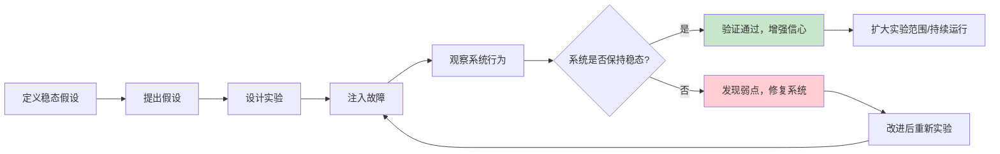
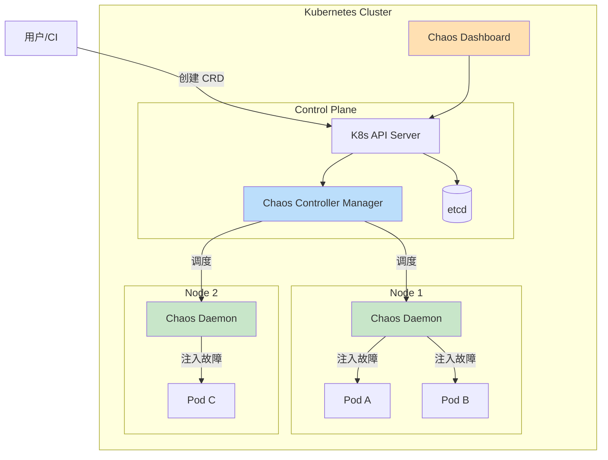

# 混沌工程-ChaosMesh

> **文档说明**：系统讲解云原生混沌工程平台 ChaosMesh，包括混沌工程原理、ChaosMesh 架构、安装部署、核心概念、故障注入类型（Pod/Network/Stress/DNS/IO/Kernel/Time/JVM）、实验配置、安全控制、可观测性、最佳实践和常见问题。
>
> **适用人群**：DevOps 工程师、SRE、云原生工程师、后端开发者、关注系统稳定性的工程师
>
> **前置知识**：[[K8s-核心概念与架构]]、[[APM应用性能监控-SkyWalking]]、[[容器安全与镜像扫描]]

---

## 一、概述

### 1. 混沌工程是什么

```text
混沌工程（Chaos Engineering）：
- 通过主动注入故障，发现系统中的弱点
- 在生产环境（或类生产环境）中进行受控的实验
- 验证系统的弹性、容错能力和恢复能力
- 由 Netflix 在 2010 年提出（Chaos Monkey）

核心思想：
- 故障是必然的，不是偶然的
- 与其等待故障发生，不如主动制造故障
- 在可控条件下发现问题，比在凌晨3点被叫醒好得多

混沌工程原则（Netflix Principles of Chaos）：
1. 建立稳态假设（Define Steady State）
   - 定义系统正常运行的指标（延迟、错误率、吞吐量）
   - 作为实验的基线

2. 多样化真实世界事件（Vary Real-world Events）
   - 注入真实可能发生的故障
   - 服务器宕机、网络延迟、磁盘满、依赖服务不可用

3. 在生产环境运行实验（Run Experiments in Production）
   - 只有生产环境才能反映真实情况
   - 但要控制爆炸半径，从小范围开始

4. 持续自动化运行（Automate Experiments to Run Continuously）
   - 手动实验不可持续
   - 自动化、定期运行，融入 CI/CD

5. 最小化爆炸半径（Minimize Blast Radius）
   - 控制实验影响范围
   - 从单实例、单服务开始，逐步扩大
   - 有暂停和回滚机制

混沌工程 vs 故障测试：
- 故障测试：验证已知故障场景的处理（单元测试、集成测试）
- 混沌工程：发现未知的弱点，探索系统行为
- 混沌工程更强调探索性和生产环境
```



### 2. ChaosMesh 介绍

```text
ChaosMesh：
- 开源的云原生混沌工程平台
- 由 PingCAP（TiDB 团队）开发，2020 年开源
- 2021 年成为 CNCF 孵化项目
- 专为 Kubernetes 设计，CRD 方式定义混沌实验
- 支持多种故障类型，覆盖容器、网络、系统、应用层

核心特性：
1. 云原生
   - 基于 Kubernetes CRD（Custom Resource Definition）
   - 用 YAML 定义实验，GitOps 友好
   - 与 K8s 生态无缝集成

2. 丰富的故障类型
   - Pod 故障：kill、删除、容器失败
   - 网络故障：延迟、丢包、分区、带宽限制、DNS 错误
   - 压力测试：CPU、内存、磁盘 IO
   - 文件系统故障：IO 延迟、错误、填充磁盘
   - 内核故障：slab 分配失败
   - 时间故障：时钟偏移
   - JVM 故障：方法延迟、异常、抛错

3. 安全可控
   - 命名空间隔离（namespaceSelector）
   - 标签选择器（labelSelector）
   - 实验范围控制（mode/value）
   - 自动恢复（duration）
   - 权限控制（RBAC）

4. 可观测性
   - 内置 Dashboard（Web UI）
   - 事件记录和审计
   - Prometheus 指标
   - 与 Grafana 集成

5. 灵活调度
   - 一次性实验
   - 定时实验（Schedule）
   - 工作流（Workflow）：多步骤、串行/并行
   - 与 CI/CD 集成

ChaosMesh 架构：
- Chaos Controller Manager：核心控制器，管理实验生命周期
- Chaos Daemon：每个节点上的 DaemonSet，执行故障注入
- Chaos Dashboard：Web UI，管理和监控实验
- CRD：定义实验类型的自定义资源
```



---

## 二、安装与部署

### 1. Helm 安装（推荐）

```bash
# 添加 Helm 仓库
helm repo add chaos-mesh https://charts.chaos-mesh.org
helm repo update

# 创建命名空间
kubectl create namespace chaos-mesh

# 安装 ChaosMesh
helm install chaos-mesh chaos-mesh/chaos-mesh \
  --namespace chaos-mesh \
  --version 2.6.3 \
  --set dashboard.create=true \
  --set dashboard.securityMode=true \
  --set chaosDaemon.runtime=containerd \
  --set chaosDaemon.socketPath=/run/containerd/containerd.sock

# 验证安装
kubectl get pods -n chaos-mesh
# 应该看到：
# chaos-controller-manager-xxx   1/1 Running
# chaos-daemon-xxx               1/1 Running（每个节点一个）
# chaos-dashboard-xxx            1/1 Running

# 查看 CRD
kubectl get crd | grep chaos-mesh
# podchaos.chaos-mesh.org
# networkchaos.chaos-mesh.org
# stresschaos.chaos-mesh.org
# ...
```

### 2. 不同容器运行时配置

```bash
# Docker 运行时
helm install chaos-mesh chaos-mesh/chaos-mesh \
  --namespace chaos-mesh \
  --set chaosDaemon.runtime=docker \
  --set chaosDaemon.socketPath=/var/run/docker.sock

# containerd 运行时（K8s 1.24+ 默认）
helm install chaos-mesh chaos-mesh/chaos-mesh \
  --namespace chaos-mesh \
  --set chaosDaemon.runtime=containerd \
  --set chaosDaemon.socketPath=/run/containerd/containerd.sock

# CRI-O 运行时
helm install chaos-mesh chaos-mesh/chaos-mesh \
  --namespace chaos-mesh \
  --set chaosDaemon.runtime=crio \
  --set chaosDaemon.socketPath=/run/crio/crio.sock
```

### 3. Dashboard 访问

```bash
# 方式1：端口转发
kubectl port-forward -n chaos-mesh svc/chaos-dashboard 2333:2333
# 访问 http://localhost:2333

# 方式2：NodePort
kubectl patch svc chaos-dashboard -n chaos-mesh \
  -p '{"spec":{"type":"NodePort"}}'
kubectl get svc chaos-dashboard -n chaos-mesh

# 方式3：Ingress
cat <<EOF | kubectl apply -f -
apiVersion: networking.k8s.io/v1
kind: Ingress
metadata:
  name: chaos-dashboard
  namespace: chaos-mesh
spec:
  rules:
  - host: chaos.example.com
    http:
      paths:
      - path: /
        pathType: Prefix
        backend:
          service:
            name: chaos-dashboard
            port:
              number: 2333
EOF

# 获取登录 Token（安全模式下）
kubectl create token chaos-dashboard -n chaos-mesh
# 或创建 ServiceAccount + ClusterRoleBinding
```

---

## 三、核心概念

### 1. 实验（Experiment）

```yaml
ChaosMesh 实验的通用结构：

apiVersion: chaos-mesh.org/v1alpha1
kind: PodChaos  # 或 NetworkChaos / StressChaos / ...
metadata:
  name: pod-kill-example
  namespace: default
  labels:
    app: chaos-experiment
spec:
  # 1. 选择器：目标范围
  selector:
    namespaces:
      - default
    labelSelectors:
      app: web
    # podSelectors / nodeSelectors / phaseSelectors

  # 2. 模式：选择多少个目标
  mode: one  # one / all / fixed / fixed-percent / random-max-percent
  value: ""  # fixed 或 fixed-percent 时的数值

  # 3. 持续时间
  duration: "30s"  # 实验持续时间，结束后自动恢复

  # 4. 故障类型特定配置
  action: pod-kill  # 具体故障动作

  # 5. 调度（可选，用于定时实验）
  # scheduler:
  #   cron: "@every 5m"
```

### 2. 选择器（Selector）

```text
选择器决定实验目标：

1. namespaces：命名空间列表
   namespaces: ["default", "production"]

2. labelSelectors：标签选择
   labelSelectors:
     app: web
     tier: frontend

3. podSelectors：直接指定 Pod
   podSelectors:
     default: ["web-7d8f9c6b5-abcde"]

4. nodeSelectors：节点选择
   nodeSelectors:
     kubernetes.io/hostname: node-1

5. phaseSelectors：Pod 阶段
   phaseSelectors: ["Running", "Pending"]

6. annotationSelectors：注解选择
   annotationSelectors:
     chaos-mesh.org/enabled: "true"

7. expressionSelectors：表达式选择
   expressionSelectors:
     - key: app
       operator: In
       values: ["web", "api"]

选择器是 AND 关系：所有条件都满足才被选中。
```

### 3. 模式（Mode）

```text
模式决定从选中的目标中选多少个：

1. one：随机选 1 个
   mode: one

2. all：选全部
   mode: all

3. fixed：选固定数量
   mode: fixed
   value: "3"  # 选 3 个

4. fixed-percent：选固定百分比
   mode: fixed-percent
   value: "50"  # 选 50%

5. random-max-percent：最多选 N%（随机数量，不超过 N%）
   mode: random-max-percent
   value: "30"  # 随机选 0-30%

生产环境建议：从 one 开始，逐步扩大。
```

### 4. 调度（Schedule）

```yaml
定时实验：

apiVersion: chaos-mesh.org/v1alpha1
kind: Schedule
metadata:
  name: scheduled-pod-kill
spec:
  schedule: "@every 5m"  # cron 表达式
  # schedule: "0 2 * * *"  # 每天凌晨2点
  # schedule: "*/30 * * * *"  # 每30分钟
  historyLimit: 5  # 保留历史记录数
  concurrencyPolicy: Forbid  # Forbid / Allow / Replace
  startingDeadlineSeconds: 60

  # 实验模板
  type: PodChaos
  podChaos:
    selector:
      namespaces: ["default"]
      labelSelectors:
        app: web
    mode: one
    action: pod-kill
    duration: "10s"

Cron 表达式：
- 标准 5 段：分 时 日 月 周
- @every 5m / @hourly / @daily / @weekly / @monthly
- 0 2 * * * = 每天凌晨2点
- */15 * * * * = 每15分钟
- 0 9-17 * * 1-5 = 工作日9点到17点整点
```

### 5. 工作流（Workflow）

```yaml
ChaosMesh Workflow：多步骤混沌实验编排

apiVersion: chaos-mesh.org/v1alpha1
kind: Workflow
metadata:
  name: e2e-chaos-workflow
spec:
  entry: the-entry
  templates:
    - name: the-entry
      templateType: Serial
      deadline: 20m
      children:
        - step1-network-delay
        - step2-pod-kill
        - step3-stress
        - step4-verify

    - name: step1-network-delay
      templateType: ChaosNode
      deadline: 2m
      chaosSelector:
        templateType: NetworkChaos
        networkChaos:
          selector:
            namespaces: ["default"]
            labelSelectors:
              app: api
          mode: all
          action: delay
          delay:
            latency: "500ms"
            correlation: "50"
            jitter: "100ms"
          duration: "1m"

    - name: step2-pod-kill
      templateType: ChaosNode
      chaosSelector:
        templateType: PodChaos
        podChaos:
          selector:
            namespaces: ["default"]
            labelSelectors:
              app: web
          mode: one
          action: pod-kill

    - name: step3-stress
      templateType: Parallel
      children:
        - stress-cpu
        - stress-mem

    - name: stress-cpu
      templateType: ChaosNode
      chaosSelector:
        templateType: StressChaos
        stressChaos:
          selector:
            namespaces: ["default"]
          mode: one
          stressors:
            cpu:
              workers: 2
              load: 80
          duration: "1m"

    - name: stress-mem
      templateType: ChaosNode
      chaosSelector:
        templateType: StressChaos
        stressChaos:
          selector:
            namespaces: ["default"]
          mode: one
          stressors:
            memory:
              workers: 1
              size: "512MB"
          duration: "1m"

    - name: step4-verify
      templateType: Task
      task:
        container:
          name: verify
          image: curlimages/curl:latest
          command: ["sh", "-c", "curl -s http://web.default.svc/health | grep -q ok && echo 'PASS' || exit 1"]

Workflow 节点类型：
- Serial：串行执行子节点
- Parallel：并行执行子节点
- ChaosNode：混沌实验节点
- Task：任务节点（运行容器）
- Suspend：暂停节点（等待人工确认）
- Branch：条件分支
```

---

## 四、故障类型详解

### 1. Pod 故障（PodChaos）

```yaml
# PodChaos：Pod 级别的故障
apiVersion: chaos-mesh.org/v1alpha1
kind: PodChaos
metadata:
  name: pod-fault-example
spec:
  selector:
    namespaces: ["default"]
    labelSelectors:
      app: web
  mode: one
  duration: "30s"

  # 故障动作
  action: pod-kill  # pod-kill / container-kill / pod-failure

  # container-kill 时指定容器
  # containerName: "main"

  # pod-failure 时的配置
  # podFailure:
  #   duration: "1m"
```

```text
PodChaos 动作：

1. pod-kill
   - 杀死 Pod（发送 SIGKILL）
   - Pod 被删除，由 ReplicaSet/Deployment 重建
   - 模拟 Pod 崩溃、节点故障
   - 验证：服务是否自动恢复、流量是否切换

2. container-kill
   - 杀死指定容器（不删除 Pod）
   - Pod 内容器重启
   - 模拟容器崩溃
   - 需要指定 containerName

3. pod-failure
   - 让 Pod 持续不可用（注入错误状态）
   - Pod 不会被删除，但持续失败
   - 模拟 Pod 长时间不可用
   - duration 后自动恢复

使用场景：
- 验证服务自愈能力
- 验证滚动更新时的可用性
- 验证依赖服务故障时的降级
- 验证负载均衡器的健康检查
```

### 2. 网络故障（NetworkChaos）

```yaml
# NetworkChaos：网络级别的故障
apiVersion: chaos-mesh.org/v1alpha1
kind: NetworkChaos
metadata:
  name: network-delay-example
spec:
  selector:
    namespaces: ["default"]
    labelSelectors:
      app: api
  mode: all
  duration: "1m"

  action: delay  # delay / loss / duplicate / corrupt / partition / bandwidth / dns

  # 延迟配置
  delay:
    latency: "500ms"      # 延迟时间
    correlation: "50"      # 延迟相关性（0-100）
    jitter: "100ms"        # 抖动范围

  # 丢包配置
  # loss:
  #   loss: "20"           # 丢包率（%）
  #   correlation: "50"

  # 重复包
  # duplicate:
  #   duplicate: "10"
  #   correlation: "50"

  # 损坏包
  # corrupt:
  #   corrupt: "10"
  #   correlation: "50"

  # 网络分区
  # action: partition
  # direction: to  # to / from / both
  # target:
  #   selector:
  #     namespaces: ["default"]
  #     labelSelectors:
  #       app: db
  #   mode: all

  # 带宽限制
  # action: bandwidth
  # bandwidth:
  #   rate: "1mbps"        # 带宽速率
  #   limit: 20971520      # 字节数限制
  #   buffer: 10000         # 缓冲区
  #   minburst: 10000       # 最小突发
  #   peakrate: "2mbps"     # 峰值速率

  # 外部目标（非 K8s 服务）
  # externalTargets:
  #   - "api.example.com"
  #   - "10.0.0.0/8"

  # 方向
  direction: to  # to（出站）/ from（入站）/ both
```

```text
NetworkChaos 动作详解：

1. delay（网络延迟）
   - 模拟网络延迟、跨地域访问
   - 参数：latency（延迟）、jitter（抖动）、correlation（相关性）
   - 验证：超时设置是否合理、用户体验影响

2. loss（丢包）
   - 模拟网络不稳定、弱网环境
   - 参数：loss（丢包率 %）
   - 验证：重试机制、TCP 重传、用户体验

3. duplicate（重复包）
   - 模拟网络重复发包
   - 验证：幂等性、重复请求处理

4. corrupt（损坏包）
   - 模拟数据包损坏
   - 验证：校验和、错误处理

5. partition（网络分区）
   - 模拟服务间网络隔离
   - 需要指定 target（对端）
   - direction：to / from / both
   - 验证：分布式系统一致性、降级策略、脑裂处理

6. bandwidth（带宽限制）
   - 模拟网络带宽瓶颈
   - 参数：rate（速率）、limit（限制）
   - 验证：大文件传输、视频流、批量处理

7. dns（DNS 故障）
   - 模拟 DNS 解析错误
   - 见 DNSChaos

使用场景：
- 验证微服务间通信的容错
- 验证超时和重试策略
- 验证弱网环境下的用户体验
- 验证分布式系统的网络分区处理
- 验证熔断和降级机制
```

### 3. 压力测试（StressChaos）

```yaml
# StressChaos：资源压力测试
apiVersion: chaos-mesh.org/v1alpha1
kind: StressChaos
metadata:
  name: stress-cpu-example
spec:
  selector:
    namespaces: ["default"]
    labelSelectors:
      app: worker
  mode: one
  duration: "2m"

  # 压力源配置
  stressors:
    # CPU 压力
    cpu:
      workers: 2        # 工作线程数
      load: 80          # CPU 负载（%）
      # options: ["--cpu 2"]  # 自定义 stress-ng 参数

    # 内存压力
    memory:
      workers: 1        # 工作线程数
      size: "512MB"     # 分配内存大小
      # 或百分比：size: "50%"

    # 硬盘 IO 压力
    # io:
    #   workers: 1
    #   bytes: "1GB"     # 写入数据量
    #   method: "write"  # write / read / randwrite / randread

  # 压力注入到指定容器
  # containerName: "main"
```

```text
StressChaos 详解：

1. CPU 压力
   - 占用 CPU 资源，模拟高负载
   - workers：线程数（建议等于 CPU 核数）
   - load：每个线程的负载百分比
   - 总负载 = workers × load
   - 验证：服务在高 CPU 下的响应时间、限流、自动扩缩容

2. 内存压力
   - 占用内存，模拟内存不足
   - size：绝对大小（512MB / 1GB）或百分比（50%）
   - 验证：OOM 处理、内存泄漏检测、自动扩缩容

3. IO 压力
   - 磁盘读写压力
   - method：write / read / randwrite / randread
   - bytes：数据量
   - 验证：磁盘 IO 瓶颈、数据库性能、日志写入

使用场景：
- 验证服务在资源受限下的表现
- 验证 HPA（水平自动扩缩容）
- 验证资源限制（requests/limits）
- 验证服务降级策略
- 发现资源泄漏
```

### 4. DNS 故障（DNSChaos）

```yaml
# DNSChaos：DNS 解析故障
apiVersion: chaos-mesh.org/v1alpha1
kind: DNSChaos
metadata:
  name: dns-error-example
spec:
  selector:
    namespaces: ["default"]
    labelSelectors:
      app: web
  mode: all
  duration: "1m"

  action: error  # error / random

  # 错误模式：DNS 查询返回错误
  # action: error

  # 随机模式：DNS 查询返回随机 IP
  # action: random

  # 目标域名模式
  patterns:
    - "google.com"
    - "*.example.com"
    - "api.*"

  # 不指定 patterns 则影响所有 DNS 查询
```

```text
DNSChaos 详解：

1. error（DNS 错误）
   - DNS 查询返回错误（NXDOMAIN / SERVFAIL）
   - 模拟 DNS 服务不可用
   - 验证：DNS 缓存、重试、降级策略

2. random（随机 IP）
   - DNS 查询返回随机 IP 地址
   - 模拟 DNS 劫持、错误解析
   - 验证：连接失败处理、TLS 验证

patterns：
- 支持通配符：*.example.com
- 支持前缀匹配：api.*
- 不指定则影响所有查询

使用场景：
- 验证 DNS 故障时的服务可用性
- 验证 DNS 缓存机制
- 验证外部依赖不可用时的降级
```

### 5. 文件系统故障（IOChaos）

```yaml
# IOChaos：文件系统故障
apiVersion: chaos-mesh.org/v1alpha1
kind: IOChaos
metadata:
  name: io-delay-example
spec:
  selector:
    namespaces: ["default"]
    labelSelectors:
      app: db
  mode: one
  duration: "1m"

  action: latency  # latency / fault / attrOverride / mistake

  # 延迟
  delay: "500ms"

  # 错误（fault）
  # errno: 28  # ENOSPC（磁盘满）
  # 常见 errno：
  # 5 = EIO（IO 错误）
  # 28 = ENOSPC（磁盘满）
  # 30 = EROFS（只读文件系统）

  # 路径过滤
  path: "/data"           # 目标路径
  percent: 50              # 影响比例（%）
  methods: ["read", "write"]  # 影响的方法

  # 容器名
  # containerName: "main"

  # 卷名（需要指定要注入的卷）
  volumePath: /var/lib/mysql
```

```text
IOChaos 详解：

1. latency（IO 延迟）
   - 模拟磁盘 IO 延迟
   - 验证：数据库性能、超时设置、异步 IO

2. fault（IO 错误）
   - 模拟 IO 操作失败
   - errno：错误码（EIO/ENOSPC/EROFS）
   - 验证：错误处理、数据一致性、重试

3. attrOverride（属性覆盖）
   - 修改文件属性（返回错误的 stat 信息）

4. mistake（错误数据）
   - 写入错误数据（翻转比特）
   - 验证：数据校验、损坏恢复

参数：
- path：目标路径
- percent：影响比例
- methods：read/write/readdir/fsync/...
- volumePath：必须指定挂载的卷路径

注意：
- IOChaos 需要 Pod 使用 volume 挂载
- 需要指定 volumePath
- 对数据库类应用特别有用
```

### 6. 时间故障（TimeChaos）

```yaml
# TimeChaos：时钟偏移
apiVersion: chaos-mesh.org/v1alpha1
kind: TimeChaos
metadata:
  name: time-shift-example
spec:
  selector:
    namespaces: ["default"]
    labelSelectors:
      app: scheduler
  mode: one
  duration: "1m"

  # 时间偏移
  timeOffset: "-5m"  # 偏移量（支持正负）
  # 正数：时间变快
  # 负数：时间变慢

  # 时钟漂移模式
  clockIds:
    - CLOCK_REALTIME
    - CLOCK_MONOTONIC
    - CLOCK_BOOTTIME

  # 容器名
  # containerName: "main"
```

```text
TimeChaos 详解：

- 模拟系统时钟偏移
- timeOffset：偏移量（如 "5m"、"-1h"、"30s"）
- clockIds：影响的时钟类型
  - CLOCK_REALTIME：系统实时时钟
  - CLOCK_MONOTONIC：单调时钟（不受 NTP 影响）
  - CLOCK_BOOTTIME：启动时间时钟

使用场景：
- 验证定时任务（CronJob）
- 验证证书过期处理
- 验证 TTL/超时逻辑
- 验证分布式系统时钟同步
- 验证时间敏感的业务逻辑（如优惠券过期）

注意：
- 只影响容器内的时钟，不影响宿主机
- 实验结束后自动恢复
```

### 7. JVM 故障（JVMChaos）

```yaml
# JVMChaos：JVM 级别的故障（Java 应用）
apiVersion: chaos-mesh.org/v1alpha1
kind: JVMChaos
metadata:
  name: jvm-delay-example
spec:
  selector:
    namespaces: ["default"]
    labelSelectors:
      app: java-service
  mode: one
  duration: "1m"

  action: delay  # delay / exception / stress / gc / oom / cpuFullload

  # 目标类和方法
  target: jvm
  class: "com.example.service.OrderService"
  method: "createOrder"

  # 延迟配置
  delay:
    latency: 2000  # 延迟毫秒数

  # 异常配置
  # exception: "java.lang.RuntimeException: Chaos injected!"

  # 压力配置
  # stress:
  #   cpuCount: 2
  #   memoryType: "heap"  # heap / stack / codecache / metaspace / direct
  #   size: "256MB"

  # GC 触发
  # action: gc

  # OOM
  # action: oom
  # oom:
  #   area: "heap"  # heap / stack
  #   block: true   # 是否阻塞

  # 容器名
  # containerName: "main"
```

```text
JVMChaos 详解：

1. delay（方法延迟）
   - 给指定方法增加延迟
   - class + method：目标类和方法
   - latency：延迟毫秒数
   - 验证：超时设置、调用链延迟、降级

2. exception（方法抛异常）
   - 让指定方法抛出异常
   - exception：异常类和消息
   - 验证：异常处理、重试、事务回滚

3. stress（JVM 压力）
   - CPU 压力：cpuCount
   - 内存压力：memoryType + size
     - heap：堆内存
     - stack：栈内存
     - codecache：代码缓存
     - metaspace：元空间
     - direct：直接内存

4. gc（触发 GC）
   - 强制触发 Full GC
   - 验证：GC 停顿影响、内存泄漏

5. oom（内存溢出）
   - 触发 OOM
   - area：heap / stack
   - block：是否阻塞
   - 验证：OOM 处理、内存限制、自动重启

使用场景：
- Java 应用的故障注入
- 验证方法级别的容错
- 验证 JVM 调优效果
- 验证 OOM 自愈能力

前提条件：
- Java 应用需要开启 JMX（通常默认开启）
- ChaosMesh 使用 byteman 注入
```

### 8. 内核故障（KernelChaos）

```yaml
# KernelChaos：内核级别的故障
apiVersion: chaos-mesh.org/v1alpha1
kind: KernelChaos
metadata:
  name: kernel-fail-example
spec:
  selector:
    namespaces: ["default"]
    labelSelectors:
      app: high-performance
  mode: one
  duration: "1m"

  # 内核故障配置
  failKernRequest:
    callchain:
      - funcname: "ext4_file_write"  # 目标内核函数
        type: "input"  # input / output
    failtype: 0  # 0: slab分配失败  1: 页面分配失败  2: bio 失败
    probability: 50  # 失败概率（%）
    times: 10  # 最大失败次数
```

```text
KernelChaos 详解：

- 注入内核级别的故障
- 使用 failc（内核故障注入框架）
- callchain：调用链，指定目标函数
- failtype：故障类型
  - 0：slab 分配失败
  - 1：页面分配失败
  - 2：bio（块 IO）失败
- probability：失败概率
- times：最大失败次数

使用场景：
- 验证内核故障时的系统稳定性
- 验证文件系统容错
- 高性能计算场景

注意：
- 需要内核支持 failc
- 风险较高，谨慎使用
- 建议在测试环境先验证
```

---

## 五、安全控制

### 1. 命名空间隔离

```yaml
# 只允许在特定命名空间创建实验
# 通过 RBAC 限制

# 创建只能在 default 命名空间操作的 ServiceAccount
apiVersion: v1
kind: ServiceAccount
metadata:
  name: chaos-operator
  namespace: default
---
apiVersion: rbac.authorization.k8s.io/v1
kind: Role
metadata:
  name: chaos-role
  namespace: default
rules:
  - apiGroups: ["chaos-mesh.org"]
    resources: ["*"]
    verbs: ["get", "list", "watch", "create", "update", "patch", "delete"]
---
apiVersion: rbac.authorization.k8s.io/v1
kind: RoleBinding
metadata:
  name: chaos-rolebinding
  namespace: default
subjects:
  - kind: ServiceAccount
    name: chaos-operator
    namespace: default
roleRef:
  kind: Role
  name: chaos-role
  apiGroup: rbac.authorization.k8s.io
```

### 2. 实验范围控制

```yaml
# 最佳实践：严格限制实验范围
apiVersion: chaos-mesh.org/v1alpha1
kind: PodChaos
metadata:
  name: safe-pod-kill
spec:
  selector:
    # 1. 限定命名空间
    namespaces: ["staging"]

    # 2. 限定标签（只打有 chaos-enabled=true 的 Pod）
    labelSelectors:
      app: web
      chaos-enabled: "true"

    # 3. 限定 Pod 阶段（只影响 Running）
    phaseSelectors: ["Running"]

  # 4. 只选 1 个
  mode: one

  # 5. 短时间
  duration: "10s"

  action: pod-kill
```

### 3. 保护机制

```bash
ChaosMesh 安全机制：

1. 自动恢复
   - duration 到期后自动恢复
   - 删除实验资源也会触发恢复

2. 实验暂停
   - 可以随时暂停实验
   kubectl annotate podchaos pod-kill-example chaos-mesh.org/pause=true

3. 最终器（Finalizer）
   - 删除实验时会先恢复故障
   - 防止故障残留

4. 权限控制
   - RBAC 限制谁可以创建实验
   - 命名空间隔离

5. Dashboard 安全模式
   - securityMode=true 时需要登录
   - Token 认证

6. 审计日志
   - 所有实验操作记录事件
   kubectl get events -n default --field-selector reason=ChaosInject
```

---

## 六、可观测性

### 1. 实验状态查看

```bash
# 查看所有实验
kubectl get podchaos,networkchaos,stresschaos -A

# 查看实验详情
kubectl describe podchaos pod-kill-example

# 查看实验状态
kubectl get podchaos pod-kill-example -o jsonpath='{.status}'

# 查看 ChaosMesh 事件
kubectl get events -A --field-selector reason=ChaosInject,ChaosRecover,ChaosFailed

# 查看控制器日志
kubectl logs -n chaos-mesh -l app.kubernetes.io/component=chaos-controller-manager

# 查看 Daemon 日志
kubectl logs -n chaos-mesh -l app.kubernetes.io/component=chaos-daemon
```

### 2. Prometheus 指标

```yaml
# ChaosMesh 暴露的 Prometheus 指标
# ServiceMonitor（如果用 Prometheus Operator）
apiVersion: monitoring.coreos.com/v1
kind: ServiceMonitor
metadata:
  name: chaos-mesh
  namespace: chaos-mesh
spec:
  selector:
    matchLabels:
      app.kubernetes.io/name: chaos-mesh
  endpoints:
    - port: http
      path: /metrics
      interval: 15s
```

```text
关键指标：
- chaosmesh_controller_experiment_total：实验总数
- chaosmesh_controller_experiment_created：实验创建数
- chaosmesh_controller_experiment_failed：实验失败数
- chaosmesh_controller_experiment_succeeded：实验成功数
- chaosmesh_podchaos_action_total：PodChaos 动作数
- chaosmesh_networkchaos_action_total：NetworkChaos 动作数
- chaosmesh_stresschaos_action_total：StressChaos 动作数

Grafana 面板：
- 导入 ChaosMesh 官方 Dashboard（ID: 15110）
- 展示实验数量、成功率、故障类型分布
```

### 3. 与监控系统结合

```text
混沌实验的可观测性闭环：

1. 实验前：记录基线指标
   - 服务延迟（P50/P95/P99）
   - 错误率
   - 吞吐量（QPS）
   - 资源使用率（CPU/内存/网络）

2. 实验中：实时监控
   - Grafana 仪表盘
   - 告警系统（Prometheus AlertManager）
   - 日志聚合（ELK/Loki）
   - 链路追踪（Jaeger/Zipkin/SkyWalking）

3. 实验后：对比分析
   - 实验前后指标对比
   - 恢复时间（MTTR）
   - 系统行为分析
   - 发现的问题记录

推荐工具组合：
- Prometheus + Grafana：指标监控
- Loki / ELK：日志
- Jaeger / SkyWalking：链路追踪
- ChaosMesh Dashboard：实验管理
```

---

## 七、最佳实践

### 1. 实验设计

- [ ] **从简单开始**：先做 Pod kill，再做网络分区，最后做复杂组合
- [ ] **小范围实验**：从 one 模式开始，验证后再扩大
- [ ] **短时间实验**：duration 从 10s 开始，逐步增加
- [ ] **非高峰时段**：在业务低峰期运行实验
- [ ] **有回滚计划**：知道如何快速停止实验和恢复
- [ ] **定义稳态**：明确什么是"正常"，有量化指标
- [ ] **记录假设**：实验前写下"我认为系统会..."
- [ ] **分析结果**：实验后分析是否符合预期，发现了什么

### 2. 安全实践

- [ ] **命名空间隔离**：生产环境用独立命名空间，严格 RBAC
- [ ] **标签控制**：只对有 chaos-enabled=true 标签的服务实验
- [ ] **审批流程**：生产环境实验需要审批（Workflow Suspend 节点）
- [ ] **自动恢复**：所有实验设置 duration，不做永久故障
- [ ] **监控告警**：实验期间密切监控，异常时自动停止
- [ ] **爆炸半径**：严格控制 mode 和 selector
- [ ] **定期审计**：审查实验记录，确保合规
- [ ] **禁止危险操作**：KernelChaos 等高风险实验只在测试环境

### 3. 持续混沌工程

- [ ] **自动化**：用 Schedule 定期运行实验
- [ ] **融入 CI/CD**：部署后自动运行混沌实验验证
- [ ] **GitOps**：实验 YAML 纳入版本控制
- [ ] **实验库**：建立常用实验模板库
- [ ] **游戏日（Game Day）**：定期组织全团队参与的混沌演练
- [ ] **故障演练手册**：记录每个实验的步骤、预期、实际结果
- [ ] **复盘文化**：实验后复盘，发现问题及时修复
- [ ] **度量改进**：跟踪 MTTR、故障发现率等指标

### 4. 常见实验场景

```text
推荐的混沌实验清单：

基础实验：
1. Pod Kill：杀死服务实例，验证自愈
2. Pod Failure：Pod 持续失败，验证调度
3. Network Delay：服务间延迟，验证超时
4. Network Loss：网络丢包，验证重试
5. Network Partition：服务隔离，验证降级
6. CPU Stress：高 CPU，验证性能和扩缩容
7. Memory Stress：高内存，验证 OOM 处理
8. DNS Error：DNS 故障，验证缓存和降级

进阶实验：
9. 组合故障：网络延迟 + Pod Kill
10. 级联故障：依赖服务故障，验证熔断
11. 数据面故障：数据库 IO 延迟
12. 控制面故障：K8s API Server 不可用
13. 节点故障：整个节点不可用
14. 区域故障：整个可用区故障

应用层实验：
15. JVM 方法延迟：验证超时设置
16. JVM 异常：验证异常处理
17. JVM OOM：验证内存限制
18. 时间偏移：验证定时任务
```

---

## 八、常见问题与排查

| 问题 | 原因 | 解决方案 |
|------|------|---------|
| **实验创建后不生效** | 选择器没匹配到 Pod/模式配置错/控制器异常 | 检查 selector、labelSelectors、mode；kubectl describe 看事件；检查控制器日志 |
| **Chaos Daemon 启动失败** | 容器运行时配置错/socket 路径错/权限不足 | 检查 chaosDaemon.runtime 和 socketPath；确认与节点运行时一致；检查 RBAC |
| **NetworkChaos 不生效** | 目标 Pod 没有正确的网络命名空间/tc 命令不可用 | 检查 Pod 是否 Running；检查节点是否支持 tc；查看 Daemon 日志 |
| **StressChaos 不生效** | 容器缺少 stress-ng/资源限制 | ChaosMesh 会自动注入 stress-ng；检查容器资源限制 |
| **实验结束后故障未恢复** | 控制器异常/最终器未执行/节点故障 | 手动删除实验资源；检查最终器；重启控制器；检查节点状态 |
| **Dashboard 无法访问** | 服务类型错/端口未开放/Ingress 配置错 | 检查 Service 类型；端口转发测试；检查 Ingress 配置 |
| **Dashboard 登录失败** | 安全模式开启但 Token 错/权限不足 | 创建正确的 ServiceAccount 和 Token；检查 ClusterRoleBinding |
| **实验影响了非目标 Pod** | 选择器范围太广/标签匹配错误 | 严格限制 namespaces 和 labelSelectors；用 mode: one 测试 |
| **生产环境实验风险大** | 没有审批流程/没有监控/没有回滚 | 建立审批流程；实验期间密切监控；设置短 duration；有紧急停止机制 |
| **JVMChaos 不生效** | Java 进程未开启 JMX/类名方法名错 | 检查 JVM 启动参数；确认类全限定名和方法名；查看注入日志 |
| **IOChaos 报错 volumePath** | 未指定 volumePath/Pod 没有挂载卷 | 必须指定 volumePath；确认 Pod 有 volume 挂载 |
| **Schedule 不触发** | Cron 表达式错/时区问题/历史限制 | 检查 Cron 格式；确认时区；检查 historyLimit；查看 Schedule 状态 |
| **Workflow 卡住** | 某个节点失败/没有超时/暂停节点 | 查看 Workflow 状态；给节点设 deadline；Suspend 节点需要手动恢复 |
| **实验导致服务雪崩** | 爆炸半径太大/没有降级/依赖链脆弱 | 缩小实验范围；完善熔断降级；逐步扩大实验；先在测试环境验证 |
| **无法创建实验（权限）** | RBAC 权限不足 | 检查 ServiceAccount 权限；创建 Role/RoleBinding；检查命名空间 |
| **Prometheus 无指标** | ServiceMonitor 未配置/标签不匹配 | 检查 ServiceMonitor；确认 Service 标签；检查 Prometheus 配置 |
| **实验记录丢失** | events 有保留期/未配置长期存储 | events 默认保留 1 小时；配置事件导出到长期存储（Loki/ES） |
| **多集群实验** | ChaosMesh 只支持单集群 | 每个集群部署 ChaosMesh；用 GitOps 统一管理；或用 Kubefed 联邦 |
| **与 Istio 冲突** | 网络故障与 Istio sidecar 交互 | 注意 sidecar 注入；排除 istio-proxy 容器；测试网络故障对 Service Mesh 的影响 |
| **实验成本高** | 占用资源/影响业务 | 用小规格测试环境；非高峰实验；短时间实验；自动化减少人工成本 |

---

## 九、关联笔记

### 云原生与运维
- [[K8s-核心概念与架构]] · [[APM应用性能监控-SkyWalking]] · [[容器安全与镜像扫描]]
- [[Jenkins流水线实战]] · [[CI-CD安全与凭据管理]] · [[Kustomize-K8s配置管理]]
- [[多架构镜像构建-buildx]]

### 后端开发
- [[Java-应用性能调优实战]] · [[分布式系统-Raft共识算法]] · [[微服务架构设计模式]]
- [[API安全最佳实践]]

### 计算机基础
- [[CPU架构与指令集]] · [[内存层次结构-Cache]] · [[网络协议-TCP-IP]]
- [[操作系统-进程与线程]]

### 导航
- [[MOC-云原生与运维]] · [[MOC-后端开发]] · [[全栈+AI工程双轨融合学习路线图]]

> **学习路径建议**：先掌握 [[K8s-核心概念与架构]] 容器编排 → 学习 [[APM应用性能监控-SkyWalking]] 可观测性 → 深入本文混沌工程与 ChaosMesh → 实践 [[Jenkins流水线实战]] CI/CD 集成 → 研究 [[分布式系统-Raft共识算法]] 分布式理论 → 构建完整的云原生稳定性保障体系。

---

## 💡 全文深度讲解

本文系统梳理了混沌工程-ChaosMesh的核心知识体系，从概述入手，深入安装与部署的底层机制，再通过核心概念掌握实战应用，最后涵盖常见问题与排查与关联笔记。学习时建议先建立整体认知，再动手实践，最后结合常见问题深化理解。

## 📝 全文精简总结

- **概述**：掌握本模块的核心概念与关键要点
- **安装与部署**：掌握本模块的核心概念与关键要点
- **核心概念**：掌握本模块的核心概念与关键要点
- **故障类型详解**：掌握本模块的核心概念与关键要点
- **安全控制**：掌握本模块的核心概念与关键要点
- **可观测性**：掌握本模块的核心概念与关键要点
- **最佳实践**：掌握本模块的核心概念与关键要点
- **常见问题与排查**：掌握本模块的核心概念与关键要点
- 其余1个模块涵盖进阶主题与拓展内容

