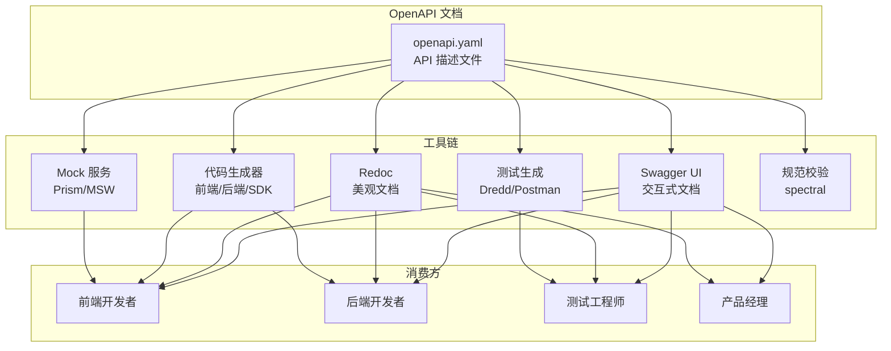
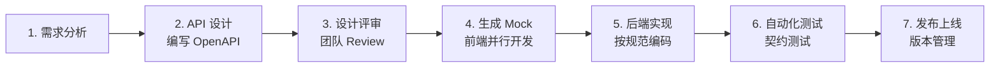
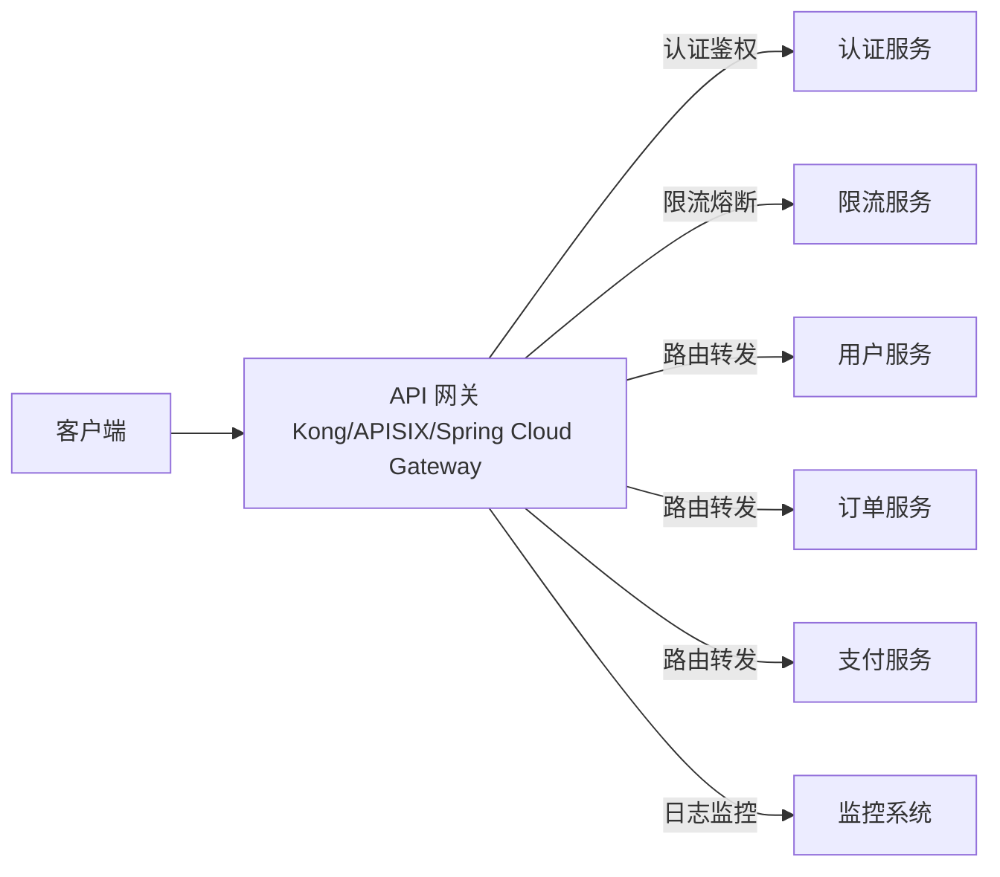

# API 设计规范 - OpenAPI

> **文档说明**：系统讲解 RESTful API 设计规范与 OpenAPI（原 Swagger）描述语言，包括 API 设计原则、资源建模、HTTP 方法语义、状态码规范、版本管理、认证授权、错误处理、分页过滤排序，以及 OpenAPI 3.1 完整语法、Swagger UI 集成、代码生成、Mock 服务与团队协作流程，含完整 YAML 示例和常见反模式。
>
> **适用人群**：后端开发者、API 架构师、全栈工程师、需要规范团队 API 设计的技术负责人
>
> **前置知识**：[[RESTful API设计]]、[[API网关实战]]、HTTP 协议基础

---

## 一、概述

### 1. 为什么需要 API 设计规范

无规范的 API 设计会导致以下问题：

| 问题 | 表现 | 影响 |
|------|------|------|
| **命名混乱** | `/getUser`、`/user_info`、`/users/list` 风格不一 | 前端/调用方学习成本高 |
| **方法滥用** | 用 GET 做删除、用 POST 做查询 | 违反 HTTP 语义，缓存/代理失效 |
| **状态码随意** | 所有错误都返回 200 + `code: 500` | 监控告警失效，客户端难以处理 |
| **错误格式不一** | 有的返回 `message`，有的返回 `error_msg`，有的返回 `msg` | 客户端需要写大量适配逻辑 |
| **无文档** | 接口靠口口相传、微信截图 | 新人上手慢，联调效率低 |
| **无版本管理** | 直接修改接口导致老客户端崩溃 | 线上故障，兼容性差 |
| **无统一认证** | 每个接口自己校验 token | 安全漏洞，代码重复 |

**API 设计规范的核心价值**：
1. **一致性**：团队所有 API 风格统一，降低认知负担
2. **可预测性**：调用方可以推断接口行为，减少文档依赖
3. **可维护性**：版本管理、弃用策略清晰，平滑升级
4. **可自动化**：基于 OpenAPI 文档自动生成代码、Mock、测试
5. **可协作**：前后端并行开发，API 先行（API-First）

### 2. API 设计流派对比

| 流派 | 特点 | 优点 | 缺点 | 适用场景 |
|------|------|------|------|---------|
| **REST** | 资源导向、HTTP 方法语义、状态码 | 标准化、缓存友好、生态成熟 | 复杂查询表达力弱、过度获取/获取不足 | 大多数 Web API |
| **GraphQL** | 单一端点、查询语言、按需获取 | 灵活、减少请求、强类型 | 学习曲线陡、缓存复杂、N+1 问题 | 复杂前端、BFF 层 |
| **gRPC** | Protocol Buffers、HTTP/2、强类型 | 高性能、流式通信、代码生成 | 浏览器支持弱、调试困难、不可读 | 微服务间通信 |
| **tRPC** | 类型安全的 RPC、端到端类型推断 | 开发体验好、类型安全 | 生态较新、多语言支持有限 | TypeScript 全栈项目 |
| **Webhook** | 事件驱动、服务端推送 | 实时性好、减少轮询 | 可靠性需自行保证、顺序问题 | 事件通知场景 |

**本文聚焦 REST + OpenAPI**，这是最通用、最成熟的 API 设计方案。

### 3. OpenAPI 规范简介

OpenAPI 规范（原 Swagger 规范）是一种用于描述 RESTful API 的**机器可读**格式，使用 YAML 或 JSON 编写。



| 组件 | 作用 | 版本 |
|------|------|------|
| **OpenAPI Specification** | API 描述语言规范 | 3.1.0（最新） |
| **Swagger UI** | 交互式 API 文档页面 | 5.x |
| **Swagger Editor** | 在线编辑器，实时预览 | 4.x |
| **OpenAPI Generator** | 多语言代码生成器 | 7.x |
| **Prism** | Mock 服务器 | 4.x |
| **Spectral** | OpenAPI 规范 Lint 工具 | 6.x |
| **Redoc** | 美观的文档渲染器 | 2.x |

### 4. API-First 开发流程



**API-First 的核心**：API 设计是第一步，前后端基于同一份 OpenAPI 文档并行开发，Mock 服务让前端无需等待后端实现。

---

## 二、底层原理

### 1. REST 架构约束

REST（Representational State Transfer）是一种架构风格，由 Roy Fielding 在 2000 年博士论文中提出，包含 6 个约束：

| 约束 | 说明 | 违反后果 |
|------|------|---------|
| **客户端-服务器分离** | 客户端和服务器独立演化，通过接口通信 | 前后端耦合，无法独立部署 |
| **无状态** | 每个请求包含所有必要信息，服务器不存储会话状态 | 水平扩展困难，会话管理复杂 |
| **可缓存** | 响应明确标注是否可缓存，减少重复请求 | 性能差，服务器压力大 |
| **统一接口** | 资源标识、通过表示操作资源、自描述消息、超媒体驱动 | 接口不一致，学习成本高 |
| **分层系统** | 客户端无法感知中间层（代理、网关、缓存） | 架构耦合，无法插入中间层 |
| **按需代码（可选）** | 服务器可传输可执行代码扩展客户端功能 | 通常不使用 |

### 2. 资源建模原理

REST 的核心是**资源（Resource）**，一切皆资源。资源建模是 API 设计的关键。

```mermaid
graph TB
    subgraph 资源层级
        COL[集合资源<br/>/users]
        COL -->|标识| IND[个体资源<br/>/users/{id}]
        IND -->|子资源| SUB[子资源<br/>/users/{id}/orders]
        SUB -->|动作| ACT[动作资源<br/>/users/{id}/orders/{id}/cancel]
    end
```

**资源命名原则**：
1. **使用名词复数**：`/users`、`/orders`、`/products`（不用 `/user`、`/getUser`）
2. **层级表达关系**：`/users/{userId}/orders`（用户的订单）
3. **避免动词**：不用 `/createUser`、`/deleteOrder`，用 HTTP 方法表达动作
4. **连字符分隔**：`/user-profiles`（不用 `/userProfiles`、`/user_profiles`）
5. **小写**：全部小写，避免大小写敏感问题
6. **保持简洁**：`/users/{id}` 而非 `/users/{userId}/user-details`

### 3. HTTP 方法语义

| 方法 | 语义 | 幂等 | 安全 | 有请求体 | 有响应体 | 典型用途 |
|------|------|------|------|---------|---------|---------|
| **GET** | 读取资源 | ✅ | ✅ | ❌ | ✅ | 查询资源、列表 |
| **POST** | 创建资源/执行动作 | ❌ | ❌ | ✅ | ✅ | 创建、复杂查询、登录 |
| **PUT** | 全量替换资源 | ✅ | ❌ | ✅ | ✅ | 全量更新 |
| **PATCH** | 部分更新资源 | ❌ | ❌ | ✅ | ✅ | 部分更新 |
| **DELETE** | 删除资源 | ✅ | ❌ | ❌ | 可选 | 删除资源 |
| **HEAD** | 读取响应头（无体） | ✅ | ✅ | ❌ | ❌ | 检查资源存在/元数据 |
| **OPTIONS** | 获取资源支持的方法 | ✅ | ✅ | ❌ | ✅ | CORS 预检、能力探测 |

**幂等性说明**：
- **幂等**：多次执行与一次执行效果相同（GET、PUT、DELETE、HEAD、OPTIONS）
- **非幂等**：多次执行效果不同（POST、PATCH）
- 幂等性是分布式系统中重试机制的基础

**安全方法说明**：
- **安全**：不修改服务器状态（GET、HEAD、OPTIONS）
- 安全方法可以被缓存、预取、爬虫访问

### 4. HTTP 状态码规范

| 类别 | 范围 | 含义 |
|------|------|------|
| **1xx** | 100-199 | 信息性响应 |
| **2xx** | 200-299 | 成功 |
| **3xx** | 300-399 | 重定向 |
| **4xx** | 400-499 | 客户端错误 |
| **5xx** | 500-599 | 服务器错误 |

**常用状态码**：

| 状态码 | 名称 | 使用场景 | 响应体 |
|--------|------|---------|--------|
| **200** | OK | GET/PUT/PATCH 成功 | 资源数据 |
| **201** | Created | POST 创建成功 | 新创建的资源 |
| **202** | Accepted | 异步任务已接受 | 任务状态/ID |
| **204** | No Content | DELETE 成功，无返回体 | 无 |
| **301** | Moved Permanently | 资源永久迁移 | 新 URL |
| **304** | Not Modified | 资源未变更（缓存） | 无 |
| **400** | Bad Request | 请求参数错误/校验失败 | 错误详情 |
| **401** | Unauthorized | 未认证/Token 无效 | 错误详情 |
| **403** | Forbidden | 已认证但无权限 | 错误详情 |
| **404** | Not Found | 资源不存在 | 错误详情 |
| **409** | Conflict | 资源冲突（重复创建、版本冲突） | 错误详情 |
| **410** | Gone | 资源已永久删除 | 错误详情 |
| **422** | Unprocessable Entity | 请求格式正确但语义错误（业务校验失败） | 错误详情 |
| **429** | Too Many Requests | 限流 | Retry-After 头 |
| **500** | Internal Server Error | 服务器内部错误 | 错误详情（不暴露堆栈） |
| **502** | Bad Gateway | 网关/上游服务错误 | 错误详情 |
| **503** | Service Unavailable | 服务不可用/维护中 | Retry-After 头 |
| **504** | Gateway Timeout | 网关超时 | 错误详情 |

**反模式**：
- ❌ 所有响应都返回 200，用 body 中的 `code` 字段表示错误
- ❌ 用 404 表示业务错误（如"余额不足"）
- ❌ 用 500 表示参数校验错误
- ❌ 200 + `code: 0` 表示成功（RPC 风格混入 REST）

### 5. 统一错误响应格式

```json
{
  "error": {
    "code": "VALIDATION_ERROR",
    "message": "请求参数校验失败",
    "details": [
      {
        "field": "email",
        "message": "邮箱格式不正确",
        "value": "invalid-email"
      },
      {
        "field": "password",
        "message": "密码长度不能少于8位",
        "value": "123"
      }
    ],
    "request_id": "req_abc123def456",
    "timestamp": "2026-09-07T10:30:00Z",
    "doc_url": "https://api.example.com/docs/errors/VALIDATION_ERROR"
  }
}
```

| 字段 | 类型 | 说明 | 必填 |
|------|------|------|------|
| `error.code` | string | 机器可读的错误码（大写下划线） | ✅ |
| `error.message` | string | 人类可读的错误描述 | ✅ |
| `error.details` | array | 字段级错误详情（校验错误时） | 可选 |
| `error.request_id` | string | 请求唯一标识，用于排查 | ✅ |
| `error.timestamp` | string | ISO 8601 时间戳 | ✅ |
| `error.doc_url` | string | 错误文档链接 | 可选 |

**错误码命名规范**：
- 大写下划线：`VALIDATION_ERROR`、`UNAUTHORIZED`、`RESOURCE_NOT_FOUND`
- 分类前缀：`AUTH_*`、`USER_*`、`ORDER_*`、`PAYMENT_*`
- 与 HTTP 状态码对应但更细粒度

### 6. 分页、过滤、排序规范

#### 分页

| 分页方式 | 适用场景 | 参数 | 示例 |
|---------|---------|------|------|
| **Offset 分页** | 常规列表、跳页 | `page`、`page_size` | `/users?page=2&page_size=20` |
| **Cursor 分页** | 大数据量、实时数据、无限滚动 | `cursor`、`limit` | `/users?cursor=eyJpZCI6MTAwfQ&limit=20` |
| **Seek 分页** | 按排序字段分页 | `since_id`、`limit` | `/users?since_id=100&limit=20` |

**Offset 分页响应**：
```json
{
  "data": [...],
  "pagination": {
    "page": 2,
    "page_size": 20,
    "total": 156,
    "total_pages": 8,
    "has_next": true,
    "has_prev": true,
    "next_cursor": null
  }
}
```

**Cursor 分页响应**：
```json
{
  "data": [...],
  "pagination": {
    "next_cursor": "eyJpZCI6MTIwfQ",
    "has_next": true,
    "limit": 20
  }
}
```

#### 过滤

```css
# 简单过滤
/users?status=active&role=admin

# 范围过滤
/orders?created_at[gte]=2026-01-01&created_at[lte]=2026-12-31
/orders?total[gt]=100&total[lt]=500

# 多值过滤
/users?role=admin,editor,viewer
/users?role[]=admin&role[]=editor

# 模糊搜索
/users?q=张三
/users?search=john
```

| 操作符 | 含义 | 示例 |
|--------|------|------|
| `eq` | 等于（默认） | `status=active` |
| `neq` | 不等于 | `status[neq]=inactive` |
| `gt` / `gte` | 大于 / 大于等于 | `created_at[gte]=2026-01-01` |
| `lt` / `lte` | 小于 / 小于等于 | `price[lt]=100` |
| `in` | 包含于 | `status[in]=active,pending` |
| `like` | 模糊匹配 | `name[like]=张` |

#### 排序

```css
# 单字段排序（+ 升序，- 降序）
/users?sort=-created_at
/users?sort=name

# 多字段排序
/users?sort=-created_at,name

# 替代写法
/users?order_by=created_at&order=desc
```

### 7. API 版本管理

| 策略 | 方式 | 优点 | 缺点 | 示例 |
|------|------|------|------|------|
| **URL 路径版本** | `/v1/users`、`/v2/users` | 直观、路由清晰、缓存友好 | URL 不优雅、多版本维护 | `/api/v1/users` |
| **Header 版本** | `Accept: application/vnd.example.v1+json` | URL 干净、符合 REST | 不直观、调试困难、代理可能丢 Header | `Api-Version: 1` |
| **Query 参数版本** | `/users?version=1` | 简单 | 缓存键复杂、不规范 | `/users?v=2` |
| **子域名版本** | `v1.api.example.com/users` | 隔离彻底 | DNS 管理复杂、跨域问题 | `api-v1.example.com` |

**推荐：URL 路径版本**（`/api/v1/`），最直观、最常用。

**版本演进策略**：
1. **向后兼容变更**（加字段、加接口）：不需要升版本
2. **破坏性变更**（删字段、改字段类型、改语义）：升大版本 `v1` → `v2`
3. **旧版本弃用**：在响应头中添加 `Deprecation` 和 `Sunset`
4. **共存期**：至少 6 个月双版本共存，给客户端迁移时间

```http
# 弃用响应头示例
Deprecation: true
Sunset: Sat, 31 Dec 2026 23:59:59 GMT
Link: <https://api.example.com/v2/users>; rel="successor-version"
```

---

## 三、实操示例

### 1. OpenAPI 3.1 完整示例

```yaml
# openapi.yaml
openapi: 3.1.0
info:
  title: 用户管理 API
  description: |
    用户管理系统的 RESTful API，包括用户注册、登录、信息管理、
    权限管理等功能。

    ## 认证
    所有需要认证的接口使用 Bearer Token：
    ```
    Authorization: Bearer <access_token>
    ```css

    ## 基础 URL
    - 生产环境：https://api.example.com/v1
    - 测试环境：https://api-staging.example.com/v1
  version: 1.0.0
  contact:
    name: API Team
    email: api-team@example.com
    url: https://example.com/api
  license:
    name: MIT
    url: https://opensource.org/licenses/MIT
  termsOfService: https://example.com/terms

servers:
  - url: https://api.example.com/v1
    description: 生产环境
  - url: https://api-staging.example.com/v1
    description: 测试环境
  - url: http://localhost:8080/v1
    description: 本地开发

tags:
  - name: 用户管理
    description: 用户的 CRUD 操作
  - name: 认证授权
    description: 注册、登录、Token 管理
  - name: 角色权限
    description: 角色和权限管理

security:
  - bearerAuth: []

paths:
  /users:
    get:
      tags: [用户管理]
      summary: 获取用户列表
      description: 分页获取用户列表，支持过滤和排序
      operationId: listUsers
      parameters:
        - $ref: '#/components/parameters/PageParam'
        - $ref: '#/components/parameters/PageSizeParam'
        - name: status
          in: query
          description: 用户状态过滤
          required: false
          schema:
            type: string
            enum: [active, inactive, suspended]
        - name: sort
          in: query
          description: 排序字段，- 表示降序
          required: false
          schema:
            type: string
            default: -created_at
      responses:
        '200':
          description: 成功返回用户列表
          content:
            application/json:
              schema:
                $ref: '#/components/schemas/UserListResponse'
              example:
                data:
                  - id: "usr_abc123"
                    username: "zhangsan"
                    email: "zhangsan@example.com"
                    status: "active"
                    created_at: "2026-01-15T10:30:00Z"
                pagination:
                  page: 1
                  page_size: 20
                  total: 156
                  total_pages: 8
        '401':
          $ref: '#/components/responses/UnauthorizedError'
        '403':
          $ref: '#/components/responses/ForbiddenError'

    post:
      tags: [用户管理]
      summary: 创建用户
      description: 创建新用户（仅管理员）
      operationId: createUser
      requestBody:
        required: true
        content:
          application/json:
            schema:
              $ref: '#/components/schemas/CreateUserRequest'
            example:
              username: "lisi"
              email: "lisi@example.com"
              password: "SecurePass123!"
              role: "user"
      responses:
        '201':
          description: 用户创建成功
          headers:
            Location:
              description: 新创建用户的 URL
              schema:
                type: string
                example: /v1/users/usr_def456
          content:
            application/json:
              schema:
                $ref: '#/components/schemas/UserResponse'
        '400':
          $ref: '#/components/responses/ValidationError'
        '401':
          $ref: '#/components/responses/UnauthorizedError'
        '403':
          $ref: '#/components/responses/ForbiddenError'
        '409':
          description: 用户名或邮箱已存在
          content:
            application/json:
              schema:
                $ref: '#/components/schemas/ErrorResponse'

  /users/{userId}:
    parameters:
      - $ref: '#/components/parameters/UserIdParam'

    get:
      tags: [用户管理]
      summary: 获取用户详情
      operationId: getUser
      responses:
        '200':
          description: 成功返回用户详情
          content:
            application/json:
              schema:
                $ref: '#/components/schemas/UserResponse'
        '401':
          $ref: '#/components/responses/UnauthorizedError'
        '404':
          $ref: '#/components/responses/NotFoundError'

    put:
      tags: [用户管理]
      summary: 全量更新用户
      operationId: updateUser
      requestBody:
        required: true
        content:
          application/json:
            schema:
              $ref: '#/components/schemas/UpdateUserRequest'
      responses:
        '200':
          description: 更新成功
          content:
            application/json:
              schema:
                $ref: '#/components/schemas/UserResponse'
        '400':
          $ref: '#/components/responses/ValidationError'
        '401':
          $ref: '#/components/responses/UnauthorizedError'
        '404':
          $ref: '#/components/responses/NotFoundError'

    patch:
      tags: [用户管理]
      summary: 部分更新用户
      description: 使用 JSON Patch 格式部分更新用户信息
      operationId: patchUser
      requestBody:
        required: true
        content:
          application/json-patch+json:
            schema:
              type: array
              items:
                type: object
                required: [op, path]
                properties:
                  op:
                    type: string
                    enum: [add, remove, replace, move, copy, test]
                  path:
                    type: string
                    example: "/email"
                  value:
                    anyOf:
                      - type: string
                      - type: number
                      - type: boolean
            example:
              - op: replace
                path: "/email"
                value: "newemail@example.com"
              - op: replace
                path: "/status"
                value: "inactive"
      responses:
        '200':
          description: 部分更新成功
          content:
            application/json:
              schema:
                $ref: '#/components/schemas/UserResponse'
        '400':
          $ref: '#/components/responses/ValidationError'
        '401':
          $ref: '#/components/responses/UnauthorizedError'
        '404':
          $ref: '#/components/responses/NotFoundError'

    delete:
      tags: [用户管理]
      summary: 删除用户
      operationId: deleteUser
      responses:
        '204':
          description: 删除成功，无响应体
        '401':
          $ref: '#/components/responses/UnauthorizedError'
        '403':
          $ref: '#/components/responses/ForbiddenError'
        '404':
          $ref: '#/components/responses/NotFoundError'

  /auth/login:
    post:
      tags: [认证授权]
      summary: 用户登录
      description: 使用用户名/邮箱和密码登录，返回访问令牌和刷新令牌
      operationId: login
      security: []  # 登录接口不需要认证
      requestBody:
        required: true
        content:
          application/json:
            schema:
              type: object
              required: [username, password]
              properties:
                username:
                  type: string
                  description: 用户名或邮箱
                  example: "zhangsan"
                password:
                  type: string
                  format: password
                  example: "SecurePass123!"
      responses:
        '200':
          description: 登录成功
          content:
            application/json:
              schema:
                type: object
                properties:
                  access_token:
                    type: string
                    example: "eyJhbGciOiJIUzI1NiIs..."
                  refresh_token:
                    type: string
                    example: "eyJhbGciOiJIUzI1NiIs..."
                  token_type:
                    type: string
                    example: "Bearer"
                  expires_in:
                    type: integer
                    example: 3600
        '400':
          $ref: '#/components/responses/ValidationError'
        '401':
          description: 用户名或密码错误
          content:
            application/json:
              schema:
                $ref: '#/components/schemas/ErrorResponse'
        '429':
          description: 登录尝试过多，请稍后再试
          headers:
            Retry-After:
              schema:
                type: integer
                example: 60

components:
  securitySchemes:
    bearerAuth:
      type: http
      scheme: bearer
      bearerFormat: JWT
      description: JWT Bearer Token 认证

  parameters:
    UserIdParam:
      name: userId
      in: path
      description: 用户唯一标识
      required: true
      schema:
        type: string
        pattern: '^usr_[a-zA-Z0-9]+$'
      example: "usr_abc123"

    PageParam:
      name: page
      in: query
      description: 页码，从 1 开始
      required: false
      schema:
        type: integer
        minimum: 1
        default: 1
      example: 1

    PageSizeParam:
      name: page_size
      in: query
      description: 每页数量
      required: false
      schema:
        type: integer
        minimum: 1
        maximum: 100
        default: 20
      example: 20

  schemas:
    User:
      type: object
      required: [id, username, email, status, created_at]
      properties:
        id:
          type: string
          description: 用户唯一标识
          example: "usr_abc123"
        username:
          type: string
          description: 用户名
          minLength: 3
          maxLength: 30
          pattern: '^[a-zA-Z0-9_]+$'
          example: "zhangsan"
        email:
          type: string
          format: email
          description: 邮箱地址
          example: "zhangsan@example.com"
        status:
          type: string
          enum: [active, inactive, suspended]
          description: 用户状态
          example: "active"
        role:
          type: string
          enum: [admin, editor, user]
          description: 用户角色
          default: user
        created_at:
          type: string
          format: date-time
          description: 创建时间（ISO 8601）
          example: "2026-01-15T10:30:00Z"
        updated_at:
          type: string
          format: date-time
          description: 更新时间
          example: "2026-06-20T14:00:00Z"

    CreateUserRequest:
      type: object
      required: [username, email, password]
      properties:
        username:
          type: string
          minLength: 3
          maxLength: 30
        email:
          type: string
          format: email
        password:
          type: string
          format: password
          minLength: 8
          maxLength: 128
          description: 至少包含大小写字母和数字
        role:
          type: string
          enum: [admin, editor, user]
          default: user

    UpdateUserRequest:
      type: object
      required: [username, email, status]
      properties:
        username:
          type: string
          minLength: 3
          maxLength: 30
        email:
          type: string
          format: email
        status:
          type: string
          enum: [active, inactive, suspended]
        role:
          type: string
          enum: [admin, editor, user]

    UserResponse:
      type: object
      properties:
        data:
          $ref: '#/components/schemas/User'

    UserListResponse:
      type: object
      properties:
        data:
          type: array
          items:
            $ref: '#/components/schemas/User'
        pagination:
          type: object
          properties:
            page:
              type: integer
            page_size:
              type: integer
            total:
              type: integer
            total_pages:
              type: integer
            has_next:
              type: boolean
            has_prev:
              type: boolean

    ErrorResponse:
      type: object
      required: [error]
      properties:
        error:
          type: object
          required: [code, message, request_id, timestamp]
          properties:
            code:
              type: string
              description: 机器可读错误码
              example: "VALIDATION_ERROR"
            message:
              type: string
              description: 人类可读错误描述
              example: "请求参数校验失败"
            details:
              type: array
              items:
                type: object
                properties:
                  field:
                    type: string
                  message:
                    type: string
                  value:
                    anyOf:
                      - type: string
                      - type: number
                      - type: boolean
            request_id:
              type: string
              description: 请求唯一标识
              example: "req_abc123def456"
            timestamp:
              type: string
              format: date-time
            doc_url:
              type: string
              format: uri

  responses:
    UnauthorizedError:
      description: 未认证或 Token 无效
      content:
        application/json:
          schema:
            $ref: '#/components/schemas/ErrorResponse'
          example:
            error:
              code: "UNAUTHORIZED"
              message: "访问令牌无效或已过期"
              request_id: "req_abc123"
              timestamp: "2026-09-07T10:30:00Z"

    ForbiddenError:
      description: 无权限访问
      content:
        application/json:
          schema:
            $ref: '#/components/schemas/ErrorResponse'

    NotFoundError:
      description: 资源不存在
      content:
        application/json:
          schema:
            $ref: '#/components/schemas/ErrorResponse'
          example:
            error:
              code: "RESOURCE_NOT_FOUND"
              message: "用户不存在"
              request_id: "req_abc123"
              timestamp: "2026-09-07T10:30:00Z"

    ValidationError:
      description: 请求参数校验失败
      content:
        application/json:
          schema:
            $ref: '#/components/schemas/ErrorResponse'
```

### 2. Swagger UI 集成（Spring Boot）

```xml
<!-- pom.xml -->
<dependency>
    <groupId>org.springdoc</groupId>
    <artifactId>springdoc-openapi-starter-webmvc-ui</artifactId>
    <version>2.6.0</version>
</dependency>
```

```java
// OpenApiConfig.java
@Configuration
public class OpenApiConfig {

    @Bean
    public OpenAPI customOpenAPI() {
        return new OpenAPI()
            .info(new Info()
                .title("用户管理 API")
                .description("用户管理系统 RESTful API")
                .version("1.0.0")
                .contact(new Contact()
                    .name("API Team")
                    .email("api@example.com"))
                .license(new License()
                    .name("MIT")
                    .url("https://opensource.org/licenses/MIT")))
            .addSecurityItem(new SecurityRequirement().addList("bearerAuth"))
            .components(new Components()
                .addSecuritySchemes("bearerAuth",
                    new SecurityScheme()
                        .type(SecurityScheme.Type.HTTP)
                        .scheme("bearer")
                        .bearerFormat("JWT")))
            .servers(List.of(
                new Server().url("https://api.example.com/v1").description("生产环境"),
                new Server().url("http://localhost:8080/v1").description("本地开发")
            ));
    }
}
```

```java
// UserController.java — 使用注解描述 API
@RestController
@RequestMapping("/v1/users")
@Tag(name = "用户管理", description = "用户的 CRUD 操作")
public class UserController {

    @Operation(summary = "获取用户列表", description = "分页获取用户列表")
    @GetMapping
    public ResponseEntity<UserListResponse> listUsers(
            @Parameter(description = "页码", example = "1")
            @RequestParam(defaultValue = "1") int page,
            @Parameter(description = "每页数量", example = "20")
            @RequestParam(defaultValue = "20") int pageSize) {
        // ...
    }

    @Operation(summary = "创建用户")
    @ApiResponses(value = {
        @ApiResponse(responseCode = "201", description = "创建成功"),
        @ApiResponse(responseCode = "400", description = "参数校验失败"),
        @ApiResponse(responseCode = "409", description = "用户已存在")
    })
    @PostMapping
    public ResponseEntity<User> createUser(@Valid @RequestBody CreateUserRequest request) {
        // ...
    }
}
```

访问地址：
- Swagger UI：`http://localhost:8080/swagger-ui.html`
- OpenAPI JSON：`http://localhost:8080/v3/api-docs`
- OpenAPI YAML：`http://localhost:8080/v3/api-docs.yaml`

### 3. FastAPI 自动生成 OpenAPI

```python
# main.py
from fastapi import FastAPI, HTTPException, Query, Path
from fastapi.openapi.utils import get_openapi
from pydantic import BaseModel, Field, EmailStr
from typing import Optional, List
from datetime import datetime
from enum import Enum

app = FastAPI(
    title="用户管理 API",
    description="用户管理系统 RESTful API",
    version="1.0.0",
    servers=[
        {"url": "https://api.example.com/v1", "description": "生产环境"},
        {"url": "http://localhost:8000/v1", "description": "本地开发"},
    ],
)

class UserStatus(str, Enum):
    active = "active"
    inactive = "inactive"
    suspended = "suspended"

class User(BaseModel):
    id: str = Field(..., description="用户唯一标识", example="usr_abc123")
    username: str = Field(..., min_length=3, max_length=30, description="用户名")
    email: EmailStr = Field(..., description="邮箱地址")
    status: UserStatus = Field(..., description="用户状态")
    created_at: datetime = Field(..., description="创建时间")

class CreateUserRequest(BaseModel):
    username: str = Field(..., min_length=3, max_length=30)
    email: EmailStr
    password: str = Field(..., min_length=8, max_length=128)

class Pagination(BaseModel):
    page: int
    page_size: int
    total: int
    total_pages: int

class UserListResponse(BaseModel):
    data: List[User]
    pagination: Pagination

@app.get("/users", response_model=UserListResponse, tags=["用户管理"])
async def list_users(
    page: int = Query(1, ge=1, description="页码"),
    page_size: int = Query(20, ge=1, le=100, description="每页数量"),
    status: Optional[UserStatus] = Query(None, description="状态过滤"),
):
    """获取用户列表，支持分页和过滤"""
    # ...
    pass

@app.post("/users", response_model=User, status_code=201, tags=["用户管理"])
async def create_user(request: CreateUserRequest):
    """创建新用户"""
    # ...
    pass

# 自定义 OpenAPI 文档
def custom_openapi():
    if app.openapi_schema:
        return app.openapi_schema
    openapi_schema = get_openapi(
        title=app.title,
        version=app.version,
        description=app.description,
        routes=app.routes,
    )
    # 添加 Bearer 认证
    openapi_schema["components"]["securitySchemes"] = {
        "bearerAuth": {
            "type": "http",
            "scheme": "bearer",
            "bearerFormat": "JWT",
        }
    }
    openapi_schema["security"] = [{"bearerAuth": []}]
    app.openapi_schema = openapi_schema
    return openapi_schema

app.openapi = custom_openapi
```

FastAPI 自动生成的文档地址：
- Swagger UI：`http://localhost:8000/docs`
- ReDoc：`http://localhost:8000/redoc`
- OpenAPI JSON：`http://localhost:8000/openapi.json`

### 4. 代码生成（OpenAPI Generator）

```bash
# 安装 OpenAPI Generator
npm install -g @openapitools/openapi-generator-cli

# 生成 TypeScript 前端 SDK
openapi-generator-cli generate \
  -i openapi.yaml \
  -g typescript-axios \
  -o ./frontend/src/api \
  --additional-properties=withSeparateModelsAndApi=true,apiPackage=api,modelPackage=models

# 生成 Python 客户端
openapi-generator-cli generate \
  -i openapi.yaml \
  -g python \
  -o ./python-client \
  --additional-properties=packageName=example_client

# 生成 Go 客户端
openapi-generator-cli generate \
  -i openapi.yaml \
  -g go \
  -o ./go-client \
  --additional-properties=packageName=exampleclient

# 生成 Spring Boot 服务端骨架
openapi-generator-cli generate \
  -i openapi.yaml \
  -g spring \
  -o ./spring-server \
  --additional-properties=basePackage=com.example.api,configPackage=com.example.api.config,apiPackage=com.example.api.controller,modelPackage=com.example.api.model
```

### 5. Mock 服务（Prism）

```bash
# 安装 Prism
npm install -g @stoplight/prism-cli

# 启动 Mock 服务（基于 OpenAPI 文档的 example）
prism mock openapi.yaml -p 4010

# 动态 Mock（根据 schema 自动生成数据）
prism mock openapi.yaml -p 4010 --dynamic

# 代理模式（Mock + 真实 API 回退）
prism proxy openapi.yaml https://api.example.com -p 4010
```

前端开发时将 API base URL 指向 `http://localhost:4010`，即可获取 Mock 数据，无需等待后端实现。

### 6. Spectral 规范校验

```bash
# 安装 Spectral
npm install -D @stoplight/spectral-cli

# 初始化规则集
npx spectral init

# 校验 OpenAPI 文档
npx spectral lint openapi.yaml

# 输出 JSON 格式
npx spectral lint openapi.yaml -f json -o report.json
```

```yaml
# .spectral.yaml
extends:
  - spectral:oas
rules:
  # 自定义规则
  operation-tag-defined: true
  operation-operationId: true
  operation-summary: true
  info-contact: true
  info-license: true
  no-eval-in-markdown: true
  no-script-tags-in-markdown: true
  oas3-api-servers: true
  oas3-operation-security-defined: true
  oas3-schema: true
  path-declarations-must-exist: true
  path-keys-no-trailing-slash: true
  path-not-include-query: true
  typed-enum: true
```

### 7. 常用 HTTP 头规范

| 请求头 | 说明 | 示例 |
|--------|------|------|
| `Authorization` | 认证令牌 | `Bearer eyJhbGciOi...` |
| `Content-Type` | 请求体格式 | `application/json` |
| `Accept` | 期望的响应格式 | `application/json` |
| `Accept-Language` | 语言偏好 | `zh-CN, en;q=0.9` |
| `X-Request-ID` | 请求唯一标识（客户端生成） | `req_abc123` |
| `Idempotency-Key` | 幂等键（防止重复提交） | `idem_xyz789` |
| `If-None-Match` | 缓存验证（ETag） | `"abc123"` |
| `If-Modified-Since` | 缓存验证（时间） | `Mon, 01 Jan 2026 00:00:00 GMT` |

| 响应头 | 说明 | 示例 |
|--------|------|------|
| `Content-Type` | 响应体格式 | `application/json; charset=utf-8` |
| `X-Request-ID` | 请求唯一标识（服务端生成） | `req_abc123` |
| `X-RateLimit-Limit` | 限流上限 | `1000` |
| `X-RateLimit-Remaining` | 剩余配额 | `950` |
| `X-RateLimit-Reset` | 重置时间（Unix 时间戳） | `1757280000` |
| `Retry-After` | 重试等待时间（秒） | `60` |
| `ETag` | 资源版本标识 | `"abc123"` |
| `Last-Modified` | 最后修改时间 | `Mon, 01 Jan 2026 00:00:00 GMT` |
| `Cache-Control` | 缓存策略 | `max-age=300, must-revalidate` |
| `Location` | 新资源 URL（201 时） | `/v1/users/usr_abc123` |
| `Deprecation` | 接口弃用标识 | `true` |
| `Sunset` | 弃用生效时间 | `Sat, 31 Dec 2026 23:59:59 GMT` |

---

## 四、常见问题与排查

### 1. API 设计反模式

| 反模式 | 问题 | 正确做法 |
|--------|------|---------|
| `/getUser?id=1` | URL 中使用动词 | `GET /users/1` |
| `/deleteUser?id=1` | 用 GET 做删除 | `DELETE /users/1` |
| 所有接口都用 POST | 不区分 HTTP 方法语义 | 按语义使用 GET/POST/PUT/PATCH/DELETE |
| `/users/create`、`/users/update` | 动词+名词 | `/users`（POST 创建）、`/users/{id}`（PUT 更新） |
| 返回 `{code: 0, data: ...}` | 用 body 中的 code 替代 HTTP 状态码 | 使用正确的 HTTP 状态码 |
| `/userList`、`/user_info` | 命名不统一 | `/users`（复数名词） |
| 不分页，一次返回全部 | 大数据量时性能问题 | 必须分页，默认 page_size=20 |
| 密码明文返回 | 安全漏洞 | 永远不返回密码字段 |
| 自增 ID 暴露 | 可被遍历攻击 | 使用 UUID/ULID/雪花 ID |
| 无版本管理 | 破坏性变更导致客户端崩溃 | URL 路径版本 `/v1/` |

### 2. 常见设计决策

| 决策点 | 方案 A | 方案 B | 推荐 |
|--------|--------|--------|------|
| **ID 类型** | 自增整数 | UUID/ULID | UUID/ULID（安全、分布式友好） |
| **时间格式** | Unix 时间戳 | ISO 8601 | ISO 8601（可读、无时区歧义） |
| **布尔字段** | `is_active` | `active` | 保持一致即可，推荐 `active` |
| **空值表示** | `null` | 省略字段 | `null`（明确表示无值） |
| **枚举值** | 数字编码 | 字符串 | 字符串（可读、自描述） |
| **批量操作** | 单个接口循环调用 | 批量接口 | 批量接口（`POST /users/batch`） |
| **软删除** | 直接 DELETE | 标记删除 | 软删除（`status=deleted`）+ 硬删除归档 |
| **复杂查询** | GET + 多参数 | POST + 请求体 | GET（简单）/ POST（复杂，如 `/search`） |

### 3. OpenAPI 文档维护问题

| 问题 | 原因 | 解决方案 |
|------|------|---------|
| 文档与代码不同步 | 手动维护文档 | 使用代码注解自动生成（Springdoc/FastAPI） |
| 文档缺少 example | 未编写示例 | 每个 schema 和响应都添加 example |
| 文档结构混乱 | 未使用 tags 和分组 | 合理使用 tags、分组、描述 |
| 大文件难以维护 | 单文件超过 1000 行 | 使用 `$ref` 拆分多文件，或按模块组织 |
| 无法版本对比 | 未纳入版本控制 | OpenAPI 文件存入 Git，变更走 PR Review |

### 4. 性能问题

| 问题 | 原因 | 解决方案 |
|------|------|---------|
| 列表接口慢 | N+1 查询 | 使用 JOIN/批量查询、DTO 投影 |
| 响应数据过大 | 返回全字段 | 支持字段选择（`?fields=id,name`） |
| 高并发下超时 | 未限流 | 网关层限流（令牌桶/漏桶） |
| 重复请求 | 客户端重试无幂等性 | POST 接口支持 `Idempotency-Key` |
| 缓存失效 | 未设置 Cache-Control | GET 接口合理设置缓存头 |

---

## 五、进阶与最佳实践

### 1. API 设计检查清单

| 类别 | 检查项 | 标准 |
|------|--------|------|
| **URL 设计** | 使用名词复数 | `/users`、`/orders` |
| | 层级表达关系 | `/users/{id}/orders` |
| | 连字符分隔多词 | `/user-profiles` |
| | 全小写 | 无大写字母 |
| | 无尾部斜杠 | `/users` 而非 `/users/` |
| **HTTP 方法** | GET 用于读取 | 不修改状态 |
| | POST 用于创建 | 返回 201 + Location |
| | PUT 用于全量更新 | 幂等 |
| | PATCH 用于部分更新 | JSON Patch 或 Merge Patch |
| | DELETE 用于删除 | 返回 204 |
| **状态码** | 成功使用 2xx | 200/201/204 |
| | 客户端错误使用 4xx | 400/401/403/404/409/422 |
| | 服务端错误使用 5xx | 500/502/503/504 |
| | 不使用 200 + body code | 用 HTTP 状态码 |
| **请求/响应** | 统一错误格式 | `{error: {code, message, request_id}}` |
| | 统一分页格式 | `{data, pagination}` |
| | 时间使用 ISO 8601 | `2026-09-07T10:30:00Z` |
| | 不返回敏感字段 | 密码、token 等 |
| | 支持压缩 | `Accept-Encoding: gzip` |
| **安全** | 认证使用 Bearer Token | JWT/OAuth2 |
| | 权限按角色/资源控制 | RBAC/ABAC |
| | 输入校验 | 所有参数校验 |
| | 限流 | 按用户/IP 限流 |
| | HTTPS | 生产环境强制 |
| **文档** | OpenAPI 描述完整 | 所有接口、参数、响应都有描述 |
| | 有示例 | 请求/响应都有 example |
| | 自动生成 | 代码注解驱动 |
| | 版本化 | 文档版本与 API 版本对应 |

### 2. HATEOAS（超媒体驱动）

成熟的 REST API 应该包含超媒体链接，让客户端可以通过链接发现可用操作：

```json
{
  "id": "usr_abc123",
  "username": "zhangsan",
  "email": "zhangsan@example.com",
  "status": "active",
  "_links": {
    "self": { "href": "/v1/users/usr_abc123", "method": "GET" },
    "update": { "href": "/v1/users/usr_abc123", "method": "PUT" },
    "delete": { "href": "/v1/users/usr_abc123", "method": "DELETE" },
    "orders": { "href": "/v1/users/usr_abc123/orders", "method": "GET" },
    "deactivate": { "href": "/v1/users/usr_abc123/deactivate", "method": "POST" }
  }
}
```

### 3. API 网关集成

API 网关是 API 规范落地的基础设施：



网关层统一处理：
- **认证**：JWT 校验、Token 转发
- **路由**：路径路由、灰度发布
- **限流**：令牌桶、漏桶、按用户/IP 限流
- **熔断**：服务不可用时快速失败
- **日志**：访问日志、请求 ID 注入
- **缓存**：GET 请求缓存
- **版本管理**：按路径/Header 路由到不同版本服务

### 4. API 测试策略

| 测试类型 | 工具 | 说明 |
|---------|------|------|
| **单元测试** | JUnit/pytest | 单个接口逻辑测试 |
| **集成测试** | Testcontainers | 接口+数据库集成测试 |
| **契约测试** | Pact / Spring Cloud Contract | 前后端契约一致性 |
| **API 自动化测试** | Postman / Newman / REST Assured | 端到端 API 测试 |
| **性能测试** | JMeter / k6 / Locust | 压力测试、负载测试 |
| **安全测试** | OWASP ZAP / Burp Suite | 注入、越权、敏感信息泄露 |
| **混沌测试** | Chaos Monkey / Litmus | 故障注入、恢复能力 |

**基于 OpenAPI 的测试生成**：
```bash
# Dredd：基于 OpenAPI 文档自动测试
npm install -g dredd
dredd openapi.yaml http://localhost:8080

# Schemathesis：基于属性的测试
pip install schemathesis
schemathesis run http://localhost:8080/openapi.json
```

### 5. API 度量与分析

| 指标 | 说明 | 目标 |
|------|------|------|
| **可用性** | API 正常运行时间 | 99.9%+ |
| **延迟（P50/P95/P99）** | 响应时间 | P99 < 500ms |
| **错误率** | 4xx + 5xx 占比 | < 1% |
| **QPS/TPS** | 每秒请求数 | 根据容量规划 |
| **吞吐量** | 总请求量 | 趋势分析 |
| **缓存命中率** | CDN/网关缓存命中 | > 80% |
| **API 调用方数量** | 接入的应用/团队 | 生态健康度 |
| **文档完整度** | OpenAPI 覆盖的接口比例 | 100% |

---

## 六、关联笔记

### API 与后端
- [[RESTful API设计]] · [[API网关实战]] · [[API设计规范与选型]]
- [[SpringBoot-RESTfulAPI设计]] · [[FastAPI-高性能Web框架]]

### 微服务
- [[SpringCloud微服务架构]] · [[服务注册与发现]] · [[分布式链路追踪实战]]
- [[Sentinel限流熔断实战]]

### 安全
- [[JWT认证机制]] · [[OAuth2.0与第三方登录]] · [[零信任安全架构]]
- [[Web安全防护]]

### 工程化
- [[代码评审规范]] · [[CI-CD流水线设计]] · [[接口测试与Postman实战]]

### 导航
- [[MOC-DevOps-四级展开]] · [[MOC-微服务与中间件]] · [[MOC-Java全栈-四级展开]]

> **学习路径建议**：先掌握 [[RESTful API设计]] 理解 REST 原则 → 学习本文 OpenAPI 规范和设计最佳实践 → 结合 [[API网关实战]] 实现网关层统一治理 → 实践 [[接口测试与Postman实战]] 验证接口 → 进阶学习 [[JWT认证机制]] 和 [[OAuth2.0与第三方登录]] 安全认证。
