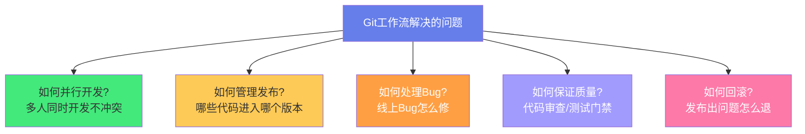
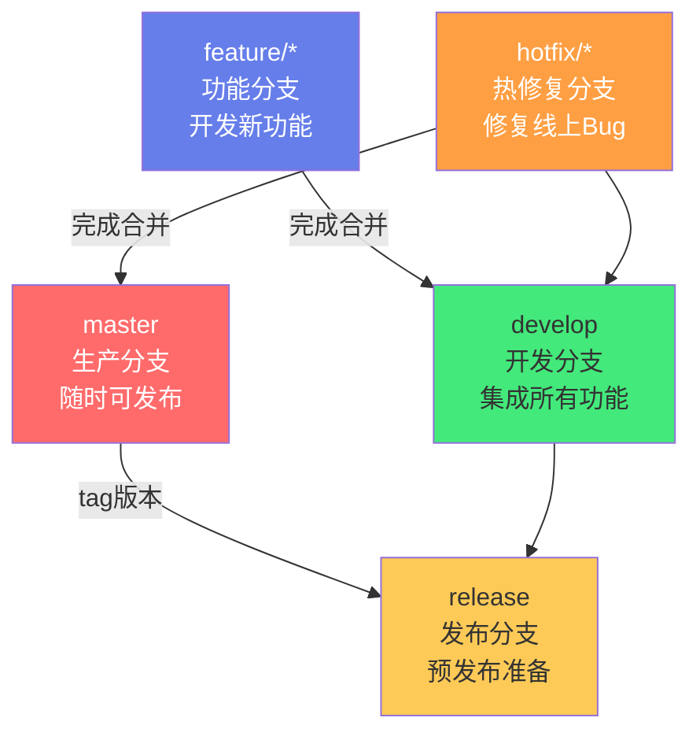
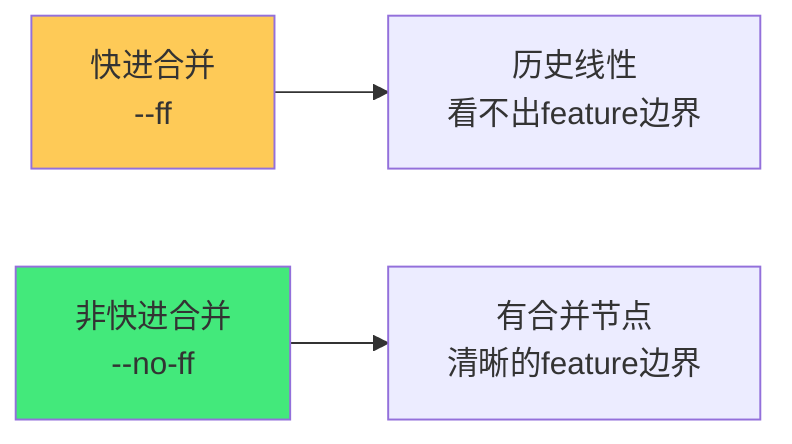
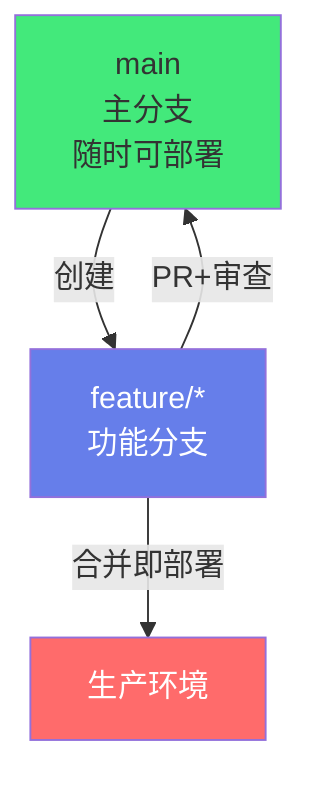
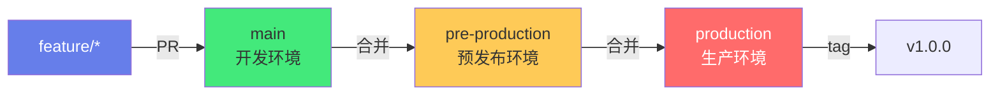
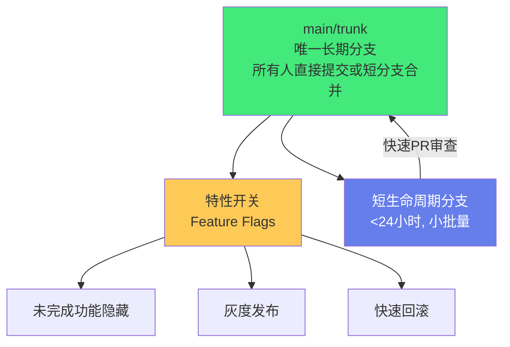

# 🌿 Git 工作流：GitFlow 与 Trunk-Based

> **文档说明**：系统讲解主流 Git 工作流的核心模型、分支策略、适用场景与选择方法，涵盖 Git 工作流的演进背景（从集中式 SVN 到分布式 Git 的协作模式变革）、**GitFlow** 完整模型（master/develop/feature/release/hotfix 五种分支的定义、创建/合并/删除规则、版本发布流程、热修复流程）、GitFlow 的优缺点分析、**GitHub Flow** 简化模型（main + feature 分支 + Pull Request + 持续部署）、**GitLab Flow** 环境分支模型（production/pre-production/main 多级环境分支）、**Trunk-Based Development（主干开发）** 核心理念（所有人直接提交主干/短生命周期分支/特性开关）、Trunk 的关键实践（短分支<24小时/小批量提交/持续集成/特性开关 Feature Flags/代码审查）、四种工作流的多维度对比（分支数量/合并频率/发布节奏/回滚能力/适用团队规模/学习曲线/CI依赖度）、如何根据团队情况选择工作流（团队规模/发布频率/CI成熟度/项目类型/监管要求）、从 GitFlow 到 Trunk 的渐进式迁移路径、分支命名规范（feature//bugfix//hotfix//release/）、Commit Message 规范（Conventional Commits：feat/fix/docs/style/refactor/test/chore）、PR/MR 规范（标题/描述/检查清单/审查人）、代码审查 Code Review 最佳实践、语义化版本号 SemVer（MAJOR.MINOR.PATCH）、常见问题与最佳实践。
>
> **适用人群**：后端/前端/全栈开发者、技术负责人、DevOps 工程师、需要规范团队协作流程的项目经理
>
> **前置知识**：[[Git-高级命令与底层原理]] · [[Git基础命令与工作流]] · [[CI-CD流水线设计]]

---

## 一、概述

### 1.1 为什么需要 Git 工作流

Git 本身只是一个「版本控制工具」，它不规定团队应该如何协作——可以每个人直接推 main，也可以建几十个分支。**Git 工作流**就是团队约定的「分支管理和协作规范」，解决以下问题：



**没有工作流的后果**：
- 多人直接推 main → 冲突频繁、代码不稳定
- 分支命名混乱 → 不知道哪个分支是干什么的
- 发布时不知道哪些代码该上 → 漏发/错发
- 线上 Bug 修复流程不清晰 → 修复慢、容易引入新问题

### 1.2 四种主流工作流

| 工作流 | 核心思想 | 分支数量 | 发布节奏 |
|--------|---------|---------|---------|
| **GitFlow** | 严格的分支分层，版本发布驱动 | 5种分支 | 按版本周期（周/月） |
| **GitHub Flow** | 简化模型，PR驱动，持续部署 | 2种分支 | 随时（合并即部署） |
| **GitLab Flow** | 环境分支，上游合并 | 3-4种分支 | 按环境推进 |
| **Trunk-Based** | 主干开发，短分支+特性开关 | 1个主干+短生命周期分支 | 随时（每日多次） |

---

## 二、GitFlow 详解

### 2.1 GitFlow 的五种分支

GitFlow 由 Vincent Driessen 于 2010 年提出，是最经典的 Git 工作流模型：



| 分支 | 命名 | 来源 | 合并到 | 说明 |
|------|------|------|--------|------|
| **master** | `master`/`main` | - | - | 生产代码，每个 commit 都是可发布版本，打 tag |
| **develop** | `develop` | master | release/master | 开发集成分支，所有 feature 完成后合并到这里 |
| **feature** | `feature/*` | develop | develop | 新功能开发，完成后删除 |
| **release** | `release/*` | develop | master+develop | 预发布分支，只修 Bug 不加新功能 |
| **hotfix** | `hotfix/*` | master | master+develop | 线上紧急 Bug 修复 |

### 2.2 GitFlow 完整流程

**1. 开发新功能**：
```bash
# 从 develop 创建 feature 分支
git checkout develop
git pull origin develop
git checkout -b feature/user-login

# 开发完成后合并回 develop
git checkout develop
git merge --no-ff feature/user-login
git branch -d feature/user-login
git push origin develop
```

**2. 发布版本**：
```bash
# 从 develop 创建 release 分支
git checkout develop
git checkout -b release/1.0.0

# 在 release 分支上修 Bug、更新版本号
# 准备就绪后合并到 master 和 develop
git checkout master
git merge --no-ff release/1.0.0
git tag -a v1.0.0 -m "Release 1.0.0"
git push origin master --tags

git checkout develop
git merge --no-ff release/1.0.0
git branch -d release/1.0.0
```

**3. 线上热修复**：
```bash
# 从 master 创建 hotfix 分支
git checkout master
git checkout -b hotfix/login-crash

# 修复 Bug
# 合并回 master 和 develop
git checkout master
git merge --no-ff hotfix/login-crash
git tag -a v1.0.1 -m "Hotfix 1.0.1"

git checkout develop
git merge --no-ff hotfix/login-crash
git branch -d hotfix/login-crash
```

### 2.3 --no-ff 的意义

`--no-ff`（no fast-forward）强制创建合并提交，保留 feature 分支的历史痕迹：



### 2.4 GitFlow 优缺点

| 优点 | 缺点 |
|------|------|
| 分支职责清晰，适合版本发布驱动的项目 | 分支多，流程复杂，学习曲线陡 |
| master 始终稳定，hotfix 流程规范 | develop 和 master 长期分叉，合并成本高 |
| 多版本并行开发支持好 | 不适合持续部署（发布周期长） |
| 适合有明确版本计划的产品（如桌面软件/APP） | CI/CD 流水线复杂（多分支多环境） |

---

## 三、GitHub Flow 详解

### 3.1 核心模型

GitHub Flow 是 GitHub 自己使用的简化工作流，只有两种分支：



**核心规则**：
1. `main` 分支的代码随时可部署
2. 新功能从 `main` 创建 `feature` 分支
3. 在 feature 分支上提交和推送
4. 通过 **Pull Request** 发起合并，进行代码审查
5. PR 审查通过后合并到 `main`
6. 合并到 `main` 后**立即部署**

### 3.2 工作流程

```bash
# 1. 从 main 创建功能分支
git checkout main
git pull origin main
git checkout -b feature/new-dashboard

# 2. 开发并推送
git add .
git commit -m "feat: add new dashboard"
git push origin feature/new-dashboard

# 3. 在 GitHub 上创建 Pull Request
#    - 填写标题和描述
#    - 指定审查人
#    - CI 自动运行测试

# 4. 审查通过后合并 PR（GitHub 界面操作）
#    推荐使用 "Squash and merge"（压缩合并）

# 5. 合并后自动部署（CI/CD 触发）
# 6. 删除 feature 分支
```

### 3.3 GitHub Flow 优缺点

| 优点 | 缺点 |
|------|------|
| 简单，只有两种分支，容易掌握 | 不适合多版本并行维护 |
| PR 驱动，代码审查自然融入 | 没有专门的 hotfix 流程（hotfix 也是 feature） |
| 合并即部署，适合持续部署 | 依赖强大的 CI/CD 和自动化测试 |
| 适合 Web 应用/SaaS 产品 | 不适合需要严格版本控制的产品 |

---

## 四、GitLab Flow 详解

### 4.1 核心模型

GitLab Flow 在 GitHub Flow 基础上增加了「环境分支」，用分支管理不同部署环境：



**核心规则**：
- 代码从上游分支向下游合并（feature → main → pre-production → production）
- 不允许反向合并（production 的修复通过 cherry-pick 到上游）
- 每个环境分支对应一个部署环境
- production 分支的每个 commit 打 tag

### 4.2 优缺点

| 优点 | 缺点 |
|------|------|
| 用分支管理环境，直观清晰 | 环境分支多，合并链长 |
| 比 GitFlow 简单，比 GitHub Flow 环境管理好 | 不适合频繁发布（每次发布要合并多次） |
| 适合有明确多级环境的团队 | 热修复需要 cherry-pick，稍复杂 |

---

```text
## 五、Trunk-Based Development 详解
```

### 5.1 核心理念

**Trunk-Based Development（主干开发）** 是 Google、Facebook、Netflix 等高绩效团队使用的工作流，核心思想是：

> **所有人都在主干（trunk/main）上开发，分支生命周期极短（<24小时），通过特性开关（Feature Flags）控制未完成功能的可见性。**



### 5.2 关键实践

| 实践 | 说明 |
|------|------|
| **短生命周期分支** | feature 分支从创建到合并不超过 24 小时，最好几小时 |
| **小批量提交** | 每个 PR 很小（<400行变更），便于审查和合并 |
| **持续集成** | 每次提交触发完整 CI，必须通过才能合并 |
| **特性开关** | 未完成的功能用 Feature Flag 包裹，合并到主干但不启用 |
| **快速代码审查** | PR 审查在小时级完成，不积压 |
| **主干始终可发布** | main 分支任何时候都可以部署到生产 |
| **频繁合并** | 每天至少合并一次，避免长期分叉 |

### 5.3 特性开关（Feature Flags）

特性开关是 Trunk-Based 的核心配套技术：

```javascript
// 未完成的功能用开关包裹
if (featureFlags.isEnabled('new-dashboard')) {
    renderNewDashboard();
} else {
    renderOldDashboard();
}
```

**特性开关的价值**：
- **分离部署和发布**：代码部署到生产 ≠ 功能对用户可见
- **灰度发布**：按用户比例/地域/标签逐步开放
- **快速回滚**：出问题只需关闭开关，无需回滚代码
- **A/B 测试**：同时运行新旧版本，对比效果

### 5.4 Trunk-Based 优缺点

| 优点 | 缺点 |
|------|------|
| 合并冲突少（分支短，频繁合并） | 对 CI/CD 和自动化测试要求极高 |
| 发布速度快（每日多次部署） | 需要特性开关基础设施 |
| 代码审查快（PR 小） | 团队需要高度自律和工程能力 |
| 回滚简单（特性开关） | 不适合新手团队或工程能力弱的团队 |
| 适合高绩效团队/互联网产品 | 监管严格的行业可能不适用 |

---

## 六、四种工作流对比

### 6.1 多维度对比

| 维度 | GitFlow | GitHub Flow | GitLab Flow | Trunk-Based |
|------|---------|-------------|-------------|-------------|
| **长期分支数** | 2（master+develop） | 1（main） | 2-3（环境分支） | 1（trunk） |
| **feature 分支寿命** | 数天-数周 | 数天 | 数天 | <24小时 |
| **合并频率** | 低（按版本） | 中（PR通过即合并） | 中（按环境推进） | 高（每日多次） |
| **发布节奏** | 按版本周期 | 合并即部署 | 按环境推进 | 随时（每日多次） |
| **回滚方式** | 回退版本/tag | 回滚 PR/重新部署 | 回退环境分支 | 特性开关/回滚 |
| **CI 依赖度** | 中 | 高 | 高 | 极高 |
| **学习曲线** | 陡 | 平缓 | 中 | 中（工程要求高） |
| **团队规模** | 中大型 | 小中型 | 中大型 | 高绩效团队 |
| **适合产品** | 桌面软件/APP/企业软件 | Web/SaaS | 多级环境Web应用 | 互联网产品/高频率发布 |
| **热修复流程** | 专门 hotfix 分支 | 普通 feature 分支 | cherry-pick | 直接主干+开关 |

### 6.2 选择决策树

```mermaid
graph TB
    A[选择工作流] --> B{发布频率?}
    B -->|按版本/周月| C{需要多版本维护?}
    B -->|持续部署/日多次| D{团队工程能力?}
    
    C -->|是| E[GitFlow]
    C -->|否| F{多级环境?}
    F -->|是| G[GitLab Flow]
    F -->|否| H[GitHub Flow]
    
    D -->|强(CI完善+特性开关)| I[Trunk-Based]
    D -->|中| H
    
    style E fill:#ff9f43,color:#fff
    style G fill:#feca57,color:#333
    style H fill:#667eea,color:#fff
    style I fill:#43e97b,color:#333
```

**选择建议**：
- **桌面软件/移动APP/企业软件**（有明确版本号、多版本维护）→ **GitFlow**
- **Web应用/SaaS**（持续部署、简单环境）→ **GitHub Flow**
- **有明确开发/预发/生产多级环境** → **GitLab Flow**
- **高绩效团队/互联网产品**（每日多次部署、工程能力强）→ **Trunk-Based**

---

## 七、从 GitFlow 到 Trunk 的渐进式迁移

很多团队从 GitFlow 起步，随着 CI/CD 成熟逐步迁移到 Trunk-Based：


| 阶段 | 动作 | 验收标准 |
|------|------|---------|
| **1→2** | 去掉 release 分支，从 develop 直接发布 | 发布流程简化，develop 接近可发布 |
| **2→3** | 合并 develop 到 main，只用 main + feature | 只有一个主分支，PR 驱动合并 |
| **3→4** | 强制 CI 通过才能合并，PR 变小 | main 始终绿色，PR 平均 <400行 |
| **4→5** | 引入特性开关，分支寿命缩短到 <24h | 未完成功能可安全合并到 main，每日多次部署 |

> **关键**：不要一步到位，每个阶段稳定运行 2-4 周再进入下一阶段。迁移的核心不是「改分支规则」，而是「提升工程能力」（CI 覆盖率、自动化测试、特性开关基础设施）。

---

## 八、配套规范

### 8.1 分支命名规范

```text
feature/     新功能开发      feature/user-login
bugfix/      Bug修复         bugfix/login-500-error
hotfix/      线上紧急修复    hotfix/payment-crash
release/     发布准备        release/1.2.0
chore/       杂项/工具       chore/update-dependencies
```

### 8.2 Commit Message 规范（Conventional Commits）

```text
<type>(<scope>): <subject>

<body>

<footer>
```

| type | 说明 |
|------|------|
| `feat` | 新功能 |
| `fix` | Bug 修复 |
| `docs` | 文档变更 |
| `style` | 代码格式（不影响功能） |
| `refactor` | 重构（既不新增功能也不修Bug） |
| `perf` | 性能优化 |
| `test` | 测试相关 |
| `chore` | 构建过程/工具依赖 |
| `ci` | CI/CD 配置变更 |
| `revert` | 回滚提交 |

**示例**：
```text
feat(auth): add OAuth2 login support

- implement Google OAuth2 flow
- add token refresh mechanism
- update login UI

Closes #123
```

### 8.3 PR/MR 规范

**PR 标题**：`type(scope): 简短描述`（同 Commit 规范）

**PR 描述模板**：
```markdown
## 变更内容
<!-- 简要描述这个PR做了什么 -->

## 变更类型
- [ ] feat 新功能
- [ ] fix Bug修复
- [ ] refactor 重构
- [ ] docs 文档
- [ ] chore 杂项

## 测试
- [ ] 单元测试通过
- [ ] 手动测试验证
- [ ] 无测试（说明原因）

## 截图/录屏
<!-- UI变更请附上截图 -->

## 关联Issue
Closes #123
```

### 8.4 代码审查（Code Review）

| 审查要点 | 说明 |
|---------|------|
| **功能正确性** | 代码是否实现了需求？边界条件处理了吗？ |
| **代码质量** | 命名清晰吗？有重复代码吗？函数过长吗？ |
| **安全性** | 有SQL注入/XSS/敏感信息泄露吗？ |
| **性能** | 有N+1查询吗？有不必要的循环吗？ |
| **可维护性** | 有注释吗？错误处理完善吗？ |
| **测试** | 有测试吗？覆盖关键路径吗？ |

**审查原则**：
- PR 越小越好（<400行），审查越快越细
- 审查在 24 小时内完成，不阻塞开发
- 评论对事不对人，用建议而非命令语气
- 审查者和作者共同对代码质量负责

### 8.5 语义化版本号（SemVer）

```text
MAJOR.MINOR.PATCH
  │     │     │
  │     │     └─ PATCH: Bug修复，向后兼容
  │     └─────── MINOR: 新增功能，向后兼容
  └───────────── MAJOR: 不兼容的API变更
```

- `1.0.0` → `1.0.1`：修了 Bug
- `1.0.1` → `1.1.0`：加了新功能（兼容）
- `1.1.0` → `2.0.0`：有不兼容的 API 变更

---

## 九、常见问题

| 问题 | 回答 |
|------|------|
| **小团队用什么工作流？** | GitHub Flow 最简单，main + feature + PR 即可 |
| **可以混用工作流吗？** | 可以，但不建议。团队统一一种工作流最重要 |
| **GitFlow 过时了吗？** | 对持续部署的 Web 产品是的，但对版本驱动的产品（APP/桌面软件）仍然适用 |
| **Trunk-Based 必须用特性开关吗？** | 强烈建议。没有特性开关，未完成功能无法安全合并到主干 |
| **PR 多大合适？** | 理想 <400 行变更，超过 800 行审查质量会显著下降 |
| **hotfix 必须走完整流程吗？** | 紧急情况下可以简化，但事后必须补全流程和测试 |
| **如何处理合并冲突？** | 经常 rebase/merge 主干到 feature 分支，减少冲突积累；冲突大时及时沟通 |
| **强制推送（force push）可以吗？** | 个人 feature 分支可以，共享分支（main/develop）绝对不行 |

---

## 十、关联笔记

```text
### Git 与版本控制
```
- [[Git-高级命令与底层原理]] · [[Git基础命令与工作流]] · [[GitHub-Actions流水线设计]]

### DevOps 与云原生
- [[CI-CD流水线设计]] · [[Docker容器化]] · [[K8s-核心概念与架构]]
- [[Nginx-反向代理与负载均衡]] · [[监控与告警体系]]

### 导航
- [[MOC-云原生与运维]] · [[MOC-通用工具]] · [[Home]] · [[学习路线总览]]

> 🔍 **知识点深度解析**
>
> **作用**：Git 工作流解决的是「团队如何使用 Git 进行高效、有序、低冲突的协作开发，如何管理代码版本、发布流程和热修复，如何在并行开发与代码质量之间取得平衡」的问题——Git 本身不规定协作方式，工作流就是团队的「交通规则」：什么分支干什么、什么时候合并、怎么发布、出了问题怎么回滚。选择合适的工作流并严格执行，能大幅减少合并冲突、发布事故和沟通成本。
>
> **底层原理**：①Git 工作流的本质是「用分支隔离不同状态的代码」——master/main 隔离「生产可用代码」，develop 隔离「集成中的代码」，feature 隔离「开发中的代码」，release 隔离「预发布代码」，hotfix 隔离「紧急修复代码」。分支越多，隔离越精细，但合并成本越高。工作流的选择本质是「隔离粒度 vs 合并成本」的权衡。②GitFlow 的核心是「版本发布驱动」——它假设产品有明确的版本周期（如每2周发一个版本），所以需要 develop 集成本版本的所有功能、release 做发布前准备、master 只存已发布版本。这种模型在「版本发布驱动」的产品（桌面软件、APP、企业软件）中非常合适，但在「持续部署」的 Web 产品中显得过于笨重。③Trunk-Based 的核心是「减少分支寿命来降低合并成本」——合并冲突的根本原因是「分支分叉太久，代码差异太大」。Trunk-Based 通过短分支（<24h）和频繁合并（每日多次），让代码差异始终很小，冲突自然减少。这背后是「小批量高频交付」的精益思想——和制造业的「小批量生产降低库存」是同一个原理。④特性开关（Feature Flags）是 Trunk-Based 的「使能技术」——没有特性开关，未完成的功能不能合并到主干（否则会破坏生产），分支寿命就无法缩短。特性开关实现了「部署」和「发布」的分离：代码可以随时部署到生产（合并即部署），但功能对用户是否可见由开关控制。这让 Trunk-Based 成为可能。⑤PR（Pull Request）+ Code Review 是所有现代工作流的「质量门禁」——无论哪种工作流，代码合并到主分支前都应该经过 PR 审查和 CI 自动化测试。PR 不仅是「合并代码的机制」，更是「知识共享和质量保证的机制」——审查者在审查中学习代码，作者在反馈中提升质量。⑥Conventional Commits + SemVer 的组合实现了「提交信息驱动版本号和变更日志」——通过规范 commit type（feat/fix/breaking change），可以自动计算版本号（feat→MINOR，fix→PATCH，breaking→MAJOR）、自动生成 CHANGELOG，减少人工操作和错误。
>
> **用法要点**：① GitFlow五分支：master(生产/tag)/develop(集成)/feature(功能,从develop来合并回develop)/release(预发布,从develop来合并到master+develop)/hotfix(热修,从master来合并到master+develop)，合并用--no-ff保留历史 ② GitHub Flow：main(随时可部署)+feature分支，PR审查通过合并到main，合并即部署 ③ GitLab Flow：feature→main→pre-production→production，上游向下游合并，production打tag ④ Trunk-Based：唯一主干main/trunk，短生命周期分支(<24h)，小批量PR(<400行)，特性开关控制未完成功能，每日多次合并，main始终可发布 ⑤ 选择：版本驱动产品→GitFlow；简单Web/SaaS→GitHub Flow；多级环境→GitLab Flow；高绩效高频发布→Trunk-Based ⑥ 迁移：GitFlow→简化(去release)→GitHub Flow→短分支+CI门禁→Trunk-Based+特性开关，每阶段稳定2-4周 ⑦ 分支命名：feature//bugfix//hotfix//release//chore/ ⑧ Commit规范：Conventional Commits，type(scope): subject，type包括feat/fix/docs/style/refactor/perf/test/chore/ci/revert ⑨ PR规范：标题同commit规范，描述含变更内容/类型/测试/截图/关联Issue ⑩ Code Review：功能正确/代码质量/安全/性能/可维护性/测试，PR<400行，24h内完成 ⑪ SemVer：MAJOR(不兼容).MINOR(新功能兼容).PATCH(Bug修复) ⑫ 常见：小团队用GitHub Flow；Trunk必须有特性开关；共享分支禁止force push；冲突靠频繁合并主干来预防。

> 💡 **深度讲解**：Git 工作流最核心的智慧是「没有最好的工作流，只有最适合团队的工作流——选择工作流的本质是选择『隔离粒度』和『发布节奏』的平衡点」——很多团队在选择工作流时陷入「哪个最好」的争论，有人说 GitFlow 最规范，有人说 Trunk-Based 最先进。但实际上，工作流的选择取决于团队的「工程能力」和「产品特性」，而非「哪个更先进」。一个刚起步的小团队，CI 还没搭好、自动化测试覆盖率很低，如果强行上 Trunk-Based，结果就是 main 分支经常坏掉、线上事故频发——因为 Trunk-Based 的「主干始终可发布」依赖强大的 CI/CD 和测试基础设施，没有这些支撑，短分支频繁合并就是灾难。相反，一个工程能力强的团队，如果还在用 GitFlow，就会被繁琐的 release 分支和合并流程拖慢发布速度——因为他们的能力已经支持更轻量的工作流。所以，选择工作流的正确姿势是「评估团队当前的工程能力，选择匹配的工作流，然后随着能力提升逐步演进」，而非「追逐最先进的工作流」。这也是为什么本指南强调「渐进式迁移」——从 GitFlow 到 Trunk-Based 不是改个分支命名规则，而是工程能力的逐步提升（CI 完善、测试覆盖、特性开关、团队自律）。Git 工作流的另一个智慧是「PR + Code Review 是所有工作流的共同基石」——无论用哪种分支模型，代码合并前经过 PR 审查和自动化测试都是必须的。分支模型决定了「代码如何流动」，PR 审查决定了「代码质量如何保证」。很多团队花大量时间争论工作流，却忽视了 PR 审查的质量——没有有效的代码审查，再好的工作流也只是形式。真正高绩效的团队，工作流可能很简单（GitHub Flow 甚至 Trunk），但 PR 审查极其严格和高效；而低效的团队，工作流可能很复杂（完整 GitFlow），但 PR 审查流于形式（点个 Approve 就合并）。所以，比选择工作流更重要的是「建立有效的代码审查文化」和「完善的 CI/CD 流水线」——这两者是所有工作流的地基，地基不牢，任何工作流都是空中楼阁。

> 📝 **精简总结**：Git工作流=团队协作的分支管理规范。四种主流：GitFlow(五分支master/develop/feature/release/hotfix,版本驱动,--no-ff,适合APP/桌面软件)、GitHub Flow(main+feature+PR,合并即部署,适合Web/SaaS)、GitLab Flow(环境分支main→pre-prod→prod,适合多级环境)、Trunk-Based(唯一主干+短分支<24h+特性开关,每日多次部署,适合高绩效团队)。选择：版本驱动→GitFlow，简单Web→GitHub Flow，多级环境→GitLab Flow，高频发布+强工程能力→Trunk。迁移：渐进式，每阶段稳定2-4周，核心是提升工程能力而非改规则。配套规范：分支命名(feature//bugfix//hotfix/)、Conventional Commits(feat/fix/docs/refactor等)、PR模板+Code Review(<400行,24h内)、SemVer版本号(MAJOR.MINOR.PATCH)。核心：没有最好只有最合适，PR审查和CI/CD是所有工作流的基石。

> **学习路径建议**：先掌握 [[Git基础命令与工作流]] 和 [[Git-高级命令与底层原理]] → 学习本文档理解四种工作流的区别 → 实践：在个人项目中使用 GitHub Flow（main + feature + PR） → 学习 [[CI-CD流水线设计]] 和 [[GitHub-Actions流水线设计]]，搭建 CI 门禁 → 团队协作中实践 PR + Code Review → 根据团队情况选择合适的工作流并制定规范文档 → 随着工程能力提升，逐步向 Trunk-Based 演进 → 学习特性开关（Feature Flags）工具和灰度发布 → 深入：研究 Google/Facebook 的工程文化和 Trunk-Based 实践。

---

> **Git 工作流的本质是「为团队的协作制定交通规则，让多人并行开发有序、高效、低冲突」——Git 是一个强大但「无政府」的工具：它不规定你该怎么用分支、怎么合并、怎么发布。这种灵活性是 Git 的优点（适合各种场景），但也是缺点（团队容易混乱）。Git 工作流就是在 Git 的灵活性之上建立「秩序」：什么分支干什么、什么时候合并、怎么发布、出问题怎么回滚。但工作流不是「越复杂越好」或「越先进越好」——GitFlow 规范但笨重，Trunk-Based 轻量但要求高，GitHub Flow 简单但不适合多版本维护。真正重要的不是「用了哪种工作流」，而是「团队是否理解并遵守约定的规则」和「是否有配套的工程能力（CI/CD、测试、代码审查）支撑」。一个严格执行 GitHub Flow + 高质量 PR 审查的团队，远比一个名义上用 Trunk-Based 但 PR 流于形式的团队高效得多。所以，不要在「选哪种工作流」上纠结太久——选一个匹配团队当前能力的，严格执行，然后随着能力提升逐步演进。工作流是手段，高效交付高质量代码才是目的。当你的团队能做到「main 分支始终可发布、PR 小而审查快、CI 可靠、回滚简单」时，用哪种工作流已经不重要了——因为你已经掌握了协作的本质。**
