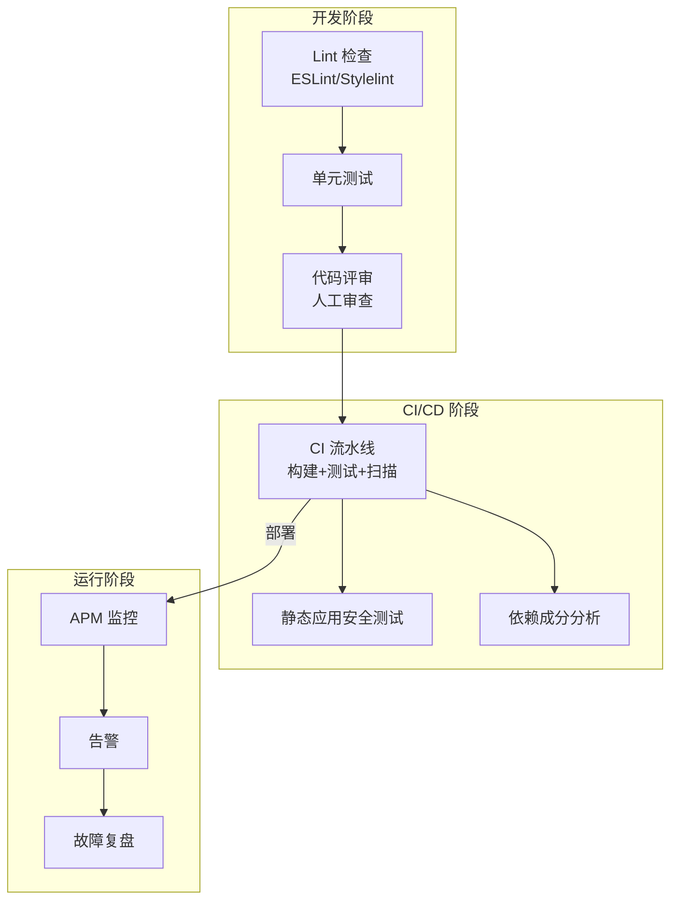
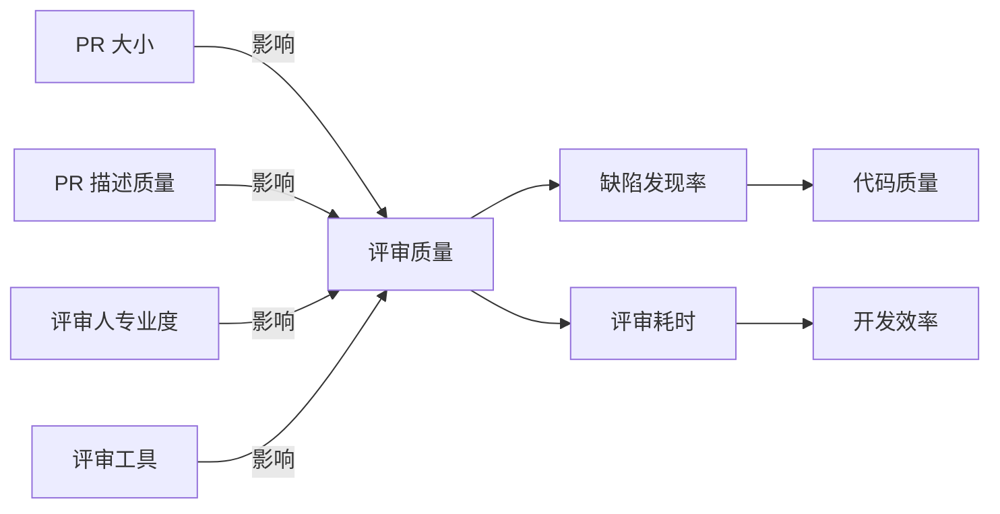
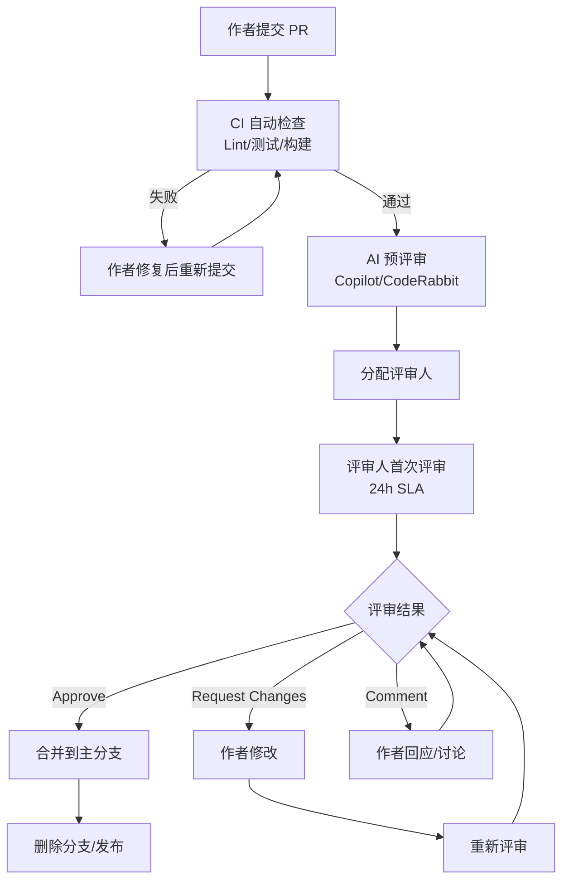
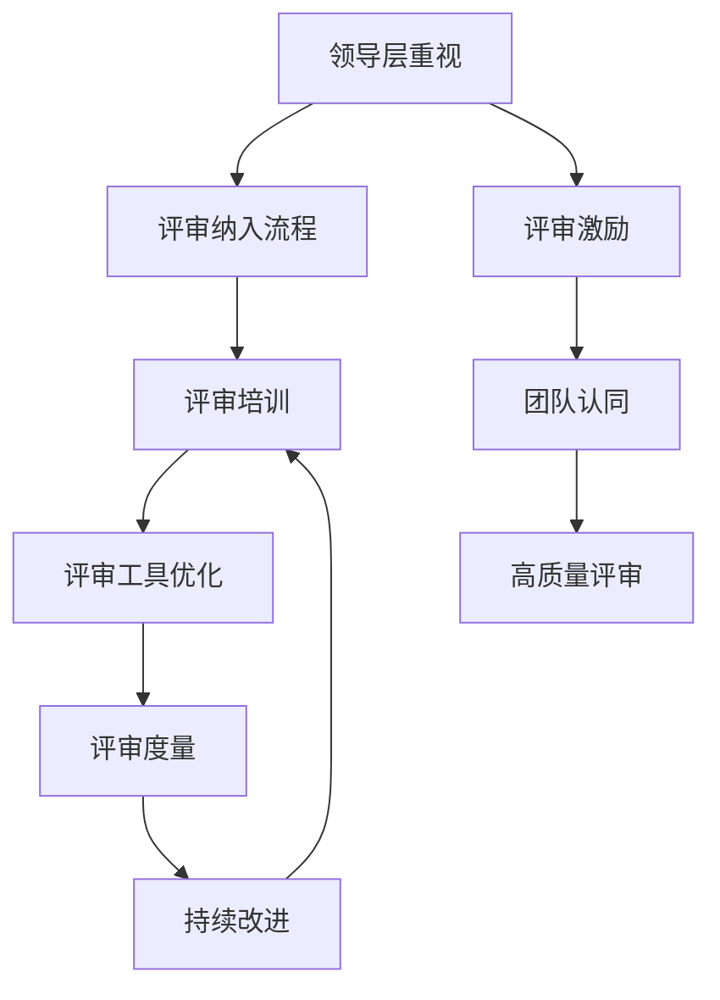

# 代码评审规范

> **文档说明**：系统讲解代码评审（Code Review）的完整规范体系，包括评审流程、评审标准、评审清单、常见问题模式、评审人职责、作者职责、工具链集成（GitHub/GitLab MR 模板、CI 检查、静态分析）、高效评审技巧与团队落地实践，含可复用的 MR/PR 模板、评审检查清单和评论分类指南。
>
> **适用人群**：开发者、技术负责人、需要建立团队代码评审体系的全栈工程师
>
> **前置知识**：[[Git分支管理与工作流]]、[[ESLint+Prettier+Stylelint规范]]

---

## 一、概述

### 1. 为什么需要代码评审

代码评审（Code Review，简称 CR）是指代码合并到主分支前，由其他开发者审查代码的过程。它是保障代码质量的最重要手段之一。

| 价值维度 | 说明 | 数据支撑 |
|---------|------|---------|
| **缺陷预防** | 在代码合并前发现 Bug，修复成本远低于线上修复 | 研究表明 CR 可减少 60-80% 的缺陷 |
| **知识共享** | 评审人了解代码变更，作者学习更好的写法 | 减少单点依赖，提升团队整体能力 |
| **代码一致性** | 统一代码风格、架构模式、命名规范 | 降低维护成本，提升可读性 |
| **安全防护** | 发现安全漏洞、注入风险、敏感信息泄露 | 安全左移，减少安全事故 |
| **性能优化** | 发现性能问题、N+1 查询、内存泄漏 | 避免性能债累积 |
| **团队协作** | 促进技术讨论、统一技术决策 | 减少技术分歧，提升团队凝聚力 |

**不做代码评审的代价**：
- 线上 Bug 率高，修复成本是开发阶段的 10-100 倍
- 代码风格混乱，新人上手慢
- 单点依赖严重，关键人员离职后系统无人能维护
- 安全漏洞难以发现，数据泄露风险高
- 技术债累积，重构成本指数级增长

### 2. 代码评审 vs 其他质量保障手段



| 手段 | 自动化程度 | 覆盖范围 | 成本 | 定位 |
|------|-----------|---------|------|------|
| **Lint** | 全自动 | 格式、简单规则 | 极低 | 第一道防线，自动修复 |
| **单元测试** | 全自动 | 逻辑正确性 | 中 | 验证功能正确性 |
| **代码评审** | 人工 | 架构、可读性、安全、性能 | 中高 | **不可替代的深度审查** |
| **CI 构建** | 全自动 | 编译、测试通过 | 低 | 合并门禁 |
| **SAST** | 全自动 | 安全漏洞模式 | 中 | 安全左移 |
| **SCA** | 全自动 | 依赖漏洞 | 低 | 依赖安全 |
| **APM 监控** | 全自动 | 运行时性能/错误 | 高 | 线上发现问题 |

**代码评审的独特价值**：自动化工具只能检查已知模式，人工评审可以发现架构问题、业务逻辑错误、可读性问题、边缘情况等自动化工具无法覆盖的内容。

### 3. 评审模式对比

| 模式 | 说明 | 优点 | 缺点 | 适用场景 |
|------|------|------|------|---------|
| **PR/MR 评审** | 提交 Pull/Merge Request，评审人在线评论 | 异步、可追溯、工具支持好 | 可能延迟合并 | 大多数团队 |
| **结对编程** | 两人共用一台电脑，实时评审 | 即时反馈、深度交流 | 人力成本高、不适合所有任务 | 复杂功能、新人指导 |
| **Over-the-shoulder** | 作者站在评审人身后讲解代码 | 简单直接、即时沟通 | 不可追溯、容易走过场 | 小团队、快速迭代 |
| **工具辅助评审** | 使用 Crucible、CodeScene 等专业工具 | 可视化、度量、趋势分析 | 需要额外工具 | 大型团队、合规要求 |
| **AI 辅助评审** | AI 工具（GitHub Copilot、CodeRabbit）预评审 | 速度快、覆盖基础问题 | 深度有限、可能误报 | 辅助人工评审 |

**推荐：PR/MR 评审 + AI 辅助预评审**，AI 处理基础问题，人工聚焦架构和业务逻辑。

---

## 二、底层原理

### 1. 代码评审的心理学

代码评审不仅是技术活动，更是人际互动。理解评审心理学可以让评审更高效、更友好。

**作者心理**：
- **防御心理**：代码是作者的创作，批评代码容易被理解为批评个人
- **时间压力**：希望快速合并，不希望被反复要求修改
- **知识盲区**：不知道自己不知道，无法发现自身问题
- **确认偏误**：倾向于认为自己的代码是正确的

**评审人心理**：
- **权威压力**：担心评论被认为是吹毛求疵或不懂装懂
- **时间压力**：自己的工作也很忙，评审容易敷衍
- **从众心理**：如果第一个评审人通过了，后面的人容易跟随
- **知识盲区**：不熟悉业务领域，难以发现业务逻辑问题

**应对原则**：
1. **对事不对人**：评论针对代码，不针对作者个人
2. **建设性反馈**：不仅指出问题，还要给出改进建议
3. **区分优先级**：明确哪些是必须修改（blocker），哪些是建议（nit）
4. **及时评审**：在 24 小时内完成首次评审，避免阻塞作者
5. **认可好代码**：不仅挑问题，也要肯定写得好的地方

### 2. 评审效率模型



**关键发现（基于 Google/Microsoft 研究）**：
- PR 超过 400 行代码，缺陷发现率显著下降
- 最佳评审速度是 300-500 行/小时，过快容易遗漏
- 评审时间超过 60 分钟，评审人注意力下降
- PR 描述越详细，评审质量越高
- 单次评审聚焦一个主题，比混合多个主题效果好

**效率优化原则**：
1. **小步提交**：单个 PR 不超过 400 行，聚焦一个功能点
2. **清晰描述**：PR 描述包含背景、方案、测试、截图
3. **拆分评审**：大功能拆分为多个 PR，按依赖顺序合并
4. **自动化前置**：Lint、测试、格式化在提交时自动完成，评审人只看人工能发现的问题
5. **限时评审**：设置 SLA，如 24 小时内首次响应

### 3. 评审评论分类体系

规范的评论分类可以让作者快速理解优先级，减少沟通成本。

| 类别 | 标签 | 说明 | 处理方式 | 示例 |
|------|------|------|---------|------|
| **Blocker** | `[blocker]` | 必须修改，否则不能合并 | 作者必须修复并重新评审 | 安全漏洞、数据丢失风险、核心逻辑错误 |
| **Important** | `[important]` | 建议修改，影响质量/可维护性 | 作者应修改，如有理由可讨论 | 命名不清晰、缺少错误处理、性能问题 |
| **Suggestion** | `[suggestion]` | 改进建议，可选 | 作者可选择采纳或忽略 | 代码风格优化、更优雅的写法 |
| **Nit** | `[nit]` | 吹毛求疵的小问题 | 作者可自行决定 | 空格、注释措辞、变量名微调 |
| **Question** | `[question]` | 疑问，需要作者解释 | 作者回答后评审人确认 | "这里为什么用 Map 而不是 Object？" |
| **Praise** | `[praise]` | 认可和赞赏 | 无需处理 | "这个抽象设计得很好！" |
| **FYI** | `[fyi]` | 信息分享，无需行动 | 了解即可 | "这个 API 在 v2 中会废弃" |

**评论模板**：
```json
[blocker] 这里存在 SQL 注入风险，用户输入直接拼接到 SQL 中。

建议使用参数化查询：
```
```text
# 不安全
cursor.execute(f"SELECT * FROM users WHERE name = '{name}'")
```

```text
# 安全
cursor.execute("SELECT * FROM users WHERE name = %s", (name,))
```
```
```

---

## 三、实操示例

### 1. PR/MR 模板

#### GitHub Pull Request 模板

```markdown
<!-- .github/pull_request_template.md -->

## 📋 变更说明

<!-- 简要描述这个 PR 做了什么，为什么需要这个变更 -->

## 🔗 关联 Issue

<!-- Closes #123 / Fixes #456 / Related to #789 -->

## 📝 变更类型

- [ ] 🐛 Bug 修复（修复问题）
- [ ] ✨ 新功能（新增功能）
- [ ] ♻️ 重构（代码重构，不改变功能）
- [ ] ⚡ 性能优化
- [ ] 📝 文档更新
- [ ] 🔧 配置/构建变更
- [ ] ✅ 测试相关
- [ ] 🎨 样式/UI 变更

## 🧪 测试说明

<!-- 描述如何测试这个变更，包括手动测试步骤 -->

- [ ] 单元测试已添加/更新
- [ ] 集成测试已添加/更新
- [ ] 手动测试已完成

**测试步骤**：
1. 
2. 
3. 

## 📸 截图/录屏

<!-- UI 变更请提供截图或录屏 -->

## ⚠️ 注意事项

<!-- 是否有破坏性变更、配置变更、数据迁移、需要特别关注的地方 -->

- [ ] 包含破坏性变更（Breaking Change）
- [ ] 需要数据库迁移
- [ ] 需要配置变更
- [ ] 需要通知其他团队

**破坏性变更说明**：
<!-- 如果有，描述变更内容和迁移指南 -->

## ✅ 自检清单

- [ ] 代码遵循项目编码规范
- [ ] 已通过 Lint 检查
- [ ] 已通过所有测试
- [ ] 已更新相关文档
- [ ] 无硬编码的敏感信息（密码、密钥、Token）
- [ ] 无 `console.log` / `print` 调试代码残留
- [ ] PR 不超过 400 行（超过请说明原因）
- [ ] 已自我评审（Self Review）
```

#### GitLab Merge Request 模板

```markdown
<!-- .gitlab/merge_request_templates/default.md -->

## 概要

<!-- 简要描述变更内容 -->

## 变更原因

<!-- 为什么需要这个变更，关联的需求/Issue -->

## 测试方案

<!-- 如何验证变更的正确性 -->

## 风险评估

| 风险项 | 风险等级 | 缓解措施 |
|--------|---------|---------|
|  | 低/中/高 |  |

## 检查清单

- [ ] 代码规范检查通过
- [ ] 单元测试通过
- [ ] 集成测试通过
- [ ] 文档已更新
- [ ] 无敏感信息泄露
```

### 2. 评审检查清单（Reviewer Checklist）

#### 通用检查清单

| 类别 | 检查项 | 严重程度 |
|------|--------|---------|
| **功能正确性** | 代码是否实现了需求描述的功能？ | blocker |
| | 边界条件是否处理？（空值、0、负数、极大值、并发） | blocker |
| | 异常路径是否处理？（网络失败、超时、权限不足） | blocker |
| | 是否有明显的逻辑错误？ | blocker |
| **安全性** | 是否有 SQL 注入、XSS、CSRF 风险？ | blocker |
| | 敏感信息（密码、密钥、Token）是否硬编码？ | blocker |
| | 权限校验是否完整？是否存在越权访问？ | blocker |
| | 用户输入是否校验和净化？ | important |
| | 错误信息是否泄露内部实现细节？ | important |
| **性能** | 是否有 N+1 查询问题？ | important |
| | 是否有不必要的循环/递归？ | important |
| | 大数据量时是否有内存溢出风险？ | important |
| | 缓存是否合理使用？ | suggestion |
| | 是否有同步阻塞操作可以异步化？ | suggestion |
| **可读性** | 命名是否清晰、一致、符合规范？ | important |
| | 函数/类是否单一职责？ | important |
| | 复杂逻辑是否有注释说明？ | suggestion |
| | 代码是否过度设计或过于巧妙？ | suggestion |
| | 是否有重复代码可以抽取？ | important |
| **可维护性** | 是否有魔法数字/字符串未定义为常量？ | suggestion |
| | 配置是否外部化？ | important |
| | 是否与现有架构/模式一致？ | important |
| | 是否引入了不必要的依赖？ | important |
| | 日志是否合理？（级别、内容、敏感信息） | suggestion |
| **测试** | 是否有对应的单元测试？ | important |
| | 测试是否覆盖了关键路径和边界条件？ | important |
| | 测试是否有断言？是否只是在跑代码？ | important |
| | 测试是否独立、可重复？ | suggestion |
| **兼容性** | 是否有破坏性变更？ | blocker |
| | 数据库变更是否有迁移脚本？ | blocker |
| | API 变更是否向后兼容？是否需要版本升级？ | important |
| | 是否影响其他模块/服务？ | important |

#### 前端专项检查

| 检查项 | 说明 |
|--------|------|
| 组件是否合理拆分？是否有超大组件？ |
| Props 类型是否完整定义？是否有 `any`？ |
| 响应式数据是否正确使用？是否有直接修改 props？ |
| 事件监听器/定时器是否正确清理？ |
| 是否有内存泄漏风险？ |
| 样式是否 scoped？是否有全局污染？ |
| 无障碍（a11y）是否考虑？ |
| 移动端适配是否处理？ |

#### 后端专项检查

| 检查项 | 说明 |
|--------|------|
| 事务边界是否正确？是否有事务过长？ |
| 数据库索引是否合理？是否有全表扫描？ |
| 连接池/线程池配置是否合理？ |
| 接口是否幂等？ |
| 缓存是否有穿透/击穿/雪崩风险？ |
| 分布式锁是否正确使用？ |
| 日志是否包含 traceId？ |

### 3. 评审流程规范



**流程规则**：

| 规则 | 说明 |
|------|------|
| **PR 大小** | 常规 PR 不超过 400 行，超过需在描述中说明原因 |
| **评审人数** | 至少 1 人评审通过；核心模块/破坏性变更需 2 人 |
| **评审 SLA** | 工作时间内 4 小时首次响应，24 小时内完成评审 |
| **作者响应** | 收到评审意见后 24 小时内回应（修改或讨论） |
| **重新评审** | 修改后必须重新请求评审，不能自行合并 |
| **CI 门禁** | CI 必须全部通过才能合并 |
| **禁止自合并** | 作者不能合并自己的 PR（至少需要 1 个 approve） |
| **紧急修复** | Hotfix 可简化流程，但事后必须补充评审 |

### 4. 高效评审技巧

#### 作者侧：让 PR 更容易被评审

1. **小步提交**：一个 PR 只做一件事，大功能拆分为多个 PR
2. **清晰描述**：PR 描述包含背景、方案、测试、截图，让评审人无需猜测
3. **自我评审**：提交前自己先 Review 一遍，修复明显问题
4. **合理拆分 Commit**：按逻辑拆分 Commit，便于评审人逐步理解
5. **提供上下文**：关联 Issue、设计文档、相关 PR，让评审人了解背景
6. **标注重点**：在描述中指出需要重点关注的部分
7. **及时响应**：收到评审意见后尽快修改或讨论，不要拖延

#### 评审人侧：高效评审方法

1. **先整体后细节**：先理解整体架构和设计，再看具体实现
2. **关注重要问题**：优先检查功能正确性、安全性、性能，再看风格
3. **使用工具辅助**：利用 IDE 的跳转、搜索功能，理解代码上下文
4. **本地运行**：复杂变更可以拉取到本地运行和测试
5. **分批评审**：大 PR 可以分多次评审，每次聚焦一个模块
6. **明确优先级**：使用评论分类标签，让作者知道哪些必须改
7. **给出具体建议**：不仅说"这里不好"，还要说"为什么不好"和"怎么改"
8. **及时完成**：在 SLA 内完成评审，不要阻塞作者

### 5. 常见代码问题模式（评审人速查）

#### 安全问题

| 模式 | 示例 | 风险 |
|------|------|------|
| **SQL 注入** | `f"SELECT * FROM users WHERE name='{name}'"` | 数据泄露、删除 |
| **XSS** | `innerHTML = userInput` | 脚本注入、Cookie 窃取 |
| **硬编码密钥** | `const API_KEY = "sk-abc123..."` | 密钥泄露 |
| **弱密码哈希** | `md5(password)` | 密码破解 |
| **越权访问** | `GET /users/{id}` 不校验当前用户 | 数据越权 |
| **开放重定向** | `redirect(request.args.get('url'))` | 钓鱼攻击 |

#### 性能问题

| 模式 | 示例 | 风险 |
|------|------|------|
| **N+1 查询** | 循环中查询数据库 | 性能极差 |
| **全表扫描** | 无索引的 WHERE 条件 | 慢查询 |
| **大对象加载** | 一次性加载全部数据到内存 | OOM |
| **同步阻塞** | 主线程中执行耗时 IO | 响应慢 |
| **内存泄漏** | 未清理的监听器/定时器 | 内存持续增长 |

#### 可维护性问题

| 模式 | 示例 | 风险 |
|------|------|------|
| **魔法数字** | `if (status == 3)` | 含义不明 |
| **超长函数** | 超过 100 行的函数 | 难以理解 |
| **深层嵌套** | 4 层以上 if/for 嵌套 | 逻辑复杂 |
| **重复代码** | 复制粘贴的相似逻辑 | 修改遗漏 |
| **模糊命名** | `data`, `info`, `temp`, `handle` | 含义不清 |

### 6. 评审度量与改进

| 度量指标 | 说明 | 目标 |
|---------|------|------|
| **评审覆盖率** | 经过评审的代码占比 | 100% |
| **评审响应时间** | PR 提交到首次评审的时间 | < 4 小时（工作时间） |
| **评审完成时间** | PR 提交到合并的时间 | < 3 天 |
| **评审意见密度** | 每千行代码的评论数 | 5-15 条/KLOC |
| **缺陷发现率** | 评审中发现的缺陷数 | 持续跟踪 |
| **评审后缺陷率** | 合并后发现的缺陷数 | 持续下降 |
| **PR 大小** | 平均 PR 代码行数 | < 400 行 |
| **评审参与度** | 参与评审的人数/次数 | 团队成员均衡参与 |

**改进措施**：
1. **定期回顾**：每月回顾评审数据，识别瓶颈
2. **评审培训**：定期分享评审技巧和常见问题模式
3. **评审轮换**：避免总是同一批人评审，让更多人参与
4. **工具优化**：引入 AI 预评审、自动化检查，减少人工负担
5. **激励机制**：认可优秀评审，将评审质量纳入绩效

---

## 四、常见问题与排查

### 1. 评审流程问题

| 问题 | 原因 | 解决方案 |
|------|------|---------|
| PR 长时间无人评审 | 评审人忙/忘记/分配不合理 | 设置 SLA 提醒、自动分配、轮值评审 |
| 评审意见反复拉锯 | 需求不清晰/技术分歧大 | 先对齐需求和技术方案，再写代码 |
| 评审流于形式 | 评审人不认真/PR 太大 | 小步提交、评审培训、度量评审质量 |
| 作者抵触评审 | 评论方式不当/感觉被挑刺 | 评审培训（对事不对人）、建设性反馈 |
| 紧急变更绕过评审 | 线上故障/时间紧 | Hotfix 流程：先合并后补评审，事后复盘 |
| 大 PR 评审质量差 | 超过 400 行，注意力下降 | 强制拆分，超过 400 行需要说明理由 |

### 2. 评审冲突处理

| 冲突类型 | 处理方式 |
|---------|---------|
| **技术方案分歧** | 先讨论达成共识，无法达成时由技术负责人决策，记录决策原因 |
| **代码风格分歧** | 以 Lint 配置和团队规范为准，不在 PR 中争论风格 |
| **优先级分歧** | Blocker 必须改，Suggestion/Nit 可讨论，评审人不应因 Nit 阻止合并 |
| **个人情绪冲突** | 私下沟通，必要时引入第三方调解，对事不对人 |

**冲突升级路径**：
1. PR 评论中讨论
2. 即时通讯/当面沟通
3. 团队技术会议讨论
4. 技术负责人/架构师决策
5. 记录决策和原因，后续复盘

### 3. 评审工具配置

#### GitHub 分支保护规则

```
Settings → Branches → Branch protection rule

- Branch name pattern: main
- Require a pull request before merging: ✅
  - Required approvals: 1（核心仓库设为 2）
  - Dismiss stale pull request approvals when new commits are pushed: ✅
  - Require review from Code Owners: ✅（如有 CODEOWNERS）
- Require status checks to pass before merging: ✅
  - 选择需要的 CI 检查（lint, test, build, security-scan）
- Require conversation resolution before merging: ✅
- Require signed commits: ✅（可选）
- Do not allow bypassing the above settings: ✅
- Include administrators: ✅（管理员也不能绕过）
```

#### GitLab 合并请求设置

```
Settings → Merge requests

- Merge method: Merge commit with semi-linear history
- Squash commits when merge request is accepted: 可选
- Enable 'Delete source branch' option by default: ✅
- Pipelines must succeed: ✅
- All discussions must be resolved: ✅
- Enable merge request approvals: ✅
  - Default number of approvals required: 1
- Enable status checks: ✅
```

#### CODEOWNERS 文件

```
# .github/CODEOWNERS（GitHub）或 .gitlab/CODEOWNERS（GitLab）

# 全局默认
* @team/backend-leads

# 前端代码
/src/frontend/ @team/frontend @team/frontend-leads

# 后端核心
/src/backend/core/ @team/backend-architects

# 数据库迁移
/src/backend/migrations/ @team/dba

# 安全相关
/src/backend/auth/ @team/security

# 配置文件
*.yml @team/devops
*.yaml @team/devops
Dockerfile @team/devops

# 文档
/docs/ @team/tech-writers
README.md @team/backend-leads
```

### 4. AI 辅助评审配置

```yaml
# .github/workflows/ai-review.yml
name: AI Code Review

on:
  pull_request:
    types: [opened, synchronize, reopened]

jobs:
  ai-review:
    runs-on: ubuntu-latest
    steps:
      - uses: actions/checkout@v4

      - name: AI Code Review
        uses: coderabbitai/ai-pr-reviewer@latest
        with:
          debug: false
          review_simple_changes: false
          review_comment_lgtm: false
        env:
          GITHUB_TOKEN: ${{ secrets.GITHUB_TOKEN }}
          OPENAI_API_KEY: ${{ secrets.OPENAI_API_KEY }}
          OPENAI_API_MODEL: gpt-4o
```

**AI 评审的定位**：
- ✅ 适合：基础问题（格式、命名、简单 Bug、安全模式匹配）
- ✅ 适合：生成测试建议、文档建议
- ❌ 不适合：架构设计评审、业务逻辑判断
- ❌ 不适合：替代人工评审，只能作为辅助

---

## 五、进阶与最佳实践

### 1. 评审文化建设



**文化建设要点**：
1. **领导层以身作则**：技术负责人的代码也必须经过评审
2. **评审是学习机会**：鼓励新人参与评审，从评审中学习
3. **认可优秀评审**：在团队会议中分享优秀评审案例
4. **安全的反馈环境**：评审意见不针对个人，鼓励讨论和质疑
5. **评审纳入绩效**：评审质量和参与度作为绩效考核的一部分
6. **定期评审分享会**：每月分享评审中发现的典型问题和优秀实践

### 2. 不同规模团队的评审策略

| 团队规模 | 评审策略 |
|---------|---------|
| **2-3 人** | 互相评审，所有 PR 至少 1 人 approve；结对编程辅助 |
| **5-10 人** | 按模块分配评审人（CODEOWNERS）；核心模块 2 人 approve；轮值评审 |
| **10-30 人** | 分层评审：模块负责人初审 + 架构师复审；AI 预评审；评审 SLA 严格执行 |
| **30+ 人** | 评审委员会；跨团队评审机制；评审度量平台；自动化门禁完善 |

### 3. 评审中的沟通艺术

**好的评审评论**：
```
[important] 这个函数有 120 行，包含了数据获取、处理、格式化三个职责。
建议拆分为三个函数：fetchUserData()、processUserData()、formatUserResponse()。
这样每个函数职责单一，也更容易测试和复用。

参考：[[代码评审规范]] 中的"单一职责原则"。
```

**不好的评审评论**：
```
这个函数太长了，重写一下。
```

**评论原则**：
1. **具体**：指出具体哪一行、哪个问题
2. **建设性**：给出改进建议，而不是只说"不好"
3. **有依据**：引用规范、最佳实践、性能数据
4. **尊重**：使用礼貌的语言，不使用指责性措辞
5. **区分优先级**：明确哪些必须改，哪些是建议

**作者回应原则**：
1. **感谢**：感谢评审人的时间和意见
2. **解释**：如果不认同，解释原因和考虑
3. **修改**：认同的意见及时修改
4. **不防御**：不要为了面子坚持错误的做法
5. **记录**：重要的技术决策记录到文档中

### 4. 评审与其他工程实践的结合

| 实践 | 与评审的关系 |
|------|-------------|
| **TDD** | 测试先行，评审时可以通过测试理解需求 |
| **结对编程** | 实时评审，适合复杂功能；PR 评审作为补充 |
| **CI/CD** | 自动化检查在评审前完成，评审人聚焦人工问题 |
| **静态分析** | SonarQube 等工具预扫描，减少人工评审负担 |
| **架构决策记录（ADR）** | 重大架构变更先写 ADR，评审时参考 |
| **设计评审** | 复杂功能先做设计评审，代码评审时验证设计落地 |
| **故障复盘** | 线上故障的根因反馈到评审清单中 |

### 5. 评审反模式（避免）

| 反模式 | 表现 | 危害 |
|--------|------|------|
| **橡皮图章** | 不看代码直接 Approve | 评审形同虚设，缺陷流入主分支 |
| **吹毛求疵** | 只关注空格、注释等 Nit 问题 | 作者挫败感，重要问题被淹没 |
| **延迟评审** | PR 放几天不看 | 阻塞开发，代码冲突增多 |
| **单人评审** | 总是同一个人评审所有代码 | 知识集中，评审人成为瓶颈 |
| **评审即考试** | 评审人故意挑错显示权威 | 团队氛围差，作者不敢提交 |
| **大杂烩 PR** | 一个 PR 包含功能+重构+格式调整 | 评审困难，容易遗漏问题 |
| **评审后不跟进** | 评审意见提了就不管了 | 问题不修复，评审失去意义 |

---

## 六、关联笔记

### 工程化与质量
- [[ESLint+Prettier+Stylelint规范]] · [[Husky+Commitlint提交规范]] · [[CI-CD流水线设计]]
- [[测试工程-Mock与Stub实战]] · [[性能优化方法论]]

```text
### Git 与协作
```
- [[Git分支管理与工作流]] · [[Git版本控制核心命令]] · [[Git进阶技巧与最佳实践]]
- [[敏捷开发与Scrum]]

### 安全
- [[Web安全防护]] · [[零信任安全架构]] · [[JWT认证机制]]

### 项目管理
- [[项目启动文档模板]] · [[项目复盘模板]] · [[开源项目README规范]]

### 导航
- [[MOC-DevOps-四级展开]] · [[MOC-工程化构建]] · [[MOC-Git版本控制]]

> **学习路径建议**：先掌握 [[Git分支管理与工作流]] 理解 PR 流程 → 学习本文代码评审规范 → 结合 [[ESLint+Prettier+Stylelint规范]] 和 [[Husky+Commitlint提交规范]] 实现自动化前置检查 → 配置 [[CI-CD流水线设计]] 作为合并门禁 → 实践中持续优化评审流程和团队文化。
