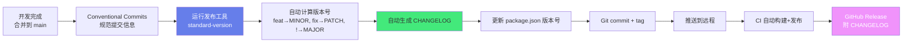

# 📌 语义化版本与 CHANGELOG

> **文档说明**：系统讲解语义化版本（Semantic Versioning, SemVer）与 CHANGELOG 的完整知识体系，涵盖版本管理的核心价值、语义化版本规范（MAJOR.MINOR.PATCH 格式、各部分含义、递增规则）、预发布版本与构建元数据、版本范围与依赖约束（^/~/>=/x）、公共 API 的定义、版本号的实际含义、CHANGELOG 的作用与价值、Keep a Changelog 规范、CHANGELOG 格式与章节划分、Conventional Commits 提交规范与自动生成 CHANGELOG、各语言包管理器版本规范（npm/Maven/Pip/Go Modules/Cargo）、版本发布流程、自动化工具（standard-version/release-please/semantic-release）、常见问题与最佳实践。
>
> **适用人群**：开发者、技术负责人、DevOps 工程师、开源维护者、需要管理版本和发布的所有技术人员
>
> **前置知识**：[[Git基础与核心命令]] · [[Git分支管理与工作流]]

---

## 一、概述

### 1.1 为什么需要语义化版本

在软件依赖管理中，版本号是沟通「这个版本有什么变化」的核心方式。没有规范的版本号会导致：

| 问题 | 没有语义化版本的困境 | 语义化版本的解决方案 |
|------|-------------------|-------------------|
| **依赖升级恐惧** | 不知道升级会不会 break，不敢升级 | 看 MAJOR 号是否变化，MAJOR 不变则兼容 |
| **依赖地狱** | A 依赖 B@1.0，C 依赖 B@2.0，冲突 | 语义化版本明确兼容性，包管理器合理解析 |
| **版本号随意** | 1.0 → 1.1 → 1.2 → 2.0 没有规律 | 严格按规则递增，每个数字有明确含义 |
| **无法自动化** | 无法根据提交自动决定版本号 | Conventional Commits + 工具自动计算版本号 |
| **用户困惑** | 用户不知道该不该升级 | CHANGELOG + 语义化版本让用户清楚变化 |
| **回滚困难** | 不知道哪个版本引入的问题 | 版本号+CHANGELOG 精确定位问题版本 |

> **核心洞察**：语义化版本不是「版本号的格式规范」，而是「依赖兼容性的沟通契约」——它通过简单的三位数字，向依赖方传达「这个版本是否兼容、是否有新功能、是否有修复」，让依赖管理从「猜测」变成「确定」。

### 1.2 什么是语义化版本

语义化版本（Semantic Versioning，简称 SemVer）是由 Grav 创始人 Tom Preston-Werner 提出的版本号规范，核心思想是「版本号及其更新方式传递了底层代码的含义和修改内容」。

**官方规范**：https://semver.org/lang/zh-CN/

**版本号格式**：
```text
MAJOR.MINOR.PATCH
  │     │     │
  │     │     └─ PATCH：向后兼容的 bug 修复
  │     └─────── MINOR：向后兼容的新功能
  └───────────── MAJOR：不兼容的 API 修改（破坏性变更）
```

**示例**：
| 版本号 | MAJOR | MINOR | PATCH | 含义 |
|--------|-------|-------|-------|------|
| 1.0.0 | 1 | 0 | 0 | 第一个稳定版本 |
| 1.0.1 | 1 | 0 | 1 | 修复了 bug，兼容 1.0.0 |
| 1.1.0 | 1 | 1 | 0 | 新增了功能，兼容 1.0.x |
| 2.0.0 | 2 | 0 | 0 | 有不兼容的 API 变更，不兼容 1.x |

### 1.3 版本递增规则

| 变更类型 | 递增部分 | 示例 | 说明 |
|---------|---------|------|------|
| **不兼容的 API 修改** | MAJOR | 1.2.3 → 2.0.0 | 破坏性变更，依赖方需要修改代码 |
| **向后兼容的新功能** | MINOR | 1.2.3 → 1.3.0 | 新增功能，不影响现有功能 |
| **向后兼容的 bug 修复** | PATCH | 1.2.3 → 1.2.4 | 修复 bug，不影响 API |

**递增时的规则**：
1. MAJOR 递增时，MINOR 和 PATCH 归零：`1.3.5 → 2.0.0`
2. MINOR 递增时，PATCH 归零：`1.3.5 → 1.4.0`
3. PATCH 递增只增加 PATCH：`1.3.5 → 1.3.6`
4. 预发布版本（如 1.0.0-alpha）的优先级低于正式版本：`1.0.0-alpha < 1.0.0`

---

## 二、语义化版本详解

### 2.1 公共 API 的定义

语义化版本的核心是「公共 API」——只有公共 API 的变更才影响版本号。

**什么是公共 API**：
| 类型 | 说明 |
|------|------|
| **函数/方法签名** | 公开的函数名、参数、返回值 |
| **类/接口定义** | 公开的类、接口、属性 |
| **配置项** | 配置文件中的键名、环境变量 |
| **CLI 命令** | 命令行参数、子命令、输出格式 |
| **HTTP API** | RESTful 端点、请求/响应格式 |
| **数据库 Schema** | 表结构、字段（如果是公共依赖） |
| **事件/消息格式** | 事件名、消息体结构 |
| **错误码** | 公开的错误码和错误信息格式 |

**什么不是公共 API**：
- 内部实现细节（私有函数、内部类）
- 未文档化的行为
- 性能特征（除非有明确的性能承诺）
- 内部依赖的版本

> **关键原则**：只要公共 API 没有变化，内部重构、性能优化、bug 修复都只递增 PATCH。如果公共 API 有新增但不破坏现有，递增 MINOR。如果公共 API 有删除或不兼容修改，递增 MAJOR。

### 2.2 预发布版本

预发布版本用于在正式发布前测试，版本号格式为 `MAJOR.MINOR.PATCH-<预发布标识>`。

```text
1.0.0-alpha      # Alpha 测试版
1.0.0-beta       # Beta 测试版
1.0.0-rc.1       # 发布候选版 1
1.0.0-rc.2       # 发布候选版 2
1.0.0            # 正式版
```

**预发布版本优先级**：
```text
1.0.0-alpha < 1.0.0-alpha.1 < 1.0.0-alpha.beta < 1.0.0-beta < 1.0.0-beta.2 < 1.0.0-beta.11 < 1.0.0-rc.1 < 1.0.0
```

**预发布标识规则**：
- 由点分隔的标识符组成：`alpha.1`、`beta.2`、`rc.1`
- 标识符只能包含字母数字和连字符：`[0-9A-Za-z-]+`
- 数字标识符不能有前导零：`rc.1` 而非 `rc.01`
- 预发布版本的优先级低于对应的正式版本：`1.0.0-alpha < 1.0.0`

**常见预发布阶段**：
| 阶段 | 标识 | 说明 |
|------|------|------|
| **Alpha** | `alpha` | 内部测试，功能可能不完整，bug 多 |
| **Beta** | `beta` | 公开测试，功能基本完整，可能有 bug |
| **RC** | `rc` | Release Candidate，发布候选，功能冻结，只修 bug |
| **正式** | 无 | 稳定发布版 |

### 2.3 构建元数据

构建元数据用于标识构建信息，格式为 `MAJOR.MINOR.PATCH+<构建元数据>`。

```text
1.0.0+20240101          # 构建日期
1.0.0+sha.abc123        # Git commit hash
1.0.0+build.123         # CI 构建号
1.0.0-beta+exp.sha.5114f85  # 预发布+构建元数据
```

**构建元数据规则**：
- 由点分隔的标识符组成
- 标识符只能包含字母数字和连字符
- **构建元数据不参与版本优先级比较**：`1.0.0+abc` 和 `1.0.0+def` 被视为相同版本
- 构建元数据通常用于 CI/CD 中标识具体构建

### 2.4 版本范围与依赖约束

包管理器使用版本范围表达式来约束依赖版本。

| 表达式 | 含义 | 示例匹配 |
|--------|------|---------|
| `1.2.3` | 精确版本 | 1.2.3 |
| `^1.2.3` | 兼容 1.x.x（不改变最左非零数字） | 1.2.3 ~ 1.9.9 |
| `~1.2.3` | 兼容 1.2.x（约等于） | 1.2.3 ~ 1.2.9 |
| `>=1.2.3` | 大于等于 | 1.2.3 及以上 |
| `>1.2.3` | 大于 | 1.2.4 及以上 |
| `<=1.2.3` | 小于等于 | 1.2.3 及以下 |
| `<1.2.3` | 小于 | 1.2.2 及以下 |
| `1.2.x` | 通配符 | 1.2.0 ~ 1.2.9 |
| `1.x` | 通配符 | 1.0.0 ~ 1.9.9 |
| `*` | 任意版本 | 所有版本 |
| `1.2.3 - 2.0.0` | 范围 | 1.2.3 ~ 2.0.0 |
| `>=1.2.3 <2.0.0` | 组合范围 | 1.2.3 ~ 1.9.9 |

**^ 和 ~ 的区别（最常用）**：
| 表达式 | 规则 | 示例 | 范围 |
|--------|------|------|------|
| `^1.2.3` | 最左非零数字不变 | ^1.2.3 | >=1.2.3 <2.0.0 |
| `^0.2.3` | 最左非零数字不变 | ^0.2.3 | >=0.2.3 <0.3.0 |
| `^0.0.3` | 最左非零数字不变 | ^0.0.3 | >=0.0.3 <0.0.4 |
| `~1.2.3` | 最后一位可变 | ~1.2.3 | >=1.2.3 <1.3.0 |
| `~1.2` | 最后一位可变 | ~1.2 | >=1.2.0 <1.3.0 |
| `~1` | 最后一位可变 | ~1 | >=1.0.0 <2.0.0 |

> **记忆口诀**：`^` 是「兼容更新」（大版本不变），`~` 是「保守更新」（次版本也不变，只更新补丁）。生产环境建议用 `~` 或精确版本，开发环境可以用 `^`。

### 2.5 0.x.x 版本的特殊规则

初始开发阶段（0.x.x）的版本号有特殊规则：
- **0.1.0**：第一个可用版本
- **0.x.x**：公共 API 不稳定，随时可能变更
- **0.MINOR.PATCH**：MINOR 递增可能包含不兼容变更（因为 API 还不稳定）
- **1.0.0**：公共 API 稳定，正式进入语义化版本规则

**何时发布 1.0.0**：
- 公共 API 已经稳定
- 有用户在生产环境使用
- 承诺向后兼容性
- 有完整的文档和 CHANGELOG

> **常见误区**：很多项目长期停留在 0.x.x，即使 API 已经稳定且有大量用户。只要 API 稳定且有生产用户，就应该发布 1.0.0，给用户一个「稳定」的信号。

---

## 三、CHANGELOG 规范

### 3.1 什么是 CHANGELOG

CHANGELOG（变更日志）是一个记录项目每个版本变更的文件，通常命名为 `CHANGELOG.md`，放在项目根目录。

**CHANGELOG 的价值**：
| 价值 | 说明 |
|------|------|
| **用户了解变化** | 用户升级前查看 CHANGELOG，知道有什么新功能、修复、破坏性变更 |
| **版本发布记录** | 每个版本的变更有明确记录，可追溯 |
| **问题定位** | 出问题时查看 CHANGELOG，快速定位是哪个版本引入的 |
| **升级决策** | 根据 CHANGELOG 决定是否升级、何时升级 |
| **项目健康度** | 规范的 CHANGELOG 反映项目的成熟度和维护质量 |

### 3.2 Keep a Changelog 规范

Keep a Changelog（https://keepachangelog.com/）是最流行的 CHANGELOG 编写规范。

**核心原则**：
1. CHANGELOG 是给人看的，不是给机器看的
2. 每个版本都应该有条目
3. 相同类型的变更应该分组
4. 最新版本在最上面
5. 标注发布日期
6. 链接到版本对比（可选）

**CHANGELOG 格式**：
```markdown
# Changelog

所有 notable changes 都会记录在这个文件中。

格式基于 [Keep a Changelog](https://keepachangelog.com/zh-CN/1.1.0/)，
本项目遵循 [语义化版本](https://semver.org/lang/zh-CN/)。

## [Unreleased]

### Added
- 新功能描述

### Changed
- 变更描述

### Deprecated
- 即将废弃的功能

### Removed
- 已移除的功能

### Fixed
- bug 修复

### Security
- 安全修复

## [2.0.0] - 2024-01-15

### Added
- 新增用户权限管理功能
- 支持暗黑模式

### Changed
- 升级 React 到 18.0
- 重构 API 响应格式

### Removed
- 移除已废弃的旧版 API

### Fixed
- 修复登录页面在移动端显示异常的问题

### Security
- 修复 XSS 安全漏洞

## [1.1.0] - 2023-12-01

### Added
- 新增数据导出功能

### Fixed
- 修复分页计算错误

## [1.0.0] - 2023-10-01

### Added
- 第一个稳定版本
- 核心功能全部完成

[Unreleased]: https://github.com/org/repo/compare/v2.0.0...HEAD
[2.0.0]: https://github.com/org/repo/compare/v1.1.0...v2.0.0
[1.1.0]: https://github.com/org/repo/compare/v1.0.0...v1.1.0
[1.0.0]: https://github.com/org/repo/releases/tag/v1.0.0
```

### 3.3 CHANGELOG 章节类型

| 类型 | 说明 | 对应版本递增 |
|------|------|------------|
| **Added** | 新增功能 | MINOR |
| **Changed** | 现有功能变更 | MINOR 或 MAJOR |
| **Deprecated** | 即将废弃的功能（仍可用） | MINOR |
| **Removed** | 已移除的功能 | MAJOR |
| **Fixed** | bug 修复 | PATCH |
| **Security** | 安全修复 | PATCH（紧急时也可能 MAJOR） |

**编写原则**：
- ✅ 用用户能理解的语言描述，不要用 commit message
- ✅ 每条变更清晰具体，说明「什么变了」「对用户有什么影响」
- ✅ 破坏性变更要突出标注（如 `**BREAKING CHANGE**`）
- ✅ 按重要性排序（重要的放前面）
- ❌ 不要写「bug 修复」「优化」这种模糊描述
- ❌ 不要直接复制 git log
- ❌ 不要包含内部实现细节（用户不关心）

### 3.4 好的 vs 坏的 CHANGELOG

**坏的 CHANGELOG**：
```markdown
## [1.2.0]
- 修复了一些 bug
- 优化了性能
- 更新了依赖
- 代码重构
```

**好的 CHANGELOG**：
```markdown
## [1.2.0] - 2024-01-15

### Added
- 新增批量删除功能，支持一次删除最多 100 条记录
- 新增导出 CSV 功能，可导出当前筛选结果

### Changed
- 优化列表页加载速度，从 3s 降低到 500ms
- 升级 Vue 到 3.4，提升响应式性能

### Fixed
- 修复 Safari 浏览器下日期选择器无法弹出的问题
- 修复搜索关键词包含特殊字符时报错的问题
- 修复分页跳转到第 10 页后返回第 1 页数据不刷新的问题
```

---

## 四、Conventional Commits 与自动化

### 4.1 Conventional Commits 规范

Conventional Commits（https://www.conventionalcommits.org/）是一种提交信息规范，让提交信息有固定格式，可以被工具解析，自动生成 CHANGELOG 和计算版本号。

**提交信息格式**：
```json
<type>[optional scope]: <description>

[optional body]

[optional footer(s)]
```

**Type 类型**：
| Type | 说明 | 对应 CHANGELOG | 版本递增 |
|------|------|--------------|---------|
| `feat` | 新功能 | Added | MINOR |
| `fix` | bug 修复 | Fixed | PATCH |
| `docs` | 文档变更 | - | 不递增 |
| `style` | 代码格式（不影响功能） | - | 不递增 |
| `refactor` | 重构（既不新增功能也不修 bug） | Changed（可选） | 不递增 |
| `perf` | 性能优化 | Changed | PATCH |
| `test` | 测试相关 | - | 不递增 |
| `build` | 构建系统/依赖变更 | - | 不递增 |
| `ci` | CI 配置变更 | - | 不递增 |
| `chore` | 杂项（不修改源码或测试） | - | 不递增 |
| `revert` | 回滚提交 | - | 不递增 |

**示例**：
```text
feat: 新增用户登录功能

feat(auth): 新增微信登录支持
fix: 修复登录页面验证码不刷新的问题
fix(api)!: 修改用户接口返回格式（破坏性变更）
docs: 更新 README 安装说明
refactor: 重构用户服务，拆分大函数
perf: 优化列表查询性能，减少 50% 响应时间
```

**破坏性变更（BREAKING CHANGE）**：
- 在 type 后加 `!`：`feat!: 修改 API 格式`
- 或在 footer 中加 `BREAKING CHANGE:`：
  ```text
  feat: 修改用户接口

  BREAKING CHANGE: 用户接口返回格式从 {data: {}} 改为 {result: {}}
  ```
- 破坏性变更对应 MAJOR 版本递增

### 4.2 自动化工具

| 工具 | 说明 | 语言/生态 |
|------|------|----------|
| **standard-version** | 自动生成 CHANGELOG + 版本号 + Git tag | Node.js/通用 |
| **semantic-release** | 全自动发布（版本+CHANGELOG+npm publish+GitHub Release） | Node.js/通用 |
| **release-please** | Google 出品，自动生成 Release PR | 多语言 |
| **commitlint** | 检查提交信息是否符合 Conventional Commits | Node.js/通用 |
| **husky** | Git hooks 工具，配合 commitlint 提交时检查 | Node.js/通用 |
| **changesets** | Monorepo 版本管理工具（Atlassian 出品） | Node.js/Monorepo |
| **git-cliff** | 基于 Git 历史生成 CHANGELOG | Rust/通用 |

**standard-version 使用示例**：
```bash
# 安装
npm install --save-dev standard-version

# 首次发布（生成 CHANGELOG，版本 1.0.0）
npx standard-version --first-release

# 正常发布（自动根据 commit 计算版本号，生成 CHANGELOG，打 tag）
npx standard-version

# 预发布
npx standard-version --prerelease alpha

# 指定版本
npx standard-version --release-as 2.0.0
```

**package.json 配置**：
```json
{
  "scripts": {
    "release": "standard-version"
  },
  "standard-version": {
    "types": [
      { "type": "feat", "section": "✨ Features" },
      { "type": "fix", "section": "🐛 Bug Fixes" },
      { "type": "perf", "section": "⚡ Performance" },
      { "type": "revert", "section": "⏪ Reverts" },
      { "type": "docs", "hidden": true },
      { "type": "style", "hidden": true },
      { "type": "refactor", "hidden": true },
      { "type": "test", "hidden": true },
      { "type": "build", "hidden": true },
      { "type": "ci", "hidden": true },
      { "type": "chore", "hidden": true }
    ]
  }
}
```

### 4.3 完整发布流程



---

## 五、各语言包管理器版本规范

### 5.1 对比总表

| 包管理器 | 语言 | 版本文件 | 版本范围语法 | lock 文件 |
|---------|------|---------|------------|----------|
| **npm** | JavaScript/Node.js | package.json | `^`, `~`, `>=`, `x` | package-lock.json |
| **yarn** | JavaScript/Node.js | package.json | 同 npm | yarn.lock |
| **pnpm** | JavaScript/Node.js | package.json | 同 npm | pnpm-lock.yaml |
| **Maven** | Java/Kotlin | pom.xml | `[1.0,2.0)`, `1.0+` | 无（dependencyManagement） |
| **Gradle** | Java/Kotlin | build.gradle | `[1.0,2.0)`, `1.+` | gradle.lockfile |
| **pip** | Python | requirements.txt | `>=`, `==`, `~=` | requirements.lock / Pipfile.lock |
| **Poetry** | Python | pyproject.toml | `^`, `~`, `>=` | poetry.lock |
| **Go Modules** | Go | go.mod | `v1.2.3`, `>=v1.0` | go.sum |
| **Cargo** | Rust | Cargo.toml | `^`, `~`, `>=`, `*` | Cargo.lock |
| **NuGet** | C#/.NET | .csproj | `[1.0,2.0)`, `1.0.*` | packages.lock.json |
| **Composer** | PHP | composer.json | `^`, `~`, `>=` | composer.lock |
| **RubyGems** | Ruby | Gemfile | `~>`, `>=` | Gemfile.lock |

### 5.2 各语言特点

**npm（Node.js）**：
- 版本范围默认用 `^`（兼容更新）
- `package-lock.json` 锁定精确版本
- `npm outdated` 检查过时依赖
- `npm audit` 检查安全漏洞

**Maven（Java）**：
- 版本范围用区间表示：`[1.0,2.0)`（>=1.0, <2.0）
- `1.0+` 表示 >=1.0
- 推荐用精确版本或 `${project.version}` 变量
- `dependencyManagement` 统一管理版本

**pip（Python）**：
- `~=1.2.3` 等价于 `>=1.2.3, <1.3.0`（类似 ~）
- `pip freeze > requirements.txt` 导出精确版本
- 推荐用 Poetry/Pipenv 管理依赖和 lock 文件

**Go Modules**：
- 版本必须以 `v` 开头：`v1.2.3`
- `v2+` 版本需要在模块路径后加 `/v2`：`module github.com/org/repo/v2`
- `go.sum` 记录校验和
- `go mod tidy` 整理依赖

**Cargo（Rust）**：
- 默认版本约束是 `^`（如 `1.2.3` 等价于 `^1.2.3`）
- `Cargo.lock` 锁定精确版本
- `cargo update` 更新依赖
- `cargo audit` 检查安全漏洞

---

## 六、常见问题与最佳实践

### 6.1 常见问题

| 问题 | 解答 |
|------|------|
| **修复 bug 但改了 API 算什么？** | 只要公共 API 有不兼容变更，就是 MAJOR，不管是不是 bug 修复 |
| **文档变更需要递增版本吗？** | 纯文档变更不影响公共 API，不需要递增版本（但可以发版更新文档） |
| **重构代码需要递增版本吗？** | 纯重构（公共 API 不变）只递增 PATCH（如果有行为变化）或不发版 |
| **0.x.x 怎么递增？** | 0.x.x 阶段 MINOR 递增可以包含不兼容变更（API 不稳定），PATCH 是兼容修复 |
| **预发布版本怎么递增？** | 预发布版本（1.0.0-alpha）可以递增预发布标识（1.0.0-alpha.1），正式发布时去掉标识 |
| **CHANGELOG 可以自动生成吗？** | 可以，用 Conventional Commits + standard-version/semantic-release 自动生成 |
| **所有 commit 都要进 CHANGELOG 吗？** | 不是，只有用户可感知的变更（feat/fix/perf/security）进 CHANGELOG，内部变更不进 |
| **版本号可以用 4 位吗？** | 语义化版本是 3 位，第 4 位可以用构建元数据（+build.123），但不参与版本比较 |
| **依赖升级算什么版本？** | 升级依赖如果不影响公共 API，是 PATCH；如果依赖的升级导致公共 API 变化，按变化类型定 |
| **紧急修复怎么发版？** | 从对应版本分支创建 hotfix 分支，修复后递增 PATCH 发布 |
| **MAJOR 版本必须完全重写吗？** | 不是，只要有不兼容的 API 变更就递增 MAJOR，哪怕只改了一个函数签名 |
| **怎么标记废弃功能？** | 在 CHANGELOG 的 Deprecated 章节标注，并在代码中加 `@deprecated`，下一个 MAJOR 移除 |
| **版本号和 Git tag 什么关系？** | 通常 Git tag 与版本号一致（如 `v1.2.3`），tag 标记发布点 |

### 6.2 最佳实践

1. **从 0.1.0 开始**：
   - 第一个可用版本发布 0.1.0
   - API 稳定且有生产用户后发布 1.0.0

2. **严格遵循递增规则**：
   - 破坏性变更 → MAJOR
   - 新功能（兼容）→ MINOR
   - bug 修复（兼容）→ PATCH
   - 不要因为「功能多」就跳版本号

3. **使用 Conventional Commits**：
   - 所有团队成员遵循提交规范
   - 用 commitlint + husky 在提交时检查
   - 自动生成 CHANGELOG 和版本号

4. **维护高质量 CHANGELOG**：
   - 遵循 Keep a Changelog 规范
   - 每个版本有明确的日期
   - 用用户能理解的语言描述变更
   - 破坏性变更突出标注
   - 链接到版本对比和 Issue/PR

5. **使用 lock 文件**：
   - 提交 lock 文件到版本控制（package-lock.json/yarn.lock/poetry.lock 等）
   - 确保所有环境使用相同版本
   - 定期更新依赖（`npm outdated`/`cargo update`）

6. **合理的版本范围**：
   - 应用项目：用 `~` 或精确版本（保守，避免意外 break）
   - 库项目：用 `^`（允许兼容更新）
   - 生产环境：锁定精确版本（lock 文件）

7. **发布流程标准化**：
   - 用自动化工具（standard-version/semantic-release）
   - 发布前运行完整测试
   - 打 Git tag 与版本号一致
   - GitHub Release 附 CHANGELOG
   - 预发布版本用于测试

8. **破坏性变更管理**：
   - 提前废弃（Deprecated），给用户迁移时间
   - 提供迁移指南
   - 一个 MAJOR 版本中不要有太多破坏性变更
   - 维护旧版本的 LTS（长期支持）版本

9. **语义化版本的例外**：
   - 0.x.x 阶段：API 不稳定，规则灵活
   - 预发布版本：可以频繁变更
   - 内部项目：可以简化，但建议遵循规范

10. **文档化版本策略**：
    - 在 README 中说明遵循语义化版本
    - 说明版本支持策略（如「支持最新 2 个 MAJOR 版本」）
    - 说明安全更新策略

---

## 七、关联笔记

```text
### Git 与研发规范
```
- [[Git基础与核心命令]] · [[Git分支管理与工作流]] · [[Git-冲突解决与变基]]
- [[代码评审最佳实践]] · [[CI-CD流水线]] · [[敏捷开发与Scrum]]

### 项目管理
- [[开源项目维护指南]] · [[技术文档写作规范]] · [[API版本管理策略]]

### 导航
- [[MOC-通用工具]] · [[MOC-云原生与运维]] · [[MOC-综合导航]] · [[Home]]

> 🔍 **知识点深度解析**
>
> **作用**：语义化版本与 CHANGELOG 解决的是「软件依赖管理中版本信息的沟通问题」——在没有规范的时代，版本号是随意的（1.0→1.1→2.0 没有规律），用户不知道升级会不会 break，依赖管理器无法合理解析版本冲突，开发者无法自动化发布。语义化版本用三位数字（MAJOR.MINOR.PATCH）明确传达「兼容性、新功能、修复」，让版本号从「随意的标签」变成「有意义的契约」；CHANGELOG 则是这个契约的详细说明书，记录每个版本的具体变更。两者结合，让依赖管理从「猜测和恐惧」变成「确定和信任」。
>
> **底层原理**：语义化版本的核心是「兼容性的数学表达」——版本号的每一位对应一种兼容性级别：MAJOR 变化意味着公共 API 有不兼容变更（依赖方必须修改代码才能升级），MINOR 变化意味着有向后兼容的新功能（依赖方可以选择使用新功能，但不升级也不影响现有功能），PATCH 变化意味着有向后兼容的 bug 修复（依赖方应该尽快升级，因为修复了问题）。这种分级让依赖管理器可以用简单的规则解析版本范围（如 `^1.2.3` 表示 >=1.2.3 <2.0.0，因为 MAJOR 不变就保证兼容）。CHANGELOG 的原理是「用户视角的变更记录」——与 git log（开发者视角，记录每次提交）不同，CHANGELOG 按版本聚合，用用户能理解的语言描述变更，按类型分组（Added/Changed/Fixed 等），让用户快速了解「这个版本对我有什么影响」。Conventional Commits 的原理是「结构化提交信息→自动化版本和 CHANGELOG」——提交信息的 type（feat/fix 等）直接对应版本递增规则（feat→MINOR, fix→PATCH, !→MAJOR）和 CHANGELOG 章节，工具可以自动解析提交历史，计算版本号，生成 CHANGELOG，实现发布全自动化。
>
> **用法要点**：① 语义化版本格式：MAJOR.MINOR.PATCH，MAJOR=不兼容API变更，MINOR=兼容新功能，PATCH=兼容bug修复；递增时高位递增低位归零（1.3.5→2.0.0） ② 预发布版本：`1.0.0-alpha`/`beta`/`rc.1`，优先级低于正式版，用于测试 ③ 构建元数据：`1.0.0+sha.abc123`，不参与版本比较，用于 CI 构建标识 ④ 版本范围：`^1.2.3`（兼容，>=1.2.3<2.0.0）、`~1.2.3`（保守，>=1.2.3<1.3.0）、`>=1.2.3<2.0.0`（范围）、`1.2.x`（通配）；生产用 `~` 或精确，库用 `^` ⑤ 公共 API：只有公共 API 变更影响版本号，内部重构/性能优化只 PATCH 或不发版 ⑥ 0.x.x 特殊：API 不稳定，MINOR 可包含不兼容变更，稳定后发 1.0.0 ⑦ CHANGELOG：Keep a Changelog 规范，章节类型 Added/Changed/Deprecated/Removed/Fixed/Security，最新版本在最上，标注日期，用户语言描述，链接版本对比 ⑧ Conventional Commits：格式 `<type>(scope): <description>`，type=feat/fix/docs/style/refactor/perf/test/build/ci/chore/revert，破坏性变更加 `!` 或 footer `BREAKING CHANGE:` ⑨ 自动化工具：standard-version（自动版本+CHANGELOG+tag）、semantic-release（全自动发布）、commitlint+husky（提交检查）、release-please（Release PR） ⑩ 发布流程：Conventional Commits→运行工具→自动计算版本→生成CHANGELOG→更新版本文件→git commit+tag→推送→CI构建发布→GitHub Release ⑪ 各语言包管理器：npm(package.json+package-lock.json)、Maven(pom.xml)、pip(requirements.txt)、Poetry(pyproject.toml+poetry.lock)、Go(go.mod+go.sum)、Cargo(Cargo.toml+Cargo.lock) ⑫ 最佳实践：从0.1.0开始、严格递增规则、Conventional Commits、高质量CHANGELOG、lock文件提交、合理版本范围、标准化发布流程、破坏性变更提前废弃+迁移指南、文档化版本策略。

> 💡 **深度讲解**：语义化版本最核心的智慧是「用简单的数字表达复杂的兼容性契约」。在没有语义化版本的时代，版本号是随意的——有的项目用日期（2024.01.15），有的用递增数字（v1, v2, v3），有的用内部构建号。用户看到版本号完全不知道「升级会不会 break」「有没有新功能」「修了什么 bug」，只能靠读文档或者试错。语义化版本用三位数字就解决了这个问题：第一位说「兼容不兼容」，第二位说「有没有新功能」，第三位说「有没有修 bug」。这就像交通信号灯——红灯（MAJOR 变化）停，绿灯（MINOR/PATCH 变化）行，简单明了，不需要思考。这种「用简单规则降低沟通成本」的设计，是工程规范的经典智慧。「CHANGELOG 是给人看的，不是给机器看的」——很多人以为 CHANGELOG 就是 git log 的复制粘贴，但实际上两者有本质区别：git log 是开发者视角，记录每次提交（可能一次提交只改了一行代码，信息是「fix typo」），按时间倒序，对用户没有意义；CHANGELOG 是用户视角，按版本聚合，用用户能理解的语言描述「这个版本对我有什么影响」，按类型分组（新功能/修复/破坏性变更），让用户快速决策「要不要升级」。好的 CHANGELOG 应该像产品更新公告——「新增了批量删除功能」「修复了 Safari 下日期选择器的问题」，而不是「fix: 修复了一个 bug」。理解了这个区别，你就能写出真正有价值的 CHANGELOG。「Conventional Commits + 自动化工具是版本管理的终极形态」——手动维护版本号和 CHANGELOG 容易出错且繁琐，Conventional Commits 让提交信息结构化，工具可以自动解析：feat 提交→MINOR 递增→Added 章节，fix 提交→PATCH 递增→Fixed 章节，! 标记→MAJOR 递增→破坏性变更高亮。整个发布流程从「手动改版本号+手写 CHANGELOG+打 tag」变成「运行一条命令」，大大降低了发布成本，也减少了人为错误。这就是「规范+自动化」的力量——先建立规范让信息结构化，再用工具自动化处理结构化信息，把人从繁琐的重复劳动中解放出来。

> 📝 **精简总结**：语义化版本 = MAJOR.MINOR.PATCH，MAJOR=不兼容API变更，MINOR=兼容新功能，PATCH=兼容bug修复。预发布：1.0.0-alpha/beta/rc.1；构建元数据：1.0.0+sha.abc。版本范围：^1.2.3（兼容<2.0）、~1.2.3（保守<1.3）、>=1.2.3<2.0.0。0.x.x API不稳定，稳定后发1.0.0。CHANGELOG：Keep a Changelog规范，Added/Changed/Deprecated/Removed/Fixed/Security，用户语言，最新在上，标注日期。Conventional Commits：feat/fix/docs/refactor/perf等，!或BREAKING CHANGE=破坏性。自动化：standard-version/semantic-release/commitlint+husky。各语言：npm(package.json+lock)、Maven(pom.xml)、pip/Poetry、Go(go.mod)、Cargo(Cargo.toml)。最佳实践：严格递增、Conventional Commits、高质量CHANGELOG、lock文件、合理版本范围、标准化发布、破坏性变更提前废弃。

> **学习路径建议**：先学习 [[Git基础与核心命令]] 掌握版本控制基础 → 学习 [[Git分支管理与工作流]] 理解分支和发布流程 → 学习本文档掌握语义化版本和 CHANGELOG → 实践：为自己的项目配置 Conventional Commits + commitlint + husky → 实践：用 standard-version 自动生成版本和 CHANGELOG → 学习 [[CI-CD流水线]] 实现自动化发布 → 学习 [[开源项目维护指南]] 理解开源版本管理 → 阅读 SemVer 官方规范和 Keep a Changelog 官方文档深入理解。

---

> **语义化版本与 CHANGELOG 的本质是「软件发布的沟通艺术」——版本号是简洁的信号（三位数字告诉你兼容性），CHANGELOG 是详细的说明（每个版本的具体变更）。在没有规范的时代，软件发布是「黑盒」——用户拿到一个新版本，不知道里面有什么，不知道升级会不会出问题，只能靠试错。语义化版本和 CHANGELOG 把发布变成了「白盒」——用户看版本号就知道兼容性，看 CHANGELOG 就知道具体变化，可以做出明智的升级决策。这不仅仅是技术规范，更是对用户的尊重——尊重用户的时间（不用读源码就知道变化）、尊重用户的系统（明确告知破坏性变更）、尊重用户的决策（提供足够信息让用户自己决定）。当你的项目遵循语义化版本和高质量 CHANGELOG，用户会信任你的发布，愿意及时升级，你的项目也会从「随意的个人作品」变成「专业的工程产品」。这就是规范的力量——它不仅仅是约束，更是信任的基石。**
