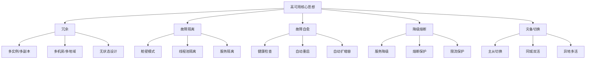
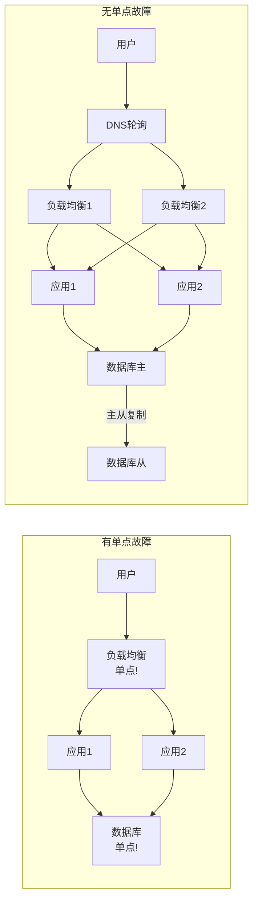
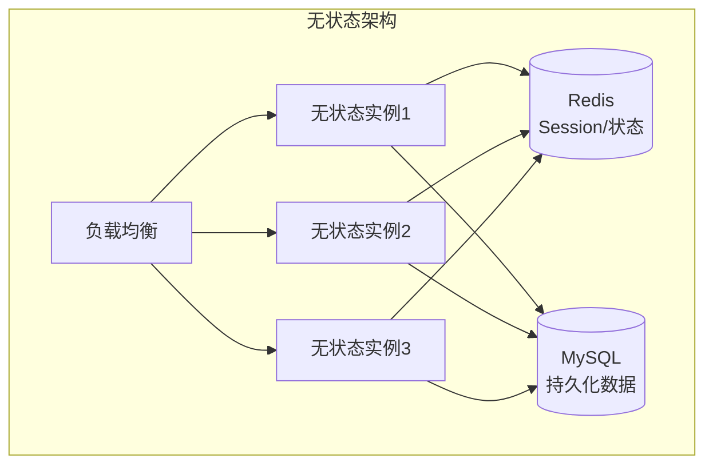
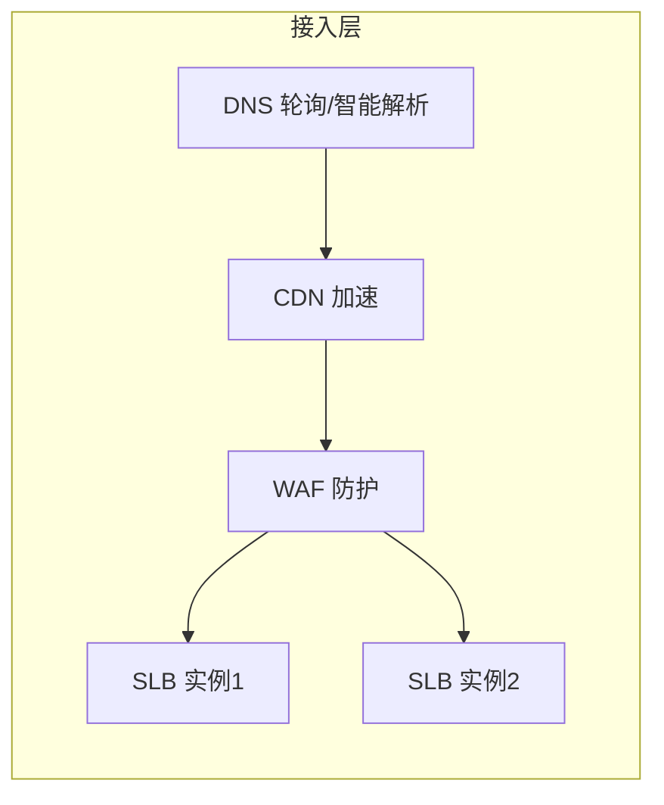
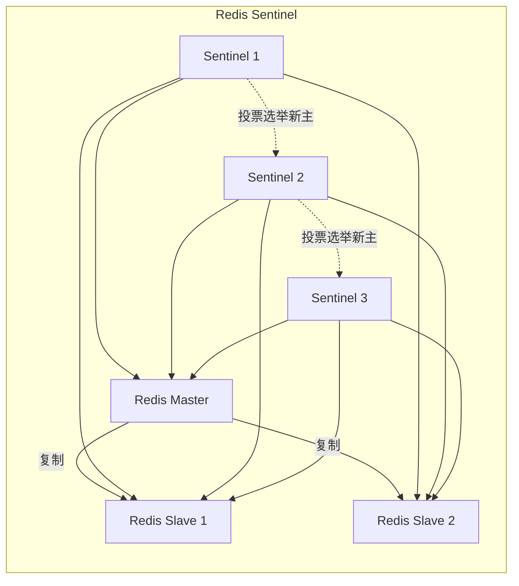
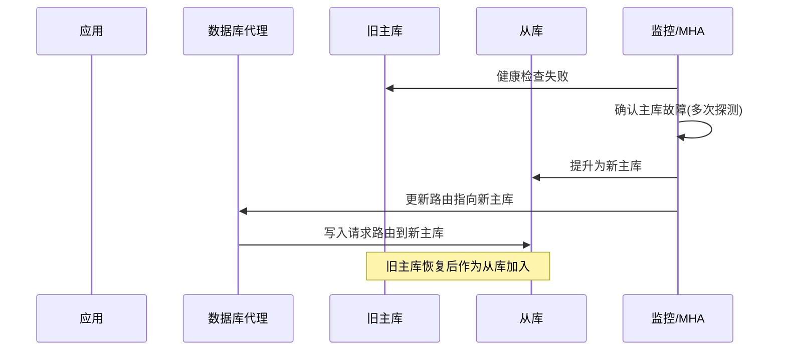
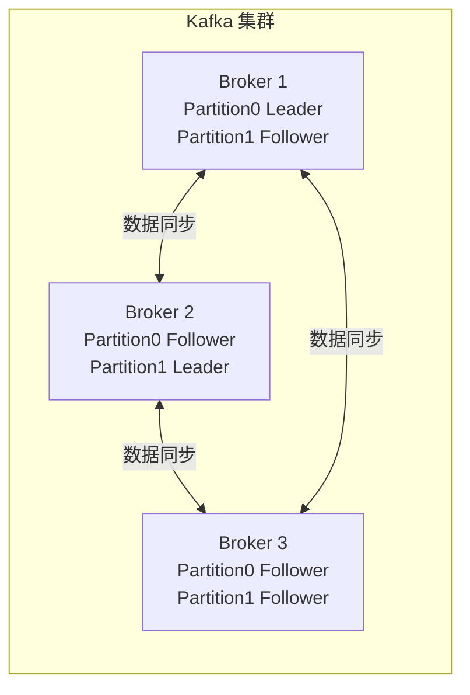
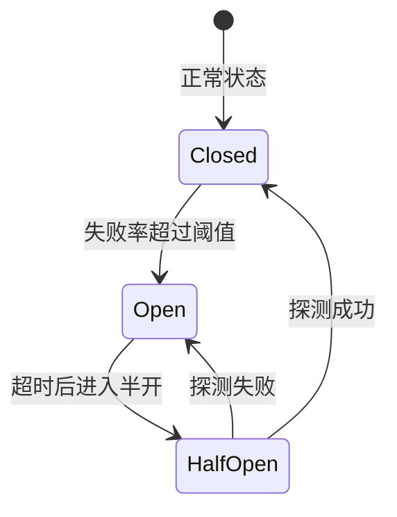
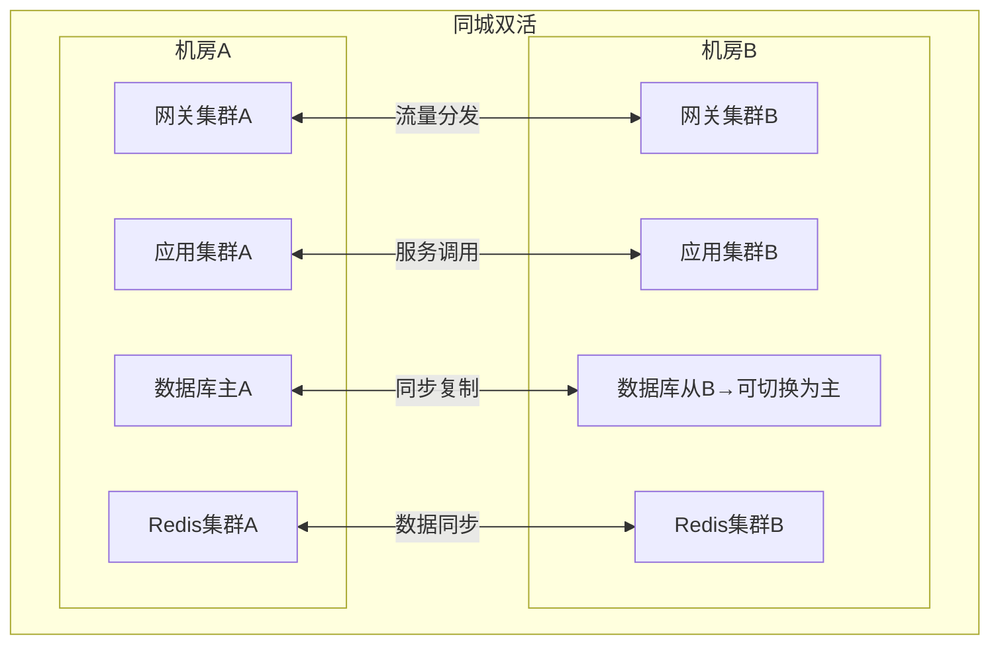
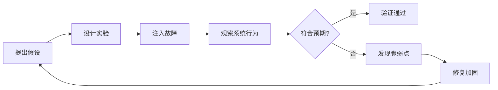

# 高可用架构设计

> **文档说明**：系统讲解高可用架构的核心概念、设计原则、分层高可用方案、故障自愈、容灾备份、SLA/SLO/SLI 体系，以及从单机到多活的完整演进路径。
>
> **适用人群**：架构师、后端开发工程师、SRE/运维工程师、需要设计高可用系统的全栈工程师
>
> **前置知识**：[[高并发系统设计案例]]、[[微服务架构核心概念]]、[[K8s-核心概念与架构]]

---

## 一、概述

**高可用（High Availability, HA）** 是指系统在面对各种故障（硬件故障、软件 Bug、网络中断、机房断电等）时，仍能持续提供服务的能力。高可用是分布式系统设计的核心目标之一，通常用"几个九"来衡量。

### 1. 可用性等级

| 可用性等级 | 年停机时间 | 日停机时间 | 典型场景 |
|-----------|-----------|-----------|---------|
| 99%（两个九） | 3.65 天 | 14.4 分钟 | 内部工具、非核心系统 |
| 99.9%（三个九） | 8.76 小时 | 1.44 分钟 | 一般互联网产品 |
| 99.95% | 4.38 小时 | 43.2 秒 | 中大型互联网产品 |
| 99.99%（四个九） | 52.6 分钟 | 8.64 秒 | 核心交易系统、支付 |
| 99.999%（五个九） | 5.26 分钟 | 0.86 秒 | 电信级、金融核心 |
| 99.9999%（六个九） | 31.5 秒 | 0.086 秒 | 极限高可用（极难达到） |

**可用性计算公式**：
```text
可用性 = 正常运行时间 / (正常运行时间 + 停机时间) × 100%
MTBF（平均无故障时间）= 总运行时间 / 故障次数
MTTR（平均恢复时间）= 总停机时间 / 故障次数
可用性 = MTBF / (MTBF + MTTR)
```

### 2. 高可用的核心思想



### 3. 故障分类

| 故障类型 | 概率 | 影响范围 | 应对策略 |
|---------|------|---------|---------|
| **进程崩溃** | 高 | 单实例 | 自动重启、多实例 |
| **主机故障** | 中 | 单台服务器 | 多机部署、自动迁移 |
| **网络分区** | 中 | 部分节点 | 服务发现、重试、降级 |
| **机房断电** | 低 | 整个机房 | 多机房部署、异地灾备 |
| **软件 Bug** | 高 | 特定功能 | 灰度发布、快速回滚 |
| **依赖故障** | 高 | 依赖该服务的功能 | 熔断、降级、缓存兜底 |
| **数据库故障** | 中 | 数据相关功能 | 主从切换、读写分离、分库分表 |
| **DDoS 攻击** | 低 | 全站 | WAF、流量清洗、CDN |
| **人为误操作** | 中 | 不定 | 权限控制、操作审计、灰度 |

---

## 二、高可用设计原则

### 1. 七大设计原则

| 原则 | 说明 | 实践 |
|------|------|------|
| **冗余原则** | 任何单点都可能故障，必须有备份 | 多实例、多副本、多机房 |
| **无状态原则** | 服务不存储状态，便于水平扩展和故障转移 | 状态存外部存储（Redis/DB），Session 集中管理 |
| **故障隔离原则** | 一个故障不应该扩散到整个系统 | 舱壁模式、线程池隔离、服务隔离 |
| **快速失败原则** | 故障时快速返回错误，而不是长时间等待 | 超时控制、快速失败、熔断 |
| **自愈原则** | 系统能自动检测和恢复故障 | 健康检查、自动重启、自动扩缩容 |
| **降级原则** | 核心功能优先，非核心功能可降级 | 服务降级、功能开关、兜底数据 |
| **可观测原则** | 能快速发现和定位故障 | 监控、告警、日志、链路追踪 |

### 2. 避免单点故障（SPOF）

**单点故障（Single Point of Failure, SPOF）** 是指系统中某个组件一旦故障就会导致整个系统不可用的部分。



**常见单点及解决方案**：

| 单点 | 解决方案 |
|------|---------|
| 负载均衡 | 多 LB 实例 + DNS 轮询 / VIP 漂移 |
| 应用服务 | 多实例部署 + 健康检查 + 自动重启 |
| 数据库 | 主从复制 + 自动故障切换（MHA/Orchestrator） |
| 缓存 | Redis Sentinel / Cluster 模式 |
| 消息队列 | 多副本 + 集群模式（Kafka/RabbitMQ 镜像队列） |
| 注册中心 | 集群部署（Nacos/Eureka/Consul 集群） |
| 配置中心 | 集群部署 + 本地缓存兜底 |
| 存储 | 多副本（RAID/分布式存储/对象存储多副本） |

### 3. 无状态设计

**无状态服务**是指服务实例不存储任何业务状态，所有状态都存储在外部系统（数据库、缓存、消息队列等）中。



**无状态的优势**：
- 任意请求可路由到任意实例
- 实例故障时可无缝切换
- 可随时水平扩展
- 发布/重启不影响用户

**有状态转无状态的方法**：
- Session → 存入 Redis / JWT Token
- 本地缓存 → 分布式缓存（Redis）
- 本地文件 → 对象存储（OSS/S3）
- 本地队列 → 消息队列（Kafka/RabbitMQ）
- 定时任务 → 分布式调度（XXL-Job/ElasticJob）

---

## 三、分层高可用方案

### 1. 接入层高可用



| 组件 | 高可用方案 |
|------|-----------|
| DNS | 多 A 记录轮询、智能 DNS（按地域/运营商解析）、DNS 故障转移 |
| CDN | 多 CDN 厂商调度、边缘节点冗余、源站高可用 |
| WAF | 集群部署、旁路模式、故障时直通 |
| 负载均衡 | 多实例 + VIP 漂移（Keepalived）、云厂商托管 LB（多可用区） |

### 2. 应用层高可用

| 方案 | 说明 |
|------|------|
| **多实例部署** | 至少 2 个实例，分布在不同物理机/可用区 |
| **健康检查** | LB 定期探测，异常实例自动摘除 |
| **优雅上下线** | 上线时预热，下线时等待请求处理完成 |
| **自动重启** | 进程崩溃后自动重启（K8s restartPolicy / Supervisor） |
| **自动扩缩容** | 根据负载自动增减实例（HPA / 弹性伸缩） |
| **滚动发布** | 逐批替换实例，不中断服务 |
| **蓝绿部署** | 两套环境，切换流量，快速回滚 |
| **金丝雀发布** | 小流量验证，逐步扩大 |

**健康检查配置**：
```yaml
# Kubernetes 健康检查
apiVersion: v1
kind: Pod
spec:
  containers:
  - name: app
    image: myapp:latest
    # 启动探针：等待应用启动完成
    startupProbe:
      httpGet:
        path: /health/startup
        port: 8080
      failureThreshold: 30
      periodSeconds: 10
    # 存活探针：检测进程是否存活
    livenessProbe:
      httpGet:
        path: /health/live
        port: 8080
      initialDelaySeconds: 30
      periodSeconds: 10
      failureThreshold: 3
    # 就绪探针：检测是否可接收流量
    readinessProbe:
      httpGet:
        path: /health/ready
        port: 8080
      initialDelaySeconds: 5
      periodSeconds: 5
      failureThreshold: 3
```

### 3. 缓存层高可用

| 方案 | 说明 |
|------|------|
| **Redis Sentinel** | 主从 + 哨兵监控，自动故障转移（适合 1主多从） |
| **Redis Cluster** | 数据分片 + 多主多从，自动分片和故障转移（适合大数据量） |
| **本地缓存兜底** | Caffeine/Guava 本地缓存，Redis 故障时兜底 |
| **缓存预热** | 启动时加载热点数据，避免冷启动击穿 |
| **多级缓存** | 本地缓存 + 分布式缓存，降低 Redis 压力 |

**Redis Sentinel 架构**：


### 4. 数据库层高可用

| 方案 | 说明 | RPO | RTO |
|------|------|-----|-----|
| **主从复制** | 一主多从，读写分离 | >0（有延迟） | 秒~分钟 |
| **MHA/Orchestrator** | 主从 + 自动故障检测和切换 | >0 | 秒级 |
| **MGR（MySQL Group Replication）** | 多主复制，Paxos 协议保证一致 | ≈0 | 秒级 |
| **Galera Cluster** | MySQL 多主同步复制 | ≈0 | 秒级 |
| **PostgreSQL 流复制** | 主从流复制 + Patroni 自动切换 | >0 | 秒级 |
| **云数据库 RDS** | 云厂商托管，主从高可用 | >0 | 秒级 |
| **分布式数据库** | TiDB/CockroachDB，多副本强一致 | =0 | 秒级 |

**RPO/RTO 说明**：
- **RPO（Recovery Point Objective）**：最大可接受数据丢失量（时间点）
- **RTO（Recovery Time Objective）**：最大可接受停机时间

**MySQL 主从切换流程**：


### 5. 消息队列高可用

| MQ | 高可用方案 |
|----|-----------|
| **Kafka** | 多副本（Replication Factor）、ISR 机制、Controller 选举 |
| **RabbitMQ** | 镜像队列（Mirrored Queue）、Quorum Queue、集群模式 |
| **RocketMQ** | 多副本（Sync/Async）、主从切换、DLedger 模式 |
| **Pulsar** | BookKeeper 多副本存储、Broker 无状态 |

**Kafka 高可用架构**：


---

## 四、容错与降级

### 1. 熔断（Circuit Breaker）

**熔断器模式**：当依赖服务故障比例超过阈值时，自动熔断（不再调用），一段时间后半开探测，恢复后关闭。



| 状态 | 行为 |
|------|------|
| **Closed（关闭）** | 正常调用，统计失败率 |
| **Open（打开）** | 直接返回降级结果，不调用下游 |
| **HalfOpen（半开）** | 放行少量请求探测，成功则关闭，失败则继续打开 |

**Resilience4j 熔断配置**：
```yaml
resilience4j:
  circuitbreaker:
    instances:
      userService:
        sliding-window-type: COUNT_BASED   # 基于计数的滑动窗口
        sliding-window-size: 100            # 窗口大小（最近100次调用）
        minimum-number-of-calls: 20         # 最小调用数（不足不触发熔断）
        failure-rate-threshold: 50           # 失败率阈值（50%）
        wait-duration-in-open-state: 30s     # 打开状态持续时间
        permitted-number-of-calls-in-half-open-state: 5  # 半开状态允许调用数
        record-exceptions:                    # 记录为失败的异常
          - java.io.IOException
          - java.util.concurrent.TimeoutException
```

### 2. 降级（Degradation）

**服务降级**是在系统压力过大或依赖故障时，有策略地放弃部分非核心功能，保证核心功能可用。

| 降级策略 | 说明 | 示例 |
|---------|------|------|
| **功能降级** | 关闭非核心功能 | 电商大促时关闭商品评论、推荐 |
| **读降级** | 读请求返回缓存/默认值 | 商品详情返回缓存，不查 DB |
| **写降级** | 写请求异步化/丢弃 | 日志写入降级为异步批量 |
| **限流降级** | 超过限流直接返回 | 秒杀超过限流返回"活动太火爆" |
| **兜底数据** | 依赖故障时返回预设数据 | 推荐服务故障时返回热门商品 |

**降级开关实现**：
```java
// 基于配置中心的动态降级开关
@Service
public class ProductService {

    @Value("${degradation.recommendation.enabled:true}")
    private boolean recommendationEnabled;

    public ProductDetail getProductDetail(Long productId) {
        ProductDetail detail = new ProductDetail();
        detail.setProduct(productMapper.selectById(productId));

        // 推荐功能降级开关
        if (recommendationEnabled) {
            try {
                detail.setRecommendations(recommendationService.getRecommendations(productId));
            } catch (Exception e) {
                // 异常降级：返回热门商品
                detail.setRecommendations(getHotProducts());
            }
        } else {
            // 手动降级：不返回推荐
            detail.setRecommendations(Collections.emptyList());
        }
        return detail;
    }

    private List<Product> getHotProducts() {
        // 从缓存获取热门商品兜底
        return redisTemplate.opsForList().range("hot:products", 0, 9);
    }
}
```

### 3. 限流（Rate Limiting）

详见 [[Gateway-网关路由与鉴权]] 限流章节。核心算法：令牌桶、漏桶、滑动窗口、固定窗口。

### 4. 超时控制

| 超时类型 | 说明 | 建议值 |
|---------|------|--------|
| 连接超时 | 建立 TCP 连接的超时 | 1-5 秒 |
| 读超时 | 等待响应数据的超时 | 3-10 秒 |
| 写超时 | 发送请求数据的超时 | 3-5 秒 |
| 请求超时 | 整个请求的总超时 | 5-30 秒 |
| 重试间隔 | 重试之间的等待时间 | 指数退避 |

**超时最佳实践**：
- 每一层都设置超时，不要依赖默认值
- 总超时 < 上游超时（避免上游超时了下游还在处理）
- 重试要有次数限制和退避策略
- 区分可重试异常（网络超时）和不可重试异常（参数错误）

```java
// Feign 超时配置
feign:
  client:
    config:
      default:
        connectTimeout: 3000      # 连接超时 3s
        readTimeout: 10000         # 读超时 10s
        loggerLevel: basic
        retryer:
          maxAttempts: 3           # 最多重试 3 次
          period: 1000             # 初始重试间隔 1s
          maxPeriod: 5000          # 最大重试间隔 5s
```

### 5. 重试策略

| 策略 | 说明 | 适用场景 |
|------|------|---------|
| **立即重试** | 失败后立即重试 | 瞬时网络抖动 |
| **固定间隔** | 固定时间间隔重试 | 简单场景 |
| **指数退避** | 重试间隔指数增长（1s, 2s, 4s...） | 下游过载，避免加剧 |
| **指数退避+抖动** | 指数退避基础上加随机抖动 | 避免大量客户端同时重试（惊群） |
| **不重试** | 失败即返回 | 非幂等操作、不可重试异常 |

**幂等性是重试的前提**：只有幂等操作才能安全重试。非幂等操作（如创建订单、扣款）需要实现幂等机制（唯一键、状态机、去重表）。

---

## 五、容灾与多活

### 1. 容灾等级

| 等级 | 方案 | RPO | RTO | 成本 | 适用场景 |
|------|------|-----|-----|------|---------|
| **同城双活** | 同城两个机房同时提供服务 | ≈0 | 秒级 | 中 | 核心业务 |
| **两地三中心** | 同城双活 + 异地灾备 | 分钟级 | 分钟~小时 | 高 | 金融级 |
| **异地双活** | 异地两个机房同时提供服务 | ≈0 | 秒级 | 极高 | 超大规模 |
| **异地多活** | 多个异地机房同时提供服务 | ≈0 | 秒级 | 极高 | 全球化业务 |
| **冷备** | 异地备份，故障时手动切换 | 小时级 | 小时级 | 低 | 非核心系统 |
| **热备** | 异地实时同步，故障时自动切换 | 秒级 | 分钟级 | 中 | 一般业务 |

### 2. 同城双活架构



**同城双活的关键技术**：
- **负载均衡**：DNS/全局负载均衡将流量分发到两个机房
- **数据同步**：数据库主从同步（半同步/组复制）、Redis 主从/集群
- **故障检测**：机房级健康检查，自动切换
- **流量调度**：故障时将流量全部切换到存活机房
- **数据一致性**：同城低延迟（<1ms），可使用同步复制保证强一致

### 3. 异地多活架构

异地多活是更高等级的容灾，多个异地机房同时提供服务，任一机房故障不影响整体服务。

```mermaid
graph TB
    subgraph 异地多活
        subgraph 华东机房(上海)
            GWE[网关]
            APPE[应用]
            DBE[数据库分片]
        end
        subgraph 华北机房(北京)
            GWN[网关]
            APPN[应用]
            DBN[数据库分片]
        end
        subgraph 华南机房(深圳)
            GWS[网关]
            APPS[应用]
            DBS[数据库分片]
        end
    end
    GWE <--> GWN
    GWN <--> GWS
    DBE <-->|异步同步| DBN
    DBN <-->|异步同步| DBS
    DBE <-->|异步同步| DBS
```

**异地多活的核心挑战**：

| 挑战 | 解决方案 |
|------|---------|
| **数据同步延迟** | 异地延迟 20-50ms，使用异步复制，业务容忍最终一致 |
| **数据一致性** | 单元化架构（按用户/地域分片），避免跨机房写冲突 |
| **全局唯一ID** | 雪花算法（含机房ID），避免ID冲突 |
| **流量调度** | 全局负载均衡（GSLB），按地域/权重调度流量 |
| **故障切换** | 机房级故障自动检测，流量快速切换 |
| **数据回切** | 故障恢复后数据同步和回切 |

**单元化架构**：
将系统按用户/地域划分为独立的单元（Cell），每个单元包含完整的应用和数据，单元内闭环，单元间数据异步同步。用户请求固定路由到所属单元，避免跨机房数据访问。

### 4. 备份策略

| 备份类型 | 说明 | RPO | 恢复速度 |
|---------|------|-----|---------|
| **全量备份** | 完整备份所有数据 | 24小时 | 慢 |
| **增量备份** | 备份上次备份后变化的数据 | 24小时 | 中（需全量+增量） |
| **差异备份** | 备份上次全量后变化的数据 | 24小时 | 中 |
| **实时备份** | 主从实时复制 | 秒级 | 快 |
| **日志备份** | 备份 binlog/WAL | 秒级 | 快（可时间点恢复） |

**备份最佳实践**：
- 遵循 3-2-1 原则：3 份副本、2 种介质、1 份异地
- 定期验证备份可恢复（备份不验证等于没备份）
- 保留多个历史版本（如日备份保留 7 天，周备份保留 4 周，月备份保留 12 月）
- 加密敏感数据备份
- 监控备份任务状态

---

## 六、SLA/SLO/SLI 体系

### 1. 核心概念

| 概念 | 说明 | 示例 |
|------|------|------|
| **SLI（服务等级指标）** | 量化服务质量的具体指标 | 可用性、延迟、错误率 |
| **SLO（服务等级目标）** | SLI 的目标值 | 可用性 ≥ 99.9%，P99 延迟 ≤ 500ms |
| **SLA（服务等级协议）** | 与客户的正式协议，违约有赔偿 | 可用性 ≥ 99.9%，低于则赔偿 |

**关系**：SLI 是测量值 → SLO 是内部目标 → SLA 是对外承诺（SLA 通常比 SLO 宽松，留有余量）

### 2. 常见 SLI 指标

| 类别 | 指标 | 说明 |
|------|------|------|
| **可用性** | 成功请求数 / 总请求数 | 最核心指标 |
| **延迟** | P50/P90/P95/P99 响应时间 | 关注长尾延迟 |
| **错误率** | 5xx 错误数 / 总请求数 | 服务端错误 |
| **吞吐量** | QPS/TPS | 系统承载能力 |
| **数据一致性** | 数据同步延迟、不一致率 | 分布式系统 |
| **饱和度** | CPU/内存/磁盘使用率 | 资源使用情况 |

### 3. SLO 示例

```yaml
# 订单服务 SLO
service: order-service
slo:
  - name: 可用性
    sli: (成功请求数) / (总请求数)
    target: ">= 99.95%"
    window: 30天
  - name: 响应延迟
    sli: P99 响应时间
    target: "<= 500ms"
    window: 30天
  - name: 数据一致性
    sli: 订单创建后1秒内可查询率
    target: ">= 99.9%"
    window: 30天

# 错误预算（Error Budget）
error_budget:
  availability: 0.05%  # 30天内允许停机 21.6分钟
  latency: 1%          # 允许 1% 请求超过 500ms
```

**错误预算（Error Budget）**：SLO 允许的故障范围。错误预算未用完时可以放心发布新功能；错误预算快用完时，冻结发布，专注稳定性。

---

## 七、混沌工程

### 1. 混沌工程概念

**混沌工程（Chaos Engineering）** 是通过主动注入故障（如杀死实例、网络延迟、CPU 满载）来验证系统在故障条件下的行为，发现系统脆弱性的工程实践。



### 2. 常见故障注入

| 故障类型 | 注入方式 | 验证目标 |
|---------|---------|---------|
| **实例故障** | kill 进程 / 关机 | 自动重启、流量切换 |
| **网络故障** | 延迟/丢包/分区 | 超时、重试、熔断 |
| **CPU 满载** | stress 工具压满 CPU | 性能降级、限流 |
| **内存泄漏** | 占用大量内存 | OOM 处理、自动重启 |
| **磁盘故障** | 磁盘满 / IO 延迟 | 磁盘空间监控、降级 |
| **依赖故障** | mock 下游返回错误/超时 | 熔断、降级、兜底 |
| **数据库故障** | 主库宕机 | 主从切换、数据一致性 |
| **时间漂移** | 修改系统时间 | 定时任务、Token 过期 |

### 3. 混沌工程工具

| 工具 | 说明 | 适用场景 |
|------|------|---------|
| **Chaos Mesh** | 云原生混沌工程平台，K8s 友好 | K8s 环境 |
| **Chaos Monkey** | Netflix 开源，随机杀死实例 | 云环境 |
| **Litmus** | 云原生混沌工程，K8s Operator | K8s 环境 |
| **Gremlin** | 商业混沌工程平台 | 企业级 |
| **Toxiproxy** | 代理层注入网络故障 | 测试网络故障 |
| **stress-ng** | CPU/内存/IO 压力测试 | 资源故障 |

### 4. 混沌工程原则

- [ ] **从稳态开始**：先定义系统正常状态（稳态）
- [ ] **先在测试环境做**：验证通过后再到生产环境
- [ ] **从小到大**：先注入小故障，再逐步扩大
- [ ] **有中止条件**：故障影响过大时立即中止实验
- [ ] **自动化**：将混沌实验纳入 CI/CD，持续验证
- [ ] **最小爆炸半径**：控制故障影响范围，避免影响真实用户

---

## 八、高可用检查清单

### 1. 架构层面

- [ ] 无单点故障（所有组件都有冗余）
- [ ] 服务无状态，可水平扩展
- [ ] 多可用区/多机房部署
- [ ] 负载均衡多实例
- [ ] 数据库主从复制 + 自动切换
- [ ] 缓存集群模式（Sentinel/Cluster）
- [ ] 消息队列多副本
- [ ] 注册中心/配置中心集群

### 2. 容错层面

- [ ] 所有外部调用设置超时
- [ ] 核心依赖配置熔断
- [ ] 非核心功能可降级
- [ ] 全链路限流（网关+服务）
- [ ] 重试有次数限制和退避策略
- [ ] 写操作实现幂等
- [ ] 有降级开关和兜底数据

### 3. 运维层面

- [ ] 完善的监控（指标+日志+链路追踪）
- [ ] 告警规则合理（不误报/不漏报）
- [ ] 健康检查配置正确
- [ ] 自动重启/自动迁移
- [ ] 滚动发布/蓝绿部署/金丝雀发布
- [ ] 快速回滚机制
- [ ] 定期备份并验证可恢复
- [ ] 灾备切换演练（每季度至少一次）
- [ ] 混沌工程实验常态化

### 4. 数据层面

- [ ] 数据库主从延迟监控
- [ ] 数据备份策略（3-2-1原则）
- [ ] 定期恢复演练
- [ ] 数据加密（传输+存储）
- [ ] 误操作回滚能力（binlog/审计）
- [ ] 分库分表有扩容方案

---

## 九、常见问题与排查

| 问题 | 原因 | 解决方案 |
|------|------|---------|
| 实例频繁重启 | OOM / 健康检查失败 / 资源不足 | 检查日志、调整内存、优化健康检查 |
| 主从切换后数据丢失 | 异步复制延迟 | 使用半同步复制 / MGR，降低 RPO |
| 熔断后无法恢复 | 半开探测一直失败 | 检查下游服务，调整半开参数 |
| 降级后无法恢复 | 降级开关未自动恢复 | 实现自动恢复机制，定时探测 |
| 流量切换后数据不一致 | 跨机房数据同步延迟 | 单元化架构，避免跨机房写 |
| 数据库连接耗尽 | 连接池配置不合理 / 慢查询 | 调整连接池、优化 SQL、限流 |
| 缓存雪崩 | 大量 key 同时过期 | 过期时间加随机值、多级缓存 |
| 消息积压 | 消费者处理慢 / 故障 | 扩容消费者、优化处理逻辑、死信队列 |
| 发布导致故障 | 未灰度 / 回滚慢 | 金丝雀发布、快速回滚、自动化测试 |
| 告警风暴 | 告警规则太敏感 / 故障扩散 | 告警收敛、分级告警、根因分析 |

---

## 十、关联笔记

### 高并发与架构
- [[高并发系统设计案例]] · [[性能优化方法论]] · [[架构设计原则-SOLID]]
- [[秒杀系统架构设计]] · [[微服务架构核心概念]] · [[分布式事务解决方案]]

### 云原生
- [[K8s-核心概念与架构]] · [[K8s-弹性伸缩HPA]] · [[Docker-核心原理与镜像优化]]
- [[Prometheus监控体系]] · [[日志收集与分析-ELK]] · [[分布式链路追踪实战]]

### 中间件
- [[Redis-数据结构与持久化]] · [[消息队列-Kafka与RabbitMQ]]
- [[数据库分库分表策略]] · [[关系型数据库索引原理]]

### 后端
- [[Gateway-网关路由与鉴权]] · [[SpringBoot-自动装配原理]]
- [[SpringCloud-服务注册与发现]] · [[配置中心-Nacos与Apollo]]

### 实战
- [[秒杀系统架构设计]] · [[支付系统架构设计]] · [[统一AI网关设计与实现]]

### 导航
- [[MOC-云原生与运维]] · [[MOC-后端开发]] · [[全栈+AI工程双轨融合学习路线图]]

> **学习路径建议**：先掌握 [[高并发系统设计案例]] 理解高并发架构 → 学习本文高可用架构设计 → 深入 [[K8s-核心概念与架构]] 容器编排 → 实践 [[Prometheus监控体系]] 可观测性 → 研究 [[分布式事务解决方案]] 数据一致性。

---

## 💡 全文深度讲解

本文系统梳理了高可用架构设计的核心知识体系，从概述入手，深入高可用设计原则的底层机制，再通过分层高可用方案掌握实战应用，最后涵盖常见问题与排查与关联笔记。学习时建议先建立整体认知，再动手实践，最后结合常见问题深化理解。

## 📝 全文精简总结

- **概述**：掌握本模块的核心概念与关键要点
- **高可用设计原则**：掌握本模块的核心概念与关键要点
- **分层高可用方案**：掌握本模块的核心概念与关键要点
- **容错与降级**：掌握本模块的核心概念与关键要点
- **容灾与多活**：掌握本模块的核心概念与关键要点
- **SLA/SLO/SLI 体系**：掌握本模块的核心概念与关键要点
- **混沌工程**：掌握本模块的核心概念与关键要点
- **高可用检查清单**：掌握本模块的核心概念与关键要点
- 其余2个模块涵盖进阶主题与拓展内容

