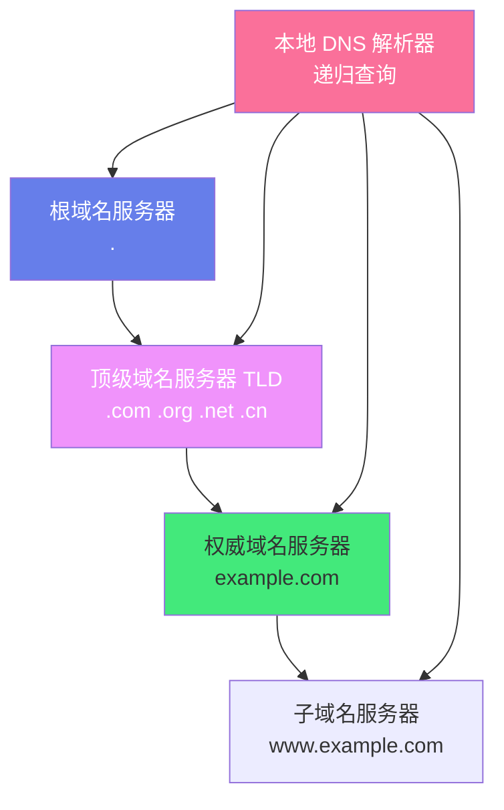
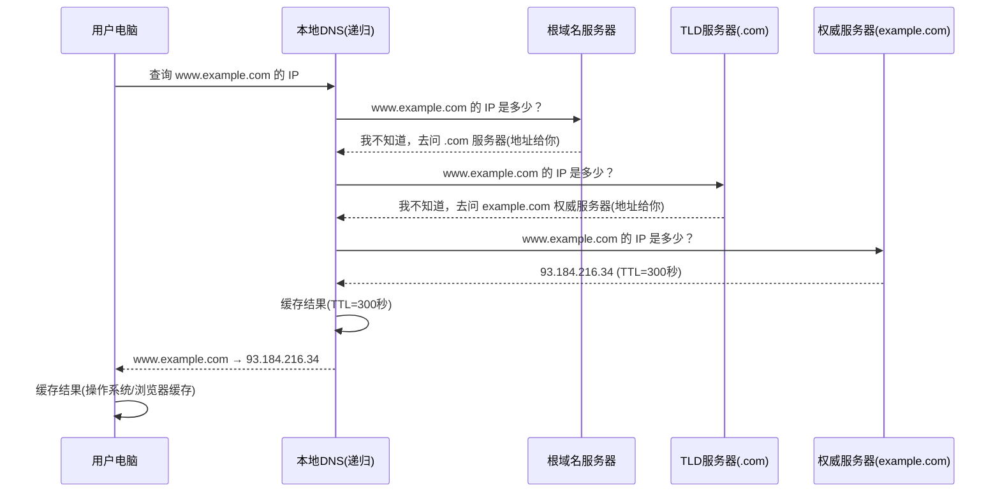
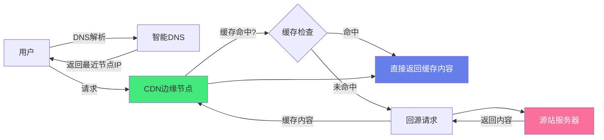

# 🌐 DNS 与 CDN 架构

> **文档说明**：系统讲解 DNS（域名系统）与 CDN（内容分发网络）的完整知识体系，涵盖 DNS 层级结构与解析流程、记录类型（A/AAAA/CNAME/MX/TXT/NS/SOA）、DNS 缓存与 TTL、智能 DNS 与 GSLB、CDN 架构与工作原理、缓存策略（强缓存/协商缓存）、回源与负载均衡、CDN 选型与配置、DNS+CDN 联动、常见问题排查与最佳实践。DNS 是互联网的地址簿，CDN 是互联网的加速引擎。
>
> **适用人群**：后端开发者、运维工程师、架构师、网络工程师
>
> **前置知识**：[[TCPIP协议栈详解]] · [[HTTPS与TLS握手]]

---

## 一、概述

### 1.1 什么是 DNS

DNS（**Domain Name System**，域名系统）是互联网的「地址簿」，负责将人类可读的域名（如 `www.example.com`）转换为机器可读的 IP 地址（如 `93.184.216.34`）。

**为什么需要 DNS**：
- 人类记忆域名比记忆 IP 地址容易得多
- IP 地址可能变化（服务器迁移、负载均衡），域名保持不变
- 一个域名可以对应多个 IP（负载均衡、高可用）
- 支持多种记录类型（邮件、文本、别名等）

### 1.2 什么是 CDN

CDN（**Content Delivery Network**，内容分发网络）是部署在全球多个地理位置的分布式服务器网络，通过将内容缓存到离用户最近的节点，实现内容的快速分发和访问加速。

**CDN 解决的问题**：

| 问题 | 说明 |
|------|------|
| **访问延迟高** | 用户与源站距离远，网络延迟大 |
| **带宽成本高** | 所有用户直接访问源站，源站带宽压力大 |
| **源站压力大** | 高并发请求直接打到源站，容易过载 |
| **可用性低** | 源站故障导致所有用户无法访问 |
| **跨运营商慢** | 跨运营商（电信/联通/移动）访问延迟高 |
| **跨国访问慢** | 跨国访问受国际带宽限制 |

### 1.3 DNS 与 CDN 的关系

DNS 和 CDN 是互联网加速的「黄金搭档」：

```text
用户访问 www.example.com
    │
    ▼
DNS 解析 ──→ 返回 CDN 节点 IP（CNAME 到 CDN 厂商域名）
    │
    ▼
用户访问最近的 CDN 节点
    │
    ├── 缓存命中 → 直接返回内容（快！）
    │
    └── 缓存未命中 → CDN 节点回源获取 → 缓存并返回
```

DNS 负责「找到最近的 CDN 节点」，CDN 负责「从最近的节点快速返回内容」。

---

## 二、底层原理

### 2.1 DNS 层级结构



| 层级 | 说明 | 数量 |
|------|------|------|
| **根域名服务器** | 最高层级，管理所有顶级域名 | 全球 13 组（a-m.root-servers.net），实际数百台实例 |
| **顶级域名服务器（TLD）** | 管理 .com/.org/.cn 等顶级域名 | 每个 TLD 一组服务器 |
| **权威域名服务器** | 管理特定域名（如 example.com）的记录 | 由域名所有者配置（通常 2-4 台） |
| **本地 DNS 解析器** | 替用户递归查询，缓存结果 | ISP 提供或公共 DNS（8.8.8.8/1.1.1.1） |

### 2.2 DNS 解析流程



**两种查询方式**：
- **递归查询**：本地 DNS 替用户一步步查询，最终返回结果（用户→本地DNS）
- **迭代查询**：每次返回下一级服务器地址，由查询者继续问（本地DNS→根→TLD→权威）

### 2.3 DNS 记录类型

| 记录类型 | 全称 | 说明 | 示例 |
|---------|------|------|------|
| **A** | Address | 域名 → IPv4 地址 | `www → 93.184.216.34` |
| **AAAA** | IPv6 Address | 域名 → IPv6 地址 | `www → 2606:2800:220:1:248:1893:25c8:1946` |
| **CNAME** | Canonical Name | 域名 → 另一个域名（别名） | `www → example.com.` |
| **MX** | Mail Exchange | 邮件服务器 | `@ → mail.example.com (优先级10)` |
| **TXT** | Text | 任意文本（验证、SPF、DKIM） | `@ → "v=spf1 include:_spf.google.com ~all"` |
| **NS** | Name Server | 权威域名服务器 | `@ → ns1.example.com` |
| **SOA** | Start of Authority | 域名管理信息（主服务器、序列号、刷新时间） | 管理域名的元数据 |
| **PTR** | Pointer | IP → 域名（反向解析） | `34.216.184.93 → www.example.com` |
| **SRV** | Service | 服务定位（端口、优先级） | `_sip._tcp → sip.example.com:5060` |
| **CAA** | Certification Authority Authorization | 允许哪些 CA 签发证书 | `@ → 0 issue "letsencrypt.org"` |

### 2.4 DNS 缓存机制

DNS 查询有多层缓存，减少重复查询，提升性能：

| 缓存层级 | 位置 | TTL 控制 | 说明 |
|---------|------|---------|------|
| **浏览器缓存** | 浏览器内存 | 浏览器自行决定（通常几分钟） | Chrome: `chrome://net-internals/#dns` |
| **操作系统缓存** | OS 内存 | 遵循记录 TTL | Windows: `ipconfig /displaydns`；macOS: `dscacheutil -q host` |
| **本地 DNS 缓存** | 递归 DNS 服务器 | 遵循记录 TTL | ISP DNS 或公共 DNS（8.8.8.8） |
| **权威服务器** | 权威 DNS | 不缓存，直接返回 | 域名所有者配置 |

**TTL（Time To Live）**：DNS 记录的存活时间，单位秒。
- TTL 短（如 60 秒）：变更生效快，但查询压力大
- TTL 长（如 86400 秒=1天）：查询压力小，但变更生效慢
- 建议：普通记录 3600（1小时），需要频繁变更的记录 300（5分钟）

### 2.5 CDN 工作原理



**CDN 核心组件**：

| 组件 | 说明 |
|------|------|
| **边缘节点（Edge Node）** | 部署在全球/全国各地区的缓存服务器，离用户最近 |
| **中心节点/汇聚节点** | 区域级缓存，减少边缘节点回源 |
| **源站（Origin）** | 内容的原始来源服务器（客户自己的服务器） |
| **智能 DNS/GSLB** | 根据用户地理位置、运营商、节点负载，返回最优节点 IP |
| **调度系统** | 实时监控节点状态，动态调整流量分配 |
| **缓存系统** | 管理内容的缓存、过期、刷新 |

### 2.6 CDN 缓存策略

| 策略 | 说明 | HTTP 头 |
|------|------|---------|
| **强缓存** | 缓存有效期内直接使用，不请求源站 | `Cache-Control: max-age=3600`、`Expires` |
| **协商缓存** | 缓存过期后，带条件请求问源站是否更新 | `ETag`/`If-None-Match`、`Last-Modified`/`If-Modified-Since` |
| **不缓存** | 每次都回源 | `Cache-Control: no-cache`、`no-store` |

**缓存命中率** = 缓存命中请求数 / 总请求数，是 CDN 最核心的性能指标。
- 静态资源（图片/CSS/JS/视频）：命中率应 > 95%
- 动态内容：通常不缓存或短时间缓存

---

## 三、实操示例

### 3.1 DNS 记录配置

```bash
# ===== 域名 DNS 记录配置示例（在域名注册商或 DNS 服务商处配置）=====

# 基础记录
# 类型    名称    值                    TTL      优先级
A         @       93.184.216.34        3600     # 根域名 → IPv4
AAAA      @       2606:2800:220:1::1   3600     # 根域名 → IPv6
CNAME     www     example.com.          3600     # www → 根域名（别名）
CNAME     api     api.example.com.cdn-provider.net.  300  # api → CDN

# 邮件记录
MX        @       mail.example.com.     3600     10  # 邮件服务器
TXT       @       "v=spf1 include:_spf.google.com ~all"  3600  # SPF 反垃圾邮件
TXT       _dmarc  "v=DMARC1; p=none; rua=mailto:dmarc@example.com"  3600

# 子域名
A         blog    192.168.1.100         3600     # blog.example.com
CNAME     docs    docs.google.com.       3600     # docs → Google Docs

# NS 记录（子域名委派）
NS        sub     ns1.sub.example.com.   3600     # sub.example.com 由其他 DNS 管理

# SRV 记录（服务定位）
SRV       _sip._tcp   10 60 5060 sip.example.com.  3600
#             优先级 权重 端口 目标

# CAA 记录（限制证书颁发机构）
CAA       @       0 issue "letsencrypt.org"   3600
CAA       @       0 iodef "mailto:admin@example.com"  3600
```

### 3.2 DNS 查询工具

```bash
# ===== nslookup（简单查询）=====
nslookup www.example.com                    # 查询 A 记录
nslookup -type=MX example.com               # 查询 MX 记录
nslookup -type=CNAME www.example.com        # 查询 CNAME
nslookup -type=TXT example.com              # 查询 TXT
nslookup www.example.com 8.8.8.8            # 指定 DNS 服务器查询

# ===== dig（功能强大，推荐）=====
dig www.example.com                          # 查询 A 记录（默认）
dig A www.example.com                        # 显式指定 A 记录
dig AAAA www.example.com                     # IPv6
dig MX example.com                           # 邮件记录
dig TXT example.com                          # 文本记录
dig NS example.com                           # 权威服务器
dig SOA example.com                          # SOA 记录
dig ANY example.com                          # 所有记录

# 指定 DNS 服务器
dig @8.8.8.8 www.example.com                # Google DNS
dig @1.1.1.1 www.example.com                # Cloudflare DNS
dig @223.5.5.5 www.example.com              # 阿里 DNS

# 追踪完整解析流程（从根开始）
dig +trace www.example.com

# 简短输出（只看答案）
dig +short www.example.com

# 反向解析（IP → 域名）
dig -x 93.184.216.34

# ===== host（简单查询）=====
host www.example.com
host -t MX example.com
host -t TXT example.com

# ===== Windows 专用 =====
ipconfig /displaydns                          # 查看本地 DNS 缓存
ipconfig /flushdns                            # 清除本地 DNS 缓存

# ===== macOS 专用 =====
sudo dscacheutil -flushcache                  # 清除 DNS 缓存
sudo killall -HUP mDNSResponder               # 重启 mDNSResponder

# ===== Linux 专用 =====
systemd-resolve --flush-caches                # 清除 systemd-resolved 缓存
resolvectl flush-caches                       # 同上（新版）
sudo systemctl restart nscd                   # 重启 nscd 缓存
```

### 3.3 智能 DNS 与 GSLB

```bash
# ===== 智能 DNS（基于地理位置/运营商的解析）=====

# 场景：根据用户位置返回不同的 CDN 节点 IP
# 北京电信用户 → 北京电信节点 IP
# 上海联通用户 → 上海联通节点 IP
# 海外用户 → 海外节点 IP

# 常见智能 DNS 服务商：
# - 阿里云 DNS（云解析）
# - 腾讯云 DNSPod
# - Cloudflare
# - AWS Route 53
# - 自建：BIND + GeoIP 模块

# ===== GSLB（全局负载均衡）=====
# GSLB = Global Server Load Balancing
# 基于 DNS 的全局流量调度，实现多机房/多区域负载均衡和故障转移

# GSLB 调度策略：
# 1. 就近接入：根据用户地理位置返回最近机房
# 2. 负载均衡：根据各机房负载分配流量
# 3. 故障转移：机房故障时自动切换到其他机房
# 4. 权重分配：按比例分配流量（如 机房A 70%、机房B 30%）

# 健康检查：GSLB 持续监控各机房可用性，故障节点自动摘除
```

### 3.4 CDN 配置

```bash
# ===== CDN 接入流程 =====

# 1. 在 CDN 服务商添加加速域名
#    加速域名：cdn.example.com
#    源站地址：origin.example.com 或 1.2.3.4
#    源站类型：IP 或 域名

# 2. 配置 CNAME
#    在 DNS 服务商添加 CNAME 记录：
#    cdn.example.com → cdn.example.com.cdn-provider.net

# 3. 配置缓存规则
#    路径模式：/static/*  缓存 30 天
#    路径模式：/images/*  缓存 7 天
#    路径模式：/api/*     不缓存
#    路径模式：/*.html    缓存 1 小时

# ===== CDN 缓存配置（HTTP 响应头）=====

# 静态资源（强缓存，长期有效）
# 在源站响应头中设置：
Cache-Control: public, max-age=31536000, immutable
# public: 可被 CDN 和浏览器缓存
# max-age=31536000: 缓存 1 年
# immutable: 内容不会变，避免重新验证

# 协商缓存（需要验证）
Cache-Control: public, max-age=3600
ETag: "abc123def456"
Last-Modified: Wed, 21 Oct 2026 07:28:00 GMT

# 不缓存（动态内容）
Cache-Control: no-cache, no-store, must-revalidate
Pragma: no-cache
Expires: 0

# ===== CDN 回源配置 =====
# 回源 Host：CDN 回源时使用的 Host 头
# 回源协议：HTTP/HTTPS/跟随协议
# 回源超时：通常 30 秒
# 回源重试：失败后重试次数

# ===== CDN 刷新/预热 =====
# 刷新（Purge）：清除 CDN 缓存，下次请求回源
#   URL 刷新：清除指定 URL 的缓存
#   目录刷新：清除指定目录下所有缓存
#   全站刷新：清除所有缓存（慎用！）

# 预热（Preload）：主动将内容缓存到 CDN 节点
#   大文件发布前预热，避免首次回源慢
```

### 3.5 HTTPS 与 CDN

```bash
# ===== CDN HTTPS 配置 =====

# 方案1：CDN 托管证书（推荐）
# - 在 CDN 服务商上传 SSL 证书
# - CDN 节点使用证书与用户建立 HTTPS
# - 回源可以用 HTTP（CDN 到源站内网）或 HTTPS

# 方案2：回源 HTTPS
# - 用户 → CDN：HTTPS
# - CDN → 源站：HTTPS（端到端加密）
# - 源站也需要配置 SSL 证书

# ===== HTTP/2 与 CDN =====
# 大多数 CDN 支持 HTTP/2，开启后：
# - 多路复用：一个连接并行请求多个资源
# - 头部压缩：HPACK 压缩请求头
# - 服务器推送：主动推送关联资源
# 只需在 CDN 控制台开启 HTTP/2，无需改代码

# ===== 免费证书（Let's Encrypt）=====
# 很多 CDN 厂商提供免费证书自动申请和续期
# 阿里云/腾讯云/Cloudflare 都支持
```

### 3.6 CDN 性能监控

```bash
# ===== 检查 CDN 是否生效 =====

# 1. 检查 CNAME 是否生效
dig CNAME cdn.example.com +short
# 应返回 CDN 厂商的域名

# 2. 检查解析到的 IP 是否是 CDN 节点
dig cdn.example.com +short
# 返回的 IP 应该属于 CDN 厂商（可用 ipip.net 查归属）

# 3. 检查响应头中的 CDN 标识
curl -I https://cdn.example.com/image.jpg
# 常见 CDN 响应头：
# X-Cache: HIT/MISS          （缓存命中/未命中）
# X-Cache-Lookup: HIT/MISS
# Age: 3600                   （缓存存活时间）
# Via: 1.1 varnish            （CDN 软件标识）
# Server: Tengine             （CDN 服务器）
# X-NWS-LOG-UUID: xxx        （网宿 CDN）
# X-Cache-Status: HIT        （Cloudflare）

# 4. 测试缓存命中率
for i in {1..10}; do
  curl -s -o /dev/null -w "%{http_code} %{time_total}s\n" https://cdn.example.com/image.jpg
done
# 第一次可能 MISS（慢），后续应该 HIT（快）

# ===== 性能测试工具 =====
# 1. curl 计时
curl -s -o /dev/null -w "
DNS解析: %{time_namelookup}s
TCP连接: %{time_connect}s
TLS握手: %{time_appconnect}s
首字节:  %{time_starttransfer}s
总时间:  %{time_total}s
下载速度: %{speed_download} bytes/s
" https://cdn.example.com/image.jpg

# 2. 多地区测速
# 使用第三方工具：
# - 阿里云站点测速：https://www.aliyun.com/
# - 17ce 多节点测速：https://www.17ce.com/
# - WebPageTest：https://www.webpagetest.org/
# - Chrome DevTools Network 面板
```

---

## 四、常见问题与排查

| 问题现象 | 可能原因 | 解决方案 |
|---------|---------|---------|
| **域名解析不到 IP** | DNS 记录未配置；NS 记录错误；域名未实名认证 | 检查 A/CNAME 记录；检查 NS 记录是否指向正确 DNS；确认域名已实名认证 |
| **DNS 生效慢** | TTL 设置过长；本地 DNS 缓存未过期；递归 DNS 缓存 | 缩短 TTL（变更前先改短）；清除本地 DNS 缓存；等待递归 DNS 缓存过期 |
| **解析到错误 IP** | DNS 记录配置错误；智能 DNS 调度错误；DNS 污染 | 检查 DNS 记录；用 `dig @权威DNS` 确认权威记录；检查是否被 DNS 污染 |
| **CDN 不生效** | CNAME 未配置或配置错误；源站不可达；CDN 未审核通过 | 检查 CNAME 记录；确认源站可访问；联系 CDN 厂商确认状态 |
| **缓存不命中** | Cache-Control 设置不缓存；URL 带随机参数；缓存已过期 | 检查源站响应头 `Cache-Control`；去除 URL 随机参数或配置忽略参数；延长缓存时间 |
| **回源失败** | 源站 IP 错误；源站防火墙拦截 CDN 回源 IP；源站超时 | 检查源站配置；将 CDN 回源 IP 段加入白名单；增加回源超时时间 |
| **HTTPS 证书错误** | 证书未上传；证书过期；证书域名不匹配 | 在 CDN 控制台上传有效证书；检查证书有效期；确认证书包含加速域名 |
| **跨域问题** | CDN 未配置 CORS 头；源站未返回 CORS | 在 CDN 配置 `Access-Control-Allow-Origin` 头；源站返回正确 CORS 头 |
| **大文件下载慢** | 未预热；单线程下载；节点带宽不足 | 大文件发布前预热；支持 Range 请求实现多线程下载；升级 CDN 带宽 |
| **动态内容被缓存** | 缓存规则配置错误；未正确设置 no-cache | 检查缓存路径规则；动态接口设置 `Cache-Control: no-cache` |
| **DNS 轮询不生效** | 客户端缓存了单个 IP；部分 DNS 不支持轮询 | 用智能 DNS/GSLB 替代简单轮询；设置较短 TTL |
| **CDN 节点 403** | 防盗链配置错误；IP 黑名单；源站返回 403 | 检查 CDN 防盗链 Referer 配置；检查 IP 黑名单；确认源站权限 |
| **刷新缓存不生效** | URL 不一致（http/https、末尾斜杠）；CDN 刷新延迟 | 确保刷新 URL 与访问 URL 完全一致；等待 CDN 全网刷新（通常几分钟） |
| **国内访问国外 CDN 慢** | 国际带宽限制；节点在国外 | 使用国内 CDN 厂商（阿里云/腾讯云/网宿）；国内节点覆盖好 |

---

## 五、进阶与最佳实践

### 5.1 DNS 最佳实践

```text
DNS 最佳实践 Checklist：

✅ 至少配置 2 个 NS 记录（主备），避免单点故障
✅ 重要域名使用多家 DNS 服务商（主备切换）
✅ TTL 策略：
   - 稳定记录（MX/TXT/NS）：TTL=86400（1天）
   - 普通 A/CNAME：TTL=3600（1小时）
   - 需要频繁变更：TTL=300（5分钟）
   - 变更前先将 TTL 改短，变更后再改长
✅ 使用 CNAME 将 www 指向根域名（或反之）
✅ 邮件配置完整：MX + SPF(TXT) + DKIM(TXT) + DMARC(TXT)
✅ 配置 CAA 记录限制证书颁发机构
✅ 定期检查 DNS 记录，清理无用记录
✅ 使用 DNSSEC（域名系统安全扩展）防止 DNS 欺骗
✅ 监控 DNS 解析可用性和延迟
✅ 重要变更前先在测试域名验证
✅ 避免使用裸域名（根域名）作为 CNAME（部分 DNS 不支持）
✅ 智能 DNS 按地理位置/运营商调度，提升访问速度
✅ DNS 故障转移：配合健康检查实现自动切换
```

### 5.2 CDN 最佳实践

```text
CDN 最佳实践 Checklist：

✅ 静态资源全部走 CDN（图片/CSS/JS/视频/字体/下载文件）
✅ 动态接口不走 CDN（或短缓存 + 缓存击穿保护）
✅ 缓存策略：
   - 带 hash 的静态资源（app.abc123.js）：max-age=31536000, immutable（1年）
   - 普通图片/视频：max-age=604800（7天）
   - HTML 页面：max-age=300（5分钟）或 no-cache
   - API 接口：no-cache, no-store
✅ 开启 HTTP/2 和 HTTPS
✅ 开启 Gzip/Brotli 压缩
✅ 大文件发布前预热，避免首次回源慢
✅ 配置防盗链（Referer 白名单）防止资源被盗用
✅ 配置跨域头（CORS）支持跨域资源访问
✅ 监控缓存命中率，目标 > 95%（静态资源）
✅ 定期检查回源率，回源率高说明缓存策略有问题
✅ CDN 厂商选择：
   - 国内为主：阿里云/腾讯云/网宿/七牛
   - 海外为主：Cloudflare/AWS CloudFront/Fastly
   - 全球：Cloudflare（免费版就很好用）
✅ 多 CDN 调度：重要业务用两家 CDN，DNS 智能调度
✅ 配置 404/5xx 错误页面，提升用户体验
✅ 图片 CDN 开启自动格式转换（WebP/AVIF）和自适应裁剪
✅ 视频 CDN 开启转码和分片（HLS/DASH）
```

### 5.3 DNS + CDN 联动架构

```text
典型高可用架构：

                    ┌─────────────────────┐
                    │   智能 DNS / GSLB    │
                    │  (地理位置+健康检查)   │
                    └──────────┬──────────┘
                               │
              ┌────────────────┼────────────────┐
              ▼                ▼                ▼
        ┌──────────┐    ┌──────────┐    ┌──────────┐
        │ CDN-A 节点 │    │ CDN-B 节点 │    │  源站集群  │
        │ (主)      │    │ (备)      │    │ (直接访问) │
        └─────┬────┘    └─────┬────┘    └─────┬────┘
              │                │                │
              └────────────────┼────────────────┘
                               ▼
                    ┌─────────────────────┐
                    │     源站服务器        │
                    │  (多机房/多区域部署)   │
                    └─────────────────────┘

设计要点：
1. DNS 层做全局调度，根据用户位置返回最优 CDN 节点
2. 多 CDN 厂商互备，DNS 健康检查自动切换
3. 源站多区域部署，CDN 回源选择最近源站
4. 静态资源 CDN 缓存，动态请求直连源站或用动态加速
5. DNS TTL 适中，兼顾变更速度和查询压力
```

### 5.4 安全最佳实践

| 安全措施 | 说明 |
|---------|------|
| **DNSSEC** | 域名系统安全扩展，防止 DNS 欺骗和缓存投毒 |
| **DNS over HTTPS (DoH)** | DNS 查询通过 HTTPS 加密，防止窃听和篡改 |
| **DNS over TLS (DoT)** | DNS 查询通过 TLS 加密 |
| **CDN WAF** | CDN 集成 Web 应用防火墙，防御 SQL 注入/XSS/CC 攻击 |
| **DDoS 防护** | CDN 天然抗 DDoS（分布式节点吸收流量） |
| **防盗链** | Referer 白名单，防止资源被盗用 |
| **访问控制** | IP 黑白名单、时间防盗链、URL 签名 |
| **HTTPS 强制** | 强制 HTTPS，HSTS 防止降级攻击 |
| **证书管理** | 证书自动续期，避免过期导致服务中断 |
| **源站隐藏** | 通过 CDN 隐藏源站真实 IP，防止直接攻击源站 |

---

## 六、关联笔记

### 计算机网络
- [[TCPIP协议栈详解]] · [[HTTPS与TLS握手]] · [[网络抓包与调试]]
- [[WebSocket与SSE原理]] · [[IO模型与零拷贝]]

### 云原生与运维
- [[Kubernetes入门与实践]] · [[Service与Ingress]] · [[ELK-日志聚合]]
- [[Prometheus监控体系]] · [[告警体系设计]]

### 高可用与架构
- [[高可用架构设计]] · [[负载均衡原理与实践]] · [[数据库备份与恢复策略]]

### 工具
- [[curl高级用法]] · [[Linux系统管理与常用命令]]

### 导航
- [[MOC-计算机基础]] · [[MOC-计算机网络]] · [[MOC-综合导航]] · [[Home]]

> 🔍 **知识点深度解析**
>
> **作用**：DNS 解决「域名到 IP 地址的转换」问题，是互联网的地址簿；CDN 解决「内容快速分发」问题，通过全球分布式节点将内容缓存到离用户最近的位置，是互联网的加速引擎。二者配合实现「找到最近节点 + 从最近节点快速返回」。
>
> **底层原理**：DNS 采用层级结构（根→TLD→权威→本地），解析流程是递归+迭代查询：本地 DNS 替用户从根开始一步步查询，每级返回下一级服务器地址，最终从权威服务器获取记录，并按 TTL 缓存。CDN 采用分布式缓存架构：智能 DNS 根据用户地理位置/运营商返回最近边缘节点 IP，用户请求到达边缘节点，缓存命中直接返回，未命中则回源获取并缓存。缓存策略分强缓存（Cache-Control: max-age）和协商缓存（ETag/Last-Modified），命中率是 CDN 核心指标。
>
> **用法要点**：① DNS 记录：A(IPv4)、AAAA(IPv6)、CNAME(别名)、MX(邮件)、TXT(文本/SPF)、NS(权威服务器) ② 工具：`dig`（推荐）、`nslookup`、`host`，`dig +trace` 追踪完整流程 ③ TTL 策略：稳定记录 86400，普通 3600，变更前先改短 ④ CDN 接入：添加加速域名→配置 CNAME→配置缓存规则 ⑤ 缓存策略：带 hash 静态资源 immutable 1年，图片 7天，HTML 5分钟，API no-cache ⑥ 验证 CDN：`curl -I` 看 `X-Cache: HIT/MISS` 和 `Age` 头 ⑦ 智能 DNS/GSLB 按地理位置+健康检查调度，实现就近接入和故障转移 ⑧ 大文件发布前预热，避免首次回源慢 ⑨ 监控缓存命中率（目标>95%）和回源率 ⑩ 安全：DNSSEC、CDN WAF、DDoS 防护、防盗链、HTTPS 强制。

> 💡 **深度讲解**：DNS 最精妙的设计是「层级缓存」——根服务器不需要知道所有域名，只需要知道顶级域名（.com/.org）的服务器地址；顶级域名服务器只需要知道二级域名（example.com）的权威服务器地址；权威服务器才真正存储域名的记录。这种层级设计让 DNS 能够支撑全球数十亿域名的查询，同时通过各级缓存（浏览器→OS→本地DNS→权威）极大减少了重复查询。CDN 最核心的指标是「缓存命中率」——命中率越高，回源越少，源站压力越小，用户访问越快。影响命中率的关键因素是缓存时间（TTL/max-age）和 URL 稳定性：如果 URL 带随机参数（如时间戳），每次请求 URL 都不同，缓存永远不命中。所以前端工程中常用的做法是静态资源文件名带内容 hash（如 app.abc123.js），这样内容不变时 URL 不变，可以长期缓存（immutable 1年）；内容变化时 hash 变化，URL 变化，自动获取新版本。这就是「缓存策略 + 文件名 hash」的经典组合。DNS 和 CDN 配合时，最常见的问题是「CNAME 配置错误」——加速域名的 CNAME 必须指向 CDN 厂商提供的专属域名，而不是源站域名，否则流量不会经过 CDN。

> 📝 **精简总结**：DNS = 域名→IP 的地址簿，层级结构（根→TLD→权威），递归+迭代查询，TTL 缓存。核心记录：A/AAAA/CNAME/MX/TXT/NS。CDN = 内容分发网络，智能 DNS 调度到最近节点，缓存命中直接返回，未命中回源。缓存策略：强缓存(max-age) + 协商缓存(ETag)，命中率>95%。DNS+CDN 配合：CNAME 指向 CDN，智能 DNS 就近调度。工具：dig/nslookup 查询 DNS，curl -I 检查 CDN 缓存头。

> **学习路径建议**：先学习 [[TCPIP协议栈详解]] 理解网络基础 → 学习 [[HTTPS与TLS握手]] 理解 HTTP/HTTPS → 学习本文档掌握 DNS 与 CDN → 学习 [[负载均衡原理与实践]] 理解流量调度 → 学习 [[高可用架构设计]] 理解整体架构 → 在项目中实践 DNS+CDN+负载均衡的完整加速和高可用方案。

---

> **DNS 是互联网的地址簿，CDN 是互联网的加速引擎。没有 DNS，我们要记住一长串 IP；没有 CDN，我们要忍受跨国跨网的慢速访问。二者配合，让互联网既好记又快。**
