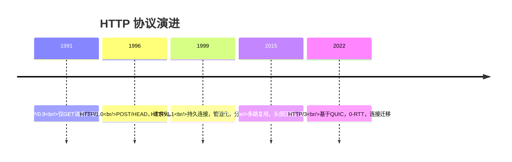
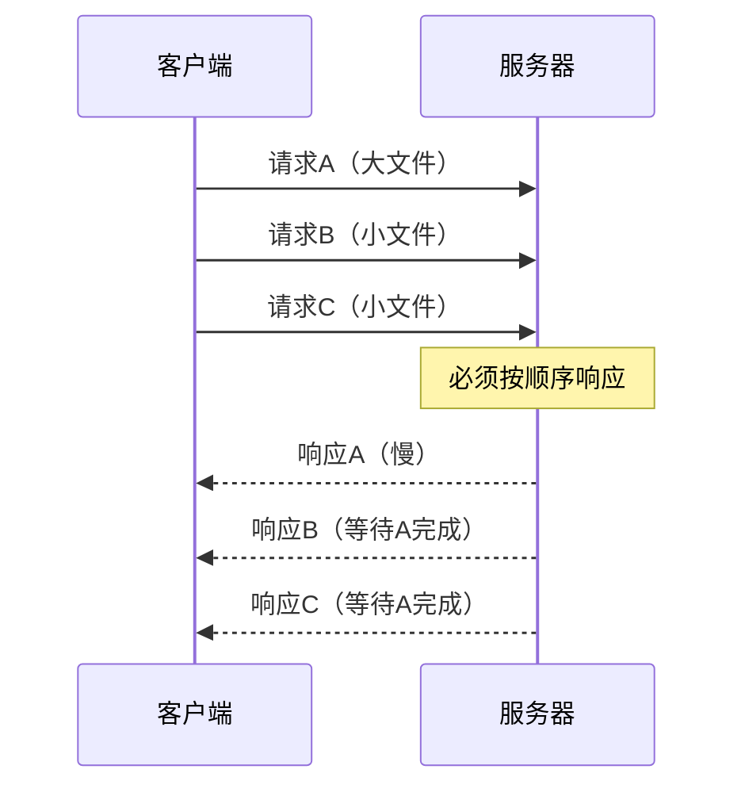
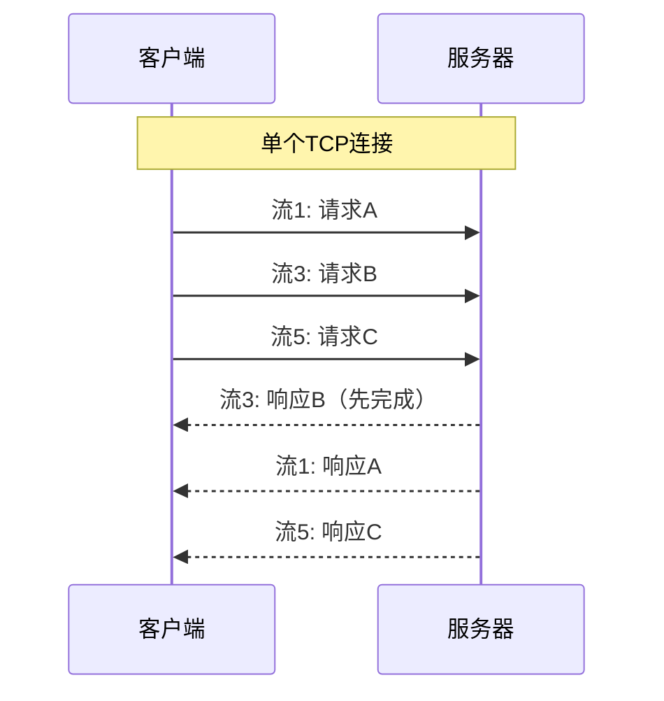
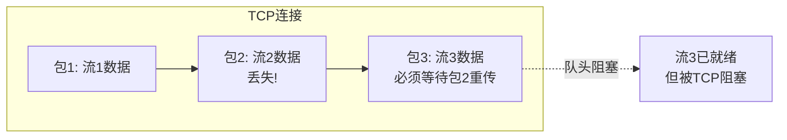
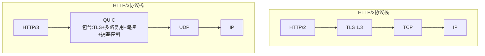
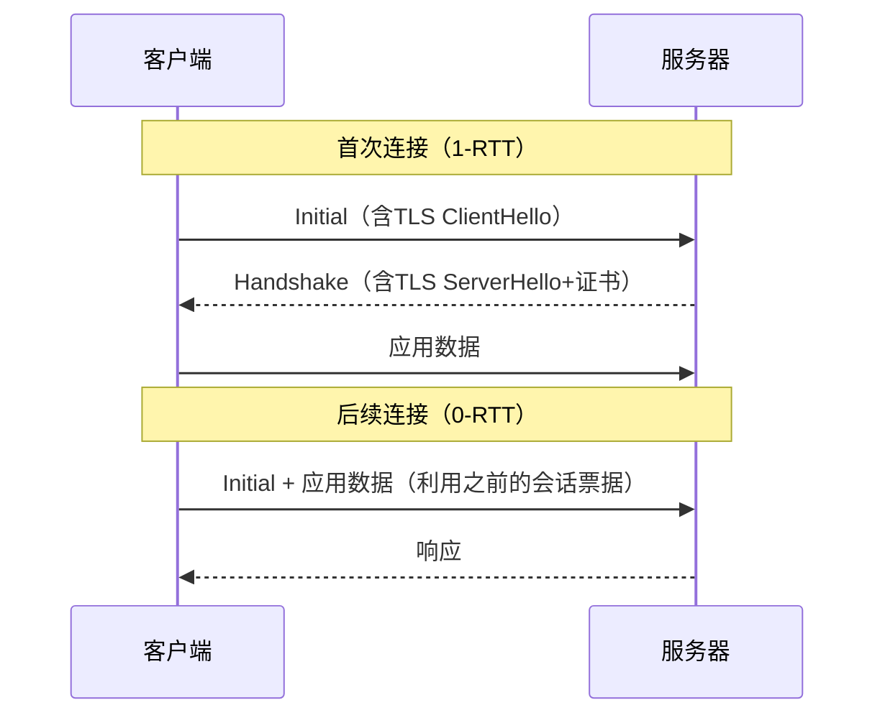

# HTTP 1.1 / 2 / 3 演进

> **文档说明**：系统讲解 HTTP 协议从 1.0 到 1.1 到 2.0 到 3.0 的演进历程，各版本的核心特性、解决的问题、性能差异，以及在实际开发中的选型和最佳实践。
>
> **适用人群**：前端/后端开发工程师、需要理解 Web 性能优化的全栈工程师
>
> **前置知识**：[[TCPIP协议栈详解]]、[[HTTPS与TLS握手]]、[[DNS与CDN架构]]

---

## 一、概述

**HTTP（HyperText Transfer Protocol，超文本传输协议）** 是 Web 的基础协议，定义了客户端与服务器之间请求和响应的格式与规则。从 1991 年 HTTP/0.9 至今，HTTP 经历了多次重大演进，每次演进都旨在解决上一版本的性能瓶颈。

### 1. 演进时间线



### 2. 各版本核心对比

| 特性 | HTTP/1.1 | HTTP/2 | HTTP/3 |
|------|----------|--------|--------|
| 传输层 | TCP | TCP | QUIC (UDP) |
| 加密 | 可选（HTTPS） | 实际必须 HTTPS | 强制加密 |
| 多路复用 | ❌ | ✅ 单连接多流 | ✅ 单连接多流 |
| 队头阻塞 | ✅ 存在 | ⚠️ TCP层仍存在 | ❌ 消除 |
| 头部压缩 | ❌ 纯文本 | ✅ HPACK | ✅ QPACK |
| 服务器推送 | ❌ | ✅（已废弃） | ❌ |
| 0-RTT 握手 | ❌ | ❌ | ✅ |
| 连接迁移 | ❌ | ❌ | ✅ |
| 握手延迟 | 1-RTT (TLS) | 1-RTT (TLS+ALPN) | 0-RTT (QUIC) |

---

## 二、HTTP/1.1

### 1. HTTP/1.1 的核心改进

HTTP/1.1 相比 1.0 的主要改进：

| 特性 | 说明 | 解决的问题 |
|------|------|-----------|
| **持久连接**（Keep-Alive） | TCP 连接默认保持，可复用 | 每次请求都建立 TCP 连接的开销 |
| **管道化**（Pipelining） | 可连续发送多个请求，不必等前一个响应 | 请求-响应的串行等待 |
| **分块传输**（Chunked） | 响应可分块发送，无需预先知道 Content-Length | 动态内容无法确定长度 |
| **Host 头** | 必须携带 Host 头，支持虚拟主机 | 一个 IP 只能托管一个网站 |
| **缓存控制** | Cache-Control、ETag、If-None-Match | 缓存机制不完善 |
| **范围请求** | Range 头支持断点续传 | 大文件无法续传 |
| **更多方法** | OPTIONS、PUT、DELETE、TRACE、CONNECT | RESTful API 支持 |

### 2. HTTP/1.1 的性能瓶颈

#### 队头阻塞（Head-of-Line Blocking）



HTTP/1.1 管道化虽然允许连续发送请求，但**响应必须按请求顺序返回**。如果第一个请求响应很慢（大文件），后面的请求即使已处理完也必须等待，这就是队头阻塞。

**实际影响**：浏览器通常对同一域名只开 6 个并发连接，超过 6 个请求必须排队。现代网页平均 50+ 个资源，队头阻塞导致显著延迟。

#### 头部冗余

每个请求都携带完整的 HTTP 头（Cookie、User-Agent、Accept 等），同一连接的多个请求头部大部分相同，造成大量冗余传输。一个典型请求头可能 500-2000 字节，其中 90% 在多次请求中重复。

### 3. HTTP/1.1 优化实践

| 优化手段 | 原理 | 效果 |
|---------|------|------|
| 域名分片（Sharding） | 将资源分散到多个域名，突破 6 连接限制 | 增加并发，但 TCP 连接开销增加 |
| 资源合并（Spriting/Concatenation） | 合并小文件减少请求数 | 减少请求，但缓存粒度变粗 |
| 内联资源（Inlining） | 将小图片/CSS/JS 内联到 HTML | 减少请求，但无法缓存 |
| Keep-Alive | 复用 TCP 连接 | 减少握手开销 |
| CDN 加速 | 就近访问 | 降低网络延迟 |

> **注意**：HTTP/2 多路复用消除了队头阻塞，域名分片和资源合并在 HTTP/2 下反而可能降低性能（分片增加 TCP 连接开销，合并降低缓存效率）。

---

## 三、HTTP/2

### 1. HTTP/2 的核心改进

HTTP/2（RFC 7540，2015年）基于 Google 的 SPDY 协议，核心目标是**降低延迟**，在不改动 HTTP 语义的前提下优化传输层。

#### 多路复用（Multiplexing）



- 单个 TCP 连接上可并行多个**流（Stream）**
- 每个流有唯一 ID，请求和响应可乱序到达
- **消除了 HTTP 层的队头阻塞**
- 浏览器不再需要域名分片，一个连接即可承载所有请求

#### 二进制分帧（Binary Framing）

HTTP/2 将所有传输信息分割为更小的**帧（Frame）**，采用二进制格式（而非 HTTP/1.1 的纯文本）：

| 帧类型 | 说明 |
|--------|------|
| HEADERS | 携带 HTTP 头部 |
| DATA | 携带请求/响应体 |
| SETTINGS | 连接配置参数 |
| WINDOW_UPDATE | 流控窗口更新 |
| PRIORITY | 流优先级 |
| RST_STREAM | 重置流 |
| PUSH_PROMISE | 服务器推送承诺 |

```text
帧结构（9字节头部 + 载荷）：
+-----------------------------------------------+
| Length (24) | Type (8) | Flags (8) |        |
+-----------------------------------------------+  9字节
| Stream Identifier (31) + R (1)               |
+-----------------------------------------------+
| Frame Payload (0 ... Length)                  |
+-----------------------------------------------+
```

#### 头部压缩（HPACK）

HTTP/2 使用 **HPACK** 算法压缩 HTTP 头部：

| 机制 | 说明 |
|------|------|
| 静态表 | 预定义 61 个常见头部字段，用索引引用 |
| 动态表 | 连接过程中出现的新头部加入动态表，后续用索引引用 |
| Huffman 编码 | 对字符串值进行 Huffman 编码压缩 |

**效果**：同一连接的后续请求头部只需发送索引引用，头部传输量减少 80-90%。

#### 流优先级（Stream Priority）

每个流可设置优先级（权重 + 依赖关系），服务器根据优先级分配资源。例如：HTML 优先于 CSS，CSS 优先于图片。

#### 服务器推送（Server Push）

服务器可主动推送客户端尚未请求的资源（如 HTML 中引用的 CSS/JS），减少往返延迟。

> **注意**：服务器推送在实践中效果不佳（推送资源可能已缓存、优先级难控制），Chrome 106+ 已移除支持，HTTP/3 也未包含此特性。

### 2. HTTP/2 的局限：TCP 层队头阻塞

HTTP/2 虽然消除了 HTTP 层的队头阻塞，但底层仍是 TCP。TCP 是**有序字节流**，如果一个 TCP 包丢失，所有后续数据必须等待重传，即使这些数据属于不同的 HTTP/2 流。



在高丢包网络（移动网络、弱网）中，HTTP/2 的多路复用优势可能被 TCP 队头阻塞抵消。这正是 HTTP/3 要解决的核心问题。

### 3. HTTP/2 部署

```bash
# Nginx 启用 HTTP/2
server {
    listen 443 ssl http2;  # http2 关键字
    server_name example.com;

    ssl_certificate /path/to/cert.pem;
    ssl_certificate_key /path/to/key.pem;

    # HTTP/2 优化
    http2_max_concurrent_streams 128;
    http2_push_preload on;  # 启用 Link 头推送
}
```

```bash
# 验证 HTTP/2
curl -I --http2 https://example.com
# 响应头中查看：
# HTTP/2 200
```

---

## 四、HTTP/3

### 1. HTTP/3 的核心改进

HTTP/3（RFC 9114，2022年）最大的变化是**将传输层从 TCP 替换为 QUIC（基于 UDP）**，从根本上解决 TCP 队头阻塞。

#### QUIC 协议



QUIC 将 TLS 1.3 加密、多路复用、流量控制、拥塞控制都集成在应用层（基于 UDP），具有以下优势：

| 特性 | 说明 |
|------|------|
| **消除队头阻塞** | 每个 QUIC 流独立，一个流的丢包不影响其他流 |
| **0-RTT 握手** | 首次连接 1-RTT，后续连接 0-RTT（直接发送应用数据） |
| **连接迁移** | 网络切换（WiFi→4G）时保持连接不中断，无需重新握手 |
| **内置加密** | QUIC 头部和载荷全部加密，中间设备无法篡改 |
| **可插拔拥塞控制** | 应用层实现，可灵活替换拥塞控制算法 |
| **无 TCP 中间设备干扰** | 基于 UDP，避免老旧网络设备对 TCP 的不友好处理 |

#### 0-RTT 握手



- 首次连接：QUIC 集成 TLS 1.3，只需 1-RTT 即可建立加密连接（TCP+TLS 需要 2-3 RTT）
- 后续连接：利用之前的会话票据，**0-RTT** 即可发送应用数据
- **效果**：弱网环境下首屏加载时间显著减少

#### 连接迁移

传统 TCP 连接由四元组（源IP, 源端口, 目的IP, 目的端口）标识，网络切换时四元组变化，连接断开，需重新建立。

QUIC 连接由**连接 ID（Connection ID）**标识，与 IP/端口无关。网络切换时，客户端使用相同的连接 ID 向新地址发送数据包，服务器识别连接 ID 后继续传输，**无需重新握手**。

**典型场景**：手机从 WiFi 切换到 4G 时，正在进行的视频通话、文件下载不中断。

#### QPACK 头部压缩

HTTP/3 使用 **QPACK**（而非 HTTP/2 的 HPACK），因为 QUIC 流可以乱序到达，HPACK 的动态表依赖有序传输。QPACK 设计为可在乱序环境下正确工作。

### 2. HTTP/3 部署

```bash
# Nginx 1.25+ 支持 HTTP/3
server {
    listen 443 ssl;
    listen 443 quic reuseport;  # QUIC 监听（UDP）

    server_name example.com;
    ssl_certificate /path/to/cert.pem;
    ssl_certificate_key /path/to/key.pem;

    # 通知客户端支持 HTTP/3
    add_header Alt-Svc 'h3=":443"; ma=86400';
    add_header Alt-Svc 'h3-29=":443"; ma=86400';
}
```

```bash
# Caddy 自动支持 HTTP/3（最简单）
example.com {
    respond "Hello HTTP/3"
}
```

```bash
# 验证 HTTP/3
curl -I --http3 https://example.com
# 或使用在线工具：https://http3check.net/
```

### 3. HTTP/3 的挑战

| 挑战 | 说明 |
|------|------|
| UDP 限速 | 部分网络运营商对 UDP 限速或封锁，HTTP/3 可能比 TCP 慢 |
| 生态成熟度 | 服务器/CDN/浏览器支持仍在完善中 |
| 调试困难 | QUIC 加密，传统抓包工具（Wireshark）难以分析 |
| CPU 开销 | QUIC 在用户态实现，内核旁路，CPU 占用可能更高 |
| 0-RTT 安全风险 | 0-RTT 数据可被重放攻击，仅用于幂等请求 |

---

## 五、版本选型与最佳实践

### 1. 浏览器支持情况

| 浏览器 | HTTP/2 | HTTP/3 |
|--------|--------|--------|
| Chrome | ✅ 全支持 | ✅ 全支持（默认启用） |
| Firefox | ✅ 全支持 | ✅ 全支持 |
| Safari | ✅ 全支持 | ✅ 14+ 支持 |
| Edge | ✅ 全支持 | ✅ 全支持 |

> 截至 2026 年，HTTP/2 支持率 > 98%，HTTP/3 支持率 > 95%。主流 CDN（Cloudflare、阿里云、腾讯云）均已支持 HTTP/3。

### 2. 部署建议

| 场景 | 推荐方案 |
|------|---------|
| 大多数网站 | HTTP/2 + HTTPS（性价比最高） |
| 追求极致性能 | HTTP/3 + HTTP/2 降级（Alt-Svc 协商） |
| 移动端为主 | HTTP/3（弱网优势明显，连接迁移） |
| API 服务 | HTTP/2（多路复用，减少连接开销） |
| 大文件下载 | HTTP/1.1（单流大文件，HTTP/2 多路复用无优势） |
| 内网服务 | HTTP/1.1（延迟低，无需加密开销） |

### 3. 性能优化清单

- [ ] 启用 HTTPS（HTTP/2 和 HTTP/3 的前提）
- [ ] 启用 HTTP/2（Nginx/Caddy 配置）
- [ ] 启用 HTTP/3（QUIC，Alt-Svc 头）
- [ ] 配置 TLS 1.3（更快的握手）
- [ ] 使用 CDN（就近访问，降低延迟）
- [ ] 合理设置缓存头（Cache-Control、ETag）
- [ ] HTTP/2 下避免域名分片和资源合并
- [ ] 启用 Brotli 压缩（比 gzip 更优）
- [ ] 预连接关键域名（`<link rel="preconnect">`）

---

## 六、常见问题与排查

| 问题 | 原因 | 解决方案 |
|------|------|---------|
| 网站不支持 HTTP/2 | 服务器未配置或证书问题 | 检查 Nginx `http2` 关键字，确认有效 SSL 证书 |
| HTTP/2 性能不如预期 | TCP 队头阻塞（高丢包）或服务器配置不当 | 升级到 HTTP/3，检查服务器并发流配置 |
| HTTP/3 不生效 | UDP 端口未开放或防火墙拦截 | 开放 443/UDP，检查 Alt-Svc 响应头 |
| 移动端加载慢 | 弱网 TCP 队头阻塞 | 启用 HTTP/3，优化资源加载顺序 |
| 连接频繁断开 | 网络切换（WiFi→4G） | 启用 HTTP/3 连接迁移 |
| 首屏白屏时间长 | 握手延迟 + 资源加载顺序 | 启用 0-RTT，关键资源内联或预加载 |

---

## 七、关联笔记

### 网络基础
- [[TCPIP协议栈详解]] · [[HTTPS与TLS握手]] · [[DNS与CDN架构]]
- [[WebSocket与SSE原理]] · [[网络抓包与调试]]

### 前端性能
- [[Vite-构建原理与插件开发]] · [[SSE-流式响应对接LLM]]
- [[AI生成内容的Loading与错误态]]

### 后端
- [[Nginx-反向代理与负载均衡]] · [[API设计规范-OpenAPI]]
- [[Gateway-网关路由与鉴权]]

### 导航
- [[MOC-计算机基础]] · [[MOC-前端开发]] · [[全栈+AI工程双轨融合学习路线图]]

> **学习路径建议**：先掌握 [[TCPIP协议栈详解]] 理解传输层 → 理解本文 HTTP 各版本演进 → 学习 [[HTTPS与TLS握手]] 加密机制 → 实践 [[Nginx-反向代理与负载均衡]] 部署配置 → 研究 [[DNS与CDN架构]] 网络优化。

---

## 💡 全文深度讲解

本文系统梳理了HTTP 1.1 / 2 / 3 演进的核心知识体系，从概述入手，深入HTTP/1.1的底层机制，再通过HTTP/2掌握实战应用，最后涵盖常见问题与排查与关联笔记。学习时建议先建立整体认知，再动手实践，最后结合常见问题深化理解。

## 📝 全文精简总结

- **概述**：掌握本模块的核心概念与关键要点
- **HTTP/1.1**：掌握本模块的核心概念与关键要点
- **HTTP/2**：掌握本模块的核心概念与关键要点
- **HTTP/3**：掌握本模块的核心概念与关键要点
- **版本选型与最佳实践**：掌握本模块的核心概念与关键要点
- **常见问题与排查**：掌握本模块的核心概念与关键要点
- **关联笔记**：掌握本模块的核心概念与关键要点

