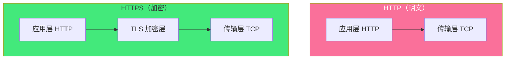
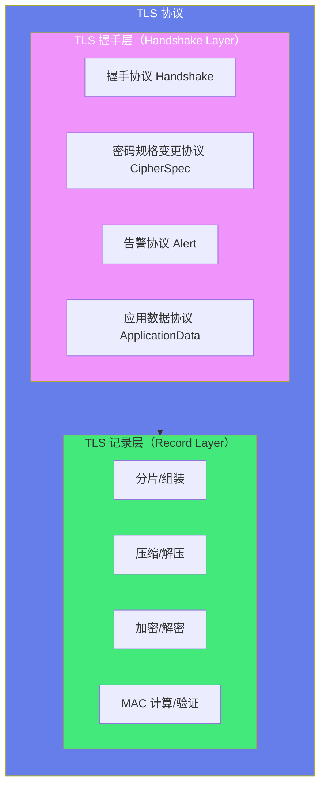
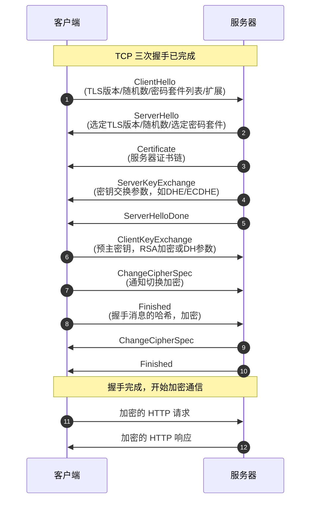
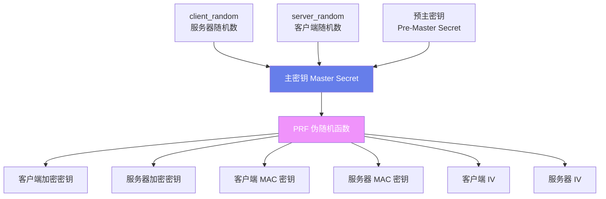
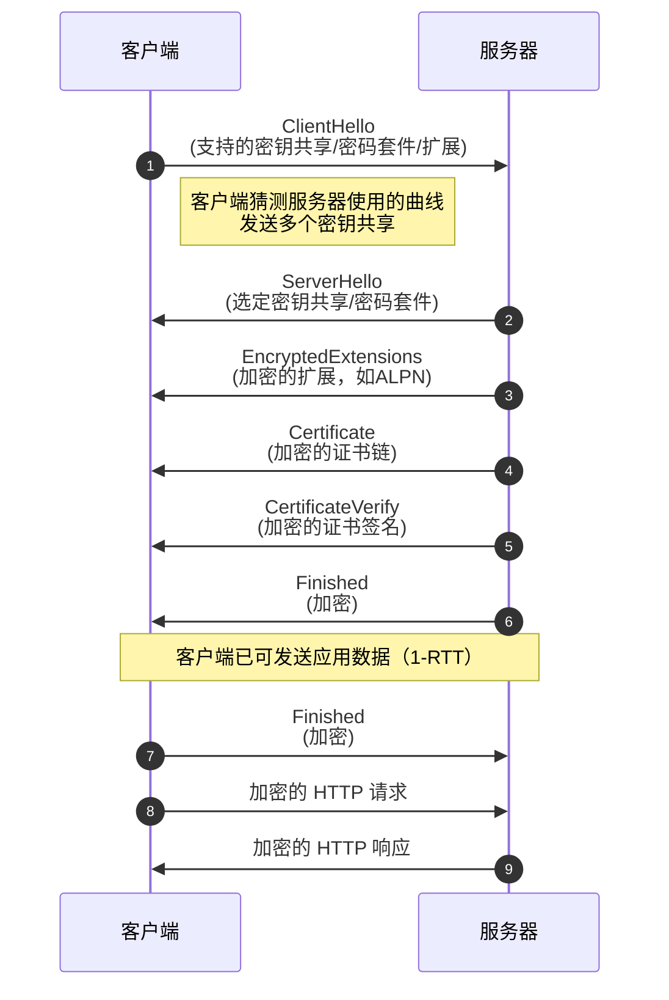
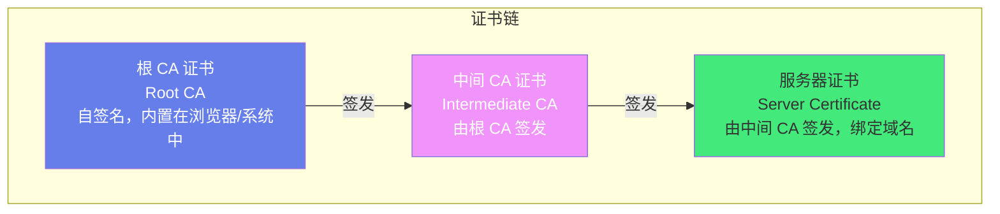

# 🔐 HTTPS 与 TLS 握手

> **文档说明**：系统讲解 HTTPS 与 TLS 握手的完整知识体系，涵盖 HTTP 与 HTTPS 对比、对称加密与非对称加密原理、TLS 协议架构（记录层/握手层）、TLS 1.2 完整握手流程（客户端Hello/服务端Hello/证书/密钥交换/Finished）、TLS 1.3 优化（1-RTT/0-RTT/密钥协商简化）、证书体系与 PKI、证书类型与验证链、OpenSSL 实操（生成证书/查看证书/调试连接）、HTTPS 性能优化（会话恢复/OCSP Stapling/HTTP/2）、常见握手错误排查。
>
> **适用人群**：后端开发者、运维工程师、安全工程师、全栈开发者、架构师
>
> **前置知识**：[[HTTP协议完整指南]] · [[TCPIP协议栈详解]] · [[网络抓包与调试]]

---

## 一、概述

### 1.1 HTTP vs HTTPS

| 维度 | HTTP | HTTPS |
|------|------|-------|
| **全称** | HyperText Transfer Protocol | HyperText Transfer Protocol Secure |
| **端口** | 80 | 443 |
| **安全性** | 明文传输，可被窃听/篡改/冒充 | 加密传输，防窃听/防篡改/防冒充 |
| **协议栈** | HTTP over TCP | HTTP over TLS over TCP |
| **性能** | 快（无加密开销） | 稍慢（握手加密开销，但可优化） |
| **证书** | 不需要 | 需要 CA 签发的 SSL/TLS 证书 |
| **SEO** | 不优先 | Google 优先收录 HTTPS |
| **浏览器标记** | "不安全"警告 | 锁形安全标记 |



### 1.2 HTTPS 解决的三大安全问题

| 问题 | 说明 | HTTPS 解决方案 |
|------|------|---------------|
| **窃听（Eavesdropping）** | 第三方可以读取传输内容 | 对称加密：只有通信双方能解密 |
| **篡改（Tampering）** | 第三方可以修改传输内容 | 消息认证码（MAC）：检测内容是否被篡改 |
| **冒充（Spoofing）** | 第三方可以冒充服务器 | 数字证书 + CA 验证：确认服务器身份 |

### 1.3 加密基础

| 加密类型 | 说明 | 优点 | 缺点 | 代表算法 |
|---------|------|------|------|---------|
| **对称加密** | 加密和解密用同一个密钥 | 速度快，适合大数据 | 密钥分发困难 | AES、ChaCha20、DES、3DES |
| **非对称加密** | 公钥加密，私钥解密（或反之） | 无需共享密钥，可身份认证 | 速度慢，不适合大数据 | RSA、ECC、Diffie-Hellman |
| **哈希函数** | 单向，不可逆，固定长度输出 | 完整性校验 | 不是加密，无法解密 | SHA-256、MD5（不安全）、SHA-3 |
| **消息认证码** | 密钥 + 哈希，验证完整性和来源 | 防篡改 + 防伪造 | 需要共享密钥 | HMAC-SHA256 |

**TLS 中的加密组合**：
- 非对称加密（RSA/ECC/DH）用于**密钥交换**和**身份认证**（握手阶段）
- 对称加密（AES/ChaCha20）用于**数据加密**（通信阶段）
- 哈希函数（SHA）用于**完整性校验**和**密钥派生**
- 数字签名（RSA/ECC + 哈希）用于**证书验证**和**握手验证**

---

## 二、TLS 协议架构

### 2.1 TLS 分层



**记录层（Record Layer）职责**：
1. 将上层数据分片为 TLS 记录（最大 16KB）
2. 压缩（可选，通常禁用，存在 CRIME 攻击）
3. 计算 MAC（消息认证码）
4. 加密（对称加密）
5. 添加 TLS 记录头（内容类型/版本/长度）

**握手层（Handshake Layer）协议**：
| 协议 | 说明 |
|------|------|
| Handshake | 协商密码套件、交换密钥、验证身份 |
| CipherSpec | 通知对端切换到新协商的密码规格 |
| Alert | 告警（警告/致命错误），如证书过期、握手失败 |
| ApplicationData | 传输应用数据（HTTP） |

### 2.2 TLS 版本演进

| 版本 | 年份 | 说明 | 状态 |
|------|------|------|------|
| SSL 1.0 | 1995 | Netscape 内部版本，从未公开 | 废弃 |
| SSL 2.0 | 1995 | 第一个公开版本，存在安全漏洞 | 废弃（RFC 6176） |
| SSL 3.0 | 1996 | 重构版本，仍有漏洞（POODLE） | 废弃（RFC 7568） |
| TLS 1.0 | 1999 | SSL 3.0 的标准化版本（RFC 2246） | 不推荐（RFC 8996） |
| TLS 1.1 | 2006 | 增加 CBC 防护、IV 随机化（RFC 4346） | 不推荐（RFC 8996） |
| TLS 1.2 | 2008 | 增加 AEAD 加密、SHA-256、密码套件扩展（RFC 5246） | 广泛使用 |
| TLS 1.3 | 2018 | 大幅简化握手（1-RTT）、0-RTT、移除不安全算法（RFC 8446） | 推荐使用 |

> **重要**：TLS 1.0/1.1 已被主流浏览器和 RFC 8996 正式弃用，生产环境应至少使用 TLS 1.2，推荐 TLS 1.3。

---

## 三、TLS 1.2 握手流程

### 3.1 完整握手（RSA 密钥交换）



### 3.2 各消息详解

| 消息 | 发送方 | 内容 | 说明 |
|------|--------|------|------|
| **ClientHello** | 客户端 | TLS 版本、客户端随机数（client_random）、密码套件列表、压缩方法、扩展（SNI/ALPN等） | 客户端告诉服务器支持什么 |
| **ServerHello** | 服务器 | 选定的 TLS 版本、服务器随机数（server_random）、选定的密码套件、会话 ID | 服务器从客户端列表中选择 |
| **Certificate** | 服务器 | 服务器证书链（服务器证书 + 中间 CA 证书） | 客户端验证服务器身份 |
| **ServerKeyExchange** | 服务器 | 密钥交换参数（DHE/ECDHE 的临时公钥和签名） | RSA 密钥交换时不需要此消息 |
| **ServerHelloDone** | 服务器 | 无内容 | 通知客户端服务器 Hello 阶段结束 |
| **ClientKeyExchange** | 客户端 | 预主密钥（RSA 加密）或客户端 DH 公钥 | 双方据此派生会话密钥 |
| **ChangeCipherSpec** | 双方 | 无内容（1 字节） | 通知对端后续消息使用新密钥加密 |
| **Finished** | 双方 | 握手消息的哈希值（加密） | 验证握手过程未被篡改 |

### 3.3 密钥派生过程



**密钥派生公式**（TLS 1.2）：
```css
master_secret = PRF(pre_master_secret, "master secret",
                     client_random + server_random)[0..47]

key_block = PRF(master_secret, "key expansion",
                 server_random + client_random)

# 从 key_block 中依次切分出：
# client_write_MAC_key, server_write_MAC_key
# client_write_key, server_write_key
# client_write_IV, server_write_IV
```

### 3.4 密码套件（Cipher Suite）

密码套件定义了握手和通信使用的算法组合，格式为：
`密钥交换算法_签名算法_WITH_对称加密算法_哈希算法`

**示例**：`TLS_ECDHE_RSA_WITH_AES_128_GCM_SHA256`

| 部分 | 算法 | 说明 |
|------|------|------|
| 密钥交换 | ECDHE | 椭圆曲线 Diffie-Hellman 临时密钥交换 |
| 签名 | RSA | RSA 签名验证服务器身份 |
| 对称加密 | AES_128_GCM | AES 128位 GCM 模式（AEAD） |
| 哈希 | SHA256 | SHA-256 哈希函数 |

**推荐密码套件**（TLS 1.2）：
```text
TLS_ECDHE_RSA_WITH_AES_128_GCM_SHA256
TLS_ECDHE_RSA_WITH_AES_256_GCM_SHA384
TLS_ECDHE_ECDSA_WITH_AES_128_GCM_SHA256
TLS_ECDHE_RSA_WITH_CHACHA20_POLY1305_SHA256
```

---

## 四、TLS 1.3 握手流程

### 4.1 TLS 1.3 优化

| 优化 | TLS 1.2 | TLS 1.3 |
|------|---------|---------|
| **握手往返** | 2-RTT（完整握手） | 1-RTT（完整握手） |
| **0-RTT** | 不支持 | 支持（会话恢复时） |
| **密码套件数量** | 数十种（含不安全的） | 5 种（全部安全） |
| **密钥交换** | RSA/DHE/ECDHE | 仅 ECDHE/X25519（移除 RSA 静态密钥） |
| **加密** | AES-CBC（不安全）/AES-GCM/ChaCha20 | 仅 AEAD（AES-GCM/ChaCha20-Poly1305） |
| **压缩** | 支持（有 CRIME 攻击风险） | 移除 |
| **重协商** | 支持（有安全风险） | 移除 |
| **握手加密** | 大部分明文 | ServerHello 之后全部加密 |

```text
### 4.2 TLS 1.3 1-RTT 握手
```



**TLS 1.3 关键改进**：
1. **1-RTT 握手**：客户端在 ClientHello 中就发送密钥共享（猜测服务器支持的曲线），服务器收到后立即可以派生密钥，比 TLS 1.2 少一个往返
2. **握手加密**：ServerHello 之后的所有消息（Certificate、Finished 等）都加密，保护证书等敏感信息
3. **0-RTT 数据**：会话恢复时，客户端可以在第一个消息中就携带应用数据（需防重放攻击）
4. **简化密码套件**：只保留 5 种安全的密码套件，移除所有不安全算法

### 4.3 TLS 1.3 密码套件

TLS 1.3 只有 5 种密码套件（全部 AEAD）：
```text
TLS_AES_128_GCM_SHA256
TLS_AES_256_GCM_SHA384
TLS_CHACHA20_POLY1305_SHA256
TLS_AES_128_CCM_SHA256
TLS_AES_128_CCM_8_SHA256
```

---

## 五、证书体系与 PKI

### 5.1 数字证书

数字证书是服务器身份的电子凭证，由可信的第三方机构（CA）签发。

**证书内容（X.509 标准）**：
| 字段 | 说明 |
|------|------|
| 版本（Version） | X.509 版本（v3） |
| 序列号（Serial Number） | CA 分配的唯一编号 |
| 签名算法（Signature Algorithm） | 证书签名算法（如 SHA256withRSA） |
| 颁发者（Issuer） | 签发证书的 CA 名称 |
| 有效期（Validity） | 生效时间和过期时间 |
| 主体（Subject） | 证书持有者信息（域名/组织） |
| 主体公钥（Subject Public Key Info） | 服务器的公钥和算法 |
| 扩展（Extensions） | SAN、密钥用途、基本约束等 |
| 签名（Signature） | CA 对证书内容的签名 |

### 5.2 证书验证链



**客户端验证证书流程**：
1. 收到服务器证书链（服务器证书 + 中间 CA 证书）
2. 用中间 CA 的公钥验证服务器证书的签名
3. 用根 CA 的公钥验证中间 CA 证书的签名
4. 根 CA 证书内置在浏览器/系统中，默认可信
5. 验证证书有效期（未过期、已生效）
6. 验证证书域名（SAN/CN 包含访问的域名）
7. 验证证书用途（密钥用途包含服务器认证）
8. 检查证书是否被吊销（CRL/OCSP）

### 5.3 证书类型

| 类型 | 说明 | 验证级别 | 适用场景 |
|------|------|---------|---------|
| **DV（Domain Validation）** | 只验证域名所有权 | 低（邮件/HTTP 验证） | 个人网站、博客 |
| **OV（Organization Validation）** | 验证域名 + 组织信息 | 中（需提交组织证明） | 企业网站 |
| **EV（Extended Validation）** | 严格验证组织身份和法律存在 | 高（严格审核） | 银行、电商、金融 |
| **通配符证书** | 保护主域名和所有子域名（*.example.com） | 取决于 DV/OV/EV | 多个子域名 |
| **多域名证书（SAN）** | 保护多个不同域名 | 取决于 DV/OV/EV | 多个不同域名 |
| **自签名证书** | 自己签发，不被 CA 信任 | 无 | 开发测试、内网 |

### 5.4 免费证书：Let's Encrypt

Let's Encrypt 是免费、自动化、开放的 CA，由 ISRG（互联网安全研究小组）运营。

```bash
# 使用 certbot 获取 Let's Encrypt 证书（Nginx）
sudo apt install certbot python3-certbot-nginx
sudo certbot --nginx -d example.com -d www.example.com

# 手动获取证书（DNS 验证）
certbot certonly --manual --preferred-challenges dns -d example.com

# 证书续期（Let's Encrypt 证书有效期 90 天）
sudo certbot renew --dry-run  # 测试续期
sudo certbot renew            # 实际续期

# 查看证书信息
sudo certbot certificates
```

---

## 六、OpenSSL 实操

### 6.1 生成自签名证书

```bash
# ===== 生成 RSA 私钥 =====
openssl genrsa -out server.key 2048
# 生成加密的私钥（需要密码）
openssl genrsa -aes256 -out server.key 2048

# ===== 生成证书签名请求（CSR）=====
openssl req -new -key server.key -out server.csr \
  -subj "/C=CN/ST=Beijing/L=Beijing/O=MyOrg/OU=IT/CN=example.com"

# ===== 生成自签名证书（有效期 365 天）=====
openssl x509 -req -days 365 -in server.csr -signkey server.key -out server.crt

# ===== 一条命令生成私钥 + 自签名证书 =====
openssl req -x509 -newkey rsa:2048 -keyout server.key -out server.crt \
  -days 365 -nodes -subj "/CN=example.com"

# ===== 生成 ECDSA 证书（更短的密钥，更快的握手）=====
openssl ecparam -genkey -name prime256v1 -out server.key
openssl req -new -key server.key -out server.csr
openssl x509 -req -days 365 -in server.csr -signkey server.key -out server.crt
```

### 6.2 查看证书信息

```bash
# 查看证书文本信息
openssl x509 -in server.crt -text -noout

# 查看证书主体（域名）
openssl x509 -in server.crt -subject -noout

# 查看证书有效期
openssl x509 -in server.crt -dates -noout

# 查看证书颁发者
openssl x509 -in server.crt -issuer -noout

# 查看证书公钥
openssl x509 -in server.crt -pubkey -noout

# 查看证书指纹
openssl x509 -in server.crt -fingerprint -sha256 -noout

# 验证证书是否由 CA 签发
openssl verify -CAfile ca.crt server.crt

# 查看 CSR 信息
openssl req -in server.csr -text -noout

# 查看私钥信息
openssl rsa -in server.key -text -noout
```

### 6.3 调试 TLS 连接

```bash
# ===== 测试 HTTPS 连接（最常用）=====
openssl s_client -connect example.com:443

# 显示完整证书链
openssl s_client -connect example.com:443 -showcerts

# 指定 TLS 版本
openssl s_client -connect example.com:443 -tls1_2
openssl s_client -connect example.com:443 -tls1_3

# 指定 SNI（服务器名称指示，虚拟主机必需）
openssl s_client -connect example.com:443 -servername example.com

# 指定密码套件
openssl s_client -connect example.com:443 -cipher ECDHE-RSA-AES128-GCM-SHA256

# 测试证书过期时间
echo | openssl s_client -connect example.com:443 -servername example.com 2>/dev/null | openssl x509 -noout -dates

# 测试支持的密码套件（需要外部脚本或 nmap）
nmap --script ssl-enum-ciphers -p 443 example.com
```

### 6.4 Nginx HTTPS 配置

```nginx
server {
    listen 443 ssl http2;
    server_name example.com www.example.com;

    # 证书配置
    ssl_certificate /etc/nginx/ssl/server.crt;
    ssl_certificate_key /etc/nginx/ssl/server.key;

    # TLS 版本（禁用旧版本）
    ssl_protocols TLSv1.2 TLSv1.3;

    # 密码套件（优先安全的）
    ssl_ciphers ECDHE-ECDSA-AES128-GCM-SHA256:ECDHE-RSA-AES128-GCM-SHA256:ECDHE-ECDSA-AES256-GCM-SHA384:ECDHE-RSA-AES256-GCM-SHA384:ECDHE-ECDSA-CHACHA20-POLY1305:ECDHE-RSA-CHACHA20-POLY1305;
    ssl_prefer_server_ciphers on;

    # 会话缓存（减少握手开销）
    ssl_session_cache shared:SSL:10m;
    ssl_session_timeout 1d;
    ssl_session_tickets off;

    # OCSP Stapling（减少客户端 OCSP 查询）
    ssl_stapling on;
    ssl_stapling_verify on;
    resolver 8.8.8.8 1.1.1.1 valid=300s;
    resolver_timeout 5s;

    # 安全头
    add_header Strict-Transport-Security "max-age=63072000; includeSubDomains; preload" always;
    add_header X-Frame-Options DENY;
    add_header X-Content-Type-Options nosniff;

    location / {
        proxy_pass http://backend;
    }
}

# HTTP 重定向到 HTTPS
server {
    listen 80;
    server_name example.com www.example.com;
    return 301 https://$host$request_uri;
}
```

---

## 七、性能优化

### 7.1 握手优化

| 优化 | 说明 | 效果 |
|------|------|------|
| **TLS 1.3** | 1-RTT 握手（比 TLS 1.2 少一个往返） | 减少 1 个 RTT |
| **会话恢复（Session Resumption）** | 复用之前的会话密钥，跳过完整握手 | 1-RTT（TLS 1.2）/ 0-RTT（TLS 1.3） |
| **会话票证（Session Tickets）** | 服务器加密会话状态发给客户端保存 | 无服务器状态，可扩展 |
| **OCSP Stapling** | 服务器在握手中附带 OCSP 响应，客户端无需单独查询 | 减少 1 个 RTT + DNS 查询 |
| **ECC 证书** | ECDSA 证书比 RSA 证书小，签名验证快 | 减少传输和计算 |
| **HTTP/2** | 多路复用，减少连接数，减少握手次数 | 整体性能提升 |
| **ALPN** | 握手中协商应用层协议（HTTP/1.1/HTTP/2） | 无需额外往返 |

### 7.2 会话恢复

**Session ID 方式**（TLS 1.2）：
- 服务器保存会话状态（Session ID → 主密钥）
- 客户端在 ClientHello 中携带 Session ID
- 服务器找到对应会话，直接使用之前的主密钥
- 缺点：服务器需要存储会话状态，多服务器共享困难

**Session Ticket 方式**（TLS 1.2/1.3）：
- 服务器将会话状态加密后作为 Ticket 发给客户端
- 客户端在 ClientHello 中携带 Ticket
- 服务器解密 Ticket 恢复会话
- 优点：无服务器状态，可水平扩展

**TLS 1.3 0-RTT**：
- 客户端在 PSK（预共享密钥）基础上，在第一个消息中就携带应用数据
- 优点：0 个 RTT，几乎无握手延迟
- 缺点：存在重放攻击风险，只用于安全的幂等请求（GET）

---

## 八、常见握手错误排查

| 错误现象 | 可能原因 | 排查方法 |
|---------|---------|---------|
| `certificate expired` | 证书过期 | `openssl x509 -dates` 检查有效期；续期证书 |
| `certificate unknown` | 证书不被信任/缺少中间证书 | 检查证书链是否完整；安装中间 CA 证书 |
| `hostname mismatch` | 证书域名不匹配 | 检查证书 SAN/CN；用 `-servername` 测试 SNI |
| `handshake failure` | 密码套件不匹配/TLS 版本不支持 | `openssl s_client -tls1_2` 测试；检查服务器配置 |
| `no shared cipher` | 客户端和服务器没有共同支持的密码套件 | 检查服务器 ssl_ciphers 配置；升级客户端 |
| `SSL handshake failed` | 多种原因（版本/证书/网络） | `openssl s_client -connect` 查看详细错误 |
| `connection reset` | 服务器拒绝连接/防火墙 | 检查端口/防火墙/服务器日志 |
| `certificate revoked` | 证书被吊销 | 检查 CRL/OCSP；重新签发证书 |
| `unable to get local issuer certificate` | 缺少根 CA/中间证书 | 配置完整证书链（服务器证书 + 中间证书） |
| `dh key too small` | DH 参数太短（安全风险） | 生成 2048 位以上 DH 参数或用 ECDHE |
| `wrong version number` | TLS 版本不匹配 | 检查客户端和服务器支持的 TLS 版本 |

**排查命令**：
```bash
# 1. 测试基本连接
openssl s_client -connect example.com:443 -servername example.com

# 2. 查看证书链
openssl s_client -connect example.com:443 -servername example.com -showcerts

# 3. 测试特定 TLS 版本
openssl s_client -connect example.com:443 -tls1_2 -servername example.com
openssl s_client -connect example.com:443 -tls1_3 -servername example.com

# 4. 查看证书有效期
echo | openssl s_client -connect example.com:443 -servername example.com 2>/dev/null | openssl x509 -noout -dates

# 5. 测试密码套件支持
nmap --script ssl-enum-ciphers -p 443 example.com

# 6. curl 详细调试
curl -vI https://example.com

# 7. 检查证书链完整性
openssl verify -CAfile ca-bundle.crt server.crt
```

---

## 九、关联笔记

### 网络协议
- [[HTTP协议完整指南]] · [[TCPIP协议栈详解]] · [[DNS与CDN架构]]
- [[网络抓包与调试]] · [[WebSocket-实时通信]]

### 安全
- [[网络安全基础]] · [[SSL-TLS证书管理]] · [[加密与签名原理]]

### 运维
- [[Nginx高性能配置]] · [[K8s-故障排查手册]] · [[Linux性能调优]]

### 导航
- [[MOC-计算机基础]] · [[MOC-计算机网络]] · [[MOC-综合导航]] · [[Home]]

> 🔍 **知识点深度解析**
>
> **作用**：HTTPS 与 TLS 握手解决的是「网络通信安全」问题——通过加密防止窃听、通过消息认证码防止篡改、通过数字证书防止冒充，让 HTTP 在不安全的公网上安全传输。TLS 握手是建立安全连接的核心过程，协商密码套件、交换密钥、验证身份。
>
> **底层原理**：TLS 采用「非对称加密 + 对称加密 + 哈希函数 + 数字证书」的混合加密体系——非对称加密（RSA/ECC/DH）用于握手阶段的密钥交换和身份认证（安全但慢），对称加密（AES/ChaCha20）用于通信阶段的数据加密（快但需要共享密钥），哈希函数（SHA）用于完整性校验和密钥派生，数字证书（X.509 + CA 签名）用于服务器身份验证。TLS 1.2 完整握手需要 2-RTT：ClientHello → ServerHello/Certificate/ServerKeyExchange/ServerHelloDone → ClientKeyExchange/ChangeCipherSpec/Finished → ChangeCipherSpec/Finished。TLS 1.3 优化为 1-RTT：客户端在 ClientHello 中就发送密钥共享（猜测服务器支持的曲线），服务器收到后立即派生密钥，ServerHello 之后全部加密，还支持 0-RTT 数据传输。
>
> **用法要点**：① 生产环境至少 TLS 1.2，推荐 TLS 1.3，禁用 TLS 1.0/1.1 和 SSL ② 密码套件优先 AEAD（AES-GCM/ChaCha20-Poly1305），禁用 CBC 和 RC4 ③ 证书用 ECDSA（更快更小），配置完整证书链（服务器证书 + 中间 CA），SAN 包含所有域名 ④ 性能优化：会话恢复（Session Tickets）、OCSP Stapling、HTTP/2、ECC 证书 ⑤ Nginx 配置：ssl_protocols TLSv1.2 TLSv1.3、ssl_prefer_server_ciphers on、ssl_session_cache、ssl_stapling on ⑥ 调试工具：openssl s_client（最常用）、curl -v、nmap ssl-enum-ciphers ⑦ 常见错误：证书过期/域名不匹配/缺少中间证书/密码套件不匹配 ⑧ 免费证书用 Let's Encrypt + certbot，90 天有效期，自动续期 ⑨ SNI（Server Name Indication）是虚拟主机必需，测试时加 -servername 参数 ⑩ HSTS 头强制浏览器使用 HTTPS，max-age 至少 6 个月。

> 💡 **深度讲解**：TLS 握手最核心的设计是「混合加密」——为什么不直接用非对称加密传输所有数据？因为非对称加密太慢了（RSA 加密 1MB 数据可能要几秒），而对称加密很快（AES 可以线速加密）。但对称加密需要双方共享密钥，密钥怎么安全地共享？这就是非对称加密的用武之地——用非对称加密安全地交换对称密钥（或交换密钥派生参数），然后用对称密钥加密大量数据。这种「非对称加密换密钥 + 对称加密传数据」的设计是 TLS 的精髓。TLS 1.3 最大的改进是「1-RTT 握手」——TLS 1.2 完整握手需要 2 个往返（客户端发 ClientHello，服务器回 ServerHello+Certificate+ServerKeyExchange+ServerHelloDone，客户端发 ClientKeyExchange+ChangeCipherSpec+Finished，服务器回 ChangeCipherSpec+Finished），TLS 1.3 让客户端在 ClientHello 中就猜测服务器使用的椭圆曲线并发送密钥共享，服务器收到后直接可以派生密钥，把 Certificate 等消息加密后发送，减少了一个往返。对于移动网络（RTT 可能 100-300ms），减少一个 RTT 意味着握手快了 100-300ms，体验提升明显。证书验证是另一个关键点——客户端怎么知道服务器的公钥真的属于这个域名？这就是 PKI（公钥基础设施）的作用：可信的 CA 用自己的私钥对服务器证书签名，客户端用内置的 CA 公钥验证签名，确认证书确实是 CA 签发的，而 CA 已经验证过域名所有权，所以客户端可以信任证书中的公钥。这个信任链的根基是内置在浏览器/操作系统中的根 CA 证书。

> 📝 **精简总结**：HTTPS = HTTP + TLS，解决窃听/篡改/冒充三大安全问题。TLS 混合加密：非对称加密换密钥，对称加密传数据，哈希校验完整性，证书验证身份。TLS 1.2 握手 2-RTT，TLS 1.3 优化为 1-RTT + 0-RTT。证书：X.509 标准，CA 签发，证书链验证。工具：openssl s_client 调试，certbot 获取免费证书，Nginx 配置 HTTPS。优化：TLS 1.3 + 会话恢复 + OCSP Stapling + ECC 证书 + HTTP/2。常见错误：证书过期/域名不匹配/缺少中间证书/密码套件不兼容。

> **学习路径建议**：先学习 [[TCPIP协议栈详解]] 理解网络基础 → 学习 [[HTTP协议完整指南]] 掌握应用层协议 → 学习本文档掌握 HTTPS/TLS 安全层 → 学习 [[网络抓包与调试]] 实践抓包分析 TLS 握手 → 学习 [[网络安全基础]] 深入理解安全原理 → 在项目中实践 HTTPS 配置和证书管理。

---

> **HTTPS 的本质是「在不信任的网络上建立信任」——通过密码学（加密/签名/哈希）和信任链（CA/证书），让两个素未谋面的实体能够安全地通信。TLS 握手是这个信任建立的仪式，每一条消息都在回答一个问题：你是谁？你支持什么？我们用什么密钥？你真的是你吗？当这些问题都得到满意的答案，安全的通信就开始了。**
