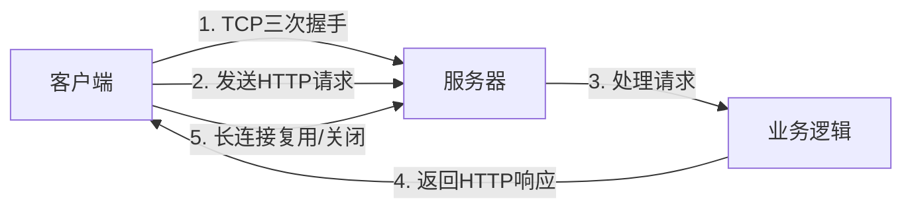
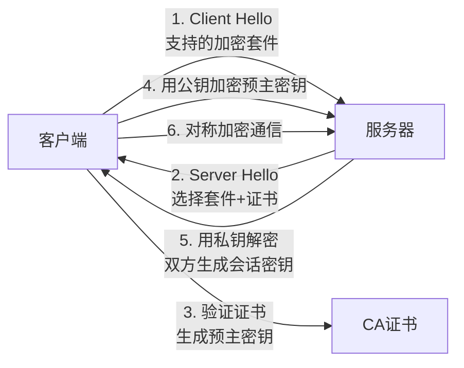

# HTTP 协议完整指南

> **文档说明**：Web开发的核心协议，涵盖请求响应结构、方法、状态码、头部、缓存、跨域、HTTPS、HTTP/2/3。前后端开发者必学。
>
> **适用人群**：Web开发者

---

## 一、概述

HTTP（HyperText Transfer Protocol）是万维网的数据传输协议，基于TCP/IP，客户端-服务器模式，无状态。

### HTTP版本演进

| 版本 | 年份 | 特点 |
|------|------|------|
| HTTP/1.0 | 1996 | 每次请求新建连接 |
| HTTP/1.1 | 1999 | 长连接、管道化、缓存控制（最常用） |
| HTTP/2 | 2015 | 二进制分帧、多路复用、头部压缩 |
| HTTP/3 | 2022 | 基于QUIC（UDP）、0-RTT、连接迁移 |

---

## 二、底层原理

### 请求响应模型



### 请求结构

```json
POST /api/users HTTP/1.1          ← 请求行（方法 + 路径 + 版本）
Host: example.com                  ← 请求头
Content-Type: application/json
Authorization: Bearer token123
Content-Length: 27

{"name":"张三","age":25}           ← 请求体
```

### 响应结构

```json
HTTP/1.1 200 OK                    ← 状态行（版本 + 状态码 + 原因）
Content-Type: application/json     ← 响应头
Content-Length: 45
Set-Cookie: session=abc123

{"id":1,"name":"张三","age":25}    ← 响应体
```

---

## 三、实操示例

### 1. 请求方法

| 方法 | 语义 | 幂等 | 有请求体 | 用途 |
|------|------|------|---------|------|
| GET | 获取资源 | ✅ | ❌ | 查询 |
| POST | 创建资源 | ❌ | ✅ | 新增/提交 |
| PUT | 全量更新 | ✅ | ✅ | 更新（整体替换） |
| PATCH | 部分更新 | ❌ | ✅ | 更新（部分字段） |
| DELETE | 删除资源 | ✅ | ❌ | 删除 |
| HEAD | 获取响应头 | ✅ | ❌ | 检查资源存在 |
| OPTIONS | 查询支持的方法 | ✅ | ❌ | 跨域预检 |

### 2. 状态码

| 类别 | 常见状态码 | 说明 |
|------|-----------|------|
| 1xx 信息 | 100 Continue | 继续发送 |
| 2xx 成功 | 200 OK | 请求成功 |
| | 201 Created | 资源创建成功 |
| | 204 No Content | 成功但无返回体 |
| 3xx 重定向 | 301 Moved Permanently | 永久重定向 |
| | 302 Found | 临时重定向 |
| | 304 Not Modified | 缓存有效 |
| 4xx 客户端错误 | 400 Bad Request | 请求参数错误 |
| | 401 Unauthorized | 未认证 |
| | 403 Forbidden | 无权限 |
| | 404 Not Found | 资源不存在 |
| | 405 Method Not Allowed | 方法不允许 |
| | 429 Too Many Requests | 请求限流 |
| 5xx 服务端错误 | 500 Internal Server Error | 服务器内部错误 |
| | 502 Bad Gateway | 网关错误 |
| | 503 Service Unavailable | 服务不可用 |
| | 504 Gateway Timeout | 网关超时 |

### 3. 常用请求头

| 头部 | 说明 | 示例 |
|------|------|------|
| Host | 目标主机 | example.com |
| Content-Type | 请求体类型 | application/json |
| Authorization | 认证令牌 | Bearer token |
| Cookie | 客户端Cookie | session=abc |
| User-Agent | 客户端标识 | Mozilla/5.0... |
| Accept | 能接受的响应类型 | application/json |
| Accept-Encoding | 支持的压缩 | gzip, deflate |
| Origin | 跨域源 | https://app.com |
| Referer | 来源页面 | https://example.com/page |

### 4. 常用响应头

| 头部 | 说明 | 示例 |
|------|------|------|
| Content-Type | 响应体类型 | application/json |
| Content-Length | 响应体长度 | 1024 |
| Set-Cookie | 设置Cookie | session=abc; HttpOnly |
| Cache-Control | 缓存控制 | max-age=3600 |
| ETag | 资源版本标识 | "abc123" |
| Access-Control-Allow-Origin | 跨域允许源 | * |
| Location | 重定向地址 | /new-page |
| X-Request-ID | 请求追踪ID | uuid-xxx |

### 5. Cookie与Session

```css
# Cookie设置响应头
Set-Cookie: session_id=abc123; Path=/; HttpOnly; Secure; Max-Age=3600; SameSite=Lax

# 属性说明：
# HttpOnly：禁止JS访问，防XSS
# Secure：只在HTTPS下传输
# Max-Age：过期时间（秒）
# SameSite：跨站策略（Strict/Lax/None）
```

### 6. 缓存机制

```css
# 强缓存（不发请求）
Cache-Control: max-age=3600    # 3600秒内直接用缓存
Expires: Wed, 28 Aug 2026 10:00:00 GMT  # 过期时间（HTTP/1.0）

# 协商缓存（发请求验证）
ETag: "abc123"                  # 资源唯一标识
If-None-Match: "abc123"         # 请求时带上
→ 304 Not Modified（缓存有效）

Last-Modified: Wed, 27 Aug 2026 10:00:00 GMT
If-Modified-Since: Wed, 27 Aug 2026 10:00:00 GMT
→ 304 Not Modified
```

### 7. 跨域CORS

```css
# 简单请求（GET/POST+简单Content-Type）
# 浏览器直接发请求，响应头检查Access-Control-Allow-Origin

# 预检请求（PUT/DELETE/自定义头/JSON）
# 先发OPTIONS预检请求
OPTIONS /api/users HTTP/1.1
Origin: https://app.com
Access-Control-Request-Method: PUT
Access-Control-Request-Headers: Content-Type

# 服务器响应
HTTP/1.1 204 No Content
Access-Control-Allow-Origin: https://app.com
Access-Control-Allow-Methods: GET, POST, PUT, DELETE
Access-Control-Allow-Headers: Content-Type, Authorization
Access-Control-Max-Age: 86400

# 预检通过后才发真实请求
```

### 8. HTTPS原理



非对称加密（RSA）用于密钥交换，对称加密（AES）用于数据传输。

---

## 四、常见问题与排查

| 问题 | 原因 | 排查方法 |
|------|------|---------|
| 跨域报错 | CORS配置不对 | 看响应头Access-Control-Allow-Origin |
| 401未认证 | Token缺失/过期 | 检查Authorization头 |
| 403无权限 | 认证了但没权限 | 检查用户角色权限 |
| 缓存不生效 | Cache-Control配置错 | 看响应头，强缓存vs协商缓存 |
| Cookie不携带 | SameSite/Secure/跨域 | 检查Cookie属性和withCredentials |
| 请求很慢 | DNS/网络/服务器 | 用curl -w看各阶段耗时 |

### curl调试技巧

```bash
# 查看完整请求响应
curl -v https://example.com

# 只看响应头
curl -I https://example.com

# 发送POST JSON
curl -X POST https://example.com/api   -H "Content-Type: application/json"   -d '{"name":"张三"}'

# 查看各阶段耗时
curl -w "DNS:%{time_namelookup}s 连接:%{time_connect}s 总:%{time_total}s
" -o /dev/null https://example.com
```

---

## 五、进阶与最佳实践

- **RESTful API设计**：GET查询/POST创建/PUT更新/DELETE删除，URL用名词复数
- **版本控制**：URL版本（/api/v1/users）或Header版本
- **幂等性**：GET/PUT/DELETE幂等，POST不幂等
- **安全**：HTTPS + Token认证 + 参数校验 + 限流
- **性能**：合理缓存 + gzip压缩 + CDN + 连接复用
- **可观测性**：每个请求加X-Request-ID，便于链路追踪

---

## 六、关联笔记

[[HTTPS与TLS握手]] · [[HTTP1.1-2-3演进]] · [[WebSocket与SSE原理]] · [[TCPIP协议栈详解]]

> 🔍 **知识点深度解析**
>
> **作用**：HTTP是Web通信的基础协议，前后端开发每天都在用。
>
> **原理**：基于TCP的请求-响应协议，无状态，通过头部传递元数据。
>
> **用法要点**：① 方法语义（GET查/POST增/PUT改/DELETE删） ② 状态码分类 ③ 缓存（强缓存+协商缓存） ④ CORS跨域 ⑤ Cookie安全属性 ⑥ HTTPS加密流程

---

> 💡 **深度讲解**：HTTP看似简单，但细节很多。面试常考：缓存机制、跨域、Cookie/Session、HTTPS握手、HTTP/2多路复用。实际开发中最容易踩坑的是跨域和缓存——跨域要理解预检请求机制，缓存要区分强缓存和协商缓存。建议用Chrome DevTools的Network面板多观察请求响应头，直观理解每个字段的作用。
>
> **📝 精简总结**：HTTP = 请求行+头+体 / 响应行+头+体，重点是方法语义、状态码、缓存、跨域、HTTPS。
