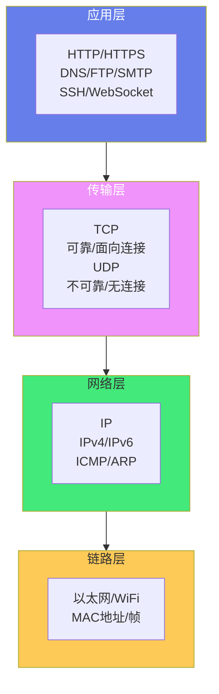
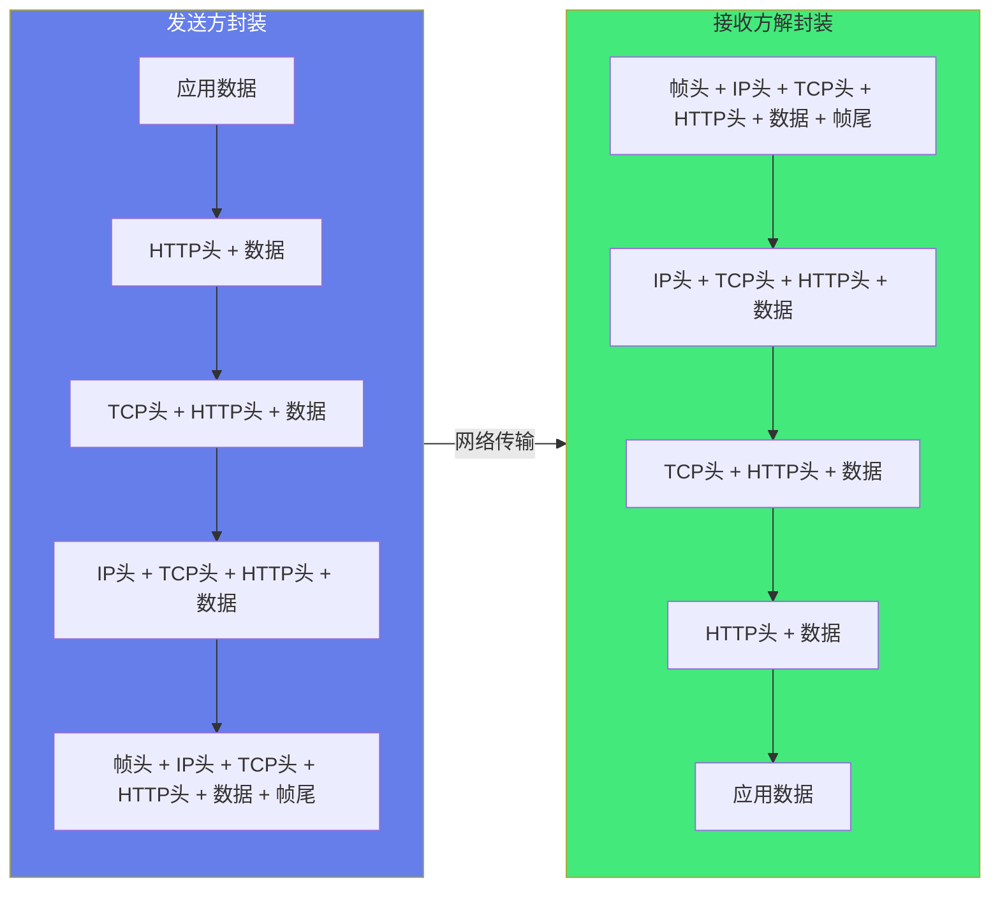
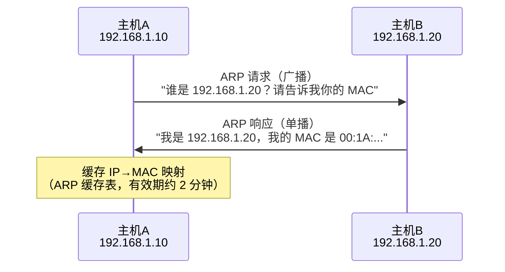
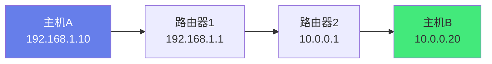
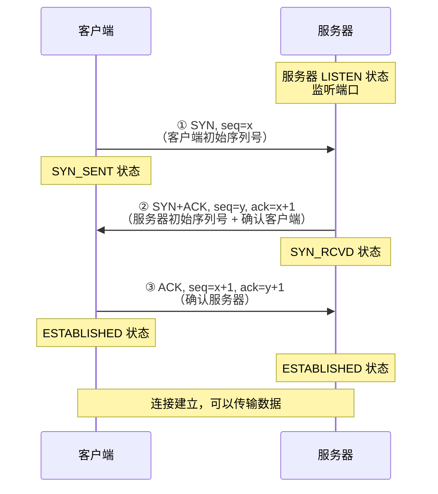
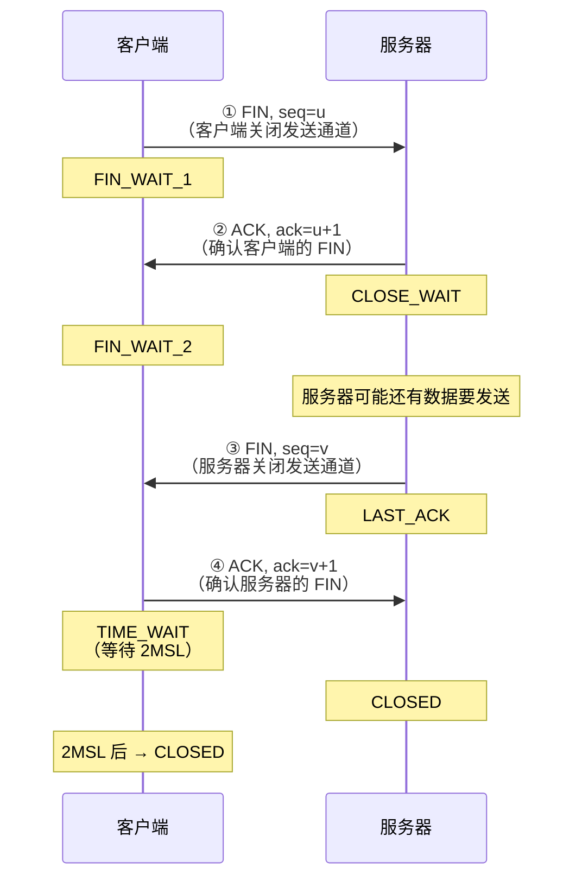
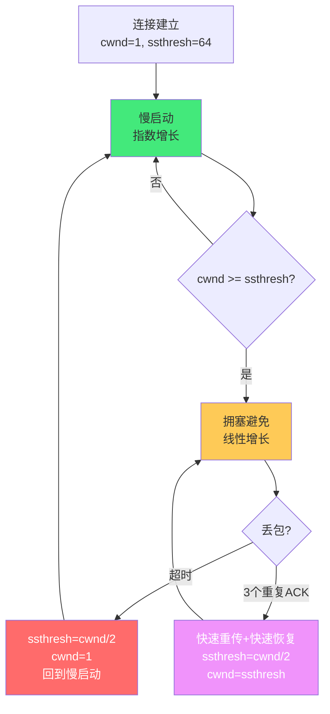
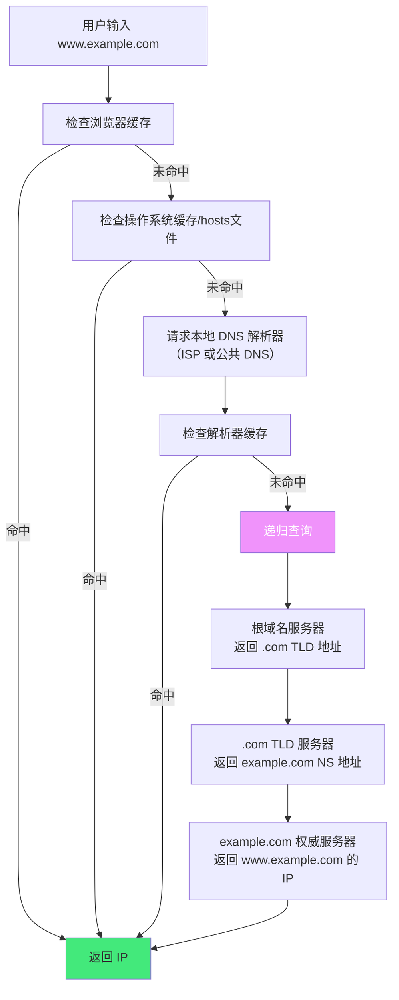
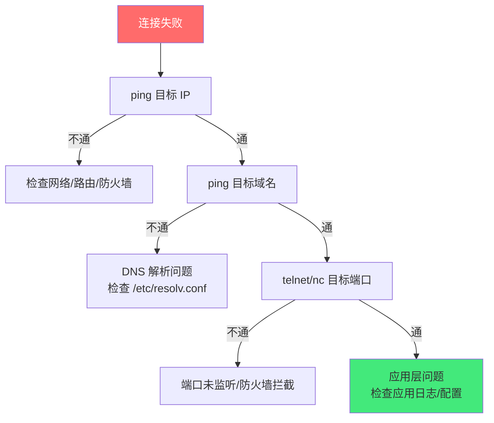

# 🌐 TCP/IP 协议栈详解

> **文档说明**：系统讲解 TCP/IP 协议栈的完整知识体系，涵盖 OSI 七层模型与 TCP/IP 四层模型对比、各层协议与功能、IP 协议（地址/子网/路由/分片）、TCP 协议（报文格式/状态机/三次握手/四次挥手/流量控制/拥塞控制/可靠传输）、UDP 协议（特点/适用场景/报文格式）、DNS/HTTP/HTTPS 应用层协议、网络排障工具（ping/traceroute/netstat/ss/tcpdump）、常见网络问题排查、性能优化与最佳实践。
>
> **适用人群**：后端开发者、运维工程师、网络工程师、全栈开发者、计算机专业学生、面试准备者
>
> **前置知识**：[[计算机网络分层模型速查]] · [[HTTP协议完整指南]]

---

## 一、概述

### 1.1 什么是 TCP/IP 协议栈

TCP/IP 协议栈是互联网的基础协议族，由一系列协议组成，定义了数据如何在网络中封装、寻址、传输和接收。它不是单一协议，而是以 TCP（传输控制协议）和 IP（网际协议）为核心的协议集合。



### 1.2 OSI 七层 vs TCP/IP 四层

| OSI 七层 | TCP/IP 四层 | 协议 | 说明 |
|---------|-----------|------|------|
| 应用层 | **应用层** | HTTP、FTP、SMTP、DNS、SSH | 为应用程序提供网络服务 |
| 表示层 | **应用层** | SSL/TLS、编码、压缩 | 数据格式转换、加密解密 |
| 会话层 | **应用层** | 会话管理、RPC | 建立和管理会话 |
| 传输层 | **传输层** | TCP、UDP | 端到端通信、流量控制 |
| 网络层 | **网络层** | IP、ICMP、ARP、OSPF | 路由选择、逻辑寻址 |
| 数据链路层 | **链路层** | 以太网、WiFi、PPP | 物理寻址、帧封装 |
| 物理层 | **链路层** | 网线、光纤、无线电信号 | 比特流传输 |

> OSI 是理论模型，TCP/IP 是实际使用的模型。TCP/IP 将 OSI 的上三层合并为应用层，下两层合并为链路层，更简洁实用。

### 1.3 数据封装与解封装

数据在协议栈中从上到下传输时，每一层都会添加自己的头部（封装）；从下到上传输时，每一层移除对应的头部（解封装）。



**各层数据单元名称**：
| 层 | 数据单元名称 |
|----|------------|
| 应用层 | 消息（Message）/ 数据（Data） |
| 传输层 | 段（Segment，TCP）/ 数据报（Datagram，UDP） |
| 网络层 | 分组/包（Packet） |
| 链路层 | 帧（Frame） |

---

## 二、链路层

### 2.1 功能与协议

链路层负责在同一物理网络（如以太网、WiFi）中相邻节点之间的数据传输。

| 协议/技术 | 说明 |
|----------|------|
| **以太网（Ethernet）** | 最常用的有线局域网技术，使用 MAC 地址寻址 |
| **WiFi（802.11）** | 无线局域网技术 |
| **PPP** | 点对点协议，用于拨号/宽带连接 |
| **ARP** | 地址解析协议，将 IP 地址解析为 MAC 地址 |
| **VLAN** | 虚拟局域网，逻辑划分广播域 |

### 2.2 MAC 地址

MAC（Media Access Control）地址是网络接口的物理地址，全球唯一，48 位（6 字节），通常表示为十六进制：`00:1A:2B:3C:4D:5E`。

- 前 24 位：OUI（组织唯一标识符），由 IEEE 分配给厂商
- 后 24 位：厂商分配的序列号
- 广播地址：`FF:FF:FF:FF:FF:FF`

### 2.3 ARP 协议

ARP（Address Resolution Protocol）将 IP 地址解析为 MAC 地址。



**ARP 缓存查看**：
```bash
arp -a                    # 查看 ARP 缓存表
ip neigh show             # Linux 查看邻居表
arp -d 192.168.1.20      # 删除指定 ARP 条目
```

---

## 三、网络层（IP 协议）

### 3.1 IP 协议功能

IP（Internet Protocol）是网络层的核心协议，负责：
- **逻辑寻址**：用 IP 地址标识网络中的主机
- **路由选择**：选择数据从源到目的的路径
- **分片与重组**：大数据包在不同 MTU 的网络中传输时分片
- **不可靠传输**：不保证交付，不保证顺序，出错直接丢弃

### 3.2 IPv4 地址

IPv4 地址 32 位，通常用点分十进制表示：`192.168.1.1`。

**地址分类**（传统分类，现已被 CIDR 取代）：
| 类别 | 范围 | 默认子网掩码 | 用途 |
|------|------|------------|------|
| A | 1.0.0.0 - 126.255.255.255 | 255.0.0.0 (/8) | 大型网络 |
| B | 128.0.0.0 - 191.255.255.255 | 255.255.0.0 (/16) | 中型网络 |
| C | 192.0.0.0 - 223.255.255.255 | 255.255.255.0 (/24) | 小型网络 |
| D | 224.0.0.0 - 239.255.255.255 | — | 组播 |
| E | 240.0.0.0 - 255.255.255.255 | — | 保留 |

**特殊地址**：
| 地址 | 说明 |
|------|------|
| 0.0.0.0 | 所有网络接口 / 默认路由 |
| 127.0.0.0/8 | 回环地址（localhost） |
| 169.254.0.0/16 | 链路本地地址（DHCP 失败时自动分配） |
| 10.0.0.0/8 | 私有地址 |
| 172.16.0.0/12 | 私有地址 |
| 192.168.0.0/16 | 私有地址 |
| 224.0.0.0/4 | 组播地址 |
| 255.255.255.255 | 受限广播地址 |

### 3.3 CIDR 与子网划分

CIDR（Classless Inter-Domain Routing）用 `IP/前缀长度` 表示，如 `192.168.1.0/24`，前缀长度表示网络位的位数。

**子网计算**：
```text
192.168.1.100/24
- 网络地址：192.168.1.0（前 24 位为网络位）
- 广播地址：192.168.1.255
- 可用主机数：2^8 - 2 = 254（减去网络地址和广播地址）
- 子网掩码：255.255.255.0

10.0.0.0/16 划分为 4 个子网：
- 10.0.0.0/18   （10.0.0.0 - 10.0.63.255）
- 10.0.64.0/18  （10.0.64.0 - 10.0.127.255）
- 10.0.128.0/18 （10.0.128.0 - 10.0.191.255）
- 10.0.192.0/18 （10.0.192.0 - 10.0.255.255）
```

### 3.4 IPv6

IPv6 地址 128 位，解决 IPv4 地址耗尽问题。表示为 8 组十六进制：`2001:0db8:85a3:0000:0000:8a2e:0370:7334`，可简写为 `2001:db8:85a3::8a2e:370:7334`。

**IPv6 优势**：
- 地址空间极大（2^128 ≈ 3.4×10^38）
- 无广播，用组播替代
- 内置 IPsec 支持
- 简化的报文头，提高路由效率
- 支持即插即用（SLAAC）

### 3.5 ICMP 协议

ICMP（Internet Control Message Protocol）用于网络诊断和错误报告。

| 类型 | 说明 |
|------|------|
| **Echo Request/Reply** | ping 使用，测试连通性 |
| **Destination Unreachable** | 目标不可达（端口/主机/协议不可达） |
| **Time Exceeded** | TTL 超时（traceroute 使用） |
| **Redirect** | 路由重定向 |
| **Parameter Problem** | 报文头参数错误 |

```bash
ping 8.8.8.8              # 测试连通性
ping -c 4 8.8.8.8         # 发送 4 个包
traceroute 8.8.8.8        # 追踪路由路径（Linux）
tracert 8.8.8.8           # Windows
mtr 8.8.8.8                # 结合 ping 和 traceroute
```

### 3.6 路由

路由是选择数据包从源到目的路径的过程。



**路由表查看**：
```bash
route -n                  # Linux 查看路由表
ip route show             # Linux 新式命令
netstat -rn               # 通用
```

**路由类型**：
| 类型 | 说明 |
|------|------|
| **直连路由** | 直接连接的网络，自动生成 |
| **静态路由** | 手动配置的路由 |
| **动态路由** | 通过路由协议（OSPF/BGP/RIP）自动学习 |
| **默认路由** | 0.0.0.0/0，所有未匹配的数据包走默认网关 |

---

## 四、传输层

### 4.1 TCP vs UDP

| 维度 | TCP | UDP |
|------|-----|-----|
| **连接性** | 面向连接（三次握手建立连接） | 无连接（直接发送） |
| **可靠性** | 可靠（确认、重传、排序） | 不可靠（不保证交付） |
| **顺序性** | 保证顺序 | 不保证顺序 |
| **流量控制** | 有（滑动窗口） | 无 |
| **拥塞控制** | 有（慢启动、拥塞避免） | 无 |
| **头部开销** | 20-60 字节 | 8 字节 |
| **速度** | 较慢（握手、确认、重传） | 快（无额外开销） |
| **适用场景** | Web、邮件、文件传输、SSH | 视频直播、DNS、游戏、VoIP |

### 4.2 TCP 报文格式

```text
0                   1                   2                   3
0 1 2 3 4 5 6 7 8 9 0 1 2 3 4 5 6 7 8 9 0 1 2 3 4 5 6 7 8 9 0 1
+-+-+-+-+-+-+-+-+-+-+-+-+-+-+-+-+-+-+-+-+-+-+-+-+-+-+-+-+-+-+-+-+
|          源端口 Source Port     |       目的端口 Dest Port      |
+-+-+-+-+-+-+-+-+-+-+-+-+-+-+-+-+-+-+-+-+-+-+-+-+-+-+-+-+-+-+-+-+
|                        序列号 Sequence Number                    |
+-+-+-+-+-+-+-+-+-+-+-+-+-+-+-+-+-+-+-+-+-+-+-+-+-+-+-+-+-+-+-+-+
|                     确认号 Acknowledgment Number                 |
+-+-+-+-+-+-+-+-+-+-+-+-+-+-+-+-+-+-+-+-+-+-+-+-+-+-+-+-+-+-+-+-+
| 数据偏移| 保留 |U|A|P|R|S|F|            窗口大小 Window         |
|  (4位) | (6位)|R|C|S|S|Y|I|            (16位)                  |
|        |      |G|K|H|T|N|N|                                   |
+-+-+-+-+-+-+-+-+-+-+-+-+-+-+-+-+-+-+-+-+-+-+-+-+-+-+-+-+-+-+-+-+
|           校验和 Checksum        |         紧急指针 Urgent       |
+-+-+-+-+-+-+-+-+-+-+-+-+-+-+-+-+-+-+-+-+-+-+-+-+-+-+-+-+-+-+-+-+
|                    选项 Options（可变长度）                       |
+-+-+-+-+-+-+-+-+-+-+-+-+-+-+-+-+-+-+-+-+-+-+-+-+-+-+-+-+-+-+-+-+
|                           数据 Data                              |
+-+-+-+-+-+-+-+-+-+-+-+-+-+-+-+-+-+-+-+-+-+-+-+-+-+-+-+-+-+-+-+-+
```

**TCP 标志位**：
| 标志 | 名称 | 说明 |
|------|------|------|
| **URG** | 紧急 | 紧急指针有效 |
| **ACK** | 确认 | 确认号有效（连接建立后所有包都置位） |
| **PSH** | 推送 | 接收方应立即将数据交给应用层 |
| **RST** | 复位 | 重置连接（异常断开） |
| **SYN** | 同步 | 建立连接时同步序列号 |
| **FIN** | 结束 | 优雅关闭连接 |

### 4.3 TCP 三次握手

TCP 通过三次握手建立连接，同步双方的初始序列号（ISN）。



**为什么是三次而不是两次**：
1. **同步双方序列号**：三次握手让双方都确认了对方的初始序列号，两次只能让一方确认
2. **防止已失效的连接请求**：如果客户端的旧 SYN 延迟到达服务器，两次握手会导致服务器建立无效连接；三次握手中客户端会忽略服务器对旧 SYN 的响应
3. **双方都确认收发能力**：三次握手让双方都确认了对方的发送和接收能力正常

**半连接队列与全连接队列**：
- 半连接队列（SYN queue）：存储 SYN_RECV 状态的连接（收到 SYN，发送了 SYN+ACK，等待 ACK）
- 全连接队列（Accept queue）：存储 ESTABLISHED 状态但未被 accept() 的连接
- SYN Flood 攻击：发送大量 SYN 不回复 ACK，占满半连接队列

### 4.4 TCP 四次挥手

TCP 通过四次挥手优雅关闭连接，因为 TCP 是全双工的，双方需要各自关闭发送通道。



**TIME_WAIT 状态**：
- 主动关闭方在发送最后一个 ACK 后进入 TIME_WAIT
- 持续 2MSL（Maximum Segment Lifetime，约 2 分钟）
- **原因 1**：确保最后一个 ACK 能到达对方（如果丢失，对方会重发 FIN，TIME_WAIT 期间可以重发 ACK）
- **原因 2**：让本次连接的所有报文在网络中消失，防止影响新连接（四元组相同的新连接）

**TIME_WAIT 过多的问题与优化**：
```bash
# 查看连接状态统计
netstat -an | awk '/tcp/ {print $6}' | sort | uniq -c
ss -s

# 优化参数（/etc/sysctl.conf）
net.ipv4.tcp_tw_reuse = 1        # 允许 TIME_WAIT 套接字重新用于新连接
net.ipv4.tcp_fin_timeout = 30    # 减少 FIN_WAIT_2 超时
net.ipv4.tcp_max_tw_buckets = 10000  # TIME_WAIT 最大数量
```

### 4.5 TCP 可靠传输机制

TCP 通过以下机制保证可靠传输：

| 机制 | 说明 |
|------|------|
| **序列号** | 每个字节都有序列号，接收方按序重组 |
| **确认应答（ACK）** | 接收方发送确认号，表示已收到该序号之前的所有数据 |
| **超时重传** | 发送方在超时时间内未收到 ACK，重传数据 |
| **快速重传** | 收到 3 个重复 ACK 时立即重传，不必等超时 |
| **滑动窗口** | 接收方通告窗口大小，控制发送速率（流量控制） |
| **拥塞控制** | 根据网络拥塞程度调整发送速率 |

**滑动窗口（流量控制）**：
```text
发送方窗口（接收方通告窗口 = 400 字节）：

已发送且已确认 | 已发送未确认 | 可发送未发送 | 不可发送
   1-100       |   101-200   |   201-400   |  401+
                |<---- 窗口大小 400 ---->|

收到 ACK=201, window=300 后：
已发送且已确认 | 已发送未确认 | 可发送未发送 | 不可发送
   1-200       |   201-300   |   301-500   |  501+
```

### 4.6 TCP 拥塞控制

拥塞控制防止发送方发送过多数据导致网络拥塞。

**四个阶段**：

| 阶段 | 说明 | 窗口增长 |
|------|------|---------|
| **慢启动（Slow Start）** | 连接建立或超时后，从 1 个 MSS 开始指数增长 | 每收到一个 ACK，cwnd += 1（指数增长） |
| **拥塞避免（Congestion Avoidance）** | cwnd 达到慢启动阈值（ssthresh）后线性增长 | 每个 RTT，cwnd += 1（线性增长） |
| **快速重传（Fast Retransmit）** | 收到 3 个重复 ACK，立即重传，不等超时 | — |
| **快速恢复（Fast Recovery）** | 快速重传后，ssthresh=cwnd/2，cwnd=ssthresh，进入拥塞避免 | — |



**拥塞控制算法**：
| 算法 | 说明 |
|------|------|
| **Tahoe** | 最早版本，任何丢包都 cwnd=1 回到慢启动 |
| **Reno** | 增加快速恢复，3 个重复 ACK 时 cwnd 减半而非归零 |
| **New Reno** | 改进 Reno，处理多个包丢失的情况 |
| **CUBIC** | Linux 默认，基于三次函数的窗口增长，公平性好 |
| **BBR** | Google 提出，基于带宽和延迟估计，不依赖丢包信号 |

### 4.7 UDP 协议

UDP（User Datagram Protocol）是无连接、不可靠的传输层协议。

**UDP 报文格式**（仅 8 字节头部）：
```text
0      7 8     15 16    23 24    31
+--------+--------+--------+--------+
|     源端口      |    目的端口     |
+--------+--------+--------+--------+
|     长度        |     校验和      |
+--------+--------+--------+--------+
|              数据 Data             |
+-----------------------------------+
```

**UDP 特点**：
- 无连接，发送前不需要建立连接
- 不保证可靠交付、不保证顺序、不重传
- 没有流量控制和拥塞控制
- 头部开销小（8 字节 vs TCP 20-60 字节）
- 支持广播和组播

**UDP 适用场景**：
- 实时应用：视频直播、VoIP、在线游戏（允许少量丢包，延迟更重要）
- 查询-响应：DNS、DHCP（一次请求一次响应，不需要建立连接）
- 组播/广播：路由协议、服务发现
- 隧道：VXLAN、GRE、QUIC（基于 UDP 的可靠传输）

> QUIC（HTTP/3 使用）是基于 UDP 的可靠传输协议，在应用层实现了 TCP 的可靠传输、拥塞控制、流量控制，同时避免了 TCP 的队头阻塞和握手延迟。

---

## 五、应用层

### 5.1 常见应用层协议

| 协议 | 端口 | 说明 |
|------|------|------|
| **HTTP** | 80 | 超文本传输协议，Web 基础 |
| **HTTPS** | 443 | HTTP over TLS，加密的 Web |
| **DNS** | 53（UDP/TCP） | 域名解析，将域名转为 IP |
| **FTP** | 20/21 | 文件传输协议（21 控制，20 数据） |
| **SSH** | 22 | 安全远程登录 |
| **SMTP** | 25 | 发送邮件 |
| **POP3** | 110 | 接收邮件 |
| **IMAP** | 143 | 接收邮件（更高级） |
| **Telnet** | 23 | 远程登录（不安全，已被 SSH 取代） |
| **RDP** | 3389 | Windows 远程桌面 |
| **MySQL** | 3306 | 数据库 |
| **Redis** | 6379 | 缓存数据库 |
| **MongoDB** | 27017 | 文档数据库 |

### 5.2 DNS 解析过程

DNS（Domain Name System）将域名解析为 IP 地址。



**DNS 记录类型**：
| 类型 | 说明 |
|------|------|
| **A** | 域名 → IPv4 地址 |
| **AAAA** | 域名 → IPv6 地址 |
| **CNAME** | 域名 → 另一个域名（别名） |
| **MX** | 邮件交换记录 |
| **TXT** | 文本记录（SPF/DKIM 等） |
| **NS** | 域名服务器记录 |
| **SOA** | 起始授权记录 |
| **PTR** | 反向解析（IP → 域名） |
| **SRV** | 服务定位记录 |

```bash
nslookup example.com         # 查询 DNS
dig example.com              # 详细 DNS 查询
dig example.com MX           # 查询 MX 记录
dig @8.8.8.8 example.com     # 指定 DNS 服务器
host example.com             # 简单查询
```

---

## 六、网络排障工具

### 6.1 连通性测试

```bash
# ping：测试网络连通性和延迟
ping 8.8.8.8
ping -c 10 example.com       # 发送 10 个包
ping -i 0.5 8.8.8.8          # 每 0.5 秒一个包

# traceroute/mtr：追踪路由路径
traceroute 8.8.8.8            # Linux
tracert 8.8.8.8               # Windows
mtr 8.8.8.8                    # 结合 ping 和 traceroute，实时统计

# curl：测试 HTTP 连接
curl -v https://example.com   # 详细输出
curl -I https://example.com   # 只看响应头
curl -o /dev/null -s -w "%{http_code} %{time_total}s\n" https://example.com
```

### 6.2 查看连接与端口

```bash
# netstat：查看网络连接（旧工具）
netstat -tlnp                  # 查看监听的 TCP 端口
netstat -tunap                 # 查看所有 TCP/UDP 连接
netstat -s                     # 查看协议统计

# ss：iproute2 新工具，更快
ss -tlnp                       # 查看监听的 TCP 端口
ss -tunap                      # 查看所有连接
ss -s                          # 查看连接统计
ss -ti                          # 查看 TCP 内部信息（拥塞窗口、RTT 等）

# lsof：查看进程打开的文件（包括端口）
lsof -i :8080                  # 查看占用 8080 端口的进程
lsof -i TCP                    # 查看所有 TCP 连接
lsof -p <pid>                  # 查看指定进程打开的所有文件

# fuser：查看占用端口的进程
fuser 8080/tcp                 # 查看占用 8080 端口的进程
```

### 6.3 抓包分析

```bash
# tcpdump：命令行抓包工具
tcpdump -i any                  # 抓取所有接口的包
tcpdump -i eth0 port 80        # 抓取 eth0 上 80 端口的包
tcpdump -i any host 8.8.8.8    # 抓取与 8.8.8.8 通信的包
tcpdump -i any -w capture.pcap  # 保存到文件
tcpdump -r capture.pcap         # 读取保存的文件
tcpdump -i any -nn -vv          # 不解析域名端口，详细输出

# Wireshark：图形化抓包分析工具（最强大）
# 过滤器语法：
# ip.addr == 192.168.1.1       按 IP 过滤
# tcp.port == 80                按端口过滤
# http                           按协议过滤
# tcp.flags.syn == 1            按 TCP 标志位过滤
# frame contains "password"     按内容过滤
```

### 6.4 域名与路由

```bash
# 域名解析
nslookup example.com
dig example.com +trace           # 追踪完整解析过程
dig example.com @8.8.8.8        # 指定 DNS 服务器

# 路由表
ip route show                    # 查看路由表
route -n                         # 旧命令
traceroute 8.8.8.8              # 追踪路径

# 网络接口
ip addr show                     # 查看网络接口和 IP
ip link show                     # 查看链路状态
ifconfig                         # 旧命令
ethtool eth0                     # 查看网卡硬件信息

# ARP
arp -a                           # 查看 ARP 缓存
ip neigh show                    # 新命令
```

---

## 七、常见问题排查

### 7.1 连接失败排查步骤



### 7.2 常见问题与解决方案

| 问题 | 可能原因 | 排查/解决方案 |
|------|---------|-------------|
| **Connection refused** | 目标端口未监听 / 服务未启动 / 防火墙拒绝 | `ss -tlnp` 检查端口，检查服务状态，检查防火墙规则 |
| **Connection timed out** | 网络不通 / 防火墙丢弃 / 路由错误 | `ping`/`traceroute` 测试连通性，检查防火墙和路由 |
| **DNS 解析失败** | DNS 服务器配置错误 / 网络不通 / 域名不存在 | 检查 `/etc/resolv.conf`，`dig @8.8.8.8` 测试，检查域名 |
| **连接慢** | DNS 解析慢 / 网络延迟高 / 服务响应慢 | `dig` 测 DNS 时间，`ping` 测延迟，应用层日志分析 |
| **大量 TIME_WAIT** | 短连接过多 / 主动关闭方 | 调整 `tcp_tw_reuse`，使用长连接/连接池 |
| **大量 CLOSE_WAIT** | 应用未正确关闭连接（bug） | 检查应用代码，确保 close()，调整 `tcp_fin_timeout` |
| **TCP 重传率高** | 网络丢包 / 拥塞 / 网卡问题 | `netstat -s` 看重传统计，检查网络质量，更换网线/网卡 |
| **端口被占用** | 其他进程占用端口 | `lsof -i :端口` 或 `ss -tlnp` 查找进程，停止或换端口 |
| **MTU 问题** | 大包丢失 / 分片问题 | `ping -M do -s 1472 目标` 测试 MTU，检查 PMTUD |
| **半连接队列满** | SYN Flood 攻击 / 并发连接过高 | `netstat -s` 看 SYN 丢弃，调整 `tcp_max_syn_backlog`，开启 SYN Cookie |

### 7.3 内核参数调优

```bash
# /etc/sysctl.conf 常见优化

# 网络核心
net.core.rmem_max = 16777216          # 接收缓冲区最大
net.core.wmem_max = 16777216          # 发送缓冲区最大
net.core.netdev_max_backlog = 5000    # 网卡数据包队列长度
net.core.somaxconn = 65535             # 全连接队列大小

# TCP
net.ipv4.tcp_rmem = 4096 87380 16777216   # TCP 接收缓冲区（min default max）
net.ipv4.tcp_wmem = 4096 65536 16777216   # TCP 发送缓冲区
net.ipv4.tcp_syncookies = 1                 # 开启 SYN Cookie（防 SYN Flood）
net.ipv4.tcp_max_syn_backlog = 65535        # 半连接队列大小
net.ipv4.tcp_tw_reuse = 1                    # 允许 TIME_WAIT 重用
net.ipv4.tcp_fin_timeout = 30                # FIN_WAIT_2 超时
net.ipv4.tcp_keepalive_time = 600            # TCP keepalive 开始时间
net.ipv4.tcp_keepalive_intvl = 30            # keepalive 探测间隔
net.ipv4.tcp_keepalive_probes = 3            # keepalive 探测次数
net.ipv4.tcp_fastopen = 3                    # 开启 TCP Fast Open
net.ipv4.tcp_mtu_probing = 1                 # 开启 MTU 探测
net.core.default_qdisc = fq                   # 默认队列调度（配合 BBR）
net.ipv4.tcp_congestion_control = bbr        # 拥塞控制算法（bbr/cubic）

# 应用后生效
sysctl -p
```

---

## 八、关联笔记

### 网络协议
- [[HTTP协议完整指南]] · [[HTTPS与TLS握手]] · [[DNS与CDN架构]]
- [[WebSocket-实时通信]] · [[网络抓包与调试]]

### 操作系统
- [[Linux内核基础概念]] · [[进程线程与协程]] · [[IO模型与零拷贝]]
- [[Linux性能调优]]

### 运维与云原生
- [[Nginx高性能配置]] · [[K8s-网络模型]] · [[K8s-故障排查手册]]
- [[Docker容器化]]

### 导航
- [[MOC-计算机基础]] · [[MOC-计算机网络]] · [[MOC-综合导航]] · [[Home]]

> 🔍 **知识点深度解析**
>
> **作用**：TCP/IP 协议栈解决的是「跨网络数据可靠传输」问题——通过分层设计，将复杂的网络通信分解为链路层（物理寻址）、网络层（逻辑寻址与路由）、传输层（端到端可靠/不可靠传输）、应用层（应用服务），每一层专注解决自己的问题，通过标准化的接口和协议协作，实现了全球互联网的互联互通。TCP 提供可靠的面向连接传输，UDP 提供轻量的无连接传输，IP 提供路由和寻址，三者构成了互联网的核心。
>
> **底层原理**：TCP/IP 的核心是「分层与封装」——数据从应用层向下传输时，每一层添加自己的头部（封装），到达接收方后从链路层向上传输时，每一层移除对应的头部（解封装），最终还原应用数据。这种分层设计使得各层可以独立演进（如链路层从以太网到 WiFi，网络层从 IPv4 到 IPv6），而不影响其他层。TCP 的可靠性通过「序列号 + 确认应答 + 超时重传 + 滑动窗口 + 拥塞控制」实现：序列号保证数据有序，ACK 确认收到，超时未收到 ACK 则重传，滑动窗口实现流量控制（接收方控制发送速率），拥塞控制根据网络状况调整发送速率（慢启动指数增长→拥塞避免线性增长→丢包时降速）。三次握手建立连接是为了同步双方初始序列号并确认双方收发能力，四次挥手关闭连接是因为 TCP 全双工，双方需要各自关闭发送通道。IP 协议通过 IP 地址逻辑寻址，通过路由表选择路径，通过 ARP 将 IP 转为 MAC 地址实现链路层传输，通过分片处理不同 MTU 的网络。UDP 则是极简设计——8 字节头部，无连接无确认，适用于实时应用和查询响应场景。
>
> **用法要点**：① 分层模型：应用层（HTTP/DNS）→ 传输层（TCP/UDP）→ 网络层（IP/ICMP）→ 链路层（以太网/MAC） ② TCP 三次握手：SYN → SYN+ACK → ACK，同步双方序列号 ③ TCP 四次挥手：FIN → ACK → FIN → ACK，主动关闭方 TIME_WAIT 2MSL ④ TCP 可靠传输：序列号+ACK+超时重传+快速重传+滑动窗口+拥塞控制 ⑤ 拥塞控制：慢启动（指数）→ 拥塞避免（线性）→ 快速重传/快速恢复（3 重复 ACK）→ 超时（cwnd=1） ⑥ TCP vs UDP：TCP 可靠面向连接（Web/邮件/文件），UDP 轻量无连接（直播/DNS/游戏/QUIC） ⑦ IP 地址：IPv4 32 位点分十进制，CIDR 表示子网，私有地址 10/172.16/192.168 ⑧ DNS：递归查询（根→TLD→权威），A/AAAA/CNAME/MX/TXT 记录 ⑨ 排障工具：ping（连通性）、traceroute/mtr（路由）、ss/netstat（连接）、tcpdump/Wireshark（抓包）、dig/nslookup（DNS）、curl（HTTP） ⑩ 常见问题：Connection refused（端口未监听）、timed out（网络/防火墙）、DNS 失败（解析配置）、TIME_WAIT 过多（短连接）、CLOSE_WAIT（应用未 close）、重传率高（网络丢包）。

> 💡 **深度讲解**：TCP/IP 最核心的设计思想是「分层」和「端到端原则」。分层将复杂问题分解——链路层解决同一网络内的传输，网络层解决跨网络的路由，传输层解决端到端的可靠/不可靠传输，应用层解决具体的应用服务。每一层只关心自己的问题，通过标准化的接口与上下层交互，这使得互联网可以在不断演进中保持兼容（比如从 IPv4 升级到 IPv6 不需要改变 TCP 和 HTTP）。端到端原则是指：可靠性、安全性等功能应该在端系统（主机）实现，而不是在网络中间节点（路由器）实现。网络核心只做简单的转发（IP 协议，不可靠、无连接），复杂的功能（TCP 的可靠传输、TLS 的加密）在端系统实现。这就是为什么 IP 是不可靠的——它故意不保证可靠，把可靠性交给端系统的 TCP。这种设计让网络核心保持简单和高效，可以支持各种不同的传输需求（TCP 可靠、UDP 不可靠、QUIC 基于 UDP 的可靠），而不需要网络中间节点理解每种传输协议。TCP 的拥塞控制是另一个精妙设计——它不是预先知道网络带宽，而是通过「试探」来感知网络容量：慢启动阶段指数增长发送速率，直到丢包（说明网络拥塞），然后降低速率进入拥塞避免阶段线性增长。这种「加性增、乘性减」（AIMD）的算法让多个 TCP 连接能公平地共享网络带宽——每个连接在拥塞时都减半速率，空闲时都线性增加，最终收敛到公平分配。三次握手为什么不是两次？核心原因是「防止已失效的连接请求报文段突然又传送到了服务端，因而产生错误」——如果客户端发送的 SYN 在网络中延迟了，客户端超时重发了 SYN 并建立了连接，之后旧的 SYN 到达服务器，如果是两次握手服务器会建立一个无效连接；三次握手中客户端收到服务器对旧 SYN 的响应后，不会发送 ACK，服务器收不到 ACK 就不会建立连接。TIME_WAIT 状态为什么要等 2MSL？两个原因：一是确保最后一个 ACK 能到达对方（如果 ACK 丢失，对方会重发 FIN，TIME_WAIT 期间可以重发 ACK）；二是让本次连接的所有报文在网络中消失，防止延迟的旧报文影响四元组相同的新连接。

> 📝 **精简总结**：TCP/IP = 四层模型（应用/传输/网络/链路），数据封装自上而下，解封装自下而上。IP：逻辑寻址+路由，不可靠，IPv4 32位/IPv6 128位，CIDR子网，ARP解析MAC。TCP：面向连接可靠传输，三次握手建连，四次挥手关连，序列号+ACK+重传+滑动窗口+拥塞控制保证可靠。拥塞控制：慢启动（指数）→拥塞避免（线性）→快速重传/恢复→超时降速。UDP：无连接不可靠，8字节头部，适用于直播/DNS/游戏/QUIC。DNS：递归查询根→TLD→权威，A/AAAA/CNAME/MX记录。排障：ping/traceroute/ss/netstat/tcpdump/dig/curl。常见问题：refused（端口）、timeout（网络/防火墙）、DNS失败（解析）、TIME_WAIT多（短连接）、CLOSE_WAIT（应用bug）。

> **学习路径建议**：先学习 [[计算机网络分层模型速查]] 理解分层思想 → 学习本文档掌握 TCP/IP 协议栈 → 学习 [[HTTP协议完整指南]] 和 [[HTTPS与TLS握手]] 掌握应用层 → 学习 [[网络抓包与调试]] 实践抓包分析 → 学习 [[DNS与CDN架构]] 理解域名解析和内容分发 → 在项目中实践网络排障和性能优化。

---

> **TCP/IP 的本质是「在不可靠的网络上提供可靠的通信」——IP 层故意不保证可靠（只做最简单的转发），把可靠性交给端系统的 TCP。这种「网络核心简单、端系统智能」的端到端原则，是互联网能够蓬勃发展的关键设计。它让网络保持简单和可扩展，让创新在边缘发生——从 Web 到视频，从邮件到即时通讯，从云计算到物联网，所有的创新都不需要改变网络核心，只需要在端系统实现。理解了 TCP/IP，你就理解了互联网的底层逻辑，也理解了为什么这个看似简单的协议族能支撑起整个数字世界。**
