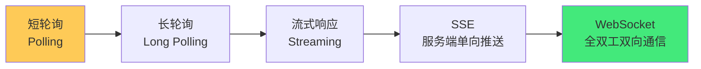

# 🔌 WebSocket 与 SSE 原理

> **文档说明**：系统讲解 WebSocket 与 Server-Sent Events（SSE）两种实时通信技术的完整知识体系，涵盖 HTTP 协议的局限性与实时通信的需求、轮询/长轮询/流式响应的演进、WebSocket 的握手协议与升级机制、数据帧格式、全双工通信原理、SSE 的事件流格式与自动重连机制、WebSocket vs SSE vs 轮询的深度对比、各语言服务端实现（Node.js/Java/Python/Go）、客户端 API 使用、心跳机制与断线重连、生产环境部署（Nginx 反向代理/负载均衡/连接数限制）、安全考虑（鉴权/CORS/Origin 校验）、常见问题与最佳实践。
>
> **适用人群**：全栈开发者、后端开发者、前端开发者、需要实时通信功能的工程师
>
> **前置知识**：[[HTTP协议完整指南]] · [[JavaScript核心语法与ES6+]] · [[TCPIP协议栈详解]]

---

## 一、概述

### 1.1 为什么需要实时通信

HTTP 协议是「请求-响应」模型——客户端发起请求，服务端返回响应，连接关闭。这种模型对于「客户端主动获取数据」的场景很合适，但对于「服务端需要主动推送数据给客户端」的场景（实时聊天、股票行情、在线协作、游戏、通知推送），HTTP 原生不支持。

**实时通信的演进**：


| 技术 | 原理 | 延迟 | 服务器负载 | 带宽 | 双向通信 |
|------|------|------|-----------|------|---------|
| **短轮询** | 客户端定时发请求（如每5秒） | 高（取决于轮询间隔） | 极高（大量无效请求） | 高（每次都有 HTTP 头） | ❌ |
| **长轮询** | 客户端发请求，服务端hold住直到有数据或超时 | 中（有数据立即返回） | 高（大量挂起连接） | 中 | ❌ |
| **流式响应** | 一个请求，服务端持续输出数据 | 低 | 中 | 低 | ❌ |
| **SSE** | HTTP 长连接，服务端单向推送事件流 | 低 | 低 | 低 | ❌（仅服务端→客户端） |
| **WebSocket** | TCP 长连接，全双工双向通信 | 极低 | 低 | 极低（无 HTTP 头开销） | ✅ |

### 1.2 什么是 WebSocket

WebSocket 是一种在单个 TCP 连接上进行**全双工通信**的协议，由 IETF 在 2011 年标准化为 RFC 6455。

**WebSocket 的核心特点**：
| 特点 | 说明 |
|------|------|
| **全双工** | 客户端和服务端可以同时双向发送数据 |
| **长连接** | 一次握手后连接保持，不需要每次重新建立 |
| **低开销** | 数据帧格式简单（2-14 字节头），没有 HTTP 头开销 |
| **跨域支持** | 原生支持跨域（通过 Origin 头校验） |
| **二进制支持** | 支持文本和二进制数据传输 |
| **子协议协商** | 握手时可协商应用层子协议（如 STOMP、MQTT） |

**WebSocket vs HTTP**：
| 维度 | HTTP | WebSocket |
|------|------|-----------|
| **通信模型** | 请求-响应（半双工） | 全双工 |
| **连接** | 短连接（每次请求新建） | 长连接（一次握手保持） |
| **开销** | 每次请求都有 HTTP 头（几百字节） | 数据帧头（2-14 字节） |
| **服务端推送** | 不支持（需轮询/SSE） | 原生支持 |
| **协议** | HTTP/1.1, HTTP/2 | ws://, wss://（基于 TCP） |
| **端口** | 80/443 | 80/443（可复用 HTTP 端口） |
| **适用场景** | 普通网页、REST API | 实时聊天、游戏、协作、行情 |

### 1.3 什么是 SSE

Server-Sent Events（SSE）是一种基于 HTTP 的**服务端单向推送**技术，由 WHATWG 标准化为 HTML5 的一部分。

**SSE 的核心特点**：
| 特点 | 说明 |
|------|------|
| **单向推送** | 仅服务端→客户端，客户端不能通过同一连接发送数据 |
| **基于 HTTP** | 就是一个普通的 HTTP 长连接，`Content-Type: text/event-stream` |
| **自动重连** | 浏览器原生支持断线自动重连 |
| **事件类型** | 支持自定义事件类型（`event: xxx`） |
| **消息 ID** | 每条消息可带 ID，断线重连后从上次 ID 继续 |
| **文本 only** | 只支持 UTF-8 文本，不支持二进制 |
| **浏览器限制** | 浏览器对同一域名的 SSE 连接数有限制（通常 6 个） |

**SSE vs WebSocket**：
| 维度 | SSE | WebSocket |
|------|-----|-----------|
| **通信方向** | 单向（服务端→客户端） | 双向（全双工） |
| **协议** | HTTP（text/event-stream） | 独立协议（ws/wss） |
| **数据格式** | 文本（UTF-8） | 文本 + 二进制 |
| **浏览器支持** | 所有现代浏览器（IE 不支持） | 所有现代浏览器 |
| **自动重连** | ✅ 原生支持 | ❌ 需手动实现 |
| **事件类型** | ✅ 原生支持 | ❌ 需应用层实现 |
| **连接数限制** | 有（同域名约 6 个） | 无（但受服务器限制） |
| **穿越防火墙** | ✅ 基于 HTTP，容易穿越 | ⚠️ 某些企业防火墙可能拦截 |
| **代理兼容** | ✅ 好（HTTP 代理都支持） | ⚠️ 需代理支持 Upgrade |
| **实现复杂度** | 低（就是 HTTP） | 中（需处理握手/帧/心跳） |
| **适用场景** | 通知推送、行情、日志流 | 聊天、游戏、协作、白板 |

> **选型原则**：只需要服务端推送（通知、行情、日志）→ SSE；需要双向通信（聊天、游戏、协作）→ WebSocket。SSE 更简单、更兼容 HTTP 生态，WebSocket 更强大、更通用。

---

## 二、WebSocket 深度原理

### 2.1 握手协议

WebSocket 连接建立需要一次 HTTP 握手（Upgrade），客户端发送 HTTP 请求请求升级协议，服务端确认后切换到 WebSocket 协议。

**客户端握手请求**：
```http
GET /chat HTTP/1.1
Host: server.example.com
Upgrade: websocket
Connection: Upgrade
Sec-WebSocket-Key: dGhlIHNhbXBsZSBub25jZQ==
Sec-WebSocket-Protocol: chat, superchat
Sec-WebSocket-Version: 13
Origin: http://example.com
```

| 头字段 | 说明 |
|--------|------|
| `Upgrade: websocket` | 请求升级到 WebSocket 协议 |
| `Connection: Upgrade` | 表示这是一个协议升级请求 |
| `Sec-WebSocket-Key` | 客户端生成的随机 Base64 字符串，用于验证 |
| `Sec-WebSocket-Protocol` | 客户端支持的子协议列表（可选） |
| `Sec-WebSocket-Version` | WebSocket 协议版本（13 是标准版本） |
| `Origin` | 客户端来源，用于服务端跨域校验 |

**服务端握手响应**：
```http
HTTP/1.1 101 Switching Protocols
Upgrade: websocket
Connection: Upgrade
Sec-WebSocket-Accept: s3pPLMBiTxaQ9kYGzzhZRbK+xOo=
Sec-WebSocket-Protocol: chat
```

| 头字段 | 说明 |
|--------|------|
| `101 Switching Protocols` | 状态码 101，表示协议切换成功 |
| `Sec-WebSocket-Accept` | 服务端根据 Key 计算的值，验证握手 |

**Sec-WebSocket-Accept 计算方式**：
```text
1. 取 Sec-WebSocket-Key 的值
2. 拼接全局唯一 GUID：258EAFA5-E914-47DA-95CA-C5AB0DC85B11
3. 计算 SHA-1 哈希
4. Base64 编码

示例：
Key = "dGhlIHNhbXBsZSBub25jZQ=="
拼接 = "dGhlIHNhbXBsZSBub25jZQ==258EAFA5-E914-47DA-95CA-C5AB0DC85B11"
SHA-1 = b37a4f2cc70d9db20c0da2a7011c1f148a4f3f80
Base64 = s3pPLMBiTxaQ9kYGzzhZRbK+xOo=
```

> **握手的意义**：WebSocket 复用 HTTP 的 80/443 端口，通过 HTTP Upgrade 机制建立连接，这样可以穿越 HTTP 防火墙和代理。握手完成后，TCP 连接不再使用 HTTP 协议，而是使用 WebSocket 数据帧协议。

### 2.2 数据帧格式

WebSocket 通信的基本单位是「帧（Frame）」，握手完成后，数据以帧的形式在 TCP 连接上传输。

**帧格式（RFC 6455）**：
```text
 0                   1                   2                   3
 0 1 2 3 4 5 6 7 8 9 0 1 2 3 4 5 6 7 8 9 0 1 2 3 4 5 6 7 8 9 0 1
+-+-+-+-+-------+-+-------------+-------------------------------+
|F|R|R|R| opcode|M| Payload len |    Extended payload length    |
|I|S|S|S|  (4)  |A|     (7)     |             (16/64)           |
|N|V|V|V|       |S|             |   (if payload len==126/127)   |
| |1|2|3|       |K|             |                               |
+-+-+-+-+-------+-+-------------+ - - - - - - - - - - - - - - - +
|     Extended payload length continued, if payload len == 127  |
+ - - - - - - - - - - - - - - - +-------------------------------+
|                               |Masking-key, if MASK set to 1  |
+-------------------------------+-------------------------------+
| Masking-key (continued)       |          Payload Data         |
+-------------------------------- - - - - - - - - - - - - - - - +
:                     Payload Data continued ...                :
+ - - - - - - - - - - - - - - - - - - - - - - - - - - - - - - - +
|                     Payload Data continued ...                |
+---------------------------------------------------------------+
```

**字段说明**：
| 字段 | 位 | 说明 |
|------|-----|------|
| **FIN** | 1 | 是否是最后一帧（1=最后一帧，0=还有后续帧） |
| **RSV1/2/3** | 3 | 保留位，用于扩展（通常为 0） |
| **Opcode** | 4 | 帧类型：0x0=继续帧, 0x1=文本, 0x2=二进制, 0x8=关闭, 0x9=Ping, 0xA=Pong |
| **MASK** | 1 | 是否有掩码（客户端→服务端必须为 1，服务端→客户端必须为 0） |
| **Payload len** | 7 | 数据长度：0-125=直接长度, 126=后续2字节, 127=后续8字节 |
| **Masking-key** | 0/32 | 掩码密钥（MASK=1 时存在，4 字节） |
| **Payload Data** | 可变 | 实际数据（经过掩码异或） |

**Opcode 类型**：
| Opcode | 名称 | 说明 |
|--------|------|------|
| 0x0 | Continuation | 继续帧（分片消息的后续帧） |
| 0x1 | Text | 文本帧（UTF-8 编码） |
| 0x2 | Binary | 二进制帧 |
| 0x8 | Close | 关闭连接帧 |
| 0x9 | Ping | 心跳 Ping |
| 0xA | Pong | 心跳 Pong（响应 Ping） |

**分片消息**：
大消息可以分成多个帧传输：
- 第一帧：FIN=0, Opcode=0x1（文本）或 0x2（二进制）
- 中间帧：FIN=0, Opcode=0x0（继续帧）
- 最后一帧：FIN=1, Opcode=0x0（继续帧）

**掩码机制**：
客户端发送给服务端的所有帧必须经过掩码（MASK=1），防止代理服务器缓存恶意帧。掩码是简单的异或操作：
```text
masked_data[i] = original_data[i] XOR masking_key[i % 4]
```
服务端收到后用同样的密钥异或还原数据。服务端发送给客户端的帧不需要掩码。

### 2.3 心跳机制

WebSocket 长连接需要心跳机制来检测连接是否仍然存活（防止 NAT/防火墙超时断开）。

**Ping/Pong 帧**：
- 一方发送 Ping 帧（Opcode=0x9）
- 另一方必须响应 Pong 帧（Opcode=0xA）
- 如果发送 Ping 后一段时间没收到 Pong，认为连接断开

**心跳实现**：
```javascript
// 客户端心跳
const ws = new WebSocket('wss://example.com/chat');
let heartbeatInterval;

ws.onopen = () => {
  // 每 30 秒发送一次 Ping
  heartbeatInterval = setInterval(() => {
    if (ws.readyState === WebSocket.OPEN) {
      ws.ping();  // 浏览器 API 可能不直接暴露 ping，可用发送特殊消息替代
    }
  }, 30000);
};

ws.onpong = () => {
  // 收到 Pong，连接正常
  console.log('Received pong');
};

ws.onclose = () => {
  clearInterval(heartbeatInterval);
  // 触发重连
};
```

> **注意**：浏览器 WebSocket API 没有直接暴露 ping() 方法（规范有但实现不一致），通常用发送特殊心跳消息（如 `{"type":"heartbeat"}`）替代，服务端响应同样的消息。

### 2.4 关闭连接

WebSocket 关闭是一个握手过程：
1. 一方发送 Close 帧（Opcode=0x8），可携带关闭码和原因
2. 另一方收到后，发送 Close 帧响应
3. 双方关闭 TCP 连接

**关闭码**：
| 码 | 名称 | 说明 |
|----|------|------|
| 1000 | Normal Closure | 正常关闭 |
| 1001 | Going Away | 端点离开（服务器关闭/浏览器跳转） |
| 1002 | Protocol Error | 协议错误 |
| 1003 | Unsupported Data | 收到不支持的数据类型 |
| 1005 | No Status Received | 没有收到状态码（内部使用） |
| 1006 | Abnormal Closure | 异常关闭（连接断开，没有 Close 帧） |
| 1007 | Invalid Frame Payload | 收到无效数据（如非 UTF-8 文本） |
| 1008 | Policy Violation | 策略违规 |
| 1009 | Message Too Big | 消息过大 |
| 1010 | Mandatory Extension | 客户端要求服务器扩展 |
| 1011 | Internal Server Error | 服务端内部错误 |
| 1015 | TLS Handshake | TLS 握手失败（内部使用） |

---

## 三、SSE 深度原理

### 3.1 SSE 协议格式

SSE 基于 HTTP，服务端返回 `Content-Type: text/event-stream`，然后持续输出事件流。

**事件流格式**：
```text
: 这是注释行（以冒号开头），用于保持连接活跃

event: message
id: 1
data: 这是第一条消息

event: update
id: 2
data: {"type":"update","content":"数据已更新"}

event: notification
id: 3
data: 您有一条新消息
retry: 5000
```

**字段说明**：
| 字段 | 说明 |
|------|------|
| `data` | 消息数据（可多行，多行用多个 data 字段，最终用 \n 连接） |
| `event` | 事件类型（默认是 `message`，可自定义） |
| `id` | 消息 ID（断线重连时通过 `Last-Event-ID` 头告诉服务端从哪条继续） |
| `retry` | 重连间隔（毫秒，告诉浏览器断线后多久重连） |
| `:` | 注释行（以冒号开头，可用于心跳保活） |

**事件分隔**：
- 每个事件以**空行**（`\n\n`）分隔
- 一个事件可以包含多个 `data` 行，最终拼接为一条消息
- 没有 `event` 字段时，默认事件类型是 `message`

**HTTP 响应头**：
```http
HTTP/1.1 200 OK
Content-Type: text/event-stream
Cache-Control: no-cache
Connection: keep-alive
X-Accel-Buffering: no  # 禁用 Nginx 缓冲
```

| 头 | 说明 |
|----|------|
| `Content-Type: text/event-stream` | SSE 标准 MIME 类型 |
| `Cache-Control: no-cache` | 禁止缓存，确保实时性 |
| `Connection: keep-alive` | 保持长连接 |
| `X-Accel-Buffering: no` | 禁用 Nginx 代理缓冲（关键，否则消息会被缓冲不实时） |

### 3.2 自动重连机制

SSE 浏览器原生支持自动重连：
1. 连接断开时，浏览器自动等待 `retry` 毫秒（默认 3 秒）
2. 重新发起连接，请求头携带 `Last-Event-ID`（最后收到的消息 ID）
3. 服务端根据 `Last-Event-ID` 从断点继续推送

**重连请求**：
```http
GET /events HTTP/1.1
Accept: text/event-stream
Last-Event-ID: 42  # 最后收到的消息 ID
```

**服务端处理**：
```javascript
app.get('/events', (req, res) => {
  res.setHeader('Content-Type', 'text/event-stream');
  res.setHeader('Cache-Control', 'no-cache');
  res.setHeader('Connection', 'keep-alive');
  
  const lastEventId = req.headers['last-event-id'];
  // 根据 lastEventId 从断点继续推送
  // ...
});
```

### 3.3 SSE 心跳保活

SSE 连接可能被中间代理（Nginx、CDN）超时断开，需要定期发送注释行保活：

```javascript
// 每 15 秒发送一个注释行，保持连接活跃
setInterval(() => {
  res.write(': heartbeat\n\n');
}, 15000);
```

> 注释行（以 `:` 开头）不会触发浏览器的 `onmessage` 事件，但能保持 TCP 连接活跃，防止代理超时。

---

## 四、客户端 API

### 4.1 WebSocket 客户端 API

```javascript
// 创建连接
const ws = new WebSocket('wss://example.com/chat', ['chat', 'superchat']);

// 连接状态
ws.readyState;  // 0=CONNECTING, 1=OPEN, 2=CLOSING, 3=CLOSED

// 事件
ws.onopen = (event) => {
  console.log('连接已建立');
  ws.send('Hello Server!');  // 发送文本
  ws.send(new Uint8Array([1, 2, 3]));  // 发送二进制
};

ws.onmessage = (event) => {
  console.log('收到消息:', event.data);  // event.data 可以是 string 或 Blob/ArrayBuffer
};

ws.onerror = (error) => {
  console.error('WebSocket 错误:', error);
};

ws.onclose = (event) => {
  console.log('连接关闭:', event.code, event.reason);
  // 触发重连逻辑
};

// 方法
ws.send(data);        // 发送数据
ws.close(code, reason);  // 关闭连接
```

**断线重连实现**：
```javascript
function connectWithReconnect(url, protocols) {
  let ws;
  let reconnectDelay = 1000;  // 初始重连延迟 1 秒
  const maxDelay = 30000;      // 最大延迟 30 秒

  function connect() {
    ws = new WebSocket(url, protocols);

    ws.onopen = () => {
      reconnectDelay = 1000;  // 连接成功，重置延迟
      console.log('连接成功');
    };

    ws.onclose = () => {
      console.log(`连接断开，${reconnectDelay}ms 后重连`);
      setTimeout(connect, reconnectDelay);
      reconnectDelay = Math.min(reconnectDelay * 2, maxDelay);  // 指数退避
    };

    ws.onerror = () => {
      ws.close();  // 错误时关闭，触发 onclose 重连
    };
  }

  connect();
  return { send: (data) => ws.send(data), close: () => ws.close() };
}
```

### 4.2 SSE 客户端 API

```javascript
// 创建 EventSource
const eventSource = new EventSource('https://example.com/events');

// 默认事件（event: message）
eventSource.onmessage = (event) => {
  console.log('收到消息:', event.data);
  console.log('消息 ID:', event.lastEventId);
};

// 自定义事件
eventSource.addEventListener('update', (event) => {
  console.log('收到更新事件:', event.data);
});

eventSource.addEventListener('notification', (event) => {
  console.log('收到通知:', event.data);
});

// 连接状态
eventSource.readyState;  // 0=CONNECTING, 1=OPEN, 2=CLOSED

// 错误事件（包括断线，浏览器会自动重连）
eventSource.onerror = (error) => {
  console.error('SSE 错误:', error);
  if (eventSource.readyState === EventSource.CLOSED) {
    console.log('连接已关闭');
  }
};

// 关闭连接
eventSource.close();
```

> **SSE 自动重连**：EventSource 原生支持断线自动重连，不需要手动实现。但如果是服务端主动关闭（返回非 200 状态码），浏览器不会重连。

---

## 五、服务端实现

### 5.1 Node.js WebSocket（ws 库）

```javascript
const WebSocket = require('ws');
const http = require('http');

const server = http.createServer();
const wss = new WebSocket.Server({ server, path: '/chat' });

// 连接建立
wss.on('connection', (ws, req) => {
  console.log('新客户端连接:', req.socket.remoteAddress);

  // 接收消息
  ws.on('message', (data, isBinary) => {
    const message = isBinary ? data : data.toString();
    console.log('收到消息:', message);

    // 广播给所有客户端
    wss.clients.forEach((client) => {
      if (client.readyState === WebSocket.OPEN) {
        client.send(message);
      }
    });
  });

  // 心跳
  ws.isAlive = true;
  ws.on('pong', () => { ws.isAlive = true; });

  // 关闭
  ws.on('close', (code, reason) => {
    console.log('客户端断开:', code, reason.toString());
  });
});

// 心跳检测：每 30 秒检查一次
const interval = setInterval(() => {
  wss.clients.forEach((ws) => {
    if (ws.isAlive === false) return ws.terminate();
    ws.isAlive = false;
    ws.ping();
  });
}, 30000);

server.listen(8080, () => {
  console.log('WebSocket 服务器运行在 ws://localhost:8080/chat');
});
```

### 5.2 Node.js SSE（Express）

```javascript
const express = require('express');
const app = express();

app.get('/events', (req, res) => {
  // 设置 SSE 响应头
  res.setHeader('Content-Type', 'text/event-stream');
  res.setHeader('Cache-Control', 'no-cache');
  res.setHeader('Connection', 'keep-alive');
  res.setHeader('X-Accel-Buffering', 'no');  // 禁用 Nginx 缓冲
  res.flushHeaders();

  // 发送初始消息
  res.write('retry: 5000\n\n');  // 重连间隔 5 秒
  res.write(`id: ${Date.now()}\n`);
  res.write('data: 连接已建立\n\n');

  // 定时推送消息
  const interval = setInterval(() => {
    const data = JSON.stringify({ time: new Date().toISOString() });
    res.write(`id: ${Date.now()}\n`);
    res.write(`event: update\n`);
    res.write(`data: ${data}\n\n`);
  }, 1000);

  // 心跳保活
  const heartbeat = setInterval(() => {
    res.write(': heartbeat\n\n');
  }, 15000);

  // 客户端断开时清理
  req.on('close', () => {
    clearInterval(interval);
    clearInterval(heartbeat);
    console.log('SSE 客户端断开');
  });
});

app.listen(3000, () => {
  console.log('SSE 服务器运行在 http://localhost:3000/events');
});
```

### 5.3 Java WebSocket（Spring Boot）

```java
// WebSocket 配置
@Configuration
@EnableWebSocket
public class WebSocketConfig implements WebSocketConfigurer {
    @Override
    public void registerWebSocketHandlers(WebSocketHandlerRegistry registry) {
        registry.addHandler(chatHandler(), "/chat")
                .setAllowedOrigins("*");
    }

    @Bean
    public WebSocketHandler chatHandler() {
        return new ChatHandler();
    }
}

// WebSocket 处理器
@Component
public class ChatHandler extends TextWebSocketHandler {
    private final Set<WebSocketSession> sessions = ConcurrentHashMap.newKeySet();

    @Override
    public void afterConnectionEstablished(WebSocketSession session) {
        sessions.add(session);
    }

    @Override
    protected void handleTextMessage(WebSocketSession session, TextMessage message) throws Exception {
        // 广播
        for (WebSocketSession s : sessions) {
            if (s.isOpen()) {
                s.sendMessage(message);
            }
        }
    }

    @Override
    public void afterConnectionClosed(WebSocketSession session, CloseStatus status) {
        sessions.remove(session);
    }
}
```

### 5.4 Java SSE（Spring Boot）

```java
@RestController
public class SseController {

    @GetMapping(value = "/events", produces = MediaType.TEXT_EVENT_STREAM_VALUE)
    public SseEmitter events() {
        SseEmitter emitter = new SseEmitter(0L);  // 0 = 永不超时

        // 发送初始消息
        try {
            emitter.send(SseEmitter.event()
                    .id(String.valueOf(System.currentTimeMillis()))
                    .name("message")
                    .data("连接已建立"));
        } catch (IOException e) {
            emitter.completeWithError(e);
        }

        // 定时推送
        ScheduledExecutorService executor = Executors.newSingleThreadScheduledExecutor();
        executor.scheduleAtFixedRate(() -> {
            try {
                emitter.send(SseEmitter.event()
                        .id(String.valueOf(System.currentTimeMillis()))
                        .name("update")
                        .data(Map.of("time", LocalDateTime.now().toString())));
            } catch (IOException e) {
                emitter.completeWithError(e);
            }
        }, 0, 1, TimeUnit.SECONDS);

        emitter.onCompletion(() -> executor.shutdown());
        emitter.onTimeout(() -> executor.shutdown());
        emitter.onError((e) -> executor.shutdown());

        return emitter;
    }
}
```

---

## 六、生产环境部署

### 6.1 Nginx 反向代理

**WebSocket 代理配置**：
```nginx
server {
    listen 443 ssl;
    server_name example.com;

    location /ws/ {
        proxy_pass http://backend:8080;
        proxy_http_version 1.1;
        proxy_set_header Upgrade $http_upgrade;      # 关键：传递 Upgrade 头
        proxy_set_header Connection "upgrade";        # 关键：传递 Connection 头
        proxy_set_header Host $host;
        proxy_set_header X-Real-IP $remote_addr;
        proxy_set_header X-Forwarded-For $proxy_add_x_forwarded_for;
        proxy_set_header X-Forwarded-Proto $scheme;

        # WebSocket 长连接超时设置
        proxy_read_timeout 86400;  # 24 小时
        proxy_send_timeout 86400;
    }
}
```

**SSE 代理配置**：
```nginx
server {
    listen 443 ssl;
    server_name example.com;

    location /events {
        proxy_pass http://backend:3000;
        proxy_http_version 1.1;
        proxy_set_header Connection "";  # 关键：SSE 不需要 Upgrade，用空 Connection
        proxy_set_header Host $host;

        # 关键：禁用缓冲，否则 SSE 消息会被缓冲不实时
        proxy_buffering off;
        proxy_cache off;
        chunked_transfer_encoding off;

        # 长连接超时
        proxy_read_timeout 86400;
    }
}
```

### 6.2 负载均衡

WebSocket/SSE 是有状态的长连接，负载均衡需要注意：

| 策略 | 说明 |
|------|------|
| **IP Hash** | 同一客户端 IP 始终路由到同一后端（简单，但 IP 变化会断连） |
| **Cookie/Header 粘性** | 根据 Cookie 或自定义 Header 路由（更可靠） |
| **Redis 发布订阅** | 后端通过 Redis Pub/Sub 广播消息，任何后端都能收到（无状态，推荐） |
| **消息队列** | 后端消费消息队列，推送给连接的客户端（解耦，高吞吐） |

**Nginx IP Hash 配置**：
```nginx
upstream websocket_backend {
    ip_hash;  # IP 粘性
    server backend1:8080;
    server backend2:8080;
}
```

### 6.3 连接数限制

| 维度 | 限制 | 优化 |
|------|------|------|
| **单服务器连接数** | 默认 65535（端口数），实际受文件描述符限制 | 调整 `ulimit -n`，用 epoll/kqueue 事件驱动 |
| **内存** | 每个连接约 10-100KB（缓冲区+状态） | 10万连接约 1-10GB 内存 |
| **Nginx worker_connections** | 默认 512 | 调整到 65535 或更高 |
| **浏览器 SSE 连接数** | 同域名约 6 个（HTTP/1.1） | HTTP/2 无此限制，或用多域名 |

**Linux 优化**：
```bash
# /etc/security/limits.conf
* soft nofile 1048576
* hard nofile 1048576

# /etc/sysctl.conf
net.core.somaxconn = 65535
net.ipv4.tcp_max_syn_backlog = 65535
net.ipv4.ip_local_port_range = 1024 65535
fs.file-max = 1048576
```

---

## 七、安全考虑

### 7.1 WebSocket 安全

| 安全问题 | 说明 | 解决方案 |
|---------|------|---------|
| **鉴权** | WebSocket 握手时没有标准的 Authorization 头传递方式 | ① URL 参数传 token（`wss://host/ws?token=xxx`，注意日志泄露）② 握手后第一条消息发 token ③ Cookie（同域） |
| **跨域（CSWSH）** | 跨站 WebSocket 劫持（类似 CSRF） | 服务端校验 `Origin` 头，只允许信任的域名 |
| **消息注入** | 恶意客户端发送超大消息或畸形帧 | 限制消息大小、校验消息格式、速率限制 |
| **拒绝服务** | 大量连接耗尽服务器资源 | 连接数限制、IP 限流、认证后才允许连接 |
| **数据加密** | 明文传输可能被窃听 | 用 `wss://`（WebSocket over TLS），不用 `ws://` |
| **子域安全** | 子协议协商可能被滥用 | 校验 `Sec-WebSocket-Protocol`，只允许信任的子协议 |

**Origin 校验示例**：
```javascript
wss.on('connection', (ws, req) => {
  const allowedOrigins = ['https://example.com', 'https://app.example.com'];
  const origin = req.headers.origin;
  
  if (!allowedOrigins.includes(origin)) {
    ws.close(1008, 'Origin not allowed');
    return;
  }
  // ...
});
```

### 7.2 SSE 安全

| 安全问题 | 说明 | 解决方案 |
|---------|------|---------|
| **鉴权** | SSE 是 GET 请求，可以用 Header/Cookie/URL 参数 | Cookie（同域）、URL 参数 token、自定义 Header（需 fetch 而非 EventSource） |
| **跨域** | EventSource 默认不支持跨域自定义 Header | 服务端设置 `Access-Control-Allow-Origin`，用 `withCredentials` |
| **数据泄露** | 事件流可能包含敏感数据 | 用 HTTPS、鉴权、最小化数据 |
| **缓存投毒** | 中间缓存可能缓存 SSE 响应 | 设置 `Cache-Control: no-cache` |

---

## 八、常见问题与最佳实践

### 8.1 常见问题

| 问题 | 原因 | 解决方案 |
|------|------|---------|
| **WebSocket 连接频繁断开** | NAT/防火墙/代理超时、没有心跳 | 增加心跳（Ping/Pong 或应用层心跳）、调整代理超时 |
| **Nginx 代理 WebSocket 失败** | 没有配置 Upgrade/Connection 头 | 配置 `proxy_set_header Upgrade $http_upgrade` 和 `Connection "upgrade"` |
| **SSE 消息不实时** | Nginx/代理缓冲了响应 | 设置 `proxy_buffering off` 和 `X-Accel-Buffering: no` |
| **SSE 浏览器连接数超限** | 同域名 HTTP/1.1 限制 6 个连接 | 用 HTTP/2、多域名、复用连接 |
| **消息丢失** | 断线期间的消息没有补发 | SSE 用 `id` + `Last-Event-ID` 断点续传；WebSocket 需应用层实现消息队列和确认 |
| **大消息传输慢** | 单帧过大 | 用分片帧（FIN=0）、或应用层分片 |
| **二进制数据传输** | SSE 只支持文本 | 用 WebSocket，或 SSE 传输 Base64 编码 |
| **移动端后台断连** | 移动端 App 进入后台后系统断开连接 | 用推送通知（APNs/FCM）替代，或前台服务保活 |
| **CDN 不支持 WebSocket** | 部分 CDN 不支持 Upgrade | 确认 CDN 支持（Cloudflare/AWS CloudFront 支持），或用独立域名直连 |
| **鉴权 token 过期** | 长连接期间 token 过期 | 应用层实现 token 刷新机制，或定期重连 |
| **跨域 WebSocket 失败** | 服务端没有校验/允许 Origin | 服务端正确处理 Origin，浏览器 WebSocket 不受 CORS 限制但服务端应校验 |

### 8.2 最佳实践

1. **选型原则**：
   - 只需要服务端推送（通知、行情、日志流）→ SSE（简单、HTTP 兼容、自动重连）
   - 需要双向通信（聊天、游戏、协作、白板）→ WebSocket（全双工、低延迟）
   - 低频更新（< 1次/分钟）→ 轮询即可，不需要长连接

2. **始终用加密连接**：
   - WebSocket 用 `wss://`（TLS 加密）
   - SSE 用 `https://`
   - 不用明文 `ws://` 或 `http://`（生产环境）

3. **心跳保活**：
   - WebSocket：每 20-30 秒发送 Ping（或应用层心跳消息）
   - SSE：每 15-30 秒发送注释行（`: heartbeat\n\n`）
   - 心跳间隔小于代理超时时间（通常 60 秒）

4. **断线重连**：
   - WebSocket：手动实现指数退避重连（1s→2s→4s→...→最大30s）
   - SSE：浏览器自动重连，设置合理的 `retry` 值
   - 重连后恢复状态（重新订阅、同步消息）

5. **消息可靠性**：
   - 关键消息用应用层确认（ACK）机制
   - 消息带 ID，客户端去重
   - 断线期间消息用服务端队列缓存，重连后补发
   - SSE 利用 `id` + `Last-Event-ID` 实现断点续传

6. **性能优化**：
   - 限制单条消息大小（建议 < 1MB）
   - 大消息用分片或压缩
   - 二进制数据用 WebSocket（SSE 不支持）
   - 用高效的序列化格式（Protocol Buffers / MessagePack）替代 JSON
   - 连接数多时用事件驱动架构（Node.js/Netty/Go）

7. **安全加固**：
   - 鉴权（token/Cookie）
   - Origin 校验（防止跨站 WebSocket 劫持）
   - 消息大小限制和格式校验
   - 速率限制（防 DoS）
   - 连接数限制
   - 敏感数据不放在 URL 参数（会被日志记录）

8. **部署优化**：
   - Nginx 正确配置 Upgrade 头（WebSocket）和禁用缓冲（SSE）
   - 负载均衡用粘性会话或 Redis Pub/Sub 广播
   - 调整文件描述符限制（`ulimit -n`）
   - 用 HTTP/2 提升 SSE 并发连接数
   - 监控连接数、消息速率、错误率

9. **降级方案**：
   - WebSocket 不可用时降级到长轮询或 SSE
   - SSE 不可用时降级到轮询
   - 用 Socket.io 等库自动处理降级

10. **监控与告警**：
    - 监控当前连接数、连接建立/断开速率
    - 监控消息发送/接收速率、错误率
    - 监控平均消息延迟
    - 连接数突增/突降告警
    - 错误率升高告警

---

## 九、关联笔记

### 计算机网络
- [[HTTP协议完整指南]] · [[TCPIP协议栈详解]] · [[RESTfulAPI设计原则]]
- [[DNS解析原理]] · [[HTTPS与SSL-TLS]]

### 前端技术
- [[JavaScript核心语法与ES6+]] · [[异步编程与Promise]] · [[事件循环与任务队列]]
- [[Vue3核心原理]] · [[React核心原理]]

### 后端技术
- [[Node.js核心原理]] · [[SpringBoot实战]] · [[实时通信架构设计]]
- [[消息队列基础]] · [[Redis实战]]

### 导航
- [[MOC-计算机基础]] · [[MOC-前端开发]] · [[MOC-后端开发]] · [[MOC-综合导航]] · [[Home]]

> 🔍 **知识点深度解析**
>
> **作用**：WebSocket 与 SSE 解决的是「HTTP 请求-响应模型下服务端无法主动推送数据的问题」——HTTP 是半双工的请求-响应模型，只能客户端主动请求、服务端被动响应，对于实时聊天、股票行情、在线协作、通知推送等需要服务端主动推送的场景，HTTP 原生不支持，传统的轮询方案效率极低（大量无效请求和 HTTP 头开销）。WebSocket 通过 HTTP Upgrade 握手建立全双工长连接，实现双向实时通信；SSE 通过 HTTP 长连接实现服务端单向推送，两种技术分别满足不同的实时通信需求。
>
> **底层原理**：①WebSocket 的核心是「HTTP 握手 + TCP 长连接 + 数据帧协议」——客户端发送带 `Upgrade: websocket` 头的 HTTP 请求，服务端返回 101 Switching Protocols 响应，握手完成后 TCP 连接不再使用 HTTP 协议，而是使用 WebSocket 数据帧协议。数据帧格式简单（2-14 字节头 + 数据），支持文本和二进制，支持分片，客户端→服务端的帧必须掩码（防止代理缓存恶意帧）。全双工意味着双方可以同时发送数据，不需要等待响应。②SSE 的核心是「HTTP 长连接 + 事件流格式」——SSE 本质上就是一个普通的 HTTP 请求，服务端返回 `Content-Type: text/event-stream`，然后不关闭连接，持续输出事件流。事件流用 `data:`/`event:`/`id:`/`retry:` 字段描述，用空行分隔事件。因为基于 HTTP，SSE 天然兼容 HTTP 代理和防火墙，浏览器原生支持自动重连（携带 `Last-Event-ID` 实现断点续传）。③两者的本质区别是「协议层级」——WebSocket 是独立的应用层协议（基于 TCP），需要专门的握手和帧解析；SSE 是 HTTP 协议的一种用法（长连接 + 流式响应），不需要新协议。这决定了 WebSocket 更强大（双向、二进制、低开销）但更复杂，SSE 更简单（单向、文本、HTTP 兼容）但功能有限。
>
> **用法要点**：① 选型：只需要服务端推送→SSE（通知/行情/日志），需要双向通信→WebSocket（聊天/游戏/协作），低频更新→轮询即可 ② WebSocket 握手：客户端发 `Upgrade: websocket` + `Sec-WebSocket-Key`，服务端返回 101 + `Sec-WebSocket-Accept`（Key+GUID 的 SHA-1 Base64） ③ WebSocket 帧：FIN（是否最后一帧）、Opcode（文本0x1/二进制0x2/关闭0x8/Ping0x9/Pong0xA）、MASK（客户端帧必须掩码）、Payload len、数据 ④ 心跳：WebSocket 用 Ping/Pong 帧或应用层心跳消息，SSE 用注释行 `: heartbeat\n\n`，间隔 20-30s 小于代理超时 ⑤ 断线重连：WebSocket 手动实现指数退避（1s→2s→4s→最大30s），SSE 浏览器自动重连+`Last-Event-ID` 断点续传 ⑥ 客户端 API：WebSocket `new WebSocket(url)` + onopen/onmessage/onerror/onclose + send/close；SSE `new EventSource(url)` + onmessage + addEventListener('event') + close ⑦ 服务端实现：Node.js 用 `ws` 库/Express SSE，Java 用 Spring WebSocket/SseEmitter，Go 用 `gorilla/websocket`/原生 SSE ⑧ Nginx 代理：WebSocket 需 `proxy_set_header Upgrade $http_upgrade` + `Connection "upgrade"`；SSE 需 `proxy_buffering off` + `X-Accel-Buffering: no` ⑨ 负载均衡：WebSocket/SSE 有状态，用 IP Hash/粘性会话，或 Redis Pub/Sub 广播实现无状态 ⑩ 安全：wss/https 加密、鉴权（token/Cookie）、Origin 校验（防跨站劫持）、消息大小限制、速率限制、连接数限制 ⑪ 性能：限制消息大小（<1MB）、二进制用 WebSocket、高效序列化（Protobuf/MessagePack）、事件驱动架构、调整 ulimit ⑫ 常见坑：Nginx 没配 Upgrade 头（WebSocket）、代理缓冲导致 SSE 不实时、没有心跳导致连接超时断开、移动端后台断连、CDN 不支持 WebSocket。

> 💡 **深度讲解**：WebSocket 最核心的智慧是「在 HTTP 的世界里开了一条全双工的隧道」——HTTP 是请求-响应模型，服务端不能主动联系客户端，这在实时通信场景下是致命的限制。WebSocket 没有发明新的传输协议，而是巧妙地利用 HTTP 的 Upgrade 机制——先以 HTTP 请求的形式建立连接（这样可以穿越 HTTP 防火墙和代理，复用 80/443 端口），握手成功后「升级」为 WebSocket 协议，在同一个 TCP 连接上进行全双工通信。这就像在一个只能「你问我答」的对话系统里，先问一句「我们能直接聊天吗？」，对方同意后，双方就可以随时说话，不需要再一问一答了。这种「借道 HTTP 建立连接，然后切换协议」的设计，是 WebSocket 能被广泛采用的关键——它不需要新的端口、不需要新的防火墙规则、不需要新的代理支持，在现有的 HTTP 基础设施上就能运行。「SSE 是被低估的实时通信技术」——很多人一提到实时通信就想到 WebSocket，但实际上很多场景（通知推送、股票行情、日志流、进度更新）只需要服务端单向推送，SSE 比 WebSocket 更合适：SSE 基于 HTTP，不需要新协议，代理和防火墙兼容性更好；SSE 浏览器原生支持自动重连和断点续传（`Last-Event-ID`），WebSocket 需要手动实现；SSE 实现更简单，就是一个 HTTP 长连接；SSE 支持自定义事件类型，客户端可以只监听关心的事件。SSE 的唯一限制是单向（只能服务端→客户端）和只支持文本，但对于很多推送场景这根本不是问题。理解了「按需选型」，你就不会在只需要推送的场景下过度设计用 WebSocket。「心跳是长连接的生命线」——无论是 WebSocket 还是 SSE，长连接都面临一个共同的敌人：中间设备（NAT 路由器、防火墙、代理服务器）的超时机制。这些设备为了节省资源，会自动关闭一段时间没有数据传输的连接。如果你的应用没有心跳，连接可能在用户不知情的情况下已经断开，消息发不出去也收不到。心跳的原理很简单：定期发送一个极小的数据包（WebSocket 的 Ping 帧或 SSE 的注释行），告诉中间设备「这个连接还活着，不要关」。心跳间隔要小于中间设备的超时时间（通常 60 秒，所以心跳设 20-30 秒比较安全）。这就像两个人打电话，定期说一句「还在吗？」「在的」，防止电话公司因为长时间没声音而挂断。

> 📝 **精简总结**：WebSocket = HTTP Upgrade 握手 + TCP 全双工长连接 + 数据帧协议，双向通信，支持文本/二进制，低延迟，适合聊天/游戏/协作。SSE = HTTP 长连接 + text/event-stream 事件流，单向服务端推送，自动重连+断点续传，适合通知/行情/日志。选型：单向推送→SSE，双向→WebSocket，低频→轮询。核心：WebSocket 握手（Upgrade+Sec-WebSocket-Key/Accept）、帧格式（FIN/Opcode/MASK/Payload）、Ping/Pong 心跳、指数退避重连；SSE 格式（data/event/id/retry/注释行）、`Last-Event-ID` 断点续传、`proxy_buffering off`。Nginx：WebSocket 配 Upgrade 头，SSE 关缓冲。安全：wss/https、鉴权、Origin 校验、限流。坑：Nginx 配置错、代理缓冲、没心跳、移动端断连。

> **学习路径建议**：先学习 [[HTTP协议完整指南]] 理解 HTTP 的请求-响应模型和局限性 → 学习 [[TCPIP协议栈详解]] 理解 TCP 长连接 → 学习本文档掌握 WebSocket 和 SSE → 实践：用 Node.js 实现一个简单的 WebSocket 聊天室 → 实践：用 SSE 实现一个实时日志流 → 学习 [[消息队列基础]] 理解大规模实时推送的架构 → 学习 [[Redis实战]] 掌握 Pub/Sub 广播 → 学习 [[实时通信架构设计]] 深入大规模实时系统 → 了解 Socket.io/SockJS 等库的自动降级机制。

---

> **WebSocket 与 SSE 的本质是「打破 HTTP 请求-响应模型的限制，让服务端能够主动与客户端通信」——在 HTTP 的世界里，服务端是「被动的」，只能等客户端来问才能回答；而实时通信需要服务端「主动」，有新消息时立即推送给客户端。WebSocket 和 SSE 用两种不同的方式解决了这个问题：WebSocket 是「革命」——通过 HTTP 握手建立连接后，彻底切换到新的全双工协议，摆脱 HTTP 的限制；SSE 是「改良」——在 HTTP 框架内，通过长连接和流式响应实现服务端推送，保持 HTTP 的兼容性。两种方式没有优劣，只有适用场景的不同——需要双向、低延迟、二进制的场景用 WebSocket，只需要单向推送、追求简单和兼容的场景用 SSE。理解了这一点，你就能在实际项目中做出正确的技术选型，而不是「为了用 WebSocket 而用 WebSocket」。实时通信是现代 Web 应用的核心能力——从聊天到协作，从行情到游戏，从通知到直播，越来越多的应用需要实时性。掌握 WebSocket 和 SSE，你就掌握了构建实时 Web 应用的核心技术。**
