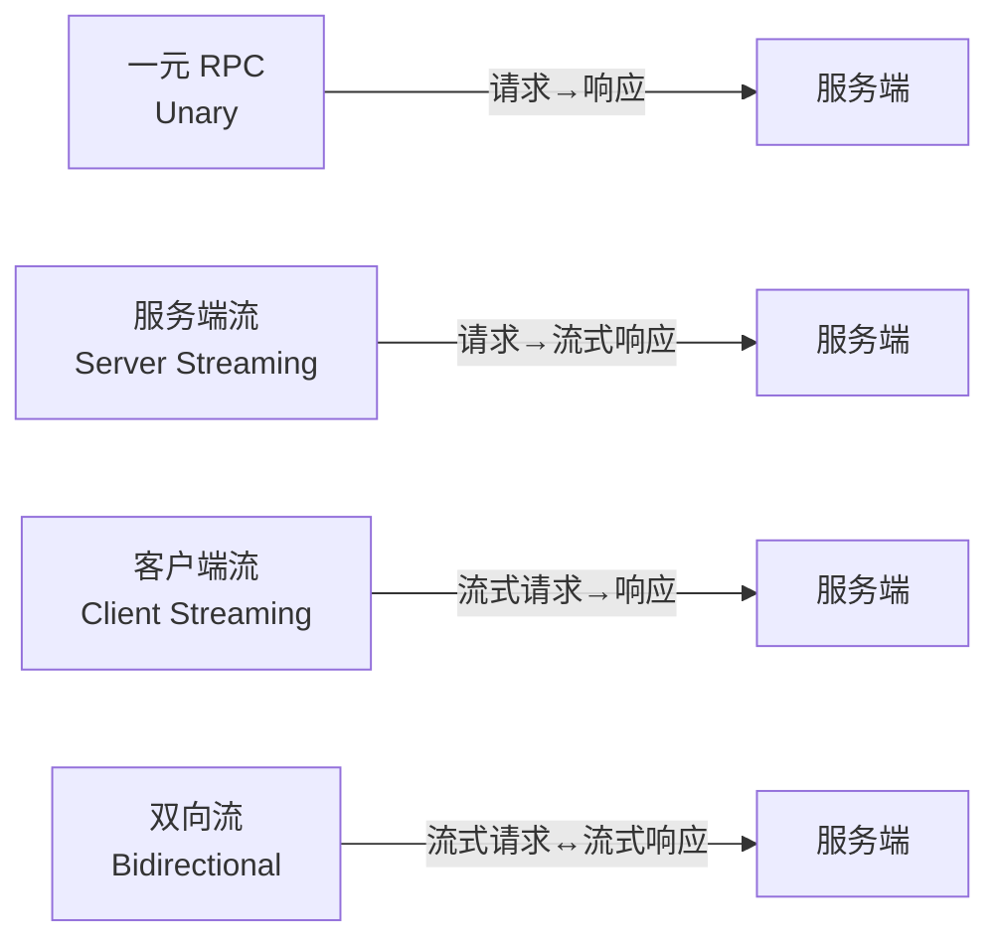

# gRPC协议与Protobuf

> **文档说明**：系统讲解 gRPC 协议与 Protocol Buffers 的原理、语法、四种通信模式、Java 服务端与客户端实现、拦截器与认证、TLS 加密、错误处理、性能优化，以及与 REST 的对比和最佳实践。
>
> **适用人群**：后端开发工程师、架构师、微服务开发者、需要构建高性能 RPC 系统的开发者
>
> **前置知识**：[[计算机网络-HTTP协议详解]]、[[实战-SpringCloud微服务电商系统]]、[[RESTfulAPI设计原则]]

---

## 一、概述

### 1. 什么是 gRPC

**gRPC** 是 Google 开源的高性能、开源的通用 RPC（Remote Procedure Call）框架，基于 HTTP/2 协议传输，使用 Protocol Buffers 作为接口定义语言（IDL）和序列化格式。

### 2. gRPC vs REST

| 维度 | gRPC | REST |
|------|------|------|
| **协议** | HTTP/2 | HTTP/1.1（多数） |
| **序列化** | Protobuf（二进制） | JSON（文本） |
| **接口定义** | .proto 文件（强类型） | OpenAPI/Swagger（可选） |
| **通信模式** | 一元、服务端流、客户端流、双向流 | 主要请求-响应 |
| **性能** | 高（二进制、HTTP/2 多路复用） | 中等（文本、无多路复用） |
| **浏览器支持** | 需 gRPC-Web | 原生支持 |
| **可读性** | 二进制，需工具解析 | JSON 可读 |
| **代码生成** | 原生支持多语言 | 需工具生成 |
| **适用场景** | 微服务内部通信、高性能场景 | 对外 API、浏览器端 |

### 3. 四种通信模式



| 模式 | 说明 | 示例 |
|------|------|------|
| **一元（Unary）** | 一个请求一个响应 | 查询用户信息 |
| **服务端流** | 一个请求，多个响应 | 订阅实时数据、文件下载 |
| **客户端流** | 多个请求，一个响应 | 批量上传、大文件上传 |
| **双向流** | 双向流式通信 | 聊天、实时协作、游戏 |

---

## 二、Protocol Buffers

### 1. 什么是 Protobuf

**Protocol Buffers（Protobuf）** 是 Google 开发的语言无关、平台无关、可扩展的序列化数据格式，用于结构化数据的序列化，比 JSON 更小、更快、更简单。

### 2. Protobuf 编码原理

```text
Protobuf 编码特点：
- 二进制格式，体积小（比 JSON 小 3-10 倍）
- 字段编号（tag）而非字段名，节省空间
- Varint 编码，整数压缩存储
- TLV（Tag-Length-Value）结构
- 向后兼容（新增字段不影响旧代码）
```

### 3. .proto 文件语法

```protobuf
// user.proto
syntax = "proto3";  // 使用 proto3 语法

package com.example.user;  // 包名

option java_package = "com.example.user";
option java_outer_classname = "UserProto";
option java_multiple_files = true;  // 每个消息生成独立类

// 消息定义
message User {
  int64 id = 1;           // 字段编号 1（1-15 占 1 字节，高效）
  string name = 2;        // 字符串
  string email = 3;
  int32 age = 4;
  Gender gender = 5;      // 枚举
  repeated string tags = 6;  // 列表（repeated）
  map<string, string> metadata = 7;  // Map
  Address address = 8;    // 嵌套消息
  google.protobuf.Timestamp created_at = 9;  // 时间戳

  // 保留字段编号（删除字段后保留，防止复用）
  reserved 10, 11;
  reserved "old_field";
}

message Address {
  string province = 1;
  string city = 2;
  string detail = 3;
}

// 枚举定义
enum Gender {
  GENDER_UNSPECIFIED = 0;  // proto3 枚举第一个必须为 0
  GENDER_MALE = 1;
  GENDER_FEMALE = 2;
}

// 请求/响应消息
message GetUserRequest {
  int64 id = 1;
}

message GetUserResponse {
  User user = 1;
}

message ListUserRequest {
  int32 page = 1;
  int32 page_size = 2;
}

message ListUserResponse {
  repeated User users = 1;
  int32 total = 2;
}

// 服务定义
service UserService {
  // 一元 RPC
  rpc GetUser(GetUserRequest) returns (GetUserResponse);

  // 服务端流：订阅用户变更
  rpc SubscribeUserChanges(GetUserRequest) returns (stream User);

  // 客户端流：批量创建用户
  rpc BatchCreateUser(stream User) returns (ListUserResponse);

  // 双向流：实时聊天
  rpc Chat(stream ChatMessage) returns (stream ChatMessage);
}

message ChatMessage {
  string from = 1;
  string content = 2;
  int64 timestamp = 3;
}
```

### 4. 字段类型

| Protobuf 类型 | Java 类型 | 说明 |
|--------------|----------|------|
| `double` | double | 双精度浮点 |
| `float` | float | 单精度浮点 |
| `int32` | int | 32 位整数（Varint） |
| `int64` | long | 64 位整数（Varint） |
| `uint32` | int | 无符号 32 位 |
| `uint64` | long | 无符号 64 位 |
| `sint32` | int | 有符号整数（负数高效） |
| `sint64` | long | 有符号 64 位 |
| `fixed32` | int | 固定 4 字节（大数值高效） |
| `fixed64` | long | 固定 8 字节 |
| `bool` | boolean | 布尔 |
| `string` | String | UTF-8 字符串 |
| `bytes` | ByteString | 字节数组 |
| `enum` | enum | 枚举 |
| `message` | class | 嵌套消息 |

### 5. proto3 vs proto2

| 特性 | proto2 | proto3 |
|------|--------|--------|
| **字段规则** | required/optional/repeated | 无 required，默认 optional |
| **默认值** | 可自定义 | 类型默认值（0、空串、false） |
| **枚举首值** | 任意 | 必须为 0 |
| **未知字段** | 保留 | 丢弃（可配置保留） |
| **推荐** | 老项目 | 新项目推荐 |

---

## 三、Java gRPC 实现

### 1. Maven 依赖

```xml
<dependencies>
    <!-- gRPC 核心 -->
    <dependency>
        <groupId>io.grpc</groupId>
        <artifactId>grpc-netty-shaded</artifactId>
        <version>1.62.2</version>
    </dependency>
    <dependency>
        <groupId>io.grpc</groupId>
        <artifactId>grpc-protobuf</artifactId>
        <version>1.62.2</version>
    </dependency>
    <dependency>
        <groupId>io.grpc</groupId>
        <artifactId>grpc-stub</artifactId>
        <version>1.62.2</version>
    </dependency>
    <!-- 注解（Java 9+） -->
    <dependency>
        <groupId>javax.annotation</groupId>
        <artifactId>javax.annotation-api</artifactId>
        <version>1.3.2</version>
    </dependency>
</dependencies>

<build>
    <extensions>
        <extension>
            <groupId>kr.motd.maven</groupId>
            <artifactId>os-maven-plugin</artifactId>
            <version>1.7.1</version>
        </extension>
    </extensions>
    <plugins>
        <plugin>
            <groupId>org.xolstice.maven.plugins</groupId>
            <artifactId>protobuf-maven-plugin</artifactId>
            <version>0.6.1</version>
            <configuration>
                <protocArtifact>com.google.protobuf:protoc:3.25.3:exe:${os.detected.classifier}</protocArtifact>
                <pluginId>grpc-java</pluginId>
                <pluginArtifact>io.grpc:protoc-gen-grpc-java:1.62.2:exe:${os.detected.classifier}</pluginArtifact>
            </configuration>
            <executions>
                <execution>
                    <goals>
                        <goal>compile</goal>
                        <goal>compile-custom</goal>
                    </goals>
                </execution>
            </executions>
        </plugin>
    </plugins>
</build>
```

### 2. 服务端实现

```java
// 服务实现类
public class UserServiceImpl extends UserServiceGrpc.UserServiceImplBase {

    @Override
    public void getUser(GetUserRequest request,
                        StreamObserver<GetUserResponse> responseObserver) {
        // 一元 RPC：处理请求，返回响应
        long id = request.getId();
        User user = findUserById(id);

        GetUserResponse response = GetUserResponse.newBuilder()
            .setUser(user)
            .build();

        responseObserver.onNext(response);
        responseObserver.onCompleted();
    }

    @Override
    public void subscribeUserChanges(GetUserRequest request,
                                     StreamObserver<User> responseObserver) {
        // 服务端流：持续推送数据
        // 模拟实时推送
        ScheduledExecutorService executor = Executors.newSingleThreadScheduledExecutor();
        executor.scheduleAtFixedRate(() -> {
            User user = getLatestUser(request.getId());
            responseObserver.onNext(user);
        }, 0, 5, TimeUnit.SECONDS);

        // 客户端断开时清理
        Context.current().addListener(context -> {
            executor.shutdown();
            responseObserver.onCompleted();
        }, MoreExecutors.directExecutor());
    }

    @Override
    public StreamObserver<User> batchCreateUser(
            StreamObserver<ListUserResponse> responseObserver) {
        // 客户端流：接收多个请求，返回一个响应
        List<User> users = Collections.synchronizedList(new ArrayList<>());

        return new StreamObserver<User>() {
            @Override
            public void onNext(User user) {
                users.add(user);  // 收集客户端发送的每个用户
            }

            @Override
            public void onError(Throwable t) {
                responseObserver.onError(t);
            }

            @Override
            public void onCompleted() {
                // 客户端发送完成，批量处理并返回响应
                List<User> saved = batchSave(users);
                ListUserResponse response = ListUserResponse.newBuilder()
                    .addAllUsers(saved)
                    .setTotal(saved.size())
                    .build();
                responseObserver.onNext(response);
                responseObserver.onCompleted();
            }
        };
    }

    @Override
    public StreamObserver<ChatMessage> chat(
            StreamObserver<ChatMessage> responseObserver) {
        // 双向流：实时收发消息
        return new StreamObserver<ChatMessage>() {
            @Override
            public void onNext(ChatMessage message) {
                // 收到客户端消息，处理后回复
                ChatMessage reply = ChatMessage.newBuilder()
                    .setFrom("server")
                    .setContent("收到: " + message.getContent())
                    .setTimestamp(System.currentTimeMillis())
                    .build();
                responseObserver.onNext(reply);
            }

            @Override
            public void onError(Throwable t) {
                responseObserver.onError(t);
            }

            @Override
            public void onCompleted() {
                responseObserver.onCompleted();
            }
        };
    }
}

// 启动服务
public class GrpcServer {
    public static void main(String[] args) throws IOException, InterruptedException {
        Server server = ServerBuilder.forPort(9090)
            .addService(new UserServiceImpl())
            .intercept(new AuthInterceptor())  // 添加拦截器
            .build()
            .start();

        System.out.println("gRPC Server started on port 9090");
        server.awaitTermination();
    }
}
```

### 3. 客户端实现

```java
public class GrpcClient {

    private final UserServiceGrpc.UserServiceBlockingStub blockingStub;
    private final UserServiceGrpc.UserServiceStub asyncStub;

    public GrpcClient(String host, int port) {
        ManagedChannel channel = ManagedChannelBuilder.forAddress(host, port)
            .usePlaintext()  // 开发环境，生产用 TLS
            .intercept(new ClientAuthInterceptor())
            .build();

        this.blockingStub = UserServiceGrpc.newBlockingStub(channel);
        this.asyncStub = UserServiceGrpc.newStub(channel);
    }

    // 一元 RPC（同步调用）
    public User getUser(long id) {
        GetUserRequest request = GetUserRequest.newBuilder()
            .setId(id)
            .build();
        GetUserResponse response = blockingStub.getUser(request);
        return response.getUser();
    }

    // 服务端流（异步接收）
    public void subscribeChanges(long id) {
        GetUserRequest request = GetUserRequest.newBuilder().setId(id).build();
        asyncStub.subscribeUserChanges(request, new StreamObserver<User>() {
            @Override
            public void onNext(User user) {
                System.out.println("收到更新: " + user.getName());
            }

            @Override
            public void onError(Throwable t) {
                System.err.println("错误: " + t.getMessage());
            }

            @Override
            public void onCompleted() {
                System.out.println("流结束");
            }
        });
    }

    // 客户端流
    public void batchCreate(List<User> users) {
        StreamObserver<ListUserResponse> responseObserver = new StreamObserver<>() {
            @Override
            public void onNext(ListUserResponse response) {
                System.out.println("创建了 " + response.getTotal() + " 个用户");
            }
            @Override
            public void onError(Throwable t) {}
            @Override
            public void onCompleted() {}
        };

        StreamObserver<User> requestObserver = asyncStub.batchCreateUser(responseObserver);
        for (User user : users) {
            requestObserver.onNext(user);  // 逐个发送
        }
        requestObserver.onCompleted();  // 发送完成
    }
}
```

---

## 四、拦截器与认证

### 1. 服务端拦截器

```java
public class AuthInterceptor implements ServerInterceptor {

    @Override
    public <ReqT, RespT> ServerCall.Listener<ReqT> interceptCall(
            ServerCall<ReqT, RespT> call,
            Metadata headers,
            ServerCallHandler<ReqT, RespT> next) {

        // 从 Metadata 获取 Token
        String token = headers.get(Metadata.Key.of("authorization",
            Metadata.ASCII_STRING_MARSHALLER));

        if (token == null || !validateToken(token)) {
            // 未认证，关闭调用
            call.close(Status.UNAUTHENTICATED.withDescription("无效 Token"), headers);
            return new ServerCall.Listener<>() {};
        }

        // 将用户信息放入 Context
        Context ctx = Context.current()
            .withValue(USER_ID_KEY, extractUserId(token));

        return Contexts.interceptCall(ctx, call, headers, next);
    }
}
```

### 2. 客户端拦截器

```java
public class ClientAuthInterceptor implements ClientInterceptor {

    @Override
    public <ReqT, RespT> ClientCall<ReqT, RespT> interceptCall(
            MethodDescriptor<ReqT, RespT> method,
            CallOptions callOptions,
            Channel next) {

        return new ForwardingClientCall.SimpleForwardingClientCall<>(
            next.newCall(method, callOptions)) {

            @Override
            public void start(Listener<RespT> responseListener, Metadata headers) {
                // 添加认证头
                headers.put(Metadata.Key.of("authorization",
                    Metadata.ASCII_STRING_MARSHALLER), "Bearer " + getToken());
                super.start(responseListener, headers);
            }
        };
    }
}
```

### 3. TLS 加密

```java
// 服务端 TLS
Server server = ServerBuilder.forPort(9090)
    .useTransportSecurity(
        new File("server.crt"),
        new File("server.key")
    )
    .addService(new UserServiceImpl())
    .build();

// 客户端 TLS
ManagedChannel channel = ManagedChannelBuilder.forAddress("localhost", 9090)
    .useTransportSecurity()  // 使用系统 CA
    // 或自定义 CA
    // .sslContext(GrpcSslContexts.forClient().trustManager(new File("ca.crt")).build())
    .build();
```

---

## 五、错误处理

### 1. gRPC 状态码

| 状态码 | 说明 | HTTP 对应 |
|--------|------|----------|
| `OK` | 成功 | 200 |
| `CANCELLED` | 操作被取消 | 499 |
| `UNKNOWN` | 未知错误 | 500 |
| `INVALID_ARGUMENT` | 参数无效 | 400 |
| `DEADLINE_EXCEEDED` | 超时 | 504 |
| `NOT_FOUND` | 资源不存在 | 404 |
| `ALREADY_EXISTS` | 资源已存在 | 409 |
| `PERMISSION_DENIED` | 权限不足 | 403 |
| `RESOURCE_EXHAUSTED` | 资源耗尽（限流） | 429 |
| `FAILED_PRECONDITION` | 前置条件失败 | 400 |
| `ABORTED` | 操作中止 | 409 |
| `OUT_OF_RANGE` | 超出范围 | 400 |
| `UNIMPLEMENTED` | 未实现 | 501 |
| `INTERNAL` | 内部错误 | 500 |
| `UNAVAILABLE` | 服务不可用 | 503 |
| `DATA_LOSS` | 数据丢失 | 500 |
| `UNAUTHENTICATED` | 未认证 | 401 |

### 2. 错误返回

```java
// 服务端返回错误
responseObserver.onError(
    Status.NOT_FOUND
        .withDescription("用户不存在: " + id)
        .asRuntimeException()
);

// 携带额外错误信息
Metadata trailers = new Metadata();
trailers.put(Metadata.Key.of("error-code", Metadata.ASCII_STRING_MARSHALLER), "USER_001");
responseObserver.onError(
    Status.INVALID_ARGUMENT
        .withDescription("邮箱格式错误")
        .asRuntimeException(trailers)
);

// 客户端捕获错误
try {
    blockingStub.getUser(request);
} catch (StatusRuntimeException e) {
    Status status = e.getStatus();
    if (status.getCode() == Status.Code.NOT_FOUND) {
        // 处理不存在
    }
}
```

### 3. 超时与重试

```java
// 客户端设置超时
blockingStub
    .withDeadlineAfter(5, TimeUnit.SECONDS)  // 5 秒超时
    .getUser(request);

// 重试配置（service config）
ManagedChannel channel = ManagedChannelBuilder.forAddress(host, port)
    .defaultServiceConfig(Map.of(
        "methodConfig", List.of(Map.of(
            "name", List.of(Map.of("service", "com.example.user.UserService")),
            "timeout", "5s",
            "retryPolicy", Map.of(
                "maxAttempts", 3.0,
                "initialBackoff", "0.1s",
                "maxBackoff", "1s",
                "backoffMultiplier", 2.0,
                "retryableStatusCodes", List.of("UNAVAILABLE", "DEADLINE_EXCEEDED")
            )
        ))
    ))
    .build();
```

---

## 六、性能优化

### 1. 连接管理

```java
// 客户端连接池（单例 Channel，不要每次创建）
@Bean
public ManagedChannel grpcChannel() {
    return ManagedChannelBuilder.forAddress(host, port)
        .usePlaintext()
        .keepAliveTime(30, TimeUnit.SECONDS)   // 保活间隔
        .keepAliveTimeout(5, TimeUnit.SECONDS) // 保活超时
        .idleTimeout(5, TimeUnit.MINUTES)      // 空闲超时
        .build();
}
```

### 2. 消息大小

```java
// 调整最大消息大小（默认 4MB）
ServerBuilder.forPort(9090)
    .maxInboundMessageSize(16 * 1024 * 1024)  // 16MB
    .build();

ManagedChannelBuilder.forAddress(host, port)
    .maxInboundMessageSize(16 * 1024 * 1024)
    .build();
```

### 3. 流式传输大文件

```protobuf
// 大文件传输使用流式，避免单条消息过大
service FileService {
  rpc Upload(stream Chunk) returns (UploadStatus);
  rpc Download(FileRequest) returns (stream Chunk);
}

message Chunk {
  bytes data = 1;  // 每次 64KB-1MB
  int32 sequence = 2;
}
```

### 4. 压缩

```java
// 启用压缩
blockingStub
    .withCompression("gzip")  // gzip 压缩
    .getUser(request);

// 服务端自动支持解压
```

---

## 七、最佳实践

### 1. .proto 设计规范

- [ ] **字段编号**：1-15 用于高频字段（占 1 字节），16+ 用于低频字段
- [ ] **保留编号**：删除字段后用 `reserved` 保留编号，防止复用
- [ ] **枚举零值**：proto3 枚举第一个值必须为 0，表示未指定
- [ ] **包名**：使用反向域名，避免冲突
- [ ] **版本管理**：API 演进用新服务或新方法，不破坏兼容性
- [ ] **消息复用**：通用消息（如 Pagination、Error）抽取共享
- [ ] **注释完整**：服务、方法、消息都要有注释

### 2. 服务设计规范

- [ ] **单一职责**：一个服务负责一个领域
- [ ] **细粒度方法**：避免一个方法做太多事
- [ ] **流式选择**：大数据/实时场景用流式，普通用一元
- [ ] **错误规范**：使用标准状态码，附加业务错误码
- [ ] **超时设置**：所有调用设置合理超时
- [ ] **幂等设计**：写操作设计为幂等，支持重试

### 3. 生产部署

- [ ] **TLS 加密**：生产环境必须启用 TLS
- [ ] **认证授权**：拦截器统一处理认证
- [ ] **负载均衡**：客户端负载均衡（grpclb）或代理层（Envoy/Nginx）
- [ ] **服务发现**：集成 Consul/Nacos/Etcd
- [ ] **监控指标**：QPS、延迟、错误率、连接数
- [ ] **链路追踪**：集成 OpenTelemetry/SkyWalking
- [ ] **限流熔断**：Sentinel/Resilience4j

---

## 八、常见问题与排查

| 问题 | 原因 | 解决方案 |
|------|------|---------|
| **连接被拒绝** | 服务未启动 / 端口错误 / 防火墙 | 检查服务状态、端口、网络 |
| **TLS 握手失败** | 证书问题 / 客户端未配置 TLS | 检查证书、CA、useTransportSecurity |
| **消息过大报错** | 超过默认 4MB 限制 | 调整 maxInboundMessageSize 或用流式 |
| **超时频繁** | 服务处理慢 / 网络延迟 | 优化服务、增加超时、检查网络 |
| **序列化错误** | .proto 版本不一致 / 字段类型变更 | 统一 .proto 版本、向后兼容 |
| **流中断** | 网络断开 / 服务端异常 | 实现重连、心跳保活 |
| **中文乱码** | 编码问题 | Protobuf 默认 UTF-8，检查字符串处理 |
| **性能不达标** | 每次创建 Channel / 同步阻塞 | Channel 单例、使用异步 Stub |
| **浏览器无法调用** | gRPC 不支持浏览器 | 使用 gRPC-Web 或 REST 网关 |
| **负载不均** | 无负载均衡 | 客户端 LB 或代理层 LB |
| **调试困难** | 二进制不可读 | 使用 grpcurl、bloomrpc 工具 |
| **内存泄漏** | Stream 未关闭 / Context 未清理 | onCompleted/onError 中清理资源 |
| **并发问题** | StreamObserver 非线程安全 | 同步访问或使用单线程发送 |
| **版本兼容** | 字段删除/编号复用 | reserved 保留、新增字段不删除 |
| **gRPC-Web 跨域** | CORS 未配置 | 代理层配置 CORS 或 Envoy 转码 |

### 调试工具

```bash
# grpcurl：命令行 gRPC 客户端
grpcurl -plaintext localhost:9090 list  # 列出服务
grpcurl -plaintext localhost:9090 describe com.example.user.UserService  # 描述服务
grpcurl -plaintext -d '{"id": 1}' localhost:9090 com.example.user.UserService/GetUser  # 调用

# bloomrpc：GUI 客户端（类似 Postman）
# 导入 .proto 文件，可视化调用 gRPC 服务
```

---

## 九、关联笔记

### 网络协议
- [[计算机网络-HTTP协议详解]] · [[RESTfulAPI设计原则]] · [[WebSocket-SSE联调实战]]

### 微服务
- [[实战-SpringCloud微服务电商系统]] · [[Gateway-网关路由与鉴权]] · [[Nacos-注册中心与配置中心]]
- [[分布式系统-高可用架构设计]]

### 性能优化
- [[后端性能优化实战]] · [[数据库性能优化实战]] · [[SpringWebFlux-响应式编程]]

### 导航
- [[MOC-计算机基础]] · [[MOC-后端开发]] · [[全栈+AI工程双轨融合学习路线图]]

> **学习路径建议**：先掌握 [[计算机网络-HTTP协议详解]] 网络基础 → 学习 [[RESTfulAPI设计原则]] API 设计 → 深入本文 gRPC 与 Protobuf → 实践 [[实战-SpringCloud微服务电商系统]] 微服务通信 → 研究 [[Gateway-网关路由与鉴权]] 网关层 → 应用于高性能微服务内部通信。

---

## 💡 全文深度讲解

本文系统梳理了gRPC协议与Protobuf的核心知识体系，从概述入手，深入Protocol Buffers的底层机制，再通过Java gRPC 实现掌握实战应用，最后涵盖常见问题与排查与关联笔记。学习时建议先建立整体认知，再动手实践，最后结合常见问题深化理解。

## 📝 全文精简总结

- **概述**：掌握本模块的核心概念与关键要点
- **Protocol Buffers**：掌握本模块的核心概念与关键要点
- **Java gRPC 实现**：掌握本模块的核心概念与关键要点
- **拦截器与认证**：掌握本模块的核心概念与关键要点
- **错误处理**：掌握本模块的核心概念与关键要点
- **性能优化**：掌握本模块的核心概念与关键要点
- **最佳实践**：掌握本模块的核心概念与关键要点
- **常见问题与排查**：掌握本模块的核心概念与关键要点
- 其余1个模块涵盖进阶主题与拓展内容

