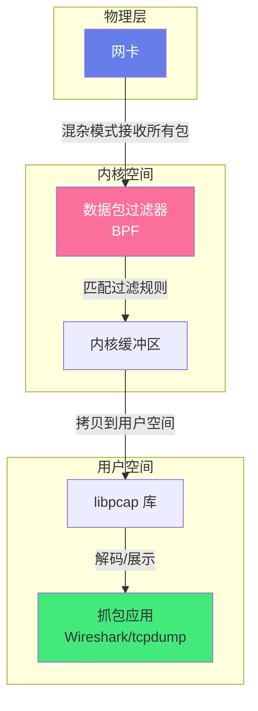
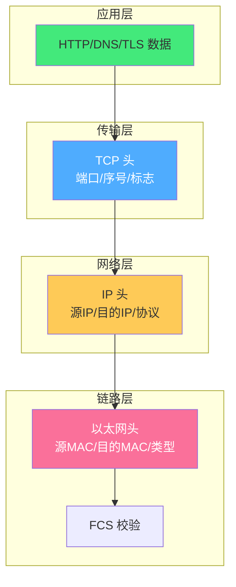
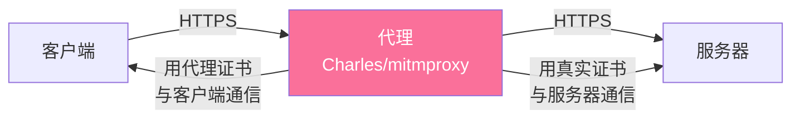
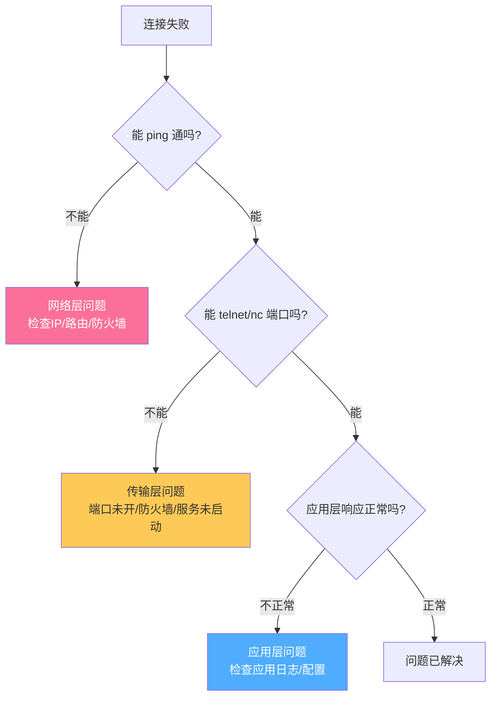
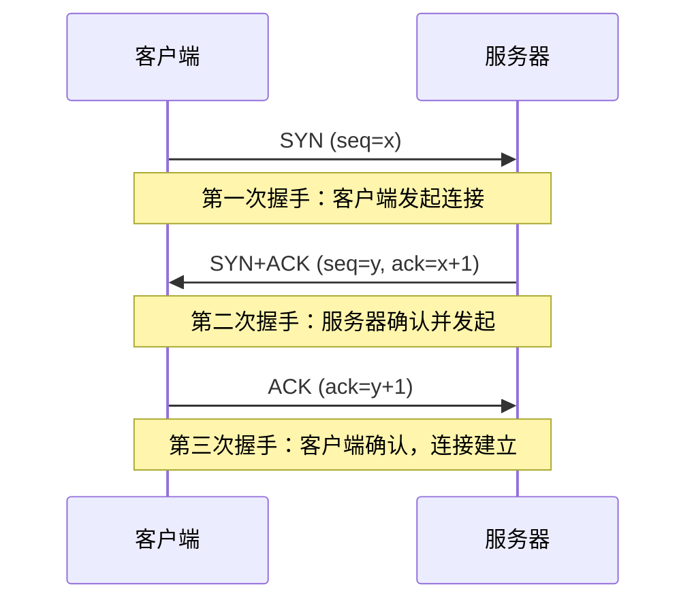
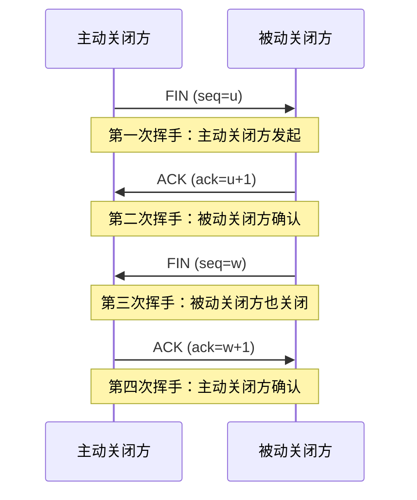

# 📡 网络抓包与调试

> **文档说明**：系统讲解网络抓包与调试的完整知识体系，涵盖抓包原理（libpcap/WinPcap、混杂模式、BPF过滤）、核心工具（Wireshark/tcpdump/tshark/Charles/Fiddler mitmproxy）、TCP 三次握手/四次挥手分析、HTTP/HTTPS 流量分析、HTTPS 解密（SSLKEYLOGFILE/中间人代理）、DNS 解析排查、常见网络问题定位（连接超时/重置/丢包/延迟）、抓包过滤语法（显示过滤器/捕获过滤器）、流追踪与统计、生产环境抓包最佳实践。
>
> **适用人群**：后端开发者、运维工程师、网络工程师、安全工程师、SRE
>
> **前置知识**：[[HTTP协议完整指南]] · [[TCPIP协议栈详解]] · [[DNS与CDN架构]]

---

## 一、概述

### 1.1 什么是网络抓包

网络抓包（Packet Capture）是指通过软件或硬件工具截获网络中传输的数据包，并对其进行分析、解码和展示的过程。抓包是网络问题排查、协议分析、安全审计、性能优化的核心手段。


**核心概念**：
- **混杂模式（Promiscuous Mode）**：网卡接收所有经过的数据包，而非只接收目标 MAC 是自己的包
- **libpcap / WinPcap / Npcap**：跨平台抓包库，提供统一的 API 访问网卡
- **BPF（Berkeley Packet Filter）**：内核级数据包过滤机制，用类汇编语言描述过滤规则
- **PCAP 文件格式**：抓包文件的标准格式（.pcap / .pcapng），可被多种工具读取

### 1.2 解决的问题

| 问题 | 说明 |
|------|------|
| **连接失败** | 服务连不上，是网络不通、端口未开、还是应用拒绝？ |
| **性能慢** | 响应慢，是网络延迟、丢包重传、还是应用处理慢？ |
| **协议异常** | HTTP 返回异常，请求/响应到底是什么内容？ |
| **HTTPS 调试** | 加密流量如何查看明文内容？ |
| **DNS 问题** | 域名解析失败或解析到错误 IP？ |
| **安全审计** | 是否有异常流量、恶意连接、数据泄露？ |
| **API 调试** | 移动端/前端调用后端 API 的实际请求是什么？ |
| **第三方接口排查** | 调用第三方服务失败，是我方还是对方问题？ |

### 1.3 工具选型

| 工具 | 平台 | 类型 | 特点 | 适用场景 |
|------|------|------|------|---------|
| **Wireshark** | Win/Mac/Linux | GUI | 最强大的图形化抓包分析工具，支持千种协议 | 深度分析、协议研究 |
| **tcpdump** | Linux/Mac | CLI | 命令行抓包工具，轻量高效，服务器必备 | 服务器抓包、远程分析 |
| **tshark** | 全平台 | CLI | Wireshark 的命令行版本，支持 Wireshark 过滤器 | 批量处理、脚本分析 |
| **Charles** | Win/Mac | GUI | HTTP/HTTPS 代理抓包，界面友好，移动端调试神器 | Web/移动端 API 调试 |
| **Fiddler** | Windows | GUI | Windows 平台经典 HTTP 调试代理 | Windows Web 调试 |
| **mitmproxy** | 全平台 | CLI/GUI | 中间人代理，支持 Python 脚本扩展，功能强大 | 自动化测试、API 篡改 |
| **F12 开发者工具** | 浏览器 | GUI | 浏览器内置 Network 面板 | 前端 Web 调试 |
| **tcping / mtr** | 全平台 | CLI | 网络连通性和路径诊断 | 网络层排查 |

> **选择建议**：服务器上用 tcpdump 抓包 → 下载到本地用 Wireshark 分析；HTTP/HTTPS API 调试用 Charles 或 mitmproxy；浏览器调试直接用 F12。

---

## 二、底层原理

### 2.1 抓包工作原理



**关键机制**：
1. **混杂模式**：网卡默认只接收目标 MAC 是自己的包（或广播/组播），开启混杂模式后接收所有经过的数据包
2. **BPF 过滤**：在内核空间进行数据包过滤，只把符合规则的包拷贝到用户空间，减少性能开销
3. **缓冲区**：内核缓冲区暂存数据包，防止高流量时丢包；缓冲区满了会丢包（可通过 `drop` 计数查看）
4. **时间戳**：每个数据包有精确的接收时间戳（微秒级），用于计算延迟和重传

### 2.2 TCP/IP 协议栈与数据包结构



**Wireshark 中的数据包分层展示**：
```text
Frame 1: 54 bytes on wire (432 bits), 54 bytes captured
    Ethernet II, Src: 00:11:22:33:44:55, Dst: 66:77:88:99:aa:bb
    Internet Protocol Version 4, Src: 192.168.1.100, Dst: 192.168.1.1
    Transmission Control Protocol, Src Port: 54321, Dst Port: 80, Seq: 1, Ack: 1, Len: 0
    Hypertext Transfer Protocol (HTTP/1.1)
```

### 2.3 混杂模式与交换网络

| 网络环境 | 能否抓到非本机流量 | 说明 |
|---------|------------------|------|
| **集线器（Hub）** | ✅ 能 | Hub 是广播域，所有端口共享同一冲突域 |
| **交换机（Switch）** | ❌ 不能（默认） | 交换机根据 MAC 地址表转发，只发往目标端口 |
| **交换机 + 端口镜像（SPAN）** | ✅ 能 | 配置交换机将指定端口流量镜像到抓包端口 |
| **同一 WiFi** | ⚠️ 部分能 | WiFi 是共享介质，但有加密和隔离 |
| **ARP 欺骗（中间人）** | ✅ 能 | 通过 ARP 欺骗让流量经过抓包机器（有法律风险） |

> **重要**：在交换网络中，默认只能抓到本机发出和接收的流量。要抓到其他机器的流量，需要端口镜像（SPAN）、集线器、或中间人攻击（仅用于授权测试）。

---

## 三、实操：tcpdump 命令行抓包

### 3.1 基础用法

```bash
# ===== 基础抓包 =====

# 查看可用网卡
tcpdump -D

# 抓取指定网卡的所有包（默认 eth0）
tcpdump -i eth0

# 抓取所有网卡
tcpdump -i any

# 抓取前 100 个包后退出
tcpdump -i eth0 -c 100

# 不解析主机名和端口名（更快，避免 DNS 查询）
tcpdump -i eth0 -n

# 显示详细信息（-v / -vv / -vvv）
tcpdump -i eth0 -nn -vv

# 显示链路层信息（MAC 地址）
tcpdump -i eth0 -e

# 以十六进制和 ASCII 显示数据包内容
tcpdump -i eth0 -X

# 以十六进制显示（不含 ASCII）
tcpdump -i eth0 -xx

# 抓取并保存到文件
tcpdump -i eth0 -w capture.pcap

# 读取保存的文件
tcpdump -r capture.pcap

# 保存为 pcapng 格式（支持更多元数据）
tcpdump -i eth0 -w capture.pcapng --immediate-mode
```

### 3.2 过滤器（BPF 语法）

```bash
# ===== 主机过滤 =====
tcpdump -i eth0 host 192.168.1.100        # 指定主机
tcpdump -i eth0 src host 192.168.1.100     # 源主机
tcpdump -i eth0 dst host 192.168.1.100     # 目的主机

# ===== 端口过滤 =====
tcpdump -i eth0 port 80                      # 指定端口
tcpdump -i eth0 src port 80                  # 源端口
tcpdump -i eth0 dst port 443                 # 目的端口
tcpdump -i eth0 portrange 1-1024             # 端口范围
tcpdump -i eth0 'port 80 or port 443'       # 多个端口

# ===== 协议过滤 =====
tcpdump -i eth0 tcp                           # TCP 协议
tcpdump -i eth0 udp                           # UDP 协议
tcpdump -i eth0 icmp                          # ICMP 协议（ping）
tcpdump -i eth0 arp                           # ARP 协议
tcpdump -i eth0 ip                            # IPv4
tcpdump -i eth0 ip6                           # IPv6

# ===== 组合过滤（and/or/not）=====
tcpdump -i eth0 'tcp and port 80 and host 192.168.1.100'
tcpdump -i eth0 'src host 192.168.1.100 and dst port 443'
tcpdump -i eth0 'port 80 or port 443'
tcpdump -i eth0 'not port 22'                # 排除 SSH 流量

# ===== TCP 标志位过滤 =====
tcpdump -i eth0 'tcp[tcpflags] & tcp-syn != 0'    # SYN 包（连接请求）
tcpdump -i eth0 'tcp[tcpflags] & tcp-ack != 0'    # ACK 包
tcpdump -i eth0 'tcp[tcpflags] & tcp-fin != 0'    # FIN 包（连接关闭）
tcpdump -i eth0 'tcp[tcpflags] & tcp-rst != 0'    # RST 包（连接重置）
tcpdump -i eth0 'tcp[tcpflags] & (tcp-syn|tcp-ack) == tcp-syn'  # 纯 SYN（无 ACK）

# ===== 数据包大小过滤 =====
tcpdump -i eth0 'greater 1000'              # 大于 1000 字节
tcpdump -i eth0 'less 100'                   # 小于 100 字节

# ===== HTTP 过滤（基于内容）=====
tcpdump -i eth0 -A 'tcp port 80 and (tcp[((tcp[12:1] & 0xf0) >> 2):4] = 0x47455420)'  # GET 请求
# 0x47455420 = "GET "
```

### 3.3 常用抓包场景

```bash
# ===== 场景1：抓取 HTTP 流量并显示内容 =====
tcpdump -i eth0 -A -s 0 'tcp port 80'
# -A：以 ASCII 显示
# -s 0：抓取完整数据包（默认只抓前 68 字节，snaplen）

# ===== 场景2：抓取 HTTPS 握手（TLS）=====
tcpdump -i eth0 -nn 'tcp port 443 and (tcp[((tcp[12:1] & 0xf0) >> 2)] = 0x16)'
# 0x16 = TLS Handshake 记录类型

# ===== 场景3：抓取 DNS 查询 =====
tcpdump -i eth0 -nn 'udp port 53'
tcpdump -i eth0 -nn 'port 53'  # TCP+UDP

# ===== 场景4：抓取 TCP 三次握手 =====
tcpdump -i eth0 -nn 'tcp[tcpflags] & (tcp-syn|tcp-ack) == tcp-syn'
# 只抓 SYN 包（连接发起）

# ===== 场景5：高流量环境抓包（优化性能）=====
tcpdump -i eth0 -nn -s 96 -w capture.pcap 'tcp port 80'
# -s 96：只抓前 96 字节（足够 IP+TCP 头和部分应用数据），减少 IO
# -w：直接写文件，不实时解析显示

# ===== 场景6：按时间抓包 =====
timeout 60 tcpdump -i eth0 -w capture.pcap  # 抓 60 秒
# 或用 -G 选项轮转文件
tcpdump -i eth0 -G 60 -w capture_%Y%m%d_%H%M%S.pcap  # 每 60 秒一个文件

# ===== 场景7：抓包同时限制文件大小 =====
tcpdump -i eth0 -C 100 -w capture.pcap  # 每个文件 100MB，自动轮转
# -C 100：100MB 一个文件（单位 MB）
```

### 3.4 服务器抓包工作流

```bash
# ===== 标准工作流：服务器抓包 → 本地分析 =====

# 1. 在服务器上抓包（后台运行，不中断 SSH）
nohup tcpdump -i eth0 -nn -s 0 -w /tmp/capture.pcap 'host 10.0.0.1 and port 443' &
# 或用 screen/tmux

# 2. 复现问题
# ... 执行触发问题的操作 ...

# 3. 停止抓包
kill %1  # 或 pkill tcpdump

# 4. 下载到本地
scp user@server:/tmp/capture.pcap ./

# 5. 用 Wireshark 打开分析
wireshark capture.pcap
# 或用 tshark 命令行分析
tshark -r capture.pcap -Y 'http.response.code == 500'
```

---

## 四、实操：Wireshark 图形化分析

### 4.1 Wireshark 界面

```text
┌─────────────────────────────────────────────────────────┐
│ 菜单栏 / 工具栏 / 过滤器栏                                │
├─────────────────────────────────────────────────────────┤
│ 数据包列表面板（Packet List）                             │
│ No.  Time    Source        Destination   Protocol  Info  │
│ 1    0.000   192.168.1.1 192.168.1.100 TCP    80→...  │
│ 2    0.001   192.168.1.100 192.168.1.1 TCP    ...→80  │
├─────────────────────────────────────────────────────────┤
│ 数据包详情面板（Packet Details）                          │
│ ▼ Frame 1: 54 bytes                                      │
│ ▼ Ethernet II, Src: ..., Dst: ...                       │
│ ▼ Internet Protocol Version 4, Src: ..., Dst: ...      │
│ ▼ Transmission Control Protocol, Src Port: ...          │
│ ▼ Hypertext Transfer Protocol                             │
├─────────────────────────────────────────────────────────┤
│ 数据包字节面板（Packet Bytes）                            │
│ 0000  00 11 22 33 44 55 66 77  88 99 aa bb cc dd ...  │
└─────────────────────────────────────────────────────────┘
```

### 4.2 显示过滤器（Display Filter）

显示过滤器用于在已抓取的数据包中筛选，语法比 BPF 更强大，支持协议字段。

| 过滤需求 | 表达式 |
|---------|--------|
| **HTTP** | `http` |
| **HTTP GET 请求** | `http.request.method == "GET"` |
| **HTTP 响应码 500** | `http.response.code == 500` |
| **HTTP 包含特定 URL** | `http.request.uri contains "/api/login"` |
| **TCP** | `tcp` |
| **TCP 端口 80** | `tcp.port == 80` |
| **TCP SYN 包** | `tcp.flags.syn == 1` |
| **TCP RST 包** | `tcp.flags.reset == 1` |
| **TCP 重传** | `tcp.analysis.retransmission` |
| **TCP 重复 ACK** | `tcp.analysis.duplicate_ack` |
| **TCP 零窗口** | `tcp.analysis.zero_window` |
| **IP 地址** | `ip.addr == 192.168.1.100` |
| **源 IP** | `ip.src == 192.168.1.100` |
| **DNS** | `dns` |
| **DNS 查询** | `dns.flags.response == 0` |
| **DNS 响应** | `dns.flags.response == 1` |
| **TLS/SSL** | `tls` 或 `ssl` |
| **TLS Client Hello** | `tls.handshake.type == 1` |
| **TLS Server Hello** | `tls.handshake.type == 2` |
| **ICMP** | `icmp` |
| **ARP** | `arp` |
| **组合条件** | `ip.addr == 192.168.1.100 && tcp.port == 443` |
| **或条件** | `http.request.method == "GET" || http.request.method == "POST"` |
| **排除条件** | `!arp && !icmp` |
| **包含字符串** | `frame contains "password"` |

> **技巧**：在数据包详情面板中，右键任意字段 → "Apply as Filter" → "Selected"，自动生成过滤器表达式。

### 4.3 流追踪（Follow Stream）

流追踪是 Wireshark 最实用的功能之一，可以将一个 TCP 连接的所有数据包重组为完整的数据流。

**操作步骤**：
1. 在数据包列表中选中一个属于目标连接的包
2. 右键 → Follow → TCP Stream（或 HTTP Stream / TLS Stream）
3. 弹出窗口显示完整的请求和响应内容

**用途**：
- 查看完整的 HTTP 请求和响应（Header + Body）
- 分析 WebSocket 通信
- 查看 SMTP/FTP 等文本协议的完整交互
- 排查 API 请求/响应内容

### 4.4 统计与分析功能

| 功能 | 路径 | 用途 |
|------|------|------|
| **协议分层统计** | Statistics → Protocol Hierarchy | 查看各协议占比 |
| **端点统计** | Statistics → Endpoints | 查看通信最多的 IP |
| **会话统计** | Statistics → Conversations | 查看通信对和流量 |
| **IO 图表** | Statistics → IO Graph | 流量随时间变化图 |
| **TCP 流图** | Statistics → TCP Stream Graphs | TCP 序列号/吞吐量/RTT 图 |
| **HTTP 统计** | Statistics → HTTP | HTTP 请求/响应统计 |
| **DNS 统计** | Statistics → DNS | DNS 查询统计 |
| **专家信息** | Analyze → Expert Information | 警告/错误/异常汇总 |

### 4.5 专家信息（Expert Info）

Wireshark 会自动分析数据包并标记异常：

| 级别 | 说明 | 常见项 |
|------|------|--------|
| **Error** | 严重错误 | 数据包格式错误、校验和错误 |
| **Warning** | 警告 | TCP 重传、重复 ACK、零窗口、连接重置 |
| **Note** | 注意 | TCP 窗口更新、保活包 |
| **Chat** | 信息 | 正常的协议交互 |

> **重点关注**：`tcp.analysis.retransmission`（重传）、`tcp.analysis.duplicate_ack`（重复 ACK）、`tcp.analysis.zero_window`（零窗口）、`tcp.analysis.out_of_order`（乱序）——这些都是网络质量问题的信号。

---

## 五、实操：HTTPS 解密

### 5.1 SSLKEYLOGFILE 方式（推荐）

SSLKEYLOGFILE 是浏览器/应用将 TLS 会话密钥导出到文件，Wireshark 用该文件解密 TLS 流量。这是最干净的解密方式，不需要中间人。

```bash
# ===== 步骤1：设置环境变量 =====

# Linux/Mac
export SSLKEYLOGFILE=~/sslkeylog.log

# Windows（PowerShell）
$env:SSLKEYLOGFILE = "$HOME\sslkeylog.log"

# ===== 步骤2：启动浏览器 =====
# 从设置了环境变量的终端启动 Chrome/Firefox
# Chrome/Firefox 会自动将 TLS 密钥写入 SSLKEYLOGFILE

# ===== 步骤3：Wireshark 配置 =====
# Wireshark → Edit → Preferences → Protocols → TLS
# (Pre)-Master-Secret log filename: 选择 sslkeylog.log 文件
# 点击 OK

# ===== 步骤4：抓包并查看解密后的 HTTP =====
# 抓取 443 端口流量，Wireshark 会自动解密并显示 HTTP 内容
# 在数据包详情中可以看到 "Decrypted TLS" 层
```

**支持 SSLKEYLOGFILE 的应用**：
- ✅ Chrome / Chromium / Edge
- ✅ Firefox
- ✅ curl（`--ssl-key-log-file`）
- ✅ Node.js（`--tls-keylog=file`）
- ❌ 大多数移动端 App（需要中间人代理）

### 5.2 中间人代理方式（Charles / mitmproxy）

对于不支持 SSLKEYLOGFILE 的应用（如移动端 App），使用中间人代理（MITM）解密 HTTPS。



**Charles 使用步骤**：
1. 安装 Charles，启动后默认监听 8888 端口
2. 客户端设置 HTTP 代理为 Charles 地址:8888
3. 安装 Charles 根证书（Help → SSL Proxying → Install Charles Root Certificate）
4. 移动端：浏览器访问 `chls.pro/ssl` 下载并安装证书
5. 开启 SSL Proxying（Proxy → SSL Proxying Settings → 添加 `*:*`）
6. 即可看到解密后的 HTTPS 流量

**mitmproxy 使用步骤**：
```bash
# 安装
pip install mitmproxy
# 或 brew install mitmproxy

# 启动（交互式界面）
mitmproxy --listen-port 8080

# 启动 Web 界面
mitmweb --listen-port 8080

# 客户端设置代理为 mitmproxy 地址:8080
# 访问 mitm.it 下载安装证书
```

> **安全提醒**：中间人代理解密 HTTPS 需要在客户端安装代理的根证书，这会降低客户端的 HTTPS 安全性。仅在授权的测试环境使用，不要在生产环境或他人设备上未经授权使用。

---

## 六、实操：常见网络问题排查

### 6.1 连接失败排查流程



```bash
# ===== 逐层排查命令 =====

# 1. 网络层：ping（ICMP）
ping 192.168.1.100
# 不通 → 检查 IP 是否正确、路由、防火墙是否禁 ICMP

# 2. 网络层：mtr（路由追踪 + 丢包率）
mtr 192.168.1.100
# 查看每一跳的丢包率和延迟

# 3. 传输层：telnet/nc 测试端口
telnet 192.168.1.100 8080
# 或
nc -zv 192.168.1.100 8080
# Connection refused → 端口未开或服务未启动
# Connection timed out → 防火墙拦截或网络不通
# Connected → 端口可达

# 4. 传输层：tcping（TCP ping，测试端口连通性和延迟）
tcping 192.168.1.100 8080

# 5. 应用层：curl 测试 HTTP
curl -v http://192.168.1.100:8080/api/health
curl -v https://192.168.1.100:8443/api/health -k
# -v：显示详细过程（DNS→连接→TLS握手→请求→响应）

# 6. 抓包确认
tcpdump -i eth0 -nn 'host 192.168.1.100 and port 8080'
# 看是否有 SYN 包发出、是否有 SYN-ACK 回来
```

### 6.2 TCP 三次握手分析



**Wireshark 过滤器**：
- `tcp.flags.syn == 1 and tcp.flags.ack == 0` → 第一次握手（纯 SYN）
- `tcp.flags.syn == 1 and tcp.flags.ack == 1` → 第二次握手（SYN+ACK）
- `tcp.flags.ack == 1 and tcp.len == 0` → 第三次握手（纯 ACK）

**常见问题**：
| 现象 | 原因 |
|------|------|
| 只有 SYN，没有 SYN-ACK | 服务器端口未开 / 防火墙丢弃 / 服务未启动 |
| SYN 发出后收到 RST | 服务器端口未监听（主动拒绝） |
| SYN-ACK 回来但客户端不回 ACK | 客户端防火墙 / 网络问题 / 客户端异常 |
| 三次握手慢 | 网络延迟高 / 服务器负载高 |

### 6.3 TCP 四次挥手分析



**常见问题**：
| 现象 | 原因 |
|------|------|
| 大量 TIME_WAIT | 主动关闭方多，正常现象，可调 `tcp_tw_reuse` |
| 大量 CLOSE_WAIT | 被动关闭方未调用 close()，应用 bug（文件描述符泄漏） |
| FIN 后收到 RST | 对端直接重置连接（异常关闭） |
| 连接长时间不关闭 | 应用未正确关闭连接 / 保活机制问题 |

### 6.4 丢包与重传分析

```bash
# ===== Wireshark 过滤器 =====
tcp.analysis.retransmission          # TCP 重传
tcp.analysis.fast_retransmission     # 快速重传
tcp.analysis.duplicate_ack           # 重复 ACK（触发快速重传）
tcp.analysis.out_of_order            # 数据包乱序
tcp.analysis.zero_window             # 零窗口（接收方缓冲区满）
tcp.analysis.window_full             # 窗口已满

# ===== 统计重传率 =====
# Wireshark → Analyze → Expert Information → 查看 Warning 数量
# 或用 tshark 命令行统计
tshark -r capture.pcap -Y 'tcp.analysis.retransmission' | wc -l
tshark -r capture.pcap -Y 'tcp' | wc -l
# 重传率 = 重传包数 / 总 TCP 包数（正常应 < 1%）
```

**丢包原因**：
| 原因 | 说明 |
|------|------|
| **网络拥塞** | 路由器/交换机缓冲区溢出丢包 |
| **带宽不足** | 流量超过链路带宽 |
| **网卡故障** | 物理层错误（CRC 错误、帧错误） |
| **防火墙丢包** | 安全设备主动丢弃特定流量 |
| **服务器过载** | 服务器内核缓冲区满，丢包 |
| **WiFi 干扰** | 无线信号干扰导致丢包 |

### 6.5 DNS 问题排查

```bash
# ===== DNS 排查命令 =====

# 1. nslookup（简单查询）
nslookup www.example.com
nslookup www.example.com 8.8.8.8  # 指定 DNS 服务器

# 2. dig（详细查询，推荐）
dig www.example.com
dig www.example.com @8.8.8.8       # 指定 DNS 服务器
dig www.example.com +trace          # 追踪完整解析过程
dig www.example.com A               # 查询 A 记录
dig www.example.com CNAME           # 查询 CNAME
dig www.example.com MX              # 查询 MX 记录
dig -x 192.168.1.1                  # 反向查询

# 3. host（简单查询）
host www.example.com

# 4. 查看本地 DNS 缓存
# Windows
ipconfig /displaydns
ipconfig /flushdns  # 清除缓存
# Linux (systemd-resolved)
resolvectl statistics
resolvectl flush-caches
# macOS
sudo dscacheutil -flushcache

# 5. 抓包分析 DNS
tcpdump -i eth0 -nn 'udp port 53' -vv
# Wireshark 过滤器：dns
```

**常见 DNS 问题**：
| 问题 | 原因 | 解决方案 |
|------|------|---------|
| 解析超时 | DNS 服务器不可达/防火墙 | 检查 /etc/resolv.conf；换 DNS 服务器 |
| 解析到错误 IP | DNS 缓存污染/HOSTS 配置 | 清除 DNS 缓存；检查 /etc/hosts |
| NXDOMAIN | 域名不存在 | 检查域名拼写；确认域名已注册 |
| SERVFAIL | DNS 服务器内部错误 | 换 DNS 服务器；检查权威 DNS |
| 解析慢 | DNS 服务器延迟高/递归查询慢 | 用更快的 DNS（114.114.114.114/8.8.8.8）；配置本地缓存 |

---

## 七、进阶与最佳实践

### 7.1 生产环境抓包注意事项

```text
生产环境抓包最佳实践：

✅ 抓包前
   - 确认抓包目的和范围，避免无目的抓包
   - 评估抓包对性能的影响（高流量服务器抓包会增加 CPU/IO 负载）
   - 准备足够的磁盘空间（抓包文件可能很大）
   - 通知相关团队（安全/运维），避免被误判为攻击

✅ 抓包中
   - 使用精确的过滤器，只抓需要的流量，减少性能影响和文件大小
   - 用 -s 限制抓取长度（不需要完整包时用 -s 96 或 -s 128）
   - 用 -w 直接写文件，不要实时显示（实时解析消耗 CPU）
   - 用 -C/-G 限制文件大小和时间，避免磁盘满
   - 后台运行（nohup/screen/tmux），避免 SSH 断开导致抓包中断
   - 监控抓包进程和磁盘使用

✅ 抓包后
   - 立即停止抓包，避免持续影响性能
   - 下载抓包文件到本地分析（scp/rsync）
   - 分析完成后删除服务器上的抓包文件（可能包含敏感数据）
   - 记录抓包时间、范围、目的，便于追溯

✅ 安全注意
   - 抓包文件可能包含密码、Token、Cookie 等敏感信息
   - 加密存储和传输抓包文件
   - 分析完成后安全删除（shred/rm -P）
   - 遵守公司安全政策和法律法规
   - 不得未经授权抓取他人通信内容
```

### 7.2 抓包过滤优化

```bash
# ===== 高性能抓包配置 =====

# 1. 用 BPF 过滤器在内核层过滤（最重要的优化）
tcpdump -i eth0 -nn 'tcp port 443 and host 10.0.0.1' -w capture.pcap
# 只抓符合条件的包，减少拷贝到用户空间的数据量

# 2. 限制 snaplen（抓取长度）
tcpdump -i eth0 -nn -s 96 'tcp port 443' -w capture.pcap
# 只抓前 96 字节（以太网头14 + IP头20 + TCP头20 + 42字节应用数据）
# 足够分析连接建立/关闭/标志位，但看不到完整应用数据

# 3. 增大内核缓冲区（高流量环境）
tcpdump -i eth0 -nn -B 4096 'tcp port 443' -w capture.pcap
# -B 4096：缓冲区 4096 KB（4MB），默认 2MB，高流量时增大减少丢包

# 4. 关闭名称解析（避免 DNS 查询延迟）
tcpdump -i eth0 -nn ...
# -n：不解析主机名；-nn：不解析主机名和端口名

# 5. 使用 immediate mode（实时写入，不缓冲）
tcpdump -i eth0 --immediate-mode -w capture.pcap
# 数据立即写入文件，不缓冲（适合实时分析，但 IO 更频繁）

# ===== 查看抓包丢包率 =====
tcpdump -i eth0 -nn -w capture.pcap -c 10000
# 结束时会显示：
# 10000 packets captured
# 12000 packets received by filter
# 2000 packets dropped by kernel  ← 关注这个！内核丢包
# 如果 dropped > 0，说明抓包速度跟不上，需要优化过滤器或增大缓冲区
```

### 7.3 tshark 批量分析

```bash
# tshark 是 Wireshark 的命令行版本，适合脚本化和批量分析

# ===== 基本分析 =====

# 读取文件并显示摘要
tshark -r capture.pcap -c 10

# 显示特定字段
tshark -r capture.pcap -Y 'http.request' -T fields -e ip.src -e http.request.method -e http.request.uri

# 统计 HTTP 请求
tshark -r capture.pcap -Y 'http.request' -T fields -e http.request.uri | sort | uniq -c | sort -rn | head -20

# 统计 HTTP 响应码
tshark -r capture.pcap -Y 'http.response' -T fields -e http.response.code | sort | uniq -c | sort -rn

# 统计 TCP 重传
tshark -r capture.pcap -Y 'tcp.analysis.retransmission' -T fields -e ip.src -e ip.dst | sort | uniq -c | sort -rn

# 导出 HTTP 对象（文件）
tshark -r capture.pcap --export-objects http,./http_objects

# 按时间统计流量
tshark -r capture.pcap -q -z io,stat,1  # 每秒统计
tshark -r capture.pcap -q -z io,stat,10  # 每 10 秒统计

# 协议分层统计
tshark -r capture.pcap -q -z io,phs

# 端点统计
tshark -r capture.pcap -q -z endpoints,ip

# 会话统计
tshark -r capture.pcap -q -z conv,tcp
```

### 7.4 移动端抓包

```text
移动端抓包方案：

✅ 方案1：代理抓包（Charles/mitmproxy）
   - 手机和电脑连同一 WiFi
   - 手机 WiFi 设置代理为电脑 IP:8888
   - 手机安装 Charles 根证书（访问 chls.pro/ssl）
   - iOS 还需在 设置→通用→关于本机→证书信任设置 中信任证书
   - Android 7+ 默认不信任用户证书，需要 root 或使用目标应用的 networkSecurityConfig
   - 适合：HTTP/HTTPS API 调试

✅ 方案2：VPN 抓包（HttpCanary/Stream）
   - Android：HttpCanary（通过 VPN 接口抓包）
   - iOS：Stream（通过 VPN 接口抓包）
   - 不需要电脑，手机端直接抓包
   - 适合：快速排查移动端 API 问题

✅ 方案3：tcpdump + Wireshark（root 设备）
   - Android root 后安装 tcpdump
   - iOS 越狱后安装 tcpdump
   - 抓包后导出用 Wireshark 分析
   - 适合：深度协议分析、非 HTTP 协议

✅ 方案4：路由器端口镜像
   - 在支持端口镜像的路由器上配置
   - 手机流量镜像到抓包电脑
   - 适合：非侵入式抓包、批量设备抓包

注意：
- HTTPS 抓包需要在手机安装代理证书
- Android 7+ 和 iOS 10+ 对证书信任有额外限制
- 部分应用使用 SSL Pinning（证书锁定），代理无法解密
- 仅在授权的测试设备上使用
```

---

## 八、关联笔记

### 网络协议
- [[HTTP协议完整指南]] · [[TCPIP协议栈详解]] · [[DNS与CDN架构]]
- [[HTTPS与TLS握手]] · [[WebSocket-实时通信]]

### 运维与调试
- [[K8s-故障排查手册]] · [[ELK-日志聚合]] · [[Linux性能调优]]
- [[curl高级用法]]

### 安全
- [[网络安全基础]] · [[SSL-TLS证书管理]]

### 导航
- [[MOC-计算机基础]] · [[MOC-计算机网络]] · [[MOC-综合导航]] · [[Home]]

> 🔍 **知识点深度解析**
>
> **作用**：网络抓包与调试解决的是「网络通信黑盒可视化」问题——当应用之间的网络通信出现问题（连接失败、响应慢、数据异常）时，通过抓包工具截获并分析原始数据包，从物理层到应用层逐层排查，精确定位问题根因（网络不通、端口未开、TCP 重传、HTTP 错误、TLS 握手失败等）。
>
> **底层原理**：抓包的核心是「网卡混杂模式 + libpcap 库 + BPF 内核过滤」——网卡开启混杂模式后接收所有经过的数据包（交换网络中默认只能抓到本机流量），libpcap 提供统一 API 访问网卡，BPF（Berkeley Packet Filter）在内核空间对数据包进行过滤，只把符合规则的包拷贝到用户空间，减少性能开销。数据包按 TCP/IP 协议栈分层封装（以太网头→IP头→TCP头→应用数据），Wireshark/tcpdump 按层解码展示。HTTPS 解密有两种方式：SSLKEYLOGFILE（浏览器导出 TLS 会话密钥，Wireshark 用密钥解密，最干净）和中间人代理（Charles/mitmproxy，客户端安装代理证书，代理分别与客户端和服务器建立 TLS 连接，适合移动端）。
>
> **用法要点**：① 工具选择：服务器用 tcpdump 抓包→下载到本地用 Wireshark 分析；HTTP/HTTPS API 调试用 Charles/mitmproxy；浏览器调试用 F12 ② tcpdump 基础：`-i` 指定网卡、`-nn` 不解析名称、`-s 0` 抓完整包、`-w` 写文件、`-r` 读文件 ③ BPF 过滤器：`host IP`、`port 端口`、`tcp/udp/icmp`、`and/or/not` 组合、`tcp[tcpflags] & tcp-syn != 0` 过滤标志位 ④ Wireshark 显示过滤器：`http`、`tcp.port==80`、`tcp.analysis.retransmission`、`ip.addr==x.x.x.x`、`&&`/`||`/`!` 组合 ⑤ 流追踪：右键→Follow→TCP Stream，查看完整 HTTP 请求响应 ⑥ 专家信息：关注重传、重复 ACK、零窗口、乱序等异常 ⑦ HTTPS 解密：SSLKEYLOGFILE（浏览器）或中间人代理（移动端） ⑧ 连接排查：ping（网络层）→telnet/nc（传输层）→curl（应用层）→抓包确认 ⑨ 生产环境：用精确过滤器、限制 snaplen、后台运行、监控磁盘、抓完即删 ⑩ 丢包分析：重传率>1% 说明网络质量差，用 mtr 定位丢包节点。

> 💡 **深度讲解**：网络抓包最核心的思维是「分层排查」——网络通信是分层的（物理层→数据链路层→网络层→传输层→应用层），每一层都可能出问题，排查时从底层到上层逐层验证。比如连接失败，先 ping（网络层，确认 IP 可达），再 telnet/nc（传输层，确认端口可达），再 curl（应用层，确认应用响应），最后抓包确认。这种分层思维比一上来就抓包更高效。抓包工具中最强大的是 Wireshark，但服务器上通常没有图形界面，所以标准工作流是「tcpdump 抓包→scp 下载→Wireshark 分析」。tcpdump 的 BPF 过滤器是性能关键——在内核层过滤比在用户层过滤高效得多，高流量环境下不写过滤器可能导致大量丢包（`packets dropped by kernel`）。Wireshark 最实用的功能是「Follow TCP Stream」和「专家信息」——前者可以把一个 TCP 连接的所有数据包重组为完整的数据流，直接看到 HTTP 请求响应的完整内容；后者自动标记重传、重复 ACK、零窗口等异常，快速定位网络质量问题。HTTPS 解密是进阶技能，SSLKEYLOGFILE 方式最干净（不需要中间人，不破坏证书链），但只支持浏览器和少数应用；移动端 App 通常需要中间人代理（Charles/mitmproxy），但 Android 7+ 和 iOS 10+ 对证书信任有限制，部分 App 还有 SSL Pinning，这些都需要额外处理。

> 📝 **精简总结**：网络抓包 = 网卡混杂模式 + libpcap + BPF 过滤，截获数据包逐层分析。工具：tcpdump（服务器 CLI）、Wireshark（本地 GUI 分析）、Charles/mitmproxy（HTTPS 代理调试）。核心技能：BPF 过滤器（tcpdump）、显示过滤器（Wireshark）、流追踪、专家信息、HTTPS 解密（SSLKEYLOGFILE/中间人）。排查方法：分层排查（ping→telnet→curl→抓包）。常见问题：连接失败（端口/防火墙）、丢包重传（网络质量）、DNS 解析失败、HTTPS 握手失败。生产环境：精确过滤、限制长度、后台运行、抓完即删。

> **学习路径建议**：先学习 [[TCPIP协议栈详解]] 理解网络协议栈 → 学习 [[HTTP协议完整指南]] 掌握应用层协议 → 学习 [[HTTPS与TLS握手]] 理解加密通信 → 学习本文档掌握抓包调试技能 → 在实际项目中实践网络问题排查 → 学习 [[网络安全基础]] 深入理解网络安全。

---

> **网络抓包的本质是「给网络通信装上 X 光机」——当应用之间的通信变成黑盒，抓包让你看到每一个数据包的真实内容，从物理层到应用层逐层透视。好的网络工程师不是靠猜，而是靠抓包数据说话——让数据包告诉你真相。**
