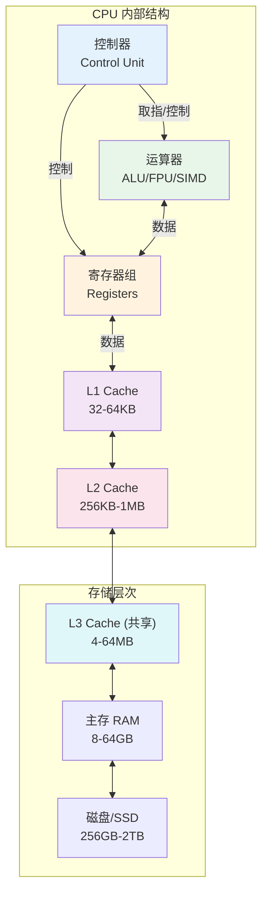

# CPU架构与指令集

> **文档说明**：系统讲解 CPU 架构与指令集，包括 CPU 基本组成、指令集架构（CISC/RISC）、x86/ARM/RISC-V 对比、流水线技术、超标量乱序执行、分支预测、多核多线程、缓存层次，以及性能指标和常见问题。
>
> **适用人群**：计算机基础学习者、后端开发者、系统程序员、关注底层性能的开发者
>
> **前置知识**：[[操作系统-进程与线程]]、[[内存层次结构-Cache]]、[[进程间通信-IPC]]

---

## 一、概述

### 1. 什么是 CPU

```text
CPU（Central Processing Unit，中央处理器）：
- 计算机的核心部件，执行指令和处理数据
- 被称为"计算机的大脑"
- 主要功能：取指令、解码、执行、写回

CPU 的基本工作流程（冯·诺依曼架构）：
1. 取指（Fetch）：从内存读取指令
2. 解码（Decode）：解析指令含义
3. 执行（Execute）：执行指令操作
4. 写回（Writeback）：将结果写回寄存器或内存

这个循环称为指令周期（Instruction Cycle），不断重复执行。
```

### 2. CPU 性能指标

```text
关键性能指标：

1. 主频（Clock Rate / Frequency）
   - CPU 内核工作的时钟频率
   - 单位：GHz（10^9 Hz）
   - 主频越高，每秒执行的时钟周期越多
   - 但不是唯一决定性能的因素

2. IPC（Instructions Per Cycle）
   - 每个时钟周期执行的指令数
   - 现代 CPU IPC 通常 > 1（超标量架构）
   - IPC 受架构、流水线、缓存等影响

3. 性能公式
   - 性能 = 主频 × IPC × 核心数（简化）
   - 更准确：执行时间 = 指令数 × CPI / 主频
   - CPI（Cycles Per Instruction）= 1 / IPC

4. 核心数（Cores）
   - 物理核心数量
   - 多核可以并行执行多个任务
   - 但不是所有任务都能完美并行（Amdahl 定律）

5. 线程数（Threads）
   - 超线程（Hyper-Threading / SMT）技术
   - 一个物理核心模拟两个逻辑核心
   - 通常线程数 = 核心数 × 2

6. 缓存（Cache）
   - L1/L2/L3 缓存大小
   - 缓存越大，命中率越高，性能越好
   - 但缓存越大，延迟越高，成本越高

7. TDP（Thermal Design Power）
   - 散热设计功耗
   - 反映 CPU 的最大发热量
   - 间接反映功耗和性能水平
```

### 3. 摩尔定律与后摩尔时代

```text
摩尔定律（Moore's Law）：
- 戈登·摩尔 1965 年提出
- 集成电路上可容纳的晶体管数量约每 18-24 个月翻一番
- 推动了 CPU 性能的指数级增长

后摩尔时代的挑战：
- 制程工艺逼近物理极限（3nm、2nm）
- 单核性能增长放缓（主频无法持续提升，功耗墙）
- 功耗和散热成为瓶颈

应对策略：
1. 多核化：增加核心数量，提升并行性能
2. 专用加速器：GPU、NPU、TPU、FPGA
3. 架构创新：3D 堆叠、Chiplet、近存计算
4. 领域专用架构（DSA）：为特定 workload 优化
5. 量子计算：长期的颠覆性技术
```

---

## 二、CPU 基本组成

### 1. 核心组件

```text
CPU 内部主要组件：

1. 运算器（ALU，Arithmetic Logic Unit）
   - 执行算术运算（加减乘除）
   - 执行逻辑运算（与或非、比较）
   - 浮点运算单元（FPU）处理浮点数
   - 向量运算单元（SIMD）处理批量数据

2. 控制器（Control Unit）
   - 从内存取指令
   - 解码指令
   - 产生控制信号，协调各部件工作
   - 管理指令流水线

3. 寄存器（Registers）
   - CPU 内部的高速存储单元
   - 存储正在处理的数据和指令
   - 类型：
     - 通用寄存器：存储数据和地址（x86: RAX/RBX/RCX/RDX...）
     - 指令指针（IP/PC）：下一条指令地址
     - 标志寄存器（FLAGS）：状态标志（零标志、进位标志等）
     - 段寄存器：内存分段（x86 实模式）
   - 访问速度：1 个时钟周期（比内存快 100+ 倍）

4. 缓存（Cache）
   - CPU 内部的高速存储器
   - 缓解 CPU 和内存之间的速度差距
   - L1 Cache：最小最快，每个核心私有（32-64KB）
   - L2 Cache：中等大小，每个核心私有（256KB-1MB）
   - L3 Cache：最大，所有核心共享（4-64MB）

5. 总线接口（Bus Interface）
   - 连接 CPU 和外部总线
   - 与内存、I/O 设备通信
   - 现代 CPU 集成内存控制器（IMC）和 PCIe 控制器

6. 时钟发生器（Clock Generator）
   - 产生时钟信号
   - 同步 CPU 内部所有操作
   - 主频 = 外频 × 倍频
```



### 2. 寄存器详解

```text
x86-64 通用寄存器（16 个 64 位）：
- RAX：累加器（Accumulator），算术运算默认使用
- RBX：基址寄存器（Base），内存寻址
- RCX：计数器（Counter），循环计数
- RDX：数据寄存器（Data），I/O 操作
- RSI：源变址寄存器（Source Index），字符串操作源地址
- RDI：目的变址寄存器（Destination Index），字符串操作目的地址
- RBP：基址指针（Base Pointer），栈帧基址
- RSP：栈指针（Stack Pointer），栈顶地址
- R8-R15：新增的通用寄存器（x86-64 扩展）

ARM64 通用寄存器（31 个 64 位）：
- X0-X7：参数/结果寄存器（函数调用前 8 个参数）
- X8：间接结果寄存器（结构体返回）
- X9-X15：临时寄存器（调用者保存）
- X16-X17：过程调用临时寄存器（IP0/IP1）
- X18：平台寄存器
- X19-X28：被调用者保存寄存器
- X29：帧指针（FP，Frame Pointer）
- X30：链接寄存器（LR，Link Register，保存返回地址）
- SP：栈指针
- PC：程序计数器（不能直接访问）
- NZCV：状态寄存器（零/负/进位/溢出标志）

寄存器访问速度对比：
- 寄存器：~1ns（1 时钟周期）
- L1 Cache：~1ns（1-4 时钟周期）
- L2 Cache：~3ns（10-20 时钟周期）
- L3 Cache：~10ns（40-80 时钟周期）
- 主存：~100ns（200-400 时钟周期）
- SSD：~100μs（10000+ 时钟周期）
- 磁盘：~10ms（百万级时钟周期）
```

---

## 三、指令集架构

### 1. ISA 概述

```text
ISA（Instruction Set Architecture，指令集架构）：
- CPU 硬件和软件之间的接口
- 定义了 CPU 支持的指令集、寄存器、寻址方式、数据类型
- 软件（编译器、操作系统）基于 ISA 编写
- 不同 ISA 的程序不能直接在对方 CPU 上运行

ISA 分类：
1. CISC（Complex Instruction Set Computer，复杂指令集）
   - 指令数量多、功能复杂
   - 指令长度不固定
   - 支持多种寻址方式
   - 代表：x86（Intel/AMD）

2. RISC（Reduced Instruction Set Computer，精简指令集）
   - 指令数量少、功能简单
   - 指令长度固定
   - 寻址方式少
   - Load-Store 架构（只有 load/store 访问内存）
   - 代表：ARM、RISC-V、MIPS、PowerPC

3. VLIW（Very Long Instruction Word，超长指令字）
   - 编译器负责指令并行调度
   - 代表：Itanium（已淘汰）

4. 其他
   - EPIC（显式并行指令计算）
   - DSP（数字信号处理器）
```

### 2. CISC vs RISC

| 维度 | CISC（x86） | RISC（ARM/RISC-V） |
|------|------------|-------------------|
| **指令数量** | 多（1000+） | 少（几十~几百） |
| **指令长度** | 不固定（1-15 字节） | 固定（4 字节，ARM 有 Thumb 2 字节） |
| **寻址方式** | 多（10+ 种） | 少（3-5 种） |
| **内存访问** | 很多指令可访问内存 | 只有 load/store 访问内存 |
| **寄存器数量** | 少（16 个 x86-64） | 多（31 个 ARM64） |
| **流水线** | 复杂（需要解码变长指令） | 简单（定长指令易解码） |
| **功耗** | 高（复杂硬件） | 低（简单硬件） |
| **性能** | 高（桌面/服务器） | 高（移动/嵌入式/服务器） |
| **代表** | Intel/AMD x86 | ARM、RISC-V、MIPS |
| **生态** | Windows、桌面、服务器 | 移动、嵌入式、苹果、新兴服务器 |

```text
现代发展趋势：
- CISC 和 RISC 的界限越来越模糊
- x86 内部采用微操作（micro-op），将复杂指令拆分为简单操作
- ARM 增加了更多指令和复杂功能（NEON/SVE 向量指令）
- 性能差距缩小，功耗和生态成为关键差异
```

### 3. x86 架构

```text
x86 架构：
- 起源：Intel 8086（1978 年），16 位处理器
- 发展：80286 → 80386（32 位）→ Pentium → Core → Core i 系列
- 64 位扩展：AMD64（AMD 提出，Intel 也采用，称为 x86-64 / AMD64）
- 主要厂商：Intel、AMD

x86 特点：
- 向后兼容性极强（可以运行 1980 年代的 16 位程序）
- 指令集庞大且复杂（AVX、SSE、MMX 等扩展）
- 高性能（桌面和服务器市场主导）
- 高功耗（不适合移动设备）

x86 指令示例（AT&T 语法）：
```
movl $1, %eax      # 将立即数 1 存入 eax
addl %ebx, %eax    # eax = eax + ebx
cmpl %ecx, %edx    # 比较 edx 和 ecx
je label            # 相等则跳转
pushq %rbp          # 压栈
call function       # 调用函数
```text

主要扩展指令集：
- MMX：多媒体指令（64 位整数向量）
- SSE/SSE2/SSE3/SSSE3/SSE4：流式 SIMD 扩展（128 位）
- AVX/AVX2/AVX-512：高级向量扩展（256/512 位）
- AES-NI：AES 加密硬件加速
- VT-x/AMD-V：硬件虚拟化
- SGX/SEV：可信执行环境
```

### 4. ARM 架构

```text
ARM 架构：
- 起源：Acorn RISC Machine（1985 年），32 位 RISC 处理器
- 发展：ARMv1 → ARMv7（32 位）→ ARMv8（64 位，AArch64）
- 授权模式：ARM 公司设计架构，授权给其他厂商（苹果、高通、三星、华为等）
- 市场：移动设备（90%+ 智能手机）、嵌入式、苹果 Mac、新兴服务器

ARM 特点：
- 低功耗（移动设备首选）
- RISC 架构，指令简单
- 32 位 ARM 和 64 位 AArch64 两种执行状态
- Thumb/Thumb-2：16/32 位混合指令集，减少代码体积
- NEON/SVE：SIMD 向量扩展
- 生态丰富（移动、嵌入式、物联网）

ARM 指令示例（AArch64）：
```
mov x0, #1          // x0 = 1
add x0, x0, x1      // x0 = x0 + x1
cmp x0, x1          // 比较 x0 和 x1
beq label            // 相等跳转
stp x29, x30, [sp, #-16]!  // 压栈（成对存储）
bl function          // 调用函数（保存返回地址到 x30）
```text

主要 ARM 厂商/芯片：
- 苹果：A 系列（iPhone）、M 系列（Mac）
- 高通：骁龙（Snapdragon）
- 三星：Exynos
- 华为：麒麟（Kirin）
- ARM：Cortex 系列（Cortex-A/R/M）
- AWS：Graviton（服务器）
- Ampere：Altra（服务器）
```

```text
### 5. RISC-V 架构
```

```text
RISC-V 架构：
- 起源：UC Berkeley（2010 年），开源指令集架构
- 特点：完全开源、免费、模块化、可扩展
- 模块化设计：
  - RV32I/RV64I/RV128I：基础整数指令集（必选）
  - M：乘除法扩展
  - A：原子操作扩展
  - F/D：单/双精度浮点扩展
  - C：压缩指令扩展（16 位指令）
  - V：向量扩展
  - 自定义扩展：厂商可以添加自定义指令

RISC-V 优势：
- 开源免费：不需要授权费
- 简洁：基础指令集只有 40 多条
- 可扩展：模块化设计，按需选择扩展
- 无历史包袱：不需要向后兼容旧指令
- 生态快速发展：中国、欧洲大力支持

RISC-V 现状：
- 嵌入式/物联网：快速增长
- 微控制器：已有大量产品
- 服务器/桌面：早期阶段
- 主要厂商：SiFive、平头哥（玄铁）、芯来科技、Andes

RISC-V 指令示例（RV64I）：
```
addi x1, x0, 1       # x1 = 1
add x2, x1, x3       # x2 = x1 + x3
beq x1, x2, label     # 相等跳转
ld x1, 0(x2)          # 加载 64 位
sd x1, 0(x2)          # 存储 64 位
jal ra, function      # 调用函数
```
```

---

## 四、流水线技术

### 1. 指令流水线

```
指令流水线（Instruction Pipelining）：
- 将指令执行过程分为多个阶段
- 多条指令在不同阶段重叠执行
- 提高 CPU 吞吐量（Instructions Per Second）

经典 5 级流水线（MIPS/RISC）：
1. IF（Instruction Fetch）：取指
2. ID（Instruction Decode）：译码 + 读寄存器
3. EX（Execute）：执行（ALU 运算/地址计算）
4. MEM（Memory Access）：内存访问（load/store）
5. WB（Write Back）：写回寄存器

流水线执行示意（理想情况）：
时钟周期: 1  2  3  4  5  6  7  8  9
指令1:    IF ID EX MEM WB
指令2:       IF ID EX MEM WB
指令3:          IF ID EX MEM WB
指令4:             IF ID EX MEM WB
指令5:                IF ID EX MEM WB

- 理想情况下，每个时钟周期完成一条指令
- 吞吐量提升 5 倍（相比非流水线）
- 但单条指令的延迟不变（仍然需要 5 个周期）

现代 CPU 流水线更深：
- Intel Core：14-20 级流水线
- 流水线越深，主频可以越高，但分支预测失败惩罚越大
```

### 2. 流水线冒险

```
流水线冒险（Pipeline Hazards）：
- 阻碍流水线连续执行的情况
- 分为三类：结构冒险、数据冒险、控制冒险

1. 结构冒险（Structural Hazard）
   - 多条指令同时需要同一个硬件资源
   - 例如：取指和访存同时访问内存
   - 解决：
     - 资源重复（分离指令缓存和数据缓存，哈佛架构）
     - 流水线停顿（插入气泡）

2. 数据冒险（Data Hazard）
   - 指令之间存在数据依赖
   - 例如：add x1, x2, x3 → sub x4, x1, x5（第二条依赖第一条的结果）
   - 类型：
     - RAW（Read After Write）：读后写（最常见）
     - WAW（Write After Write）：写后写
     - WAR（Write After Read）：写后读
   - 解决：
     - 流水线停顿（插入气泡，浪费周期）
     - 数据转发（Data Forwarding / Bypassing）：直接将结果从 EX/MEM 寄存器转发到下一条指令的 EX 阶段
     - 编译器调度：调整指令顺序，避免依赖

3. 控制冒险（Control Hazard）
   - 分支指令导致下一条指令不确定
   - 例如：beq（相等跳转）指令，跳转目标在 ID 阶段才能确定
   - 解决：
     - 流水线停顿（等待分支结果）
     - 分支预测（预测跳转或不跳转，预测失败则冲刷流水线）
     - 延迟分支（分支指令后总是执行一条指令，编译器填充有用指令）
```

### 3. 数据转发示例

```
数据冒险示例：
add x1, x2, x3    # x1 = x2 + x3（EX 阶段计算结果）
sub x4, x1, x5    # 需要 x1 的结果（依赖上一条）

没有转发的情况（需要停顿）：
周期: 1  2  3  4  5  6  7
add:  IF ID EX MEM WB
sub:     IF ID -- -- EX MEM WB  (插入 2 个气泡)

有数据转发的情况（无需停顿）：
周期: 1  2  3  4  5  6
add:  IF ID EX MEM WB
sub:     IF ID EX MEM WB  (EX 阶段直接从 add 的 EX/MEM 寄存器获取 x1)

数据转发路径：
- EX/MEM → EX（前一条指令的结果转发到当前指令的 EX）
- MEM/WB → EX（前两条指令的结果转发）
- MEM/WB → MEM（load-use 冒险的特殊情况）
```

---

## 五、超标量与乱序执行

### 1. 超标量架构

```
超标量（Superscalar）：
- 每个时钟周期可以发射多条指令
- 有多条并行的执行流水线（多个 ALU、多个加载存储单元）
- IPC > 1（每个周期执行多条指令）

现代 CPU 通常是 4-8 发射超标量：
- Intel Core：4-8 发射
- AMD Zen：4-6 发射
- ARM Cortex-X：4-8 发射

超标量执行示意：
周期:   1    2    3    4
指令1:  IF   ID   EX   WB
指令2:  IF   ID   EX   WB
指令3:  IF   ID   EX   WB
指令4:  IF   ID   EX   WB

- 每个周期同时取指、译码、执行 4 条指令
- 需要多个功能单元并行执行
```

### 2. 乱序执行

```
乱序执行（Out-of-Order Execution, OoOE）：
- 指令不按程序顺序执行
- CPU 动态调度，先执行准备好的指令（无依赖、资源可用）
- 提高流水线利用率，避免等待

执行流程：
1. 取指（In-order）：按顺序取指令
2. 译码（In-order）：按顺序译码
3. 重命名（Register Renaming）：消除伪依赖（WAR/WAW）
4. 发射/调度（Out-of-order）：指令进入保留站，等待操作数就绪后发射
5. 执行（Out-of-order）：功能单元执行指令
6. 写回（Out-of-order）：结果写入重排序缓冲区（ROB）
7. 提交（In-order，Retire）：按程序顺序提交结果到寄存器/内存

关键组件：
- 重排序缓冲区（ROB，Reorder Buffer）：保存乱序执行的结果，按顺序提交
- 保留站（RS，Reservation Station）：等待操作数的指令队列
- 寄存器重命名：将逻辑寄存器映射到物理寄存器，消除伪依赖
- 加载/存储队列：处理内存访问的顺序

乱序执行的好处：
- 隐藏延迟（等待缓存/内存时执行其他指令）
- 提高功能单元利用率
- 提升 IPC

限制：
- 指令窗口大小有限（ROB 大小，通常 100-300 条）
- 只能在窗口内寻找并行性
- 内存依赖难以判断
```


### 3. 寄存器重命名

```
寄存器重命名（Register Renaming）：
- 将逻辑寄存器（ISA 定义的，如 x0-x31）映射到物理寄存器（CPU 内部更多）
- 消除伪依赖（WAR、WAW），让更多指令可以并行执行

伪依赖示例：
add x1, x2, x3    # 写 x1
...
sub x1, x4, x5    # 写 x1（WAW 伪依赖，实际上不需要等上一条）
add x6, x1, x7    # 读 x1（这是真依赖 RAW）

- 第二条指令的 x1 和第一条的 x1 没有真正的数据依赖
- 但因为用了同一个寄存器名，看起来有依赖
- 寄存器重命名将它们映射到不同的物理寄存器，消除伪依赖

物理寄存器数量：
- x86-64：16 个逻辑寄存器 → 100+ 个物理寄存器
- ARM64：31 个逻辑寄存器 → 100+ 个物理寄存器
- RISC-V：32 个逻辑寄存器 → 物理寄存器数量由实现决定
```

---

## 六、分支预测

### 1. 分支预测概述

```
分支预测（Branch Prediction）：
- 预测分支指令是否跳转，以及跳转目标
- 让流水线继续取指，不需要等待分支结果
- 预测正确：流水线无停顿，性能好
- 预测错误：冲刷流水线，重新取指，惩罚 10-20 个周期

分支预测准确率：
- 现代 CPU 分支预测准确率 > 95%
- 但预测错误的惩罚很大（15-20 周期）
- 因此分支预测是 CPU 性能的关键

分支类型：
1. 条件分支：if/else、for/while（beq、bne、blt 等）
2. 无条件跳转：jmp、goto
3. 函数调用/返回：call/ret（bl/jalr）
4. 间接跳转：switch、函数指针（目标地址不固定）
```

### 2. 分支预测器类型

```
1. 静态分支预测（Static Prediction）
   - 基于指令类型固定预测
   - 例如：向后跳转预测为跳转（循环），向前跳转预测为不跳转
   - 简单，但准确率低（~70%）
   - 现代 CPU 仅在没有历史信息时使用

2. 动态分支预测（Dynamic Prediction）
   - 基于分支历史动态调整预测
   - 准确率高（>95%）

   a. 1 位预测器：记录上次是否跳转，预测这次相同
      - 问题：循环退出时总是预测错误（两次错误）

   b. 2 位饱和计数器（最经典）：
      - 00（强不跳转）→ 01（弱不跳转）→ 10（弱跳转）→ 11（强跳转）
      - 需要连续两次错误才改变预测方向
      - 准确率比 1 位高

   c. 局部历史预测器：
      - 记录每个分支自己的历史
      - 用分支地址索引预测表

   d. 全局历史预测器：
      - 记录最近所有分支的历史（全局历史寄存器 GHR）
      - 用 GHR 索引预测表
      - 利用分支之间的相关性

   e. 锦标赛预测器（Tournament Predictor，Intel 使用）：
      - 同时使用局部和全局预测器
      - 用选择器选择哪个预测器更准确
      - 综合两者优势

   f. TAGE（TAgged GEometric history length）：
      - 现代高级预测器（AMD、ARM 使用）
      - 使用不同长度的历史，带标签
      - 准确率极高

3. 分支目标预测（Branch Target Prediction）
   - 预测跳转的目标地址
   - 分支目标缓冲区（BTB，Branch Target Buffer）：缓存分支目标地址
   - 返回地址栈（RAS，Return Address Stack）：预测函数返回地址

4. 间接分支预测
   - switch/函数指针的目标地址不固定
   - 用间接分支目标缓冲区（IBTB）
   - 基于历史预测目标
```

### 3. 软件优化分支预测

```
程序员可以帮助分支预测：

1. 减少分支
   - 用条件传送指令（cmov）替代简单分支
   - 用位运算替代简单 if
   - 循环展开减少循环分支

2. 分支概率提示
   - C/C++：__builtin_expect(cond, 1) 表示很可能为真
   - Linux 内核：likely() / unlikely() 宏
   - 帮助编译器和 CPU 优化

3. 排序数据
   - 有序数据的分支更容易预测（例如二分查找）
   - 无序数据的分支预测准确率低

4. 避免不可预测分支
   - 随机数据的条件分支难以预测
   - 考虑用无分支算法（SIMD、位运算）

示例：
```
// 不好：随机数据的分支预测失败率高
for (int i = 0; i < n; i++) {
    if (data[i] > threshold) {  // 随机，预测难
        sum += data[i];
    }
}

// 好：排序后分支更可预测，或用无分支
qsort(data, n, sizeof(int), compare);  // 先排序
for (int i = 0; i < n; i++) {
    if (data[i] > threshold) {  // 有序，预测准确（前半不跳转，后半跳转）
        sum += data[i];
    }
}
```
```

---

## 七、多核与多线程

### 1. 多核架构

```
多核（Multi-core）：
- 一个 CPU 芯片上集成多个独立的处理核心
- 每个核心有自己的 L1/L2 缓存、ALU、控制器
- 共享 L3 缓存、内存控制器、总线接口
- 可以并行执行多个线程/进程

多核 CPU 结构：
┌─────────────────────────────────────────┐
│              CPU 芯片                     │
│  ┌──────┐ ┌──────┐ ┌──────┐ ┌──────┐  │
│  │ Core0│ │ Core1│ │ Core2│ │ Core3│  │
│  │L1 I/D│ │L1 I/D│ │L1 I/D│ │L1 I/D│  │
│  │ L2   │ │ L2   │ │ L2   │ │ L2   │  │
│  └──┬───┘ └──┬───┘ └──┬───┘ └──┬───┘  │
│     └────────┴────────┴────────┘        │
│                  │                        │
│            ┌─────▼─────┐                 │
│            │  L3 Cache  │  (共享)        │
│            └─────┬─────┘                 │
│                  │                        │
│       ┌──────────┴──────────┐            │
│       │  内存控制器 / PCIe   │            │
│       └──────────────────────┘            │
└─────────────────────────────────────────┘
```

### 2. 超线程（SMT）

```
超线程（Hyper-Threading，Intel）/ SMT（Simultaneous Multithreading，ARM）：
- 一个物理核心模拟两个逻辑核心
- 共享执行单元（ALU、缓存），但有独立的寄存器和程序计数器
- 当一个线程等待（缓存缺失、分支预测失败）时，另一个线程可以使用执行单元
- 提高核心利用率，通常提升 15-30% 性能

SMT 工作原理：
- 每个物理核心有两套架构状态（寄存器、PC）
- 共享：执行单元、L1/L2 缓存、TLB
- 调度器在每个周期选择哪个线程的指令执行
- 可以同时执行两个线程的指令（如果资源不冲突）

SMT 的效果：
- 计算密集型任务：提升有限（执行单元已经满载）
- 内存密集型任务：提升明显（一个线程等内存时另一个执行）
- 混合负载：提升 15-30%

注意：
- 不是所有场景都适合开 SMT
- 某些 HPC 任务关闭 SMT 性能更好（减少缓存竞争）
- 授权：有些软件按核心数授权，SMT 可能需要更多授权
```

### 3. Amdahl 定律

```
Amdahl 定律（阿姆达尔定律）：
- 描述并行计算的加速比上限
- 加速比 = 1 / (串行比例 + 并行比例 / 处理器数)
- S = 1 / (P + (1-P)/N)
  - S：加速比
  - P：串行部分比例（不可并行）
  - N：处理器数量

示例：
- 程序 90% 可并行，10% 串行
- 2 核：S = 1 / (0.1 + 0.9/2) = 1.82 倍
- 4 核：S = 1 / (0.1 + 0.9/4) = 3.08 倍
- 8 核：S = 1 / (0.1 + 0.9/8) = 4.71 倍
- 16 核：S = 1 / (0.1 + 0.9/16) = 6.4 倍
- 无限核：S = 1 / 0.1 = 10 倍（上限）

启示：
- 串行部分是性能瓶颈
- 优化串行部分比增加核心更有效
- 不是核心越多越好，超过一定数量收益递减
- 并行编程要尽量减少串行部分（锁、同步、I/O）
```

### 4. 缓存一致性

```
缓存一致性（Cache Coherence）：
- 多核 CPU 每个核心有自己的私有缓存（L1/L2）
- 当一个核心修改了共享数据，其他核心的缓存副本需要更新或失效
- 缓存一致性协议保证所有核心看到一致的内存视图

MESI 协议（最经典）：
- 每个缓存行有 4 种状态：
  - M（Modified，已修改）：数据被修改，与内存不一致，只在本缓存
  - E（Exclusive，独占）：数据与内存一致，只在本缓存
  - S（Shared，共享）：数据与内存一致，可能在多个缓存
  - I（Invalid，无效）：数据无效，不能使用

状态转换：
- 读命中：状态不变
- 读缺失：
  - 其他缓存有 M：其他缓存写回内存，本缓存进入 S
  - 其他缓存有 E/S：本缓存进入 S，其他变为 S
  - 没有其他缓存有：本缓存进入 E
- 写命中：
  - M/E：直接写，保持 M
  - S：发送失效请求给其他缓存，其他变为 I，本缓存变为 M
- 写缺失：
  - 先读（获取数据），再写

其他协议：
- MOESI：增加 O（Owned）状态，减少写回
- MESIF：增加 F（Forward）状态，优化共享数据的转发
- AMD 用 MOESI，Intel 用 MESIF

伪共享（False Sharing）：
- 两个线程修改不同变量，但变量在同一个缓存行
- 导致缓存行不断在核心间失效和同步，性能严重下降
- 解决：变量对齐到不同缓存行（padding），或用线程局部存储

示例：
```
// 不好：两个变量在同一个缓存行，伪共享
struct {
    int counter1;  // 线程 1 修改
    int counter2;  // 线程 2 修改
} counters;  // 两个变量可能在同一个 64 字节缓存行

// 好：用 padding 隔离
struct {
    int counter1;
    char padding1[60];  // 填充到 64 字节
    int counter2;
    char padding2[60];
} counters;
```
```

---

## 八、性能优化

### 1. 软件层面优化

```
CPU 性能优化（软件层面）：

1. 算法优化
   - 选择时间复杂度更低的算法（O(n log n) 优于 O(n²)）
   - 减少不必要的计算
   - 空间换时间（缓存、预计算）

2. 数据局部性
   - 时间局部性：最近访问的数据很快会再访问（缓存会保留）
   - 空间局部性：相邻地址的数据会一起访问（缓存行预取）
   - 优化：按顺序访问数组（而非随机）、紧凑数据结构、减少指针跳转

3. 循环优化
   - 循环展开：减少循环分支和开销
   - 循环合并：减少循环次数
   - 循环分裂：改善缓存局部性
   - 循环不变量外提：将循环内不变的计算移到循环外

4. 分支优化
   - 减少分支（用条件传送、位运算）
   - 排序数据提高分支预测准确率
   - likely/unlikely 提示

5. 向量化（SIMD）
   - 用 SIMD 指令一次处理多个数据
   - 编译器自动向量化（-O3 -march=native）
   - 手动用 intrinsics（SSE/AVX/NEON）
   - 数据对齐、连续访问

6. 多线程/并行
   - 将可并行的任务分到多个核心
   - 减少锁和同步（无锁数据结构）
   - 避免伪共享
   - 任务粒度适中（太细开销大，太粗负载不均）

7. 内存优化
   - 减少内存分配（对象池、预分配）
   - 减少缓存缺失（数据局部性）
   - 使用合适的数据结构（数组优于链表）
   - 内存对齐

8. 编译优化
   - -O2/-O3 优化级别
   - -march=native（针对当前 CPU 优化）
   - LTO（链接时优化）
   - PGO（配置文件引导优化）
```

### 2. 硬件层面选择

```
CPU 选型考虑因素：

1. 单核性能
   - 主频高、IPC 高
   - 适合单线程任务、游戏、编译
   - Intel Core i9 / AMD Ryzen 9 / Apple M 系列

2. 多核性能
   - 核心数多
   - 适合并行计算、渲染、虚拟化、服务器
   - AMD Threadripper / Intel Xeon / AWS Graviton

3. 功耗/能效
   - 低功耗、高性能 per watt
   - 适合移动设备、数据中心（电费）
   - ARM / Apple M 系列

4. 缓存大小
   - 大缓存适合内存密集型任务
   - 数据库、大数据分析

5. 扩展指令集
   - AVX-512：高性能计算、AI 推理
   - AES-NI：加密/解密
   - VT-x/AMD-V：虚拟化

6. 价格/性价比
   - 预算限制
   - 中端 CPU 通常性价比最高

场景推荐：
- 游戏：高主频 + 不错的单核（Intel i5/i7 / AMD R5/R7）
- 开发编译：多核 + 大缓存（AMD R7/R9 / Intel i7/i9）
- 服务器：多核 + 高内存带宽 + ECC（Xeon / EPYC / Graviton）
- 移动/笔记本：能效比（Apple M / AMD U 系列）
- AI/ML：GPU 更重要，CPU 够用即可（搭配 NVIDIA GPU）
```

---

## 九、最佳实践

### 1. 性能优化原则

- [ ] **先测量再优化**：用 profiler 定位瓶颈，不要盲目优化
- [ ] **算法优先**：选择更好的算法比微优化更有效
- [ ] **数据局部性**：优化缓存命中率，按顺序访问数据
- [ ] **减少分支**：不可预测的分支严重影响性能
- [ ] **向量化**：利用 SIMD 指令处理批量数据
- [ ] **并行化**：利用多核，但注意同步开销
- [ ] **避免伪共享**：多线程变量注意缓存行对齐
- [ ] **减少内存分配**：预分配、对象池、栈上分配
- [ ] **编译优化**：-O2/-O3、LTO、PGO
- [ ] **关注 Amdahl 定律**：优化串行部分，不要盲目加核心

### 2. 性能分析工具

```
性能分析工具：

1. Linux 性能工具
   - perf：Linux 官方性能分析工具（CPU 缓存、分支预测、硬件事件）
   - top/htop：进程级 CPU/内存使用
   - vmstat：虚拟内存统计
   - iostat：I/O 统计
   - pidstat：进程级统计
   - sar：系统活动报告

2. 编程语言工具
   - C/C++：gprof、Valgrind（callgrind）、Intel VTune、perf
   - Java：JProfiler、VisualVM、async-profiler
   - Python：cProfile、line_profiler、py-spy
   - Go：pprof
   - Rust：perf、criterion

3. 硬件性能计数器
   - perf stat：统计 CPU 硬件事件（缓存缺失、分支预测失败、指令数）
   - 示例：perf stat -e cache-misses,branch-misses,instructions,cycles ./program
   - 指标：
     - CPI = cycles / instructions（越低越好）
     - 缓存缺失率 = cache-misses / cache-references
     - 分支预测失败率 = branch-misses / branches

4. 其他工具
   - Google Benchmark：C++ 微基准测试
   - hyperfine：命令行基准测试
   - FlameGraph：火焰图可视化
   - eBPF/bcc：高级系统级性能分析
```

```bash
# perf 常用命令

# 统计程序的硬件事件
perf stat ./program

# 详细统计特定事件
perf stat -e cycles,instructions,cache-misses,branch-misses,L1-dcache-load-misses ./program

# 性能采样（找到热点函数）
perf record ./program
perf report  # 查看报告

# 系统级性能分析
perf top  # 实时显示热点函数

# 生成火焰图
perf record -F 99 -g ./program
perf script | stackcollapse-perf.pl | flamegraph.pl > flame.svg
```

---

## 十、常见问题与排查

| 问题 | 原因 | 解决方案 |
|------|------|---------|
| **CPU 使用率 100% 但程序慢** | 单线程瓶颈/缓存缺失/分支预测失败 | 用 perf 分析、优化算法、改善数据局部性 |
| **多核 CPU 但只用了一个核** | 程序是单线程的/没有并行化 | 多线程改造、用并行库（OpenMP/TBB）、考虑多进程 |
| **加了更多核心性能没提升** | Amdahl 定律/串行部分/锁竞争 | 优化串行部分、减少锁、用无锁数据结构 |
| **缓存缺失率高** | 数据局部性差/随机访问/数据结构大 | 按顺序访问、紧凑数据结构、数组替代链表、分块算法 |
| **分支预测失败率高** | 随机数据的条件分支/不可预测分支 | 排序数据、用条件传送/位运算、减少分支 |
| **多线程比单线程还慢** | 锁竞争/伪共享/线程创建开销/任务太细 | 减少锁、缓存行对齐、线程池、增大任务粒度 |
| **SIMD 不生效** | 编译器未自动向量化/数据不连续/有依赖 | 检查编译选项、数据对齐连续、用 intrinsics、减少依赖 |
| **程序在不同 CPU 上性能差异大** | 指令集支持不同/缓存大小不同/核心架构不同 | 用 cpuid 检测、运行时选择代码路径、目标通用架构 |
| **编译优化后结果不对** | 未定义行为/浮点精度变化/严格别名违规 | 修复 UB、用 -ffast-math 时注意精度、用 -fno-strict-aliasing |
| **内存带宽瓶颈** | 数据量大/计算少/内存访问模式差 | 增加计算密度、改善访问模式、用更大缓存的 CPU、NUMA 优化 |
| **TLB 缺失高** | 虚拟地址空间大/页面太小/随机访问 | 用大页（HugePage）、改善局部性、减少地址空间 |
| **NUMA 架构性能差** | 跨 NUMA 节点访问内存 | 绑定内存和 CPU 到同一节点（numactl）、线程亲和性 |
| **超线程降低性能** | 缓存竞争/计算密集型任务 | 关闭超线程、绑定线程到物理核心、调整任务分配 |
| **功耗墙/降频** | CPU 过热/功耗超过 TDP | 改善散热、降低功耗（DVFS）、减少持续高负载 |
| **指令数多但 CPI 高** | 流水线停顿/依赖链长/缓存缺失 | 减少依赖、改善局部性、指令级并行、乱序执行窗口 |
| **函数调用开销大** | 小函数频繁调用/虚函数/间接调用 | 内联小函数、减少虚函数、用模板/静态多态、LTO |
| **浮点运算慢** | 除法/开方/超越函数/精度要求高 | 用近似算法、查表、SIMD、降低精度（float 替代 double） |
| **I/O 等待 CPU 空闲** | 程序是 I/O 密集型 | 异步 I/O、多线程重叠 I/O 和计算、预读、缓存 |
| **调试版本慢** | 未优化/断言/调试信息 | 用 Release 版本测试性能、-O2/-O3、关闭调试断言 |

---

## 十一、关联笔记

### 计算机基础
- [[操作系统-进程与线程]] · [[内存层次结构-Cache]] · [[进程间通信-IPC]]
- [[文件系统详解-ext4-btrfs]] · [[网络协议-TCP-IP]] · [[数据结构-树与图]]
- [[算法复杂度分析]]

### 后端开发
- [[Java-应用性能调优实战]] · [[Java-数据库性能优化]] · [[Python-性能测试与压测]]
- [[分布式系统-Raft共识算法]]

### 云原生与运维
- [[K8s-核心概念与架构]] · [[APM应用性能监控-SkyWalking]] · [[容器安全与镜像扫描]]

### 导航
- [[MOC-计算机基础]] · [[MOC-后端开发]] · [[全栈+AI工程双轨融合学习路线图]]

> **学习路径建议**：先掌握 [[操作系统-进程与线程]] 操作系统基础 → 深入本文 CPU 架构 → 学习 [[内存层次结构-Cache]] 存储层次 → 实践 [[Java-应用性能调优实战]] 性能调优 → 研究 [[分布式系统-Raft共识算法]] 分布式系统 → 构建完整的计算机底层与性能优化体系。

---

## 💡 全文深度讲解

本文系统梳理了CPU架构与指令集的核心知识体系，从概述入手，深入CPU 基本组成的底层机制，再通过指令集架构掌握实战应用，最后涵盖常见问题与排查与关联笔记。学习时建议先建立整体认知，再动手实践，最后结合常见问题深化理解。

## 📝 全文精简总结

- **概述**：掌握本模块的核心概念与关键要点
- **CPU 基本组成**：掌握本模块的核心概念与关键要点
- **指令集架构**：掌握本模块的核心概念与关键要点
- **流水线技术**：掌握本模块的核心概念与关键要点
- **超标量与乱序执行**：掌握本模块的核心概念与关键要点
- **分支预测**：掌握本模块的核心概念与关键要点
- **多核与多线程**：掌握本模块的核心概念与关键要点
- **性能优化**：掌握本模块的核心概念与关键要点
- 其余3个模块涵盖进阶主题与拓展内容

