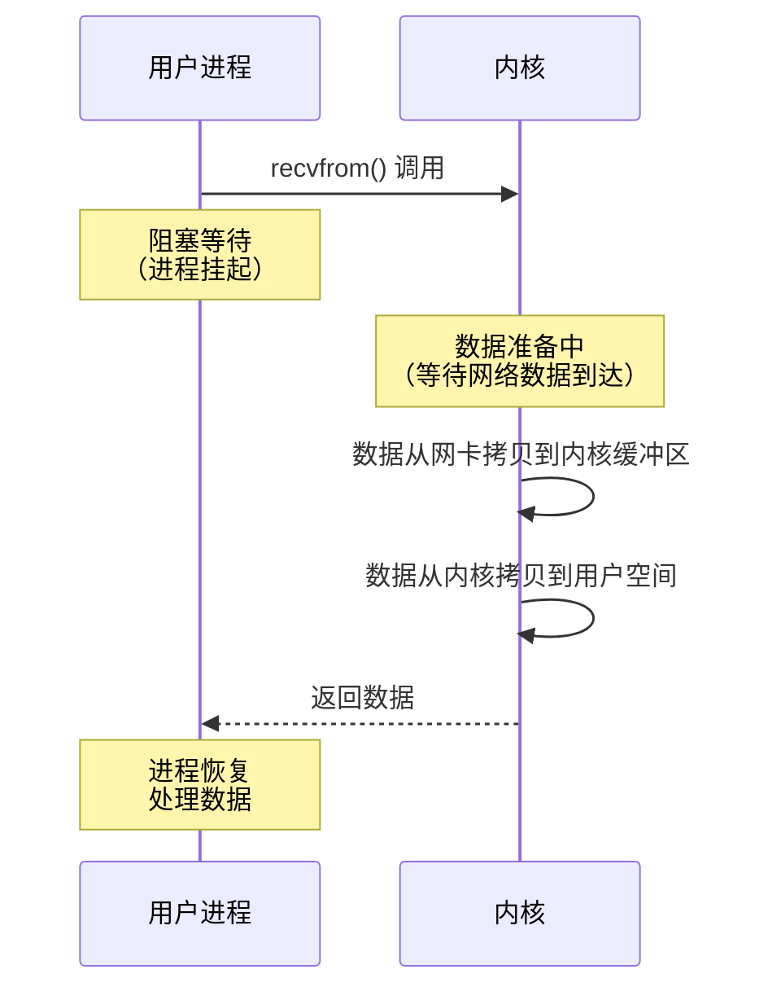
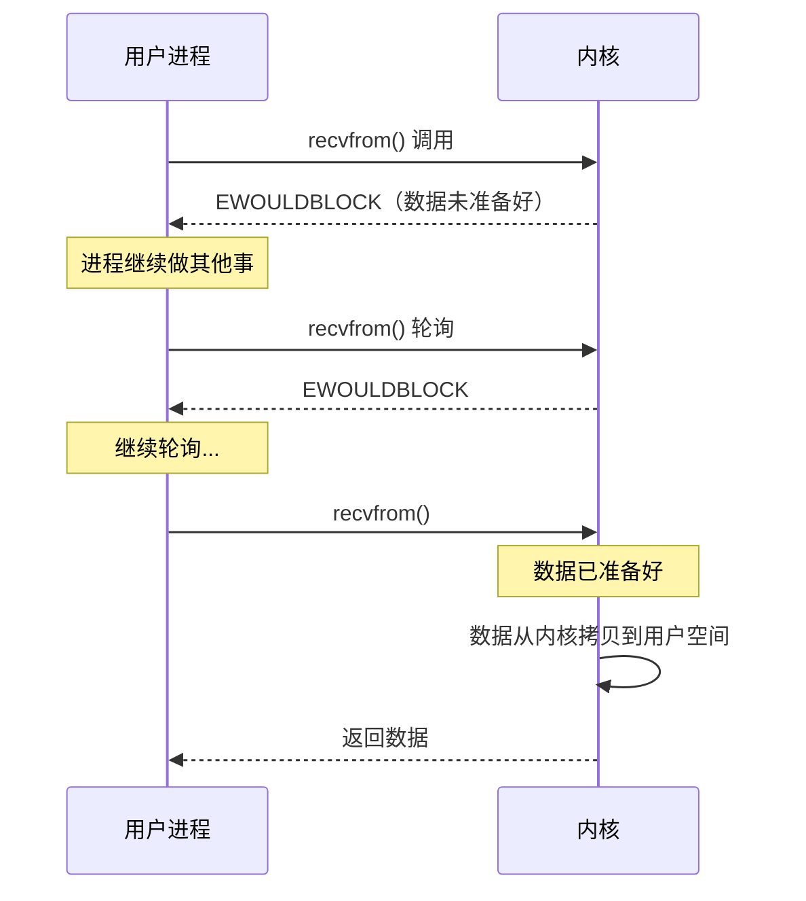
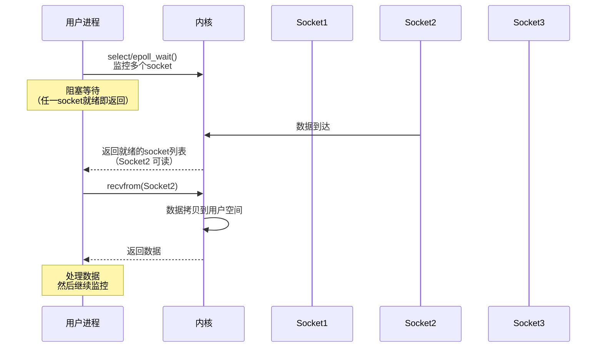
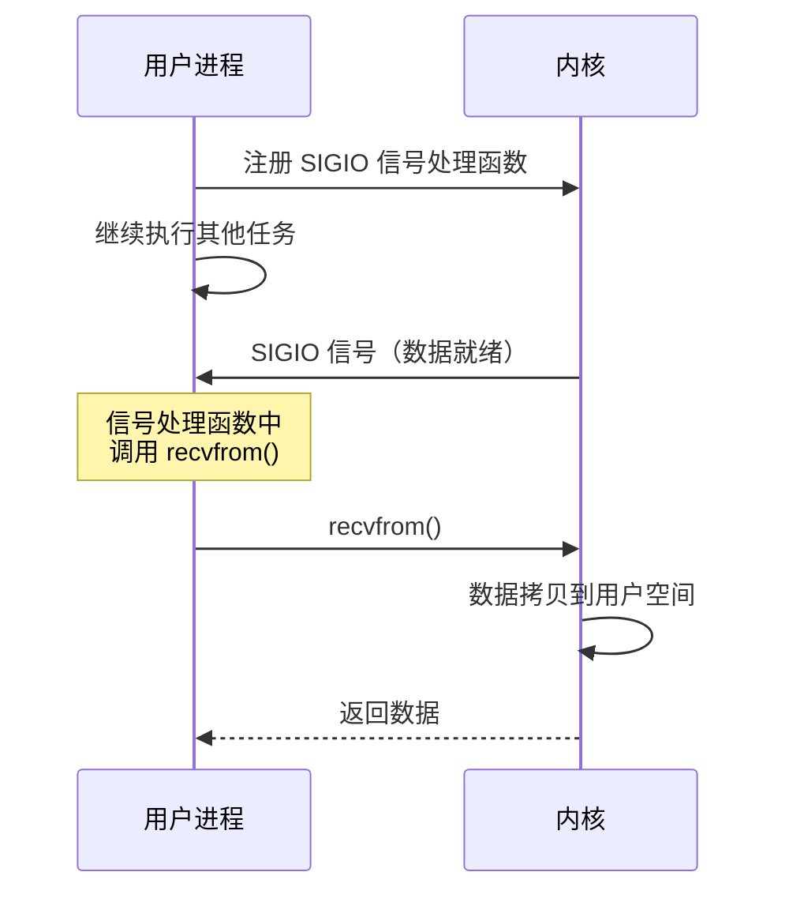
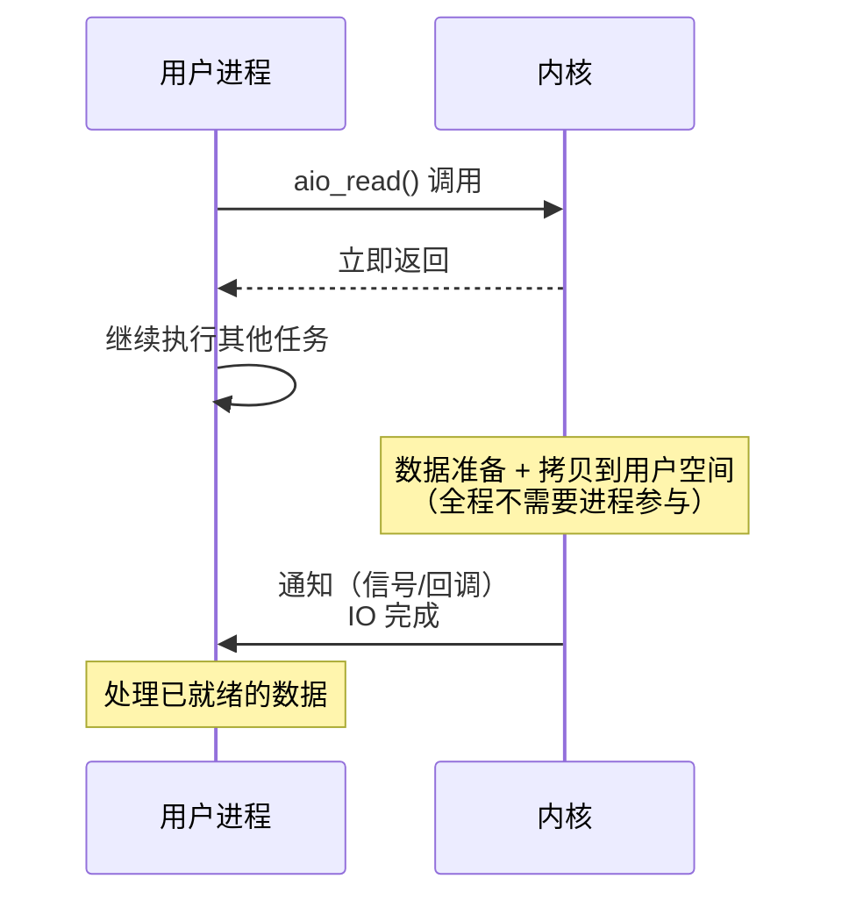
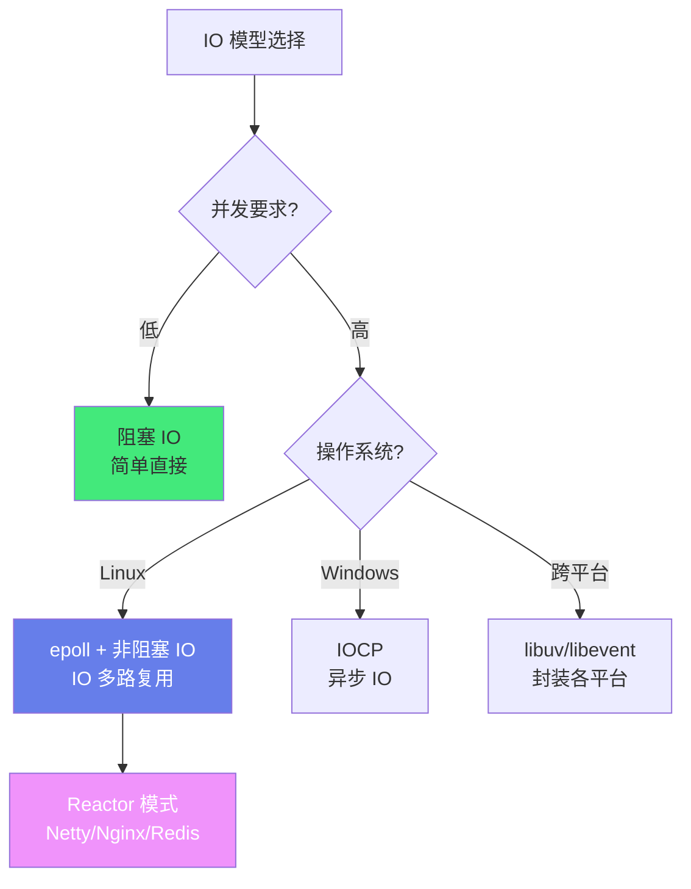
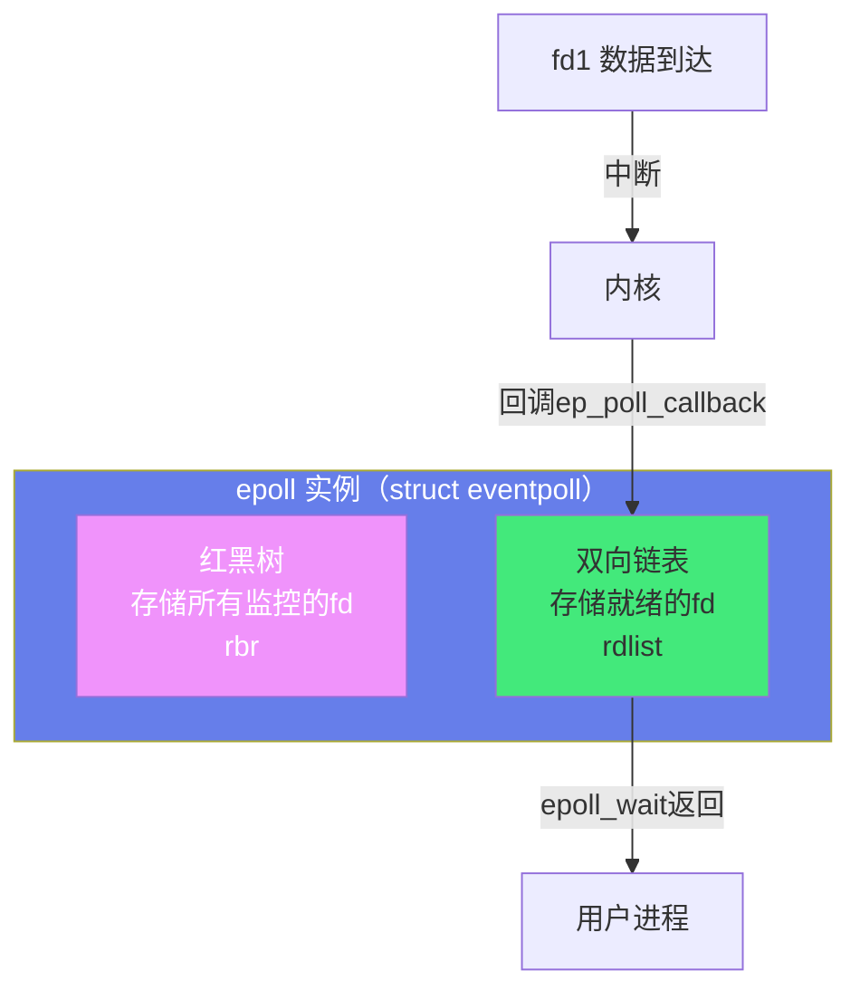
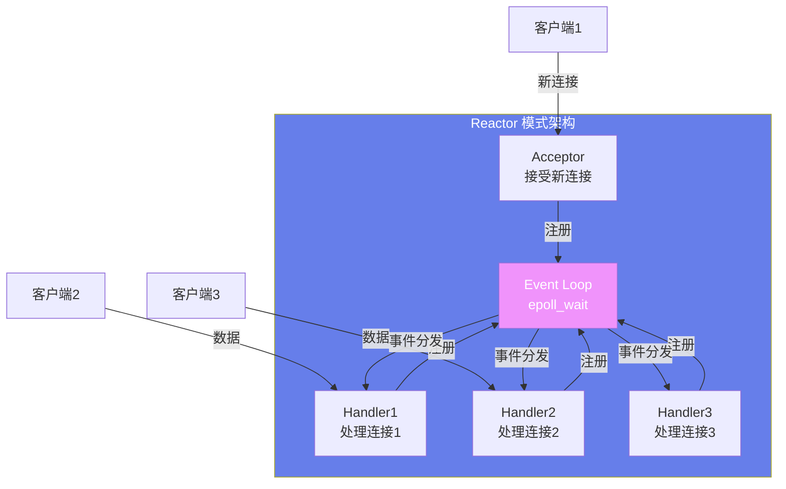
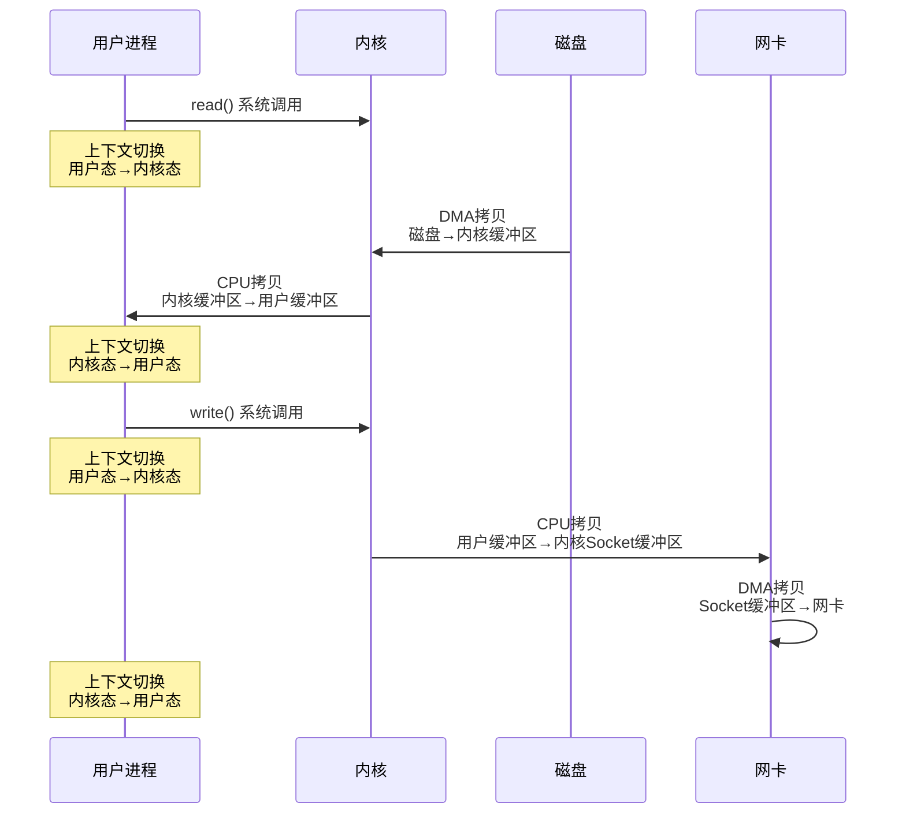

# ⚡ IO 模型与零拷贝

> **文档说明**：系统讲解 IO 模型与零拷贝的完整知识体系，涵盖五种 IO 模型（阻塞 IO、非阻塞 IO、IO 多路复用、信号驱动 IO、异步 IO）原理与对比、select/poll/epoll 实现机制与区别、Reactor 与 Proactor 模式、零拷贝技术（mmap、sendfile、splice、tee、vmsplice）原理与实现、Direct IO 与 Page Cache、IO 性能优化、各语言 IO 模型实现（Java NIO/Netty、Python asyncio、Go goroutine、Node.js 事件循环）、常见问题与最佳实践。
>
> **适用人群**：后端开发者、系统工程师、高性能服务器开发者、计算机专业学生、面试准备者
>
> **前置知识**：[[进程线程与协程]] · [[内存管理与虚拟内存]] · [[Linux内核基础概念]]

---

## 一、概述

### 1.1 什么是 IO

IO（Input/Output）是计算机与外部设备（磁盘、网络、键盘、显示器等）之间的数据交换。IO 操作通常比 CPU 计算慢几个数量级，是系统性能的主要瓶颈。

**IO 的两个阶段**：
1. **数据准备阶段**：数据从外部设备（磁盘/网卡）拷贝到内核缓冲区
2. **数据拷贝阶段**：数据从内核缓冲区拷贝到用户进程缓冲区


> **DMA（Direct Memory Access）**：直接内存访问，外部设备可以不经过 CPU 直接将数据拷贝到内存，解放 CPU。

### 1.2 为什么需要 IO 模型

IO 操作慢，进程如果在 IO 时一直等待（阻塞），会浪费 CPU 资源。IO 模型解决的是「如何高效地处理 IO」问题——在等待 IO 数据准备时，CPU 可以做其他事情，提高系统吞吐量和资源利用率。

**传统阻塞 IO 的问题**：
- 一个线程只能处理一个 IO 连接
- C10K 问题：1 万个连接需要 1 万个线程，内存和上下文切换开销巨大
- IO 等待时线程被阻塞，CPU 利用率低

**高性能 IO 的目标**：
- 一个线程/进程处理大量并发连接
- IO 等待时不阻塞，CPU 可以处理其他任务
- 减少数据拷贝次数（零拷贝）
- 减少系统调用和上下文切换

### 1.3 IO 性能关键指标

| 指标 | 说明 |
|------|------|
| **吞吐量（Throughput）** | 单位时间内处理的数据量或请求数 |
| **延迟（Latency）** | 从请求发起到响应返回的时间 |
| **并发连接数** | 同时处理的连接数量 |
| **CPU 利用率** | CPU 忙于计算而非等待 IO 的比例 |
| **IOPS** | 每秒 IO 操作次数（磁盘） |
| **带宽** | 数据传输速率（网络/磁盘） |

---

## 二、五种 IO 模型

### 2.1 阻塞 IO（Blocking IO）

进程发起 IO 调用后，一直等待数据准备和拷贝完成，期间进程被阻塞，不能做其他事情。



**特点**：
- 简单易用，编程模型简单
- 一个线程处理一个连接，并发能力低
- IO 等待时 CPU 空闲，资源浪费
- 适用于连接数少、并发要求低的场景

**示例**：
```python
import socket

server = socket.socket(socket.AF_INET, socket.SOCK_STREAM)
server.bind(('0.0.0.0', 8080))
server.listen(5)

while True:
    conn, addr = server.accept()  # 阻塞等待连接
    data = conn.recv(1024)        # 阻塞等待数据
    conn.send(data)
    conn.close()
```

### 2.2 非阻塞 IO（Non-blocking IO）

进程发起 IO 调用后，如果数据未准备好，立即返回错误（EWOULDBLOCK），进程可以继续做其他事情，然后轮询检查数据是否准备好。



**特点**：
- 不阻塞，可以同时处理多个连接
- 需要轮询，CPU 忙等（busy waiting），浪费 CPU
- 编程复杂，需要处理 EWOULDBLOCK
- 实际很少单独使用，通常配合 IO 多路复用

### 2.3 IO 多路复用（IO Multiplexing）

一个线程同时监控多个文件描述符（socket），当某个描述符就绪（可读/可写）时，通知进程处理。这是高性能服务器最常用的模型。



**三种实现**：
| 实现 | 说明 | 并发能力 | 效率 |
|------|------|---------|------|
| **select** | 最早的实现，POSIX 标准 | 1024 个连接（FD_SETSIZE） | O(n)，每次遍历所有 fd |
| **poll** | 改进 select，无连接数限制 | 无限制（内存允许） | O(n)，每次遍历所有 fd |
| **epoll** | Linux 特有，事件驱动 | 无限制，百万级 | O(1)，只返回就绪的 fd |

**IO 多路复用的优势**：
- 一个线程处理大量并发连接（C10K/C100K）
- 不需要多线程，减少内存和上下文切换开销
- 阻塞在 select/epoll_wait 上，不忙等
- 是 Reactor 模式的基础

### 2.4 信号驱动 IO（Signal-driven IO）

进程注册 SIGIO 信号处理函数，当 IO 就绪时，内核发送 SIGIO 信号通知进程，进程在信号处理函数中处理 IO。



**特点**：
- 数据准备阶段不阻塞，通过信号通知
- 数据拷贝阶段仍阻塞
- 信号处理函数编程复杂，信号队列可能溢出
- 实际使用较少，UDP 偶尔使用，TCP 几乎不用

### 2.5 异步 IO（Asynchronous IO）

进程发起 IO 调用后立即返回，内核完成数据准备和拷贝后，通知进程（或调用回调函数）。整个过程进程完全不阻塞。



**特点**：
- 两个阶段都不阻塞，真正的异步
- 编程模型复杂（回调/事件循环）
- Linux 原生 AIO 支持有限（主要用于 Direct IO）
- Windows IOCP 是成熟的异步 IO 实现
- 高级语言封装：Node.js 事件循环、Python asyncio、Java NIO.2

### 2.6 五种 IO 模型对比

| 模型 | 数据准备阶段 | 数据拷贝阶段 | 阻塞程度 | 并发能力 | 编程复杂度 |
|------|------------|------------|---------|---------|-----------|
| **阻塞 IO** | 阻塞 | 阻塞 | 全程阻塞 | 低（一线程一连接） | 低 |
| **非阻塞 IO** | 不阻塞（轮询） | 阻塞 | 部分阻塞 | 中 | 中 |
| **IO 多路复用** | 阻塞（等就绪） | 阻塞 | 部分阻塞 | 高（一线程多连接） | 中 |
| **信号驱动 IO** | 不阻塞（信号） | 阻塞 | 部分阻塞 | 中 | 高 |
| **异步 IO** | 不阻塞 | 不阻塞 | 完全不阻塞 | 最高 | 高 |



---

## 三、select / poll / epoll 详解

### 3.1 select

```c
#include <sys/select.h>

int select(int nfds, fd_set *readfds, fd_set *writefds,
           fd_set *exceptfds, struct timeval *timeout);

// 操作 fd_set 的宏
FD_ZERO(fd_set *set);           // 清空集合
FD_SET(int fd, fd_set *set);    // 添加 fd
FD_CLR(int fd, fd_set *set);    // 移除 fd
FD_ISSET(int fd, fd_set *set);  // 检查 fd 是否就绪
```

**select 的缺点**：
1. **连接数限制**：FD_SETSIZE 通常为 1024，最多监控 1024 个 fd
2. **效率低**：每次调用都要把整个 fd_set 从用户态拷贝到内核态，O(n) 遍历所有 fd
3. **返回后需遍历**：返回后需要遍历所有 fd 检查哪个就绪，O(n)
4. **fd_set 不可重用**：每次调用后 fd_set 被修改，需要重新设置

### 3.2 poll

```c
#include <poll.h>

int poll(struct pollfd *fds, nfds_t nfds, int timeout);

struct pollfd {
    int fd;         // 文件描述符
    short events;   // 关心的事件（POLLIN/POLLOUT/POLLERR）
    short revents;  // 实际发生的事件（内核填充）
};
```

**poll 相比 select 的改进**：
- 无 1024 连接数限制（用数组，动态分配）
- pollfd 结构分离了 events 和 revents，不需要每次重置

**poll 仍存在的问题**：
- 每次调用仍需将 pollfd 数组从用户态拷贝到内核态
- 仍需 O(n) 遍历所有 fd 检查就绪状态
- 连接数大时效率仍低

### 3.3 epoll

epoll 是 Linux 2.6 引入的高性能 IO 多路复用实现，是目前 Linux 下最高效的 IO 模型。

**三个核心 API**：
```c
#include <sys/epoll.h>

// 1. 创建 epoll 实例（红黑树 + 就绪链表）
int epoll_create(int size);
int epoll_create1(int flags);  // 改进版

// 2. 控制 epoll 监控的文件描述符（增删改）
int epoll_ctl(int epfd, int op, int fd, struct epoll_event *event);
// op: EPOLL_CTL_ADD（添加）/ EPOLL_CTL_MOD（修改）/ EPOLL_CTL_DEL（删除）

// 3. 等待事件，返回就绪的 fd 数量
int epoll_wait(int epfd, struct epoll_event *events, int maxevents, int timeout);

struct epoll_event {
    uint32_t events;   // 事件类型（EPOLLIN/EPOLLOUT/EPOLLERR/EPOLLET）
    epoll_data_t data; // 用户数据（通常存 fd）
};
```

**epoll 的核心数据结构**：


**epoll 的高效原理**：
1. **红黑树存储监控 fd**：增删改 O(log n)，避免 select/poll 每次传递整个集合
2. **就绪链表**：fd 就绪时通过回调函数加入就绪链表，epoll_wait 只需检查链表是否为空
3. **只返回就绪的 fd**：不需要遍历所有 fd，O(1) 时间获取就绪列表
4. **内存共享**：epoll_ctl 注册后，fd 信息存在内核，不需要每次拷贝

**epoll 两种工作模式**：

| 模式 | 说明 | 特点 |
|------|------|------|
| **LT（Level Triggered，水平触发）** | 默认模式，只要 fd 上有数据就一直通知 | 编程简单，类似 select/poll，数据没读完会一直通知 |
| **ET（Edge Triggered，边缘触发）** | 只在状态变化时通知一次（从无到有/从有到无） | 高效，必须一次性读完数据（非阻塞 IO + 循环读到 EAGAIN），否则数据可能丢失 |

**ET 模式的正确用法**：
```c
// 必须使用非阻塞 IO
int flags = fcntl(fd, F_GETFL, 0);
fcntl(fd, F_SETFL, flags | O_NONBLOCK);

// 注册到 epoll，使用 ET 模式
struct epoll_event ev;
ev.events = EPOLLIN | EPOLLET;  // 边缘触发
ev.data.fd = fd;
epoll_ctl(epfd, EPOLL_CTL_ADD, fd, &ev);

// 处理数据时必须循环读到 EAGAIN
while (1) {
    n = read(fd, buf, sizeof(buf));
    if (n == -1) {
        if (errno == EAGAIN || errno == EWOULDBLOCK) {
            break;  // 数据读完了
        }
        // 真正的错误
        break;
    }
    if (n == 0) {
        // 连接关闭
        break;
    }
    // 处理数据
    process_data(buf, n);
}
```

### 3.4 select / poll / epoll 对比

| 维度 | select | poll | epoll |
|------|--------|------|-------|
| **数据结构** | fd_set（位图） | pollfd 数组 | 红黑树 + 就绪链表 |
| **连接数限制** | 1024（FD_SETSIZE） | 无限制 | 无限制 |
| **时间复杂度** | O(n) | O(n) | O(1)（就绪通知） |
| **内存拷贝** | 每次调用拷贝整个集合 | 每次调用拷贝整个数组 | 注册时拷贝一次，后续共享 |
| **遍历方式** | 返回后遍历所有 fd | 返回后遍历所有 fd | 只遍历就绪的 fd |
| **工作模式** | LT | LT | LT / ET |
| **平台支持** | POSIX（全平台） | POSIX（全平台） | Linux 特有 |
| **适用场景** | 连接数少（<1000） | 连接数中等 | 高并发（C10K+） |
| **代表应用** | 旧版 Unix 工具 | — | Nginx、Redis、Netty(epoll) |

---

## 四、Reactor 与 Proactor 模式

### 4.1 Reactor 模式

Reactor 模式是基于 IO 多路复用的事件驱动模式，是高性能服务器的标准架构。

**核心组件**：
| 组件 | 说明 |
|------|------|
| **Reactor** | 事件分发器，监控 IO 事件，分发给对应的 Handler |
| **Acceptor** | 处理新连接，接受连接后注册到 Reactor |
| **Handler** | 处理具体的 IO 事件（读/写/异常） |
| **Event Loop** | 事件循环，不断调用 epoll_wait 并分发事件 |



**Reactor 模式特点**：
- 基于 IO 多路复用（epoll），一个线程处理大量连接
- 事件驱动，IO 就绪时才处理
- 非阻塞 IO，处理 IO 时不阻塞
- 单线程模型（或主从多线程）
- 代表：Nginx、Redis、Node.js、Netty（主从 Reactor）

**主从 Reactor 模式（Netty）**：
- **主 Reactor（Boss Group）**：只处理新连接（accept），通常 1 个线程
- **从 Reactor（Worker Group）**：处理已连接的 IO 读写，通常 CPU 核数个线程
- 连接建立后，从 Reactor 分配一个线程处理该连接的所有 IO

### 4.2 Proactor 模式

Proactor 模式是基于异步 IO 的事件驱动模式，IO 操作由内核完成，完成后通知应用程序。

**与 Reactor 的区别**：
| 维度 | Reactor | Proactor |
|------|---------|----------|
| **IO 模型** | IO 多路复用 + 非阻塞 IO | 异步 IO（AIO） |
| **数据拷贝** | 应用程序自己 read/write | 内核完成拷贝，直接通知结果 |
| **事件类型** | IO 就绪事件（可读/可写） | IO 完成事件（读完成/写完成） |
| **处理方式** | 事件就绪后应用自己执行 IO | 内核执行完 IO 后通知应用处理结果 |
| **代表实现** | Nginx、Redis、Netty | Windows IOCP、Boost.Asio（Proactor） |

> Linux 原生 AIO 不够成熟，Linux 下通常用 Reactor（epoll）模式。Windows 下用 Proactor（IOCP）模式。Boost.Asio 在 Linux 下用 Reactor 模拟 Proactor。

---

## 五、零拷贝（Zero-Copy）

### 5.1 传统 IO 的数据拷贝

传统的文件传输（如 Web 服务器发送静态文件）需要 4 次数据拷贝和 4 次上下文切换：



**4 次拷贝**：
1. DMA：磁盘 → 内核缓冲区
2. CPU：内核缓冲区 → 用户缓冲区
3. CPU：用户缓冲区 → 内核 Socket 缓冲区
4. DMA：内核 Socket 缓冲区 → 网卡

**4 次上下文切换**：
1. read()：用户态 → 内核态
2. read() 返回：内核态 → 用户态
3. write()：用户态 → 内核态
4. write() 返回：内核态 → 用户态

> 零拷贝的目标是减少 CPU 拷贝次数（第 2、3 次），让数据不经过用户缓冲区，直接在内核空间传输。

### 5.2 mmap + write

mmap 将文件映射到用户进程的虚拟地址空间，这样用户进程可以直接访问文件内容，不需要 read() 拷贝。但 write() 仍需从内核缓冲区拷贝到 Socket 缓冲区。

```mermaid
flowchart LR
    D[磁盘] -->|DMA| K[内核缓冲区]
    K <-->|mmap映射<br/>共享物理页| U[用户进程虚拟地址]
    U -->|write()| S[Socket缓冲区]
    S -->|DMA| N[网卡]
    
    style K fill:#f093fb,color:#fff
    style U fill:#667eea,color:#fff
```

**mmap 的拷贝次数**：
1. DMA：磁盘 → 内核缓冲区（与用户空间共享）
2. CPU：内核缓冲区 → Socket 缓冲区（write 时）
3. DMA：Socket 缓冲区 → 网卡

减少了 1 次 CPU 拷贝（传统的第 2 次），共 3 次拷贝。

**mmap 示例**：
```c
#include <sys/mman.h>

// 将文件映射到内存
void *addr = mmap(NULL, file_size, PROT_READ, MAP_PRIVATE, fd, 0);

// 直接通过内存访问文件内容
// 不需要 read()

// 写入 Socket（仍需一次 CPU 拷贝）
write(socket_fd, addr, file_size);

// 解除映射
munmap(addr, file_size);
```

**mmap 的注意事项**：
- 必须处理 SIGBUS 信号（文件被截断时访问映射区会触发）
- 映射大小受虚拟地址空间限制（32 位系统最大 2-3GB）
- 适合大文件随机访问，不适合小文件顺序读取（开销大于 read）
- mmap 有缺页中断开销，需要预热

### 5.3 sendfile

sendfile 是 Linux 2.1 引入的系统调用，专门用于在两个文件描述符之间传输数据，数据不经过用户空间。

```c
#include <sys/sendfile.h>

ssize_t sendfile(int out_fd, int in_fd, off_t *offset, size_t count);
// out_fd: 目标 fd（通常是 socket）
// in_fd: 源 fd（必须是支持 mmap 的文件，如普通文件）
// offset: 源文件偏移量
// count: 传输字节数
```


**sendfile 的拷贝次数**：
1. DMA：磁盘 → 内核缓冲区
2. CPU：内核缓冲区 → Socket 缓冲区
3. DMA：Socket 缓冲区 → 网卡

与 mmap+write 相同，3 次拷贝，但减少了系统调用（一次 sendfile 替代 read+write），上下文切换从 4 次减少到 2 次。

**sendfile 的限制**：
- in_fd 必须是普通文件（不能是 socket 或 pipe）
- out_fd 必须是 socket（Linux 2.6.33 后支持任意 fd）
- 不能在传输过程中修改数据（如压缩、加密）

### 5.4 sendfile + DMA Gather Copy

Linux 2.4 内核引入了 DMA Gather Copy 技术，配合 sendfile 可以实现真正的零拷贝（0 次 CPU 拷贝）。

原理：sendfile 将数据从内核缓冲区拷贝到 Socket 缓冲区时，不实际拷贝数据，只将缓冲区描述符（地址+长度）传给 Socket 缓冲区，DMA 控制器根据描述符直接从内核缓冲区将数据发送到网卡。


**真正的零拷贝（2 次 DMA，0 次 CPU 拷贝）**：
1. DMA：磁盘 → 内核缓冲区
2. DMA：内核缓冲区 → 网卡（通过 DMA Gather，不经过 Socket 缓冲区）

> 需要网卡支持 SG-DMA（Scatter-Gather DMA），现代网卡基本都支持。

### 5.5 splice

splice 是 Linux 2.6.17 引入的系统调用，可以在两个文件描述符之间移动数据，其中至少一个必须是管道。

```c
#define _GNU_SOURCE
#include <fcntl.h>

ssize_t splice(int fd_in, loff_t *off_in, int fd_out, loff_t *off_out,
               size_t len, unsigned int flags);
```

**splice 的零拷贝原理**：
- 数据不经过用户空间
- 通过管道缓冲区在内核空间传递
- 利用管道的缓冲区引用计数，不实际拷贝数据

**典型用法（文件 → 管道 → Socket）**：
```c
int pipefd[2];
pipe(pipefd);

// 文件 → 管道（零拷贝）
splice(file_fd, NULL, pipefd[1], NULL, size, SPLICE_F_MORE);

// 管道 → Socket（零拷贝）
splice(pipefd[0], NULL, socket_fd, NULL, size, SPLICE_F_MORE);
```

### 5.6 零拷贝技术对比

| 技术 | CPU 拷贝次数 | 系统调用 | 上下文切换 | 适用场景 |
|------|------------|---------|-----------|---------|
| **传统 read+write** | 2 次 | 2 次 | 4 次 | 通用，可修改数据 |
| **mmap+write** | 1 次 | 2 次 | 4 次 | 大文件随机访问 |
| **sendfile** | 1 次 | 1 次 | 2 次 | 文件→Socket 传输 |
| **sendfile+DMA Gather** | 0 次 | 1 次 | 2 次 | 静态文件传输（Nginx） |
| **splice** | 0 次 | 2 次 | 2 次 | 任意 fd→fd（需管道） |

**零拷贝的限制**：
- 不能在传输过程中修改数据（压缩、加密、转换）
- sendfile 要求源是普通文件，目标是 socket
- 需要硬件支持（DMA Gather）
- 小文件开销可能大于传统方式

> Nginx 发送静态文件默认使用 sendfile（`sendfile on`），配合 `tcp_nopush` 和 `tcp_nodelay` 优化传输性能。

---

## 六、Direct IO 与 Page Cache

### 6.1 Page Cache（页缓存）

Page Cache 是 Linux 内核的磁盘缓存，将磁盘文件数据缓存在内存中，加速后续访问。

```mermaid
flowchart LR
    A[用户进程 read()] --> B{Page Cache<br/>命中?}
    B -->|命中| C[直接从缓存返回<br/>无磁盘IO]
    B -->|未命中| D[从磁盘读取<br/>填充Page Cache]
    D --> C
    
    style B fill:#f093fb,color:#fff
    style C fill:#43e97b,color:#333
    style D fill:#ff6b6b,color:#fff
```

**Page Cache 的特点**：
- 以页（4KB）为单位缓存
- 读缓存：read() 时先查 Page Cache，未命中才读磁盘
- 写缓存：write() 时写入 Page Cache，由内核线程（pdflush/flush）异步刷回磁盘（延迟写）
- 预读：顺序读时内核预读后续页面，提高命中率
- 回收：内存不足时通过 LRU 算法回收不常用的页

**查看 Page Cache 使用**：
```bash
free -h              # 查看内存使用（buff/cache 列）
cat /proc/meminfo    # 详细内存信息
vmstat 1             # 实时查看内存和 IO
```

### 6.2 Direct IO

Direct IO 绕过 Page Cache，直接在用户缓冲区和磁盘之间传输数据，不经过内核缓存。

```c
// 打开文件时指定 O_DIRECT 标志
int fd = open("file", O_RDONLY | O_DIRECT);
```

**Direct IO 的特点**：
- 绕过 Page Cache，减少一次 CPU 拷贝（内核缓冲区 → 用户缓冲区）
- 用户进程自己管理缓存（如数据库 InnoDB Buffer Pool）
- 需要满足对齐要求：缓冲区地址、IO 偏移量、传输长度都必须是 512 字节（或逻辑块大小）的整数倍
- 适用于数据库等自己实现缓存的应用

**Direct IO vs 缓冲 IO**：
| 维度 | 缓冲 IO（默认） | Direct IO |
|------|---------------|-----------|
| **Page Cache** | 使用 | 绕过 |
| **CPU 拷贝** | 2 次（磁盘→内核→用户） | 1 次（磁盘→用户，DMA） |
| **缓存管理** | 内核管理 | 应用自己管理 |
| **对齐要求** | 无 | 严格（512 字节对齐） |
| **适用场景** | 通用、文件共享、随机访问 | 数据库、自实现缓存 |
| **代表应用** | 大部分应用 | MySQL InnoDB、Oracle |

---

## 七、各语言 IO 模型实现

### 7.1 Java NIO / Netty

| 组件 | 说明 |
|------|------|
| **Java BIO** | 阻塞 IO，一个线程一个连接，传统模式 |
| **Java NIO** | 非阻塞 IO + Channel + Buffer + Selector（封装 select/poll/epoll） |
| **Netty** | 基于 NIO 的高性能框架，主从 Reactor 模式，零拷贝（FileRegion） |

**Netty 零拷贝**：
- `FileRegion`：基于 sendfile 的文件传输，零拷贝
- `CompositeByteBuf`：将多个 ByteBuf 组合为一个逻辑视图，不实际拷贝
- `slice()`/`duplicate()`：共享底层缓冲区，不拷贝数据
- `Unpooled.wrappedBuffer()`：包装已有数组，不拷贝

### 7.2 Python asyncio

- 基于事件循环（Event Loop）
- Linux 下使用 epoll（`asyncio.SelectorEventLoop`）
- `async/await` 语法糖，协程实现异步 IO
- 单线程并发，适合 IO 密集型
- 代表框架：FastAPI、aiohttp、Tornado

### 7.3 Go goroutine

- Go 运行时实现 M:N 调度（N 个 goroutine 映射到 M 个 OS 线程）
- 网络 IO 由 Go runtime 封装为非阻塞 + epoll
- goroutine 发起 IO 时，runtime 将其挂起，IO 就绪后恢复
- 开发者写同步代码，runtime 自动异步化
- 高并发，百万级 goroutine

### 7.4 Node.js 事件循环

- 单线程事件循环，基于 libuv（跨平台异步 IO 库）
- Linux 下用 epoll，Windows 下用 IOCP
- 所有 IO 操作都是异步的，通过回调/Promise 处理结果
- 适合 IO 密集型，不适合 CPU 密集型
- 代表：Express、Koa、NestJS

---

## 八、IO 性能优化最佳实践

| 优化方向 | 具体措施 |
|---------|---------|
| **IO 模型** | 高并发用 epoll + 非阻塞 IO（Reactor 模式），避免阻塞 IO 多线程 |
| **零拷贝** | 静态文件传输用 sendfile，大文件用 mmap，数据库用 Direct IO |
| **缓冲区** | 合理设置 Socket 缓冲区（SO_RCVBUF/SO_SNDBUF），减少系统调用 |
| **批量 IO** | 合并小 IO 为大 IO，减少系统调用次数（如 writev/readv） |
| **异步 IO** | IO 密集型用异步模型，避免线程阻塞 |
| **Page Cache** | 利用 Page Cache 加速重复访问，顺序读利用预读 |
| **连接池** | 复用连接，减少连接建立开销（TCP 三次握手） |
| **长连接** | HTTP Keep-Alive、WebSocket，避免频繁建立连接 |
| **压缩** | 传输前压缩数据（gzip/br），减少网络 IO（CPU 换带宽） |
| **CDN** | 静态资源用 CDN，减少源站 IO |
| **监控** | 监控 IO 指标（iostat、vmstat、sar），及时发现瓶颈 |

**常用 IO 监控命令**：
```bash
iostat -xz 1              # 磁盘 IO 统计（%util、await、svctm）
vmstat 1                   # 系统整体统计（io 列、wa 列）
sar -d 1                   # 磁盘活动统计
sar -n DEV 1               # 网络 IO 统计
dstat                      # 综合统计（替代 vmstat/iostat/netstat）
iotop                      # 进程级 IO 统计（类似 top）
pidstat -d 1               # 进程 IO 统计
```

---

## 九、常见问题排查

| 问题 | 可能原因 | 排查/解决方案 |
|------|---------|-------------|
| **CPU 占用高但吞吐量低** | 阻塞 IO 多线程上下文切换 / 非阻塞 IO 忙等 | 用 epoll 替代，检查是否正确使用非阻塞 |
| **连接数上不去** | 文件描述符限制 / 端口耗尽 / epoll 配置 | `ulimit -n` 调整，检查 TIME_WAIT，调整内核参数 |
| **IO 延迟高** | 磁盘瓶颈 / 网络延迟 / 缓冲区太小 | iostat 看磁盘 util，ping 看网络，调整 SO_RCVBUF |
| **大量 TIME_WAIT** | 短连接过多 / 主动关闭方 | 用长连接/连接池，调整 tcp_tw_reuse，优化应用 |
| **epoll 丢事件** | ET 模式未读完数据 / 水平触发误用 | ET 模式必须循环读到 EAGAIN，检查 EPOLLET 标志 |
| **sendfile 不生效** | 源不是普通文件 / 内核版本低 / 未开启 | 检查文件类型，Nginx 配置 sendfile on，确认内核支持 |
| **mmap 崩溃（SIGBUS）** | 文件被截断 / 映射区越界 | 处理 SIGBUS，文件大小变化时重新映射 |
| **Direct IO 报错 EINVAL** | 缓冲区/偏移/长度未对齐 | 确保 512 字节对齐，用 posix_memalign 分配 |
| **连接被重置（RST）** | 对端崩溃 / 防火墙 / 半连接队列满 | 检查对端状态，调整 tcp_max_syn_backlog，开启 syncookies |
| **写阻塞** | Socket 发送缓冲区满 / 对端接收慢 | 用非阻塞写，检查对端处理速度，调整 SO_SNDBUF |

---

## 十、关联笔记

### 操作系统
- [[进程线程与协程]] · [[Linux内核基础概念]] · [[内存管理与虚拟内存]]
- [[Linux性能调优]]

### 网络
- [[TCPIP协议栈详解]] · [[HTTP协议完整指南]] · [[HTTPS与TLS握手]]
- [[网络抓包与调试]]

### 高性能
- [[Nginx高性能配置]] · [[Redis高性能原理]] · [[Netty核心原理]]
- [[高可用架构设计]] · [[性能优化方法论]]

### 导航
- [[MOC-计算机基础]] · [[MOC-操作系统]] · [[MOC-综合导航]] · [[Home]]

> 🔍 **知识点深度解析**
>
> **作用**：IO 模型与零拷贝解决的是「高效处理 IO」问题——IO 操作（磁盘/网络）比 CPU 计算慢几个数量级，是系统性能的主要瓶颈。IO 模型（阻塞/非阻塞/多路复用/信号驱动/异步）决定了进程如何等待和处理 IO，目标是在 IO 等待时不浪费 CPU，提高并发能力和吞吐量。零拷贝技术（mmap/sendfile/splice）减少了数据在内核空间和用户空间之间的 CPU 拷贝次数，降低了 IO 传输的 CPU 开销和延迟。两者结合是高性能服务器（Nginx/Redis/Netty/Kafka）的核心技术基础。
>
> **底层原理**：IO 操作分为两个阶段——数据准备阶段（外部设备→内核缓冲区，DMA 完成）和数据拷贝阶段（内核缓冲区→用户缓冲区，CPU 完成）。五种 IO 模型的区别在于这两个阶段是否阻塞：阻塞 IO 两个阶段都阻塞；非阻塞 IO 准备阶段不阻塞（轮询）但拷贝阶段阻塞；IO 多路复用阻塞在「等就绪」上（epoll_wait），就绪后拷贝阶段仍阻塞；信号驱动 IO 准备阶段通过信号通知不阻塞，拷贝阶段阻塞；异步 IO 两个阶段都不阻塞，内核完成后通知。epoll 是 Linux 最高效的 IO 多路复用实现，核心是「红黑树存储监控 fd + 就绪链表存储就绪 fd + 回调机制」：fd 注册时加入红黑树（O(log n)），fd 就绪时通过中断回调加入就绪链表，epoll_wait 只需检查就绪链表是否为空（O(1)），只返回就绪的 fd，不需要遍历所有 fd。零拷贝的核心是「减少 CPU 拷贝」：传统 read+write 需要 2 次 CPU 拷贝（内核→用户→内核 Socket），mmap 用内存映射消除了内核→用户的拷贝（共享物理页），sendfile 直接在内核空间传输不经过用户空间（1 次 CPU 拷贝），sendfile+DMA Gather 通过描述符传递和网卡 DMA 直接从内核缓冲区取数据实现 0 次 CPU 拷贝（真正的零拷贝），splice 通过管道缓冲区引用计数实现任意 fd 间的零拷贝。
>
> **用法要点**：① IO 模型选择：低并发用阻塞 IO（简单），高并发用 epoll+非阻塞 IO（Reactor 模式），Windows 用 IOCP（异步） ② epoll 用法：epoll_create 创建实例 → epoll_ctl 注册 fd（EPOLLIN/EPOLLOUT/EPOLLET）→ epoll_wait 等待事件 → 处理就绪 fd ③ ET 模式必须用非阻塞 IO，且必须循环读到 EAGAIN，否则数据可能丢失 ④ 零拷贝选择：静态文件传输用 sendfile（Nginx sendfile on），大文件随机访问用 mmap，数据库自管理缓存用 Direct IO，任意 fd 间传输用 splice ⑤ 零拷贝限制：不能在传输中修改数据（压缩/加密），sendfile 要求源是文件目标是 socket ⑥ 性能优化：epoll+非阻塞+Reactor+零拷贝+连接池+长连接+批量 IO+合理缓冲区 ⑦ 监控：iostat 看磁盘 util/await，vmstat 看 wa，sar 看网络，iotop 看进程 IO ⑧ 常见坑：ET 模式未读完数据丢事件、TIME_WAIT 过多端口耗尽、epoll 水平触发误设为边缘触发、mmap 文件截断导致 SIGBUS、Direct IO 未对齐报 EINVAL ⑨ 各语言实现：Java Netty（主从 Reactor+FileRegion 零拷贝）、Python asyncio（epoll+协程）、Go（runtime M:N 调度+epoll 自动异步）、Node.js（libuv+epoll/IOCP+事件循环） ⑩ 面试重点：五种 IO 模型对比、select/poll/epoll 区别、epoll 高效原理、LT vs ET、Reactor vs Proactor、零拷贝原理和实现、传统 IO 4 次拷贝。

> 💡 **深度讲解**：IO 模型最核心的理解是「IO 两个阶段的阻塞性」——数据准备阶段（等数据从设备到内核）和数据拷贝阶段（数据从内核到用户）。阻塞 IO 两个阶段都等，非阻塞 IO 第一阶段不等但要轮询，IO 多路复用第一阶段等在「多个 fd 任一就绪」上（比非阻塞的轮询高效，因为不忙等），信号驱动第一阶段用信号通知不等，异步 IO 两个阶段都不等（内核全包）。实际生产中 99% 的高性能服务器用的是「IO 多路复用 + 非阻塞 IO」（Reactor 模式），因为纯异步 IO（Linux AIO）不够成熟，而 IO 多路复用已经足够高效（epoll 可以支撑百万级连接）。epoll 为什么比 select/poll 快？关键是「事件驱动 + 只返回就绪的」：select/poll 每次调用都要把所有 fd 从用户态拷贝到内核态，内核遍历所有 fd 检查是否就绪，返回后用户还要遍历所有 fd 找就绪的——O(n) 的开销。epoll 用 epoll_ctl 把 fd 注册到内核的红黑树（只注册一次，不需要每次拷贝），fd 就绪时通过回调函数加入就绪链表，epoll_wait 只需要检查就绪链表有没有数据，有就直接返回（只返回就绪的 fd，不需要遍历所有）——O(1) 的就绪检测。这就是 epoll 在连接数大时性能碾压 select/poll 的原因。零拷贝的本质是「数据不需要 CPU 搬运」——传统 IO 中数据从磁盘到网卡要经过：磁盘→内核缓冲区（DMA，不需要 CPU）→用户缓冲区（CPU 拷贝）→Socket 缓冲区（CPU 拷贝）→网卡（DMA）。中间两次 CPU 拷贝是零拷贝要消除的目标。mmap 通过内存映射让用户进程和内核共享同一块物理内存（消除内核→用户的拷贝），sendfile 直接在内核空间从文件缓冲区拷到 Socket 缓冲区（不经过用户空间，消除用户→Socket 的拷贝，但内核内仍有一次 CPU 拷贝），sendfile+DMA Gather 让网卡直接从文件缓冲区 DMA 取数据（连内核内的 CPU 拷贝都消除了，真正 0 次 CPU 拷贝）。理解了这个数据流，你就理解了各种零拷贝技术的区别和适用场景。

> 📝 **精简总结**：IO 模型=五种（阻塞/非阻塞/多路复用/信号驱动/异步），核心是两个阶段（数据准备+数据拷贝）的阻塞性。高性能用 epoll+非阻塞 IO（Reactor）。epoll=红黑树+就绪链表+回调，O(1) 就绪检测，LT（水平）/ET（边缘）两种模式，ET 必须非阻塞+循环读到 EAGAIN。零拷贝=减少 CPU 拷贝，传统 4 次拷贝（2次CPU+2次DMA），mmap 3次，sendfile 3次，sendfile+DMA Gather 2次（0次CPU，真零拷贝），splice 管道零拷贝。Reactor=IO多路复用+事件分发（Nginx/Redis/Netty），Proactor=异步IO+完成通知（Windows IOCP）。优化：epoll+非阻塞+Reactor+零拷贝+连接池+长连接+批量IO。监控：iostat/vmstat/sar/iotop。面试重点：五种IO模型对比、select/poll/epoll区别、LT vs ET、Reactor vs Proactor、零拷贝原理。

> **学习路径建议**：先学习 [[进程线程与协程]] 理解并发基础 → 学习 [[Linux内核基础概念]] 理解内核机制 → 学习本文档掌握 IO 模型和零拷贝 → 学习 [[TCPIP协议栈详解]] 理解网络 IO → 学习 [[Nginx高性能配置]] 和 [[Redis高性能原理]] 看实际应用 → 学习 [[Netty核心原理]] 深入 Reactor 模式 → 在项目中实践高性能 IO 编程。

---

> **IO 的本质是「等待」——CPU 等待数据从慢速设备（磁盘/网络）到达。IO 模型的演进，就是从「傻等」（阻塞 IO）到「轮询」（非阻塞 IO）到「等通知」（IO 多路复用/信号驱动）到「全包办」（异步 IO）的过程，核心目标是让 CPU 在等待时不浪费。零拷贝的本质是「减少搬运」——数据从设备到应用的路径上，每一次 CPU 拷贝都是开销，零拷贝就是要让数据尽可能少地被 CPU 搬运，最好完全由 DMA 直接传输。理解了「等待」和「搬运」这两个本质，你就理解了整个 IO 高性能优化的思路——要么减少等待（异步/多路复用），要么减少搬运（零拷贝/Direct IO），要么两者结合（epoll+sendfile，这就是 Nginx 高性能的秘诀）。**
