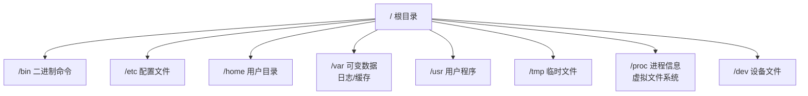

# Linux 系统管理与常用命令

> **文档说明**：开发者必备的Linux技能，涵盖文件系统、用户权限、进程管理、网络命令、软件包管理、Shell脚本。学完能独立管理Linux服务器。
>
> **适用人群**：Linux零基础开发者

---

## 一、概述

Linux是服务器操作系统的绝对主流（90%以上服务器运行Linux）。掌握Linux是后端/运维/AI工程师的必备技能。

### 常见发行版

| 发行版 | 特点 | 包管理器 |
|--------|------|---------|
| Ubuntu | 最流行，社区活跃 | apt |
| CentOS/RHEL | 企业级，稳定 | yum/dnf |
| Debian | 稳定，Ubuntu基础 | apt |
| Arch | 滚动更新，极客向 | pacman |
| Alpine | 轻量，Docker常用 | apk |

---

## 二、底层原理

### Linux文件系统



### 权限模型

```text
-rw-r--r-- 1 user group 1024 Aug 27 10:00 file.txt
│  │  │  │
│  │  │  └─ 其他用户权限（r-- = 只读）
│  │  └─── 组权限（r-- = 只读）
│  └────── 所有者权限（rw- = 读写）
└───────── 文件类型（- = 普通文件，d = 目录，l = 链接）
```

权限数字：r=4, w=2, x=1
- 755 = rwxr-xr-x（所有者读写执行，其他读执行）
- 644 = rw-r--r--（普通文件默认）
- 777 = rwxrwxrwx（所有权限，慎用）

---

## 三、实操示例

### 1. 文件与目录操作

```bash
# 目录操作
pwd                    # 显示当前目录
cd /path/to/dir        # 切换目录
cd ~                   # 回到家目录
cd -                   # 回到上一个目录
ls -la                 # 列出所有文件（含隐藏），详细信息
mkdir -p a/b/c         # 创建多级目录
rm -rf dir             # 强制删除目录（危险！）
cp -r src dst          # 复制目录
mv old new             # 移动/重命名

# 文件操作
cat file.txt           # 查看文件内容
less file.txt          # 分页查看（q退出，/搜索）
head -n 20 file.txt    # 看前20行
tail -f app.log        # 实时跟踪日志
tail -n 100 file.txt   # 看最后100行
grep "error" app.log   # 搜索关键词
wc -l file.txt         # 统计行数
find / -name "*.log"   # 查找文件
```

### 2. 文本处理三剑客

```bash
# grep：搜索
grep -rn "TODO" src/           # 递归搜索，显示行号
grep -v "debug" app.log        # 排除匹配行
grep -E "error|warn" app.log   # 正则匹配

# sed：流编辑
sed -i 's/old/new/g' file.txt  # 全局替换
sed -n '10,20p' file.txt       # 显示10-20行
sed -i '10d' file.txt          # 删除第10行

# awk：文本处理
awk '{print $1}' access.log    # 打印第一列
awk -F: '{print $1}' /etc/passwd  # 按:分割
awk '$9 == 200 {count++} END {print count}' access.log  # 统计200状态码
```

### 3. 进程管理

```bash
ps aux                     # 查看所有进程
ps aux | grep java         # 查找Java进程
top                        # 实时进程监控（q退出）
htop                       # 更友好的top（需安装）
kill 1234                  # 终止进程（PID=1234）
kill -9 1234               # 强制杀死进程
killall nginx              # 按名称杀进程
pstree -p                  # 进程树
```

### 4. 系统资源监控

```bash
# CPU和内存
top                        # 综合监控
free -h                    # 内存使用（人类可读）
uptime                     # 系统运行时间和负载

# 磁盘
df -h                      # 磁盘使用情况
du -sh /var/log            # 目录大小
du -sh * | sort -rh        # 当前目录各子目录大小排序

# 网络
netstat -tlnp              # 监听端口（旧）
ss -tlnp                   # 监听端口（新）
lsof -i :8080              # 查看占用8080端口的进程

# IO
iostat -x 1                # 磁盘IO监控
iotop                      # 进程IO监控
```

### 5. 用户与权限

```bash
# 用户管理
useradd -m username        # 创建用户（-m创建家目录）
passwd username            # 设置密码
usermod -aG sudo username  # 添加到sudo组
userdel -r username        # 删除用户

# 权限管理
chmod 755 script.sh        # 修改权限
chmod +x script.sh         # 添加执行权限
chown user:group file      # 修改所有者和组
chown -R user:group dir/   # 递归修改
```

### 6. 软件包管理

```bash
# Ubuntu/Debian
apt update                 # 更新软件源
apt install nginx          # 安装软件
apt remove nginx           # 卸载软件
apt search keyword         # 搜索软件
apt upgrade                # 升级所有软件

# CentOS/RHEL
yum install nginx
yum remove nginx
yum search keyword
yum update

# 通用
systemctl start nginx      # 启动服务
systemctl stop nginx       # 停止服务
systemctl restart nginx    # 重启服务
systemctl enable nginx     # 开机自启
systemctl status nginx     # 查看状态
journalctl -u nginx -f     # 查看服务日志
```

### 7. 网络命令

```bash
ip addr                    # 查看IP地址
ifconfig                   # 旧命令
ping google.com            # 测试连通性
curl -I https://example.com  # 测试HTTP
wget https://example.com/file.zip  # 下载文件
scp file.txt user@host:/path/  # 远程复制
ssh user@host              # 远程登录
nslookup example.com       # DNS查询
dig example.com            # DNS详细查询
traceroute example.com     # 路由追踪
```

### 8. Shell脚本基础

```bash
#!/bin/bash
# 第一行指定解释器

# 变量
name="张三"
echo "你好，$name"

# 条件判断
if [ -f file.txt ]; then
    echo "文件存在"
else
    echo "文件不存在"
fi

# 循环
for i in {1..5}; do
    echo "第$i次"
done

# 函数
greet() {
    echo "你好，$1"
}
greet "世界"

# 命令替换
files=$(ls *.txt)
echo "文本文件：$files"
```

---

## 四、常见问题与排查

| 问题 | 排查命令 | 解决方案 |
|------|---------|---------|
| 端口被占用 | `lsof -i :端口` / `ss -tlnp` | kill占用进程或换端口 |
| 磁盘满 | `df -h` / `du -sh *` | 清理日志/临时文件，扩容 |
| 内存不足 | `free -h` / `top` | 杀占用大的进程，加内存/swap |
| 服务启动失败 | `journalctl -u 服务名` | 看日志定位错误 |
| 网络不通 | `ping` / `curl` / `telnet` | 检查防火墙/安全组/DNS |
| 权限拒绝 | `ls -la` 看权限 | chmod/chown修改权限 |

---

## 五、进阶与最佳实践

- **用sudo不用root**：日常操作用普通用户+sudo，避免误操作
- **别名提高效率**：在~/.bashrc中设置别名（如`alias ll='ls -la'`）
- **历史命令**：`Ctrl+R`搜索历史命令，`!$`引用上条命令最后一个参数
- **管道组合**：`ps aux | grep java | grep -v grep | awk '{print $2}'`
- **日志排查**：`tail -f`实时看日志，`grep`过滤关键词，`awk`统计
- **定时任务**：`crontab -e`编辑定时任务

---

## 六、关联笔记

[[Linux-运维常用命令手册]] · [[进程线程与协程]] · [[IO模型与零拷贝]] · [[Docker-核心原理与镜像优化]]

> 🔍 **知识点深度解析**
>
> **作用**：Linux是服务器的标准操作系统，掌握命令行是开发者的基本功。
>
> **原理**：一切皆文件，通过文件系统接口管理硬件、进程、网络。
>
> **用法要点**：① 文件操作ls/cd/cp/rm ② 文本处理grep/sed/awk ③ 进程ps/top/kill ④ 系统监控free/df/ss ⑤ 服务systemctl ⑥ 管道组合命令

---

> 💡 **深度讲解**：Linux学习的关键是"多用"，不要死记命令。日常开发中尽量用命令行操作，遇到问题先想"用什么命令能查出来"。最常用的命令不超过30个，掌握它们就能应对90%的场景。文本处理三剑客（grep/sed/awk）是排查问题的利器，尤其在看日志时非常高效。
>
> **📝 精简总结**：Linux = 文件操作 + 文本处理 + 进程管理 + 系统监控，常用命令30个够用，管道组合是精髓。
