# 🧠 内存管理与虚拟内存

> **文档说明**：系统讲解操作系统内存管理与虚拟内存的完整知识体系，涵盖内存管理基础（物理内存/地址空间/内存分配）、虚拟内存核心概念（虚拟地址/物理地址/地址翻译）、分页机制（页/页框/页表/多级页表）、TLB 快表、缺页中断与页面置换算法（FIFO/LRU/Clock/OPT）、内核内存管理（伙伴系统/Zone/Slub/Slab）、用户态内存分配（malloc/brk/sbrk/mmap）、内存映射文件、共享内存、写时复制（COW）、内存碎片与整理、OOM 机制、NUMA 非一致内存访问、CPU 缓存层次（L1/L2/L3）与缓存一致性、内存屏障、Linux 内存管理实现、Java 虚拟机内存模型、常见内存问题排查与优化。
>
> **适用人群**：后端开发者、系统工程师、C/C++ 开发者、性能优化工程师、计算机基础学习者
>
> **前置知识**：[[操作系统核心概念]] · [[操作系统-进程与线程]] · [[Linux内核基础概念]]

---

## 一、概述

### 1.1 内存管理的目标

内存管理是操作系统最核心的功能之一，负责管理计算机的物理内存资源，为进程提供**抽象、隔离、共享、虚拟化**的内存服务。

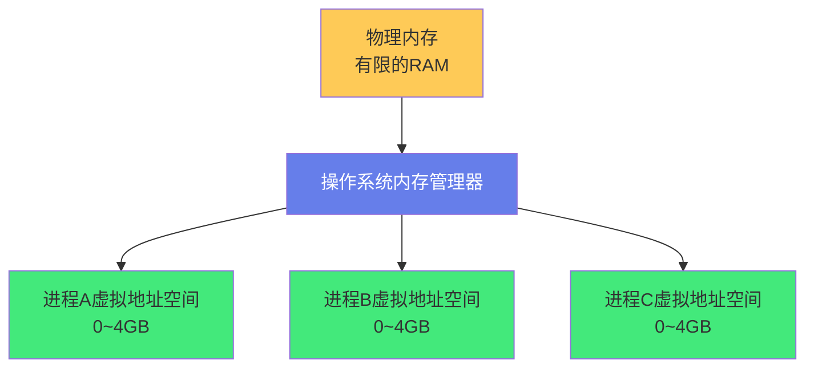

**内存管理的四大目标**：
| 目标 | 说明 |
|------|------|
| **抽象（Abstraction）** | 为每个进程提供独立的虚拟地址空间，进程无需关心物理内存布局 |
| **隔离（Isolation）** | 进程之间内存隔离，一个进程不能访问另一个进程的内存 |
| **共享（Sharing）** | 支持进程间共享内存（如共享库、共享内存段） |
| **虚拟化（Virtualization）** | 虚拟内存可以超过物理内存大小（通过磁盘交换） |

### 1.2 为什么需要虚拟内存

在没有虚拟内存的时代（早期操作系统），程序直接使用物理地址，存在严重问题：

| 问题 | 说明 |
|------|------|
| **地址冲突** | 多个进程使用相同物理地址，互相覆盖 |
| **内存碎片化** | 进程频繁创建/销毁导致物理内存碎片 |
| **安全性差** | 进程可以访问任意物理地址，包括其他进程和内核 |
| **程序加载复杂** | 程序需要重定位（根据加载地址修改绝对地址） |
| **内存受限** | 程序大小不能超过物理内存 |

**虚拟内存的解决方案**：
- 每个进程有独立的虚拟地址空间（0 ~ 2^64-1，64位系统）
- 虚拟地址通过 MMU（内存管理单元）翻译为物理地址
- 进程只能访问自己的虚拟地址空间，无法访问其他进程
- 虚拟内存可以超过物理内存（部分页面在磁盘上）
- 程序使用虚拟地址链接，无需重定位

### 1.3 核心概念

| 概念 | 说明 |
|------|------|
| **物理地址（Physical Address）** | 内存芯片上的实际地址，CPU 通过地址总线访问 |
| **虚拟地址（Virtual Address）** | 进程看到的地址，由操作系统和 MMU 翻译为物理地址 |
| **地址空间（Address Space）** | 进程可用的虚拟地址范围（32位：4GB，64位：256TB 实际可用） |
| **页（Page）** | 虚拟内存的固定大小单位（通常 4KB，也支持 2MB/1GB 大页） |
| **页框（Page Frame）** | 物理内存的固定大小单位，与页大小相同 |
| **页表（Page Table）** | 虚拟页号到物理页框号的映射表 |
| **MMU（Memory Management Unit）** | CPU 中的硬件单元，负责虚拟地址到物理地址的翻译 |
| **TLB（Translation Lookaside Buffer）** | 页表缓存，加速地址翻译 |
| **缺页中断（Page Fault）** | 访问的虚拟页不在物理内存中时触发的中断 |

---

## 二、分页机制

### 2.1 页与页框

分页是虚拟内存的核心机制：将虚拟地址空间和物理内存都划分为**固定大小的页**，通过页表建立映射。

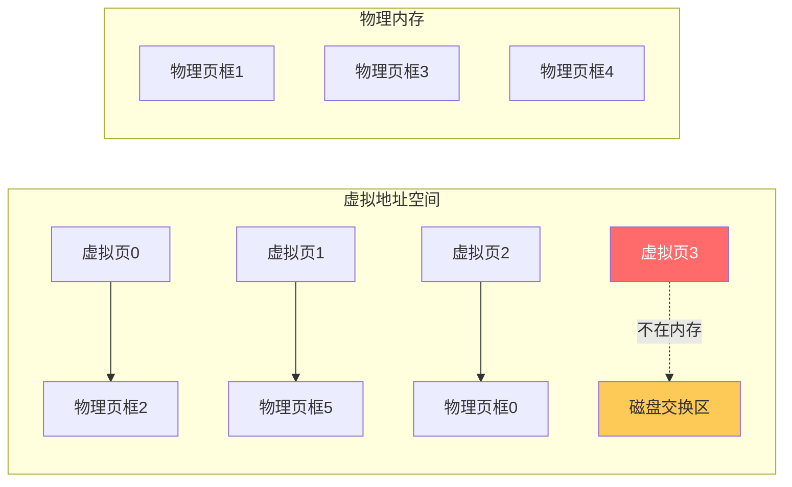

**常见页大小**：
| 架构 | 普通页 | 大页（Huge Page） |
|------|--------|------------------|
| x86-32 | 4KB | 4MB（PAE：2MB） |
| x86-64 | 4KB | 2MB / 1GB |
| ARM64 | 4KB/16KB/64KB | 2MB/32MB/512MB |

**页大小的权衡**：
| 页大小 | 优点 | 缺点 |
|--------|------|------|
| **小页（4KB）** | 内存浪费少（内部碎片小）、粒度细 | 页表大、TLB 命中率低、地址翻译开销大 |
| **大页（2MB/1GB）** | 页表小、TLB 命中率高、翻译快 | 内部碎片大（可能浪费大量内存）、粒度粗 |

> **大页适用场景**：数据库（Oracle/MySQL/PostgreSQL）、Java 堆、HPC 高性能计算——这些场景内存占用大且连续，大页能显著减少 TLB miss 和页表开销。

### 2.2 地址翻译

虚拟地址分为两部分：**虚拟页号（VPN）** 和 **页内偏移（Offset）**。

```text
32位虚拟地址（4KB页）：
┌──────────────────────┬──────────────┐
│   虚拟页号 VPN(20位)  │  偏移(12位)  │
└──────────────────────┴──────────────┘
 31                    12 11            0

64位虚拟地址（4KB页，48位地址）：
┌──────────────────────────┬──────────────┐
│    虚拟页号 VPN(36位)      │  偏移(12位)  │
└──────────────────────────┴──────────────┘
 47                        12 11            0
```

**地址翻译过程**：
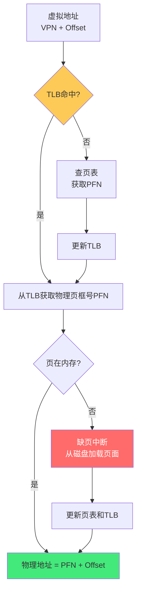

### 2.3 多级页表

单级页表在 64 位系统中会非常大（2^36 个页表项 × 8字节 = 512GB），所以使用**多级页表**。

**x86-64 四级页表（4KB 页）**：
```text
64位虚拟地址（实际使用48位）：
┌────────┬────────┬────────┬────────┬──────────┐
│ PML4(9) │ PDPT(9) │  PD(9)  │  PT(9)  │ Offset(12)│
└────────┴────────┴────────┴────────┴──────────┘
 47-39    38-30    29-21    20-12    11-0
```

| 级别 | 名称 | 大小 |
|------|------|------|
| 第1级 | PML4（Page Map Level 4） | 512 项 × 8字节 = 4KB |
| 第2级 | PDPT（Page Directory Pointer Table） | 512 项 × 8字节 = 4KB |
| 第3级 | PD（Page Directory） | 512 项 × 8字节 = 4KB |
| 第4级 | PT（Page Table） | 512 项 × 8字节 = 4KB |

**多级页表的优势**：
- 只需要为实际使用的虚拟地址分配页表（稀疏地址空间）
- 未使用的中间页表项为空，不占用内存
- 一个进程的页表通常只有几十 KB ~ 几 MB

**页表项（PTE）内容**：
| 字段 | 说明 |
|------|------|
| **物理页框号（PFN）** | 映射的物理页框号 |
| **Present（P）** | 页是否在物理内存中 |
| **Read/Write（R/W）** | 是否可写 |
| **User/Supervisor（U/S）** | 用户态是否可访问 |
| **Accessed（A）** | 页是否被访问过（用于置换算法） |
| **Dirty（D）** | 页是否被修改过（置换时需要写回磁盘） |
| **Execute Disable（XD）** | 是否禁止执行（NX 位，安全特性） |
| **Page Size（PS）** | 是否为大页 |

### 2.4 TLB 快表

TLB（Translation Lookaside Buffer）是 CPU 中的高速缓存，存储最近使用的页表项，加速地址翻译。

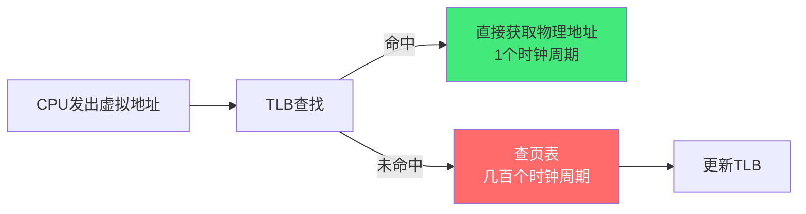

**TLB 特性**：
| 特性 | 说明 |
|------|------|
| **位置** | CPU 芯片内部，与 L1 缓存同级别 |
| **大小** | 通常 64~1024 个条目（分 L1 TLB/L2 TLB） |
| **分离** | 指令 TLB（ITLB）和数据 TLB（DTLB）分离 |
| **命中率** | 典型 99%+（程序局部性原理） |
| **未命中代价** | 几百个时钟周期（需要访问内存中的页表） |

**TLB 与大页**：
- 大页（2MB）的 TLB 条目可以覆盖更大的内存范围
- 4KB 页：1 个 TLB 条目覆盖 4KB
- 2MB 大页：1 个 TLB 条目覆盖 2MB（512 倍）
- 使用大页可以显著提高 TLB 命中率，减少 TLB miss

---

## 三、缺页中断与页面置换

### 3.1 缺页中断

当进程访问的虚拟页**不在物理内存中**（页表项 Present=0）时，MMU 触发缺页中断，操作系统接管处理。

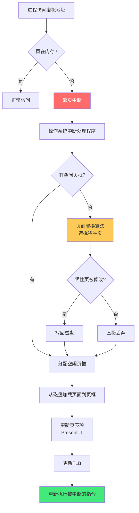

**缺页中断类型**：
| 类型 | 说明 |
|------|------|
| **Minor Fault（小缺页）** | 页在内存中但未映射到当前进程（如共享页、零页），无需磁盘IO |
| **Major Fault（大缺页）** | 页不在内存中，需要从磁盘加载（交换区/文件映射），有磁盘IO |
| **Invalid Fault（无效缺页）** | 访问的虚拟地址无效（越界/空指针），操作系统发送 SIGSEGV 终止进程 |

### 3.2 页面置换算法

当物理内存满了，需要选择一个「牺牲页」换出到磁盘。置换算法的目标是**最低的缺页率**。

| 算法 | 原理 | 优点 | 缺点 |
|------|------|------|------|
| **OPT（最优）** | 置换未来最久不使用的页 | 理论最优，缺页率最低 | 需要预知未来，无法实现（仅作基准） |
| **FIFO** | 置换最早进入内存的页 | 简单，易实现 | 可能置换常用页（Belady异常） |
| **LRU（最近最少使用）** | 置换最久未使用的页 | 接近最优，局部性好 | 硬件实现复杂（需要时间戳/栈） |
| **Clock（时钟）** | 循环扫描，置换访问位为0的页 | 近似LRU，实现简单 | 精度不如LRU |
| **LFU（最不经常使用）** | 置换访问次数最少的页 | 考虑访问频率 | 实现复杂，旧页可能永远不被置换 |
| **Working Set（工作集）** | 保持进程最近使用的页在内存 | 减少抖动 | 需要跟踪工作集窗口 |

**LRU 实现方式**：
```text
用链表维护页的访问顺序：
- 访问页时，将页移到链表头部
- 置换时，选择链表尾部的页（最久未使用）

问题：每次访问都要修改链表，开销大
硬件优化：用时间戳（每页记录最后访问时间）或用矩阵记录访问关系
```

**Clock 算法（改进的二次机会算法）**：
```text
循环扫描页框，每页有一个访问位（Accessed）：
1. 指针指向当前页
2. 如果访问位=0，置换该页
3. 如果访问位=1，将访问位设为0，指针移到下一页
4. 重复直到找到访问位=0的页

相当于给每个页「第二次机会」——最近访问过的页不会被立即置换
```

**Belady 异常**：
- FIFO 算法中，增加页框数反而可能增加缺页率
- 原因：FIFO 不考虑页的使用频率，增加的页框可能「挤掉」常用页
- LRU 和 Clock 算法不会出现 Belady 异常（栈式算法）

### 3.3 抖动（Thrashing）

当系统频繁发生缺页中断，大部分时间用于页面置换而非执行指令，称为**抖动**。

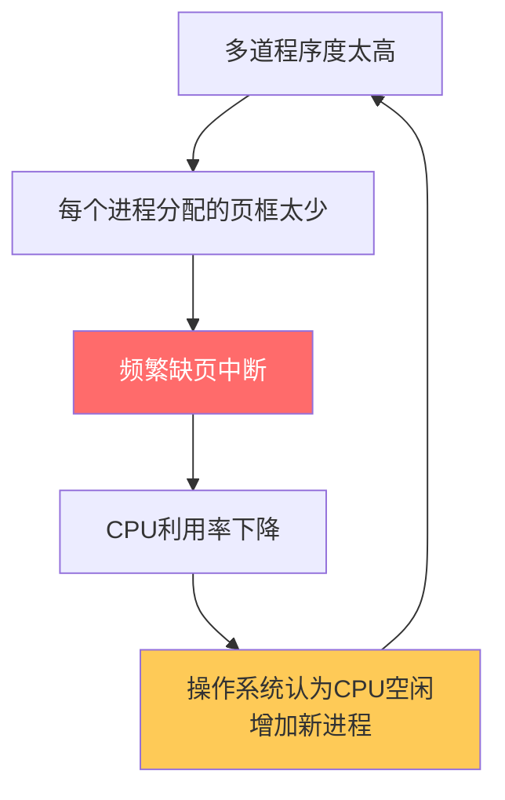

**抖动的原因**：
- 多道程序度太高，每个进程分配的物理页框太少
- 进程的工作集（Working Set）无法全部装入内存
- 频繁的页面置换导致 IO 饱和

**解决方案**：
- 降低多道程序度（挂起部分进程）
- 增加物理内存
- 使用工作集模型跟踪每个进程的内存需求
- 页面置换算法优化（如工作集置换算法）

---

## 四、内核内存管理

### 4.1 物理内存管理：伙伴系统（Buddy System）

Linux 内核使用**伙伴系统**管理物理页框，解决外部碎片问题。

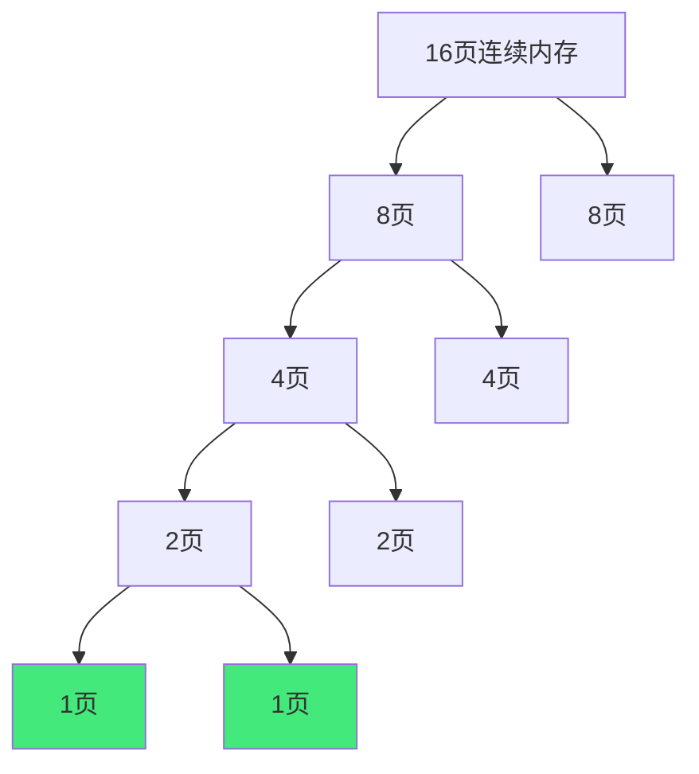

**伙伴系统原理**：
- 将物理内存按 2 的幂次大小分组（1页、2页、4页、8页...）
- 分配时，找到最小的满足需求的块，如果没有就拆分更大的块
- 释放时，检查「伙伴」（相邻的同大小块）是否也空闲，如果是就合并
- 伙伴的计算：块地址 XOR 块大小 = 伙伴地址

**伙伴系统的优缺点**：
| 优点 | 缺点 |
|------|------|
| 分配/释放快（O(log n)） | 内部碎片（最多浪费一半） |
| 合并简单（伙伴合并） | 不适合小对象分配（用 Slab 补充） |
| 减少外部碎片 | - |

### 4.2 内存区域（Zone）

Linux 将物理内存分为多个区域（Zone），因为不同物理地址范围有不同的用途限制：

| Zone | 范围（x86-32） | 用途 |
|------|----------------|------|
| **ZONE_DMA** | 0~16MB | ISA DMA 设备只能访问此范围 |
| **ZONE_DMA32** | 0~4GB | 32位 DMA 设备（x86-64） |
| **ZONE_NORMAL** | 16MB~896MB（32位）/ 全部（64位） | 常规内存，可直接映射 |
| **ZONE_HIGHMEM** | 896MB以上（32位） | 高端内存，不能直接映射，需临时映射 |
| **ZONE_MOVABLE** | 可移动区域 | 用于内存热插拔和防碎片 |

> 64 位系统没有 ZONE_HIGHMEM（所有物理内存都可以直接映射），只有 ZONE_DMA、ZONE_DMA32、ZONE_NORMAL。

### 4.3 Slab 分配器

伙伴系统以页为单位分配，但内核需要大量小对象（如 task_struct、inode、file 结构体），直接用伙伴系统会造成严重的内部碎片。Slab 分配器解决**小对象分配**问题。

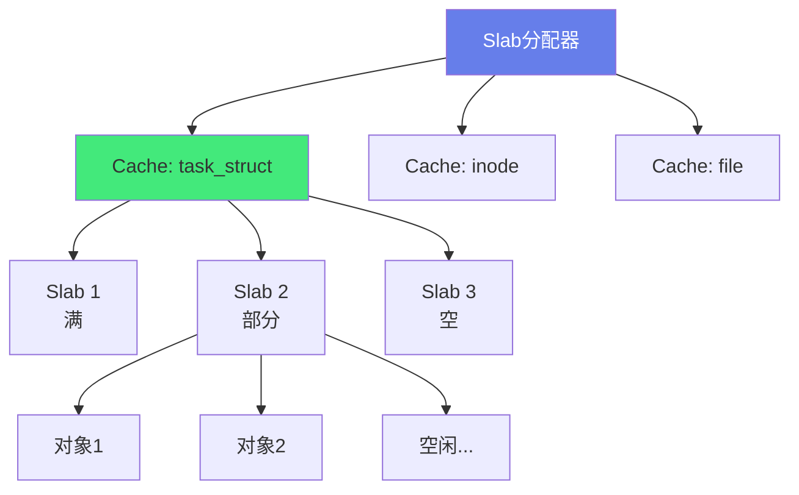

**Slab 三层结构**：
| 层级 | 说明 |
|------|------|
| **Cache（缓存）** | 每种对象类型一个 Cache（如 task_struct_cache） |
| **Slab** | Cache 中的一组连续页框，包含多个对象 |
| **Object（对象）** | Slab 中分配的单个小对象 |

**Slab 的三种状态**：
| 状态 | 说明 |
|------|------|
| **Full（满）** | 所有对象都已分配 |
| **Partial（部分）** | 部分对象已分配，部分空闲 |
| **Empty（空）** | 所有对象都空闲 |

**Slab 分配器的优势**：
- 小对象分配快（从 Partial Slab 中取空闲对象，O(1)）
- 减少内部碎片（按对象大小精确分配）
- 对象复用（释放的对象不立即归还伙伴系统，保留在 Slab 中，下次分配直接用）
- 构造/析构优化（对象初始化一次，复用时不需要重新初始化）

**Slab 的演进**：
- **Slab**：原始设计，每个 CPU 有本地缓存
- **Slub**：Linux 2.6.22 后默认，简化设计，去除 per-CPU 队列，性能更好
- **Slob**：用于嵌入式系统，极简设计

### 4.4 内核内存分配函数

| 函数 | 大小 | 特点 |
|------|------|------|
| `kmalloc(size, flags)` | 任意大小（< 128KB） | Slab 分配，物理连续，可指定标志 |
| `kzalloc(size, flags)` | 同上 | kmalloc + 清零 |
| `vmalloc(size)` | 任意大小 | 虚拟地址连续，物理不连续，开销大 |
| `alloc_pages(gfp, order)` | 2^order 页 | 伙伴系统直接分配页框 |
| `get_free_page(gfp)` | 1页 | 分配单个页框 |
| `kmem_cache_alloc(cache, flags)` | 特定对象大小 | 从指定 Slab Cache 分配 |

**kmalloc 标志（gfp_t）**：
| 标志 | 说明 |
|------|------|
| `GFP_KERNEL` | 内核分配，可能睡眠（进程上下文） |
| `GFP_ATOMIC` | 原子分配，不睡眠（中断上下文） |
| `GFP_USER` | 用户空间分配 |
| `GFP_HIGHUSER` | 从高端内存分配 |
| `__GFP_ZERO` | 分配后清零 |
| `__GFP_DMA` | 从 DMA 区域分配 |

---

## 五、用户态内存管理

### 5.1 进程虚拟地址空间布局

**32位 Linux 进程地址空间（4GB）**：
```text
高地址 0xFFFFFFFF ┌─────────────────────┐
                  │   内核空间（1GB）     │  0xC0000000 ~ 0xFFFFFFFF
                  ├─────────────────────┤
                  │   栈（向下增长）       │
                  ├─────────────────────┤
                  │   内存映射区（共享库）  │
                  ├─────────────────────┤
                  │   堆（向上增长）       │
                  ├─────────────────────┤
                  │   BSS段（未初始化数据）  │
                  ├─────────────────────┤
                  │   数据段（已初始化数据）  │
                  ├─────────────────────┤
低地址 0x00000000 │   代码段（文本段）      │
                  └─────────────────────┘
```

**64位 Linux 进程地址空间（256TB 用户空间）**：
```text
高地址 0xFFFFFFFFFFFFFFFF ┌─────────────────────┐
                           │   内核空间（128TB）    │
                           ├─────────────────────┤
                           │   栈（向下增长）        │
                           ├─────────────────────┤
                           │   内存映射区            │
                           ├─────────────────────┤
                           │   堆（向上增长）        │
                           ├─────────────────────┤
                           │   BSS/数据/代码段       │
低地址 0x0000000000000000  └─────────────────────┘
```

### 5.2 malloc 实现

`malloc` 是 C 标准库的内存分配函数，底层通过系统调用 `brk`/`sbrk`（调整堆顶）和 `mmap`（内存映射）向内核申请内存。

```mermaid
flowchart TB
    A[malloc(size)] --> B{size > 阈值<br/>128KB?}
    B -->|是| C[mmap 系统调用<br/>分配匿名映射]
    B -->|否| D[ptmalloc 堆分配器]
    D --> E{有空闲块?}
    E -->|有| F[从空闲链表分配]
    E -->|否| G[sbrk/brk 扩展堆]
    G --> F
    
    style C fill:#feca57,color:#333
    style D fill:#667eea,color:#fff
```

**ptmalloc（glibc 的 malloc 实现）核心机制**：
| 机制 | 说明 |
|------|------|
| **Arena（分配区）** | 每个线程有独立的 Arena（减少锁竞争），主 Arena + 多个线程 Arena |
| **Chunk（内存块）** | 分配的基本单位，有头部（size/prev_size/标志位） |
| **Bin（空闲链表）** | 空闲 Chunk 的链表，按大小分类 |
| **Fast Bin** | 小对象快速分配（< 64B？不，是 < 80B 左右），LIFO，不合并 |
| **Unsorted Bin** | 释放的大对象先放这里，下次分配时遍历 |
| **Small Bin** | 小对象（< 512B），FIFO，同大小合并 |
| **Large Bin** | 大对象（> 512B），按大小排序 |
| **Top Chunk** | 堆顶的大块，所有 Bin 都不够时从这里分 |
| **mmap 阈值** | 超过 128KB（动态调整）的分配用 mmap，释放时直接 munmap |

**malloc 的性能问题**：
| 问题 | 说明 |
|------|------|
| **多线程锁竞争** | 多个线程同时 malloc 时竞争 Arena 锁（ptmalloc 用 per-thread Arena 缓解） |
| **内存碎片** | 频繁分配/释放不同大小导致外部碎片 |
| **内存不归还** | free 后内存不一定归还操作系统（保留在 Arena 中，除非大量连续空闲） |
| **元数据开销** | 每个 Chunk 有头部（16字节），小对象开销比例大 |

**替代分配器**：
| 分配器 | 特点 |
|--------|------|
| **jemalloc** | Facebook 开发，多线程性能好，内存碎片少（Redis/Firefox 用） |
| **tcmalloc** | Google 开发，per-CPU 缓存，分配极快（Chrome/Go 用） |
| **mimalloc** | Microsoft 开发，性能优异，设计简洁 |
| **musl malloc** | musl libc 的实现，简单紧凑 |

### 5.3 brk/sbrk 与 mmap

**brk/sbrk（调整堆顶）**：
```c
// brk：将堆顶设置为指定地址
int brk(void *addr);

// sbrk：将堆顶增加 increment 字节，返回旧堆顶
void *sbrk(intptr_t increment);

// 示例
void *p = sbrk(4096);  // 扩展堆 4KB
sbrk(-4096);            // 缩小堆 4KB
```

**mmap（内存映射）**：
```c
void *mmap(void *addr, size_t length, int prot, int flags,
           int fd, off_t offset);

// 匿名映射（分配内存，类似 malloc）
void *p = mmap(NULL, 4096, PROT_READ | PROT_WRITE,
               MAP_PRIVATE | MAP_ANONYMOUS, -1, 0);

// 文件映射（将文件映射到内存）
int fd = open("file.txt", O_RDONLY);
void *p = mmap(NULL, 4096, PROT_READ, MAP_PRIVATE, fd, 0);

// 释放
munmap(p, 4096);
```

**mmap 参数**：
| 参数 | 说明 |
|------|------|
| `addr` | 期望映射地址（NULL 由内核选择） |
| `length` | 映射长度 |
| `prot` | 保护模式（PROT_READ/PROT_WRITE/PROT_EXEC/PROT_NONE） |
| `flags` | 标志（MAP_PRIVATE/MAP_SHARED/MAP_ANONYMOUS/MAP_FIXED） |
| `fd` | 文件描述符（匿名映射为 -1） |
| `offset` | 文件偏移 |

**brk vs mmap**：
| 维度 | brk/sbrk | mmap |
|------|----------|------|
| **分配位置** | 堆区 | 内存映射区 |
| **大小限制** | 连续，受堆大小限制 | 灵活，可分配大内存 |
| **释放** | 只能从堆顶释放（LIFO） | 任意释放（munmap） |
| **开销** | 小（调整一个指针） | 大（建立页表映射） |
| **碎片** | 外部碎片 | 虚拟地址空间碎片 |
| **适用** | 小对象（malloc 默认） | 大对象（>128KB）、文件映射 |

---

## 六、高级内存机制

### 6.1 写时复制（COW - Copy On Write）

写时复制是一种优化策略：多个进程共享同一份物理页，只有当某个进程**修改**该页时，才为该进程创建副本。

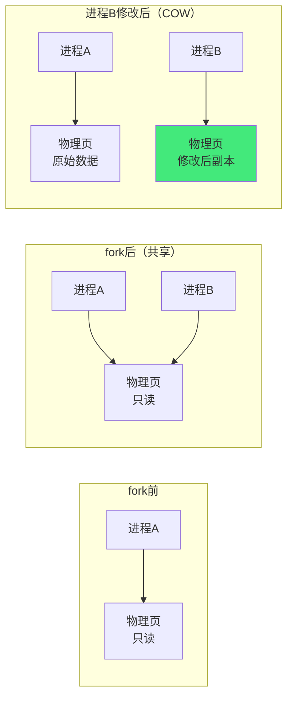

**COW 的典型场景**：
| 场景 | 说明 |
|------|------|
| **fork()** | 子进程共享父进程的所有页，标记为只读；子进程或父进程修改时才复制 |
| **mmap(MAP_PRIVATE)** | 私有文件映射，多个进程共享文件页，修改时创建私有副本 |
| **共享库** | 多个进程共享同一份共享库代码页（只读，不需要复制） |
| **KSM（Kernel Samepage Merging）** | 内核合并相同内容的页（虚拟化场景，KVM 虚拟机共享相同页） |

**COW 的优势**：
- fork() 后子进程不需要立即复制所有内存（传统 fork 复制整个地址空间，极慢）
- 大大减少 fork 的开销（只复制页表，不复制页内容）
- 节省物理内存（只读页永远共享，不复制）

**COW 的代价**：
- 修改页时触发缺页中断，需要复制页（延迟开销）
- 页表需要标记为只读（修改时触发 COW 中断）

### 6.2 共享内存

共享内存是最快的进程间通信（IPC）方式：多个进程将同一块物理内存映射到各自的虚拟地址空间，直接读写。

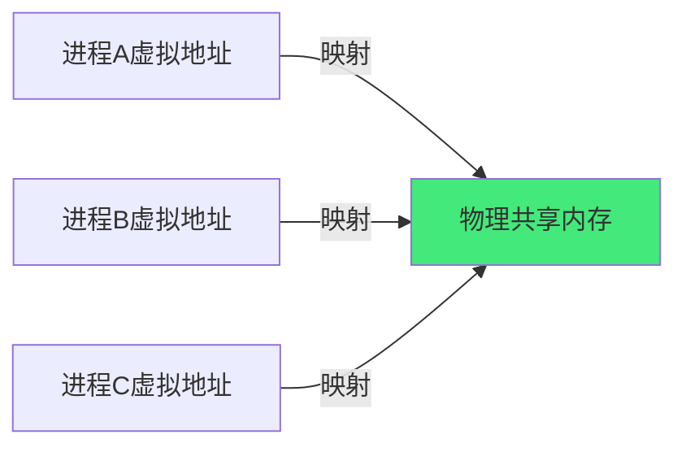

**System V 共享内存**：
```c
// 创建/获取共享内存
int shmid = shmget(key, size, IPC_CREAT | 0666);

// 附加到进程地址空间
void *p = shmat(shmid, NULL, 0);

// 使用共享内存
strcpy(p, "Hello shared memory!");

// 分离
shmdt(p);

// 删除共享内存
shmctl(shmid, IPC_RMID, NULL);
```

**POSIX 共享内存（推荐）**：
```c
// 创建/打开共享内存对象
int fd = shm_open("/myshm", O_CREAT | O_RDWR, 0666);

// 设置大小
ftruncate(fd, size);

// 映射到进程地址空间
void *p = mmap(NULL, size, PROT_READ | PROT_WRITE, MAP_SHARED, fd, 0);

// 使用
strcpy(p, "Hello POSIX shared memory!");

// 清理
munmap(p, size);
close(fd);
shm_unlink("/myshm");
```

**共享内存的注意事项**：
- 需要同步机制（信号量/互斥锁/条件变量），否则数据竞争
- 共享内存不会自动删除（直到显式删除或系统重启）
- 虚拟地址可能不同（每个进程映射的虚拟地址可以不同，用偏移量而非指针）

### 6.3 内存映射文件

内存映射文件将文件内容映射到进程虚拟地址空间，通过读写内存来操作文件（无需 read/write 系统调用）。


**内存映射文件的优势**：
| 优势 | 说明 |
|------|------|
| **简化编程** | 像访问内存一样访问文件，无需 read/write |
| **减少拷贝** | 直接操作页缓存，减少用户态/内核态数据拷贝 |
| **惰性加载** | 只加载实际访问的页（缺页中断时加载） |
| **共享** | 多个进程映射同一文件，共享页缓存 |

**内存映射文件的局限**：
- 文件大小不能超过虚拟地址空间（32位系统受限）
- 不适合追加写入（需要 ftruncate 扩展）
- 写入是异步的（需要 msync 或 munmap 时刷盘）
- 小文件操作开销可能比 read/write 大（建立映射的开销）

### 6.4 OOM（Out of Memory）

当系统物理内存和交换区都耗尽时，Linux 内核触发 OOM Killer，选择一个进程杀死以释放内存。

**OOM Killer 选择进程的依据**：
| 因素 | 说明 |
|------|------|
| **oom_score** | 内核为每个进程计算的分数（0~1000），分数越高越可能被杀 |
| **内存占用** | 占用内存越多，oom_score 越高 |
| **oom_score_adj** | 用户可调（-1000~1000），调整 oom_score |
| **oom_adj** | 旧版接口（-17~15），已被 oom_score_adj 取代 |
| **进程优先级** | 内核线程、init 进程（oom_score_adj=-1000）不会被杀 |

**OOM 相关配置**：
```bash
# 查看进程 oom_score
cat /proc/<pid>/oom_score
cat /proc/<pid>/oom_score_adj

# 调整进程 OOM 优先级（-1000 不被杀，1000 优先被杀）
echo -500 > /proc/<pid>/oom_score_adj

# 系统 OOM 配置
# /etc/sysctl.conf
vm.overcommit_memory = 2      # 0=启发式 1=总是 2=严格
vm.overcommit_ratio = 50       # overcommit_memory=2 时的比例
vm.panic_on_oom = 0            # OOM时是否内核panic（0=杀进程，1=panic）
```

**OOM 预防**：
- 监控内存使用（Prometheus + node_exporter）
- 设置合理的内存限制（cgroups / K8s resources.limits）
- 关键进程设置 oom_score_adj=-1000（如 sshd、数据库）
- 配置足够的 swap（但 swap 会降低性能）
- 定期重启内存泄漏的进程

---

## 七、NUMA 与 CPU 缓存

### 7.1 NUMA（非一致内存访问）

在多 CPU 服务器中，每个 CPU 有本地内存，访问本地内存比访问远程 CPU 的内存快（延迟约 1.5~2 倍）。

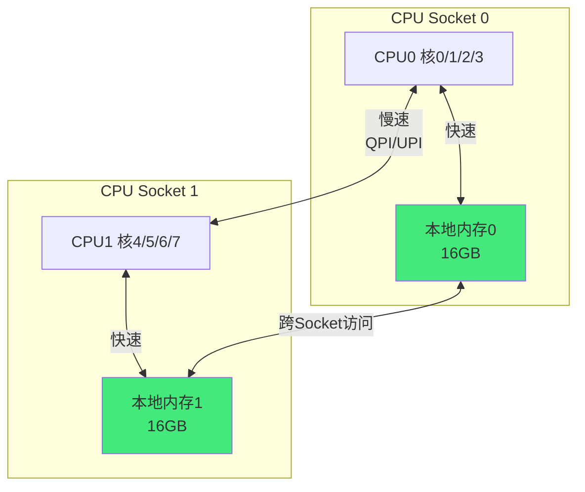

**NUMA 相关命令**：
```bash
# 查看 NUMA 拓扑
numactl --hardware
lscpu | grep NUMA

# 查看 NUMA 内存使用
numastat
numastat -p <pid>

# 绑定进程到特定 NUMA 节点
numactl --cpunodebind=0 --membind=0 ./myapp

# 查看进程 NUMA 策略
cat /proc/<pid>/numa_maps
```

**NUMA 优化建议**：
- 进程和内存尽量在同一个 NUMA 节点（numactl 绑定）
- 数据库等大内存应用需要特别关注 NUMA（如 MySQL 的 innodb_numa_interleave）
- 开启 NUMA 平衡（numad 守护进程自动平衡）
- 监控跨节点访问（numastat 的 numa_miss 指标）

### 7.2 CPU 缓存层次

现代 CPU 有三级缓存，速度从快到慢，容量从小到大：

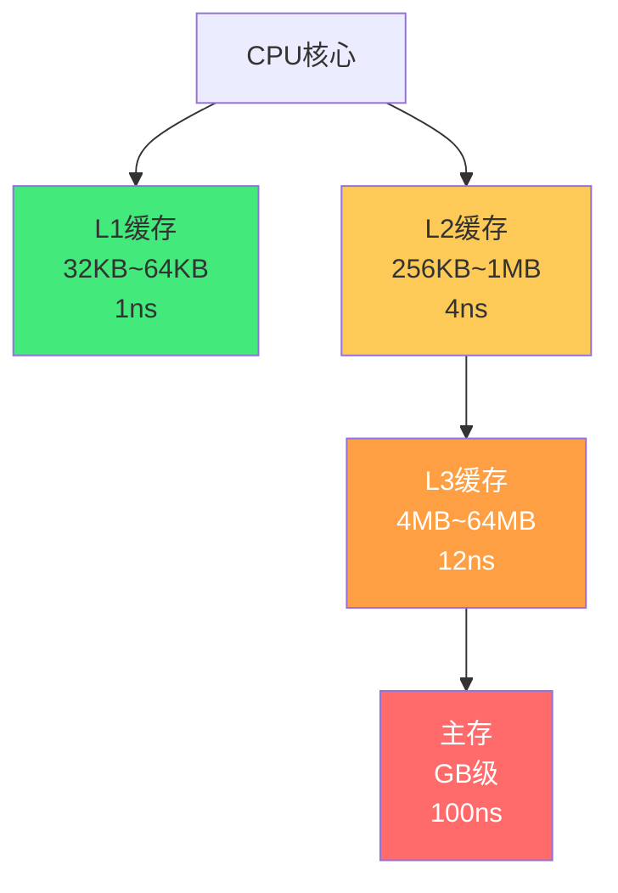

| 缓存级别 | 容量 | 延迟 | 共享 |
|---------|------|------|------|
| **L1d/L1i** | 32KB（数据）+ 32KB（指令） | ~1ns | 每个核心私有 |
| **L2** | 256KB ~ 1MB | ~4ns | 每个核心私有 |
| **L3** | 4MB ~ 64MB | ~12ns | 多核共享（同一 Socket） |
| **主存** | GB 级 | ~100ns | 全部共享 |

**缓存命中率对性能的影响**：
- L1 命中：~1ns（1 个时钟周期）
- L2 命中：~4ns
- L3 命中：~12ns
- 主存：~100ns（L1 的 100 倍！）

> **局部性原理**：程序访问的内存地址在时间和空间上趋于集中。时间局部性（刚访问的地址很快会再访问）和空间局部性（刚访问的地址附近的地址很快会被访问）是缓存有效的基础。

**缓存优化技巧**：
- 数据结构按缓存行对齐（64 字节），避免 false sharing
- 顺序访问数组（空间局部性好，预取有效）
- 热点数据放在一起（提高缓存命中率）
- 避免随机访问大数组（缓存命中率低）
- 循环优化（循环展开、循环交换、循环分块）

### 7.3 缓存一致性（MESI 协议）

多核 CPU 中，每个核心有私有缓存，需要保证缓存一致性。MESI 是最常用的缓存一致性协议。

| 状态 | 含义 |
|------|------|
| **M（Modified）** | 该缓存行被修改，与主存不一致，只在本缓存中 |
| **E（Exclusive）** | 该缓存行只在本缓存中，与主存一致 |
| **S（Shared）** | 该缓存行在多个缓存中，与主存一致 |
| **I（Invalid）** | 该缓存行无效，需要从主存或其他缓存重新加载 |

**False Sharing（伪共享）**：
多个线程修改同一个缓存行中的不同变量，导致缓存行频繁失效，性能严重下降。

```c
// 伪共享示例（两个变量在同一个64字节缓存行中）
struct {
    int counter1;  // 线程1修改
    int counter2;  // 线程2修改
} counters;

// 解决方案：缓存行填充/对齐
struct {
    int counter1;
    char padding[60];  // 填充到64字节
    int counter2;
} counters;
// 或用 C11 的 alignas(64)
```

---

## 八、内存屏障与内存模型

### 8.1 内存屏障（Memory Barrier）

编译器和 CPU 可能对内存操作进行重排序（优化性能），在多线程/多核场景下可能导致可见性问题。内存屏障禁止特定类型的重排序。

| 屏障类型 | 作用 |
|---------|------|
| **LoadLoad** | 禁止前面的 Load 与后面的 Load 重排序 |
| **StoreStore** | 禁止前面的 Store 与后面的 Store 重排序 |
| **LoadStore** | 禁止前面的 Load 与后面的 Store 重排序 |
| **StoreLoad** | 禁止前面的 Store 与后面的 Load 重排序（最耗性能） |
| **全屏障（mfence）** | 禁止所有重排序 |

**C/C++ 内存序（C11/C++11）**：
| 内存序 | 说明 |
|--------|------|
| `memory_order_relaxed` | 松散，只保证原子性，不保证顺序 |
| `memory_order_acquire` | 读屏障，后面的操作不能重排到前面 |
| `memory_order_release` | 写屏障，前面的操作不能重排到后面 |
| `memory_order_acq_rel` | 读写屏障（acquire + release） |
| `memory_order_seq_cst` | 顺序一致性（最强，全屏障，默认） |

### 8.2 Java 内存模型（JMM）

Java 内存模型定义了多线程环境下变量的可见性和有序性规则。

| 关键字/机制 | 内存语义 |
|------------|---------|
| `volatile` | 写 volatile 变量 = release 屏障；读 volatile 变量 = acquire 屏障；禁止重排序 |
| `synchronized` | 进入锁 = acquire；释放锁 = release；保证可见性和原子性 |
| `final` | final 字段的写不能重排序到构造函数之外（构造函数安全发布） |
| `Happens-Before` | 偏序关系，A happens-before B 则 A 的结果对 B 可见 |

**Happens-Before 规则**：
| 规则 | 说明 |
|------|------|
| **程序顺序** | 同一个线程中，前面的操作 happens-before 后面的操作 |
| **监视器锁** | 解锁 happens-before 后续对同一锁的加锁 |
| **volatile** | volatile 写 happens-before 后续对同一变量的 volatile 读 |
| **线程启动** | Thread.start() happens-before 线程中的所有操作 |
| **线程终止** | 线程中的所有操作 happens-before Thread.join() 返回 |
| **传递性** | A happens-before B，B happens-before C → A happens-before C |

---

## 九、常见内存问题排查

### 9.1 内存泄漏

**内存泄漏的类型**：
| 类型 | 说明 | 排查工具 |
|------|------|---------|
| **C/C++ 堆泄漏** | malloc 后未 free | valgrind / AddressSanitizer / jemalloc stats |
| **资源泄漏** | 文件描述符/套接字未关闭 | lsof / /proc/pid/fd |
| **Java 内存泄漏** | 对象引用未释放（静态集合/监听器） | jmap / jhat / Eclipse MAT / VisualVM |
| **内核内存泄漏** | 内核模块分配后未释放 | kmemleak / /proc/slabinfo |
| **内存映射泄漏** | mmap 后未 munmap | /proc/pid/maps |

**排查步骤**：
```bash
# 1. 确认内存泄漏（RSS 持续增长不下降）
watch -n 5 'ps -o pid,rss,vsz,cmd -p <pid>'

# 2. 查看进程内存映射
cat /proc/<pid>/maps
cat /proc/<pid>/smaps  # 详细的内存段信息

# 3. C/C++ 用 valgrind
valgrind --leak-check=full ./myapp

# 4. 用 AddressSanitizer（编译时加 -fsanitize=address）
gcc -fsanitize=address -g myapp.c -o myapp
./myapp

# 5. Java 用 jmap 导出堆转储
jmap -dump:format=b,file=heap.hprof <pid>
# 用 Eclipse MAT 或 VisualVM 分析

# 6. 查看文件描述符泄漏
ls -la /proc/<pid>/fd | wc -l
lsof -p <pid>
```

### 9.2 内存碎片化

**内部碎片**：分配的内存大于实际需要（如伙伴系统分配 2 的幂次、Slab 对象对齐）。

**外部碎片**：空闲内存总量足够，但没有足够大的连续块（伙伴系统通过合并缓解，Slab 减少小对象碎片）。

**碎片排查**：
```bash
# 查看伙伴系统碎片情况
cat /proc/buddyinfo

# 查看 Slab 使用
cat /proc/slabinfo
slabtop  # 实时查看 Slab

# 查看内存碎片
cat /proc/zoneinfo | grep -A 5 "node"

# 手动整理碎片（Linux 3.0+）
echo 1 > /proc/sys/vm/compact_memory
```

### 9.3 OOM 排查

```bash
# 查看系统 OOM 日志
dmesg | grep -i "out of memory"
dmesg | grep -i "killed process"
journalctl -k | grep -i oom

# 查看 OOM 分数
cat /proc/<pid>/oom_score
cat /proc/<pid>/oom_score_adj

# 查看内存使用
free -h
cat /proc/meminfo
vmstat 1

# 查看哪个进程占用内存最多
ps aux --sort=-%rss | head
```

### 9.4 性能分析工具

| 工具 | 用途 |
|------|------|
| `free` | 内存使用概览 |
| `vmstat` | 虚拟内存统计（si/so 交换、bi/bo IO） |
| `top/htop` | 进程内存使用（RSS/VIRT/SHR） |
| `pmap` | 进程内存映射 |
| `smem` | 按 PSS 统计内存（更准确） |
| `valgrind` | C/C++ 内存错误检测 |
| `AddressSanitizer` | 编译时内存错误检测（更快） |
| `perf` | 性能分析（缓存 miss、TLB miss） |
| `numastat` | NUMA 内存统计 |
| `slabtop` | Slab 分配器实时统计 |
| `jmap/jstat` | Java 内存分析 |

```bash
# perf 分析缓存 miss
perf stat -e cache-misses,cache-references,LLC-load-misses ./myapp

# perf 分析 TLB miss
perf stat -e dTLB-load-misses,iTLB-load-misses ./myapp

# 查看进程内存段（PSS）
smem -P myapp
smem -tk -p <pid>
```

---

## 十、关联笔记

### 操作系统
- [[操作系统核心概念]] · [[操作系统-进程与线程]] · [[进程间通信]]
- [[Linux内核基础概念]] · [[系统调用与中断]]

### 计算机基础
- [[CPU架构与指令集]] · [[计算机组成原理]] · [[并发编程基础]]

### 语言相关
- [[JVM-内存模型与GC调优]] · [[C++内存管理]] · [[Python内存管理]]

### 导航
- [[MOC-计算机基础]] · [[MOC-操作系统]] · [[MOC-综合导航]] · [[Home]]

> 🔍 **知识点深度解析**
>
> **作用**：内存管理与虚拟内存解决的是「操作系统如何高效、安全、透明地管理有限的物理内存资源，为多个进程提供独立、隔离、可扩展的地址空间的问题」——物理内存是有限且昂贵的资源（相比磁盘），而多个进程需要同时运行，每个进程都需要独立的内存空间，且程序大小可能超过物理内存。没有虚拟内存的时代，程序直接使用物理地址，导致地址冲突、内存碎片、安全漏洞、程序加载复杂等问题。虚拟内存通过「地址翻译 + 分页 + 缺页中断 + 页面置换」，将有限的物理内存虚拟化为每个进程独立的、巨大的、隔离的地址空间，实现了内存的抽象、隔离、共享和虚拟化，是现代操作系统最核心的基础设施之一。
>
> **底层原理**：①虚拟内存的核心是「地址翻译」——CPU 发出的虚拟地址被 MMU（内存管理单元）分为虚拟页号（VPN）和页内偏移，MMU 通过页表将 VPN 翻译为物理页框号（PFN），物理地址 = PFN + 偏移。这个翻译过程对进程完全透明——进程以为自己在访问连续的虚拟地址，实际上物理页可能分散在物理内存的任意位置。②分页机制的核心是「固定大小的页 + 页表映射」——虚拟地址空间和物理内存都划分为固定大小的页（通常 4KB），页表记录虚拟页到物理页框的映射。64 位系统使用多级页表（x86-64 四级：PML4→PDPT→PD→PT），只需要为实际使用的地址分配页表，大大节省内存。③TLB 是地址翻译的「缓存」——每次地址翻译都需要访问内存中的页表（几百个时钟周期），TLB 将最近使用的页表项缓存在 CPU 内部（1 个时钟周期），利用程序的局部性原理，TLB 命中率通常 99%+。大页（2MB/1GB）可以让一个 TLB 条目覆盖更大的内存范围，进一步提高 TLB 命中率。④缺页中断是「按需加载」的核心——进程访问的页不在物理内存中时，MMU 触发缺页中断，操作系统从磁盘（交换区/文件）加载页面到内存，更新页表和 TLB，然后重新执行指令。这使得虚拟内存可以超过物理内存——不常用的页被换出到磁盘，需要时再换入。⑤页面置换算法决定「换出哪个页」——物理内存满了需要换出页时，OPT（最优，置换未来最久不用的）理论最优但无法实现，LRU（最近最少使用）利用局部性原理接近最优，Clock（时钟）是 LRU 的近似实现，简单高效。FIFO 可能出现 Belady 异常（增加页框反而缺页更多）。⑥内核内存管理分为「伙伴系统 + Slab」两层——伙伴系统以页为单位管理物理内存（2 的幂次分配，伙伴合并减少外部碎片），Slab 在伙伴系统之上管理小对象（每种对象一个 Cache，对象复用减少内部碎片和初始化开销）。⑦用户态 malloc 通过「brk + mmap」向内核申请内存——小对象（<128KB）通过 brk 扩展堆，ptmalloc 管理堆中的空闲块（Arena/Bin/Chunk），大对象直接用 mmap 匿名映射。free 后内存不一定归还操作系统（保留在分配器中复用）。⑧写时复制（COW）是「延迟复制」的优化——fork 时子进程共享父进程的页（标记只读），只有修改时才复制页，大大减少 fork 开销。共享内存是最快的 IPC（直接读写共享物理页），但需要同步机制。⑨NUMA 是多 CPU 架构下的「内存访问不一致」——每个 CPU 有本地内存（访问快），访问远程 CPU 的内存慢（1.5~2 倍延迟），需要将进程和内存绑定到同一 NUMA 节点。CPU 缓存（L1/L2/L3）是内存访问的「加速器」，利用局部性原理减少主存访问，但多核需要缓存一致性协议（MESI），伪共享是常见的性能陷阱。
>
> **用法要点**：① 虚拟内存核心：虚拟地址→MMU→页表→物理地址；页大小4KB（大页2MB/1GB）；多级页表（x86-64四级）；TLB加速翻译；缺页中断按需加载 ② 页面置换：OPT理论最优/LRU实际常用/Clock近似实现/FIFO有Belady异常；抖动=频繁缺页，解决方案降低多道程序度/增加内存 ③ 内核内存：伙伴系统（页级，2的幂次，伙伴合并）+ Slab/Slub（小对象，Cache→Slab→Object）；kmalloc（Slab，物理连续）/vmalloc（虚拟连续物理不连续）/alloc_pages（伙伴系统直接分配） ④ 用户态内存：malloc→ptmalloc（Arena/Bin/Chunk）→brk（小对象）/mmap（大对象>128KB）；替代分配器jemalloc/tcmalloc/mimalloc；进程地址空间布局（代码段/数据段/BSS/堆/映射区/栈/内核） ⑤ 高级机制：COW写时复制（fork/mmap私有映射）、共享内存（System V shmget/POSIX shm_open+mmap，最快IPC需同步）、内存映射文件（mmap文件，简化编程减少拷贝）、OOM Killer（oom_score/oom_score_adj，内存耗尽杀进程） ⑥ NUMA与缓存：numactl绑定进程和内存到同一节点；CPU缓存L1/L2/L3延迟递增容量递增；局部性原理（时间+空间）；MESI缓存一致性；伪共享（false sharing）用缓存行对齐解决 ⑦ 内存屏障：C/C++ memory_order（relaxed/acquire/release/acq_rel/seq_cst）；Java volatile（acquire+release）/synchronized（锁的acquire+release）/Happens-Before规则 ⑧ 排查工具：free/vmstat/top（概览）、pmap/smem（进程内存）、valgrind/AddressSanitizer（C/C++泄漏）、jmap/MAT（Java泄漏）、perf（缓存/TLB miss）、numastat（NUMA）、slabtop（Slab）、dmesg（OOM日志） ⑨ 优化：大页（数据库/Java堆）、缓存友好的数据结构和访问模式、避免伪共享、NUMA绑定、内存池（减少malloc开销和碎片）、及时释放不再使用的内存。

> 💡 **深度讲解**：虚拟内存最核心的智慧是「抽象与隔离的艺术」——在没有虚拟内存的时代，程序员需要直接操作物理地址，需要关心程序加载到内存的哪个位置、会不会和其他程序冲突、内存够不够用。这是极其痛苦和容易出错的。虚拟内存通过一层「地址翻译」，为每个进程创造了一个「幻觉」：你拥有整个地址空间（32位4GB，64位256TB），你的地址从0开始，你可以随意使用，不需要关心其他进程，不需要关心物理内存有多大。这个幻觉的背后是 MMU、页表、TLB、缺页中断、页面置换等复杂机制，但对进程完全透明——进程就像在一个独立的、巨大的、连续的内存空间中运行。这种「抽象」是操作系统最伟大的发明之一——它将复杂的物理内存管理隐藏在简单的虚拟地址接口背后，让程序员可以专注于程序逻辑，而不是内存布局。同时，「隔离」保证了进程之间不会互相干扰——一个进程的野指针不会破坏其他进程的内存，一个进程的崩溃不会导致整个系统崩溃。这种抽象与隔离，是现代多任务操作系统的基石。「局部性原理是内存管理一切优化的基础」——为什么缓存有效？为什么 LRU 置换算法效果好？为什么 TLB 命中率高？为什么预取有效？答案都是「局部性原理」：程序访问的内存地址在时间上（刚访问的很快会再访问）和空间上（刚访问的附近很快会被访问）趋于集中。这个原理是经验性的，但几乎所有程序都遵循——循环访问数组（空间局部性）、循环体中的变量被反复访问（时间局部性）、函数调用栈（局部性）。理解了局部性原理，你就能理解为什么顺序访问数组比随机访问快（缓存预取有效）、为什么 LRU 比 FIFO 好（最近访问的很可能很快再访问）、为什么大页能提高 TLB 命中率（连续的大内存访问用一个 TLB 条目覆盖）、为什么数据结构设计要考虑缓存友好（链表随机访问缓存命中率低，数组顺序访问缓存命中率高）。局部性原理是「内存性能优化的第一性原理」。「malloc 不是系统调用，而是一个内存分配器」——很多人以为 malloc 是直接向操作系统申请内存，实际上 malloc 是 C 标准库（glibc ptmalloc）实现的内存分配器，它通过 brk/mmap 系统调用向内核申请「大块」内存，然后在用户态管理这些内存，将「小块」分配给程序。这种设计的原因是：系统调用有开销（陷入内核），如果每次 malloc 都调用 brk，性能会很差；而且 brk 只能从堆顶 LIFO 分配/释放，无法灵活管理任意大小的块。ptmalloc 在用户态维护了复杂的空闲链表（Fast Bin/Small Bin/Large Bin/Unsorted Bin），通过「先从空闲链表找，找不到再向内核申请」的策略，大大减少了系统调用次数，提高了分配效率。但这也带来了问题：free 后内存不一定归还操作系统（保留在分配器的空闲链表中），可能导致「进程 RSS 很高但实际使用很少」的现象；多线程竞争 Arena 锁；内存碎片等。理解 malloc 的实现原理，才能解释和解决这些「看起来内存泄漏但实际不是」的问题。

> 📝 **精简总结**：内存管理=操作系统管理物理内存，为进程提供虚拟地址空间。虚拟内存核心：MMU地址翻译、分页(4KB页/页表)、TLB快表、缺页中断、页面置换(OPT/LRU/Clock/FIFO)。内核内存：伙伴系统(页级，2的幂次，伙伴合并) + Slab/Slub(小对象，Cache→Slab→Object)；kmalloc/vmalloc/alloc_pages。用户态：malloc→ptmalloc(Arena/Bin/Chunk)→brk(小对象)/mmap(大对象>128KB)；替代jemalloc/tcmalloc。高级机制：COW写时复制(fork)、共享内存(shmget/shm_open，最快IPC)、内存映射文件(mmap)、OOM Killer(oom_score)。NUMA：本地内存快远程慢，numactl绑定。CPU缓存：L1/L2/L3延迟递增，局部性原理，MESI一致性，伪共享用缓存行对齐。内存屏障：C++ memory_order，Java volatile/synchronized/Happens-Before。排查：free/vmstat/top/pmap/smem/valgrind/ASan/jmap/perf/numastat/slabtop/dmesg。优化：大页、缓存友好、NUMA绑定、内存池、及时释放。

> **学习路径建议**：先学习 [[操作系统核心概念]] 理解操作系统整体 → 学习 [[操作系统-进程与线程]] 理解进程模型 → 学习本文档掌握内存管理 → 学习 [[计算机组成原理]] 理解硬件层面的内存和缓存 → 学习 [[系统调用与中断]] 理解缺页中断等机制 → 实践：用 C 语言写内存分配器、用 valgrind/ASan 排查内存泄漏、用 perf 分析缓存 miss → 学习 [[JVM-内存模型与GC调优]] 理解 Java 内存管理 → 学习 [[并发编程基础]] 理解内存屏障和可见性 → 深入学习 Linux 内核源码（mm/目录）理解伙伴系统和 Slab 实现 → 备考操作系统相关面试和认证。

---

> **内存管理与虚拟内存的本质是「用一层地址翻译的抽象，将有限、碎片化、不安全的物理内存，转化为每个进程独立的、连续的、巨大的、安全的虚拟地址空间」——在没有虚拟内存的时代，内存管理是程序员的噩梦：你需要手动管理物理地址，需要关心程序加载到哪里，需要担心和其他程序冲突，需要处理内存碎片，程序大小不能超过物理内存。虚拟内存通过 MMU、页表、TLB、缺页中断、页面置换等机制，将这些复杂性全部隐藏——进程以为自己拥有整个地址空间，以为内存是连续的，以为内存是无限的（超过物理内存的部分放在磁盘上）。这种抽象的力量是如此强大，以至于现代操作系统（Linux/Windows/macOS）无一例外地使用虚拟内存，甚至嵌入式系统也越来越多地使用 MMU。当你理解了虚拟内存，你就理解了操作系统最核心的设计哲学——「抽象隐藏复杂性，接口提供简单性」：进程不需要知道物理内存有多少、在哪里、是否碎片化，只需要使用虚拟地址；操作系统在背后处理所有的复杂性（地址翻译、页面置换、内存分配、进程隔离）。这种「简单的接口 + 复杂的实现」的设计模式，不仅适用于虚拟内存，也适用于文件系统（抽象为文件路径，隐藏磁盘块管理）、进程调度（抽象为进程，隐藏 CPU 时分复用）、网络协议栈（抽象为 socket，隐藏数据包传输）——理解了虚拟内存的设计哲学，你就理解了整个操作系统的设计思维。**
