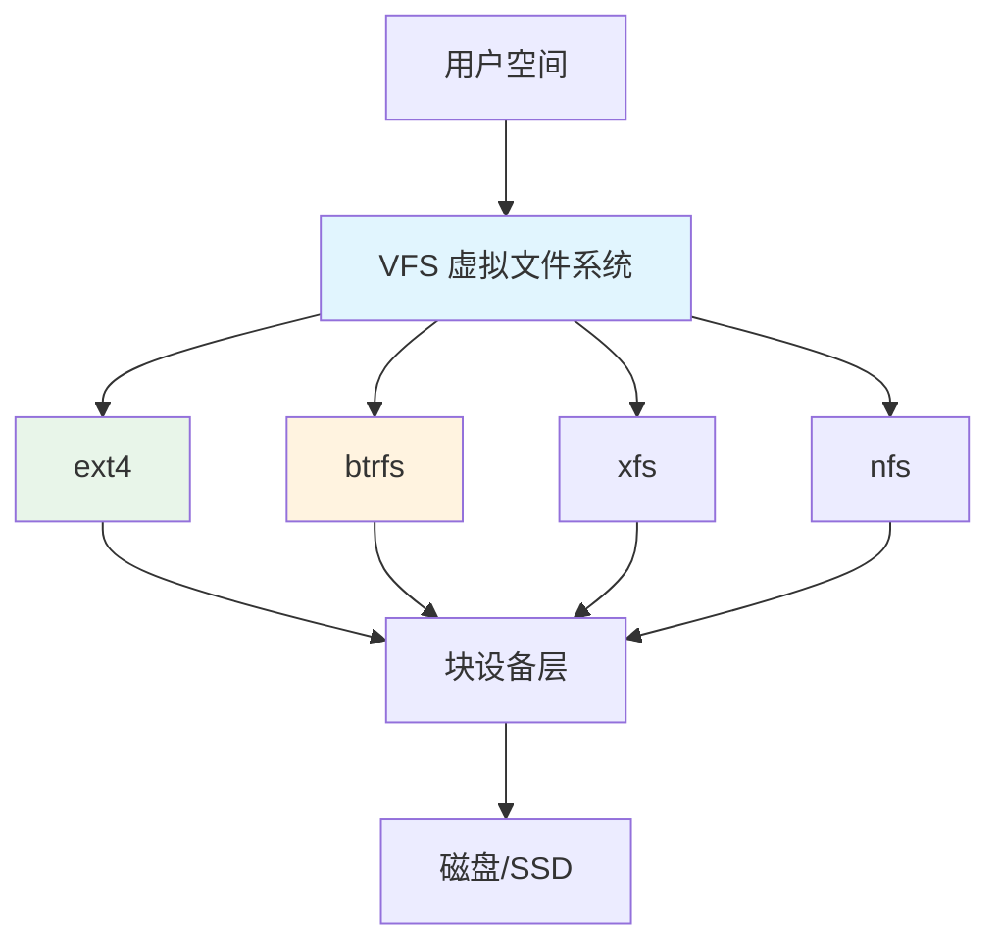

# 文件系统详解-ext4-btrfs

> **文档说明**：系统讲解 Linux 文件系统原理，深入对比 ext4 和 btrfs 的架构、特性、优缺点，涵盖其他主流文件系统、选择策略、性能调优、常用操作，以及生产级最佳实践和常见问题。
>
> **适用人群**：后端开发者、运维工程师、SRE、需要理解存储底层的开发者
>
> **前置知识**：[[进程间通信-IPC]]、[[操作系统-进程与线程]]、[[Linux命令行实战]]

---

## 一、概述

### 1. 什么是文件系统

**文件系统（File System）** 是操作系统用于管理存储设备上文件和目录的机制，负责数据的组织、存储、检索和保护。

```text
文件系统的职责：
- 文件和目录的组织（树形结构）
- 数据块的分配和回收
- 文件元数据管理（权限、时间、大小）
- 数据完整性保护（校验、日志）
- 访问控制（权限、ACL）
- 性能优化（缓存、预读、碎片整理）
```

### 2. Linux 文件系统架构



```text
VFS（Virtual File System）：
- Linux 内核的抽象层
- 统一不同文件系统的接口
- 用户通过统一的系统调用（open/read/write）访问
- 支持多种文件系统共存
```

### 3. 主流文件系统概览

| 文件系统 | 类型 | 最大卷 | 最大文件 | 特点 |
|---------|------|--------|---------|------|
| **ext4** | 日志 | 1EB | 16TB | 稳定、成熟、通用 |
| **btrfs** | 写时复制 | 16EB | 16EB | 高级特性、快照、校验 |
| **xfs** | 日志 | 8EB | 8EB | 高性能、大文件 |
| **zfs** | 写时复制 | 256ZB | 16EB | 企业级、存储池 |
| **ntfs** | 日志 | 256TB | 16TB | Windows 默认 |
| **apfs** | 写时复制 | 8EB | 8EB | macOS 默认 |
| **f2fs** | 日志 | - | - | 闪存优化 |

---

## 二、ext4 详解

### 1. ext4 概述

**ext4（Fourth Extended File System）** 是 Linux 最广泛使用的文件系统，ext3 的后继者，2008 年进入内核。

```text
ext4 核心特性：
- 日志文件系统（Journaling）
- 支持最大 1EB 卷、16TB 单文件
- 延迟分配（Delayed Allocation）
- 多块分配（Multiblock Allocation）
- 盘区（Extents）替代间接块
- 在线碎片整理
- 快速 fsck
- 纳秒级时间戳
- 配额支持
```

### 2. ext4 结构

```text
ext4 磁盘布局：
┌─────────────────────────────────────┐
│           Block Group 0             │
│  ┌──────┬──────┬──────┬──────┬────┐ │
│  │Super │Group │块位图│inode │数据│ │
│  │Block │Desc  │      │位图  │块  │ │
│  └──────┴──────┴──────┴──────┴────┘ │
├─────────────────────────────────────┤
│           Block Group 1             │
│  ...                                │
├─────────────────────────────────────┤
│           Block Group N             │
│  ...                                │
└─────────────────────────────────────┘

关键结构：
- Superblock：文件系统元信息（大小、块数、inode数）
- Group Descriptor：块组描述符
- Block Bitmap：标记哪些数据块已使用
- Inode Bitmap：标记哪些 inode 已使用
- Inode Table：存储 inode（文件元数据）
- Data Blocks：实际文件数据
```

### 3. Inode

```text
inode（索引节点）是 ext4 的核心概念：
- 每个文件对应一个 inode
- inode 存储文件元数据（不包含文件名）
- 包含：权限、所有者、大小、时间戳、数据块指针

inode 数据块指针：
- 12 个直接指针（指向数据块）
- 1 个一级间接指针（指向指针块）
- 1 个二级间接指针
- 1 个三级间接指针

ext4 用 Extents（盘区）替代传统间接块：
- 盘区 = 起始块号 + 连续块数
- 大文件只需少量盘区描述
- 减少元数据开销，提升性能
```

### 4. 日志机制

```text
ext4 日志模式：
1. Journal（完整日志）：数据和元数据都写日志（最安全，最慢）
2. Ordered（默认）：元数据写日志，数据先于元数据写入（平衡）
3. Writeback：只写元数据日志（最快，可能数据不一致）

日志作用：
- 系统崩溃后快速恢复（重放日志）
- 不需要完整 fsck（扫描整个磁盘）
- 保证元数据一致性
```

### 5. ext4 优缺点

| 优点 | 缺点 |
|------|------|
| 成熟稳定，社区支持好 | 缺少现代特性（快照、校验） |
| 性能均衡，通用场景好 | 不支持内置压缩 |
| 工具完善，文档丰富 | 不支持透明加密（需 eCryptfs） |
| 兼容性好，所有 Linux 支持 | 子卷/快照需要外部工具 |
| 修复工具成熟（e2fsck） | 大文件碎片问题 |

---

## 三、btrfs 详解

### 1. btrfs 概述

**btrfs（B-Tree File System，Butter FS / Better FS）** 是 Linux 的写时复制（CoW）文件系统，目标是实现高级功能和容错。

```text
btrfs 核心特性：
- 写时复制（Copy-on-Write）
- 子卷（Subvolumes）
- 快照（Snapshots）
- 数据和元数据校验（CRC32C）
- 透明压缩（zlib/lzo/zstd）
- 内置 RAID（0/1/10）
- 在线添加/删除设备
- 在线碎片整理
- 配额支持（Quota Groups）
- 发送/接收（Send/Receive）增量备份
```

### 2. btrfs 结构

```text
btrfs 核心数据结构：B-Tree（B 树）

btrfs 内部树：
- 根树（Root Tree）：管理其他树的根
- 块组树（Chunk Tree）：管理物理空间分配
- 设备树（Device Tree）：管理物理设备
- 文件系统树（FS Tree）：文件和目录
- 校验和树（Checksum Tree）：数据校验和
- 配额树（Quota Tree）：配额管理
- 日志树（Log Tree）：日志

写时复制（CoW）：
- 修改数据时，不覆盖原数据
- 写入新位置，更新元数据指向新数据
- 原子更新（要么全部成功，要么不变）
- 天然支持快照（保留旧版本元数据）
```

### 3. 子卷与快照

```bash
# 创建子卷
btrfs subvolume create /mnt/data/subvol1

# 列出子卷
btrfs subvolume list /mnt/data

# 创建快照（只读）
btrfs subvolume snapshot -r /mnt/data/subvol1 /mnt/data/snapshots/snap1

# 创建可写快照
btrfs subvolume snapshot /mnt/data/subvol1 /mnt/data/snapshots/snap2

# 删除子卷/快照
btrfs subvolume delete /mnt/data/snapshots/snap1

# 设置默认子卷（挂载时默认进入）
btrfs subvolume set-default <id> /mnt/data
```

### 4. 数据校验

```css
btrfs 校验机制：
- 每个数据块和元数据块都有 CRC32C 校验和
- 读取时验证校验和
- 检测到损坏时：
  - 如果有 RAID 镜像，从健康副本修复
  - 无副本则返回 I/O 错误
- 后台 scrub 扫描验证所有数据

# 手动 scrub（校验所有数据）
btrfs scrub start /mnt/data
btrfs scrub status /mnt/data
```

### 5. 透明压缩

```bash
# 挂载时启用压缩
mount -o compress=zstd /dev/sda1 /mnt/data

# 压缩级别
# compress=zlib:1-9 （压缩率高，慢）
# compress=lzo （速度快，压缩率低）
# compress=zstd:1-15 （平衡，推荐）
# compress=zstd:3 （默认级别）

# 强制压缩（即使数据不可压缩也尝试）
mount -o compress-force=zstd /dev/sda1 /mnt/data

# 查看压缩效果
compsize /mnt/data
```

### 6. btrfs 优缺点

| 优点 | 缺点 |
|------|------|
| 快照功能强大 | 相对较新，某些场景稳定性待验证 |
| 数据校验和自愈 | 写时复制可能导致碎片 |
| 透明压缩节省空间 | 数据库场景性能可能较差 |
| 内置 RAID | 修复工具不如 ext4 成熟 |
| 子卷灵活管理 | 内存占用较高 |
| 增量备份（send/receive） | 部分企业功能仍在开发 |

---

## 四、ext4 vs btrfs 对比

### 1. 功能对比

| 特性 | ext4 | btrfs |
|------|------|-------|
| **日志/CoW** | 日志 | 写时复制 |
| **快照** | 不支持（需 LVM） | 原生支持 |
| **子卷** | 不支持 | 原生支持 |
| **数据校验** | 不支持 | CRC32C |
| **透明压缩** | 不支持 | zlib/lzo/zstd |
| **内置 RAID** | 不支持 | RAID 0/1/10 |
| **最大卷** | 1EB | 16EB |
| **最大文件** | 16TB | 16EB |
| **在线扩容** | 支持 | 支持 |
| **在线缩容** | 不支持 | 支持 |
| **碎片整理** | 支持 | 支持 |
| **配额** | 支持 | 支持（更灵活） |
| **成熟度** | 非常成熟 | 较成熟（持续改进） |

### 2. 性能对比

| 场景 | ext4 | btrfs |
|------|------|-------|
| **小文件读写** | 优秀 | 良好 |
| **大文件顺序读写** | 优秀 | 优秀 |
| **数据库随机写** | 优秀 | 一般（CoW 碎片） |
| **大量小文件** | 良好 | 良好 |
| **快照后写入** | - | 有开销 |
| **压缩后读取** | - | 可能更快（减少 IO） |
| **fsck 速度** | 快（日志） | 不需要（CoW） |

### 3. 选择建议

```text
选择 ext4 的场景：
- 通用服务器、数据库（MySQL/PostgreSQL）
- 对稳定性要求极高
- 不需要快照/压缩等高级功能
- 虚拟机镜像存储
- 传统企业环境

选择 btrfs 的场景：
- 需要快照和回滚
- 桌面/工作站（Fedora/openSUSE 默认）
- 需要透明压缩节省空间
- NAS/存储服务器（配合 RAID）
- 容器宿主机（子卷隔离）
- 需要数据校验和自愈
```

---

## 五、其他文件系统

### 1. XFS

```css
XFS 特点：
- SGI 开发，Red Hat 推荐（RHEL/CentOS 默认）
- 高性能，尤其大文件和高并发
- 支持最大 8EB 卷
- 在线扩容（不支持缩容）
- 分配组（Allocation Groups）并行
- 适合：大文件、媒体存储、高吞吐

# 创建 XFS
mkfs.xfs /dev/sdb1
# 扩容
xfs_growfs /mnt/data
```

### 2. ZFS

```text
ZFS 特点：
- Sun 开发，OpenZFS 开源
- 写时复制，企业级功能
- 存储池（Zpool）+ 文件系统
-  RAID-Z（类似 RAID 5/6，更智能）
- 快照、克隆、压缩、去重
- 数据校验和自愈
- 适合：NAS、企业存储、备份
- 注意：Linux 上通过 OpenZFS（非内核内置）
```

### 3. F2FS

```text
F2FS（Flash-Friendly File System）：
- 三星开发，专为闪存设计
- 日志结构，减少写入放大
- 适合：SSD、eMMC、手机存储
- Android 部分设备使用
```

---

## 六、常用操作

### 1. 创建和挂载

```bash
# ext4
mkfs.ext4 /dev/sdb1
mkfs.ext4 -L mydata /dev/sdb1  # 带标签
mount /dev/sdb1 /mnt/data

# btrfs
mkfs.btrfs /dev/sdb1
mkfs.btrfs -L mydata /dev/sdb1
mount /dev/sdb1 /mnt/data

# 开机自动挂载（/etc/fstab）
# ext4
UUID=xxx /mnt/data ext4 defaults 0 2
# btrfs
UUID=xxx /mnt/data btrfs defaults,compress=zstd 0 0
```

### 2. 查看信息

```bash
# 查看文件系统类型
df -T
mount | grep /mnt/data

# ext4 信息
tune2fs -l /dev/sdb1 | head -20
dumpe2fs -h /dev/sdb1

# btrfs 信息
btrfs filesystem show /mnt/data
btrfs filesystem df /mnt/data    # 空间使用
btrfs filesystem usage /mnt/data  # 详细使用
btrfs subvolume list /mnt/data
```

### 3. 维护操作

```bash
# ext4 检查修复（卸载后）
umount /mnt/data
fsck.ext4 /dev/sdb1
e2fsck -f /dev/sdb1  # 强制检查

# ext4 碎片整理
e4defrag /mnt/data
e4defrag -v /mnt/data/file

# btrfs 平衡（重新分配数据）
btrfs balance start /mnt/data
btrfs balance status /mnt/data

# btrfs 碎片整理
btrfs filesystem defragment /mnt/data
btrfs filesystem defragment -r /mnt/data  # 递归

# btrfs scrub（校验）
btrfs scrub start /mnt/data
btrfs scrub status /mnt/data
```

### 4. 性能监控

```bash
# IO 监控
iostat -xz 1
iotop

# 查看挂载选项
mount | grep /mnt/data

# ext4 挂载优化选项
# noatime：不更新访问时间（提升性能）
# nodiratime：不更新目录访问时间
# commit=60：提交间隔（默认5秒）
mount -o noatime,nodiratime /dev/sdb1 /mnt/data

# btrfs 挂载优化选项
# noatime：不更新访问时间
# compress=zstd：透明压缩
# ssd：SSD 优化
# autodefrag：自动碎片整理
mount -o noatime,compress=zstd,ssd /dev/sdb1 /mnt/data
```

---

## 七、性能调优

### 1. 通用调优

```text
- 挂载选项：noatime（减少写入）
- 调度器：SSD 用 none/noop，HDD 用 cfq/bfq
- 预读：大文件顺序读增大 read_ahead
- 缓存：调整 vm.dirty_ratio / vm.dirty_background_ratio
- 交换：调整 swappiness（桌面 60，服务器 10）
```

### 2. ext4 调优

```bash
# 创建时优化
mkfs.ext4 -T largefile4 /dev/sdb1  # 大文件优化
mkfs.ext4 -E stride=128,stripe-width=256 /dev/sdb1  # RAID 对齐

# 保留块调整（默认5%，大数据盘可减少）
tune2fs -m 1 /dev/sdb1  # 保留1%

# 关闭日志（高性能但有风险）
tune2fs -O ^has_journal /dev/sdb1
```

### 3. btrfs 调优

```bash
# 挂载优化
mount -o noatime,compress=zstd:3,ssd,autodefrag /dev/sdb1 /mnt/data

# 数据库场景：关闭 CoW（对特定目录/文件）
chattr +C /mnt/data/mysql  # 目录设置 No_COW
# 注意：必须在空目录上设置，已有文件无效

# 平衡操作（定期维护）
btrfs balance start -dusage=50 /mnt/data  # 平衡使用率低于50%的块
```

---

## 八、最佳实践

### 1. 选择规范

- [ ] **数据库用 ext4/XFS**：CoW 文件系统不适合数据库随机写
- [ ] **通用服务器用 ext4**：稳定、成熟、工具完善
- [ ] **需要快照用 btrfs**：系统盘、开发环境
- [ ] **NAS/存储用 btrfs/ZFS**：数据校验、RAID、压缩
- [ ] **大文件存储用 XFS**：高吞吐、大文件
- [ ] **SSD 考虑 F2FS**：移动设备、嵌入式

### 2. 运维规范

- [ ] **定期备份**：文件系统不能替代备份
- [ ] **监控磁盘健康**：SMART 监控、坏道检测
- [ ] **定期 fsck/scrub**：ext4 定期 fsck，btrfs 定期 scrub
- [ ] **合理分区**：系统、数据、日志分开
- [ ] **LVM 配合**：ext4 配合 LVM 实现快照和扩容
- [ ] **监控空间**：inode 和空间都要监控（df -i）

### 3. 安全规范

- [ ] **重要数据 RAID**：RAID 1/5/10 或 btrfs RAID
- [ ] **定期快照**：btrfs 定期快照，保留多个版本
- [ ] **异地备份**：3-2-1 备份策略
- [ ] **加密敏感数据**：LUKS 加密 + 文件系统
- [ ] **权限控制**：合理设置目录权限和 ACL

---

## 九、常见问题与排查

| 问题 | 原因 | 解决方案 |
|------|------|---------|
| **空间不足但 df 显示有空间** | inode 用尽 / 保留块 | df -i 检查 inode、tune2fs -m 调整保留 |
| **ext4 文件损坏** | 异常断电 / 磁盘坏道 | fsck 修复、检查 SMART、更换磁盘 |
| **btrfs 只读挂载** | 检测到错误自动只读 | dmesg 查看错误、scrub 修复、备份数据 |
| **btrfs 性能差** | 碎片 / CoW / 压缩 | defrag、数据库目录设 +C、调整压缩 |
| **删除文件空间不释放** | 进程仍持有文件句柄 | lsof 找到进程、重启进程 |
| **fsck 很慢** | 磁盘大 / 未用日志 | 用 ext4 日志、定期维护 |
| **btrfs 平衡卡住** | 数据量大 / IO 慢 | 等待、用 -dusage 限制范围 |
| **SSD 写入放大** | 日志频繁 / atime | noatime、调整 commit 间隔 |
| **RAID 重建慢** | 磁盘大 / IO 限制 | 调整重建速度、低峰期操作 |
| **子卷无法删除** | 非空 / 是默认子卷 | 先删除内容、更改默认子卷 |
| **压缩效果差** | 数据已压缩/不可压缩 | 用 compsize 检查、调整算法 |
| **ext4 无法缩容** | ext4 不支持在线缩容 | 备份数据、重新格式化 |
| **btrfs 内存占用高** | 大文件系统 / 缓存 | 调整缓存、增加内存 |
| **挂载失败** | 文件系统损坏 / 超级块损坏 | fsck 修复、用备份超级块 |
| **性能突然下降** | 磁盘满 / 碎片 / 硬件故障 | 检查空间、碎片整理、SMART 检查 |

---

## 十、关联笔记

### 操作系统
- [[进程间通信-IPC]] · [[操作系统-进程与线程]] · [[Linux命令行实战]]
- [[文件系统详解-ext4-btrfs]]

### 云原生与存储
- [[K8s-存储与配置管理]] · [[Docker容器化实战]] · [[分布式系统-高可用架构设计]]

### 运维
- [[APM应用性能监控-SkyWalking]] · [[kubectl命令速查表]] · [[多架构镜像构建-buildx]]

### 导航
- [[MOC-计算机基础]] · [[MOC-云原生与运维]] · [[全栈+AI工程双轨融合学习路线图]]

> **学习路径建议**：先掌握 [[操作系统-进程与线程]] OS 基础 → 深入本文文件系统 → 学习 [[进程间通信-IPC]] IPC → 实践 [[Linux命令行实战]] 命令行 → 研究 [[K8s-存储与配置管理]] K8s 存储 → 构建完整的存储底层理解。

---

## 💡 全文深度讲解

本文系统梳理了文件系统详解-ext4-btrfs的核心知识体系，从概述入手，深入ext4 详解的底层机制，再通过btrfs 详解掌握实战应用，最后涵盖常见问题与排查与关联笔记。学习时建议先建立整体认知，再动手实践，最后结合常见问题深化理解。

## 📝 全文精简总结

- **概述**：掌握本模块的核心概念与关键要点
- **ext4 详解**：掌握本模块的核心概念与关键要点
- **btrfs 详解**：掌握本模块的核心概念与关键要点
- **ext4 vs btrfs 对比**：掌握本模块的核心概念与关键要点
- **其他文件系统**：掌握本模块的核心概念与关键要点
- **常用操作**：掌握本模块的核心概念与关键要点
- **性能调优**：掌握本模块的核心概念与关键要点
- **最佳实践**：掌握本模块的核心概念与关键要点
- 其余2个模块涵盖进阶主题与拓展内容

