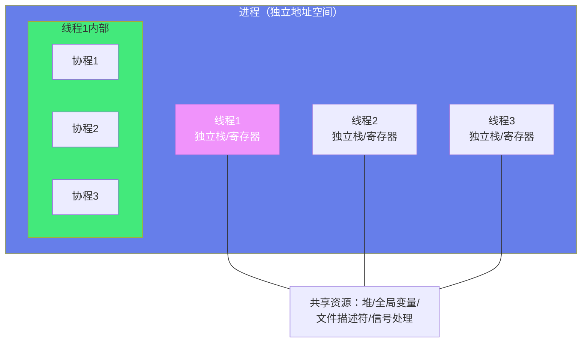
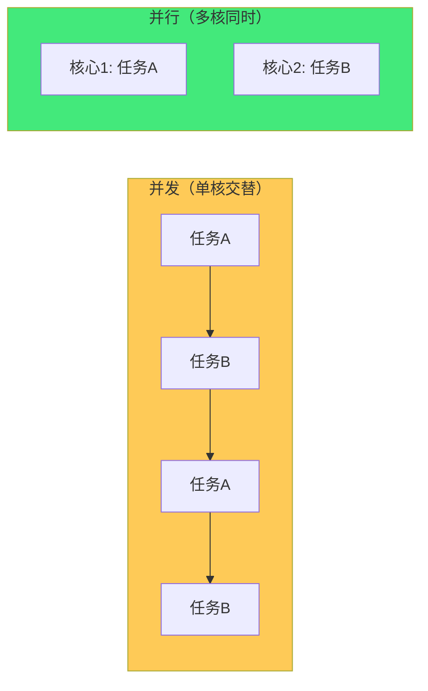
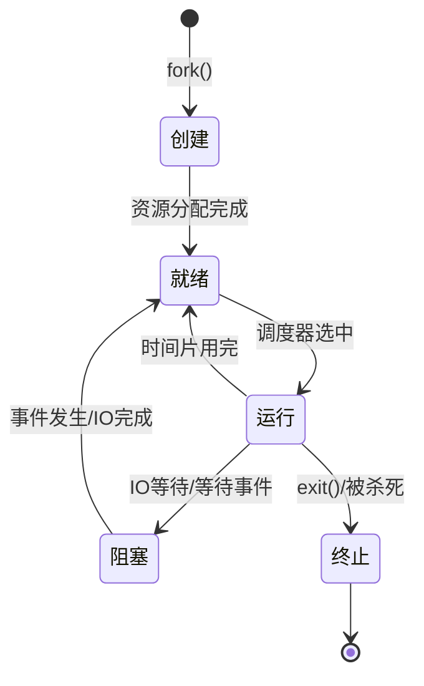
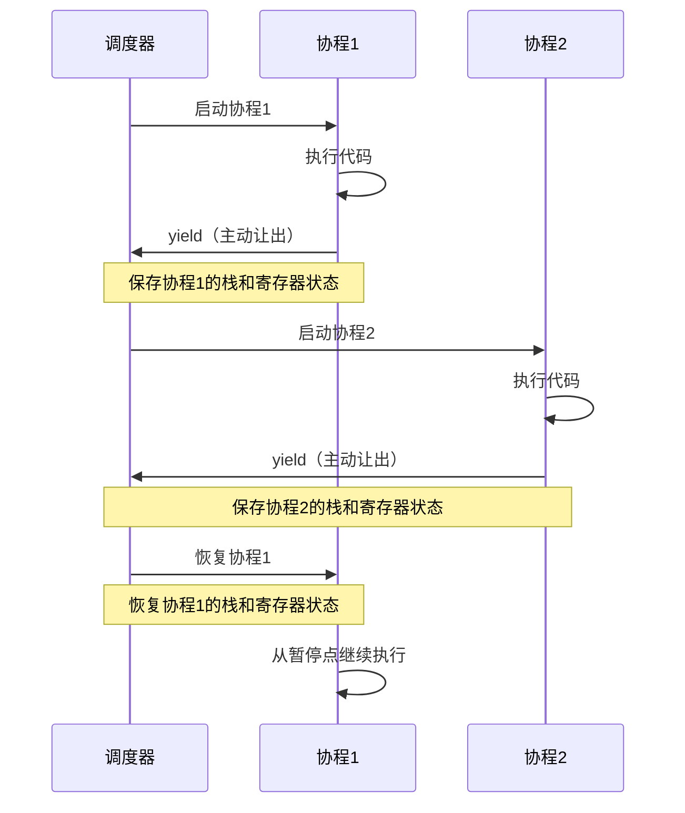

# ⚙️ 进程、线程与协程

> **文档说明**：系统讲解进程、线程与协程的完整知识体系，涵盖进程概念与生命周期、进程状态与调度、线程概念与实现（用户级/内核级）、线程同步机制（互斥锁/信号量/条件变量/读写锁/原子操作）、协程概念与原理（用户态轻量级线程）、进程/线程/协程对比、上下文切换、并发与并行、死锁与活锁、生产者消费者模型、各语言实现（Java/Python/Go/JS）、常见并发问题排查。
>
> **适用人群**：后端开发者、系统工程师、计算机专业学生、面试准备者
>
> **前置知识**：[[Linux内核基础概念]] · [[操作系统核心原理]]

---

## 一、概述

### 1.1 三个核心概念

| 概念 | 定义 | 资源占用 | 调度单位 | 切换开销 |
|------|------|---------|---------|---------|
| **进程（Process）** | 资源分配的最小单位，程序的一次执行实例 | 独立地址空间、文件描述符、PID等 | 操作系统调度 | 大（需切换页表、刷新TLB） |
| **线程（Thread）** | CPU 调度的最小单位，进程内的执行流 | 共享进程资源，只有独立栈和寄存器 | 操作系统调度 | 中（切换栈和寄存器） |
| **协程（Coroutine）** | 用户态轻量级线程，协作式调度 | 极轻量，共享线程资源 | 用户态调度（运行时） | 极小（用户态切换，无内核介入） |



### 1.2 并发与并行

| 概念 | 说明 | 示例 |
|------|------|------|
| **并发（Concurrency）** | 多个任务在**同一时间段**内交替执行（宏观同时，微观交替） | 单核 CPU 上多任务，通过时间片轮转 |
| **并行（Parallelism）** | 多个任务在**同一时刻**真正同时执行 | 多核 CPU 上多个核心同时执行不同任务 |



> **关键区别**：并发是「同时处理多个任务」（可能交替），并行是「同时执行多个任务」（真正同时）。并发是逻辑上的同时，并行是物理上的同时。并发不一定需要多核，并行必须多核。

### 1.3 为什么需要并发

| 需求 | 说明 |
|------|------|
| **提高吞吐量** | 利用多核 CPU，同时处理多个请求 |
| **提高响应性** | IO 密集型任务等待时，CPU 可以处理其他任务 |
| **资源利用率** | IO 等待时 CPU 不空闲，提高 CPU 利用率 |
| **任务建模** | 复杂问题分解为多个独立任务，逻辑更清晰 |
| **实时性** | 高优先级任务可以抢占低优先级任务 |

---

## 二、进程

### 2.1 进程概念

进程是程序的一次执行过程，是操作系统进行**资源分配和调度**的基本单位。

**进程包含的资源**：
- 独立的虚拟地址空间（代码段、数据段、堆、栈）
- 文件描述符表
- 信号处理函数
- 用户 ID 和组 ID
- PID（进程 ID）
- 寄存器状态（PC、SP 等）
- 内存映射（mmap）

**进程 vs 程序**：
| 维度 | 程序 | 进程 |
|------|------|------|
| 本质 | 静态的指令和数据集合 | 程序的动态执行过程 |
| 存储 | 磁盘上的可执行文件 | 内存中的执行实例 |
| 生命周期 | 永久存在（除非删除） | 有创建、运行、终止的生命周期 |
| 资源 | 不占用系统资源（除磁盘） | 占用 CPU、内存、文件描述符等 |
| 关系 | 一个程序可以对应多个进程 | 一个进程只能对应一个程序 |

### 2.2 进程状态



| 状态 | 说明 |
|------|------|
| **创建（New）** | 进程正在被创建，分配 PID 和资源 |
| **就绪（Ready）** | 进程已准备好，等待 CPU 调度 |
| **运行（Running）** | 进程正在 CPU 上执行 |
| **阻塞（Blocked/Waiting）** | 进程等待某个事件（IO、信号、锁），不占用 CPU |
| **终止（Terminated/Zombie）** | 进程执行完毕或被杀死，等待父进程回收资源 |

### 2.3 进程调度

操作系统调度器决定哪个就绪进程获得 CPU。

**常见调度算法**：
| 算法 | 说明 | 优点 | 缺点 |
|------|------|------|------|
| **FCFS** | 先来先服务 | 简单公平 | 短任务等待长任务，平均等待时间长 |
| **SJF** | 最短作业优先 | 平均等待时间最短 | 需要预知运行时间，长任务可能饥饿 |
| **优先级调度** | 优先级高的先执行 | 重要任务优先 | 低优先级可能饥饿 |
| **时间片轮转** | 每个进程分配固定时间片 | 公平，响应快 | 上下文切换开销 |
| **多级反馈队列** | 多个队列，不同优先级和时间片 | 兼顾响应和吞吐量 | 实现复杂 |

**Linux CFS（完全公平调度器）**：
- 红黑树管理就绪进程，按虚拟运行时间排序
- 每次选择虚拟运行时间最小的进程执行
- 动态调整优先级（nice 值）
- 公平分配 CPU 时间

### 2.4 进程创建与终止

```c
// ===== 进程创建（fork）=====
#include <unistd.h>
#include <stdio.h>

int main() {
    pid_t pid = fork();  // 创建子进程
    
    if (pid < 0) {
        perror("fork failed");
        return 1;
    } else if (pid == 0) {
        // 子进程
        printf("子进程: PID=%d, 父进程PID=%d\n", getpid(), getppid());
        // exec 系列函数替换进程映像
        execl("/bin/ls", "ls", "-l", NULL);
    } else {
        // 父进程
        printf("父进程: PID=%d, 子进程PID=%d\n", getpid(), pid);
        wait(NULL);  // 等待子进程结束
        printf("子进程已结束\n");
    }
    return 0;
}
```

**fork 的写时复制（COW）**：
- fork 后父子进程共享物理内存（只读）
- 当任一进程尝试写入时，才复制该页
- 减少 fork 的开销，提高效率

**进程终止方式**：
- 正常终止：`exit()` / `return`
- 异常终止：被信号杀死（SIGKILL/SIGTERM/SIGSEGV）
- 僵尸进程：子进程终止但父进程未调用 `wait()` 回收资源
- 孤儿进程：父进程先于子进程终止，子进程被 init 进程收养

---

## 三、线程

### 3.1 线程概念

线程是进程内的执行单元，是 **CPU 调度和分派**的基本单位。一个进程可以包含多个线程，它们共享进程的资源，但有各自独立的栈和寄存器。

**线程共享的资源**：
- 进程地址空间（代码段、数据段、堆）
- 文件描述符表
- 信号处理函数
- 用户 ID 和组 ID
- 当前工作目录

**线程独立的资源**：
- 线程 ID（TID）
- 栈（用户栈和内核栈）
- 寄存器状态（PC、SP 等）
- 信号掩码（屏蔽哪些信号）
- errno 变量
- 线程局部存储（TLS）

### 3.2 线程实现模型

| 模型 | 说明 | 优点 | 缺点 |
|------|------|------|------|
| **用户级线程** | 线程管理在用户态，内核不可见 | 创建/切换快，无需内核介入 | 一个线程阻塞会阻塞整个进程，无法利用多核 |
| **内核级线程** | 线程由内核管理和调度 | 可利用多核，一个线程阻塞不影响其他 | 创建/切换开销大（需内核介入） |
| **混合模型（N:M）** | N 个用户级线程映射到 M 个内核级线程 | 兼顾两者优点 | 实现复杂 |

**各语言线程模型**：
| 语言 | 线程模型 | 说明 |
|------|---------|------|
| **Java** | 内核级（1:1） | 每个 Java 线程对应一个内核线程 |
| **Python（CPython）** | 内核级（1:1）+ GIL | 内核线程，但 GIL 限制同一时刻只有一个线程执行 Python 字节码 |
| **Go** | 混合（N:M） | goroutine（用户级）映射到 OS 线程（内核级），Go 运行时调度 |
| **JavaScript（Node.js）** | 单线程 + 事件循环 | 单线程执行 JS，IO 操作由线程池处理 |
| **C/C++（pthread）** | 内核级（1:1） | POSIX 线程，通常映射到内核线程 |
| **Rust** | 内核级（1:1） | std::thread 对应内核线程 |

### 3.3 线程同步机制

多线程共享资源时需要同步，防止竞态条件（Race Condition）。

| 机制 | 说明 | 适用场景 |
|------|------|---------|
| **互斥锁（Mutex）** | 同一时刻只有一个线程持有锁 | 保护共享资源的互斥访问 |
| **信号量（Semaphore）** | 计数器，控制同时访问资源的线程数 | 限制并发数、生产者消费者 |
| **条件变量（Condition）** | 等待某个条件成立，配合互斥锁使用 | 等待事件、生产者消费者 |
| **读写锁（RWLock）** | 读共享、写独占 | 读多写少的场景 |
| **自旋锁（Spinlock）** | 循环等待锁释放，不阻塞 | 锁持有时间短、多核环境 |
| **原子操作（Atomic）** | 硬件级原子指令，无需锁 | 简单的计数器、标志位 |
| **屏障（Barrier）** | 所有线程到达屏障后才继续 | 分阶段并行计算 |
| **Future/Promise** | 异步任务的结果传递 | 异步编程、任务并行 |

**互斥锁示例（C pthread）**：
```c
#include <pthread.h>

pthread_mutex_t mutex = PTHREAD_MUTEX_INITIALIZER;
int counter = 0;

void* increment(void* arg) {
    for (int i = 0; i < 100000; i++) {
        pthread_mutex_lock(&mutex);    // 加锁
        counter++;                       // 临界区
        pthread_mutex_unlock(&mutex);  // 解锁
    }
    return NULL;
}
```

**条件变量示例（生产者消费者）**：
```c
pthread_mutex_t mutex = PTHREAD_MUTEX_INITIALIZER;
pthread_cond_t cond = PTHREAD_COND_INITIALIZER;
int buffer = 0;

void* producer(void* arg) {
    for (int i = 0; i < 10; i++) {
        pthread_mutex_lock(&mutex);
        while (buffer != 0) {
            pthread_cond_wait(&cond, &mutex);  // 等待消费者消费
        }
        buffer = i + 1;
        printf("生产: %d\n", buffer);
        pthread_cond_signal(&cond);  // 通知消费者
        pthread_mutex_unlock(&mutex);
    }
    return NULL;
}

void* consumer(void* arg) {
    for (int i = 0; i < 10; i++) {
        pthread_mutex_lock(&mutex);
        while (buffer == 0) {
            pthread_cond_wait(&cond, &mutex);  // 等待生产者生产
        }
        printf("消费: %d\n", buffer);
        buffer = 0;
        pthread_cond_signal(&cond);  // 通知生产者
        pthread_mutex_unlock(&mutex);
    }
    return NULL;
}
```

### 3.4 死锁

死锁是多个线程互相等待对方释放资源，导致都无法继续执行。

**死锁四个必要条件（Coffman 条件）**：
| 条件 | 说明 |
|------|------|
| **互斥** | 资源一次只能被一个线程持有 |
| **持有并等待** | 持有资源的同时等待其他资源 |
| **不可剥夺** | 资源只能由持有者主动释放，不能被强制剥夺 |
| **循环等待** | 存在线程循环等待链，每个线程等待下一个线程持有的资源 |

**死锁预防**（破坏任一条件）：
- 破坏互斥：资源可共享（如只读数据）
- 破坏持有并等待：一次性申请所有资源
- 破坏不可剥夺：持有资源的线程申请新资源失败时释放已有资源
- 破坏循环等待：资源按固定顺序申请（如按资源 ID 升序申请锁）

**死锁检测与恢复**：
- 定期检测资源分配图是否有环
- 检测到死锁后，终止一个或多个进程/线程，或剥夺资源

**死锁避免（银行家算法）**：
- 每次资源分配前，判断是否可能导致死锁
- 只在安全状态下分配资源

---

## 四、协程

### 4.1 协程概念

协程（Coroutine）是用户态的轻量级线程，由程序（运行时）调度，而非操作系统内核调度。协程的切换在用户态完成，无需内核介入，开销极小。

**协程 vs 线程**：
| 维度 | 线程 | 协程 |
|------|------|------|
| 调度者 | 操作系统内核 | 用户程序/运行时 |
| 切换开销 | 大（内核态切换） | 极小（用户态切换） |
| 调度方式 | 抢占式（内核决定） | 协作式（协程主动让出） |
| 数量 | 通常几百到几千 | 可创建数万到数十万 |
| 栈大小 | 通常 1-8MB | 通常几 KB 到几十 KB |
| 数据共享 | 共享进程内存，需同步 | 共享线程内存，需同步（但通常单线程内无竞态） |
| 阻塞 | 一个线程阻塞不影响其他线程 | 协程阻塞会阻塞整个线程（需异步 IO） |

### 4.2 协程原理

协程的核心是**函数可以暂停和恢复**——协程执行到某个点可以主动让出 CPU（yield），保存当前执行状态，之后可以从暂停点恢复执行。



**协程切换的实现方式**：
1. **ucontext（POSIX）**：`getcontext/setcontext/makecontext/swapcontext` 系列函数
2. **setjmp/longjmp**：非本地跳转，可用于简单协程
3. **汇编实现**：直接操作栈指针和寄存器，效率最高（如 Go runtime）
4. **async/await 语法糖**：编译器将代码转换为状态机（如 JS/Python/C#）

### 4.3 各语言协程实现

| 语言 | 协程实现 | 说明 |
|------|---------|------|
| **Go** | goroutine + channel | 语言原生支持，N:M 调度，go 关键字启动 |
| **Python** | asyncio + async/await | 事件循环调度，单线程异步 |
| **JavaScript** | async/await + Promise | 事件循环，V8 引擎 |
| **Kotlin** | 协程（kotlinx.coroutines） | 编译器支持，可挂起函数 |
| **Rust** | async/await + Future | 零成本抽象，需运行时（tokio/async-std） |
| **C#** | async/await + Task | 编译器生成状态机，线程池调度 |
| **C++20** | coroutine（co_await/co_yield） | 语言级支持，需自定义 Promise |
| **Lua** | coroutine | 语言原生，协作式调度 |
| **PHP** | Swoole 协程 / Fibers | 扩展或语言级支持 |

**Go goroutine 示例**：
```go
package main

import (
    "fmt"
    "time"
)

func worker(id int, ch chan int) {
    for task := range ch {
        fmt.Printf("协程 %d 处理任务 %d\n", id, task)
        time.Sleep(100 * time.Millisecond)
    }
}

func main() {
    ch := make(chan int, 10)
    
    // 启动 3 个 goroutine
    for i := 1; i <= 3; i++ {
        go worker(i, ch)
    }
    
    // 发送任务
    for i := 1; i <= 10; i++ {
        ch <- i
    }
    close(ch)
    
    time.Sleep(2 * time.Second)
}
```

**Python asyncio 示例**：
```python
import asyncio

async def fetch_data(url):
    print(f"开始请求 {url}")
    await asyncio.sleep(1)  # 模拟异步 IO，让出 CPU
    print(f"请求完成 {url}")
    return f"data from {url}"

async def main():
    # 并发执行多个协程
    tasks = [
        fetch_data("https://api1.com"),
        fetch_data("https://api2.com"),
        fetch_data("https://api3.com"),
    ]
    results = await asyncio.gather(*tasks)
    print(results)

asyncio.run(main())
```

### 4.4 协程的适用场景

| 场景 | 说明 |
|------|------|
| **IO 密集型** | 网络请求、文件读写、数据库查询等，协程等待 IO 时让出 CPU |
| **高并发服务器** | 数万连接，每个连接一个协程，开销远小于线程 |
| **异步编程** | async/await 语法，让异步代码像同步代码一样易读 |
| **生成器/迭代器** | 协程可以作为生成器，按需产生数据 |
| **状态机** | 协程的暂停/恢复天然适合实现状态机 |

**不适合协程的场景**：
- CPU 密集型任务（协程无法利用多核，需要多进程/多线程）
- 需要抢占式调度的场景（协程是协作式，一个协程不主动让出会阻塞整个线程）
- 需要严格实时性的场景

---

## 五、三者对比与选择

### 5.1 综合对比

| 维度 | 进程 | 线程 | 协程 |
|------|------|------|------|
| **定义** | 资源分配最小单位 | CPU 调度最小单位 | 用户态轻量级线程 |
| **地址空间** | 独立 | 共享进程地址空间 | 共享线程地址空间 |
| **资源开销** | 大（独立地址空间） | 中（独立栈/寄存器） | 小（几 KB 栈） |
| **切换开销** | 大（切换页表/TLB） | 中（切换栈/寄存器） | 极小（用户态切换） |
| **调度者** | 操作系统 | 操作系统 | 用户程序/运行时 |
| **调度方式** | 抢占式 | 抢占式 | 协作式（主动让出） |
| **并发能力** | 几十到几百 | 几百到几千 | 几万到几十万 |
| **数据共享** | IPC（管道/消息队列/共享内存） | 共享内存（需同步） | 共享内存（通常单线程内） |
| **同步机制** | IPC 原语 | 互斥锁/信号量/条件变量 | 通常不需要（单线程），但跨线程需同步 |
| **崩溃影响** | 进程崩溃不影响其他进程 | 线程崩溃可能导致整个进程崩溃 | 协程崩溃可能导致整个线程崩溃 |
| **多核利用** | 可以 | 可以 | 不能（单线程内），需多线程配合 |
| **典型应用** | 独立服务、沙箱隔离 | CPU 密集、并行计算 | IO 密集、高并发服务器 |

### 5.2 选择策略

```mermaid
flowchart TD
    A[需要并发?] -->|否| B[单线程同步]
    A -->|是| C{任务类型?}
    
    C -->|CPU密集| D{需要多核?}
    D -->|是| E[多进程/多线程]
    D -->|否| F[单线程]
    
    C -->|IO密集| G{并发量?}
    G -->|低(<1000)| H[多线程]
    G -->|高(>10000)| I[协程/异步IO]
    
    C -->|混合| J[多进程+多线程+协程]
    
    style E fill:#43e97b,color:#333
    style I fill:#4facfe,color:#fff
    style J fill:#f093fb,color:#fff
```

**选择建议**：
- **CPU 密集型 + 需要多核**：多进程（避免 GIL）或多线程
- **IO 密集型 + 高并发**：协程（Go goroutine / Python asyncio / Node.js）
- **需要强隔离**：多进程（一个崩溃不影响其他）
- **需要共享大量数据**：多线程（共享内存，注意同步）
- **简单任务 + 低并发**：多线程（简单直接）
- **超大规模并发**：协程 + 事件循环（如 Nginx、Redis）

---

## 六、常见并发问题

### 6.1 竞态条件（Race Condition）

多个线程/协程同时访问共享资源，且至少一个是写操作，导致结果依赖于执行顺序。

```python
# 竞态条件示例
counter = 0

def increment():
    global counter
    for _ in range(100000):
        counter += 1  # 非原子操作：读-改-写

# 两个线程同时执行，结果可能不是 200000
```

**解决方案**：互斥锁、原子操作、避免共享状态

### 6.2 死锁（Deadlock）

见 3.4 节。

### 6.3 活锁（Livelock）

多个线程不断改变状态但都无法继续执行，虽然没有阻塞但也没有进展。

**示例**：两个人在走廊相遇，都向同一侧让路，结果还是挡住对方，反复让路但都过不去。

**解决方案**：引入随机性（随机等待后重试）、优先级、超时机制

### 6.4 饥饿（Starvation）

某个线程/进程长期得不到资源，无法执行。

**原因**：不公平的调度策略、优先级反转、资源被长期占用

**解决方案**：公平调度（FIFO）、优先级继承、资源限制

### 6.5 优先级反转（Priority Inversion）

低优先级线程持有高优先级线程需要的资源，导致高优先级线程被低优先级线程阻塞。

**经典案例**：火星探路者号（1997）因优先级反转导致系统重启

**解决方案**：优先级继承（持有资源的低优先级线程临时提升到等待它的高优先级线程的优先级）、优先级天花板

---

## 七、实操与调试

### 7.1 Linux 进程/线程查看

```bash
# 查看进程
ps aux                          # 查看所有进程
ps -ef                          # 查看所有进程（另一种格式）
ps -eLf                         # 查看线程（LWP 列是线程 ID）
top                             # 实时查看进程（按 H 显示线程）
htop                            # 增强版 top
pstree                          # 进程树
pidof <进程名>                  # 查看进程 PID

# 查看进程详情
cat /proc/<pid>/status         # 进程状态
cat /proc/<pid>/maps           # 进程内存映射
ls /proc/<pid>/fd              # 进程打开的文件描述符
ls /proc/<pid>/task            # 进程的线程列表

# 进程控制
kill <pid>                      # 发送 SIGTERM
kill -9 <pid>                   # 发送 SIGKILL（强制杀死）
killall <进程名>                # 按名称杀死
pkill <模式>                    # 按模式杀死
nice -n 10 <命令>               # 以指定优先级运行
renice -n 5 -p <pid>           # 修改进程优先级

# 线程调试
gdb -p <pid>                   # 附加到进程调试
info threads                    # gdb 中查看线程
thread <id>                     # 切换到指定线程
```

### 7.2 并发性能分析

```bash
# CPU 使用率
mpstat 1                        # 每秒查看 CPU 使用率
pidstat 1 -p <pid>             # 查看指定进程的 CPU 使用率

# 内存使用
free -h                         # 查看内存使用
pmap <pid>                      # 查看进程内存映射
cat /proc/<pid>/status | grep Vm  # 查看进程内存

# 上下文切换
vmstat 1                        # 查看系统上下文切换（cs 列）
pidstat -w 1 -p <pid>          # 查看进程上下文切换

# 锁竞争
# Linux perf 工具
perf lock record -a -- sleep 10  # 记录锁竞争
perf lock report                   # 分析锁竞争

# 线程状态
ps -eLf | grep <进程名>         # 查看线程状态（S 休眠/R 运行/D 不可中断/Z 僵尸）
```

### 7.3 各语言并发调试

| 语言 | 调试工具 | 说明 |
|------|---------|------|
| **Java** | jstack、jconsole、VisualVM、Arthas | 查看线程栈、死锁检测 |
| **Python** | py-spy、pudb、threading.enumerate() | 采样分析、线程查看 |
| **Go** | pprof、go tool trace、dlv | CPU/内存分析、协程追踪 |
| **C/C++** | gdb、valgrind、helgrind、drd | 调试、数据竞争检测 |
| **Node.js** | --inspect、clinic.js、0x | 调试、性能分析 |

---

## 八、关联笔记

### 操作系统
- [[Linux内核基础概念]] · [[操作系统核心原理]] · [[Linux性能调优]]
- [[内存管理与虚拟内存]]

### 并发编程
- [[Java-并发编程JUC_backup_skeleton]] · [[Python异步编程]] · [[Go并发模型]]
- [[生产者消费者模式]] · [[线程池与连接池]]

### 网络与性能
- [[HTTP协议完整指南]] · [[网络抓包与调试]] · [[性能优化方法论]]

### 导航
- [[MOC-计算机基础]] · [[MOC-操作系统]] · [[MOC-综合导航]] · [[Home]]

> 🔍 **知识点深度解析**
>
> **作用**：进程、线程与协程解决的是「并发执行与资源利用」问题——通过多个执行流同时处理多个任务，提高 CPU 利用率（IO 等待时不空闲）、提高系统吞吐量（同时处理多个请求）、提高响应性（后台任务不阻塞前台）。进程是资源分配单位，线程是 CPU 调度单位，协程是用户态轻量级执行单位。
>
> **底层原理**：进程拥有独立的虚拟地址空间，通过 fork 创建（写时复制共享内存），由操作系统调度器分配 CPU 时间片，上下文切换需要切换页表和刷新 TLB，开销大。线程是进程内的执行流，共享进程地址空间但有独立的栈和寄存器，由内核调度（1:1 模型），切换只需切换栈和寄存器，开销中等。协程是用户态的执行流，由程序运行时调度（协作式），切换在用户态完成（保存/恢复栈和寄存器），无需内核介入，开销极小，可以创建数万个。三者的核心区别在于「调度者」和「切换开销」：进程/线程由内核调度（抢占式），协程由用户程序调度（协作式，主动让出）。
>
> **用法要点**：① 进程：资源隔离强，一个崩溃不影响其他，但开销大，适合独立服务/沙箱 ② 线程：共享内存，切换开销中等，适合 CPU 密集型并行计算，但注意同步（互斥锁/信号量/条件变量）和死锁 ③ 协程：切换开销极小，可创建数万，适合 IO 密集型高并发，但单线程内无法利用多核，需配合多进程/多线程 ④ 选择：CPU 密集+多核→多进程/多线程；IO 密集+高并发→协程；强隔离→多进程；共享大量数据→多线程 ⑤ 同步机制：互斥锁（保护临界区）、条件变量（等待事件）、读写锁（读多写少）、原子操作（简单计数器）、信号量（限制并发数） ⑥ 死锁四条件：互斥/持有并等待/不可剥夺/循环等待，破坏任一即可预防 ⑦ 常见问题：竞态条件（加锁/原子操作）、死锁（按顺序加锁/超时）、活锁（随机等待）、饥饿（公平调度） ⑧ 调试：Linux 用 ps/top/pstree/pidstat/perf，Java 用 jstack/Arthas，Go 用 pprof/trace ⑨ GIL：CPython 的全局解释器锁限制同一时刻只有一个线程执行 Python 字节码，CPU 密集型用多进程，IO 密集型用线程/协程 ⑩ Go 的 M:N 模型：goroutine（用户级）映射到 OS 线程（内核级），Go runtime 调度，兼顾轻量和多核利用。

> 💡 **深度讲解**：进程/线程/协程最核心的区别是「调度者和切换开销」，这决定了它们的适用场景。进程切换开销最大因为要切换页表（虚拟地址空间映射）和刷新 TLB（快表），但进程隔离性最好，一个进程崩溃不会影响其他进程。线程切换开销中等因为共享地址空间只需切换栈和寄存器，但线程共享内存意味着一个线程崩溃可能导致整个进程崩溃（如段错误），而且多线程共享数据需要同步，容易产生竞态条件和死锁。协程切换开销最小因为完全在用户态完成，不需要陷入内核，但协程是协作式调度——一个协程不主动让出 CPU 会阻塞整个线程的所有协程，所以协程必须配合非阻塞 IO（异步 IO）使用，遇到 IO 操作时主动让出。这也是为什么 Node.js/Python asyncio 都强调「非阻塞 IO」——如果用了阻塞 IO，整个事件循环就卡住了。另一个关键点是「并发 vs 并行」：并发是同一时间段内交替执行多个任务（单核也能并发，通过时间片轮转），并行是同一时刻真正同时执行多个任务（必须多核）。协程能提高并发度（IO 等待时切换到其他协程），但单线程内的协程不能并行（同一时刻只有一个协程在执行），要利用多核需要多进程或多线程配合。死锁是并发编程中最经典的问题，四个必要条件（互斥/持有并等待/不可剥夺/循环等待）必须同时满足才会死锁，所以预防死锁的思路就是破坏其中一个条件，最常用的是「按固定顺序申请锁」（破坏循环等待）和「一次性申请所有资源」（破坏持有并等待）。

> 📝 **精简总结**：进程=资源分配单位（独立地址空间，开销大，隔离强），线程=CPU调度单位（共享进程资源，开销中，需同步），协程=用户态轻量级线程（运行时调度，开销极小，协作式）。选择：CPU密集+多核→多进程/多线程，IO密集+高并发→协程，强隔离→多进程。同步：互斥锁/条件变量/读写锁/原子操作/信号量。问题：竞态条件/死锁/活锁/饥饿。死锁四条件：互斥/持有并等待/不可剥夺/循环等待。调试：ps/top/gdb/jstack/pprof。

> **学习路径建议**：先学习 [[操作系统核心原理]] 理解操作系统基础 → 学习 [[Linux内核基础概念]] 掌握 Linux 进程管理 → 学习本文档掌握进程/线程/协程 → 学习 [[Java-并发编程JUC_backup_skeleton]] 或 [[Python异步编程]] 或 [[Go并发模型]] 深入具体语言 → 在项目中实践并发编程 → 学习 [[性能优化方法论]] 优化并发性能。

---

> **进程、线程、协程的本质是「不同粒度的执行抽象」——进程是粗粒度的（资源隔离），线程是中粒度的（共享资源），协程是细粒度的（用户态轻量）。没有最好的，只有最合适的——理解它们的取舍，在正确的场景选择正确的工具，这才是并发编程的精髓。**
